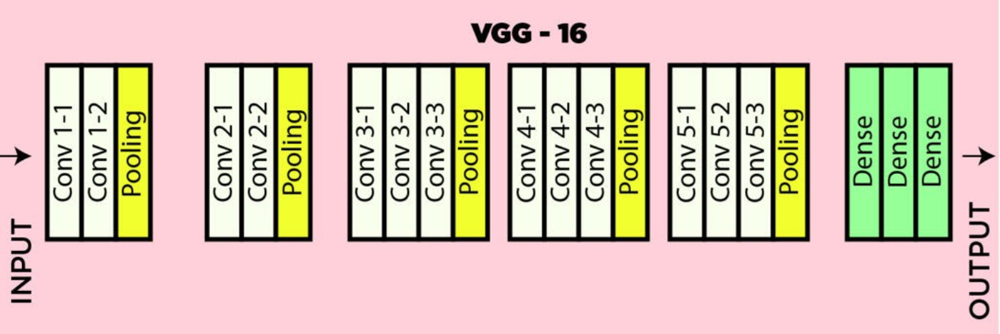
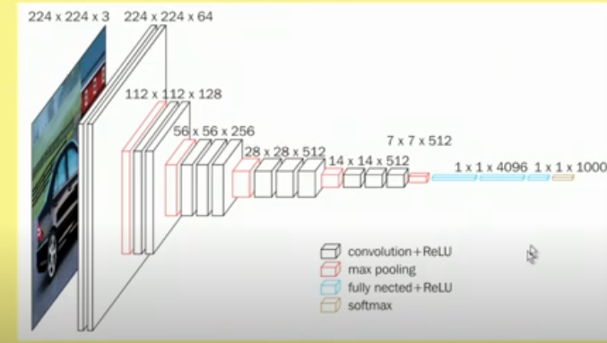

# Slide Deck Deconstruction: ML_Lec_16_VGG_CNN

> **Source Presentation:** `ML_Lec_16_VGG_CNN.pptx`  
> **Slides:** 23  
> **Media referenced by slides:** 2 (extracted into `media/`)

---

## Slide 1: VGG-16

- The VGG-16 model is a CNN architecture that was proposed by the Visual Geometry Group (VGG) at the University of Oxford.
- It is characterized by its depth, consisting of 16 layers (i.e., these layers have tunable parameters), including 13 convolutional layers and 3 fully connected layers. Other layers are pooling layers which have no tunable parameters.
- VGG-16 is renowned for its simplicity and effectiveness, as well as its ability to achieve strong performance on various computer vision tasks, including image classification and object recognition.
- The model’s architecture features a stack of convolutional layers followed by max-pooling layers, with progressively increasing depth.

---

## Slide 2: VGG16

- This design enables the model to learn intricate hierarchical representations of visual features, leading to robust and accurate predictions.
- VGG16, proposed by Karen Simonyan and Andrew Zisserman in 2014, and this architecture was the first runners up in ImageNet Large Scale Visual Recognition Challenge (ILSVRC).
- This model achieves 92.7% top-5 test accuracy on the ImageNet dataset which contains 14 million images belonging to 1000 classes.
- It means for every 100 images it was tested on, it got the answer right within its top 5 guesses about 93 times. This is an exceptionally high score, indicating a very powerful and accurate model, especially given the difficulty of the dataset.

---

## Slide 3: The Detailed Breakdown (ILSVRC)

- The standard split for the ImageNet Large Scale Visual Recognition Challenge (ILSVRC), for "92.7% top-5 accuracy," is as follows:
- Training Images: ~1.28 million (There are roughly 1,281,167 training images, with about 1,000 images per of the 1,000 classes.)
- Validation Images: 50,000 (It contains 50,000 images, with 50 images per class, for hyperparameters tuning)
- Test Images: 100,000 (The labels for this set are kept secret. It contains 100,000 images, with 100 images per class.)
- So, the total volume for the ILSVRC benchmark is roughly 1.28M + 50k + 100k = ~1.43 million images.

---

## Slide 4: ImageNet dataset

- The "ImageNet dataset" is a much larger project than just the ILSVRC challenge.
- The full ImageNet database indeed contains over 14 million images organized according to the WordNet hierarchy.
- However, these 14+ million images are spread across more than 20,000 categories (called "synsets").
- The ILSVRC Subset: The ILSVRC uses a curated subset of this vast database. It takes a manageable number of images (the ~1.43 million mentioned above) from 1,000 of the most common object categories.

---

## Slide 5: Architecture of VGG16

---

## Slide 6: VGG16

- It accepts color images (i.e., 3 channels) of size 224 × 224
- Image is passed through a stack of convolutional layers
- Every convolutional filter is of size 3×3, and convolution is carried out with stride = 1
- Use row and column padding to maintain spatial resolution after convolution, i.e., the size of input feature map and the size of the output feature map are same.
  - ReLU activation function is used for nonlinearity, after convolution operation in every convolution layer.
- There are 13 convolution layers and 5 max-pool layers, so every convolution layer is not followed by a max-pool layer.
- Max-pooling window size 2 × 2, stride 2; i.e., max-pool windows are non-overlapping windows.
- There are 3 Fully connected layers.

---

## Slide 7: VGG16

- Here’s a breakdown of the VGG-16 architecture based on the provided details:
- 1. Input Layer: It accepts color images of size 224 × 224
  - Input dimensions: (224, 224, 3)
- 2. Convolutional Layers (64 filters, 3×3 filters, same padding):
  - Two consecutive convolutional layers with 64 filters each and a filter size of 3×3.
  - Same padding is applied to maintain spatial dimensions.
- 3. Max Pooling Layer (2×2, stride 2):
  - Max-pooling layer with a pool size of 2×2 and a stride of 2.

---

## Slide 8: VGG16

- 4. Convolutional Layers (128 filters, 3×3 filters, same padding):
  - Two consecutive convolutional layers with 128 filters each and a filter size of 3×3.
- 5. Max Pooling Layer (2×2, stride 2):
  - Max-pooling layer with a pool size of 2×2 and a stride of 2.
- 6. Convolutional Layers (256 filters, 3×3 filters, same padding):
  - Three consecutive convolutional layers with 256 filters each and a filter size of 3×3.

---

## Slide 9: VGG16

- 7. Convolutional Layers (512 filters, 3×3 filters, same padding):
  - Three consecutive convolutional layers with 512 filters each and a filter size of 3×3.
- 8. Max Pooling Layer (2×2, stride 2):
  - Max-pooling layer with a pool size of 2×2 and a stride of 2.
- 9. Convolutional Layers and Max Pooling:
  - Three consecutive convolutional layers with 512 filters each and a filter size of 3×3.
  - Max-pooling layer with a pool size of 2×2 and a stride of 2.
- 10. Flattening:
  - Flatten the output feature map (7x7x512) into a vector of size 25088.

---

## Slide 10: VGG16

- 11. Fully Connected Layers:
  - Three fully connected layers with ReLU activation.
  - First layer with input size 25088 and output size 4096.
  - Second layer with input size 4096 and output size 4096.
  - Third layer with input size 4096 and output size 1000, corresponding to the 1000 classes in the ILSVRC challenge.
  - Softmax activation is applied to the output of the third fully connected layer for classification.

---

## Slide 11: VGG16

- This architecture follows the specifications provided, including the use of ReLU activation function and the final fully connected layer outputting probabilities for 1000 classes using softmax activation.
- VGG-16 was one of the best performing architectures in the ILSVRC challenge 2014.
- It was the runner up in the classification task with a top-5 classification error of 7.32% (only behind GoogLeNet with a classification error of 6.66%).
- It was also the winner of localization task with 25.32% localization error.

---

## Slide 12: VGG16

- Limitations Of VGG 16:
- It is very slow to train (the original VGG model was trained on Nvidia Titan GPU for 2-3 weeks).
- The size of VGG-16 trained imageNet weights is 528 MB. So, it takes quite a lot of disk space and bandwidth which makes it inefficient.
- 138 million parameters lead to exploding gradients problem.

---

## Slide 13: Advantages over AlexNet

- VGG16 and AlexNet are both convolutional neural network architectures designed for image classification, but VGG16 is considered a more advanced and effective model in many respects.
- Here are the key advantages of VGG16 over AlexNet:

---

## Slide 14: Advantages over AlexNet

- 1. Deeper Architecture
- VGG16: Has 16 layers of weights (13 convolutional layers + 3 fully connected layers), allowing it to capture more complex features from input images.
- AlexNet: Contains only 8 layers (5 convolutional layers + 3 fully connected layers), which limits its capacity to learn hierarchical features.
- Advantage: The deeper architecture of VGG16 enables it to model more intricate patterns and achieve higher accuracy on complex datasets.

---

## Slide 15: Advantages over AlexNet

- 2. Smaller Filter Sizes
- VGG16: Uses 3×3 convolutional filters consistently across all layers.
- AlexNet: Uses larger 11×11filters in the first layer and 5×5 filters in subsequent layers.
- Advantage: Smaller filters allow VGG16 to stack more layers while maintaining the same receptive field. This increases the model's depth and the granularity of feature extraction without a significant increase in computational cost.

---

## Slide 16: Advantages over AlexNet

- 3. Uniform Architecture
- VGG16: Has a uniform architecture throughout, with all convolutional layers using the same filter size and consistent stride/padding settings.
- AlexNet: Features varying filter sizes, strides, and complexities across different layers.
- Advantage: The uniform design of VGG16 makes it easier to understand, implement, and extend for different use cases.

---

## Slide 17: Advantages over AlexNet

- 4. Better Generalization
- The deeper structure and smaller filters of VGG16 help it learn richer and more generalized feature representations.
- This often translates to better performance on unseen data compared to AlexNet.
- 5. Improved Accuracy
- VGG16 achieved significantly higher accuracy in image classification benchmarks like ImageNet compared to AlexNet.
- VGG16's top-5 error rate on ImageNet was approximately 7.4%, whereas AlexNet's was around 16.4%.

---

## Slide 18: Advantages over AlexNet

- 6. Regularization via Depth
- The deeper architecture of VGG16 naturally acts as a form of regularization, as the increased depth forces the network to extract only the most relevant features to pass through the layers.
- 7. Wider Adoption and Pre-trained Models
- VGG16 became more popular for transfer learning because its pre-trained weights generalize well to other tasks, while AlexNet is less commonly used today.

---

## Slide 19: Trade-offs

- While VGG16 has clear advantages, it also comes with trade-offs:
- Increased Computational Cost: VGG16 has significantly more parameters (138M) compared to AlexNet (60M), leading to higher memory and computation requirements.
- Slower Training and Inference: The deeper network requires more time for both training and inference.

---

## Slide 20: Conclusion

- VGG16 is superior to AlexNet in terms of accuracy, depth, and feature extraction capabilities, making it a more powerful model for complex image recognition tasks.
- However, these improvements come at the cost of increased computational demand.

---

## Slide 21: Testing Strategy

- K-fold cross-validation (e.g., 5-fold or 10-fold), train the model K separate times.
  - Example: If one training run takes 5 days and $1,000, a 5-fold cross-validation would take 25 days and $5,000.
- This cost is simply too high for most research labs and companies, especially when the benefit is often marginal for large datasets.
- A Single Training Run is Extremely Expensive:
- Training a modern model like VGG, ResNet or Vision Transformer on ImageNet can take days or even weeks on a powerful, multi-GPU server, costing thousands of dollars in cloud computing.

---

## Slide 22: The Dataset is Already Massive and Stable

- The statistical advantages of K-fold are less critical with huge datasets.
- Reduces Variance: K-fold is brilliant for small datasets (e.g., 1,000 images) because it maximizes the use of limited data and reduces the variance in performance estimation that can come from a single, unlucky random split.
- Large Datasets are Inherently Stable: With over 1.2 million training images, a single, large, random split is already a very robust and representative sample of the underlying data distribution. The performance metric on a validation set of 50,000 images is already a highly stable estimate with low variance. The extra stability gained from K-fold isn't worth the 5x-10x computational cost.

---

## Slide 23: Thank You!

---
