# Slide Deck Deconstruction: ML_Lec_19_Autoencoder

> **Source Presentation:** `ML_Lec_19_Autoencoder.pptx`  
> **Slides:** 60  
> **Media referenced by slides:** 29 (extracted into `media/`)

---

## Slide 1: Autoencoder

- An autoencoder is a type of unsupervised learning where neural networks are subject to the task of representation learning.
- Its main purpose is to learn efficient representations of data, typically for the purpose of dimensionality reduction or feature extraction.
- Here, we use unlabelled data and still use backpropagation algorithm to represent the input data into encoded form so that we can decode the encoded data to reconstruct the original data from the encoded representation.

---

## Slide 2: Structure : Autoencoder

- An autoencoder consists of two main parts:
- (i) Encoder: This part compresses the input data into a lower-dimensional representation, often referred to as the "latent space" or "bottleneck."
- (ii) Decoder: This part reconstructs the original input from the compressed representation.
- So, for an input feature X, there is a mapping f(X) that gives the encoded data, and is another mapping g(f(X)) that transform the encoded data to reconstructed data which should be identical to the original input.

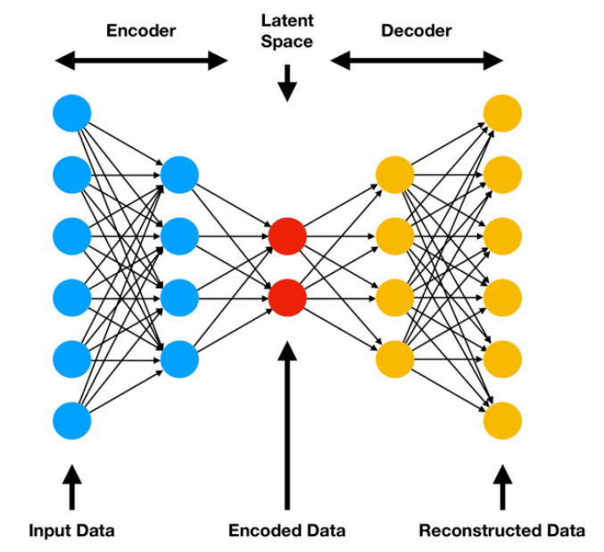

- f(X)

- g(f(X))

- x̂

- X

---

## Slide 3: Training

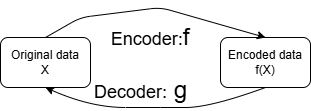

- Autoencoders are trained to minimize the difference between the original input and its reconstructed output.
- This is usually done using a loss function, such as mean squared error.
- The goal is to learn an efficient encoding of the data that captures its essential features.
- For efficient encoding, the task of the neural network is to go for representation learning, i.e., how to encode the input data.

---

## Slide 4: Autoencoder

- For efficient encoding or representation learning, bottleneck is introduced in the neural network.
- As mentioned earlier, for an input feature X, there is an encoder f(X) that gives the encoded data, and is a decoder g(f(X)) that transform the encoded data to reconstructed output.
- The reconstructed output should be identical or almost identical to the original input.
- So, there is a possibility that the network may eventually learn an identity mapping, as g(f(X))=X gоf(X)=X, where gоf is a composite identity mapping in input feature space.

---

## Slide 5: Autoencoder

- A network learns an identity mapping means it does not learn the representation, i.e., does not learn the inner structure of the data.
- To learn the inner structure, we need a bottleneck layer in the network.
- This bottleneck layer forces a compressed knowledge representation of the input.
- That is, if input feature vectors are of dimension m, in the compressed knowledge representation, the input vector will be mapped to a vector of dimension, say d, where d <<m.

---

## Slide 6: Assumptions: Autoencoder

- Autoencoder is designed based on the assumption that there exists high degree of correlation in the input data.
- If they are uncorrelated, i.e., if the features of the input data are independent to each other then the compressed domain representation and subsequent reconstruction of the original input will be difficult, in fact may not be possible at all, because during compression they will loose salient features of the input.
- So, when the neural network goes for representation learning, it basically transforms the input data to the compressed domain by removing the correlation or redundancy present in the data.
- Thus it preserves only the uncorrelated part and from this uncorrelated part it should subsequently possible to reconstruct the original input data.

---

## Slide 7: Autoencoder: Summary

- Autoencoder encodes the data, i.e., it codes the data in its own.
- This is an unsupervised learning, as we don’t need the class label of the data during training.
- Whatever is fed to the input of the autoencoder, it outputs the same thing.
- For this, we need two different functions: encoder and decoder.
- The encoder will encode the input data to a compressed domain knowledge representation using one or many hidden layers, where last hidden layer is called the bottleneck or latent layer.
- The decoder will decode the data from that compressed representation available at the bottleneck layer to the original input or closer to original input at the output layer. The decoder also may contain many hidden layers.
- Encoder part is from input layer to bottleneck layer and decoder part is from bottleneck layer to output layer.

---

## Slide 8: Base Architecture of an Autoencoder

- X

- x̂

- Bottleneck layer

- If input is X and autoencoder reconstructed x̂ then the error between X and x̂ should be minimum.
- We have encoder half and decoder half in our base autoencoder.
- It has one input layer, one output layer and one or more hidden layer with a bottleneck layer or latent layer.
- In the bottleneck layer, we are compressing the data and get the compressed domain knowledge representation of the input data.
- The number of nodes in the bottleneck layer is much less than the number of nodes in the input layer.

---

## Slide 9: Base Architecture of an Autoencoder

- So we have to reconstruct X from x̂. That is why input layer and output layer should have same number of nodes. But, input layer has a bias input so it contains one more node than output layer.

- X

- x̂

- W2

- W2

- W1

- W3

- But if the input is an image, say of size M×N, then we have MN number of pixels, represented by a vector.
- Each pixel is represented by a node. So we need MN+1 nodes, as one node is required for bias.
- But we don’t need the bias at output layer, so the number of nodes at output layer is MN.
- The hidden layer is the compressed domain knowledge representation of the input image, so the representation space contains vectors of dimension d << MN. But here also we need a bias node, so number of nodes in bottleneck is d+1

---

## Slide 10: Loss Function

- Whatever may be the type of autoencoder, we have to encode the input data and again decode the encoded data for faithful reconstruction of the input.
- At the encoder side, the bottleneck layer compress the input data and at decoder side the compressed data is reconstructed.
- So autoencoder should perform two tasks:
- (i) Autoencoder should be sensitive to input for accurate reconstruction.
- (ii) It should not be sensitive enough to memorize or overfit the training data.

---

## Slide 11: Loss Function

- (i) Sensitive to input for accurate reconstruction =>
- Reconstructed vector x̂ should be as close as possible to the input vector X, i.e., autoencoder should accurately reconstruct the input vector.
- But if this is the only aim of the autoencoder, then it might be possible that autoencoder simply learns the identity mapping.
- Then the learnt identity mapping will faithfully reconstruct the input data.
- But this should not be the only objective function of an autoencoder, as the autoencoder than memorize the input data.

---

## Slide 12: Loss Function

- (ii) Insensitive enough to memorize or overfit the training data =>
- The main interest in an autoencoder is that how the data is represented in the compressed domain. Because this encoded data is useful for some other applications.
- So we have two conflicting requirements or expectations from an autoencoder: it should be sensitive and at the same time should not be sensitive enough.

---

## Slide 13: Loss Function

- Both the conflicting requirements are satisfied by defining an appropriate loss function.

- Loss Function: L(X, x̂) + Regularizer

- The loss function measures how well the network can reconstruct its input after passing through a lower-dimensional representation (latent space).
- This loss function has two components. First part, L(X, x̂ ) gives the error between original and reconstructed input.
- This should be minimized. That is autoencoder is sensitive for faithful reconstruction of the input.

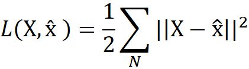

---

## Slide 14: Loss Function

- Loss Function: L(X, x̂) + Regularizer

- The second part of the loss function is the regularizer which conflicts the first part.
- Regularizer term tries to make the autoencoder insensitive to the input and forces it to learn the low dimensional representation.
- Thus autoencoder learns the salient features of the input. Using this salient feature, the decoder can reconstruct the input data.
- So, it does not simply learn the identity function.
- This loss function is used in backpropagation learning for training of autoencoder

---

## Slide 15: Loss Function

- The most common loss functions for autoencoders are:

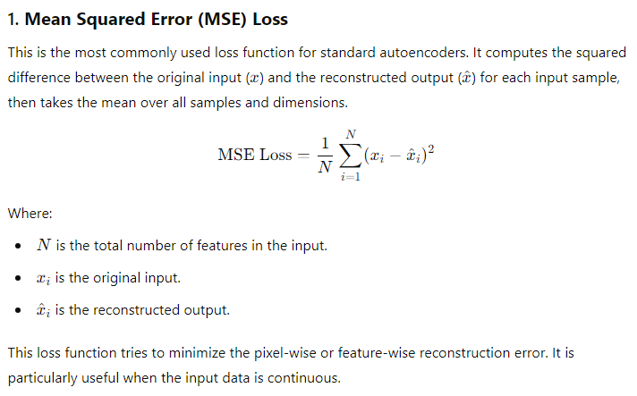

---

## Slide 16: Loss Function

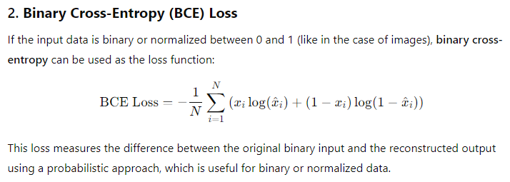

---

## Slide 17: Loss Function

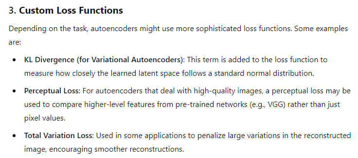

---

## Slide 18: Regularization

- In autoencoders, regularization is often applied to the loss function to improve the learned latent space representation or to prevent overfitting.
- Various types of regularization encourage the autoencoder to learn meaningful and efficient representations.

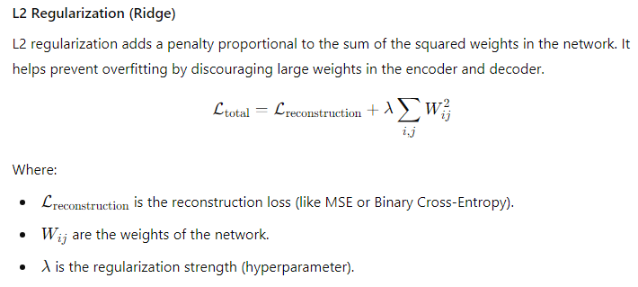

---

## Slide 19: Regularization

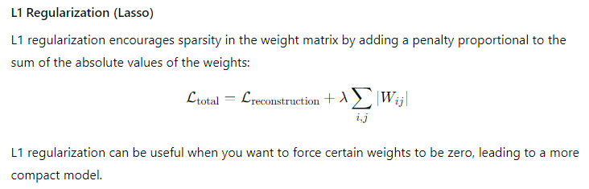

---

## Slide 20: Regularization

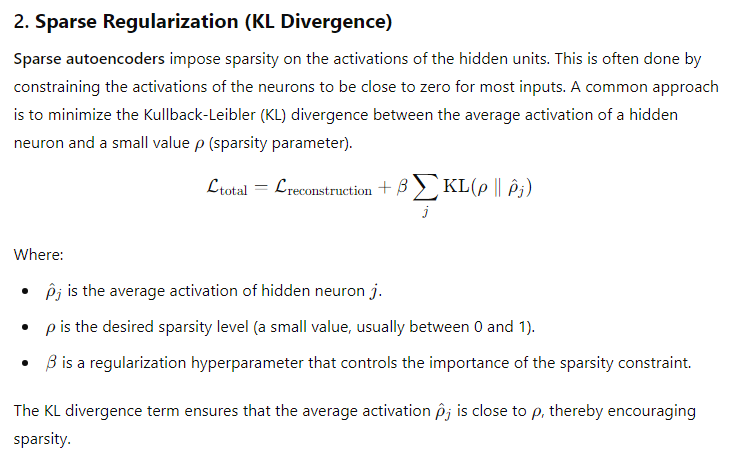

---

## Slide 21: Undercomplete Autoencoder

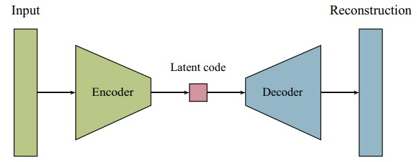

- An undercomplete autoencoder is a type of autoencoder where the size of the latent space (also called the bottleneck or hidden representation) is smaller than the input space.
- Here, the network is made insensitive to the input by restricting number of nodes in the hidden layer. Vanilla autoencoders can have a latent space that is equal to or larger than the input, while undercomplete autoencoders always have a smaller latent space.
- This forces the network to learn a more compact and efficient encoding of the input data, often capturing the most important features or patterns.
- For training such an autoencoder, we simply minimize the loss function, and we do not use any regularization function separately in the loss function

---

## Slide 22: Undercomplete Autoencoder

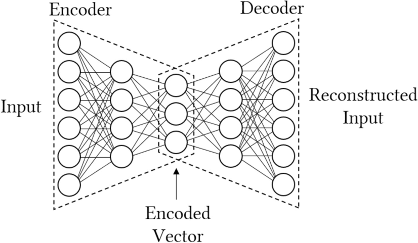

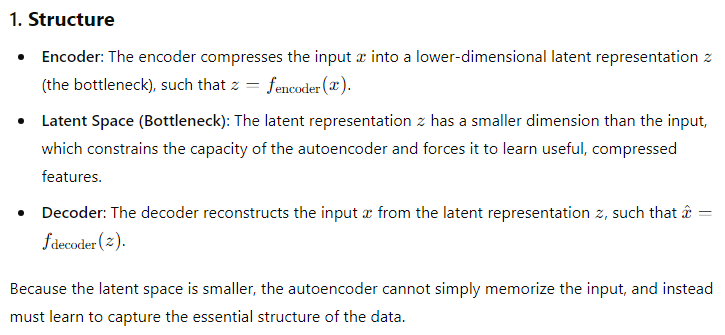

---

## Slide 23: Undercomplete Autoencoder

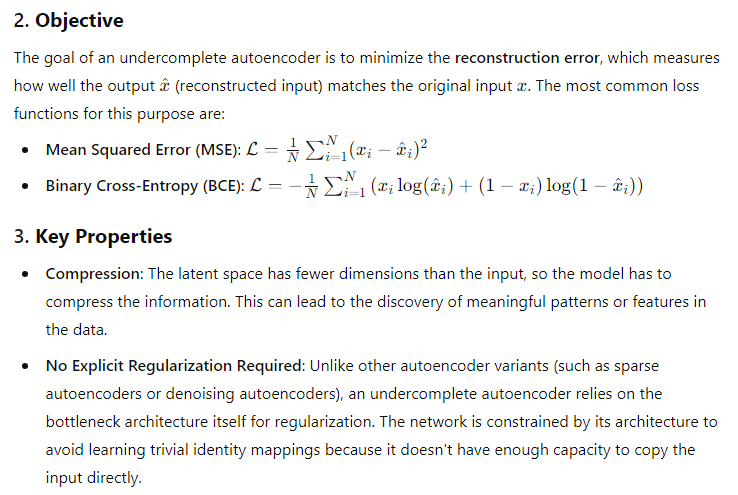

---

## Slide 24: Undercomplete Autoencoder

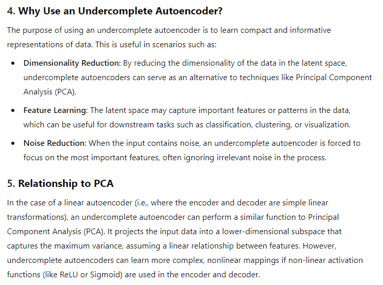

---

## Slide 25: Undercomplete Autoencoder

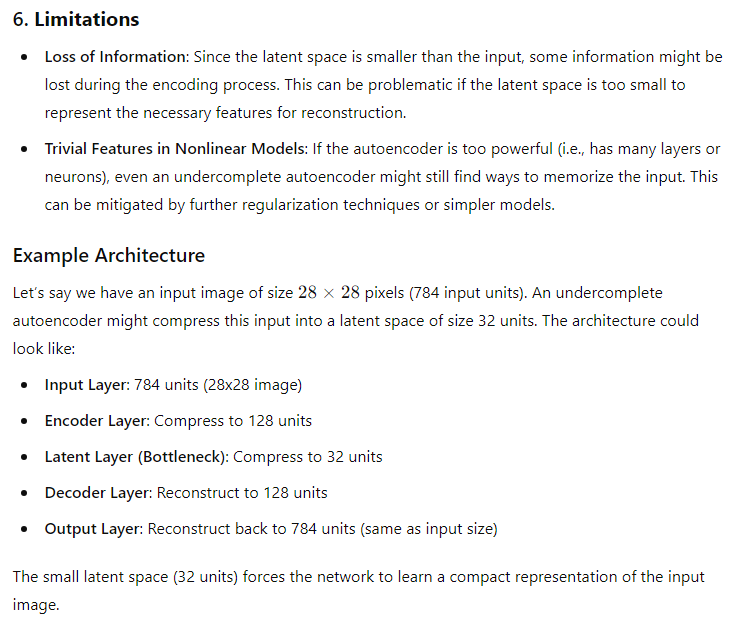

---

## Slide 26: Undercomplete Autoencoder

- Applications:
- i) Dimensionality Reduction: An undercomplete autoencoder can be used for dimensionality reduction in large datasets, allowing for faster processing in subsequent tasks.
- ii) Anomaly Detection: If trained on normal data, the autoencoder will have trouble reconstructing anomalous inputs, making it a good tool for detecting outliers.
- iii) Pretraining for Deep Networks: The learned representations in the bottleneck can be used as feature representations for initializing deep neural networks (transfer learning).
- Summary:
- An undercomplete autoencoder is a neural network model designed to learn compact, efficient representations by restricting the size of the latent space.
- It achieves dimensionality reduction, feature extraction, and noise reduction by forcing the network to encode only the most important aspects of the input data.
- This constraint makes it an effective tool for many machine learning tasks, particularly when the goal is to capture the essential structure of the data.

---

## Slide 27: Stacked Autoencoder

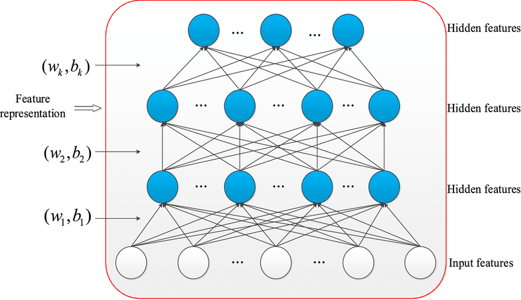

- Stacked Autoencoders are a type of artificial neural network architecture used in unsupervised learning.
- They are designed to learn efficient data coding in an unsupervised manner, with the goal of reducing the dimensionality of the input data, and are particularly effective in dealing with large, high-dimensional datasets.

---

## Slide 28: Stacked Autoencoder

- A Stacked Autoencoder (SAE) is a neural network that is composed of multiple layers of autoencoders, where each layer is trained on the output of the previous one.

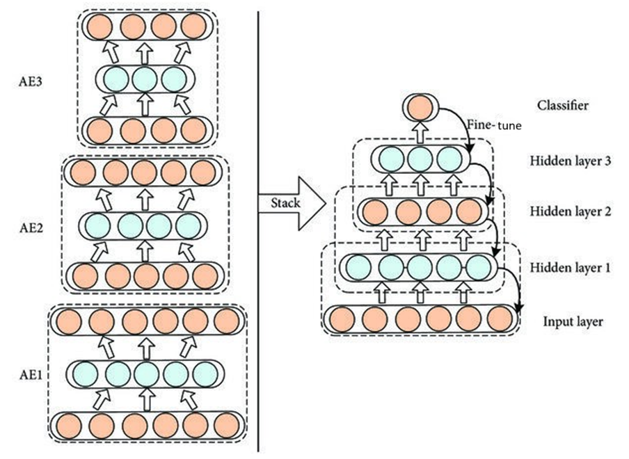

---

## Slide 29: SAE

- This “stacking” of autoencoders allows the network to learn more complex representations of the input data.

---

## Slide 30: Structure of SAE

- Layered Architecture: A stacked autoencoder consists of several layers of autoencoders, where the output of one autoencoder serves as the input for the next. Each autoencoder typically consists of:
- Encoder: Compresses the input data into a lower-dimensional representation.
- Decoder: Reconstructs the original data from the compressed representation.
- Training: The layers can be
- pre-trained individually using unsupervised learning (typically by minimizing the reconstruction error), and then
- fine-tuned together with supervised learning if labels are available.

---

## Slide 31: How it works?

- In a stacked autoencoder, the output of the latent layer (the encoded representation) of one autoencoder is passed as the input to the next autoencoder. Here's how it works:
- Encoder Phase: The first autoencoder takes the input data and encodes it into a lower-dimensional representation (the latent layer).
- Stacking: This encoded representation is then used as the input for the next autoencoder, which has its own encoder and decoder.
- Decoding: Each autoencoder reconstructs its input from its latent representation, but for stacking, we typically only use the latent outputs for the subsequent layers.
- As a summary, the latent layer output (not the decoder output) of the current autoencoder is used as the input for the next autoencoder. This allows each subsequent autoencoder to learn increasingly abstract representations of the data.

---

## Slide 32: Benefits of SAE

- Hierarchical Feature Learning: Each layer can learn increasingly abstract features of the input data, similar to deep learning models.
- Dimensionality Reduction: The lower-dimensional representation can help reduce noise and improve performance for downstream tasks like classification or regression.
- Improved Performance: Stacking autoencoders can lead to better performance on tasks compared to a single autoencoder, especially with complex datasets.

---

## Slide 33: SAE

- Applications
- (i) Image Processing: For tasks like denoising or feature extraction.
- (ii) Natural Language Processing: To capture semantic representations of words or sentences.
- (iii) Anomaly Detection: By training on normal data and identifying deviations in reconstruction.
- Overall, stacked autoencoders are a powerful tool in unsupervised learning and can be leveraged in various applications to uncover meaningful patterns in data.

---

## Slide 34: Semantic representation learning

- In NLP:
- Input: word embeddings or bag-of-words/sentence vectors.
- Hidden layers: compress these representations to denser forms.
- Output: reconstruction of the original input.
- The latent (encoded) representations in the middle layers:
- i) Capture semantic similarities — similar words/sentences map to similar encodings.
- ii) Filter out noise or irrelevant variation (like word order differences that don’t affect meaning).
- Example: Words like “king” and “queen” or sentences like “The cat sat on the mat” and “A cat is sitting on a rug” will have closer encodings because the model learns shared underlying meaning.

---

## Slide 35: Sentence encoding

- A sentence encoding is a numerical vector (a list of numbers) that represents the semantic meaning of a sentence. This vector is usually dense, e.g. 100–768 dimensions, depending on the model.
- Goal: Sentences with similar meaning → similar vectors.

---

## Slide 36: Sentence encoding

- How a stacked autoencoder produces this encoding
- 1. Input representation (The cat sat on the mat) Each word (like “The”, “cat”, “sat”...) is converted into a vector — for example, a word embedding (like Word2Vec, GloVe, or learned jointly).
- Example word embeddings:
- The → [0.2, 0.1, 0.0]
- cat → [0.8, 0.5, 0.3]
- sat → [0.6, 0.4, 0.2]
- on → [0.1, 0.3, 0.2]
- the → [0.2, 0.1, 0.0]
- mat → [0.7, 0.6, 0.4]

---

## Slide 37: Sentence encoding

- 2. Sentence vector formation These word vectors are combined — often by averaging, concatenation, or a recurrent layer (LSTM/GRU).
- Example average:
- 3. Encoding through the stacked autoencoder The sentence vector s is passed through the encoder layers:
- The final hidden layer output hL​ is the sentence encoding.

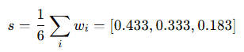

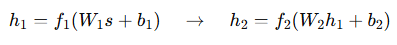

---

## Slide 38: Example (simplified):

- Input: [0.433, 0.333, 0.183]
- Layer 1 → [0.45, 0.22]
- Layer 2 → [0.61] ← Sentence encoding
- So the final encoding might be something like:
- "The cat sat on the mat" → [0.61]
- (In reality, it’s much higher-dimensional, e.g., 100–512 values.)
- If the input: “A dog rested on the rug”
- It would produce a similar encoding, because the semantics are close.

---

## Slide 39: Summary

| Step | Process | Example |
| --- | --- | --- |
| 1 | Tokenize words | The, cat, sat, on, the, mat |
| 2 | Convert to embeddings | Word vectors |
| 3 | Combine into one vector | Averaging, RNN, etc. |
| 4 | Encode via stacked autoencoder | Compress to low-dimensional space |
| 5 | Output = Sentence encoding | A dense numeric vector capturing meaning |

---

## Slide 40: Sparse Autoencoder

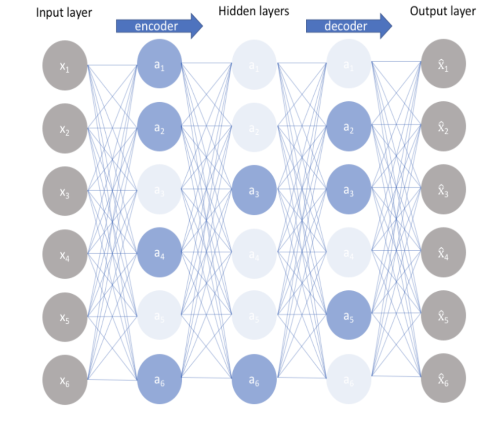

- Architecture:
- Like other autoencoders, a sparse autoencoder consists of an encoder and a decoder.
- The encoder compresses the input data into a latent representation, while the decoder reconstructs the input from this representation.

- A sparse autoencoder is a type of neural network that encourages sparsity in the latent representation of the data.
- This means that, for a given input, only a small number of neurons in the hidden layer are activated (represented by blue color),
- This leads to a more efficient and meaningful representation of the data.

---

## Slide 41: Sparse Autoencoder: Key Concepts

- Sparsity Constraint:
  - The primary goal is to ensure that only a small fraction of the neurons are active (non-zero) for any given input. This is usually achieved by adding a sparsity penalty to the loss function.
  - Common methods include using L1 regularization on the activations or incorporating a sparsity constraint that compares the average activation of the neurons to a predefined sparsity parameter.

---

## Slide 42: Loss Function

- The overall loss function for a sparse autoencoder typically consists of two parts:
  - Reconstruction Loss: Measures how well the autoencoder can reconstruct the input data from the latent representation.
  - Sparsity Penalty: Encourages the model to have a certain level of sparsity in the activations. A popular method is to use the Kullback-Leibler (KL) divergence between the average activation of the neurons and a target sparsity value (often close to zero).

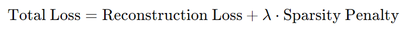

- Here, λ is a hyperparameter that balances the two loss components.

---

## Slide 43: Sparsity Penalty: Using KL Divergence

- The Kullback-Leibler (KL) divergence is a statistical measure that quantifies how one probability distribution diverges from a second, expected probability distribution.
- In the context of sparse autoencoders, it can be used to encourage sparsity in the activations of the hidden layer.
- Basic Idea
- In a sparse autoencoder, we want to ensure that the average activation of the hidden neurons is close to a predefined target sparsity level, typically denoted as ρ (a small positive value, like 0.05).
- The KL divergence helps measure how far the actual average activation of the hidden neurons from this target ρ.

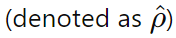

---

## Slide 44: Sparsity Penalty: Using KL Divergence

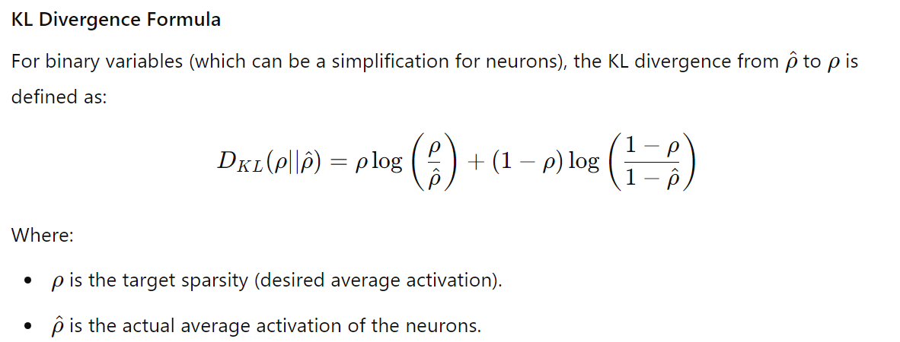

---

## Slide 45: Sparsity Penalty: Using KL Divergence

- Example:

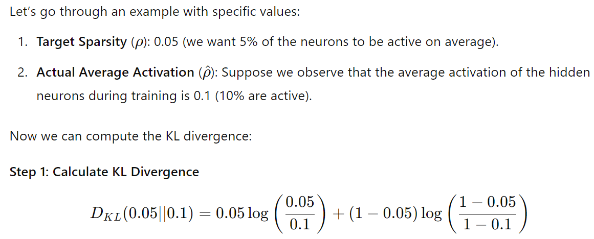

---

## Slide 46: Sparsity Penalty: Using KL Divergence

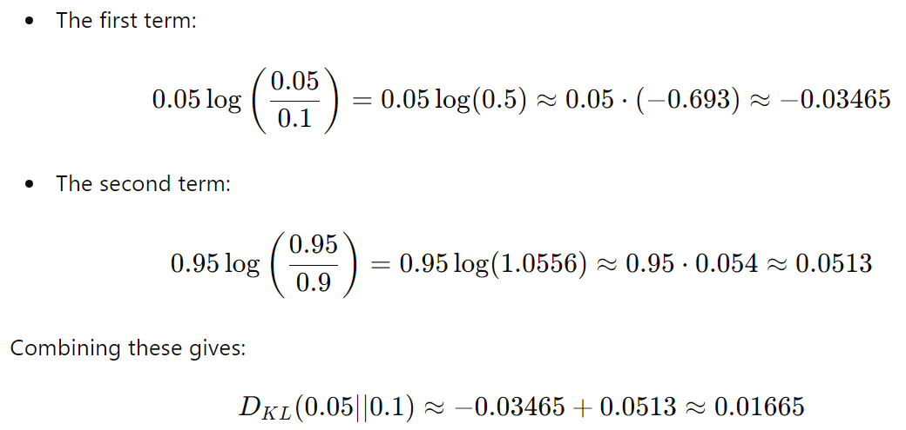

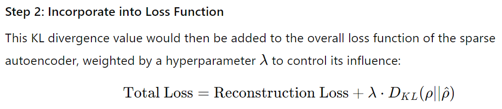

---

## Slide 47: Sparsity Penalty: Using KL Divergence

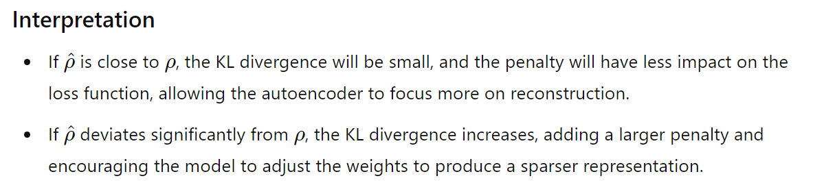

- Conclusion: Using KL divergence for sparsity penalties effectively guides the training of the sparse autoencoder to produce representations that are both compact and meaningful, improving the quality of learned features.

---

## Slide 48: Sparse Autoencoder

- The loss function is:

- Implementation Considerations
- (i) Choosing Sparsity Level: Selecting an appropriate sparsity level (the target average activation) is crucial. It often requires experimentation based on the specific dataset and task.
- (ii) Regularization Strength: The λ parameter needs to be tuned carefully to balance reconstruction quality and sparsity.

- Applications
- (i) Image Processing: Useful for tasks like denoising, where the model learns to represent images with minimal active features.
- (ii) Anomaly Detection: Since the model learns a compact representation, deviations from the normal pattern (anomalies) can be more easily identified by examining the activations.
- (iii) Natural Language Processing: Can be employed to learn meaningful representations of textual data, capturing essential features while ignoring noise.

---

## Slide 49: Sparse Autoencoder

- Benefits
- (i) Feature Extraction: By promoting sparsity, these autoencoders tend to learn more meaningful and interpretable features, which can be useful for downstream tasks.
- (ii) Dimensionality Reduction: Sparse representations can be more efficient in capturing the underlying structure of the data, which is beneficial for reducing dimensionality.
- (iii) Robustness: Sparsity can enhance the model's robustness to noise and irrelevant variations in the data.

---

## Slide 50: Denoising Autoencoder

- A denoising autoencoder (DAE) is a type of autoencoder specifically designed to learn robust representations of data by reconstructing clean input from noisy versions.
- This approach helps the model learn to filter out noise and can improve its ability to generalize to unseen data.
- Architecture:
  - Like a standard autoencoder, a denoising autoencoder consists of an encoder and a decoder.
  - The encoder compresses the noisy input data into a lower-dimensional latent representation, and the decoder reconstructs the original clean input from this representation.

---

## Slide 51: Denoising Autoencoder

- Input Corruption: During training, the original input data is intentionally corrupted. Common methods of corruption include:
  - Adding Gaussian Noise: Random noise is added to the input features.
  - Dropout: Randomly setting a fraction of input units to zero.
  - Salt-and-Pepper Noise: Randomly replacing some input pixels with maximum and minimum values (for images).
- The model learns to reconstruct the original clean input from this corrupted version.

---

## Slide 52: Denoising Autoencoder : Loss Function

- The objective is to minimize the reconstruction loss, typically using mean squared error (MSE) or binary cross-entropy, comparing the reconstructed output with the original clean input.

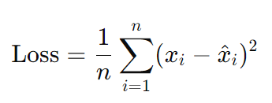

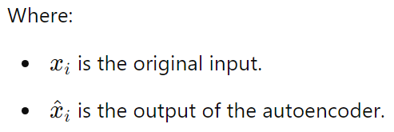

---

## Slide 53: Denoising Autoencoder : Loss Function

- Though the added noise during training acts as a form of regularization to prevent overfitting, but some other regularizers are also helpful.
- Common Regularization Techniques are:
- Dropout: Randomly dropping units during training can help prevent co-adaptation of neurons, making the model more robust.
- Weight Regularization: Adding L1 or L2 penalties to the weights in the loss function can help keep the model from becoming overly complex.
- Early Stopping: Monitor validation loss and stop training when it starts to increase can prevent overfitting.

---

## Slide 54: Denoising Autoencoder

- Benefits
- (i) Robust Feature Learning: By learning to reconstruct from noisy inputs, DAEs can capture more robust features that generalize well to new, unseen data.
- (ii) Regularization: The added noise during training acts as a form of regularization, helping to prevent overfitting.
- (iii) Improvements in Data Quality: Can be effectively used for tasks such as denoising images, speech signals, or any data that is prone to noise.

---

## Slide 55: Applications of DAE

- Image Denoising: Removing noise from images while preserving important features.
- Speech Processing: Enhancing speech signals that have been corrupted by noise.
- Anomaly Detection: Identifying outliers by comparing the reconstruction error.
- Data Augmentation: Improving the robustness of other models by training them on denoised representations (i.e., clean generated data).

---

## Slide 56: Implementation Steps of DAE

- 1. Corrupt Input: Define the method of corruption (e.g., adding noise) and apply it to the training data.
- 2. Train the Model:
  - Feed the corrupted inputs into the encoder.
  - Use the decoder to reconstruct the original clean inputs.
  - Calculate the reconstruction loss and backpropagate the error to update the model weights.
- 3. Evaluate Performance: After training, evaluate the model on clean and noisy data to see how well it denoises new inputs.

---

## Slide 57: Denoising Autoencoder: Example

- Input Data: Consider an image of a handwritten digit (like from the MNIST dataset).
- Corrupted Input: Add Gaussian noise to the image, resulting in a noisy version that contains random pixel variations.
- Training: The model is trained using the noisy image as input and the original clean image as the target output.
- Reconstruction: Once trained, when provided with a new noisy image, the model can effectively reconstruct a cleaner version of the original image.

---

## Slide 58: Denoising Autoencoder

- Denoising autoencoders are powerful tools for learning robust representations of data in the presence of noise.
- By reconstructing clean inputs from corrupted versions, they help improve generalization, prevent overfitting, and enhance data quality in various applications.

---

## Slide 59: Applications: Autoencoders

- Dimensionality Reduction: Similar to PCA, but can capture more complex patterns.
- Data Denoising: Removing noise from data by training on noisy inputs and expecting the clean output.
- Anomaly Detection: Identifying unusual patterns by analyzing reconstruction errors.
- Generative Modeling: Some variants (like variational autoencoders) can generate new data similar to the training set.
- Autoencoders can be simple feedforward networks, convolutional networks, or even recurrent networks, depending on the type of data being processed.

---

## Slide 60: Thank You!

---
