# Slide Deck Deconstruction: ML_Lec_20_VAE

> **Source Presentation:** `ML_Lec_20_VAE.pptx`  
> **Slides:** 46  
> **Media referenced by slides:** 23 (extracted into `media/`)

---

## Slide 1: Variational Autoencoder (VAE)

- A Variational Autoencoder (VAE) is a type of generative model that learns how to encode data into a compressed representation and then decode it back to the original form.
- Unlike traditional autoencoders, VAEs focus on probabilistic modeling, learning how to generate new data samples similar to the training data by sampling from a distribution (usually Gaussian).

---

## Slide 2: Variational Autoencoder (VAE)

- Why Learn VAEs?
- 1. Generative Model: VAEs can generate new samples similar to the training data (e.g., new images of handwritten digits).
- 2. Dimensionality Reduction: VAEs can reduce the dimensionality of complex data while preserving important information.
- 3. Smooth Latent Space: The latent space in VAEs is continuous and structured, allowing interpolation between data points.

---

## Slide 3: Components of a VAE

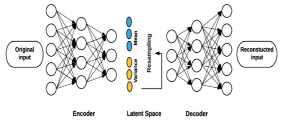

- 1. Encoder
- The encoder is a neural network that maps the input data x to a latent space (a lower-dimensional representation).
- Instead of encoding to a single point, VAEs encode the input into a distribution (mean μ and variance σ2) in the latent space. This distribution is typically assumed to be Gaussian.
- The encoder outputs two vectors:
  - Mean vector μ(x)
  - Variance vector σ2(x)
- Mathematically:
- z∼N(μ(x),σ2(x)) where z is a latent variable sampled from a Gaussian distribution.

---

## Slide 4: Components of a VAE

- 2. Latent Space
- The latent space is a lower-dimensional space where the encoded data resides. VAEs are unique in that they model this latent space as a probability distribution.
- Instead of encoding data as a point, VAE encodes data as a distribution, usually a Gaussian (normal) distribution.
- This allows the VAE to generate new data by sampling from this latent distribution.

---

## Slide 5: Components of a VAE

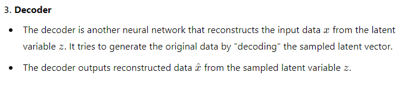

---

## Slide 6: Variational Autoencoder vs Traditional Autoencoder

- Architecture comparison
- As seen before, traditional autoencoders consist of an encoder network that maps the input data x to a fixed, lower-dimensional latent space representation z.
- This process is deterministic, meaning each input is encoded into a specific point in the latent space.
- The decoder network then reconstructs the original data from this fixed latent representation, aiming to minimize the difference between the input and its reconstruction.
- Traditional autoencoders' latent space is a compressed representation of the input data without any probabilistic modeling, which limits their ability to generate new, diverse data since they lack a mechanism to handle uncertainty.

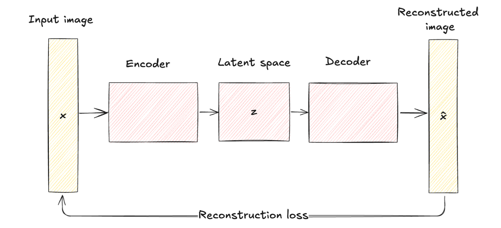

---

## Slide 7: Variational Autoencoder vs Traditional Autoencoder

- VAEs introduce a probabilistic element into the encoding process. Namely, the encoder in a VAE maps the input data to a probability distribution over the latent variables, typically modeled as a Gaussian distribution with mean μ and variance σ2.
- This approach encodes each input into a distribution rather than a single point, adding a layer of variability and uncertainty.
- Architectural differences are visually represented by the deterministic mapping in traditional autoencoders versus the probabilistic encoding and sampling in VAEs.

---

## Slide 8: Variational Autoencoder vs Traditional Autoencoder

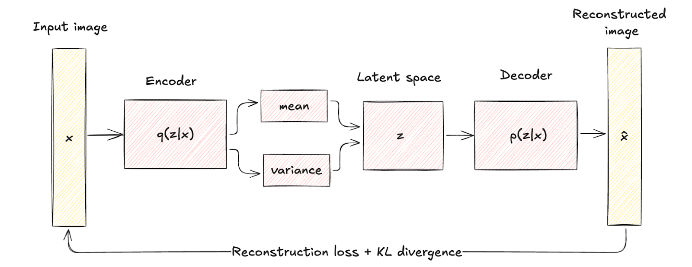

- However, the goal of a variational autoencoder is not to reconstruct the original input; it’s to generate new samples that resemble the original input. For that reason, an additional optimization term is needed, which is Kullback-Leibler divergence.

---

## Slide 9: Variational Autoencoder

- Here is how the process flow looks:
- The input data x is fed into the encoder, which outputs the parameters of the latent space distribution q(z∣x) (mean μ and variance σ2).
- Latent variables z are sampled from the distribution q(z∣x) using techniques like the reparameterization trick.
- The sampled z is passed through the decoder to produce the reconstructed data x̂, which should be similar to the original input x.

---

## Slide 10: Variational Autoencoder

- To generate the new samples from the latent space, we need to regularize the latent space to ensure that the latent space conforms to a specified distribution.
- The process involves a delicate balance between two essential components: the reconstruction loss and the regularization term, often represented by the Kullback-Leibler divergence.
- The reconstruction loss compels the model to accurately reconstruct the input, while the regularization term encourages the latent space to follow a chosen distribution.
- This helps prevent overfitting and makes the generalized model.

---

## Slide 11: VAE Loss Function

- The total loss function combines the reconstruction loss and KL divergence (regularization) term.
- The objective is to minimize the total loss (i.e., reconstruction loss plus regularization loss):
- L = Lreconstruction + LKL ​
- Where, Lreconstructionensures accurate reconstruction of the data.
- LKL ensures that the learned latent representation is close to a standard Gaussian distribution.

---

## Slide 12: Steps to Compute the Loss

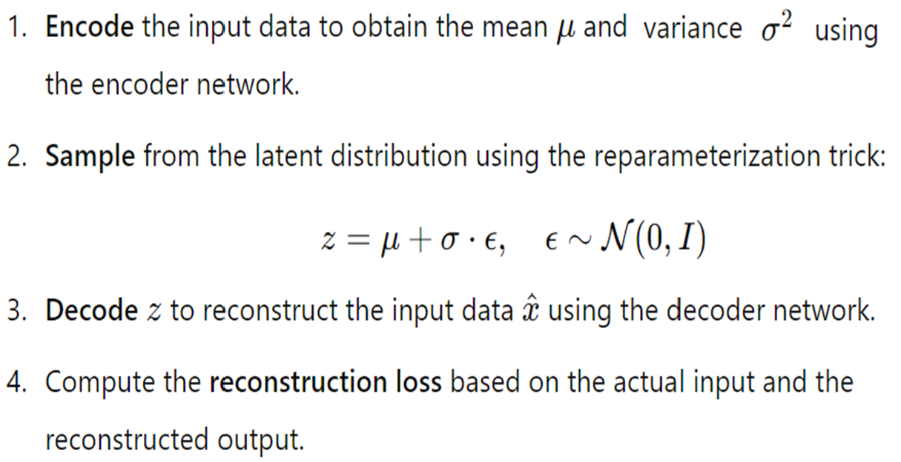

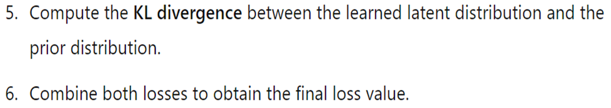

---

## Slide 13: VAE Loss Function

- 1. Reconstruction Loss
- The reconstruction loss measures how well the VAE can reconstruct the input data from the latent representation. This is typically computed using:

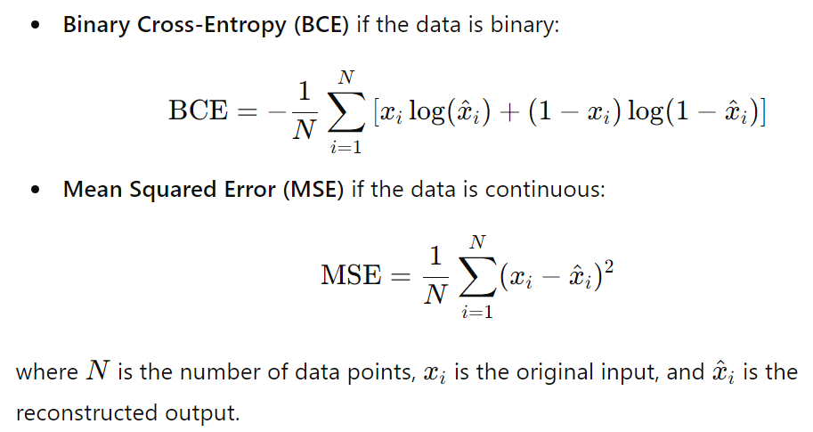

---

## Slide 14: VAE Loss Function

- 2. Kullback-Leibler Divergence
- The KL divergence measures how much the learned latent distribution diverges from the prior distribution (usually a standard normal distribution). It can be computed as:

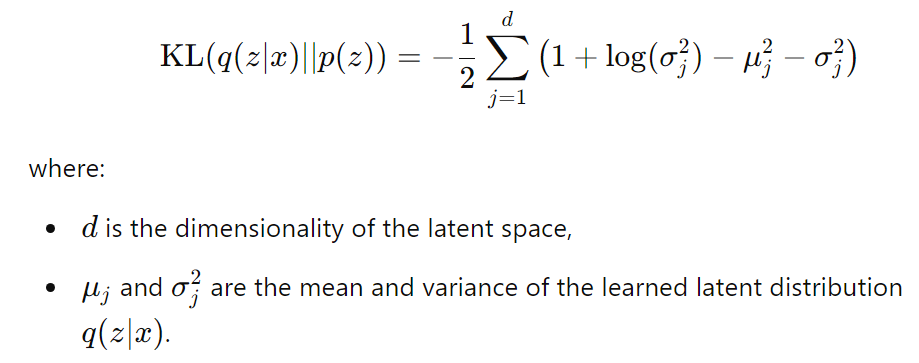

---

## Slide 15: VAE Loss Function

- The Kullback-Leibler (KL) divergence in a VAE loss function quantifies the difference between the approximate posterior distribution q(z∣x) (the distribution that our encoder outputs for each data point x) and a prior distribution p(z) (usually chosen as a standard Gaussian, N(0,I).
- Let’s go through how we derive the KL divergence expression used in the VAE.

---

## Slide 16: KL divergence

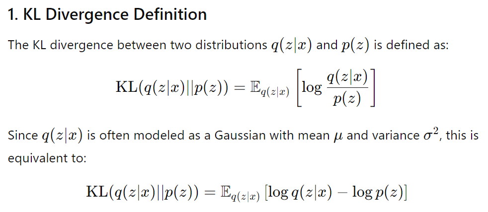

---

## Slide 17: KL divergence

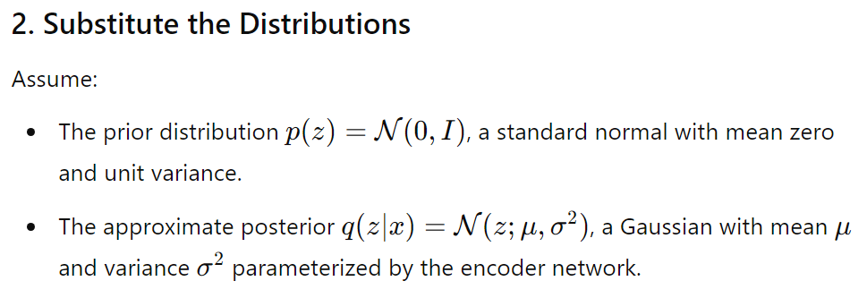

---

## Slide 18: KL divergence

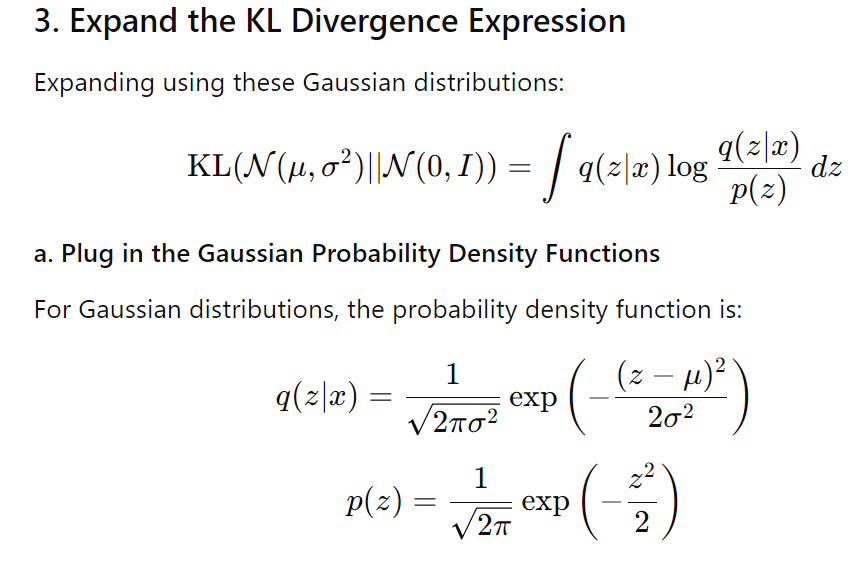

---

## Slide 19: KL divergence

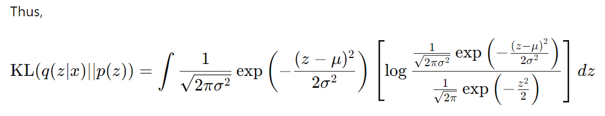

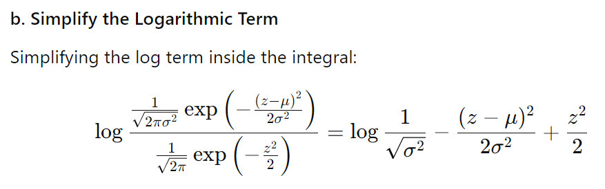

---

## Slide 20: KL divergence

- To compute KL divergence, we need the following:
- If ϵ is a random variable following a standard normal distribution, denoted ϵ ∼N(0,1), we want to find the expected values E(ϵ) and E(ϵ2).
- 1. Expectation E(ϵ) = 0
- Since ϵ ∼N(0,1), the mean of a standard normal distribution is 0. Therefore:
- E(ϵ)=0
- 2. Expectation E(ϵ2) =1
- For a standard normal distribution, the variance σ2 is 1, and we know that:
- E(ϵ2)=Var(ϵ)+(E(ϵ))2
- Since Var(ϵ)=1 and E(ϵ)=0, this simplifies to:
- E(ϵ2)=1

---

## Slide 21: KL divergence

- The expectation Eq(z/x) over this simplified term is:
- , where z=µ+σ.ϵ and ϵ ~N(0,1)

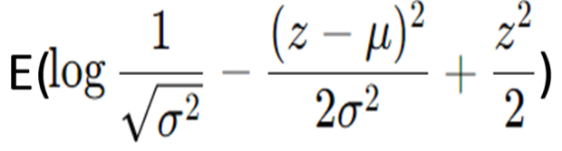

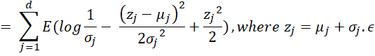

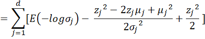

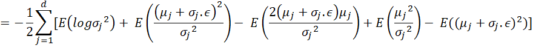

---

## Slide 22: KL divergence

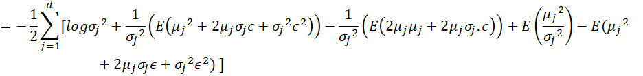

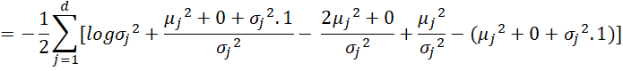

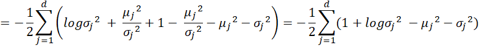

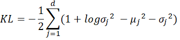

- Therefore,

---

## Slide 23: VAE Loss Function

- 3. Total Loss Function
- The total loss function for the VAE is a combination of the reconstruction loss and the KL divergence:
- L = Lreconstruction + β LKL ​
- The parameter β can be adjusted to control the trade-off between reconstruction loss and the regularization enforced by the KL divergence.

---

## Slide 24: Reparameterization Trick

- One of the challenges in training VAEs is that we need to backpropagate through a stochastic process (sampling from a distribution), which is not possible directly. To solve this, we use the reparameterization trick.

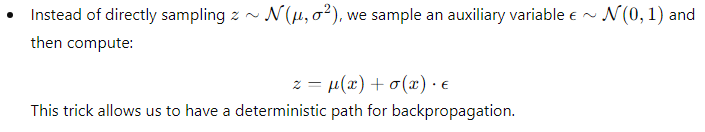

---

## Slide 25: Reparameterization Trick

- The reparameterization trick is a key technique in training Variational Autoencoders (VAEs).
- It allows us to handle the stochastic (random) nature of the latent variables during backpropagation, which is needed for optimizing the VAE's parameters using gradient-based methods like Stochastic Gradient Descent (SGD).
- To understand how it works, let's break it down step by step.

---

## Slide 26: Problem: Stochastic Latent Variables

- In a VAE, after encoding an input x through the encoder, instead of encoding it into a single point, we encode it into a distribution. Specifically, the encoder outputs two vectors:
- Mean vector μ(x): Represents the center (mean) of the Gaussian distribution in the latent space for the input x.
- Log-variance vector log⁡(σ2(x)) : Represents the spread (variance) of this Gaussian distribution.
- The latent variable z is then sampled from this Gaussian distribution: z ∼ N(μ(x),σ2(x))
- This means that the latent variable z is a random variable drawn from a Gaussian distribution, with mean μ(x) and variance σ2(x).

---

## Slide 27: Problem: Stochastic Latent Variables

- Challenge: Backpropagation and Random Sampling
- Backpropagation is the technique used in neural networks to compute gradients and update parameters.
- During backpropagation, gradients need to flow back through the entire computational graph to update the parameters of the encoder and decoder.
- However, because random sampling from the latent variable z is non-differentiable (sampling introduces randomness), we can't directly backpropagate through this stochastic node. This makes training the VAE using gradient-based optimization challenging.

---

## Slide 28: Solution: The Reparameterization Trick

- The reparameterization trick is a clever way to move the randomness outside the neural network in a way that allows gradients to still flow through the encoder and decoder.
- How it Works:
- 1. Gaussian Sampling: Instead of directly sampling z from the distribution N(μ,σ2), we express z in terms of a deterministic transformation of a random variable.
- 2. Reparameterize the Latent Variable: We rewrite z as:
- z=μ(x)+σ(x)⋅ϵ Where:
  - μ(x) : The mean output by the encoder.
  - σ(x) : The standard deviation (which is the square root of variance σ2.
  - ϵ ∼ N(0,1) : A random noise sampled from a standard normal distribution with mean 0 and variance 1.

---

## Slide 29: Solution: The Reparameterization Trick

- 3. Deterministic Transformation: The key insight is that we express z as a deterministic transformation of two parts:
- The deterministic outputs of the encoder: μ(x) and σ(x).
- The random noise ϵ, which is independent of the encoder's parameters.
- In other words, instead of sampling z directly from N(μ(x),σ2(x)), we sample from N(0,1) (which is easy to handle) and then shift and scale it using the encoder outputs.
- This is known as reparameterization because it turns the random sampling process into a deterministic operation that still includes randomness through ϵ, but in a way that allows gradients to propagate.

---

## Slide 30: Solution: The Reparameterization Trick

- Reparameterization Trick Formula:
- z=μ(x)+σ(x)⋅ϵ, where ϵ∼N(0,1)
- This transformation is fully differentiable with respect to μ(x) and σ(x), so the gradients can flow through them during backpropagation.
- How the Reparameterization Trick Helps in Training:
- Gradient Flow:
  - Now that z is expressed as a deterministic function of μ(x), σ(x), and ϵ, we can compute the gradients of the loss function (which depends on z) with respect to the encoder parameters (which compute μ(x) and σ(x).
  - This allows us to train the VAE using standard gradient-based optimization techniques like backpropagation and stochastic gradient descent (SGD).
- Preserving Stochastic Nature:
  - Even though the reparameterization trick converts the sampling into a deterministic process, it still preserves the stochastic nature of the latent variable z because ϵ is a random variable.
  - So, the VAE retains its ability to sample from the latent space, but now it can also be trained effectively.

---

## Slide 31: Solution: The Reparameterization Trick

- Visualizing the Reparameterization Trick:
- Imagine the process of generating the latent variable z in the VAE as follows:
- Without the reparameterization trick:
  - The encoder computes μ(x) and σ2(x), and then we directly sample z∼N(μ(x),σ2(x)).
  - This sampling is non-differentiable, so backpropagation can't flow through this sampling step, preventing effective training.
- With the reparameterization trick:
  - The encoder still computes μ(x) and σ2(x), but instead of sampling directly, we sample ϵ∼N(0,1).
  - Now, the randomness is entirely in ϵ, which is independent of μ and σ. So z=μ(x)+σ(x)⋅ϵ becomes a differentiable function of μ, and σ.
  - Thus, z=μ(x)+σ(x)⋅ϵ, allowing us to perform gradient descent on the encoder parameters because μ(x) and σ(x) are part of the deterministic path.
- In this way, the reparameterization trick transforms the non-differentiable sampling operation into a differentiable one, allowing VAEs to be trained efficiently.

---

## Slide 32: Interpolation

- A VAE learns to encode data (e.g. images) into a latent space (a lower-dimensional continuous vector space), and then decode from that space back into realistic data.
- Interpolation means taking two points in latent space — say, z1​ and z2​ — and creating intermediate points along the line between them: zinterp=(1−α) z1 +α z2,α∈[0,1]
- Then we decode those points: xinterp=Decoder(zinterp)
- If the latent space is well-structured, the decoded samples xinterp will smoothly transition from the first data point to the second — e.g., one face morphing into another, or one digit gradually changing into another.

---

## Slide 33: Why interpolation is useful

- (a) Semantic continuity
- Interpolation reveals that nearby latent vectors correspond to similar data samples. That’s a sign that the model has learned a structured latent space that captures meaningful features.
- (b) Data synthesis
- We can generate new, realistic samples by taking combinations of known latent codes. Example: blending two faces to create a new, plausible in-between face.
- (c) Latent space exploration
- Interpolation allows us to explore the “shape” of the learned representation — e.g., how varying certain dimensions changes output features (pose, color, style, etc.).

---

## Slide 34: Example with MNIST dataset

- We demonstrate how a 2D latent space captures the distribution of data and enables interpolation between points.
- We use a simple dataset like MNIST (handwritten digits) and map it to a 2D latent space using a Variational Autoencoder (VAE).
- After mapping the dataset to the latent space, we will visually show:
- Latent Space Distribution: How different digit classes (e.g., 0 to 9) are distributed in the 2D latent space.
- Interpolation: Generating new images by interpolating between two different points in the latent space.

---

## Slide 35: Example with MNIST dataset

- 1. Visualizing the Latent Space Distribution
- In a 2D latent space, each point represents a compressed version of a data point (e.g., an image of a digit).
- The VAE encodes each image into a point in this 2D space, where similar digits should be placed near each other.
- We will:
- -- Train a VAE on the MNIST dataset (or a similar dataset).
- -- Encode each image in the dataset to a 2D point.
- -- Color each point based on the digit it represents (e.g., '0' in red, '1' in blue, etc.).

---

## Slide 36: Example with MNIST dataset

- 2. Interpolation in Latent Space
- After visualizing the latent space, we will demonstrate interpolation.
- Interpolation in the latent space means moving smoothly between two points (latent vectors) and decoding these points into actual images.
- This will show how the VAE captures a continuous transformation between two data points.
- Steps:
- 1. Select two points in the latent space, each representing different digits (e.g., a '2' and a '7').
- 2. Linearly interpolate between these points in the latent space.
- 3. Decode the interpolated points back into the image space to see how the digit morphs from '2' to '7'.

---

## Slide 37: Example with MNIST dataset

- Latent Space: In a Variational Autoencoder (VAE), after compressing an input (like an image of a handwritten digit) through the encoder, you get a latent representation of the input in a lower-dimensional space (often 2D or more dimensions). This space is called the latent space.
- Every input image (like a handwritten "0" or "1") corresponds to a point in this latent space. This means each digit is represented as a unique point (or distribution) in the latent space.
- Decoding from Latent Space:
- The decoder is the part of the VAE that takes a point from this latent space and "decodes" it back to an image (like reconstructing a "0" or "1").
- So, if you pick any point in the latent space and feed it to the decoder, the decoder will generate an image that corresponds to that point.

---

## Slide 38: Example with MNIST dataset

- Linear Interpolation: Moving Between Two Points
- Interpolation means creating a transition or progression between two values.
- Linear interpolation between two points means creating a straight-line path between them and picking points along that path.
- Example: Interpolation Between Two Digits
- Let’s say we want to interpolate between two digits, for example, '0' and '1'.
- Find the Latent Space Representation:
  - We take an image of a '0' and an image of a '1', and we pass them through the encoder.
  - The encoder gives us two points in the latent space:
    - Point 1 (representing '0'): Let's call it z0​.
    - Point 2 (representing '1'): Let's call it z1​.

---

## Slide 39: Example with MNIST dataset

- Interpolate Between the Two Points:
- Instead of jumping directly from z0​ to z1​, we can create several points in between.
- To do this, we use linear interpolation: we compute points that are partway between z0 and z1.
- Mathematically, we can compute intermediate points using the formula:
- zinterpolated = (1−t)⋅z0 + t⋅z1
  - t is a value between 0 and 1.
  - When t=0, the point is exactly z0 (so it represents '0').
  - When t=1, the point is exactly z1​ (so it represents '1').
  - As we change t from 0 to 1, we get points in between z0​ and z1​.
- Decode the Interpolated Points:
- Each of these interpolated points is passed through the decoder, which converts them back into images.
- The images we get will start to look like a gradual transition from '0' to '1'.

---

## Slide 40: Example with MNIST dataset

- Visualization of Interpolation:
- Imagine a straight line connecting the point for a '0' and the point for a '1' in the latent space.
- By picking points along this line and decoding them, we generate images that gradually transform from looking like a '0' into looking like a '1'.
- Visual Example:
- Think of this interpolation as a morphing or transition process. Here's what might happen as we move from a '0' to a '1':
- t=0: we see a clear image of a '0'.
- t=0.2: The digit starts changing slightly, losing some of the round shape of '0'.
- t=0.5: The digit is halfway between a '0' and '1', looking like a blurry or distorted digit.
- t=0.8: The digit starts looking more like a '1', with a straightening of the figure.
- t=1: we see a clear image of a '1'.
- In short, linear interpolation allows us to create a smooth morphing effect between any two digits in the latent space.

---

## Slide 41: Example with MNIST dataset

- Illustration
- Original points:
  - z0​ (Latent representation of '0')
  - z1​ (Latent representation of '1')
- Interpolation points:
  - Zinterpolated ​ for t=0.25, t=0.5, t=0.75, etc.
- Each zinterpolated ​ is fed into the decoder, producing images that are steps between '0' and '1'.

---

## Slide 42: Types of Variational Autoencoders

- VAEs have evolved into various specialized forms to address different challenges and applications in machine learning. In this section, we’ll examine the most prominent types, highlighting use cases, advantages, and limitations.
- 1. Conditional variational autoencoder
- Conditional Variational Autoencoders (CVAEs) are a specialized form of VAEs that enhance the generative process by conditioning on additional information.
- A VAE becomes conditional by incorporating additional information, denoted as c, into both the encoder and decoder networks.
- This conditioning information can be any relevant data, such as class labels, attributes, or other contextual data.

---

## Slide 43: CVAE

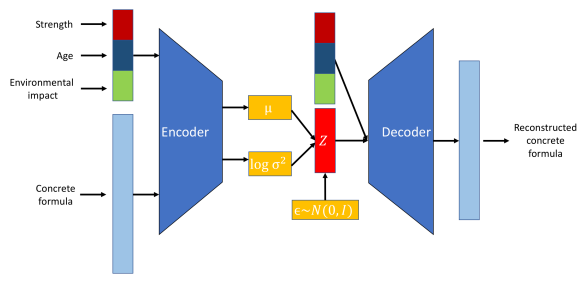

- Use cases of CVAEs include:
- Controlled data generation. For example, in image generation, a CVAE can create images of specific objects or scenes based on given labels or descriptions.

---

## Slide 44: CVAE

- Image-to-image translation: CVAEs can transform images from one domain to another while maintaining specific attributes. For instance, they can be used to translate black-and-white images to color images or to convert sketches into realistic photos.
- Text generation. CVAEs can generate text conditioned on specific prompts or topics, making them useful for tasks like story generation, chatbot responses, and personalized content creation.
- The pros and cons are:
- i) Finer control over generated data
- ii) Improved representation learning
- iii) Increased risk of overfitting

---

## Slide 45: Other variants of VAE

- Disentangled Variational Autoencoders, often called Beta-VAEs
- Adversarial Autoencoders (AAEs)
- Variational Recurrent Autoencoders (VRAEs)
- Hierarchical Variational Autoencoders (HVAEs)

---

## Slide 46: Thank You

---
