# Slide Deck Deconstruction: ML_Lec_21_RNN

> **Source Presentation:** `ML_Lec_21_RNN.pptx`  
> **Slides:** 73  
> **Media referenced by slides:** 31 (extracted into `media/`)

---

## Slide 1: Recurrent Neural Network(RNN)

- Recurrent Neural Networks (RNNs) were introduced to address the limitations of traditional neural networks, such as Feed Forward Neural Networks (FNNs), when it comes to processing sequential data.
- FNN takes inputs and process each input independently through a number of hidden layers without considering the order and context of other inputs.
- Due to which it is unable to handle sequential data effectively and capture the dependencies between inputs.

---

## Slide 2: Recurrent Neural Network(RNN)

- As a result, FNNs are not well-suited for sequential processing tasks such as, language modeling (Predict the next word (or token) in a sequence, given the previous words), machine translation (Translate text from one language to another), speech recognition, time series analysis, and many other applications that requires sequential processing.
- To address the limitations posed by traditional neural networks, RNN comes into the picture.

---

## Slide 3: Recurrent Neural Network(RNN)

- RNN overcome these limitations by introducing a recurrent connection that allow information to flow from one time-step to the next.
- This recurrent connection enables RNNs to maintain internal memory, where the output of each step is fed back as an input to the next step.
- This allows the network to capture the information from previous steps and utilize it in the current step, enabling model to learn temporal dependencies and handle input of variable length.

---

## Slide 4: Recurrent Neural Network(RNN)

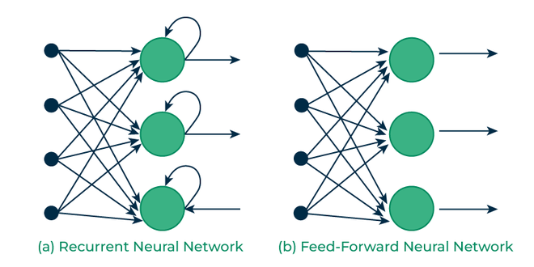

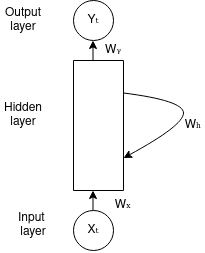

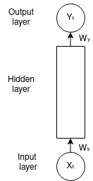

---

## Slide 5: Architecture Of RNN

- The RNN takes an input vector X and the network generates an output vector y by scanning the data sequentially from left to right, with each time step updating the hidden state and producing an output.
- It shares the same parameters across all time steps. This means that, the same set of parameters, represented by U, V, W is used consistently throughout the network.

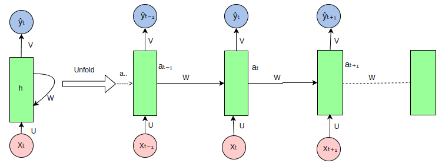

---

## Slide 6: Architecture Of RNN

- U represents the weight parameter governing the connection from input layer X to the hidden layer h
- W represents the weight associated with the connection between hidden layers, and
- V for the connection from hidden layer h to output layer y.
- This sharing of parameters allows the RNN to effectively capture temporal dependencies and process sequential data more efficiently by retaining the information from previous input in its current hidden state.

---

## Slide 7: Architecture Of RNN

- At each time step t, the hidden state aₜ is computed based on the current input xₜ , previous hidden state aₜ₋₁ and model parameters, θ.
- aₜ = f(aₜ₋₁, xₜ; θ) (1)
- It can also be written as,
- aₜ = f(U * Xₜ + W* aₜ₋₁ + b) (2)
- where,
- aₜ represents the output generated from the hidden layer at time step t .
- xₜ is the input at time step t.
- θ represents a set of learnable parameters(weights and biases).
- U, V, and W ∈ θ
- b is the bias vector for the hidden layer; b ∈ θ
- f is the activation function.

---

## Slide 8: Architecture Of RNN

- For a finite number of time steps T=4, we can repeat it T-1 times.
- When T = 4, a₄ = f(a₃, x₄; θ) by eq.(1).
- Eq.(2) can be expanded as,
- a₄ = f(U * X₄ + W* a₃ + b)
- a₃ = f(U * X₃ + W* a₂ + b)
- a₂ = f(U * X₂ + W* a₁ + b)

---

## Slide 9: Architecture Of RNN

- The output at each time step t, denoted as , ŷₜ is computed based on the hidden state output aₜ using the following formula,
- ŷₜ = f(aₜ; θ) (3)
- Eq.(3) can be written as,
- ŷₜ = f(V * aₜ + c) (4)
- when t=4, ŷ₄ = f(V * a₄ + c)
- where, ŷₜ is the output predicted at time step t.
- c is the bias vector for the output layer.

---

## Slide 10: Variants of RNN Architectures

- RNNs can be adapted into different architectures based on the nature of the input and output:
- One-to-One:
  - A simple feedforward network, not typically considered an RNN, but included for completeness.
  - Example: Standard neural network for image classification.
- One-to-Many:
  - Used when a single input leads to a sequence of outputs.
  - Example: Generating a sequence of text from a single image (image captioning).
- Many-to-One:
  - Used for tasks like sentiment analysis where the entire sequence leads to a single output (e.g., classification).
  - Example: Predicting the sentiment of a sentence.
- Many-to-Many:
  - Used for tasks where each input in the sequence corresponds to an output (e.g., translation).
  - Example: Machine translation from one language to another.

---

## Slide 11: One to One

- This type of RNN behaves the same as any simple Neural network it is also known as Vanilla Neural Network. In this Neural network, there is only one input and one output.

- One To Many
- In this type of RNN, there is one input and many outputs associated with it. One of the most used examples of this network is Image captioning where given an image we predict a sentence having Multiple words.

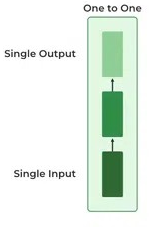

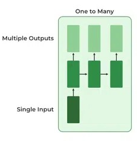

---

## Slide 12: Many to One Many to Many

- In this type of neural network, there are multiple inputs and multiple outputs corresponding to a problem. One Example of this Problem will be language translation. In language translation, we provide multiple words from one language as input and predict multiple words from the second language as output.

- In this type of network, Many inputs are fed to the network at several states of the network generating only one output. This type of network is used in the problems like sentimental analysis. Where we give multiple words as input and predict only the sentiment of the sentence as output.

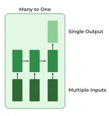

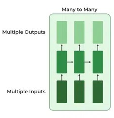

---

## Slide 13: Backpropagation Through Time (BPTT)

- Backpropagation involves adjusting the model’s parameters (weights and biases) based on the error between predicted output and the actual target value.
- The goal of backpropagation is to improve the model’s performance by minimize the loss function.
- Backpropagation Through Time is a special variant of backpropagation used to train RNNs, where the error is propagated backward through time until the initial time step t=1.
- Backpropagation involves two key steps: forward pass and backward pass.

---

## Slide 14: Backpropagation Through Time (BPTT)

- Forward Pass:
- During forward pass, the RNN processes the input sequence through time, from t=1 to t=n, where n is the length of input sequence.
- In each forward propagation, the following calculation takes place
- aₜ = U * Xₜ + W* aₜ₋₁ + b aₜ = σ(aₜ) [Generally, tanh() function is used] ŷₜ = softmax(V * aₜ + c)

---

## Slide 15: Backpropagation Through Time (BPTT)

- After processing the entire sequence, RNN generates a sequence of predicted outputs,  ŷ =[ŷ₁, ŷ₂, …, ŷₜ].
- The relationship between the lengths of the input sequence n and the output sequence t depends on the specific architecture and purpose of the RNN.
- Loss is then computed by comparing predicted output ŷ at each time step with actual target output y. Loss function given by,

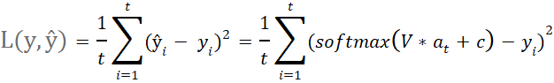

---

## Slide 16: Backpropagation Through Time (BPTT)

- 2. Backward Pass: The backward pass in BPTT involves computing the gradients of the loss function with respect to the network’s parameters (U, W, V and biases) over each time step.
- Let’s explore the concept of backpropagation through time by computing the gradients of loss at time step t=4.
- The figure below also serves as an illustration of backpropagation for time step 4.

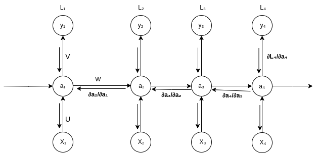

---

## Slide 17: Backpropagation Through Time (BPTT)

- Derivative of loss L w.r.t V
- Loss L is a function of predicted value ŷ, so using the chain rule ∂L/∂V can be written as,
- ∂L/∂V = (∂L/∂ŷ) * (∂ŷ/∂V)

---

## Slide 18: Derivative of loss L w.r.t W

- Applying the chain rule of derivatives ∂L/∂W can be written as follows:
- (i) The loss at the 4th time step is dependent upon ŷ due to the fact that the loss is calculated as a function of ŷ, which is in turn dependent on the current time step’s hidden state a₄, a₄ is influenced by both W and a₃, and again a₃ is connected to both a₂ and W, and a₂ depends on a₁ and also on W.

---

## Slide 19: Derivative of loss L w.r.t W

- ∂L₄/∂W = (∂L₄/∂ŷ₄ * ∂ŷ₄/∂a₄ * ∂a₄/∂W) + (∂L₄/∂ŷ₄ * ∂ŷ₄/∂a₄ *∂a₄/∂a₃*∂a₃/∂W) + (∂L₄/∂ŷ₄ * ∂ŷ₄/∂a₄ *∂a₄/∂a₃*∂a₃/∂a₂*∂a₂/∂W) + (∂L₄/∂ŷ₄ * ∂ŷ₄/∂a₄ *∂a₄/∂a₃* ∂a₃/∂a₂*∂a₂/∂a₁*∂a₁/∂W)

---

## Slide 20: Derivative of loss L w.r.t U

- Similarly, ∂L/∂U can be written as,
- ∂L₄/∂U = (∂L₄/∂ŷ₄ * ∂ŷ₄/∂a₄ * ∂a₄/∂U) + (∂L₄/∂ŷ₄ * ∂ŷ₄/∂a₄ *∂a₄/∂a₃*∂a₃/∂U) + (∂L₄/∂ŷ₄ * ∂ŷ₄/∂a₄ *∂a₄/∂a₃*∂a₃/∂a₂*∂a₂/∂U) + (∂L₄/∂ŷ₄ * ∂ŷ₄/∂a₄ *∂a₄/∂a₃*∂a₃/∂a₂*∂a₂/∂a₁*∂a₁/∂U)

---

## Slide 21: Derivative of loss L w.r.t U

- Where,
- and aₜ = U * Xₜ + W* aₜ₋₁ + b aₜ = σ(aₜ) and ŷₜ = softmax(V * aₜ + c)
- Here we’re summing up the gradients of loss across all time steps which represents the key difference between BPTT and regular backpropagation approach.

---

## Slide 22: Training through RNN

- A single-time step of the input is provided to the network.
- Then calculate its current state using a set of current input and the previous state.
- The current ht becomes ht-1 for the next time step.
- One can go as many time steps according to the problem and join the information from all the previous states.
- Once all the time steps are completed the final current state is used to calculate the output.
- The output is then compared to the actual output i.e the target output and the error is generated.
- The error is then back-propagated to the network to update the weights and hence the network (RNN) is trained using Backpropagation through time.

---

## Slide 23: Difference between RNN and Simple Neural Network

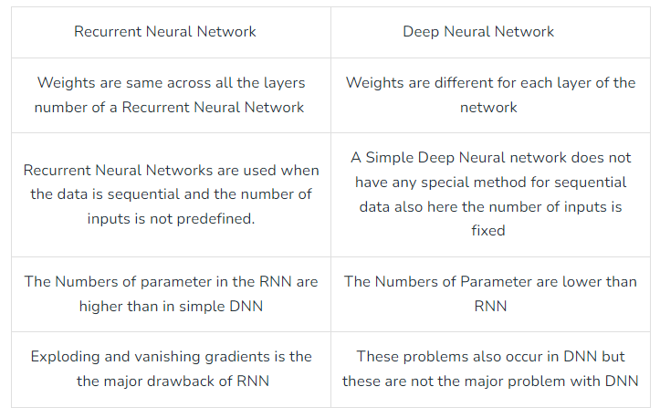

---

## Slide 24: Applications of RNNs

- Natural Language Processing: RNNs are widely used for language modeling, text generation, machine translation, and sentiment analysis.
- Speech Recognition: They can model the temporal aspects of speech data, making them effective for transcribing spoken language.
- Time Series Prediction: RNNs can analyze and predict future values in time-dependent datasets, such as stock prices or weather forecasting.
- Music Generation: RNNs can be trained to compose music by learning from sequences of musical notes.

---

## Slide 25: Limitations of RNN

- During backpropagation, gradients can become too small, leading to the vanishing gradient problem, or too large, resulting in the exploding gradient problem as they propagate backward through time.
- In the case of vanishing gradients, the issue is that the gradient may become too small where the network struggles to capture long-term dependencies effectively. It can still converge during training but it may take a very long time.
- In contrast, in exploding gradient problem, large gradient can lead to numerical instability during training, causing the model to deviate from the optimal solution and making it difficult for the network to converge to global minima.
- To address these problems, variations of RNN like Long-short term memory (LSTM) and Gated Recurrent Unit (GRU) networks have been introduced.

---

## Slide 26: Variants of RNNs

- Long Short-Term Memory (LSTM): LSTMs are a specialized type of RNN designed to combat the vanishing gradient problem, which often hampers the training of standard RNNs. LSTMs introduce mechanisms called gates (input, forget, and output gates) that regulate the flow of information, allowing LSTMs to learn longer dependencies.
- Gated Recurrent Unit (GRU): GRUs are a simpler alternative to LSTMs, combining the input and forget gates into a single update gate. They perform similarly to LSTMs but with fewer parameters, making them computationally more efficient.
- Bidirectional RNNs: These networks process the input sequence in both forward and backward directions, allowing the model to capture information from both past and future contexts. This can enhance performance on tasks like text classification and sequence labeling.

---

## Slide 27: Long Short-Term Memory (LSTM) Networks

- LSTMs are a specialized type of Recurrent Neural Network (RNN) designed to address the vanishing gradient problem.
- It is enabled to learn long-range dependencies in sequential data.
- They achieve this through a unique architecture that includes memory cells and gating mechanisms.

---

## Slide 28: Key Components of LSTM

- An LSTM cell contains several components that interact in a structured way to retain relevant information over long sequences, while discarding unnecessary information.
- Cell State:
- The core idea of LSTM is the cell state, which acts as a conveyor belt running through the entire sequence, enabling the memory to persist over time.
- It can be thought of as the long-term memory of the network, carrying information across many time steps.
- The cell state is modified in a controlled manner by the various gates.

---

## Slide 29: Key Components of LSTM

- Gates:
- LSTMs use three types of gates to control the flow of information:
  - Forget Gate: The forget gate determines which information from the previous cell state should be discarded.
  - Input Gate: Determines what new information should be added to the cell state.
  - Output Gate: Decides what part of the cell state should be output to the next layer.

---

## Slide 30: Key Components of LSTM

  - 1. Forget Gate:
- The forget gate determines which information from the previous cell state should be discarded.
- It takes the previous hidden state (ht−1) and the input at the current time step (xt​) as inputs and passes them through a sigmoid activation function.

---

## Slide 31: LSTM Cell Operations

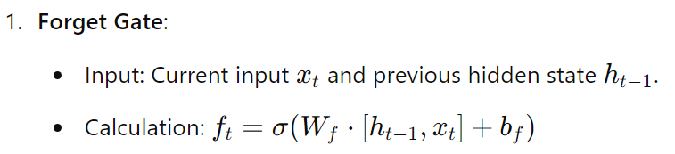

- Output: A vector of values between 0 and 1 that determine what information to forget from the cell state.

- The output value 0 means "completely forget" and 1 means "completely retain."

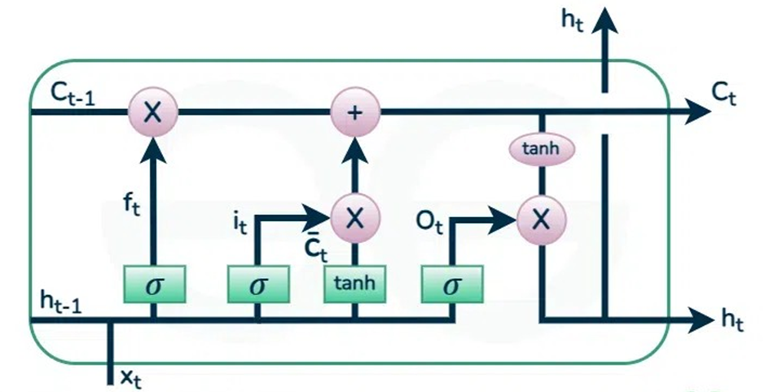

---

## Slide 32: LSTM Cell Operations

- 2. Input Gate (it):
- The input gate controls how much of the new information from the current input and hidden state should be added to the cell state.
- Like the forget gate, it uses a sigmoid function to output a value between 0 and 1.

---

## Slide 33: Untitled Slide

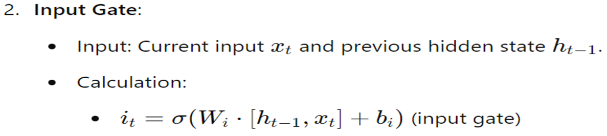

- Output: The input gate determines which values to update in the cell state

---

## Slide 34: LSTM Cell Operations

- 3.
- A tanh layer is used to create a new candidate cell state, which contains potential new information that could be added to the cell state.
- This is generated using the current input and the previous hidden state. The formula is:

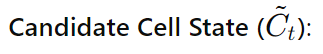

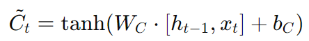

---

## Slide 35: LSTM Cell Operations

- 4. Updating the Cell State (Ct​):
- The new cell state is updated by combining the forget gate's decision and the input gate's decision.
- The forget gate decides what to remove from the previous cell state, and the input gate decides what new information to add.
- The formula is:

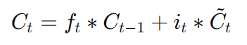

---

## Slide 36: LSTM Cell Operations

- 5. Output Gate(Ot):
- The output gate decides what the next hidden state (ht​) should be.
- This hidden state is used for predictions and also passed to the next time step.
- The output gate first passes the previous hidden state and the current input through a sigmoid activation to determine which parts of the cell state should be output to the next time step.
- Then, the updated cell state is passed through a tanh function to squash the values between -1 and 1, and the result is multiplied element-wise by the output gate's decision.

---

## Slide 37: Untitled Slide

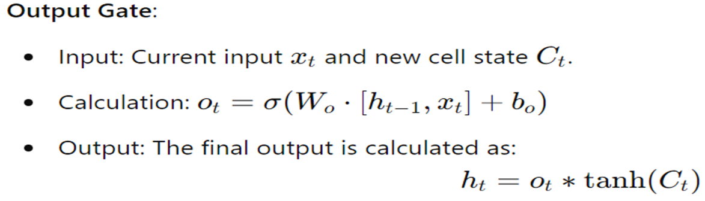

- This output will be passed to the next LSTM cell and to the next layer of the network.

---

## Slide 38: LSTM Working Mechanism:

- At each time step t:
- Forget gate controls what proportion of the previous cell state Ct−1​ should be "forgotten."
- Input gate decides how much of the current input (combined with the previous hidden state) should update the current cell state.
- Cell state is updated based on the decisions of the forget and input gates.
- Output gate controls the flow of information from the updated cell state to the hidden state ht​, which is passed to the next time step and possibly used as output.

---

## Slide 39: LSTM

- Key Advantages of LSTM:
- 1. Long-Term Dependency Handling: LSTMs are designed to maintain information over longer time periods without losing it due to vanishing gradients, unlike standard RNNs.
- 2. Selective Memory: The gating mechanisms allow the network to decide what to remember and what to forget, which makes it suitable for tasks involving sequential data with long-term dependencies (e.g., time series prediction, language modeling, machine translation).
- LSTM Variants:
- 1. Bidirectional LSTM (BiLSTM): Combines two LSTMs, one processing the input sequence forward and another processing it backward. This provides a more comprehensive understanding of context.
- 2. Stacked LSTM: Involves multiple LSTM layers stacked on top of each other, allowing for a more complex and hierarchical feature extraction process.

---

## Slide 40: Input gate Vs Candidate cell state

- The input gate and the candidate cell state are two distinct components of an LSTM cell, and they serve different roles in managing the flow of information:
- 1. Input Gate (it​):
- Purpose: The input gate controls how much of the new information (i.e., the candidate cell state) should be added to the cell state. It acts as a filter to decide what proportion of the candidate information will influence the memory.
- Operation: It takes the current input xt​ and the previous hidden state ht−1​, processes them through a sigmoid function, and produces an output between 0 and 1. This output is a gate or mask that regulates the flow of information into the cell state.
- Formula:
- Where σ is the sigmoid activation function, which outputs values between 0 and 1. A value close to 0 means little or no new information is allowed, while a value close to 1 means new information is allowed in fully.

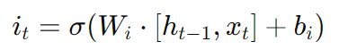

---

## Slide 41: Input gate Vs Candidate cell state

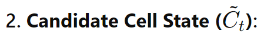

- Purpose: The candidate cell state represents potential new information that could be added to the cell state. It is a processed version of the current input and previous hidden state, designed to offer new content for updating the cell memory.
- Operation: It is computed by applying a tanh activation function to a weighted combination of the current input xt​ and the previous hidden state ht−1​. The tanh activation squashes the values between -1 and 1, generating the candidate information that might be useful to update the cell state.
- Formula:

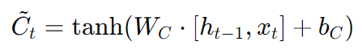

---

## Slide 42: Different Purpose

- Input Gate (it​):
- The input gate is a control mechanism. It does not directly generate new information.
- Instead, it decides how much of the new information (generated by the candidate cell state) should influence the cell state. It acts like a filter or gate.
- It outputs values between 0 and 1 (via a sigmoid activation) to control the flow of the candidate cell state.
- Think of it as a gate that controls the flow of information: it’s there to allow or restrict how much new information should be considered important enough to update the memory.

---

## Slide 43: Different Purpose

- The candidate cell state is the actual new information that could potentially update the cell’s memory. It’s not controlling anything—it is proposing new content to be added to the memory.
- The candidate cell state represents a set of new values, generated through a tanh function, which compresses the potential values to lie between -1 and 1.
- Think of it as the potential memory update: it is suggesting new content that could modify the cell’s memory, but it won’t have an effect unless the input gate allows it.

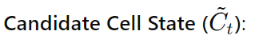

---

## Slide 44: Different Activation Functions:

- Input Gate (it​):
- The input gate uses a sigmoid activation function (σ). The sigmoid function squashes the output between 0 and 1. This is important because the gate is designed to control how much of the new information should pass through.
- The sigmoid’s output close to 0 means "don’t add this new information", while an output close to 1 means "let this new information fully through."

---

## Slide 45: Different Activation Functions:

- The candidate cell state uses a tanh activation function. Tanh produces values between -1 and 1, which represents the actual new content that could potentially update the memory.
- Tanh compresses the candidate information into a smaller range but allows negative, neutral, and positive values to represent different kinds of updates to the memory.

---

## Slide 46: How They Work Together:

- The candidate cell state generates the actual new information that could be added to the memory (the values between -1 and 1).
- The input gate then uses its output (values between 0 and 1) to decide how much of this candidate information will actually be added to the current memory (cell state).
- Together, they interact like this:

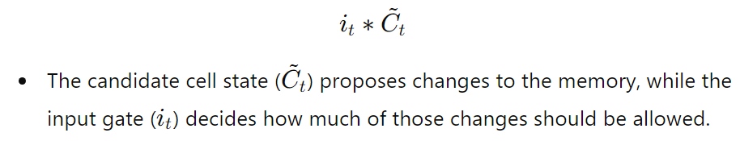

---

## Slide 47: How They Work Together:

- Think of the candidate cell state as raw data (like a list of new facts or observations), and the input gate as the editor deciding how much of that data is relevant or useful enough to be stored. The editor might allow some of the new information in fully, some of it partially, and might discard other parts entirely.

---

## Slide 48: Example: Text Generation

- Let we want to train an LSTM to generate text based on a training dataset of sentences.
- Data Preparation: We would prepare the text by tokenizing it into sequences of words, transforming it into numerical representations (e.g., word embeddings).
- Training:
  - We feed these sequences into the LSTM one time step at a time.
  - The LSTM learns to predict the next word in the sequence based on previous words, utilizing its cell state and gating mechanisms to remember relevant context.
- Text Generation:
  - After training, we can initialize the LSTM with a seed word and generate text by iteratively predicting the next word and feeding it back into the model until we reach the desired length.

---

## Slide 49: Prediction of next word

- Suppose, we want to predict the next word of the sequence of words: “The color of an apple is”.
- we need to understand how the LSTM processes sequential data and maintains context through its memory.
- Step-by-Step LSTM Process is as follows:

---

## Slide 50: 1. Input Representation

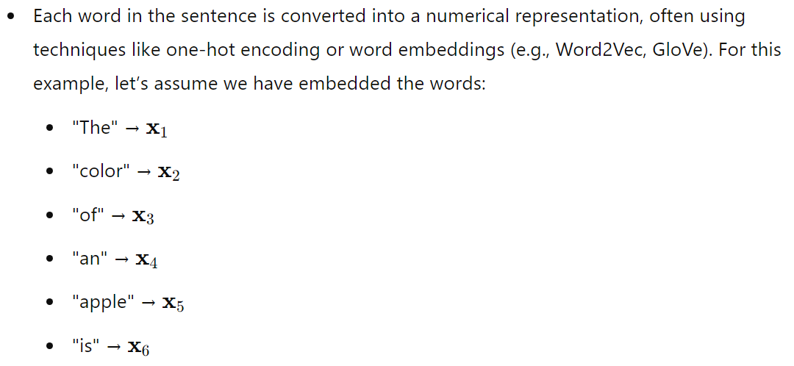

---

## Slide 51: 2. Feeding the Input into the LSTM:

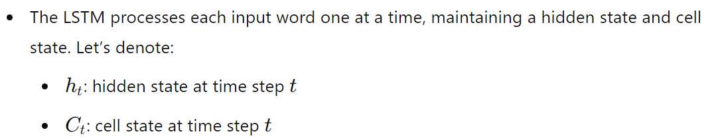

---

## Slide 52: 3. Processing Each Word:

- For each word, the LSTM performs the following calculations:
- Forget Gate:
- Input Gate:
- Cell State Update:
- Output Gate:

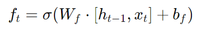

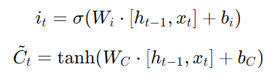

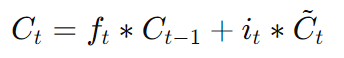

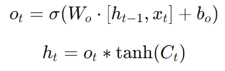

---

## Slide 53: 4. Sequential Updates:

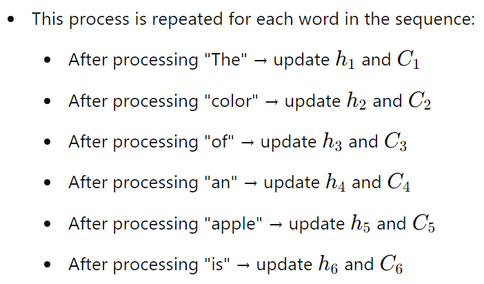

---

## Slide 54: Making the Prediction

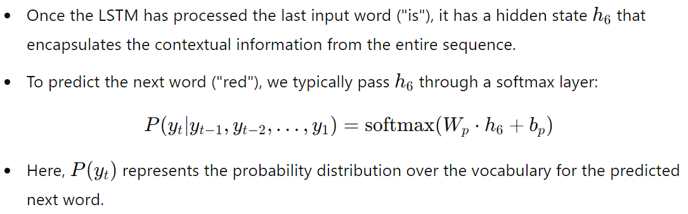

---

## Slide 55: 6. Output Interpretation:

- The output of the softmax layer gives probabilities for each word in the vocabulary, including "red."
- The word with the highest probability is selected as the predicted next word.

---

## Slide 56: Backpropagation Learning

- In LSTM (Long Short-Term Memory) networks, backpropagation learning works similarly to standard neural networks, but with some additional mechanisms to handle the sequential data and the vanishing/exploding gradient problem. Steps of learning are:
- 1. Forward Pass
- In the forward pass, the LSTM processes input data through its gates and hidden states. It uses the following components:
- (i) Forget Gate: Decides what information to discard from the cell state.
- (ii) Input Gate: Determines which new information to store in the cell state.
- (iii) Output Gate: Decides what information from the cell state will be output.
- (iv) Cell State: This is the "memory" of the LSTM, which is updated at each time step.
- The hidden state ht​ at each time step and the cell state ct​ are passed to the next time step, along with the output.

---

## Slide 57: Backpropagation Learning

- 2. Loss Calculation
- After the forward pass, the LSTM calculates the output at each time step, and the error (or loss) is computed.
- The loss typically depends on the task (e.g., Mean Squared Error for regression, or Cross-Entropy Loss for classification).
- 3. Backpropagation Through Time (BPTT)
- In traditional neural networks, backpropagation calculates gradients of the loss with respect to weights by applying the chain rule of derivatives.
- In LSTM networks, this process is extended to "Backpropagation Through Time" (BPTT) because LSTMs deal with sequences of data (like RNN).

---

## Slide 58: BPTT

- Gradients are computed for each time step, and the weights are updated by accumulating the gradients over all time steps in the sequence.
- Long-term dependencies: LSTMs use their gating mechanisms (like the forget gate) to retain important information and forget irrelevant details, allowing them to capture long-term dependencies in the data.

---

## Slide 59: 4. Gradient Flow and the Vanishing Gradient Problem

- LSTMs help combat the vanishing gradient problem (which can cause traditional RNNs to forget long-term dependencies) by using a memory cell that can store information over long time intervals.
- During backpropagation, gradients are passed back through the network, including the cell state.
- The gates in the LSTM ensure that gradients are propagated in a way that mitigates the vanishing gradient problem by controlling the flow of information and gradients.

---

## Slide 60: 5. Weight Updates

- Once the gradients are calculated via BPTT, the model's weights are updated using an optimization algorithm like Stochastic Gradient Descent (SGD) or Adam.
- The goal is to minimize the loss function by adjusting the weights in a way that reduces the error.

---

## Slide 61: Summary of the Backpropagation Steps in LSTM

- Compute the forward pass, which involves the cell state and hidden state through the various gates.
- Calculate the loss after the forward pass.
- Use BPTT to propagate the error backward through time, calculating gradients at each step for each gate.
- Update the weights using the gradients.

---

## Slide 62: Vanishing Gradient problem

- Long Short-Term Memory (LSTM) networks are a type of recurrent neural network (RNN) designed to address the vanishing gradient problem, a common issue in traditional RNNs when training long sequences.
- The vanishing gradient problem occurs because, during backpropagation, gradients diminish (or sometimes explode) as they are propagated back through the network layers over many time steps, causing the network to "forget" early parts of sequences.
- LSTM networks tackle this problem with a unique architecture that includes gates and a cell state.
- These gates and cell state work together to address the vanishing gradient issue:

---

## Slide 63: Vanishing Gradient problem

- Cell State:
- LSTM introduces a cell state (or memory cell) that allows the network to carry information across many time steps without frequent updates, preserving important information.
- The cell state is a sort of highway for gradients, which minimizes the diminishing effect because it can carry values over time steps relatively unchanged, helping maintain gradients.

---

## Slide 64: Vanishing Gradient problem

- 2. Gates: LSTMs use three gates — input, forget, and output gates — to regulate information flow. These gates control what information to add, remove, or output at each time step, allowing the network to selectively retain or discard information based on its relevance.
- Forget Gate: Decides what part of the cell state should be kept or discarded, allowing the model to “forget” information that is no longer relevant.
- Input Gate: Controls how much of the new information should be added to the cell state, helping update it with relevant information without overwhelming it.
- Output Gate: Regulates what information from the cell state is used to produce the current output.

---

## Slide 65: Vanishing Gradient problem

- 3. Gradient Flow Through the Cell State:
- Unlike traditional RNNs, where the gradient directly flows through the hidden state, LSTMs have a more stable pathway through the cell state.
- This setup helps gradients propagate back in time effectively, preserving information over longer sequences and reducing the risk of them vanishing.

---

## Slide 66: Vanishing Gradient problem

- By managing the flow of information with gates and maintaining a consistent gradient flow through the cell state, LSTMs effectively mitigate the vanishing gradient problem.
- This structure allows them to remember dependencies over longer time sequences than traditional RNNs, making them suitable for tasks where long-term context is essential, like language modeling and time-series analysis.

---

## Slide 67: Vanishing Gradient problem

- LSTMs mitigate the vanishing gradient problem through a careful design of the cell state and gates, which regulate and stabilize the gradient flow even across many time steps.
- Here’s a deeper look at why the LSTM structure prevents the gradient from vanishing:

---

## Slide 68: 1. Cell State and Element-Wise Multiplication

- In an LSTM, the cell state flows through time steps almost directly, with only a few controlled, element-wise operations (multiplication by the forget gate and addition from the input gate).
- This design means the cell state can carry values across time steps with minimal modification, maintaining its scale better than in traditional RNNs.
- Because gradients are propagated along this cell state path, they are less likely to vanish over long sequences.
- The forget gate’s values are usually set close to 1 (at least for parts of the sequence that need retention), which means the cell state experiences minimal scaling, allowing gradients to stay within a stable range.

---

## Slide 69: 2. Forget Gate and Self-Looping Structure

- The forget gate (which multiplies its output with the cell state) is a crucial component. Since the forget gate’s output values are typically between 0 and 1, the model learns to retain only relevant information, reducing the risk of unnecessary multiplication that could shrink gradients.
- This self-looping structure is designed so that even after many time steps, the values in the cell state are preserved if the forget gate is close to 1, keeping gradients stable when they propagate back through time.

---

## Slide 70: 3. Controlled Update Mechanism

- The LSTM cell state is updated in a controlled way through the input and forget gates, allowing it to accumulate gradients gradually instead of allowing abrupt changes.
- Because of this controlled flow, the gradients are less likely to either explode or vanish. For example, if the cell state is continuously updated with small, relevant amounts of information, it’s unlikely to diminish drastically, maintaining gradient strength across time steps.

---

## Slide 71: 4. Activation Functions in Gates

- LSTMs generally use sigmoid and tanh activation functions in gates. Sigmoid activation for gates limits values between 0 and 1, preventing extreme values that might otherwise contribute to exploding or vanishing gradients.
- The tanh activation, used for candidate cell state values, outputs values between -1 and 1, which further stabilizes the update flow into the cell state and reduces the effect of multiplying very small or large numbers over many time steps.

---

## Slide 72: Summary of Why Vanishing Doesn’t Happen

- Gradient Flow Path Stability: Since gradients flow through a relatively unmodified cell state, they avoid vanishing as they propagate.
- Controlled Element-Wise Updates: Gates control each update step, which reduces the chance of gradients shrinking (or exploding) across many time steps.
- Gate Values Near 1: The forget gate can be trained to be close to 1 for important information, minimizing multiplicative shrinking of the cell state.
- Together, these mechanisms allow LSTMs to maintain a more stable gradient flow across long sequences, which traditional RNNs struggle with due to their simpler, unrestricted architecture.

---

## Slide 73: Thank You!

---
