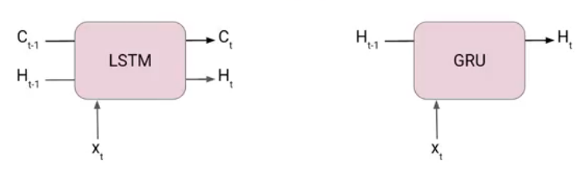
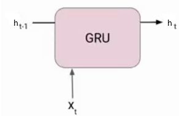
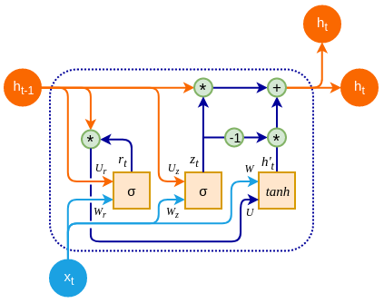
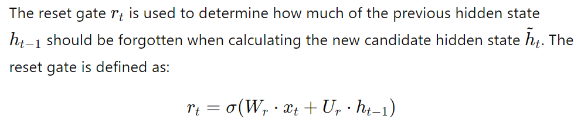
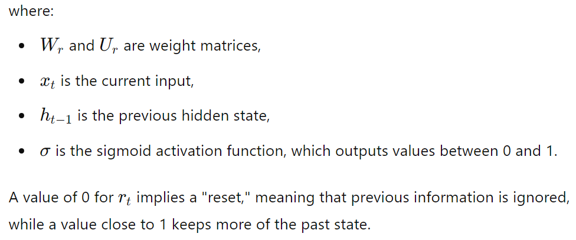
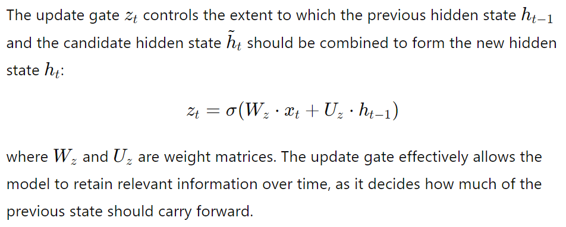
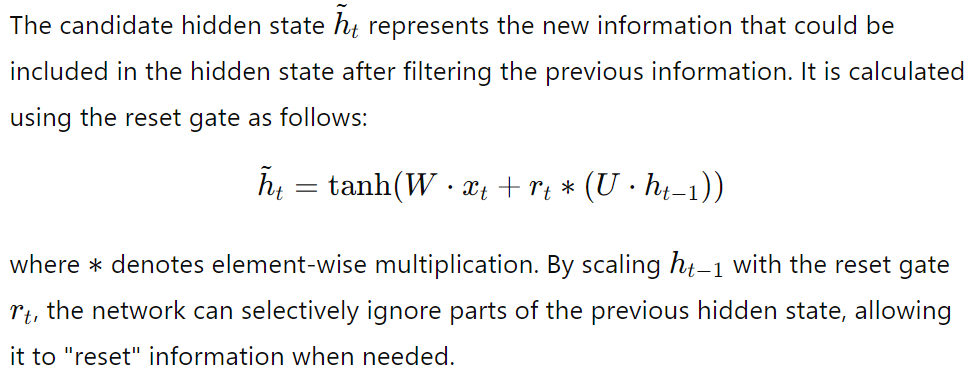
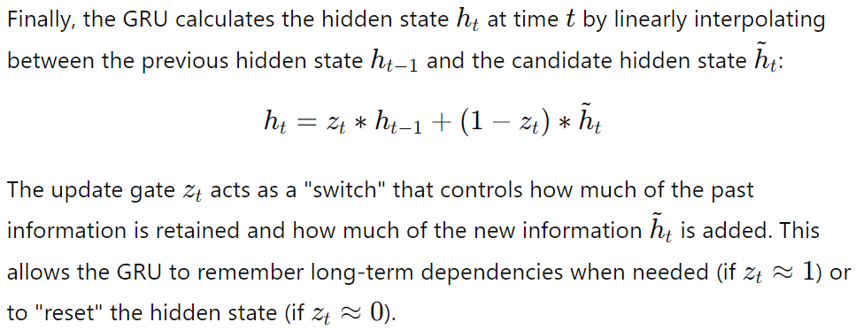

# Slide Deck Deconstruction: ML_Lec_22_GRU

> **Source Presentation:** `ML_Lec_22_GRU.pptx`  
> **Slides:** 18  
> **Media referenced by slides:** 8 (extracted into `media/`)

---

## Slide 1: Gated Recurrent Unit Networks

- Gated Recurrent Unit (GRU) is a type of recurrent neural network (RNN) that was introduced by Cho et al. in 2014 as a simpler alternative to Long Short-Term Memory (LSTM) networks.
- Like LSTM, GRU can process sequential data such as text, speech, and time-series data.
- The basic idea behind GRU is to use gating mechanisms to selectively update the hidden state of the network at each time step.
- The gating mechanisms are used to control the flow of information in and out of the network.
- The GRU has two gating mechanisms, called the reset gate and the update gate.
- The reset gate determines how much of the previous hidden state should be forgotten, while the update gate determines how much of the new input should be used to update the hidden state.
- The output of the GRU is calculated based on the updated hidden state.

---

## Slide 2: GRU

- GRUs are very similar to Long Short Term Memory(LSTM). Just like LSTM, GRU uses gates to control the flow of information. They are relatively new as compared to LSTM. This is the reason they offer some improvement over LSTM and have simpler architecture.
- Another Interesting thing about  GRU network is that, unlike LSTM, it does not have a separate cell state (Ct). It only has a hidden state(Ht). Due to the simpler architecture, GRUs are faster to train.

---

## Slide 3: GRU

- Like LSTM, GRU is designed to model sequential data by allowing information to be selectively remembered or forgotten over time.
- However, GRU has a simpler architecture than LSTM, with fewer parameters, which can make it easier to train and more computationally efficient.
- The main difference between GRU and LSTM is the way they handle the memory cell state.
- In LSTM, the memory cell state is maintained separately from the hidden state and is updated using three gates: the forget gate, input gate, and output gate.
- In GRU, the memory cell state is replaced with a “candidate activation vector,” which is updated using two gates: the reset gate and update gate.

---

## Slide 4: GRU

- The reset gate determines how much of the previous hidden state to forget, while the update gate determines how much of the candidate activation vector to incorporate into the new hidden state.
- Overall, GRU is a popular alternative to LSTM for modeling sequential data, especially in cases where computational resources are limited or where a simpler architecture is desired.

- At each timestamp t, it takes an input Xt and the hidden state ht-1 from the previous timestamp t-1.
- Later it outputs a new hidden state ht which again passed to the next timestamp.
- Now there are primarily two gates in a GRU as opposed to three gates in an LSTM cell. The first gate is the Reset gate and the other one is the update gate.

---

## Slide 5: Reset Gate (Short term memory)

- The Reset Gate is responsible for the short-term memory of the network i.e., the hidden state (ht).

---

## Slide 6: Reset Gate (Short term memory)

---

## Slide 7: Update Gate (Long Term memory)

- Similarly, we have an Update gate for long-term memory.

---

## Slide 8: Update Gate (Long Term memory)

---

## Slide 9: Candidate Hidden State

---

## Slide 10: Final Hidden State

---

## Slide 11: Functionality of GRU

- The GRU’s functionality is centered around effectively capturing short- and long-term dependencies in sequential data. Here’s a summary of each gate's functionality and its impact on the GRU’s behavior:
- Reset Gate:
- The reset gate enables the model to forget irrelevant past information.
- This is particularly useful in cases where the recent information is more relevant than older context, such as in sentence parsing or real-time sensor data.

---

## Slide 12: Functionality of GRU

- 2. Update Gate:
- The update gate controls the balance between retaining old information and incorporating new information.
- This allows the GRU to keep track of information over a long period if needed.
- For instance, in a language model, it can remember the subject of a sentence over a long clause to make appropriate predictions at the end of the sentence.

---

## Slide 13: Functionality of GRU

- 3. Single Hidden State:
- Unlike LSTM, which has both a cell state and a hidden state, GRU has only a single hidden state that serves as both memory and output.
- This reduces the number of parameters and makes GRUs computationally efficient while maintaining the ability to handle long sequences effectively.

---

## Slide 14: Key Advantages of GRU

- Reduced Complexity: GRUs are computationally simpler than LSTMs as they have fewer gates and lack a separate cell state. This makes them faster to train and more efficient for applications where computational resources are limited.
- Similar Performance with Fewer Parameters: Despite their simpler structure, GRUs perform comparably to LSTMs in many tasks, particularly those that do not require as much fine-grained memory management, such as machine translation, text generation, and speech recognition.
- Effective Long-Term Memory Retention: By using the update gate to retain important information over time, GRUs manage to retain long-term dependencies, solving the vanishing gradient problem common to traditional RNNs.

---

## Slide 15: Comparison with LSTM

- While GRUs and LSTMs share similarities, they have different strengths and are suited to different types of tasks:
- Parameter Efficiency: GRUs generally have fewer parameters than LSTMs, making them faster to train and less likely to overfit, especially on smaller datasets.
- Longer Dependencies: LSTMs may outperform GRUs on tasks that require learning very long dependencies since the cell state in LSTMs allows for more refined control over information retention.
- Computational Cost: GRUs are more computationally efficient and therefore may be preferred for real-time applications or when hardware resources are limited.

---

## Slide 16: Use Cases

- GRUs are widely used in a variety of applications where sequence data is involved:
- Speech Recognition: GRUs can effectively process sequences of audio data to recognize spoken words or phrases.
- Language Modeling and Machine Translation: GRUs are used in natural language processing to model sentences, predict next words, and even translate text between languages.
- Time-Series Analysis: For predicting stock prices, weather forecasting, or analyzing sensor data, GRUs can capture both short- and long-term dependencies in the data.

---

## Slide 17: Summary

- GRUs are a powerful and efficient alternative to traditional RNNs and even LSTMs, providing a simpler, faster architecture for learning from sequential data.
- By combining the reset and update gates, GRUs enable selective memory retention and controlled forgetting, allowing them to learn dependencies effectively without the complexity of a separate cell state.
- This structure makes GRUs particularly well-suited for applications requiring fast processing of sequence data and has led to their widespread adoption in various fields of machine learning and natural language processing.

---

## Slide 18: Thank You!

---
