# 4G and 5G Networks — Learning Guide

Source: `4G_5G.pdf` (18 pages), cited as (p. 3). Every number recomputed.
**📘 Beyond the notes** = gap filled from outside the PDF. **✏️ Note discrepancy** = the PDF is wrong, outdated or unclear.

## Contents

1. [5G spectrum: FR1 and FR2](#1-5g-spectrum-fr1-and-fr2)
2. [Small cells: macro, micro, pico, femto](#2-small-cells-macro-micro-pico-femto)
3. [5G architecture, perspective 1: the converged system](#3-5g-architecture-perspective-1-the-converged-system)
4. [5G architecture, perspectives 2 and 3: RAN, core, 5GS](#4-5g-architecture-perspectives-2-and-3-ran-core-5gs)
5. [The 5G core: reference points vs service-based architecture](#5-the-5g-core-reference-points-vs-service-based-architecture)
6. [The core network functions](#6-the-core-network-functions)
7. [Tracking areas, registration and paging](#7-tracking-areas-registration-and-paging)
8. [Carrier aggregation](#8-carrier-aggregation)
9. [Spread spectrum and OFDM/OFDMA](#9-spread-spectrum-and-ofdmofdma)
10. [QPSK and QAM](#10-qpsk-and-qam)

---

## 1. 5G spectrum: FR1 and FR2

**The idea.** More data needs more spectrum. The low frequencies used by 2G–4G are crowded, so 5G also moves up to much higher frequencies, where wide channels are free but signals travel only short distances.

**New Radio (p. 1).** The 5G air interface defined by **3GPP** (the 3rd Generation Partnership Project, the standards body) is called **New Radio (NR)**. It is split into two frequency ranges:

| | FR1 ("sub-6") | FR2 ("mmWave") |
| :--- | :--- | :--- |
| Frequencies | below 6 GHz | 24–54 GHz (as the notes give it) |
| Channel bandwidth | max **100 MHz**, because continuous spectrum is scarce in this crowded range | min **50 MHz**, max **400 MHz**; two-channel aggregation in 3GPP Release 15 |
| Typical use | most widely used band **3.3–4.2 GHz**; Korean carriers use band **n78 at 3.5 GHz** | very high data rates |
| Other names | the upper part, unused by earlier generations, is called **mid-band** | **millimetre wave (mmWave)** |

The higher the frequency, the greater the ability to support high data-transfer speeds (p. 1).

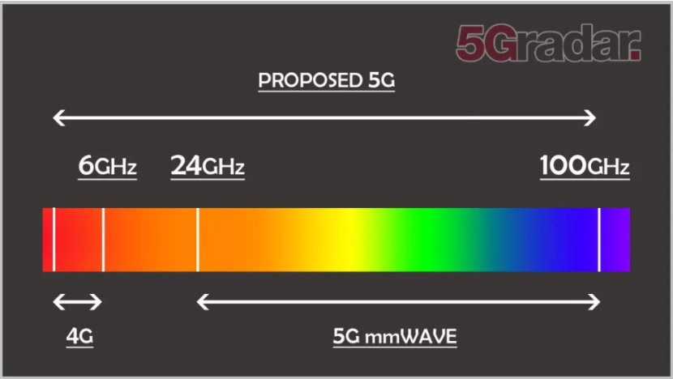
*Figure: p. 1. 4G lives below 6 GHz; 5G adds the band from 24 GHz upward.*

> 📘 **Beyond the notes — why "millimetre" wave.** Wavelength $\lambda = c / f$. At 30 GHz, $\lambda = 3 \times 10^8 / (3 \times 10^{10}) = 0.01$ m = 10 mm; at 3.5 GHz it is about 86 mm. Wavelengths of 1–10 mm (30–300 GHz) give the name. Short waves are blocked by walls and rain and fade fast, which is why mmWave needs many small cells (section 2), but they also allow tiny antennas packed into large arrays (section 3).

> ✏️ **Note discrepancy (p. 1).** In 3GPP Release 15, FR2 is **24.25–52.6 GHz**; Release 17 later added 52.6–71 GHz. "24–54 GHz" is a rounded, slightly off range. The spectrum picture's "up to 100 GHz" is the *proposed* range, not the standard.

---

## 2. Small cells: macro, micro, pico, femto

**The problem (pp. 1–2).** High-band signals carry over shorter distances. So 5G needs not just low- and mid-band spectrum but also high-band spectrum, and therefore a **much larger number of access points, each covering a smaller area**.

**Small cells (pp. 1–2)** are low-powered radio access points that connect mobiles to the network over a small area. They reuse frequencies on an extremely dense basis to make full use of the spectrum.

**Advantages over traditional towers (p. 1).** Stronger coverage and higher data speeds where devices would otherwise compete for bandwidth, and **longer handset battery life**, because the phone is closer to its access point and needs less transmit power.

**A fact to share (p. 2).** An FCC (Federal Communications Commission) commissioner estimated the US needs **800,000** small cells for 5G; IDC (International Data Corporation) expected **over two million by 2021**. The whole existing 2G/3G/4G network has just over **200,000** towers: that is 4 times (800,000) to 10 times (2 million) as many sites.

**Pico vs femto (p. 2).** Both are **Low-Power Nodes (LPNs)**, members of the small-cell family; which is better depends on the environment and the service.

- **Femtocell:** a small, low-power cellular base station, typically for a **home or small business**. Extends coverage **indoors or at the cell edge**, where access would otherwise be limited. "Small cell" is the broader industry term; femtocell is a subset. Better for **high-capacity in-building** solutions.
- **Picocell:** covers a small area such as offices, malls, train stations, stock exchanges, or aircraft. Extends coverage indoors where outdoor signals do not reach, or **adds capacity** where phone use is very dense (stations, stadiums), where a traditional **macrocell** would be difficult or expensive. Better for **outdoor hotspots**.

| Cell type (p. 2) | Typical radius | Power amplifier: range (typical) |
| :--- | :--- | :--- |
| Macro | > 1 km | 20–160 W (40 W) |
| Micro | 250 m – 1 km | 2–20 W (5 W) |
| Pico | 100–300 m | 250 mW – over 2 W |
| Femto | 10–50 m | 10–200 mW |

*Why so many small cells?* Coverage area grows with radius squared ($\pi r^2$). One 1 km macrocell covers the same area as $(1000/100)^2 = 100$ picocells of 100 m radius; but each picocell reuses the full spectrum, so the same area carries up to about 100 times the traffic.

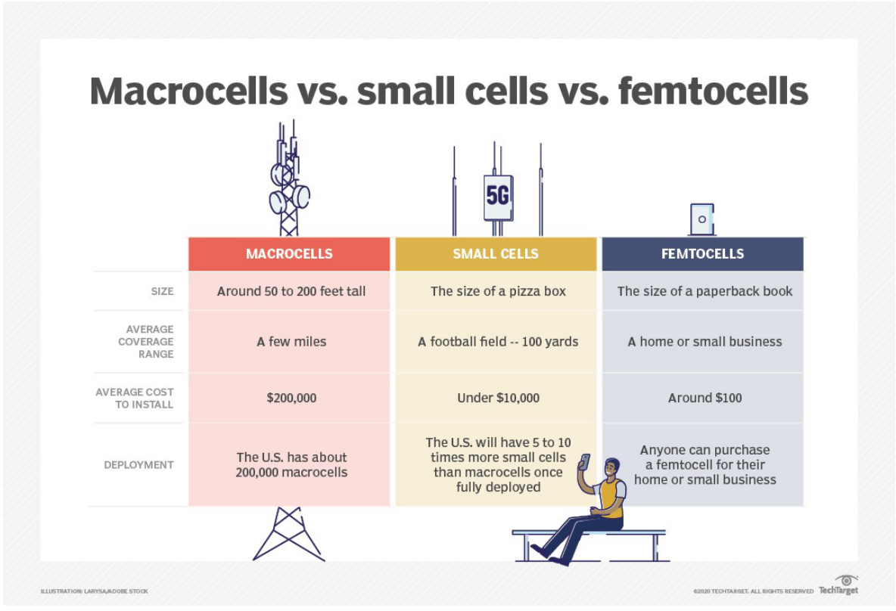
*Figure: p. 3. Macrocell: 50–200 ft tall, a few miles, about 200,000 US dollars to install, about 200,000 in the US. Small cell: pizza-box size, about 100 yards, under 10,000 dollars, 5–10 times more than macrocells once deployed. Femtocell: paperback-book size, one home, about 100 dollars, anyone can buy one.*

---

## 3. 5G architecture, perspective 1: the converged system

**One system for everything (p. 3).** 5G is a truly **converged** system supporting:

- mobile voice and **multi-gigabit-per-second** mobile Internet;
- **D2D** (device-to-device) and **V2X** (vehicle-to-everything: V2V to vehicles, V2I to infrastructure);
- native support for **MTC** (machine-type communication) and **public safety**;
- the **smart grid**, which makes the electricity grid more reliable and efficient.

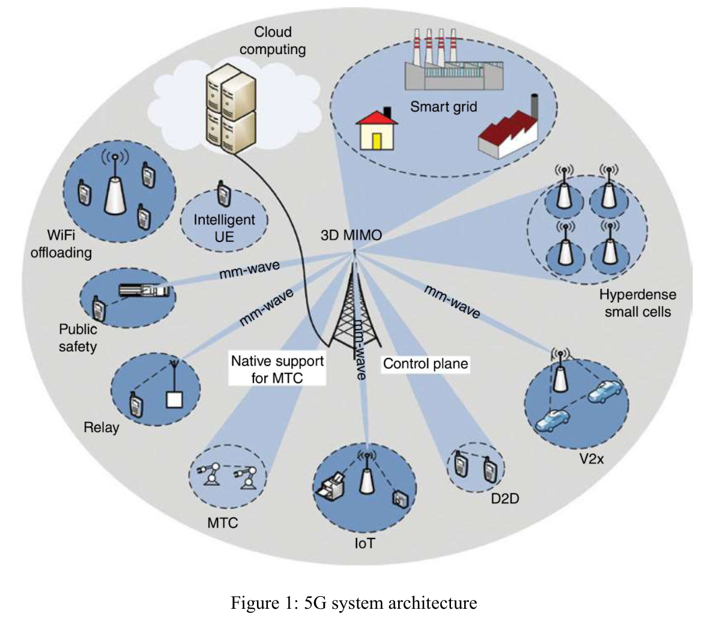
*Figure: p. 4, Figure 1.*

**The building blocks (pp. 3–5).**

| Technique | What it is | What it buys |
| :--- | :--- | :--- |
| **3D-MIMO** at BSs | antenna elements in both horizontal **and vertical** dimensions (a form of massive MIMO) | higher data rate and capacity at macro-cell level |
| **Relay stations, hyperdense small cells, WiFi offloading** | extra access points in dead spots and hot spots | coverage, capacity and **energy efficiency (EE)** |
| **Directional mmWave links** | wireless backhaul for relays and small-cell BSs | deployment flexibility vs wired (copper or fibre) backhaul |
| **Macro-BS control plane** | the macro BS manages D2D and small cells | small cells carry data; the macro handles signalling |
| **Cloud computing** | applied to the RAN and to a pool of user resources | applications closer to the user: lower latency for real-time control |

**Key terms (pp. 4–6).**

- **MIMO** (multiple input, multiple output): many antennas at **both** transmitter and receiver, combined so data travels over many signal paths at once. This minimises errors, raises data speed and capacity. Many copies of the same signal give more chances to reach the receiver without fading, which improves **signal-to-noise ratio** and error rate: a more stable connection with less congestion.
- **Degrees of freedom (DoF):** come from multi-antenna and massive antenna deployments (small cells, distributed antennas, massive MIMO).
- **Beamforming and phased arrays:** smart antennas steer a narrow **pencil beam** to a precise location, rotated electronically by **phase shifting**. Narrow beams exploit the **spatial DoF** without interfering with other users.
- **MTC:** wireless communication with sensors, actuators and objects **not operated by humans**.
- **WiFi offloading:** devices connect transparently to WiFi hotspots or access points when available, bypassing the carrier's network and reducing demand on its spectrum.
- **Blanket coverage:** coverage that is not targeted but covered by all channels; the traditional **sub-3 GHz** bands give macro-cell blanket coverage, while cm- and mmWave bands serve small cells.

**Why mmWave enables massive MIMO (p. 4).** Plenty of spectrum (easy Gbps "pipes") **and** tiny antennas: arrays of hundreds or thousands of elements fit even on a UE. 5G will **seamlessly integrate** existing radio access technologies (RATs: GSM, HSPA, LTE, WiFi) with the new mmWave ones.

**Meeting the 1000x capacity challenge (p. 5).** Hyperdense small cells give massive capacity and shorten the BS–UE distance, which raises energy efficiency. The split: **low bands for macro blanket coverage + control plane; high bands for small-cell data plane**.

> **Control plane vs user (data) plane (p. 5).** The **control plane** decides which path a packet takes; it carries **signalling** traffic. The **data plane** (also user, forwarding, carrier or bearer plane) forwards the packets according to that logic; it carries **user** traffic. *Analogy:* the control plane is the air-traffic controller; the data plane is the planes.

> 📘 **Beyond the notes — why more antennas help.** With $M$ transmit and $N$ receive antennas, MIMO can send up to $\min(M, N)$ independent streams in the same band at the same time. A 4×4 link can carry up to 4 times the data of a 1×1 link, without extra spectrum.

---

## 4. 5G architecture, perspectives 2 and 3: RAN, core, 5GS

**Perspective 2: two subsystems (pp. 6–7).**

- **Radio Access Network (RAN):** a distributed collection of base stations; it manages the radio spectrum so it is used efficiently and meets each user's quality-of-service (QoS).
- **Mobile Core:** a **bundle of functionality, not a device**. It (1) provides Internet (IP) connectivity for data and voice; (2) ensures that connectivity meets the promised QoS; (3) tracks user mobility for uninterrupted service; (4) tracks usage for billing and charging.
- Despite the name, from an Internet view the Mobile Core is still part of the **access network**: a bridge between the RAN in one area and the IP Internet. A good working model: one Mobile Core per metropolitan area, its RAN spanning dozens to hundreds of towers.
- **Backhaul network:** interconnects the base stations with the Mobile Core; typically wired, maybe ring-shaped. *E.g.* a **Passive Optical Network (PON)**, which provides Fibre-to-the-Home, is a prime candidate. It is necessary, but an **implementation choice, not prescribed by 3GPP**.

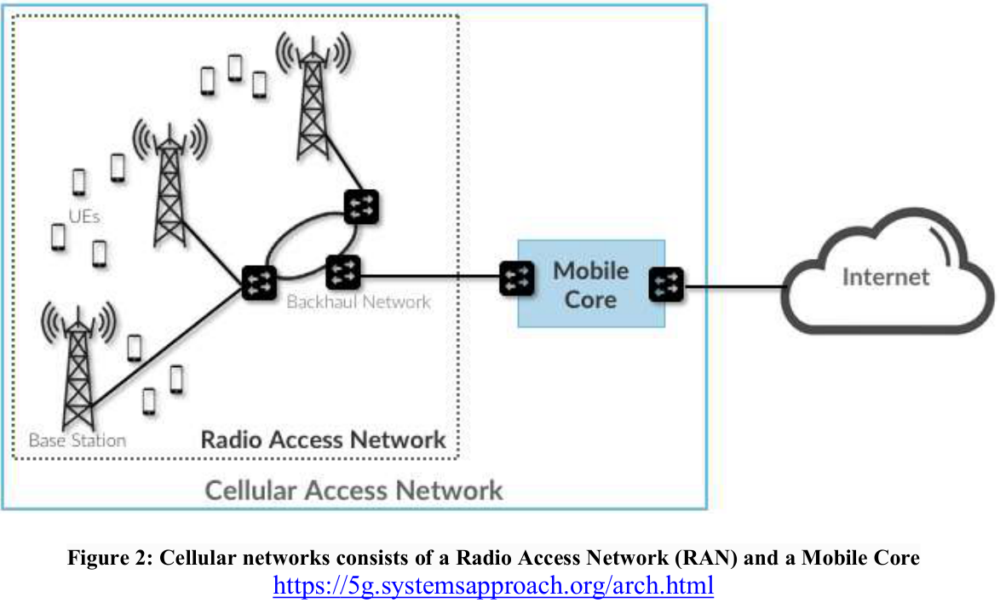
*Figure: p. 6, Figure 2.*

**Perspective 3: 5G built on LTE (p. 7).**

| Part | What it adds |
| :--- | :--- |
| **5G core network (5GC)** | network functions supporting **NFV**, **SDN** and **network slicing** |
| **NG-RAN** (next-generation RAN) | new backhaul interfaces and signalling between nearby base stations; RAN **centralisation and virtualisation**, **edge computing**, slicing |
| **5G system (5GS)** | 5GC + NG-RAN together |

- **SDN** (software-defined networking): separates data and control planes, so features are managed centrally.
- **NFV** (network functions virtualisation): separates functions from the hardware they usually run on and implements them **as software**.
- **Network slicing:** multiple unique **logical, virtualised networks** over one common infrastructure. *E.g.* one slice for low-latency factory robots, one for phone broadband, one for millions of low-power sensors, all on the same towers.

**Nodes (p. 7).** The 5G base station is the **gNB** (next-generation Node B); it talks to the mobile over the **NR** air interface (mmWave and multiple antennas). The 4G base station is the **eNB**. Either is generically a **node**. A node is in the **E-UTRAN** if it supports the legacy LTE backhaul to the **EPC** (evolved packet core), in the **NG-RAN** if it supports the 5G backhaul to the **5GC**, or in both.

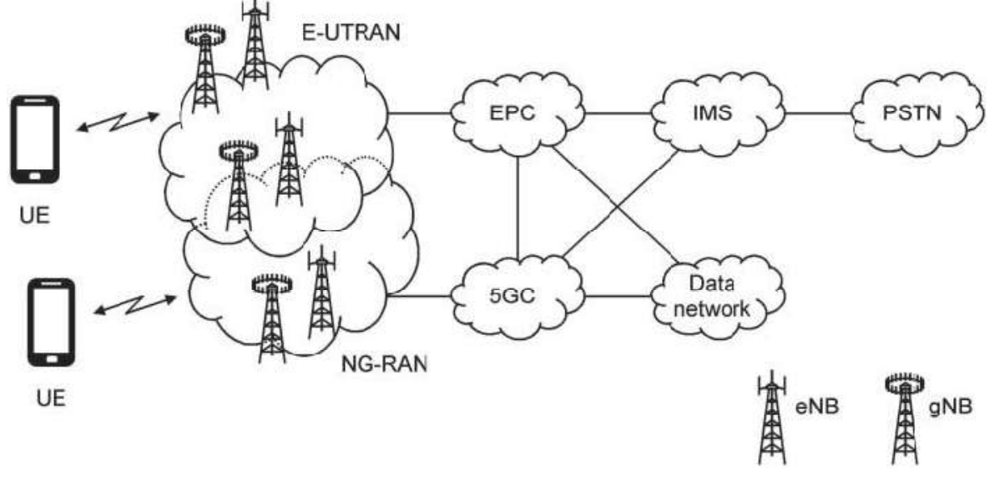
*Figure: p. 7, Figure 3.*

**Voice in 5G (p. 8).** In **Release 15** the 5GC handles voice by **VoIP alone**, controlled by a third-party app or the **IMS** (IP Multimedia Subsystem: a standard framework for voice, video and text over IP). **Release 16** adds **SRVCC** (single radio voice call continuity): an IMS voice call can be converted to a **circuit-switched** call and handed to a 3G cell (GSM/UMTS or CDMA2000). That is the **only** direct interaction between the 5GC and 2G/3G cores; during an SRVCC handover, connections to external packet data networks are torn down.

---

## 5. The 5G core: reference points vs service-based architecture

**What the 5GC does (p. 8).** The heart of the 5G network: reliable, secure connectivity and access to services. It handles connectivity and mobility management, authentication and authorisation, subscriber data and policy management. Its functions are **software-based and cloud-native**: independent of the underlying cloud, for agility and flexibility.

**Sessions (p. 8).** A mobile can connect to one or more packet **data networks (DN)**: the Internet, the IMS, or a private low-latency industrial network. Each connection has a **session management function (SMF)** that handles signalling with the mobile, reports data usage to charging, and controls one or more **user plane functions (UPFs)**, which carry the user's traffic.

**Two ways to draw the core (pp. 8–10).**

| | Reference point architecture | Service-based architecture (SBA) |
| :--- | :--- | :--- |
| Building blocks | **Network Elements (NE)** | **Network Functions (NF)**, each a **service provider** to other NFs |
| Connections | point-to-point interfaces, the **reference points** N1, N2, N3 … (3GPP TS 23.501) | a **common bus**; each NF exposes an interface named after it (Namf, Nsmf, Nnrf …) |
| Applies to | the **user plane** | the **control plane** only |

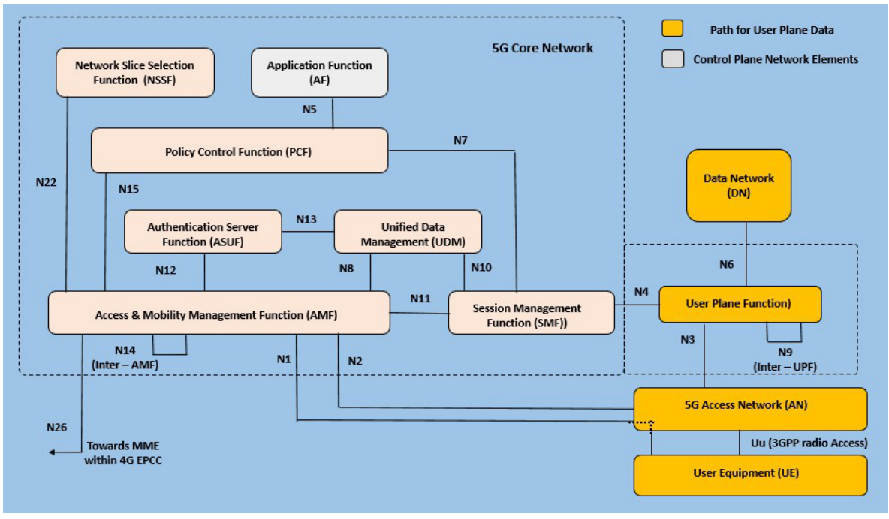
*Figure: p. 9, Figure 4. Orange boxes are on the user-plane data path.*

**Reading the reference-point figure (pp. 9–10).**

- It shows the **separation** of control-plane and user-plane functions.
- **Uplink:** UE → 5G access network (AN) → **UPF** → external network (Internet); downlink is the reverse.
- **Exception:** SMS user data can travel in **NAS** (Non-Access Stratum) signalling between the UE and the **AMF**.
- **N1:** UE ↔ AMF, a direct **logical** link. **N3:** access network ↔ UPF. **N9:** UPF ↔ UPF (one UPF faces the access network, a second faces the external data network). **N26:** AMF ↔ the 4G **MME** in the EPC, for **4G–5G handovers**.
- In the NG-RAN, user data and control signalling between UE and NG-RAN use the **Uu** air interface.

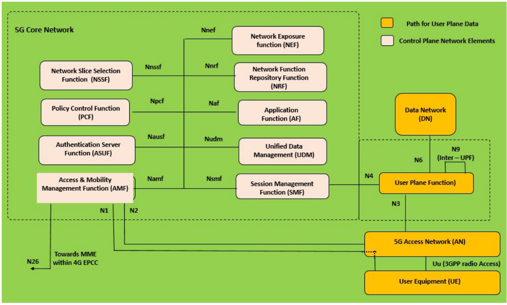
*Figure: p. 10, Figure 5.*

> ✏️ **Note discrepancy (pp. 9–10).** Both figures label the authentication function "ASUF"; the correct name is **AUSF** (Authentication Server Function), as the text says. Page 11 also carries a caption "Figure 6" with no figure.

> 📘 **Beyond the notes — why SBA.** With point-to-point links, adding a new function means wiring it to each partner. On a bus, a new NF registers once with the NRF and any NF can find and call it (HTTP/2 APIs). That is what "cloud-native" means here: functions are like web services that can be scaled or replaced independently.

---

## 6. The core network functions

**UPF (p. 10).** The data-plane part of **CUPS** (Control and User Plane Separation), a fundamental part of the 5GC: it forwards user traffic.

| Function | Role (pp. 11–12) |
| :--- | :--- |
| **NRF**, Network Repository Function | a key SBA element: the **central repository** of all NFs; NFs **register and discover** each other through a standard API |
| **AMF**, Access and Mobility Management | control-plane function; **registration** and **reachability** management |
| **AUSF**, Authentication Server Function | authentication and security services through the Nausf service-based interface; authenticates UEs and stores authentication keys |
| **NSSF**, Network Slice Selection Function | selects the **network slice instance (NSI)**, determines the allowed **NSSAI** (slice selection assistance information) and the AMF to serve the UE; the AMF can get the NRF, NSI ID and target AMFs during initial registration and PDU session setup |
| **PCF**, Policy Control Function | QoS policy and charging control (interfaces N7, N15, N28, N36, Rx); policy rules for slicing, roaming, mobility; collects subscriber metrics for operators; real-time management of subscribers and resources; works with other NFs through the NRF |
| **NEF**, Network Exposure Function | secure, simple access to the network for **external applications** and developers (SDKs, partnerships) |
| **AF**, Application Function | control-plane function providing application services, e.g. video streaming; a **trusted** AF talks to 5GC functions directly, a **third-party** AF goes through the **NEF** |
| **UDM**, Unified Data Management | subscriber data; service and access **authorisation** for authenticated subscribers, so they reach only their subscribed services |
| **SMF**, Session Management Function | interacts with the decoupled data plane; creates, updates and removes **PDU** (Protocol Data Unit) sessions; manages session context with the UPF |

> ✏️ **Note discrepancy (pp. 11–12).** The NEF, UDM and part of the PCF entries are copied from vendor product pages (e.g. "Alepo's", "Oracle NSSF", "ConfD CLI"). Learn the function each performs, not the vendor features.

**Service discovery, step by step (pp. 11–12).** How the AMF finds an AUSF:

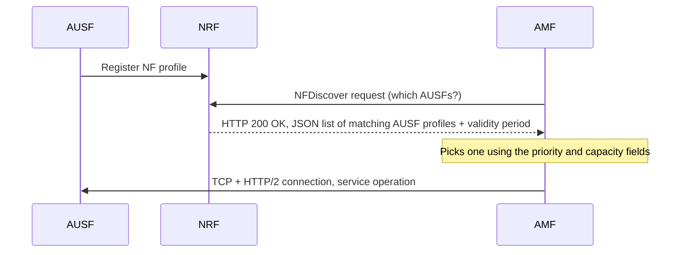

1. An NF registers with the NRF; then other NFs can discover it.
2. The AMF asks the NRF's **NFDiscover** service for registered AUSFs.
3. The NRF replies **HTTP 200 OK**; its JSON lists matching AUSF profiles plus a **validity period** (how long they may be cached).
4. The AMF picks one using the profiles' **priority and capacity** fields, opens **TCP and HTTP/2** connections and requests the service.
5. **Roaming:** the AMF asks its own NRF, which forwards the request to the NRF in the destination network; the AMF then contacts the chosen AUSF directly.

---

## 7. Tracking areas, registration and paging

**Tracking areas (p. 13).** The NG-RAN is organised into **tracking areas (TAs)**: small regions of perhaps **100 nodes**. TAs **do not overlap**: a cell lies in one TA, but a node can lie in several, since it controls several cells.

- **TAC** (tracking area code): **24 bits**, unique within the operator's network (PLMN, public land mobile network). $2^{24} = 16{,}777{,}216$ possible codes.
- **TAI** (tracking area identity) = PLMN-ID + TAC: **globally unique**.
- **Registration area (RA):** built from TAs; each is a mobile-specific **tracking area list** of at most **16 TAs**.

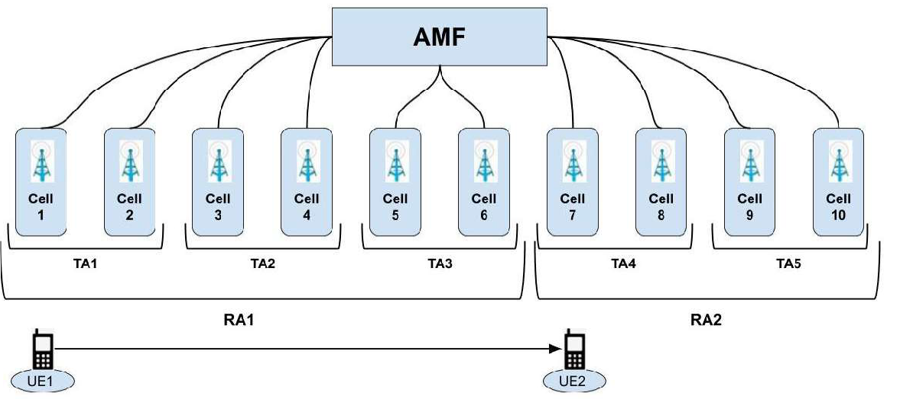
*Figure: p. 13, Figure 10. The UE starts in cell 1 (TA1). While it moves inside RA1, the network need not be told; crossing into RA2 triggers a mobility registration.*

**Registration (p. 14).** An active UE must be registered.

| Type | When |
| :--- | :--- |
| **Initial** | the UE connects after being switched on |
| **Periodic** | the UE re-registers at intervals, so the network can tell whether a UE in the RA has vanished without notice (e.g. battery died) |
| **Mobility** | the UE moves into a cell whose TA is **not** in its RA list |

**Paging (p. 14).** How the network **locates** an idle UE, triggered when a **downlink packet** arrives for it. The network pages only the cells of the UE's registration area, not the whole country.

> 📘 **Beyond the notes — the trade-off.** Big registration areas mean few mobility registrations but paging over many cells; small ones mean the reverse. *E.g.* RA1 here has 6 cells: a page goes to 6 cells instead of all 10.

> ✏️ **Note discrepancy (p. 14).** "DRX cycle – Disconnection in reception" should be **Discontinuous Reception**: an idle UE sleeps and wakes only at set paging moments to listen for pages, saving battery. Page 13 also has a stray fragment ("oth types of node at the same time") from cut text.

---

## 8. Carrier aggregation

**The idea (p. 14).** First introduced in **LTE Release 10**. A mobile talks through **several cells at once** instead of one, to raise its maximum data rate. The cells are controlled by **one base station** and use **different frequencies**, so they do not interfere. CA lets a UE transmit and receive on multiple **component carriers** from a single eNB simultaneously (p. 15).

| | Primary cell (PCell) | Secondary cells (SCells), optional |
| :--- | :--- | :--- |
| Number | exactly one | one or more |
| Carries | user traffic **and signalling** | **traffic only** |
| Direction | uplink and downlink | uplink and downlink, **or downlink alone** |

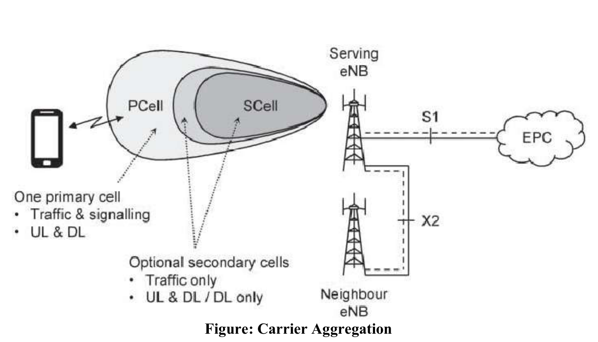
*Figure: p. 14.*

*Example:* 📘 LTE-Advanced allows up to 5 component carriers of up to 20 MHz each: $5 \times 20 = 100$ MHz in total, five times one carrier's peak rate.

---

## 9. Spread spectrum and OFDM/OFDMA

**Spread spectrum (p. 15).** Originally military: it spreads a signal over a **wide** band for secure communication. A **narrowband** signal is easily jammed by any other signal in the same band. Usually transmissions are kept narrow to save spectrum, but sometimes spreading is better. **Advantage:** many users can share the same bandwidth simultaneously without interfering. **So** it is **not economic when users are few**.

**OFDM in one line (pp. 15–17).** Instead of one fast stream on one wide carrier, split the data into **many slow streams** on many **closely spaced, orthogonal subcarriers**, sent in parallel.

- **Origin and use:** OFDM serves single-user 802.11 transmissions; **OFDMA**, its **multi-user** version, is used by 802.11ax (different users get different subcarriers). OFDM is a building block of 802.11 WLAN, 802.16 WiMAX, 3GPP LTE and 5G.
- **Combines** QAM and FDM (frequency division multiplexing) for high data rates.
- Each subcarrier is modulated with a normal scheme (**QPSK, 16QAM** …) at a **low symbol rate**; together they match the data rate of a single-carrier scheme in the same bandwidth.
- **Demodulation** uses **FFT** (fast Fourier transform) algorithms. **Weinstein and Ebert (1971)** added the **guard interval**, for better orthogonality on multipath channels.
- **Orthogonal** = acting independently, uncorrelated: signals that do not depend on or interfere with each other. Orthogonal spacing puts **nulls** at neighbouring subcarrier frequencies, so there is no **inter-carrier interference (ICI)** even **without guard bands**.

**OFDM vs plain FDM (p. 17).** FDM puts streams on separate channels with **guard bands** between them. OFDM differs in three ways: (1) multiple **subcarriers** carry one information stream; (2) the subcarriers are **orthogonal**; (3) a **guard interval** is added to each symbol against channel delay spread and **inter-symbol interference (ISI)**.

**Why OFDM wins (pp. 15–16).** It copes with **severe channel conditions** (high-frequency attenuation in long copper wire, narrowband interference, frequency-selective **fading** from multipath) **without complex equalisation filters**. It is more resilient to interference, uses bandwidth efficiently (closely spaced subchannels), and parallel low-rate substreams are less susceptible to interference.

**The transmit-receive chain (p. 17).**

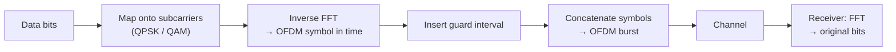

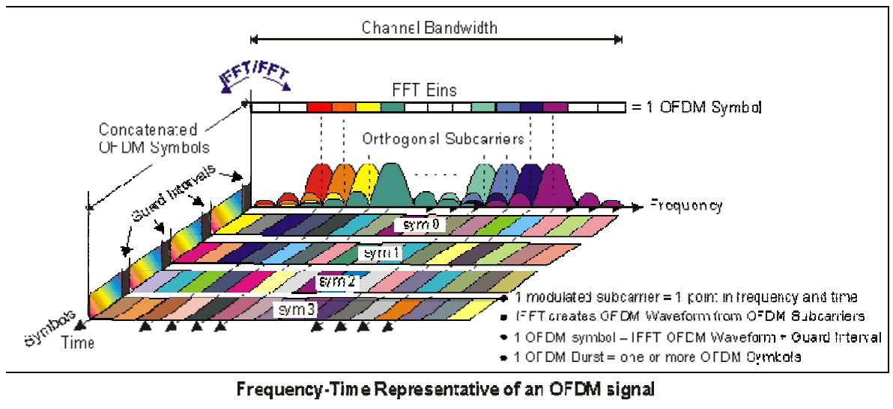
*Figure: p. 18. One modulated subcarrier = one point in frequency and time; the IFFT turns subcarriers into a waveform; symbol = IFFT waveform + guard interval; burst = one or more symbols.*

**FFT (p. 18).** An algorithm that computes the **discrete Fourier transform (DFT)** or its inverse (IDFT). Fourier analysis converts a signal from its original domain (time or space) to the **frequency domain** and back.

> 📘 **Beyond the notes — OFDM in numbers (802.11a).** 20 MHz split into 64 subcarriers: spacing $20 \text{ MHz} / 64 = 312.5$ kHz. Orthogonality needs symbol time $= 1/312.5 \text{ kHz} = 3.2$ µs; add a 0.8 µs guard interval → 4 µs per symbol. With 48 data subcarriers, 64QAM (6 bits) and coding rate 3/4: $48 \times 6 \times 0.75 = 216$ bits per symbol, and $216 / 4\ \mu\text{s} = 54$ Mbps, the top 802.11a rate. Each subcarrier is slow (250,000 symbols per second), so a 0.8 µs echo smears only a fifth of a symbol.

---

## 10. QPSK and QAM

**QPSK (p. 18).** Quadrature Phase Shift Keying: phase shift keying that sends **2 bits at once** by choosing one of **four phases** (0°, 90°, 180°, 270°). It carries **twice** the information of ordinary (binary) PSK in the same bandwidth.

**QAM (p. 18).** Quadrature Amplitude Modulation: the notes call it a combination of analog and digital modulation that sends two message streams by modulating the **amplitude of two carrier waves** (with amplitude shift keying). Bits per symbol depend on the order:

| Scheme | QPSK | 16QAM | 32QAM | 64QAM | 128QAM | 256QAM |
| :--- | :---: | :---: | :---: | :---: | :---: | :---: |
| Symbols $M$ | 4 | 16 | 32 | 64 | 128 | 256 |
| Bits $= \log_2 M$ | 2 | 4 | 5 | 6 | 7 | 8 |

**Differences (p. 18).** QPSK's spectral width is **wider** than QAM's; QPSK carries 2 bits vs 4–8 for QAM; QPSK's performance is **superior**; QAM's **bit error rate is higher**.

> ✏️ **Note discrepancy (p. 18).** These points need context. (1) The two QAM carriers are 90° apart (in quadrature), and QAM varies **both** amplitude and phase; QPSK is in fact the same as 4-QAM. (2) "Wider spectral width" is true only **for the same bit rate**: fewer bits per symbol means more symbols per second. (3) "Superior performance" means more **robust**: QPSK's 4 points are far apart, so noise rarely confuses them; 256QAM packs 256 points into the same power, so it needs a much cleaner signal. That is why phones switch: high-order QAM near the tower, QPSK at the cell edge.

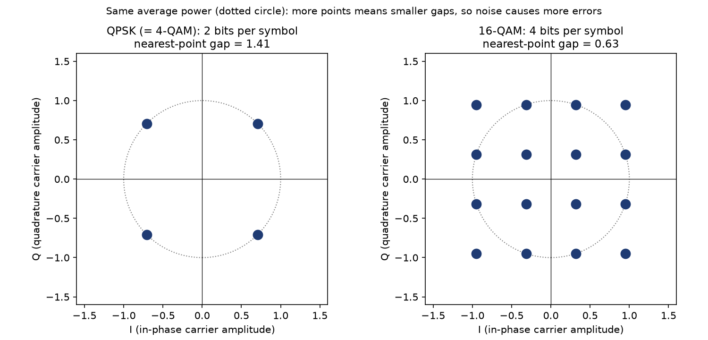
*Figure: 📘 Each dot is one symbol (an amplitude pair on the two carriers). At equal power, 16-QAM's points sit 0.63 apart vs 1.41 for QPSK, so a smaller noise kick lands on the wrong point.*
