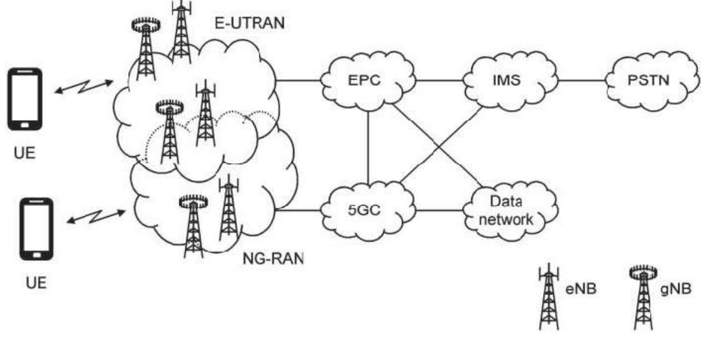

# 4G and 5G Networks — Exam Questions and Answers

This document is a companion to [4G_5G_Learning_Guide.md](4G_5G_Learning_Guide.md) (ma'am's notes `4G_5G.pdf`).
Try to answer each question first. Then read the provided answer.

**End-sem pattern:** Full marks 50, 3 hours. **Q1 is compulsory**: five terms, "define and state their usage", 5 × 2 = 10. Then answer **any two of Q2–Q5**, 20 marks each. Each question splits into parts such as 10 + 10, 10 + 5 + 5 or 5 + 5 + 5 + 5.
**Here:** Part A = 2-mark terms (Q1 style). Part B = 20-mark questions (Q2–Q5 style).
**This file keeps only the past-paper questions (🎯) and a few likely ones (✍️).** Every past question from the 2023–2025 mid-sem and end-sem papers on this topic is here.
**Tags:** 🎯 real paper (year, question); ✍️ likely question (not asked yet, but close to a past one); 📘 beyond the notes. 💡 = memory hook.
A 5G question has appeared in **every** end-sem paper (Q4 in 2023, 2024 and 2025), and 5G terms in every Q1.

| No. | Question | Source |
| :--- | :--- | :--- |
| A1 | mmWave (FR2) | ✍️ |
| A2 | MIMO | 🎯 2025 End Q1(d), 2023 End Q1(e) |
| A3 | MTC (Machine-Type Communication) | 🎯 2024 End Q1(c) |
| A4 | WiFi offloading | 🎯 2025 End Q4(b)(iv) |
| A5 | Control plane | 🎯 2023 End Q1(d) |
| A6 | User (data) plane | 🎯 2023 End Q1(c) |
| A7 | NFV (Network Functions Virtualisation) | 🎯 2024 End Q1(d) |
| A8 | Network slicing | 🎯 2025 End Q1(e) |
| A9 | SDN (Software-Defined Networking) | ✍️ |
| A10 | OFDM | ✍️ |
| B1(a) | What is the 5G core network? What tasks does it perform? [10] | 🎯 2025 End Q4, 2023 End Q4 |
| B1(b) | Write the tasks of: (i) NRF, (ii) NSSF, (iii) UDM, (iv) PCF, (v) Carrier Aggregation. [10] | 🎯 2025 End Q4, 2023 End Q4 |
| B2(a) | Draw the 5G access network architecture showing the RAN and core parts. [5] | 🎯 2024 End Q4 |
| B2(b) | Write the advantages of introducing small cells in a 5G network. [5] | 🎯 2024 End Q4 |
| B2(c) | Do a point-wise comparison of macro, pico and femto cells in terms of size, coverage range,… [10] | 🎯 2024 End Q4 |
| B3(a) | Write a short note on carrier aggregation. [10] | 🎯 2023 End Q5(a) |
| B4(a) | Describe the two 5G frequency ranges, FR1 and FR2. [5] | ✍️ |
| B5(a) | Describe the 5G converged system architecture and its main building blocks. [10] | ✍️ |
| B5(b) | Compare the reference-point and service-based architectures of the 5G core. [5] | ✍️ |

---

## Part A — 2-mark terms: define and state their usage

### A1. mmWave (FR2). ✍️ [2]

**Definition:** The 5G New Radio (5G wireless) band from **24 GHz** upward (the notes: 24–54 GHz). Its wavelengths are 1–10 mm. Its channels are wide: minimum 50 MHz, maximum 400 MHz.
**Usage:** It gives very high data rates because its channels are wide. However, its signals travel only short distances and walls block them. Because of this, operators use it with **many small cells**. Its tiny antennas also make **massive MIMO** (many antennas working together) arrays possible. (FR1, below 6 GHz, gives wide coverage.)

> 💡 mmWave = tiny waves (1–10 mm) → tiny antennas, short reach, huge speed.

### A2. MIMO. 🎯 2025 End Q1(d), 2023 End Q1(e) [2]

**Definition:** Multiple Input, Multiple Output. It uses **many antennas at both the transmitter and the receiver**. Data travels over many signal paths at the same time.
**Usage:** It raises **data rate and capacity** without needing extra spectrum (radio frequencies). The multiple signal copies cut down fading (signal drops) and errors. This gives a better signal-to-noise ratio (stronger signal compared to noise). 📘 With $M$ transmit and $N$ receive antennas, it supports up to $\min(M, N)$ streams. For example, a 4×4 link carries up to 4 times the data. 5G uses **3D (massive) MIMO** (antennas placed both horizontally and vertically) at base stations.

> 💡 MIMO = Many In, Many Out — like opening extra lanes on a highway at once.

### A3. MTC (Machine-Type Communication). 🎯 2024 End Q1(c) [2]

**Definition:** Automated wireless communication between sensors, actuators (devices that trigger physical actions), and devices **not operated by humans**.
**Usage:** It is used in IoT (Internet of Things): smart meters, smart grids, factory sensors, and connected vehicles. 5G gives **native support** (built-in support). For example, 5G can give a dedicated network slice (a separate virtual network) to millions of low-power sensors.

> 💡 MTC = Machines Talking to Computers, with no humans in the loop.

### A4. WiFi offloading. 🎯 2025 End Q4(b)(iv) [2]

**Definition:** Mobile devices **transparently connect to WiFi hotspots** (automatically, without user effort) or local access points when available. This bypasses the mobile carrier's cellular network.
**Usage:** It cuts data traffic on the carrier's cellular spectrum (radio frequencies). It adds **capacity and coverage** in busy traffic hotspots and dead zones (spots with no mobile signal). It also improves device **energy efficiency**.

> 💡 WiFi offloading = moving traffic off a crowded mobile road onto a local WiFi street.

### A5. Control plane. 🎯 2023 End Q1(d) [2]

**Definition:** The part of the network that **decides which path a packet takes**. It carries network **signalling** traffic (control messages).
**Usage:** It handles device registration, user mobility (tracking moving users), and session set-up. In 5G, the **macro BS** (large base station) runs the control plane while small cells carry data. In the core network, all control functions (AMF, SMF, NRF …) form the service-based architecture (functions sharing a common bus).

> 💡 Control plane = traffic police who direct cars, not the cars themselves.

### A6. User (data) plane. 🎯 2023 End Q1(c) [2]

**Definition:** The part of the network that **forwards packets** using decisions from the control plane. It carries **user** traffic. People also call it the data, forwarding, carrier, or bearer plane.
**Usage:** It carries actual voice and user data. In 5G, the **UPF** (User Plane Function) runs the user plane. Separating it from the control plane (**CUPS** [Control and User Plane Separation]) lets each plane scale (grow or shrink) independently.

> 💡 Control plane = air-traffic controller; user plane = the planes.

### A7. NFV (Network Functions Virtualisation). 🎯 2024 End Q1(d) [2]

**Definition:** Separating network functions from dedicated hardware (special single-purpose boxes) and running them **as software**.
**Usage:** The functions in the 5G core are **software and cloud-native** (built for the cloud). They run on standard commercial servers. Operators can scale or replace each function on its own. NFV also makes network slicing (multiple virtual networks on one physical network) possible.

> 💡 NFV = hardware network boxes turned into software apps on normal servers.

### A8. Network slicing. 🎯 2025 End Q1(e) [2]

**Definition:** Creating **multiple unique logical, virtualised networks** (separate software-made networks) over **one common physical infrastructure** (the same real towers and hardware).
**Usage:** Each slice is tuned for one specific type of service. For example:
- Low-latency (very low delay) links for factory robots.
- High-speed broadband for mobile phones.
- Connections for millions of low-power sensors.
All these slices share the same physical cell towers. The **NSSF** (Network Slice Selection Function) picks the right slice for each user.

> 💡 Network slicing = one physical cake cut into custom slices (robots, phones, sensors).

### A9. SDN (Software-Defined Networking). ✍️ [2]

**Definition:** **Separating the data and control planes**. This lets software manage network features from a **central** controller.
**Usage:** Along with NFV (Network Functions Virtualisation) and slicing, SDN is a key technology supported by the 5G core (5GC). It makes the network programmable (easy to change with software).

> 💡 SDN = split control from data so one central software brain runs the network.

### A10. OFDM. ✍️ [2]

**Definition:** Orthogonal Frequency Division Multiplexing. It splits data into **many slow streams**. It sends these streams in parallel over **closely spaced orthogonal subcarriers** (frequencies that do not interfere with each other).
**Usage:** It is the radio air interface (wireless link) of 4G LTE, 5G, and WiFi. It resists **multipath fading** (signal echoes) without needing complex equalisers (signal-fixing circuits). OFDMA, the multi-user version, gives different subcarriers to different users.

> 💡 OFDM = one fast stream split into many slow, non-clashing radio lanes.

---

## Part B — 20-mark questions

### B1. 🎯 2025 End Q4, 2023 End Q4

**(a)** What is the 5G core network? What tasks does it perform? **[10]**
**(b)** Write the tasks of: (i) NRF, (ii) NSSF, (iii) UDM, (iv) PCF, (v) Carrier Aggregation. **[10]**

**(a) Answer.**

**In short:** The 5G core (5GC) is a cloud-native bundle of software functions that handles connections, mobility, security, sessions, policy, billing, and slicing.

**5G core network (5GC):**
- It is the **heart of the 5G network**.
- It gives users reliable, secure network connections and access to network services.
- Together with the radio access network (NG-RAN), it forms the **5G system (5GS)**.
- It is a **bundle of functions, not a single device**.
- Its functions are **software-based and cloud-native** (built to run in the cloud).
- They are built using **NFV** (Network Functions Virtualisation), **SDN** (Software-Defined Networking), and **network slicing** (multiple virtual networks on one physical network).

**Tasks:**

1. **Connectivity:** Gives IP connectivity for data and voice. It links a mobile device to one or more **data networks** (such as the Internet, IMS, or a private network).
2. **Mobility management:** Tracks users as they move (using tracking areas, registration, and paging) so service does not drop. The **AMF** (access and mobility function) does this task.
3. **Authentication and authorisation:** Checks user identity (**AUSF**). It lets users access only the services they subscribed to (**UDM**, Unified Data Management).
4. **Session management:** Creates, updates, and removes PDU sessions (user data sessions). It also controls user-plane functions (**SMF**, **UPF**).
5. **QoS and policy:** Makes sure each link meets its promised quality of service (QoS). It applies policy rules and runs charging (**PCF**, Policy Control Function).
6. **Subscriber data management:** Stores and manages user subscription profiles (**UDM**).
7. **Usage tracking:** Tracks network usage for billing and charging.
8. **Network slicing:** Picks the right network slice for each user (**NSSF**, Network Slice Selection Function).

**How it is organised:**
- Control-plane functions connect over a **common bus** in a service-based architecture (SBA). Each function offers services to other functions.
- The **UPF** (User Plane Function) carries user data traffic.
- The core cleanly separates the control and user planes (**CUPS**, Control and User Plane Separation) so each plane can scale independently.

> 💡 The core: connect, move, check, session, policy, bill, slice.

**(b) Answer.**

**In short:** NRF, NSSF, UDM, and PCF are 5G core control functions for discovery, slicing, user data, and policy, while Carrier Aggregation joins radio bands to boost speed.

| Function | Tasks |
| :--- | :--- |
| **(i) NRF**, Network Repository Function | Acts as the **central repository** (directory) for all network functions. Network functions (NFs) **register** their profiles with it. They **discover** (find) each other through it using a standard API. For example, the AMF asks the NRF for available AUSFs, and the NRF returns a list with priority and capacity fields. |
| **(ii) NSSF**, Network Slice Selection Function | Picks the **network slice instance** for the UE (user device). Decides the allowed **NSSAI** (slice selection assistance information). Also picks the **AMF** to serve the UE. |
| **(iii) UDM**, Unified Data Management | Stores and manages **subscriber data** (user profiles). Gives service and access **authorisation** (permission). This ensures authenticated users access only their subscribed services. |
| **(iv) PCF**, Policy Control Function | Handles **QoS policy and charging control** (service quality and billing rules). Sets policy rules for slicing, roaming, and mobility. Collects subscriber metrics and manages users and resources in real time. |
| **(v) Carrier Aggregation** | A UE uses **several component carriers (cells on different frequencies) from one base station at once** to raise its peak data rate. It uses one **primary cell** (for traffic and signalling) and optional **secondary cells** (for traffic only). For example, 5 × 20 MHz = 100 MHz. |

Also know (2025 asked WiFi offloading, see A4):

| Function | Task |
| :--- | :--- |
| **AMF** | Access and mobility: handles user **registration** and **reachability**. |
| **SMF** | Creates, updates, and removes **PDU sessions** (data sessions). Controls UPFs. |
| **UPF** | Forwards **user traffic** (runs the user plane). |
| **AUSF** | **Authenticates** UEs (checks user identity). Stores authentication keys. |
| **NEF** | Exposes network capabilities securely to **external applications**. |
| **AF** | Gives application services (for example, video). Third-party AFs connect through the NEF. |

> 💡 Read the key letter: N**R**F = Repository, N**S**SF = Slice, U**D**M = Data, **P**CF = Policy; CA = Combine bands.

### B2. 🎯 2024 End Q4

**(a)** Draw the 5G access network architecture showing the RAN and core parts. **[5]**
**(b)** Write the advantages of introducing small cells in a 5G network. **[5]**
**(c)** Do a point-wise comparison of macro, pico and femto cells in terms of size, coverage range, cost and deployment. **[10]**

**(a) Answer.**

**In short:** A 5G access network connects user devices to the Internet through three parts: the Radio Access Network (RAN), the backhaul, and the Mobile Core (5GC).

- **Radio Access Network (RAN):** A spread-out group of **base stations** (called gNBs in 5G). They use radio spectrum well and meet each user's QoS (quality of service) needs. UEs (user devices) connect over the **NR** (New Radio) air interface.
- **Backhaul network:** Links base stations to the core network. It is usually wired (such as a passive optical network). Operators choose how to build it because 3GPP does not fix its design.
- **Mobile Core (5GC):** Gives IP connectivity, QoS control, mobility tracking, and billing. It links devices to the **Internet**. Usually, one core network serves a metropolitan area (city) with tens to hundreds of RAN towers.
- **5GS = NG-RAN + 5GC.** A base station that also supports LTE backhaul to the EPC (4G core) belongs to the E-UTRAN as well.

> 💡 Path of traffic: UE → RAN (towers) → Backhaul (wires) → 5GC (core) → Internet.

**(b) Answer.**

**In short:** Small cells solve mmWave's short reach and improve capacity, speed, indoor coverage, battery life, and energy efficiency at low cost.

**Small cells** are low-powered radio access points that cover a small area. High-band (mmWave) signals travel only short distances, so 5G needs many smaller cells.

Advantages:
1. **Capacity:** Small cells reuse frequencies very densely. For example, one 1 km macrocell covers the area of $(1000/100)^2 = 100$ picocells of 100 m. Because each picocell reuses the full spectrum, it supports up to about 100 times more traffic.
2. **Higher data speeds and stronger coverage:** They give high speeds where many devices share bandwidth (such as train stations and stadiums).
3. **Longer handset battery life:** The mobile phone stays close to its access point. Because the link is short, the phone needs less transmit power and saves battery.
4. **Coverage indoors and at the cell edge:** They fill coverage gaps where macrocell signals cannot reach.
5. **Cheap and quick to deploy:** They are small ("pizza-box" size) and cost under 10,000 dollars. They also give better **energy efficiency** because the distance between base station and device is short.

> 💡 5 wins of small cells: **C**apacity, **S**peed, **B**attery, **G**aps filled, **C**heap setup.

**(c) Answer.**

**In short:** Macrocells are costly towers for wide areas, picocells are mid-sized boxes for busy hotspots, and femtocells are cheap user-installed boxes for indoors.

| Point | Macrocell | Picocell | Femtocell |
| :--- | :--- | :--- | :--- |
| **Size** | Large tower, 50–200 ft tall | Small box (small-cell family, "pizza-box" size) | Paperback-book size |
| **Coverage range** | > 1 km, a few miles | 100–300 m | 10–50 m, one home |
| **Transmit power** | 20–160 W (typical 40 W) | 250 mW – 2 W | 10–200 mW |
| **Cost** | About 200,000 dollars to install | Under 10,000 dollars | About 100 dollars |
| **Deployment** | Installed by the operator on towers for blanket coverage | Installed by the operator in offices, malls, stations, stadiums, and aircraft: **outdoor hotspots** and dense areas | Installed by **anyone** in homes and small businesses: **indoor** coverage |
| 📘 **Users served** | Thousands | Tens to hundreds | A few |
| **Purpose** | Wide-area coverage and fast users | Adds **capacity** where use is dense | Gives **in-building** coverage at the cell edge |

> 💡 Macro covers a town, pico a mall, femto a flat.

### B3. 🎯 2023 End Q5(a)

**(a)** Write a short note on carrier aggregation. **[10]**

**(a) Answer.**

**In short:** Carrier aggregation joins several frequency bands from one base station into one wider pipe so a phone gets a higher peak data rate.

**Carrier aggregation (CA):**
- First introduced in **LTE Release 10**.
- A mobile phone talks through **several cells at once** instead of one. This raises its **maximum data rate**.
- **One base station** controls all these cells (called component carriers).
- They do not interfere with each other because they use **different frequencies**.

| | Primary cell (PCell) | Secondary cells (SCells) |
| :--- | :--- | :--- |
| Number | Exactly **one** | **Zero or more** (optional) |
| Carries | User traffic **and signalling** (control messages) | **Traffic only** |
| Direction | Uplink and downlink | Uplink and downlink, **or downlink only** |

- The base station connects to the core (EPC) over the **S1** interface. It connects to neighbour base stations over the **X2** interface.
- *Example:* LTE-Advanced allows up to 5 carriers of up to 20 MHz each: $5 \times 20 = 100$ MHz. This gives five times the peak rate of one carrier.
- 📘 The carriers may be **contiguous** (side by side) in one band, **non-contiguous** (separated) in one band, or in **different bands**.

**Why it matters:** An operator's spectrum is often scattered in small pieces. Carrier aggregation joins them into one wide pipe. As a result, a user gets a higher peak rate without needing a new wide band.

> 💡 One primary for control, extra secondaries for speed.

### B4. ✍️

**(a)** Describe the two 5G frequency ranges, FR1 and FR2. **[5]**

**(a) Answer.**

**In short:** 5G splits its radio spectrum into FR1 (below 6 GHz) for wide coverage and FR2 (24 GHz upward) for very high speeds over short distances.

5G **New Radio** (NR) has two frequency ranges:

| | FR1 ("sub-6") | FR2 ("mmWave") |
| :--- | :--- | :--- |
| Frequencies | Below 6 GHz | 24 GHz upward (notes: 24–54 GHz; standard 24.25–52.6 GHz) |
| Channel bandwidth | Up to 100 MHz (spectrum here is crowded) | 50–400 MHz |
| Range | Longer; most networks use 3.3–4.2 GHz (*e.g.* band n78, 3.5 GHz) | Short; walls and rain easily block signals |
| Role | Gives wide coverage | Gives very high data rates in small cells |

Higher frequency gives more bandwidth and speed, but shorter reach. Because of this, 5G uses low bands for **blanket coverage and control**, and high bands for **small-cell data**.

> 💡 FR1 = **F**ar **R**each (sub-6 GHz); FR2 = **F**ast **R**ates (mmWave, short reach).

### B5. ✍️

**(a)** Describe the 5G converged system architecture and its main building blocks. **[10]**
**(b)** Compare the reference-point and service-based architectures of the 5G core. **[5]**

**(a) Answer.**

**In short:** 5G combines mobile broadband, device, vehicle, sensor, and grid services in one system built on 3D-MIMO, dense small cells, mmWave backhaul, macro control, cloud computing, and beamforming.

5G is a **converged** (unified) system. Alongside mobile voice and multi-gigabit Internet, it supports **D2D** (device-to-device), **V2X** (vehicle-to-everything), native **MTC** (Machine-Type Communication), **public safety**, and the **smart grid**.

| Building block | What it is | What it gives |
| :--- | :--- | :--- |
| **3D-MIMO** at macro BSs | Antenna arrays placed in horizontal and vertical directions. | Higher data rate and greater capacity. |
| **Hyperdense small cells, relays, WiFi offloading** | Extra access points placed in hot spots (busy areas) and dead spots (no-signal areas). | Better capacity, coverage, and **energy efficiency**. |
| **mmWave links** | Directional wireless **backhaul** (link to the core) for relays and small cells. | Flexible setup, cheaper than laying fibre. |
| **Macro-BS control plane** | The macro BS manages D2D and small cells. | Small cells carry data, while the macro BS handles signalling (control messages). |
| **Cloud computing** | Cloud servers for the RAN and user apps. | Runs apps close to the user for low latency (low delay). |
| **Beamforming** | Phased arrays aim narrow pencil beams electronically. | Serves users directly without interfering with others. |

**The 1000× capacity plan:**
- Low bands give macro **blanket coverage and the control plane**.
- High bands carry **small-cell data**.
- mmWave gives wide spectrum **and** tiny antennas, so hundreds of elements fit in one array.
- 5G also combines existing radio technologies (GSM, HSPA, LTE, WiFi) with mmWave.

> 💡 6 blocks: **3D**-MIMO, **S**mall cells, **m**mWave links, **M**acro control, **C**loud, **B**eamforming (low bands cover, high bands speed).

**(b) Answer.**

**In short:** The user plane uses point-to-point links between network elements (reference-point), while the control plane uses software functions on a common bus (service-based).

| | Reference-point architecture | Service-based architecture (SBA) |
| :--- | :--- | :--- |
| Building blocks | Uses **network elements**. | Uses **network functions (NFs)**, each acting as a **service provider** to others. |
| Links | Uses **point-to-point** interfaces named N1, N2, N3 … | Uses a **common bus**. Each NF exposes an interface named after itself (Namf, Nsmf, Nnrf …). |
| Applies to | The **user plane**. | The **control plane**. |
| Adding a function | Wire it to every partner element. | Register once with the **NRF** (Network Repository Function); any function can find it because all share the bus. |

Key reference points:
- **N1**: UE (user device)–AMF.
- **N3**: Access network–UPF (User Plane Function).
- **N9**: UPF–UPF.
- **N26**: AMF–4G MME (4G–5G handover).

> 💡 Reference-point = direct wires (N1, N3, N9, N26) for the user plane; SBA = shared bus + NRF directory for the control plane.
