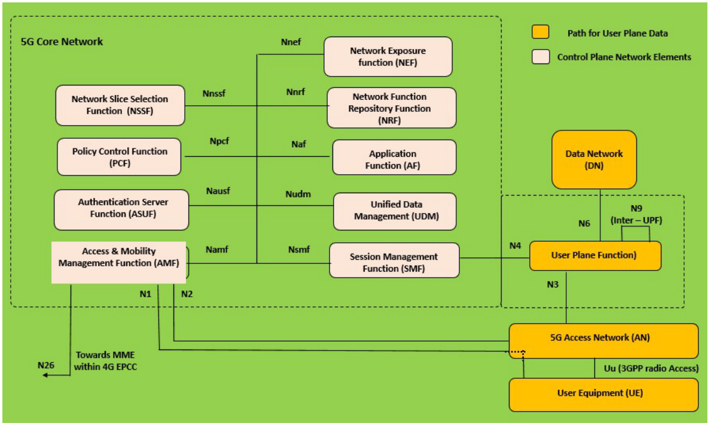
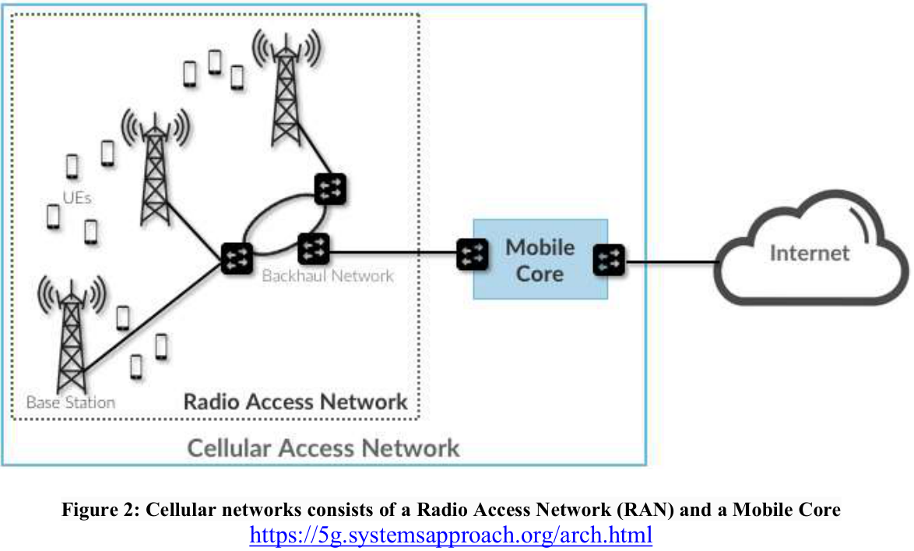
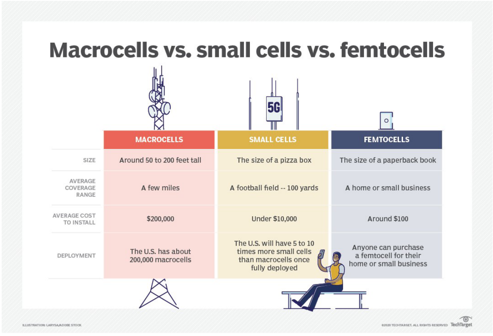
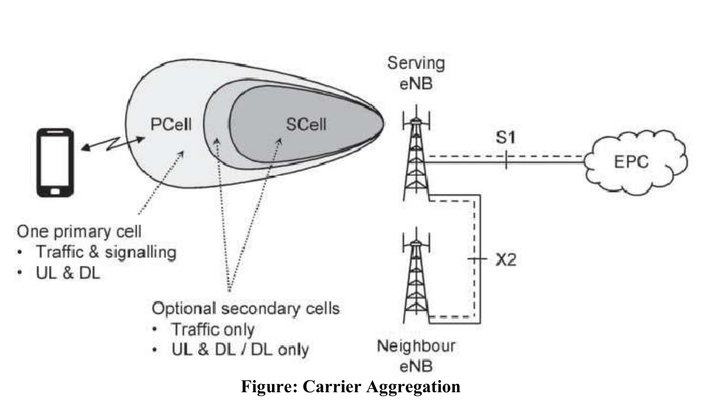
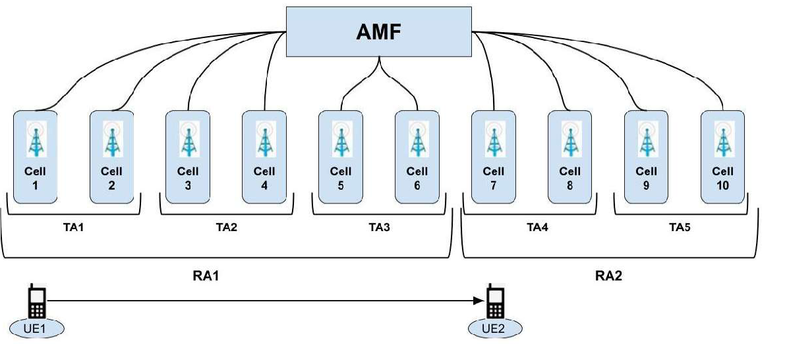
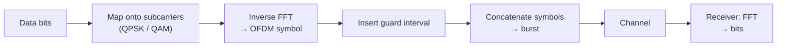
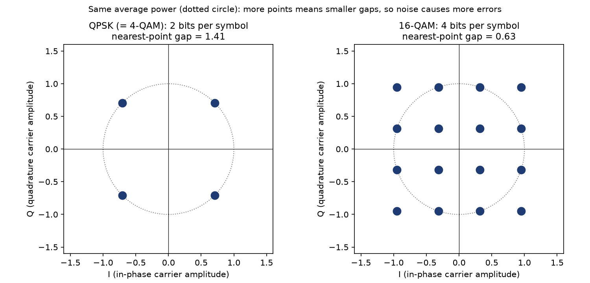
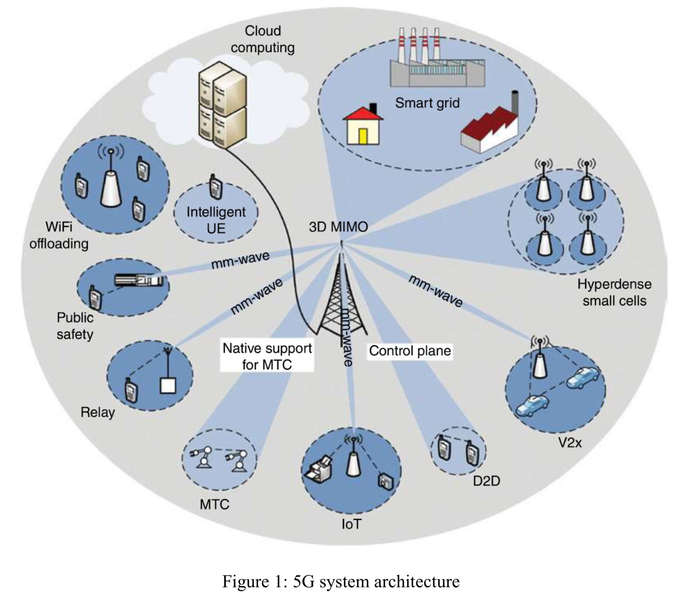

# 4G and 5G Networks — Exam Questions and Answers

This document is a companion to [4G_5G_Learning_Guide.md](4G_5G_Learning_Guide.md) (ma'am's notes `4G_5G.pdf`).
Try to answer each question first. Then read the provided answer.

**End-sem pattern:** Full marks 50, 3 hours. **Q1 is compulsory**: five terms, "define and state their usage", 5 × 2 = 10. Then answer **any two of Q2–Q5**, 20 marks each, split into parts such as 10 + 10, 10 + 5 + 5 or 5 + 5 + 5 + 5.
**Here:** Part A = 2-mark terms (Q1 style). Part B = 20-mark questions (Q2–Q5 style).
**Tags:** 🎯 real paper (year, question); ✍️ practice to cover the notes; 📘 beyond the notes. 💡 = memory hook.
A 5G question has appeared in **every** end-sem paper (Q4 in 2023, 2024 and 2025), and 5G terms in every Q1.

| Topic in the guide | Question |
| :--- | :--- |
| FR1 and FR2 spectrum (§1) | A1, B4(c) |
| Small cells (§2) | B2(b), B2(c) |
| Converged system, MIMO, MTC, WiFi offloading, planes (§3) | A2, A3, A4, A5, A6, B5(a) |
| RAN, core, 5GS, NFV, SDN, slicing (§4) | A7, A8, A9, B1(a), B2(a) |
| Reference points vs SBA (§5) | B5(b) |
| Core network functions, service discovery (§6) | B1(b), B5(c) |
| Tracking areas, registration, paging (§7) | A10, B3(b) |
| Carrier aggregation (§8) | B1(b), B3(a) |
| Spread spectrum, OFDM (§9) | A11, B4(a) |
| QPSK and QAM (§10) | B4(b) |

---

## Part A — 2-mark terms: define and state their usage

### A1. mmWave (FR2). ✍️ [2]

**Definition:** The 5G New Radio band from **24 GHz** upward (the notes: 24–54 GHz). Its wavelengths measure 1–10 mm. Channels are wide: minimum 50 MHz, maximum 400 MHz.
**Usage:** Provides very high data rates. Its signals travel only short distances and walls block them. Because of this, operators deploy it with **many small cells**. Its tiny antennas also make **massive MIMO** arrays possible. (FR1, below 6 GHz, provides wide coverage.)

### A2. MIMO. 🎯 2025 End Q1(d), 2023 End Q1(e) [2]

**Definition:** Multiple Input, Multiple Output. It uses **many antennas at both the transmitter and the receiver**. Data travels over many signal paths at the same time.
**Usage:** Increases **data rate and capacity** without needing extra spectrum. The multiple signal copies reduce fading and errors (giving a better signal-to-noise ratio). 📘 With $M$ transmit and $N$ receive antennas, it supports up to $\min(M, N)$ streams. For example, a 4×4 link carries up to 4 times the data. 5G uses **3D (massive) MIMO** at base stations.

### A3. MTC (Machine-Type Communication). 🎯 2024 End Q1(c) [2]

**Definition:** Automated wireless communication between sensors, actuators, and devices **not operated by humans**.
**Usage:** Used in IoT (Internet of Things): smart meters, smart grids, factory sensors, and connected vehicles. 5G provides **native support** (built-in support). For example, it can provide a dedicated network slice for millions of low-power sensors.

### A4. WiFi offloading. 🎯 2025 End Q4(b)(iv) [2]

**Definition:** Mobile devices **transparently connect to WiFi hotspots** or local access points when available. This bypasses the mobile carrier's cellular network.
**Usage:** Reduces data traffic on the carrier's cellular spectrum. It adds **capacity and coverage** in traffic hotspots and dead zones. It also improves device **energy efficiency**.

### A5. Control plane. 🎯 2023 End Q1(d) [2]

**Definition:** The part of the network that **decides which path a packet takes**. It carries network **signalling** traffic (control messages).
**Usage:** Handles device registration, user mobility, and session set-up. In 5G, the **macro BS** (base station) manages the control plane while small cells carry data. In the core network, all control functions (AMF, SMF, NRF …) form the service-based architecture.

### A6. User (data) plane. 🎯 2023 End Q1(c) [2]

**Definition:** The part of the network that **forwards packets** according to decisions from the control plane. It carries **user** traffic. People also call it the data, forwarding, carrier, or bearer plane.
**Usage:** Carries actual voice and user data. In 5G, the **UPF** (User Plane Function) handles the user plane. Separating it from the control plane (**CUPS** [Control and User Plane Separation]) allows each plane to scale independently.

> 💡 Control plane = air-traffic controller; user plane = the planes.

### A7. NFV (Network Functions Virtualisation). 🎯 2024 End Q1(d) [2]

**Definition:** Separating network functions from dedicated hardware and running them **as software**.
**Usage:** The functions in the 5G core are **software and cloud-native**. They run on standard commercial servers. Operators can scale or replace them independently. NFV also makes network slicing possible.

### A8. Network slicing. 🎯 2025 End Q1(e) [2]

**Definition:** Creating **multiple unique logical, virtualised networks** over **one common physical infrastructure**.
**Usage:** Each slice is tuned for one specific type of service. For example:
- Low-latency links for factory robots.
- High-speed broadband for mobile phones.
- Connections for millions of low-power sensors.
All these slices run on the same physical cell towers. The **NSSF** (Network Slice Selection Function) selects the right slice for each user.

### A9. SDN (Software-Defined Networking). ✍️ [2]

**Definition:** **Separating the data and control planes**. This allows software to manage network features from a **central** controller.
**Usage:** Along with NFV and slicing, SDN is a core technology supported by the 5G core (5GC). It makes the network programmable.

### A10. Tracking area. ✍️ [2]

**Definition:** A small region of the NG-RAN (Next Generation Radio Access Network), often covering about 100 nodes. Tracking areas do not overlap. Each tracking area has a **24-bit TAC** (Tracking Area Code). The TAI (Tracking Area Identity) = PLMN-ID + TAC, which is globally unique.
**Usage:** Used for **mobility management** (tracking user location). A UE's (user equipment) registration area is a list of up to 16 tracking areas. The UE re-registers only when it enters a tracking area outside its list. The network **pages** only that area to locate the device.

### A11. OFDM. ✍️ [2]

**Definition:** Orthogonal Frequency Division Multiplexing. It splits data into **many slow streams**. It transmits these streams in parallel over **closely spaced orthogonal subcarriers** (frequencies that do not interfere with each other).
**Usage:** It is the radio air interface of 4G LTE, 5G, and WiFi. It resists **multipath fading** (signal echoes) without needing complex equalisers. OFDMA, the multi-user version, assigns different subcarriers to different users.

---

## Part B — 20-mark questions

### B1. 🎯 2025 End Q4, 2023 End Q4

**(a)** What is the 5G core network? What tasks does it perform? **[10]**
**(b)** Write the tasks of: (i) NRF, (ii) NSSF, (iii) UDM, (iv) PCF, (v) Carrier Aggregation. **[10]**

**(a) Answer.**

**5G core network (5GC):** The **heart of the 5G network**. It provides reliable, secure connections to the network and access to network services. Together with the radio access network (NG-RAN), it forms the **5G system (5GS)**. The core is a **bundle of functions, not a single device**. Its functions are **software-based and cloud-native**. They are built using **NFV**, **SDN**, and **network slicing**.

**Tasks:**

1. **Connectivity:** Provides IP connectivity for data and voice. It connects a mobile device to one or more **data networks** (such as the Internet, IMS, or a private network).
2. **Mobility management:** Tracks users as they move (using tracking areas, registration, and paging). This prevents service interruptions. The **AMF** performs this task.
3. **Authentication and authorisation:** Checks user identity (**AUSF**). It allows users to access only their subscribed services (**UDM**).
4. **Session management:** Creates, updates, and removes PDU sessions. It also controls user-plane functions (**SMF**, **UPF**).
5. **QoS and policy:** Ensures each connection meets promised quality of service levels. It applies policy rules and manages charging (**PCF**).
6. **Subscriber data management:** Manages user subscription profiles (**UDM**).
7. **Usage tracking:** Tracks network usage for billing and charging.
8. **Network slicing:** Selects the right network slice for each user (**NSSF**).

**How it is organised:** Control-plane functions connect over a **common bus** in a service-based architecture (SBA). Each function offers services to other functions. The **UPF** carries user data traffic. The core cleanly separates the control and user planes (**CUPS**).

> 💡 The core: connect, move, check, session, policy, bill, slice.

**(b) Answer.**

| Function | Tasks |
| :--- | :--- |
| **(i) NRF**, Network Repository Function | The **central repository** for all network functions. Network functions (NFs) **register** their profiles with it. They **discover** each other through it using a standard API. For example, the AMF asks the NRF for available AUSFs. The NRF returns a list with priority and capacity fields. |
| **(ii) NSSF**, Network Slice Selection Function | Selects the **network slice instance** for the UE. Determines the allowed **NSSAI** (slice selection assistance information). It also chooses the **AMF** to serve the UE. |
| **(iii) UDM**, Unified Data Management | Stores and manages **subscriber data**. Gives service and access **authorisation**. This ensures that authenticated subscribers access only their subscribed services. |
| **(iv) PCF**, Policy Control Function | Handles **QoS policy and charging control**. Sets policy rules for slicing, roaming, and mobility. Collects subscriber metrics. Manages subscribers and resources in real time. |
| **(v) Carrier Aggregation** | A UE uses **several component carriers (cells on different frequencies) from one base station at once** to raise its peak data rate. It uses one **primary cell** (for traffic and signalling) and optional **secondary cells** (for traffic only). For example, 5 × 20 MHz = 100 MHz. |

Also know (2025 asked WiFi offloading, see A4):

| Function | Task |
| :--- | :--- |
| **AMF** | Access and mobility: handles user **registration** and **reachability**. |
| **SMF** | Creates, updates, and removes **PDU sessions**. Controls UPFs. |
| **UPF** | Forwards **user traffic** (operates the user plane). |
| **AUSF** | **Authenticates** UEs. Stores authentication keys. |
| **NEF** | Exposes network capabilities securely to **external applications**. |
| **AF** | Provides application services (for example, video). Third-party AFs connect through the NEF. |

### B2. 🎯 2024 End Q4

**(a)** Draw the 5G access network architecture showing the RAN and core parts. **[5]**
**(b)** Write the advantages of introducing small cells in a 5G network. **[5]**
**(c)** Do a point-wise comparison of macro, pico and femto cells in terms of size, coverage range, cost and deployment. **[10]**

**(a) Answer.**

- **Radio Access Network (RAN):** A distributed group of **base stations** (called gNBs in 5G). They manage radio spectrum efficiently and meet QoS requirements for each user. UEs connect over the **NR** air interface.
- **Backhaul network:** Connects base stations to the core network. It is usually wired (such as a passive optical network). Operators choose how to deploy it; 3GPP does not fix its design.
- **Mobile Core (5GC):** Provides IP connectivity, QoS control, mobility tracking, and billing. It connects devices to the **Internet**. Typically, one core network serves a metropolitan area with tens to hundreds of RAN towers.
- **5GS = NG-RAN + 5GC.** A base station that also supports LTE backhaul to the EPC belongs to the E-UTRAN as well.

**(b) Answer.**

**Small cells** are low-powered radio access points covering a small area. High-band (mmWave) signals travel only short distances. Therefore, 5G requires many smaller cells. Advantages:

1. **Capacity:** Frequencies are reused very densely. For example, one 1 km macrocell covers the area of $(1000/100)^2 = 100$ picocells of 100 m. Each picocell reuses the full spectrum. This allows up to about 100 times more traffic.
2. **Higher data speeds and stronger coverage:** They provide high speeds where many devices share bandwidth (such as train stations and stadiums).
3. **Longer handset battery life:** The mobile phone stays close to its access point. Therefore, it needs less transmit power and saves battery.
4. **Coverage indoors and at the cell edge:** They fill coverage gaps where macrocell signals cannot reach.
5. **Cheap and quick to deploy:** They are small ("pizza-box" size) and cost under 10,000 dollars. They also offer better **energy efficiency** because the distance between base station and device is short.

**(c) Answer.**

| Point | Macrocell | Picocell | Femtocell |
| :--- | :--- | :--- | :--- |
| **Size** | Large tower, 50–200 ft tall | Small box (small-cell family, "pizza-box" size) | Paperback-book size |
| **Coverage range** | > 1 km, a few miles | 100–300 m | 10–50 m, one home |
| **Transmit power** | 20–160 W (typical 40 W) | 250 mW – 2 W | 10–200 mW |
| **Cost** | About 200,000 dollars to install | Under 10,000 dollars | About 100 dollars |
| **Deployment** | Installed by the operator on towers for blanket coverage | Installed by the operator in offices, malls, stations, stadiums, and aircraft: **outdoor hotspots** and dense areas | Installed by **anyone** in homes and small businesses: **indoor** coverage |
| 📘 **Users served** | Thousands | Tens to hundreds | A few |
| **Purpose** | Wide-area coverage and fast users | Adds **capacity** where use is dense | Provides **in-building** coverage at the cell edge |

> 💡 Macro covers a town, pico a mall, femto a flat.

### B3. 🎯 2023 End Q5(a) + ✍️

**(a)** Write a short note on carrier aggregation. **[10]**
**(b)** Explain tracking areas, registration and paging in 5G. **[10]**

**(a) Answer.**

**Carrier aggregation (CA):** First introduced in **LTE Release 10**. A mobile phone communicates through **several cells at once** instead of one. This raises its **maximum data rate**. These cells (component carriers) are controlled by **one base station**. Because they use **different frequencies**, they do not interfere with each other.

| | Primary cell (PCell) | Secondary cells (SCells) |
| :--- | :--- | :--- |
| Number | Exactly **one** | **Zero or more** (optional) |
| Carries | User traffic **and signalling** | **Traffic only** |
| Direction | Uplink and downlink | Uplink and downlink, **or downlink only** |

- The base station connects to the core (EPC) over the **S1** interface. It connects to neighbour base stations over the **X2** interface.
- *Example:* LTE-Advanced allows up to 5 carriers of up to 20 MHz each: $5 \times 20 = 100$ MHz. This gives five times the peak rate of one carrier.
- 📘 The carriers may be **contiguous** in one band, **non-contiguous** in one band, or in **different bands**.

**Why it matters:** An operator's spectrum is often scattered in small pieces. Carrier aggregation joins them into one wide pipe. A user gets a higher peak rate without needing a new wide band.

> 💡 One primary for control, extra secondaries for speed.

**(b) Answer.**

**Tracking areas (TAs):** The NG-RAN is split into small regions of about 100 nodes. TAs **do not overlap**: each cell is in one TA. However, one node can control cells in several TAs.

- **TAC** (tracking area code): 24 bits, unique in the operator's network ($2^{24} = 16{,}777{,}216$ codes).
- **TAI** (tracking area identity) = PLMN-ID + TAC: globally unique.
- **Registration area (RA):** A mobile-specific list of at most **16 TAs**.

**Registration:** An active UE must register with the AMF.

| Type | When |
| :--- | :--- |
| **Initial** | The UE connects after turning on. |
| **Periodic** | Sent at regular intervals. This lets the network tell if a UE has vanished (*e.g.* battery died). |
| **Mobility** | The UE enters a cell whose TA is **not** in its registration area. |

**Paging:** How the network **locates an idle UE** when a **downlink packet** arrives for it. Only the cells of the UE's registration area are paged, not the whole network. An idle UE uses **DRX** (discontinuous reception): it sleeps and wakes only at set paging moments, saving battery.

**Trade-off:**
- Large registration areas mean few mobility registrations, but the network must page over many cells.
- Small registration areas require frequent registrations, but paging uses fewer cells.
For example, in the figure, RA1 has 6 cells. The network sends the page to 6 cells instead of all 10 cells.

### B4. ✍️ + 🎯 2024 End Q5(a) (spread spectrum)

**(a)** Explain OFDM: its principle, how it differs from FDM, and the transmit–receive chain. Why is it used in 4G and 5G? **[10]**
**(b)** Compare QPSK and QAM. **[5]**
**(c)** Describe the two 5G frequency ranges, FR1 and FR2. **[5]**

**(a) Answer.**

**Principle:** Instead of sending one fast stream on a single wide carrier, data is split into **many slow streams**. These streams travel in parallel on **many closely spaced, orthogonal subcarriers**. Each subcarrier is modulated with QPSK or QAM at a **low symbol rate**. Together, they match the throughput of a single fast carrier. OFDM combines **QAM and FDM**.

**Orthogonal** = The subcarriers do not interfere with each other. Each subcarrier's peak lines up exactly with the **nulls** (zero points) of the others. Because of this, there is no inter-carrier interference even **without guard bands**.

**OFDM vs FDM:**

| FDM | OFDM |
| :--- | :--- |
| Each stream travels on its own channel. | Many subcarriers carry **one** data stream. |
| Uses **guard bands** between channels. | Subcarriers **overlap** but stay orthogonal: no guard bands needed. |
| Has no guard interval. | Adds a **guard interval** to each symbol against delay spread and **inter-symbol interference**. |

**Chain:**

**Why used:** OFDM copes with **severe channel conditions** (multipath fading, narrowband interference) **without complex equalisers**. Because each subcarrier is slow, signal echoes barely hurt it. Spectrum is also used efficiently. **OFDMA** gives different users different subcarriers. It is the base of WiFi (802.11), WiMAX, LTE, and 5G.

📘 *Numbers (802.11a):* 20 MHz / 64 subcarriers = 312.5 kHz spacing; symbol 3.2 µs + 0.8 µs guard = 4 µs; 48 data subcarriers × 6 bits (64QAM) × 3/4 coding = 216 bits per symbol = 54 Mbps.

*Spread spectrum*, the other wideband idea in the notes: The signal is spread over a **wide** band. The military originally designed it for secure, jam-resistant links. Many users can share the band at once, but it is **not economic when users are few**. The full CDMA treatment is in [Mobile_Computing_SDB_QA.md](Mobile_Computing_SDB_QA.md).

**(b) Answer.**

| | QPSK | QAM |
| :--- | :--- | :--- |
| How | Uses 4 **phases** (0°, 90°, 180°, 270°). | Varies both the **amplitude and phase** of two carriers 90° apart. |
| Bits per symbol | 2 | $\log_2 M$: 4 (16QAM), 6 (64QAM), 8 (256QAM). |
| Spectral width for the same bit rate | **Wider** | Narrower |
| Noise robustness | **Superior**: constellation points are far apart. | Lower: points are closer together; **higher bit error rate**. |
| Used | At the **cell edge**, where signals are weak. | **Near the tower**, where signals are strong. |

QPSK is in fact 4-QAM. At equal power, 16QAM's constellation points are 0.63 apart vs 1.41 for QPSK. Because of this, smaller noise moves a symbol onto the wrong point.

> 💡 More bits per symbol, less room for noise.

**(c) Answer.**

5G **New Radio** (NR) has two frequency ranges:

| | FR1 ("sub-6") | FR2 ("mmWave") |
| :--- | :--- | :--- |
| Frequencies | Below 6 GHz | 24 GHz upward (notes: 24–54 GHz; standard 24.25–52.6 GHz) |
| Channel bandwidth | Up to 100 MHz (spectrum here is crowded) | 50–400 MHz |
| Range | Longer; most networks use 3.3–4.2 GHz (*e.g.* band n78, 3.5 GHz) | Short; walls and rain easily block signals |
| Role | Provides coverage | Delivers very high data rates in small cells |

Higher frequency means more bandwidth and speed, but shorter reach. Therefore, 5G uses low bands for **blanket coverage and control**, and high bands for **small-cell data**.

### B5. ✍️

**(a)** Describe the 5G converged system architecture and its main building blocks. **[10]**
**(b)** Compare the reference-point and service-based architectures of the 5G core. **[5]**
**(c)** How does the AMF discover an AUSF? **[5]**

**(a) Answer.**

5G is a **converged** system. It supports mobile voice and multi-gigabit Internet alongside **D2D** (device-to-device), **V2X** (vehicle-to-everything), native **MTC**, **public safety**, and the **smart grid**.

| Building block | What it is | What it gives |
| :--- | :--- | :--- |
| **3D-MIMO** at macro BSs | Antenna arrays arranged in horizontal and vertical directions. | Higher data rate and greater capacity. |
| **Hyperdense small cells, relays, WiFi offloading** | Extra access points placed in hot spots and dead spots. | Improves capacity, coverage, and **energy efficiency**. |
| **mmWave links** | Directional wireless **backhaul** to relays and small cells. | Flexible deployment, cheaper than laying fibre. |
| **Macro-BS control plane** | The macro BS manages D2D and small cells. | Small cells carry data, while the macro BS handles signalling. |
| **Cloud computing** | Cloud resources for the RAN and user applications. | Runs applications close to the user for low latency. |
| **Beamforming** | Phased arrays steer narrow pencil beams electronically. | Serves users directly without interfering with others. |

**The 1000× capacity plan:** Low bands provide macro **blanket coverage and the control plane**. High bands provide **small-cell data**. mmWave gives wide spectrum **and** tiny antennas, so hundreds of elements fit in an array. 5G also integrates existing radio technologies (GSM, HSPA, LTE, WiFi) with mmWave.

**(b) Answer.**

| | Reference-point architecture | Service-based architecture (SBA) |
| :--- | :--- | :--- |
| Building blocks | Uses **network elements**. | Uses **network functions (NFs)**, each acting as a **service provider** to others. |
| Links | Uses **point-to-point** interfaces named N1, N2, N3 … | Uses a **common bus**. Each NF exposes an interface named after itself (Namf, Nsmf, Nnrf …). |
| Applies to | The **user plane**. | The **control plane**. |
| Adding a function | Wire it to every partner element. | Register once with the **NRF**; any function can find it. |

Key reference points:
- **N1**: UE–AMF.
- **N3**: Access network–UPF.
- **N9**: UPF–UPF.
- **N26**: AMF–4G MME (4G–5G handover).

**(c) Answer.**

1. The AUSF **registers** its profile with the **NRF**.
2. The AMF sends an **NFDiscover** request to the NRF: "which AUSFs exist?"
3. The NRF replies **HTTP 200 OK** with a JSON list of matching AUSF profiles and a **validity period** (how long they may be cached).
4. The AMF picks one using the **priority and capacity** fields, opens a **TCP + HTTP/2** connection, and requests the service.
5. **Roaming:** The AMF's NRF forwards the query to the NRF of the other network. The AMF then contacts the chosen AUSF directly.

> 💡 Register, discover, pick, call.
