# Cellular Networks: Architecture, Frequency Reuse, Handoff and GSM — Learning Guide

Source: `celluler_network.pdf` (43 slides), cited as (Slide 14). Every number recomputed.
**📘 Beyond the slides** = gap filled from outside the slides. **✏️ Slide discrepancy** = a slide is wrong or unclear.

## Contents

1. [Why cellular?](#1-why-cellular)
2. [Architecture and terminology](#2-architecture-and-terminology)
3. [How a call is made](#3-how-a-call-is-made)
4. [Cell shape: why hexagons](#4-cell-shape-why-hexagons)
5. [Frequency reuse and co-channel cells](#5-frequency-reuse-and-co-channel-cells)
6. [Cell design: capacity vs cluster size](#6-cell-design-capacity-vs-cluster-size)
7. [Co-channel interference and the reuse ratio Q](#7-co-channel-interference-and-the-reuse-ratio-q)
8. [Handoff: thresholds and the margin Δ](#8-handoff-thresholds-and-the-margin-δ)
9. [1G vs 2G handoff, roaming and prioritisation](#9-1g-vs-2g-handoff-roaming-and-prioritisation)
10. [Practical constraints: umbrella cells and cell dragging](#10-practical-constraints-umbrella-cells-and-cell-dragging)
11. [GSM](#11-gsm)
12. [GPRS](#12-gprs)

---

## 1. Why cellular?

**The problem (Slide 1).** Demand for mobile service grew faster than governments could allocate spectrum: regulators **could not make allocations in proportion to demand**. The radio telephone system had to be restructured to achieve three things at once: **high capacity**, with **limited spectrum**, covering **very large areas**.

📘 The old way was one powerful transmitter on a tall tower for a whole city. Its signal covers everything, so each frequency can carry only **one** conversation in the whole city.

**The cellular concept (Slide 2).** **Replace one high-power transmitter (a large cell) with many low-power transmitters (small cells).** Each covers only a small part of the service area. Because a weak signal dies out with distance, the **same frequencies can be reused** in another cell far enough away. This was a major breakthrough against **spectral congestion** and **user capacity** limits.

*The key insight:* to add capacity you do not need more spectrum, only **smaller cells and more reuse** (section 6 shows the numbers).

---

## 2. Architecture and terminology

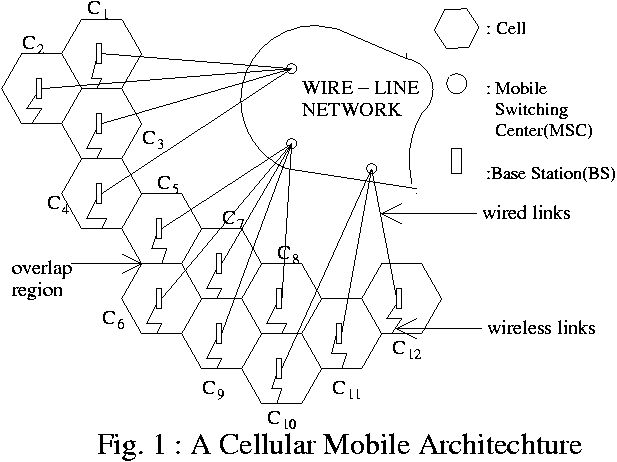
*Figure: Slide 3. Hexagonal cells C1–C12, each with a base station (BS), wired to the MSC; mobiles talk to the BS over the air.*

| Term (slides) | Meaning |
| :--- | :--- |
| **Base Station (BS)** (4) | fixed station for radio communication with mobiles; at the **centre or edge** of its cell; consists of radio channels, transmitter, receiver and antennas |
| **Mobile Switching Centre (MSC)** (5, 7) | also **MTSO** (mobile telephone switching office); coordinates call routing over a large area and connects BSs and mobiles to the **PSTN** (public switched telephone network). A typical MSC handles **100,000 subscribers**, **5,000 simultaneous conversations**, plus **billing and system maintenance** |
| **Mobile Station (MS)** (6) | contains a transceiver, antenna and control circuitry; vehicle-mounted or hand-held |
| **Transceiver** (5) | a device that transmits and receives radio signals **simultaneously** |

**Channels (Slides 6–7).** Forward = BS → MS (downlink); reverse = MS → BS (uplink).

| Channel | Direction | Job |
| :--- | :---: | :--- |
| **FVC**, forward voice | BS → MS | voice |
| **RVC**, reverse voice | MS → BS | voice |
| **FCC**, forward control | BS → MS | **beacons**: continuously broadcast all traffic requests (pages) for all mobiles |
| **RCC**, reverse control | MS → BS | call requests and replies |

FCC and RCC **initiate** calls and set them up, so they are called **set-up channels**. About **5%** of all channels are control/set-up channels; the other 95% carry voice.

---

## 3. How a call is made

**Power-on (Slide 8).** The phone **scans the FCCs**, locks onto the **strongest**, and monitors it until the signal drops below a usable level, then scans again.

**Call from the mobile (Slide 8).**

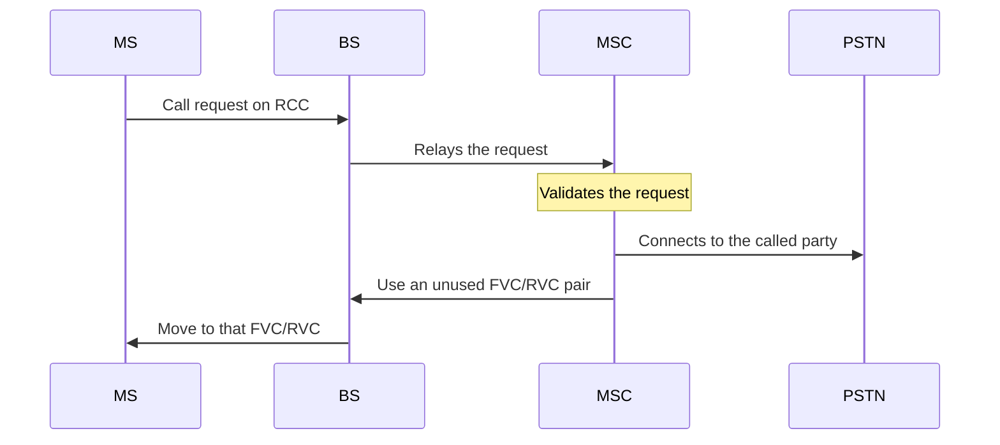

**Call from a landline (Slide 9).** The MSC does not know which cell the mobile is in, so it asks everyone.

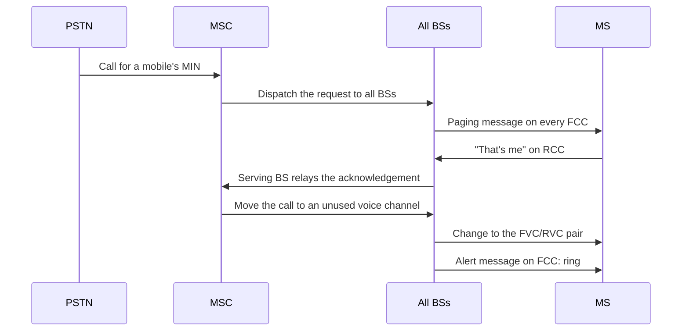

The **MIN** (mobile identification number) is the phone's number, used in the page.

**MSC's role during the call (Slide 10).** (1) Sends special **control signals** to the MS through the BS. (2) **Adjusts the mobile's transmit power**. (3) Keeps call quality by **changing the mobile's channel** when needed (handoff, section 8). 📘 Lower power near the BS saves battery and causes less interference in other cells.

---

## 4. Cell shape: why hexagons

**Footprints (Slide 11).** A cell's real coverage, its **footprint**, comes from **field measurements** and **propagation prediction models**. Real footprints are **amorphous** (irregular), but a **regular shape** is needed for **systematic design** and **future growth**.

**Which shape (Slide 12).** The slide compares **rectangle, circle and hexagon**. For the same distance $R$ from the centre to the farthest point, the **hexagon has the largest area of the three**, and it closely matches the **circular radiation pattern** of an **omni-directional** BS antenna under **free-space** propagation.

📘 Why not the circle itself? Circles cannot tile a plane: touching circles leave gaps, overlapping ones waste coverage. Only three regular polygons tile without gaps or overlaps: triangle, square, hexagon.

| Shape (radius $R$) | Area | Relative to hexagon |
| :--- | :--- | ---: |
| Equilateral triangle | $\frac{3\sqrt{3}}{4} R^2 \approx 1.299 R^2$ | 50% |
| Square | $2R^2$ | 77% |
| Regular hexagon | $\frac{3\sqrt{3}}{2} R^2 \approx 2.598 R^2$ | 100% |

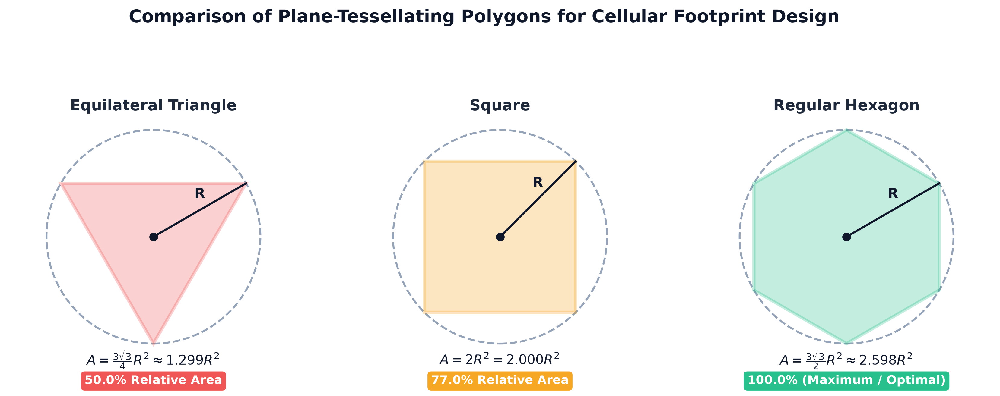
*Figure: Same reach $R$, different area. Covering a region with hexagons needs half as many base stations as with triangles.*

---

## 5. Frequency reuse and co-channel cells

**Frequency reuse (Slide 13).** Place BSs systematically, give each a **channel group**, spread the groups over the coverage zone, and **reuse channels as many times as necessary**, keeping interference between **co-channel cells** below an acceptable level.

**Co-channel cells (Slides 14–15)** use the **same** channel group (all cells marked "A" in Fig. 2). A **cluster** (compact pattern) of $N$ cells uses all channels once; then the pattern repeats.

```math
N = i^2 + ij + j^2
```

$i$ and $j$ are non-negative integers (the "shift" steps). *Slide 14:* $i = 3$, $j = 2$: $N = 9 + 6 + 4 = 19$. 📘 Other valid sizes: $(1, 0) \to 1$, $(1, 1) \to 3$, $(2, 0) \to 4$, $(2, 1) \to 7$, $(3, 0) \to 9$, $(2, 2) \to 12$, $(3, 1) \to 13$. A cluster of, say, 5 or 6 is impossible.

**Finding the nearest co-channel cell (Slide 15).** Move $i$ cells along any chain of hexagons, **turn 60° counter-clockwise**, move $j$ cells. Each cell has **6 equidistant** nearest co-channel neighbours.

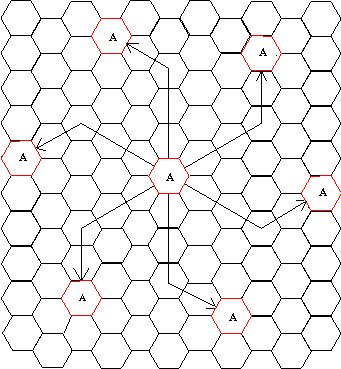
*Figure: Slide 14. From the centre "A", 3 steps, turn 60°, 2 steps reaches the next "A"; six such cells surround it.*

**Co-channel interference (Slide 15)** is interference between the signals of a cell and its co-channel cells. 📘 Unlike noise, raising transmit power does not help: the interfering cells' power rises too.

---

## 6. Cell design: capacity vs cluster size

**The formulas (Slide 16).** A system has $S$ duplex channels; each cell gets $K$; a cluster has $N$ cells, so

```math
S = KN, \qquad C = MKN = MS
```

The cluster is replicated $M$ times, so the total capacity $C$ (duplex channels in the whole system) is $M$ copies of all $S$ channels. **Capacity is proportional to $M$**, the number of times the cluster is replicated (Slide 17).

**Worked example** 📘. $S = 840$ channels; the city needs 84 cells of fixed size. Then $M = 84 / N$ and $K = 840 / N$:

| $N$ | $K$ per cell | $M$ | Capacity $C = MS$ |
| :---: | ---: | ---: | ---: |
| 4 | 210 | 21 | 17,640 |
| 7 | 120 | 12 | 10,080 |
| 12 | 70 | 7 | 5,880 |

Same spectrum, same cells: $N = 4$ carries 3 times as many calls as $N = 12$. **And** shrinking the cells (more of them) raises $M$ further: that is the cellular concept's whole trick.

**The catch (Slides 17–18).**

| Cluster size | Co-channel cells | Capacity | Interference |
| :--- | :--- | :--- | :--- |
| **Large** $N$ | far apart: $D/R$ large | low | low, good quality |
| **Small** $N$ | much closer | high | **significant** |

Design criteria: to **maximise capacity**, use the **smallest** $N$; for **no interference**, the **biggest** $N$. So design is a **trade-off between capacity and interference (QoS)**.

---

## 7. Co-channel interference and the reuse ratio Q

**The reuse ratio (Slide 19).** $D$ = distance between centres of nearest co-channel cells, $R$ = cell radius:

```math
Q = \frac{D}{R} \qquad \text{📘 and on a hexagonal grid} \qquad Q = \sqrt{3N}
```

- $Q$ **too large:** better transmission quality, less capacity.
- $Q$ **too small:** more capacity, worse quality.
- A **trade-off** between quality and capacity. To reduce interference: **separate co-channel cells by a minimum distance** and rely on enough **isolation from propagation** (signal loss over distance).

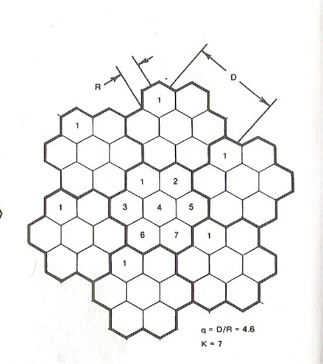
*Figure: Slide 20. For $N = 7$: $Q = \sqrt{21} = 4.5826 \approx 4.6$. With $R = 1$ km, co-channel cells are 4.58 km apart.*

> ✏️ **Slide discrepancy (Slide 20).** The figure writes the cluster size as $K = 7$, but Slide 16 uses $K$ for channels **per cell** and $N$ for cluster size. Here it means $N = 7$.

> 📘 **Beyond the slides — how much interference? (Rappaport).** With the 6 first-tier co-channel cells and received power falling as $d^{-n}$ (path-loss exponent $n$ = 3 to 4), the worst-case signal-to-interference ratio is
>
> ```math
> \frac{S}{I} = \frac{(D/R)^n}{6} = \frac{(\sqrt{3N})^n}{6}
> ```
>
> Your signal travels $R$, each interferer about $D$, so each interferer is $(D/R)^n$ times weaker; there are 6 of them. *Example:* $N = 7$, $n = 4$: $21^2 / 6 = 73.5$, i.e. $10 \log_{10} 73.5 = 18.66$ dB, above the 18 dB analog AMPS needed. With $n = 3$, $N = 7$ gives only 12.05 dB; a 15 dB target then needs $N = 12$ ($36^{1.5} / 6 = 36$, i.e. 15.56 dB).

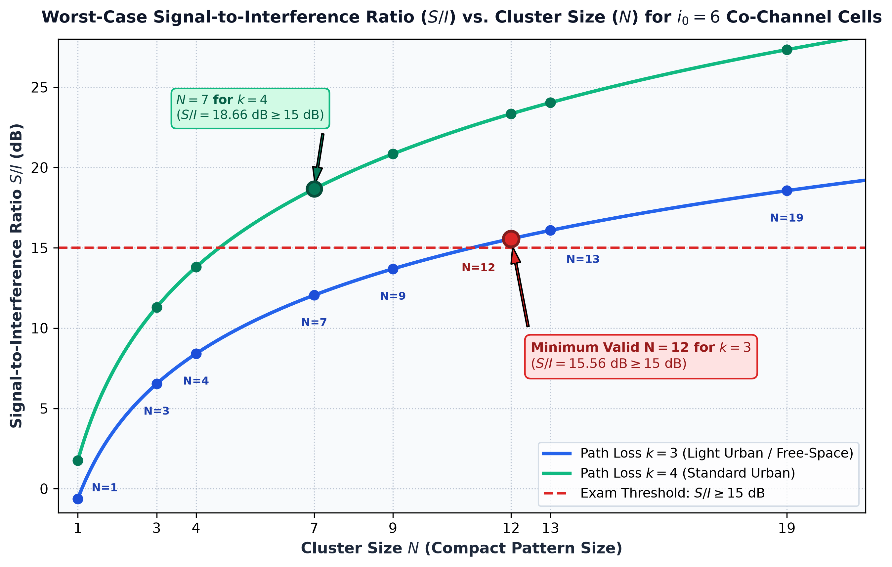
*Figure: S/I rises with $N$; a harsher path loss ($n = 4$) helps, because interferers fade faster.*

---

## 8. Handoff: thresholds and the margin Δ

**Definition (Slide 21).** **Handoff** is transferring a mobile from one channel or BS to another: identify a new BS, then allocate voice and control channels of the new BS. It must be done **successfully**, **as infrequently as possible**, and **imperceptibly** to users.

**Two signal levels (Slide 22)** at the BS receiver: a **minimum usable** level for acceptable voice quality, and a **slightly stronger handoff threshold**. The margin:

```math
\Delta = P_{r,\text{handoff}} - P_{r,\text{minimum usable}}
```

The gap between "start handing off" and "the call dies".

| $\Delta$ (Slide 23) | Effect |
| :--- | :--- |
| **Too large** | **unnecessary handoffs** that burden the MSC |
| **Too small** | **not enough time** to finish the handoff before the call is lost to a weak signal |

📘 *E.g.* minimum usable −100 dBm, threshold −90 dBm: $\Delta = 10$ dB of warning.

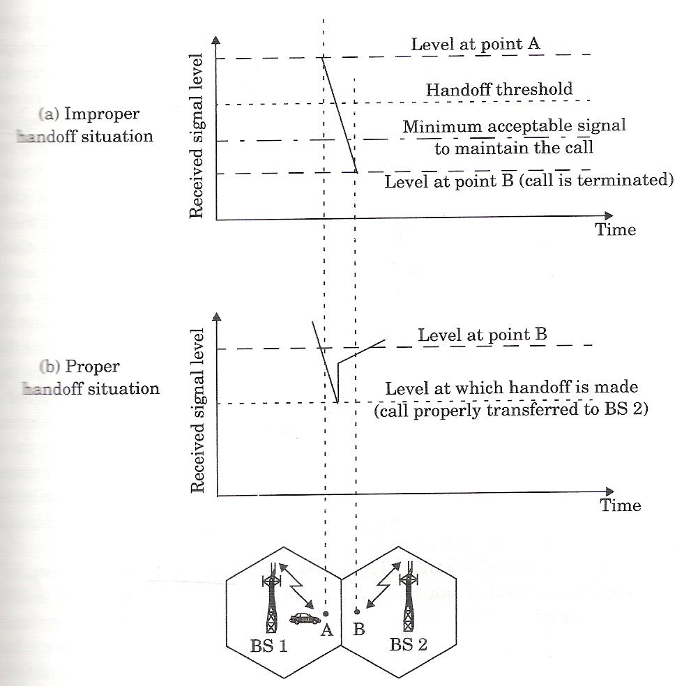
*Figure: Slide 24. (a) The handoff is too late: the signal from BS1 falls below the minimum and the call drops. (b) It happens at the threshold, and the call moves to BS2.*

**Why calls drop (Slide 25).** Excessive delays at high traffic, because of **computational load at the MSC**, or because **no channel is free** in any nearby BS, so the MSC must wait until one frees up.

**Check before handing off (Slide 26).** Make sure (1) the drop is **not momentary fading** and (2) the MS is **really moving away**. So the BS **monitors the signal for a while** first. How long depends on the **mobile's speed**: if the **short-term average signal slopes down steeply**, hand off **quickly**.

---

## 9. 1G vs 2G handoff, roaming and prioritisation

| | 1st generation (Slide 27) | 2nd generation, **MAHO** (Slides 27–28) |
| :--- | :--- | :--- |
| Who measures | each **BS** monitors signal strength of the **RVCs** | the **MS** measures received power from **neighbouring BSs** and reports to the serving BS |
| Who decides | the **MSC** supervises, finding each mobile's relative location | **mobile-assisted** handoff |
| Trigger | — | a neighbour's BS power exceeds the current BS's **by a certain level or for a certain time** |
| Speed and load | slower; the MSC constantly monitors | **much faster**; the MSC **no longer constantly monitors** |

📘 Rappaport puts 1G handoff at about 10 s and the usable margin at 6–12 dB.

**Roaming (Slide 29)** is the mechanism for **intersystem handoff**. *When:* the signal at the MS becomes weak **and** the MSC cannot find another cell **within its own system**. *Issues:* the MS leaves its **home system**; a **local call becomes long-distance**; **compatibility between the two MSCs** must be checked first.

**Prioritising handoffs (Slide 30).** A call **cut off mid-conversation** annoys users more than being **blocked** occasionally on a new call, so handoffs get priority:

1. **Guard channels:** a fraction of each cell's channels is **reserved for handoffs**; new calls cannot use them.
2. **Queuing handoff requests:** if no channel is free, queue the handoff; the time between the threshold and the minimum usable level (Δ) gives room to wait.

📘 *Trade-off:* with 60 channels and 6 guard channels, new calls can use only 54, so slightly more new calls are blocked, but far fewer calls drop.

---

## 10. Practical constraints: umbrella cells and cell dragging

**Problem 1: very different speeds (Slide 31).** Fast cars cross small cells in seconds and would hand off constantly; pedestrians need capacity. **Solution:** different **antenna heights** and **power levels**, with **large and small cells co-located**: the **umbrella cell approach**. Large cells serve **high-speed** users (few handoffs); small cells serve **low-speed** users.

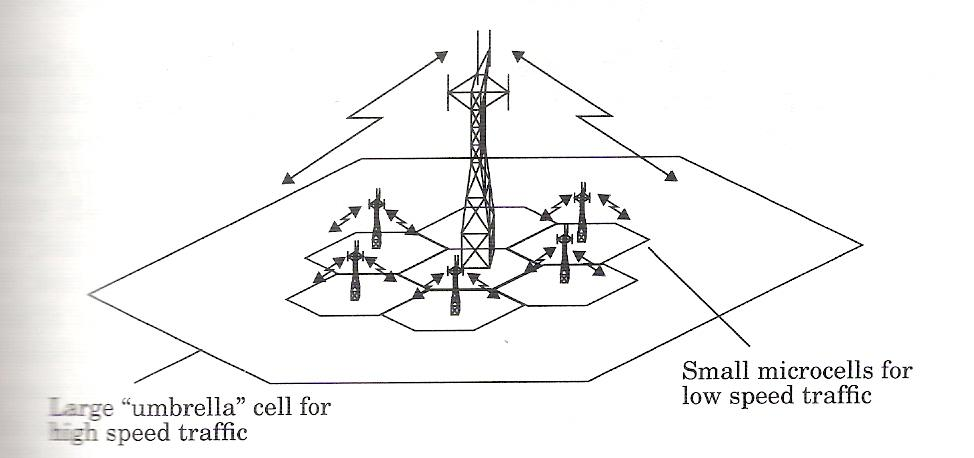
*Figure: Slide 32. One large umbrella cell over several microcells.*

**Problem 2: cell dragging (Slide 33).** A handoff is **not made even when essential**. It happens when a **pedestrian** gives a **very strong signal** to the BS, in an **urban** environment with a **line-of-sight (LOS)** path between MS and BS. 📘 The signal stays above threshold as the user walks deep into the next cell, so the call is "dragged" there and causes interference to that cell's users.

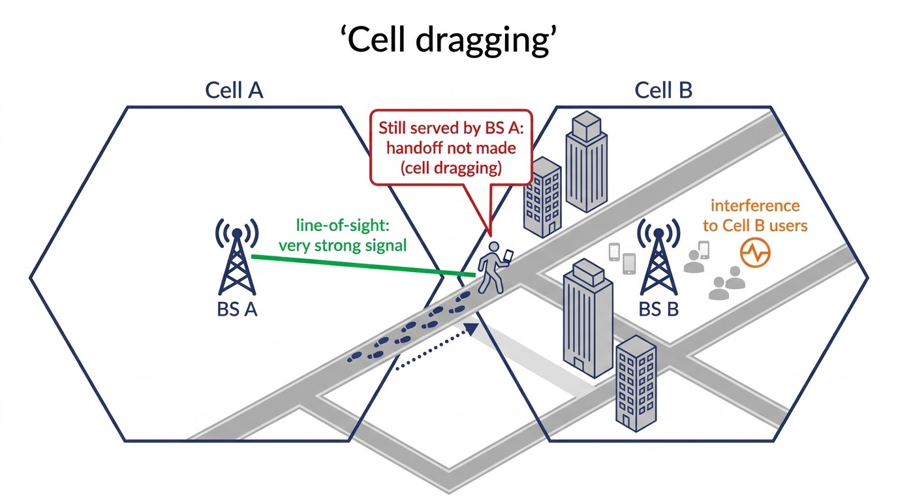
*Figure: 📘 illustration (AI-generated). The open street gives a strong line-of-sight signal to BS A, so the handoff threshold is never crossed even inside Cell B.*

---

## 11. GSM

**What and why (Slide 34).** **GSM** (Global System for Mobile) is a **2G** standard, the **world's first** cellular system to specify **digital modulation** and **network-level architectures and services**. Before it, European countries used different standards, so one phone could not work throughout Europe.

**Services (Slide 35).** **Teleservices:** calling, facsimile (fax). **Data services:** **300 bps to 9.6 kbps**; **SMS** while carrying normal voice traffic.

**SIM (Slides 36–37).** A memory device storing the subscriber's **identification**, **networks**, **country**, **privacy key** and other user information. Without a SIM all GSM phones are **identical and non-operational**; a subscriber can plug their SIM into **any suitable terminal**. 📘 That separates *who you are* (SIM) from *which phone you use*.

**Architecture (Slides 38–41)**: three interconnected subsystems.

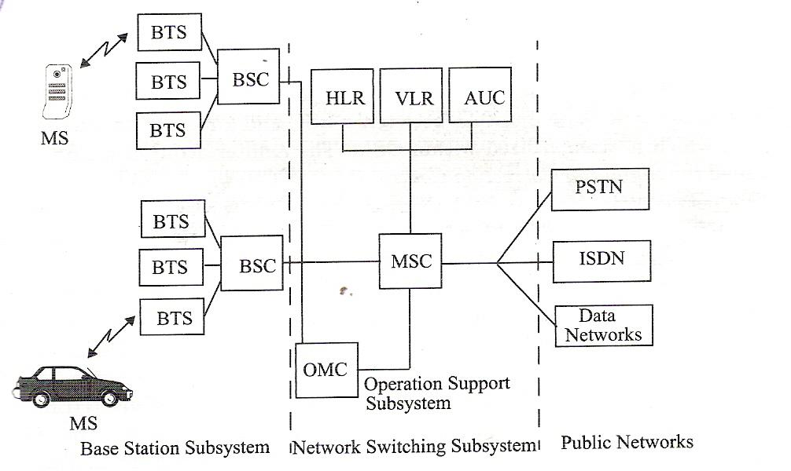
*Figure: Slide 39. BSS (BTS, BSC), NSS (MSC, HLR, VLR, AUC) and OSS (OMC), linked to the PSTN, ISDN and data networks.*

| Subsystem | Role |
| :--- | :--- |
| **BSS**, Base Station Subsystem (40) | radio paths between the MS and MSCs; manages the **radio interface** between mobiles and the rest of GSM; **BSCs** connect the MS to the NSS via MSCs |
| **NSS**, Network and Switching Subsystem (40) | the **switching** functions; lets MSCs talk to other networks (**PSTN, ISDN**) |
| **OSS**, Operation Support Subsystem (41) | **operation and maintenance**; engineers **monitor, diagnose and troubleshoot** everything; **only for the operator's staff** |

**Handoff rule (Slide 41).** A handoff between two **BTSs under the same BSC** is handled **by the BSC, not the MSC**.

> 📘 **Beyond the slides — boxes in the figure.** **BTS:** the radio equipment of one cell. **BSC:** controls many BTSs. **HLR** (home location register): permanent subscriber records and current location. **VLR** (visitor location register): temporary data on subscribers currently in this MSC's area. **AUC** (authentication centre): keys for checking SIMs. **OMC:** the OSS's operations centre.

---

## 12. GPRS

**What (Slide 42).** **GPRS** (General Packet Radio Service): an **enhanced 2G** (2.5G) system with **packet-switched** data, faster than GSM. Suited to **small bursts of data** such as email and web browsing.

**Speeds (Slide 43).** Up to **115 kbps**, vs GSM's **9.6 kbps**; typically **20–30 kbps** (max 50 kbps) in practice; **theoretical maximum 171.2 kbps**. 📘 That is 8 timeslots × 21.4 kbps = 171.2 kbps.

**Billing (Slide 43).** Pay for **the amount of data downloaded**, not the **duration** of the connection, so the phone can stay connected.

> ✏️ **Slide discrepancy (Slide 42).** It calls GPRS "**multicast** packet switched technology". GPRS is a packet-switched service for ordinary one-to-one (unicast) data; "multicast" is a misprint or overstatement.
