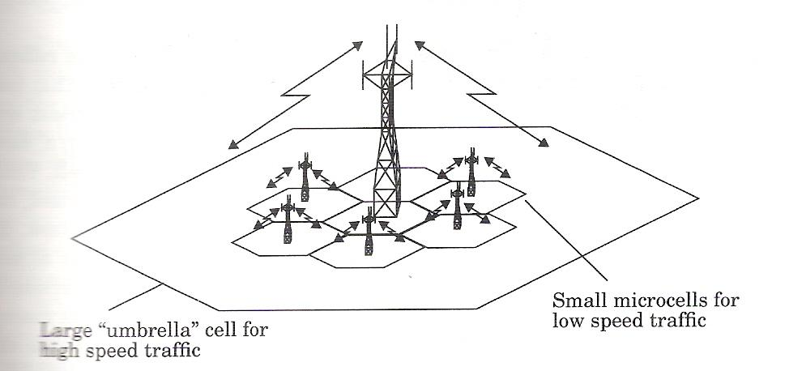
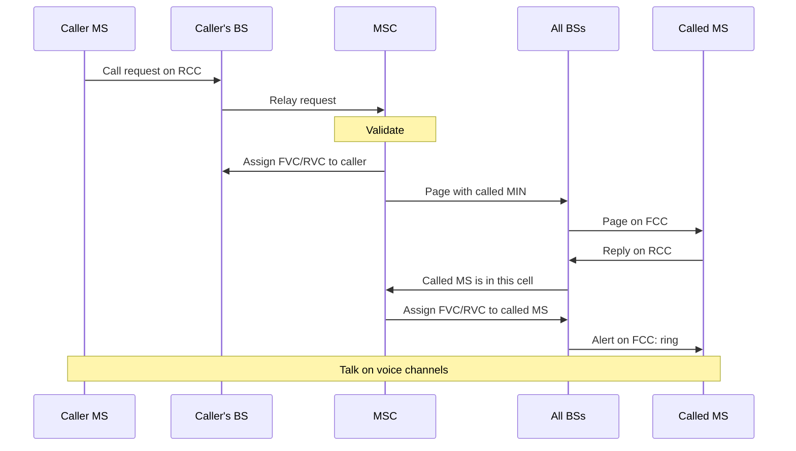
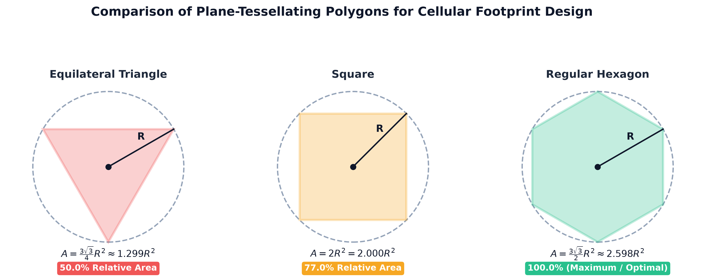
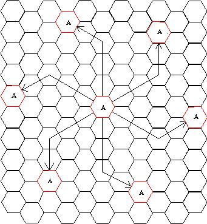
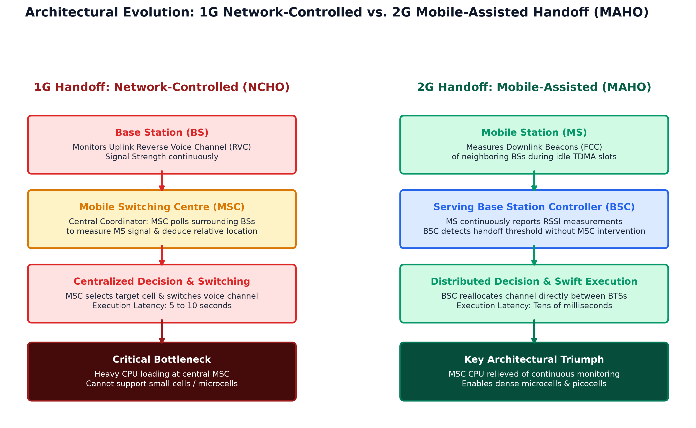
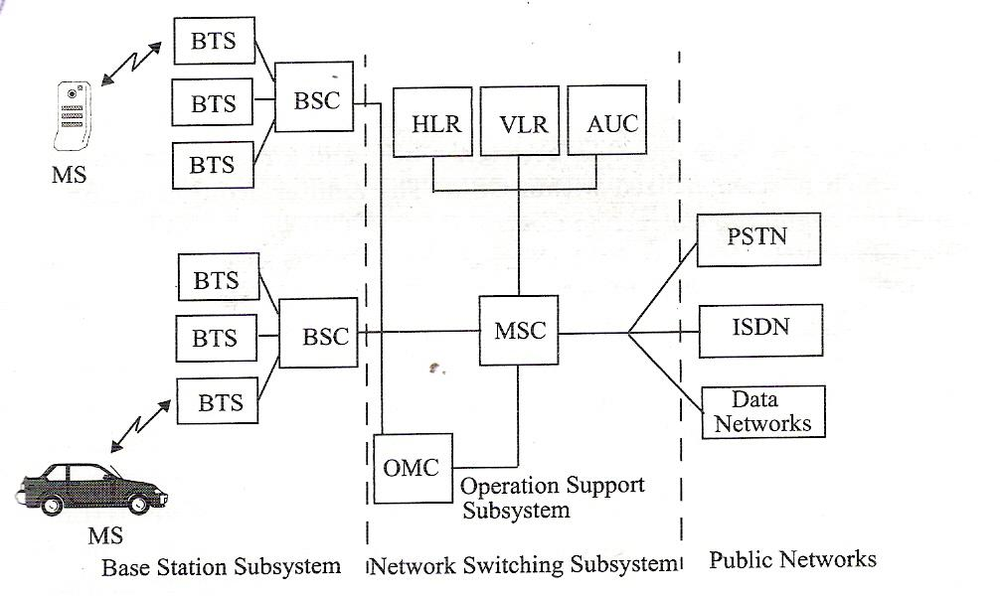

# Cellular Networks — Exam Questions and Answers

This file is a companion to [Cellular_Networks_Guide.md](Cellular_Networks_Guide.md) (ma'am's slides `celluler_network.pdf`).
Try each question first, then read the answer.

**End-sem pattern:** Full marks 50, 3 hours. **Q1 is compulsory**: five terms, "define and state their usage", 5 × 2 = 10. Then answer **any two of Q2–Q5**, 20 marks each. Parts are split into 10 + 10, 10 + 5 + 5 or 5 + 5 + 5 + 5.
**Here:** Part A = 2-mark terms (Q1 style). Part B = 20-mark questions (Q2–Q5 style).
**This file keeps only the past-paper questions (🎯) and a few likely ones (✍️).** Every past question from the 2023–2025 mid-sem and end-sem papers on this topic is here.
**Tags:** 🎯 real paper (year, question); ✍️ likely question (not asked yet, but close to a past one); 📘 beyond the slides. 💡 = memory hook.
Cellular networks are also in textbook Chapter 2.
Channel assignment, Erlang/GOS, cell splitting and sectoring, and CDMA are in [Mobile_Computing_SDB_QA.md](Mobile_Computing_SDB_QA.md).

| No. | Question | Source |
| :--- | :--- | :--- |
| A1 | How is the capacity of the radio enhanced in a cellular network? | 🎯 2025 Mid Q1(d), 2023 Mid Q1(v) |
| A2 | Paging channel | 🎯 2025 End Q1(c) |
| A3 | Co-channel cells and co-channel interference | ✍️ |
| A4 | Roaming | ✍️ |
| A5 | Umbrella cell approach | 🎯 2024 Mid Q3(b) |
| A6 | SIM | 🎯 2023 Mid Q1(ii) (MCQ) |
| B1(a) | What roles do the channels FVC, RVC, FCC and RCC play in a cellular mobile network? [5] | 🎯 2023 Mid Q2(b) + 2025 Mid Q2(a), 2023 Mid Q2(a) + 2024 Mid Q1(b) |
| B1(b) | Write the steps of operation for establishing a call between two mobile stations. [10] | 🎯 2023 Mid Q2(b) + 2025 Mid Q2(a), 2023 Mid Q2(a) + 2024 Mid Q1(b) |
| B1(c) | Justify the hexagonal cell shape in cellular network design. [5] | 🎯 2023 Mid Q2(b) + 2025 Mid Q2(a), 2023 Mid Q2(a) + 2024 Mid Q1(b) |
| B2(a) | What is frequency reuse? How is the cluster size found, and how do you locate the nearest… [5] | ✍️ |
| B2(b) | What is the impact of cluster size on capacity and interference in a cellular mobile network? [5] | 🎯 ✍️ +  2025 Mid Q2(b), Q2(c) +  2023 Mid Q3(b) |
| B2(c) | A cellular system covers 2310 km² and each cell area is 6 km². The total allocated channels… [5] | 🎯 ✍️ +  2025 Mid Q2(b), Q2(c) +  2023 Mid Q3(b) |
| B2(d) | (i) A cellular system has 40 MHz bandwidth and uses two 20 kHz simplex channels for each… [5] | 🎯 ✍️ +  2025 Mid Q2(b), Q2(c) +  2023 Mid Q3(b) |
| B3(a) | What is the frequency reuse ratio? Derive the relationship between the frequency reuse… [10] | 🎯 2024 Mid Q2(a), Q2(b) |
| B3(b) | A GSM TDMA system accepts $S/I \ge 15$ dB. What should the compact pattern size $N$ be when… [5] | 🎯 2024 Mid Q2(a), Q2(b) |
| B4(a) | What is handoff? Explain the handoff threshold, the margin Δ and how a handoff decision is… [5] | 🎯 2025 Mid Q3(b) |
| B4(b) | Compare first-generation and second-generation handoff mechanisms. [5] | 🎯 2025 Mid Q3(b) |
| B5(a) | Draw the GSM architecture and explain its three subsystems. [10] | ✍️ |

---

## Part A — 2-mark terms: define and state their usage

### A1. How is the capacity of the radio enhanced in a cellular network? 🎯 2025 Mid Q1(d), 2023 Mid Q1(v) [2]

The network **replaces one high-power transmitter with many low-power base stations**.
- Each base station covers one small **cell** (a small service area).
- Weak signals die out with distance, so far-apart cells **reuse the same channels**.
- Capacity grows with **more base stations and channel reuse**, not with more spectrum (total radio frequencies).
- Total capacity $C = MS$ grows with $M$. Here, $M$ is how many times the **cluster** (a group of cells using all channels once) repeats.

> 💡 Smaller cells, more reuse, more calls.

### A2. Paging channel. 🎯 2025 End Q1(c) [2]

**Definition:** The **forward control channel (FCC)** (base-to-mobile control link) that broadcasts a **page**. A page is a message carrying the called mobile's **MIN** (mobile identification number). All base stations send it on their FCCs.
**Usage:** When a call arrives, the **MSC** (central switching centre) does not know the mobile's cell, so it pages all cells.
- The mobile hears its MIN and replies on the **RCC** (reverse control channel, mobile to base station).
- The network then sets up the call on a voice channel in that cell.

> 💡 Paging = the network calling out your number to find you.

### A3. Co-channel cells and co-channel interference. ✍️ [2]

**Definition:** **Co-channel cells** are cells that use the **same channel group**. **Co-channel interference** is radio interference between a cell and its co-channel cells.
**Usage:** Reusing channels in co-channel cells gives the network high capacity.
- Designers keep co-channel cells at least a minimum distance $D$ apart because radio signals weaken with distance.
- Raising transmit power does not fix this interference, because the interfering cells raise their power too.

> 💡 Same channel group = co-channel cells; keep them distance D apart, because raising power helps nobody.

### A4. Roaming. ✍️ [2]

**Definition:** **Intersystem handoff**, where a mobile moves into another operator's or another **MSC's** (central switching centre's) system.
**Usage:** The network uses roaming when the signal gets weak **and** the MSC finds no other cell in its own system. Key issues:
- The user leaves the home system.
- A local call becomes **long-distance**.
- The two MSCs must be **compatible** (able to work together).

> 💡 Roaming = moving to another system; remember the 3 issues: leaves home, long-distance call, compatible MSCs.

### A5. Umbrella cell approach. 🎯 2024 Mid Q3(b) [2]

**Definition:** **Large and small cells co-located** (placed in the same area) using different **antenna heights and power levels**. One big umbrella cell sits over several **microcells** (small cells).
**Usage:** It serves users who move at very different speeds.
- The large cell serves **high-speed** users (cars), so they hand off (switch cells) rarely.
- The small cells serve **low-speed** users (pedestrians), because small cells give higher capacity through more channel reuse.

> 💡 Fast users under the umbrella, slow users in the small cells.

### A6. SIM. 🎯 2023 Mid Q1(ii) (MCQ) [2]

**Definition:** **Subscriber Identity Module** — a memory device that stores the subscriber's **identification**, network, country, **privacy key** and other user information.
**Usage:** Without a SIM, a GSM phone cannot work (it is non-operational).
- The user can plug the SIM into **any suitable terminal** (compatible phone).
- It separates *who you are* (the SIM) from *which phone you use*.

> 💡 SIM = your network ID card; swap phones freely and keep your SIM.

---

## Part B — 20-mark questions

### B1. 🎯 2023 Mid Q2(b) + 2025 Mid Q2(a), 2023 Mid Q2(a) + 2024 Mid Q1(b)

**(a)** What roles do the channels FVC, RVC, FCC and RCC play in a cellular mobile network? **[5]**
**(b)** Write the steps of operation for establishing a call between two mobile stations. **[10]**
**(c)** Justify the hexagonal cell shape in cellular network design. **[5]**

**(a) Answer.**

**In short:** Control channels (FCC and RCC) find the phone and set up the call, and voice channels (FVC and RVC) carry the talk.

- **Forward** = base station (**BS**) → mobile station (**MS**), also called the **downlink**.
- **Reverse** = MS → BS, also called the **uplink**.

| Channel | Direction | Role |
| :--- | :---: | :--- |
| **FVC**, forward voice | BS → MS | Carries voice from BS to mobile |
| **RVC**, reverse voice | MS → BS | Carries voice from mobile to BS |
| **FCC**, forward control | BS → MS | **Beacon**: broadcasts pages (call alerts) and channel assignments nonstop to all mobiles |
| **RCC**, reverse control | MS → BS | Carries call requests and replies to pages |

- FCC and RCC are the **set-up channels** (about 5% of channels). They start and set up the call.
- Once the call is set up, the conversation runs on an **FVC/RVC pair**.

> 💡 Forward = tower to phone, Reverse = phone to tower; Control sets up (5%), Voice carries talk.

**(b) Answer.**

**In short:** The MSC checks the caller's RCC request, pages all cells on FCC to find the receiver, assigns voice channels to both phones, and connects the call.

Before any call, each mobile powers on, **scans the FCCs** (forward control channels), locks onto the **strongest** one, and keeps listening to it.

1. **Request:** The calling **MS** (mobile station) sends a call request on the **RCC** (reverse control channel) to its **BS** (base station). The request carries its **MIN** (mobile identification number), its serial number **ESN**, and the dialled number.
2. **Relay:** The BS forwards this request to the **MSC** (central switching centre).
3. **Validate:** The MSC checks that the caller is a valid subscriber.
4. **Caller's channel:** The MSC picks an unused **FVC/RVC pair** (forward and reverse voice channels) for the BS. The BS uses the **FCC** to tell the caller to switch to that pair.
5. **Page:** The MSC does not know which cell holds the called mobile, because it could be anywhere. So the MSC sends a **paging message** with the called MIN to **all BSs**. All BSs broadcast it on their **FCCs**.
6. **Reply:** The called MS hears its MIN and replies on the **RCC**. Its BS informs the MSC, so the MSC now knows the called MS's cell.
7. **Called party's channel:** The MSC assigns an unused **FVC/RVC pair** in that cell. The BS tells the called MS on the FCC to switch to it.
8. **Alert:** The BS sends an **alert** on the FCC, and the called phone **rings**.
9. **Talk:** When the user answers, the MSC connects both voice paths. The conversation now runs on the voice channels.

During the call, the MSC **adjusts each mobile's transmit power**. It also **changes the channel (handoff)** when the user moves to another cell.

> 💡 Flow: request (RCC) → relay → validate → caller channel → page all (FCC) → reply (RCC) → called channel → ring → talk.

**(c) Answer.**

**In short:** Planners use hexagons because they tile an area with no gaps, cover the largest area for a given radius, and need the fewest base stations.

A cell's real radio coverage (its **footprint**) has an irregular shape. However, engineers need a **regular shape** for systematic design and growth. The four choices are a circle, triangle, square and hexagon.

- **Circle:** It matches an omni-directional antenna (an antenna that radiates equally in all directions). However, circles **cannot tile** a plane because they leave gaps or overlap.
- **Tiling shapes:** Only the **triangle, square and hexagon** tile an area with no gaps and no overlaps.
- **Largest area:** For the same distance $R$ (centre to farthest corner), the **hexagon covers the largest area**:

| Shape (radius $R$) | Area | Relative |
| :--- | :--- | ---: |
| Triangle | $1.299 R^2$ | 50% |
| Square | $2R^2$ | 77% |
| Hexagon | $2.598 R^2$ | 100% |

- Because it covers the largest area, the hexagon is closest to a circle.
- It needs the **fewest base stations** (half as many as triangles, since 50% is half of 100%).
- Every neighbouring cell sits at the exact same distance from the centre.

> 💡 Hexagon = tiles like a square, covers like a circle.

### B2. ✍️ + 🎯 2025 Mid Q2(b), Q2(c) + 🎯 2023 Mid Q3(b)

**(a)** What is frequency reuse? How is the cluster size found, and how do you locate the nearest co-channel cell? **[5]** ✍️
**(b)** What is the impact of cluster size on capacity and interference in a cellular mobile network? **[5]**
**(c)** A cellular system covers 2310 km² and each cell area is 6 km². The total allocated channels in the system are 1596. Calculate the system capacity for cluster size 7. **[5]**
**(d)** (i) A cellular system has 40 MHz bandwidth and uses two 20 kHz simplex channels for each full-duplex channel. How many channels does each cell get in a 12-cell reuse system? (ii) The system covers 2310 km² with 6 km² cells. Calculate the system capacity. **[5]**

**(a) Answer.**

**In short:** Frequency reuse repeats the same channel groups across far-apart clusters of size $N = i^2 + ij + j^2$, and you find each nearest co-channel cell by stepping $i$, turning 60° counter-clockwise, and stepping $j$.

**Frequency reuse:** Engineers place base stations in a planned grid.
- Each base station gets one **channel group**.
- The network **reuses** these channel groups across the whole area as many times as needed.
- Co-channel cells (cells using the same group) stay far enough apart to keep **co-channel interference** acceptable.

**Finding cluster size ($N$):** A **cluster** (compact pattern) is a group of $N$ cells that use **all** system channels once. This pattern then repeats across the whole area. The allowed cluster sizes follow the formula:

$$N = i^2 + ij + j^2$$

Here, $i, j$ are non-negative integers (0, 1, 2, ...). This gives $N = 1, 3, 4, 7, 9, 12, 13, 19, \dots$ (*e.g.* $i = 2, j = 1 \Rightarrow 7$; $i = 3, j = 2 \Rightarrow 19$).

**Locating the nearest co-channel cell:**
1. Start at your cell and move $i$ cells along any chain of hexagons.
2. **Turn 60° counter-clockwise**.
3. Move $j$ cells forward.

Repeat these three steps in all six directions to find all **6** nearest co-channel cells.

> 💡 Find a co-channel cell: step i → turn 60° left → step j (do it 6 ways for 6 neighbours).

**(b) Answer.**

**In short:** A smaller cluster size $N$ gives higher capacity (more repeated clusters) but more interference (closer co-channel cells), while a larger $N$ does the opposite.

Suppose the system has $S$ total channels, $K$ channels per cell, and $N$ cells per cluster, so $S = KN$. If the cluster repeats $M$ times, the system capacity is:

$$C = MKN = MS$$

- For a fixed area and cell size, $M = \dfrac{\text{number of cells}}{N}$.
- Therefore, **capacity is inversely proportional to $N$** (smaller $N$ means larger $M$ and higher $C$).
- Meanwhile, the reuse distance (distance between nearest co-channel cells) grows with $N$: $D = R\sqrt{3N}$.

| Cluster size | Co-channel cells | Capacity | Interference |
| :--- | :--- | :--- | :--- |
| **Small** $N$ | Close together (small $D$) | **High** (more clusters $M$) | **High** |
| **Large** $N$ | Far apart (large $D$) | **Low** (fewer clusters $M$) | **Low**, good quality |

*E.g.* with 840 channels and 84 cells:
- $N = 4$ gives $C = 21 \times 840 = 17{,}640$.
- $N = 12$ gives $7 \times 840 = 5{,}880$.

Designers therefore choose the **smallest $N$ that still meets the required signal-to-interference ratio**. This is a direct trade-off between **capacity and quality**.

> 💡 Small cluster: more calls, more noise.

**(c) Answer.**

**In short:** Divide total area by cell area to get 385 cells, divide by cluster size 7 to get 55 clusters, and multiply by 1596 channels.

1. Number of cells $= 2310 / 6 = 385$.
2. Number of clusters $M = 385 / 7 = 55$ (because each cluster has 7 cells).
3. Channels per cell $K = 1596 / 7 = 228$.
4. System capacity $C = MS = 55 \times 1596 = \mathbf{87{,}780}$ channels (check: $385 \times 228 = 87{,}780$).

**Exam trap:** The capacity is **not** 1596, because all 55 clusters reuse those 1596 channels.

> 💡 Three steps: cells (area ÷ cell area) → clusters M (cells ÷ N) → capacity C = M × S.

**(d) Answer.**

**In short:** Find the size of one full-duplex channel (40 kHz), divide total bandwidth to get 1000 channels, split across 12 cells (83 each), then multiply by 385 cells.

**(i) Channels per cell:**
1. One **full-duplex** (two-way) channel uses two **simplex** (one-way) channels: $= 2 \times 20 = 40$ kHz.
2. Total channels $S = 40\,000 / 40 = 1000$ (since 40 MHz = 40,000 kHz).
3. Channels per cell: $K = 1000 / 12 = 83.3$. A cell cannot use a fraction of a channel, so it gets **83 channels per cell** (4 are left over).

**(ii) System capacity:**
1. Number of cells $= 2310 / 6 = 385$.
2. Capacity $= 385 \times 83 = \mathbf{31{,}955}$ channels.
3. Note: With $C = MS$: $M = 385 / 12 = 32.08$, $C \approx 32{,}083$; the small difference is the 4 spare channels.

> 💡 Full-duplex = 2 simplex channels; divide total channels by N (round down), then multiply by total cells.

### B3. 🎯 2024 Mid Q2(a), Q2(b)

**(a)** What is the frequency reuse ratio? Derive the relationship between the frequency reuse ratio and the signal-to-interference ratio $S/I$. **[10]**
**(b)** A GSM TDMA system accepts $S/I \ge 15$ dB. What should the compact pattern size $N$ be when the path-loss exponent $k = 3$? **[5]**

**(a) Answer.**

**In short:** The frequency reuse ratio is $Q = D/R = \sqrt{3N}$, and comparing one cell-edge signal against 6 co-channel interferers gives $S/I = Q^k/6$.

**1. Frequency reuse ratio** (also called co-channel reuse ratio):

$$Q = \frac{D}{R}$$

- $D$ = distance between the centres of the nearest co-channel cells.
- $R$ = cell radius (centre to corner).

**2. Link between Q and N:**
- In a hexagonal grid, neighbouring cell centres are $\sqrt{3}R$ apart.
- Move $i$ cells, turn 60°, and move $j$ cells to reach the nearest co-channel cell.
- The two legs meet at 120°, so the cosine rule gives:

$$D^2 = (\sqrt{3}R)^2(i^2 + ij + j^2) = 3R^2N \quad\Rightarrow\quad Q = \frac{D}{R} = \sqrt{3N}$$

**3. Derivation of S/I in terms of Q:**
Received radio power drops with distance as $P_r \propto d^{-k}$. Here, $k$ is the **path-loss exponent** (how fast the signal fades with distance: 2 to 5, about 4 in cities).

1. **Worst-case desired signal:** Put the mobile at the **cell edge** (distance $R$ from its own BS, where its signal is weakest), so $S \propto R^{-k}$.
2. **Co-channel interference:** Interference comes from the **6** nearest co-channel cells (the first tier), each about distance $D$ away: $I_i \propto D^{-k}$.
3. **Ratio:** Ignore farther tiers and noise, then divide desired signal by the sum of all 6 interferers:

$$\frac{S}{I} = \frac{R^{-k}}{\sum_{i=1}^{6} D^{-k}} = \frac{R^{-k}}{6D^{-k}} = \frac{1}{6}\left(\frac{D}{R}\right)^k$$

$$\boxed{\frac{S}{I} = \frac{Q^k}{6} = \frac{(\sqrt{3N})^k}{6}}$$

**Takeaway:** **S/I rises with Q**, and Q rises with N. So a larger cluster gives better call quality, but less capacity.

*E.g.* $N = 7$, $k = 4$: $S/I = 21^2 / 6 = 73.5$, i.e. $10\log_{10}73.5 = 18.66$ dB.

> 💡 Two links to learn: geometry gives Q = D/R = √(3N), then 1 signal over 6 interferers gives S/I = Q^k / 6.

**(b) Answer.**

**In short:** Convert 15 dB to a plain ratio (31.62), solve $Q^3/6 \ge 31.62$ to get $N \ge 11.01$, and pick the next allowed cluster size, 12.

1. **Convert dB to a linear (plain) ratio** (because the formula uses plain ratios, not dB): $10^{15/10} = 10^{1.5} = 31.62$.
2. **Find $Q$** (using $k = 3$ in $S/I = Q^k/6$): $\dfrac{Q^3}{6} \ge 31.62 \Rightarrow Q^3 \ge 189.74 \Rightarrow Q \ge 5.75$.
3. **Find $N$** (using $Q = \sqrt{3N}$): $3N = Q^2 \ge 33.02 \Rightarrow N \ge 11.01$.
4. **Pick a valid cluster size:** The smallest allowed size ($N = i^2 + ij + j^2$) that is at least 11.01 is $\mathbf{N = 12}$ ($i = j = 2$).

**Check:** $N = 12$ gives $Q = 6$, $S/I = 6^3/6 = 36 = 15.56$ dB ✓; $N = 9$ gives only 13.7 dB ✗.

> ✏️ The textbook (p. 30) drops the 6 inside the cube root and gets $Q = 3.13$, $N = 3$. Use the full formula; $N = 12$ is right.

> 💡 Steps: dB → linear ratio → Q → N → round up to next valid cluster size (i² + ij + j²).

### B4. 🎯 2025 Mid Q3(b)

**(a)** What is handoff? Explain the handoff threshold, the margin Δ and how a handoff decision is made. **[5]**
**(b)** Compare first-generation and second-generation handoff mechanisms. **[5]**

**(a) Answer.**

**In short:** Handoff switches an active call to a new base station when the signal drops past a carefully chosen margin Δ above the minimum usable level.

**Handoff:** Moving a mobile from one channel or **BS** (base station) to another during an active call.
- The network finds a new BS and assigns that BS's voice and control channels to the mobile.
- Handoff must happen **successfully**, **as rarely as possible**, and **unnoticed** by the user.

**Handoff threshold and margin Δ:**
The BS watches two signal levels:
1. The **minimum usable** level (lowest level for acceptable voice quality).
2. The **handoff threshold** (a slightly stronger level where handoff starts).

The gap between them is the **margin Δ**:

$$\Delta = P_{r,\text{handoff}} - P_{r,\text{minimum usable}}$$

- **Δ too large:** The network makes unnecessary handoffs, which overload the **MSC** (central switching centre).
- **Δ too small:** The network has too little time to finish the handoff, so the call drops.

**How the handoff decision is made:**
- Before handing off, the BS **monitors the signal for a while**.
- This confirms the drop is **not momentary fading** (a brief dip) and the mobile is **really moving away**.
- If the short-term average signal falls **steeply** (meaning a fast-moving mobile), the network hands off **quickly**.

Calls can still drop if the MSC is overloaded or if **no channel is free** in any nearby BS.

> 💡 Margin Δ is a safety gap: too big = wasted handoffs; too small = dropped calls.

**(b) Answer.**

**In short:** In 1G, base stations and the MSC do all the signal checking (slow, heavy MSC load), while in 2G the mobile checks nearby towers itself (MAHO — fast, light MSC load).

| | 1G (analog) | 2G (digital), **MAHO** (Mobile-Assisted Handoff) |
| :--- | :--- | :--- |
| **Who measures** | Each **BS** (base station) measures the signal strength of the mobiles' **RVCs** (reverse voice channels) | The **mobile** measures the power from **neighbouring BSs** and reports it to its BS |
| **Who decides** | The **MSC** (central switching centre), which tracks each mobile's relative location | Handoff is **mobile-assisted** (MAHO); it starts when a neighbour BS stays stronger by a set level or for a set time |
| **Load on the MSC** | High, because the MSC monitors constantly | Low, because the MSC no longer monitors constantly |
| **Speed** | Slow (📘 about 10 s) | **Much faster** |

> 💡 1G: the network listens. 2G: the phone listens and reports.

### B5. ✍️

**(a)** Draw the GSM architecture and explain its three subsystems. **[10]**

**(a) Answer.**

**In short:** GSM has three subsystems — BSS handles the radio link, NSS handles call switching and user records, and OSS lets staff monitor and fix the network.

| Subsystem | Parts | Role |
| :--- | :--- | :--- |
| **BSS**, Base Station Subsystem | **BTS** (radio equipment of one cell), **BSC** (controls many BTSs) | The **radio interface**: handles radio paths between the mobile and the **MSC** (central switching centre). BSCs connect the mobile to the NSS through the MSC. |
| **NSS**, Network and Switching Subsystem | **MSC**, **HLR** (permanent subscriber records and location), **VLR** (temporary records of visitors in this MSC's area), **AUC** (authentication keys) | **Switching**: connects calls to other networks (**PSTN, ISDN**, data networks) and tracks subscribers. |
| **OSS**, Operation Support Subsystem | **OMC** (operation and maintenance centre) | **Operation and maintenance**: staff monitor, diagnose and troubleshoot the network. Used only by the operator. |

- **Key rule:** The **BSC** handles any handoff between two BTSs **under the same BSC**, **not the MSC** (because the BSC already controls both BTSs).

> 💡 Three parts: BSS = radio (BTS, BSC), NSS = switching & records (MSC, HLR, VLR, AUC), OSS = operator care (OMC).

For the GSM protocol layers, channels and call set-up, see [Mobile_Computing_SDB_QA.md](Mobile_Computing_SDB_QA.md).
