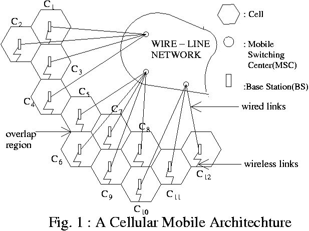
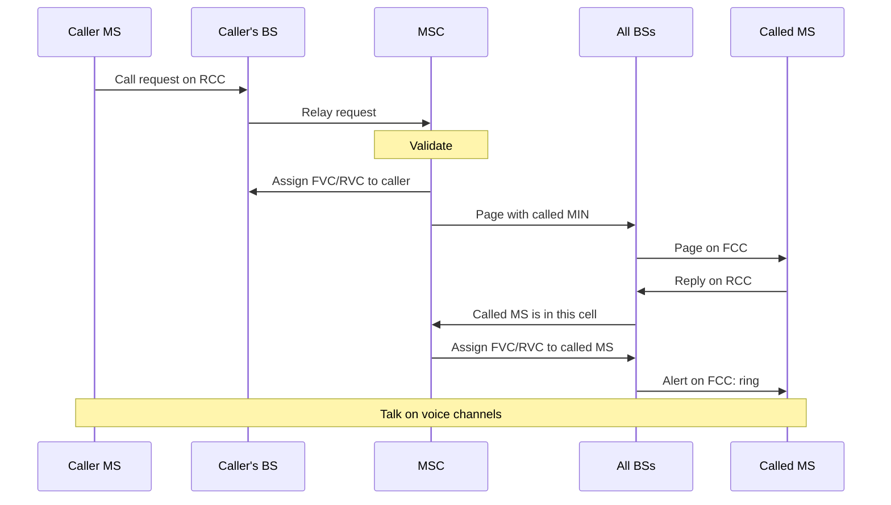
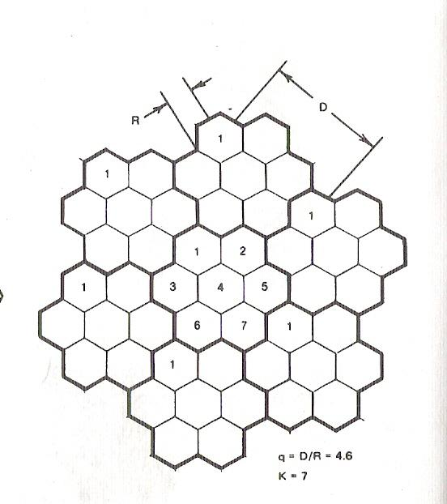
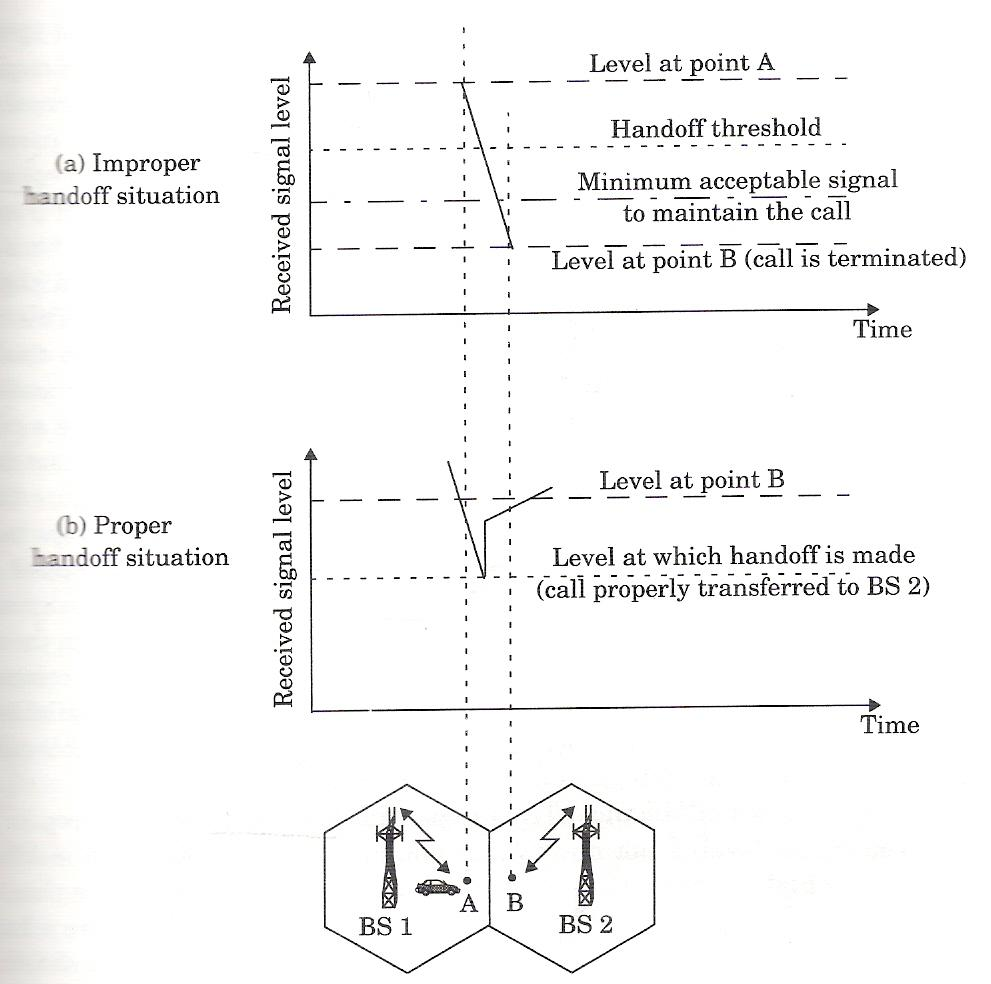
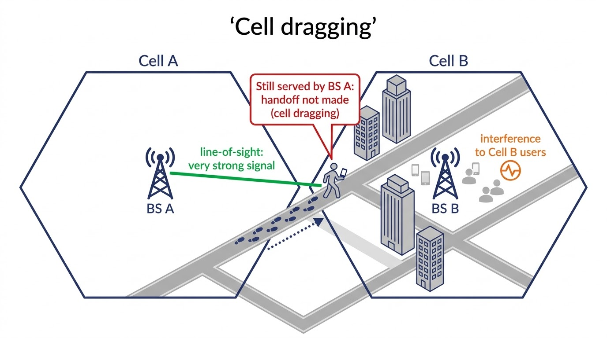

# Cellular Networks — Exam Questions and Answers

This file is a companion to [Cellular_Networks_Guide.md](Cellular_Networks_Guide.md) (ma'am's slides `celluler_network.pdf`).
Try each question first, then read the answer.

**End-sem pattern:** Full marks 50, 3 hours. **Q1 is compulsory**: five terms, "define and state their usage", 5 × 2 = 10. Then answer **any two of Q2–Q5**, 20 marks each. Parts are split into 10 + 10, 10 + 5 + 5 or 5 + 5 + 5 + 5.
**Here:** Part A = 2-mark terms (Q1 style). Part B = 20-mark questions (Q2–Q5 style).
**Tags:** 🎯 real paper (year, question); ✍️ practice to cover the slides; 📘 beyond the slides. 💡 = memory hook.
Cellular networks are also in textbook Chapter 2.
Channel assignment, Erlang/GOS, cell splitting and sectoring, and CDMA are in [Mobile_Computing_SDB_QA.md](Mobile_Computing_SDB_QA.md).

| Topic in the guide | Question |
| :--- | :--- |
| Why cellular, radio capacity (§1) | A1 |
| Architecture, channels (§2) | A2, A3, B1(a) |
| How a call is made (§3) | B1(b) |
| Hexagonal cells (§4) | B1(c) |
| Frequency reuse, cluster size (§5) | A4, B2(a) |
| Capacity vs cluster size (§6) | B2(b), B2(c), B2(d) |
| Reuse ratio Q, S/I (§7) | B3 |
| Handoff and the margin Δ (§8) | A5, B4(a) |
| 1G vs 2G handoff, roaming, priority (§9) | A6, A7, B4(b), B4(c) |
| Umbrella cells, cell dragging (§10) | A8, A9, B4(d) |
| GSM (§11) | A10, B5(a), B5(b) |
| GPRS (§12) | A11, B5(c) |

---

## Part A — 2-mark terms: define and state their usage

### A1. How is the capacity of the radio enhanced in a cellular network? 🎯 2025 Mid Q1(d), 2023 Mid Q1(v) [2]

One high-power transmitter is **replaced by many low-power base stations**.
Each base station covers a small cell.
Because a weak signal dies out with distance, the **same channels are reused** in cells far enough apart.
So capacity grows with **more base stations and channel reuse**, not with more spectrum.
Capacity $C = MS$ grows with $M$, the number of times the cluster is repeated.

> 💡 Smaller cells, more reuse, more calls.

### A2. Paging channel. 🎯 2025 End Q1(c) [2]

**Definition:** the **forward control channel (FCC)** used to broadcast a **page**. A page is a message carrying the called mobile's **MIN** (mobile identification number). It is sent on the FCCs of all base stations.
**Usage:** when a call arrives for a mobile, the MSC does not know its cell, so it pages. The mobile that hears its MIN replies on the RCC. Then the call is set up on a voice channel in that cell.

> 💡 Paging = the network calling out your number to find you.

### A3. Set-up (control) channels. ✍️ [2]

**Definition:** the **FCC** (forward control channel, BS → MS) and **RCC** (reverse control channel, MS → BS); about **5%** of all channels.
**Usage:** they carry call requests, pages and replies, so they **initiate and set up calls**. The FCC is also the **beacon** a phone scans and locks onto at power-on. The voice itself then moves to an FVC/RVC pair.

### A4. Co-channel cells and co-channel interference. ✍️ [2]

**Definition:** **co-channel cells** use the **same channel group**. **Co-channel interference** is interference between the signals of a cell and its co-channel cells.
**Usage:** reusing channels in co-channel cells is what gives capacity, so they are kept a minimum distance $D$ apart. Raising the transmit power does not help, because the interferers' power rises too.

### A5. Handoff margin Δ. ✍️ [2]

**Definition:** $\Delta = P_{r,\text{handoff}} - P_{r,\text{minimum usable}}$: the gap between the signal level where handoff **starts** and the level where the call **dies**.
**Usage:** it sets when to hand off.
- Too large: unnecessary handoffs that load the MSC.
- Too small: not enough time to finish the handoff, and the call drops.
- *E.g.* threshold −90 dBm, minimum −100 dBm: $\Delta = 10$ dB.

### A6. Roaming. ✍️ [2]

**Definition:** **intersystem handoff**: the mobile moves to another operator's or MSC's system.
**Usage:** used when the signal is weak **and** the MSC finds no other cell in its own system. Issues:
- The user leaves the home system.
- A local call becomes **long-distance**.
- The two MSCs must be **compatible**.

### A7. Guard channels. ✍️ [2]

**Definition:** a fraction of each cell's channels **reserved for handoff calls only**; new calls cannot use them.
**Usage:** prioritising handoffs, because a call cut off mid-conversation annoys users more than a blocked new call.
- Cost: fewer channels for new calls (*e.g.* 60 channels with 6 guard: new calls get 54).
- So slightly more new calls are blocked.

### A8. Umbrella cell approach. 🎯 2024 Mid Q3(b) [2]

**Definition:** **large and small cells co-located**, using different **antenna heights and power levels**: one big umbrella cell over several microcells.
**Usage:** handles users of very different speeds.
- **High-speed** users (cars) are served by the large cell, so they hand off rarely.
- **Low-speed** users (pedestrians) are served by the small cells, which give capacity.

> 💡 Fast users under the umbrella, slow users in the small cells.

### A9. Cell dragging. ✍️ [2]

**Definition:** a handoff is **not made even when it is essential**.
**Usage (when it happens):** a **pedestrian** in an **urban** area has a **line-of-sight** path to the base station, so its signal stays very strong. It never falls to the handoff threshold. The call is "dragged" deep into the next cell, where it **interferes** with that cell's users. Handoff thresholds and power must be tuned to prevent it.

### A10. SIM. ✍️ [2]

**Definition:** Subscriber Identity Module: a memory device storing the subscriber's **identification**, network, country, **privacy key** and other user information.
**Usage:** without a SIM a GSM phone is non-operational. The user can plug the SIM into **any suitable terminal**. It separates *who you are* (SIM) from *which phone you use*.

### A11. GPRS. ✍️ [2]

**Definition:** General Packet Radio Service: an **enhanced 2G (2.5G)** service that adds **packet-switched** data to GSM.
**Usage:** small bursts of data such as email and web browsing. Speeds reach up to **115 kbps** vs GSM's 9.6 kbps. (Theoretical maximum is 171.2 kbps = 8 slots × 21.4 kbps.) Billed by **data downloaded**, not connection time, so the phone can stay connected.

---

## Part B — 20-mark questions

### B1. 🎯 2023 Mid Q2(b) + 2025 Mid Q2(a), 2023 Mid Q2(a) + 2024 Mid Q1(b)

**(a)** What roles do the channels FVC, RVC, FCC and RCC play in a cellular mobile network? **[5]**
**(b)** Write the steps of operation for establishing a call between two mobile stations. **[10]**
**(c)** Justify the hexagonal cell shape in cellular network design. **[5]**

**(a) Answer.**

Forward = base station (BS) → mobile station (MS), the downlink.
Reverse = MS → BS, the uplink.

| Channel | Direction | Role |
| :--- | :---: | :--- |
| **FVC**, forward voice | BS → MS | carries the voice to the mobile |
| **RVC**, reverse voice | MS → BS | carries the voice from the mobile |
| **FCC**, forward control | BS → MS | **beacon**: continuously broadcasts pages and channel assignments for all mobiles |
| **RCC**, reverse control | MS → BS | call requests and replies to pages |

FCC and RCC are the **set-up channels** (about 5% of channels): they start and set up the call.
The conversation itself then runs on an FVC/RVC pair.

**(b) Answer.**

At power-on, each mobile **scans the FCCs**, locks onto the **strongest**, and keeps monitoring it.

1. **Request:** the calling MS sends a call request (its MIN, its serial number ESN, and the dialled number) on the **RCC** to its BS.
2. **Relay:** the BS forwards the request to the **MSC**.
3. **Validate:** the MSC checks that the subscriber is valid.
4. **Caller's channel:** the MSC tells the BS to use an unused **FVC/RVC pair**. The BS tells the caller on the FCC to move there.
5. **Page:** the called mobile could be anywhere. So the MSC sends a **paging message** with the called MIN to **all BSs**. All BSs broadcast it on their **FCCs**.
6. **Reply:** the called MS recognises its MIN and replies on the **RCC**. Its BS tells the MSC, which now knows its cell.
7. **Called party's channel:** the MSC assigns an unused FVC/RVC pair in that cell. The BS tells the called MS (on the FCC) to move to it.
8. **Alert:** the BS sends an **alert** on the FCC; the called phone **rings**.
9. **Talk:** when it is answered, the MSC connects the two voice paths and the conversation runs on the voice channels.

During the call the MSC **adjusts the mobile's transmit power**. It also **changes its channel** (handoff) when needed.

**(c) Answer.**

A cell's real coverage (its **footprint**) is irregular, but planning needs a **regular shape** for systematic design and growth.
The candidates are the circle, triangle, square and hexagon.

- **Circle:** matches an omni-directional antenna's pattern, but circles **cannot tile** a plane: they leave gaps or overlap.
- Only the **triangle, square and hexagon** tile without gaps or overlaps.
- For the same distance $R$ from the centre to the farthest point, the **hexagon covers the largest area**:

| Shape (radius $R$) | Area | Relative |
| :--- | :--- | ---: |
| Triangle | $1.299 R^2$ | 50% |
| Square | $2R^2$ | 77% |
| Hexagon | $2.598 R^2$ | 100% |

- So the hexagon is closest to the circle.
- It needs the **fewest base stations** (half as many as triangles).
- It also has all neighbours at equal distance.

> 💡 Hexagon = tiles like a square, covers like a circle.

### B2. ✍️ + 🎯 2025 Mid Q2(b), Q2(c) + 🎯 2023 Mid Q3(b)

**(a)** What is frequency reuse? How is the cluster size found, and how do you locate the nearest co-channel cell? **[5]**
**(b)** What is the impact of cluster size on capacity and interference in a cellular mobile network? **[5]**
**(c)** A cellular system covers 2310 km² and each cell area is 6 km². The total allocated channels in the system are 1596. Calculate the system capacity for cluster size 7. **[5]**
**(d)** (i) A cellular system has 40 MHz bandwidth and uses two 20 kHz simplex channels for each full-duplex channel. How many channels does each cell get in a 12-cell reuse system? (ii) The system covers 2310 km² with 6 km² cells. Calculate the system capacity. **[5]**

**(a) Answer.**

**Frequency reuse:** base stations are placed systematically. Each gets a **channel group**, and the groups are **reused** across the area as many times as necessary, keeping co-channel interference acceptable.

A **cluster** (compact pattern) is $N$ cells that together use **all** channels once; the pattern then repeats. The allowed sizes are

$$N = i^2 + ij + j^2$$

Here, $i, j$ are non-negative integers. This gives $N = 1, 3, 4, 7, 9, 12, 13, 19, \dots$ (*e.g.* $i = 2, j = 1 \Rightarrow 7$; $i = 3, j = 2 \Rightarrow 19$).

**Nearest co-channel cell:**
1. From the cell, move $i$ cells along a chain of hexagons.
2. **Turn 60° counter-clockwise**.
3. Move $j$ cells.

Doing this in all six directions gives the **6** nearest co-channel cells.

**(b) Answer.**

With $S$ channels, $K$ per cell and $N$ cells per cluster: $S = KN$.
The cluster is repeated $M$ times, so the capacity is

$$C = MKN = MS$$

For a fixed area and cell size, $M = \dfrac{\text{number of cells}}{N}$, so **capacity is inversely proportional to $N$**.
The reuse distance grows with $N$: $D = R\sqrt{3N}$.

| Cluster size | Co-channel cells | Capacity | Interference |
| :--- | :--- | :--- | :--- |
| **Small** $N$ | close together | **high** (more clusters) | **high** |
| **Large** $N$ | far apart | **low** | **low**, good quality |

*E.g.* 840 channels, 84 cells:
- $N = 4$ gives $C = 21 \times 840 = 17{,}640$.
- $N = 12$ gives $7 \times 840 = 5{,}880$.

So the designer uses the **smallest $N$ that still meets the required signal-to-interference ratio**: a trade-off between **capacity and quality**.

> 💡 Small cluster: more calls, more noise.

**(c) Answer.**

1. Number of cells $= 2310 / 6 = 385$.
2. Clusters $M = 385 / 7 = 55$.
3. Channels per cell $K = 1596 / 7 = 228$.
4. Capacity $C = MS = 55 \times 1596 = \mathbf{87{,}780}$ channels (check: $385 \times 228 = 87{,}780$).

Trap: the capacity is **not** 1596. The 1596 channels are reused in all 55 clusters.

**(d) Answer.**

(i) One duplex channel $= 2 \times 20 = 40$ kHz. Total channels $S = 40\,000 / 40 = 1000$. Per cell: $K = 1000 / 12 = 83.3$, so **83 channels per cell** (4 are left over).

(ii) Cells $= 2310 / 6 = 385$. Capacity $= 385 \times 83 = \mathbf{31{,}955}$ channels. (With $C = MS$: $M = 385 / 12 = 32.08$, $C \approx 32{,}083$; the small difference is the 4 spare channels.)

### B3. 🎯 2024 Mid Q2(a), Q2(b) + ✍️

**(a)** What is the frequency reuse ratio? Derive the relationship between the frequency reuse ratio and the signal-to-interference ratio $S/I$. **[10]**
**(b)** A GSM TDMA system accepts $S/I \ge 15$ dB. What should the compact pattern size $N$ be when the path-loss exponent $k = 3$? **[5]**
**(c)** What happens if $Q$ is too large or too small? How is co-channel interference reduced? **[5]**

**(a) Answer.**

**Frequency reuse ratio** (co-channel reuse ratio):

$$Q = \frac{D}{R}$$

$D$ = distance between the centres of the nearest co-channel cells; $R$ = cell radius (centre to corner).

**Q in terms of N.** In a hexagonal grid, neighbouring cell centres are $\sqrt{3}R$ apart.
Moving $i$ cells, turning 60°, and moving $j$ cells gives (cosine rule, 120° between the two legs):

$$D^2 = (\sqrt{3}R)^2(i^2 + ij + j^2) = 3R^2N \quad\Rightarrow\quad Q = \frac{D}{R} = \sqrt{3N}$$

**S/I in terms of Q.** Received power falls with distance as $P_r \propto d^{-k}$ ($k$ = path-loss exponent, 2 to 5, about 4 in cities).

1. Worst case: the mobile is at the **cell edge**, distance $R$ from its own BS, so the signal is $S \propto R^{-k}$.
2. Interference comes from the **6** nearest co-channel cells (the first tier), each about $D$ away: $I_i \propto D^{-k}$.
3. Ignore farther tiers and noise:

$$\frac{S}{I} = \frac{R^{-k}}{\sum_{i=1}^{6} D^{-k}} = \frac{R^{-k}}{6D^{-k}} = \frac{1}{6}\left(\frac{D}{R}\right)^k$$

$$\boxed{\frac{S}{I} = \frac{Q^k}{6} = \frac{(\sqrt{3N})^k}{6}}$$

So **S/I rises with Q**, and Q rises with N: a larger cluster means better quality but less capacity.

*E.g.* $N = 7$, $k = 4$: $S/I = 21^2 / 6 = 73.5$, i.e. $10\log_{10}73.5 = 18.66$ dB.

**(b) Answer.**

1. Convert to linear: $10^{15/10} = 10^{1.5} = 31.62$.
2. $\dfrac{Q^3}{6} \ge 31.62 \Rightarrow Q^3 \ge 189.74 \Rightarrow Q \ge 5.75$.
3. $3N = Q^2 \ge 33.02 \Rightarrow N \ge 11.01$.
4. The smallest allowed size ($N = i^2 + ij + j^2$) that is at least 11.01 is $\mathbf{N = 12}$ ($i = j = 2$).

Check: $N = 12$ gives $Q = 6$, $S/I = 6^3/6 = 36 = 15.56$ dB ✓; $N = 9$ gives only 13.7 dB ✗.

> ✏️ The textbook (p. 30) drops the 6 inside the cube root and gets $Q = 3.13$, $N = 3$. Use the full formula; $N = 12$ is right.

**(c) Answer.**

- **Q too large:** co-channel cells far apart, so better transmission **quality**, but **less capacity**.
- **Q too small:** more **capacity**, but worse quality (more co-channel interference).
- **Reducing co-channel interference:**
  - Separate co-channel cells by a **minimum distance** $D$ (a larger cluster size), so propagation loss isolates them.
  - 📘 Also directional antennas (**sectoring**), which cut the 6 interferers to 2 (120° sectors) or 1 (60° sectors).
  - Power control.

> 💡 S/I = Q to the power k, over 6 neighbours.

### B4. 🎯 2025 Mid Q3(b) + ✍️

**(a)** What is handoff? Explain the handoff threshold, the margin Δ and how a handoff decision is made. **[5]**
**(b)** Compare first-generation and second-generation handoff mechanisms. **[5]**
**(c)** Why are handoffs prioritised, and how? What is roaming? **[5]**
**(d)** Explain two practical constraints on handoff: users with different speeds, and cell dragging. **[5]**

**(a) Answer.**

**Handoff:** transferring a mobile, during a call, from one channel or base station to another.
The network identifies a new BS, then gives that BS's voice and control channels.
It must be done **successfully**, **as rarely as possible**, and **unnoticed** by the user.

The BS uses two signal levels: the **minimum usable** level (for acceptable voice) and a slightly stronger **handoff threshold**. The margin is

$$\Delta = P_{r,\text{handoff}} - P_{r,\text{minimum usable}}$$

- Δ **too large:** unnecessary handoffs that load the MSC.
- Δ **too small:** not enough time to finish the handoff; the call drops.

**Decision:** before handing off, the BS **monitors the signal for a while**.
This confirms the drop is **not momentary fading** and the mobile is **really moving away**.
If the short-term average signal falls **steeply** (a fast mobile), hand off **quickly**.

Calls also drop when the MSC is overloaded or **no channel is free** in any nearby BS.

**(b) Answer.**

| | 1G (analog) | 2G (digital), **MAHO** |
| :--- | :--- | :--- |
| Who measures | each **BS** measures the signal strength of the mobiles' **RVCs** | the **mobile** measures the power received from **neighbouring BSs** and reports it to its BS |
| Who decides | the **MSC**, which tracks each mobile's relative location | handoff is **mobile-assisted** (MAHO); started when a neighbour BS is stronger by a certain level or for a certain time |
| Load on the MSC | high: it constantly monitors | low: it no longer constantly monitors |
| Speed | slow (📘 about 10 s) | **much faster** |

> 💡 1G: the network listens. 2G: the phone listens and reports.

**(c) Answer.**

A call **cut off mid-conversation** annoys users more than an occasionally **blocked new call**, so handoffs get priority:

1. **Guard channels:** some channels in each cell are reserved for handoffs only. Cost: fewer channels for new calls.
2. **Queuing handoff requests:** if no channel is free, the handoff waits in a queue; the margin Δ gives time before the signal reaches the minimum.

**Roaming** is **intersystem handoff**: used when the signal is weak and the MSC finds no other cell in its own system. Issues:
- The mobile leaves its **home system**.
- A local call becomes **long-distance**.
- The two MSCs must be **compatible**.

**(d) Answer.**

1. **Very different speeds:** fast cars would cross small cells in seconds and hand off constantly; pedestrians need capacity.
   - **Umbrella cells:** large and small cells are co-located (different antenna heights and power).
   - The large cell serves **fast** users (few handoffs).
   - The small cells serve **slow** users.
2. **Cell dragging:** a **pedestrian** in an **urban** area has a **line-of-sight** path to the base station, so its signal stays very strong.
   - It never falls to the handoff threshold.
   - The call is "dragged" deep into the next cell, where it **interferes** with that cell's users.
   - Handoff thresholds and power must be tuned to prevent it.

### B5. ✍️

**(a)** Draw the GSM architecture and explain its three subsystems. **[10]**
**(b)** What is GSM? What services does it offer, and what is the role of the SIM? **[5]**
**(c)** What is GPRS? How does it differ from GSM? **[5]**

**(a) Answer.**

| Subsystem | Parts | Role |
| :--- | :--- | :--- |
| **BSS**, Base Station Subsystem | **BTS** (radio equipment of one cell), **BSC** (controls many BTSs) | the **radio interface**: radio paths between the mobile and the MSC; BSCs connect the mobile to the NSS through the MSC |
| **NSS**, Network and Switching Subsystem | **MSC**, **HLR** (permanent subscriber records and location), **VLR** (temporary records of visitors in this MSC's area), **AUC** (authentication keys) | **switching**; connects to other networks (**PSTN, ISDN**, data networks); tracks subscribers |
| **OSS**, Operation Support Subsystem | **OMC** (operation and maintenance centre) | **operation and maintenance**: staff monitor, diagnose and troubleshoot the network; used only by the operator |

A handoff between two BTSs **under the same BSC** is handled **by the BSC, not the MSC**.

For the GSM protocol layers, channels and call set-up, see [Mobile_Computing_SDB_QA.md](Mobile_Computing_SDB_QA.md).

**(b) Answer.**

**GSM** (Global System for Mobile communication) is a **2G** standard.
It is the first cellular system to specify **digital modulation** and **network-level architecture and services**.
Before it, each European country had its own system, so one phone could not work across Europe.

**Services:**
- Teleservices (calls, fax).
- Data services from **300 bps to 9.6 kbps**.
- **SMS**, even during voice traffic.

**SIM:** stores the subscriber's identity, network, country and privacy key.
Without a SIM a GSM phone is non-operational.
The user can plug the SIM into **any suitable terminal**. It separates *who you are* (SIM) from *which phone you use*.

**(c) Answer.**

**GPRS** (General Packet Radio Service) is a **2.5G** enhancement of GSM that adds **packet switching**.

| | GSM | GPRS |
| :--- | :--- | :--- |
| Switching | circuit (a channel held for the whole call) | **packet** (channels shared, used only when data flows) |
| Data rate | 9.6 kbps | up to **115 kbps** (typically 20–30 kbps; theoretical 171.2 kbps = 8 slots × 21.4) |
| Billing | by **connection time** | by **data volume**, so the phone can stay always connected |
| Suited to | voice | small bursts: email, web browsing |

> 💡 GPRS = GSM plus packets; pay per byte, not per minute.
