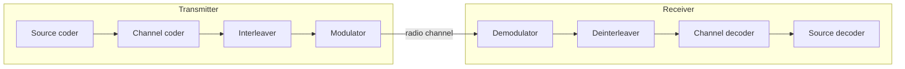
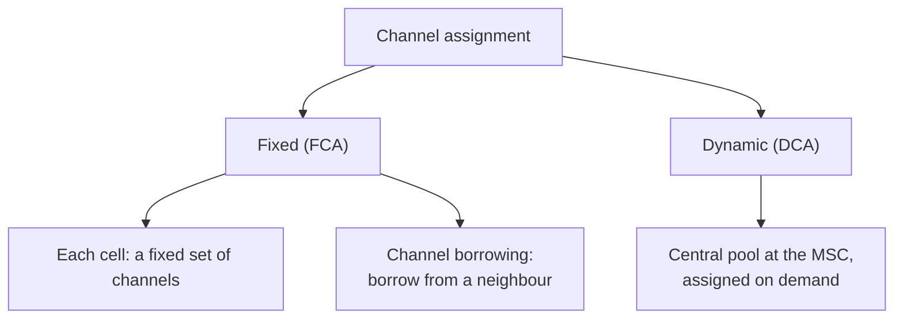
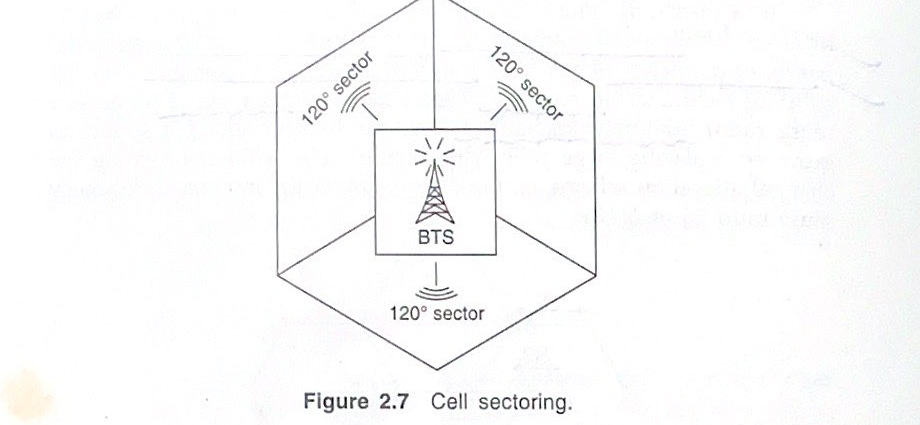
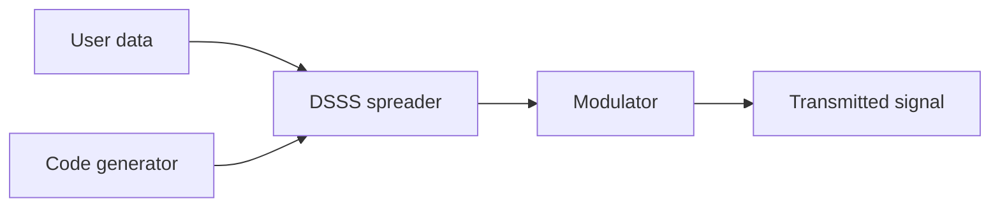
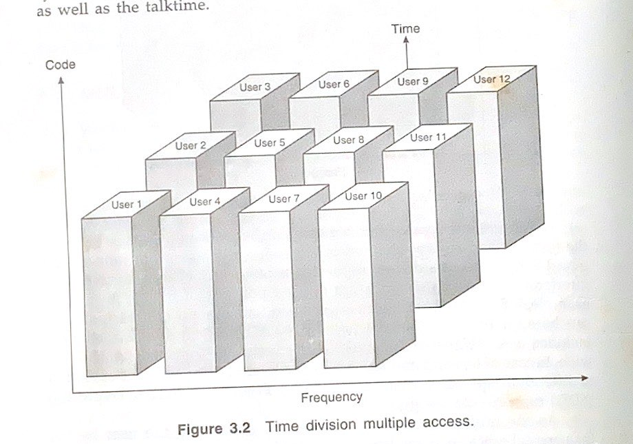
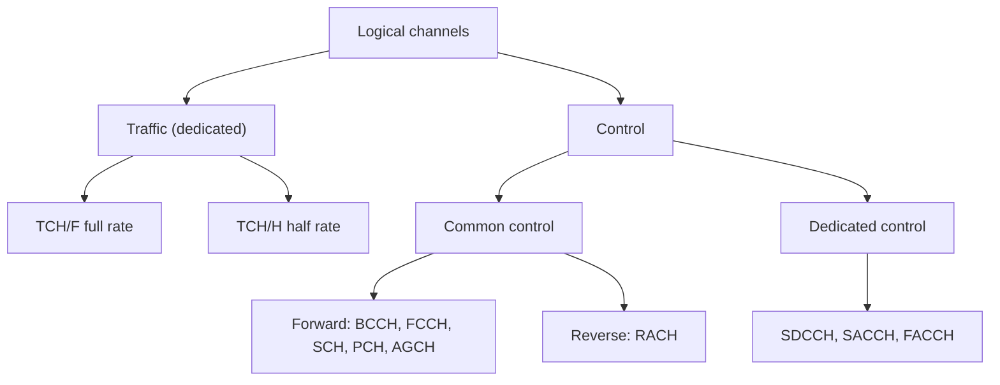

# Mobile Computing Textbook (Chapters 1–3) — Exam Questions and Answers

Companion to [Mobile_Computing_SDB_Learning_Guide.md](Mobile_Computing_SDB_Learning_Guide.md) (textbook: Sipra DasBit and Biplab K. Sikdar, *Mobile Computing*, PHI, `Mobile Computing - SDB.pdf`). Try each question first, then read the answer.

**Syllabus covered here:** Chapter 1 (Introduction), Chapter 2 (cellular network), Chapter 3 **sections 3.1–3.3 only** (digital cellular, FDMA/TDMA/CDMA, GSM). IS-95 (3.4) is not in the syllabus. Chapter 6.4 (Mobile IP) and Chapter 7 (UMTS) are in [Mobile_IP_UMTS_QA.md](Mobile_IP_UMTS_QA.md).
**End-sem pattern:** Full marks 50, 3 hours. **Q1 is compulsory**: five terms, "define and state their usage", 5 × 2 = 10. Then answer **any two of Q2–Q5**, 20 marks each, split into parts such as 10 + 10, 10 + 5 + 5 or 5 + 5 + 5 + 5.
**Here:** Part A = 2-mark terms (Q1 style). Part B = 20-mark questions (Q2–Q5 style).
**This file keeps only the past-paper questions (🎯) and a few likely ones (✍️).** Every past question from the 2023–2025 mid-sem and end-sem papers on this topic is here.
**Tags:** 🎯 real paper (year, question); ✍️ likely question (not asked yet, but close to a past one); 📘 beyond the book. ✏️ = book error. 💡 = memory hook.
Topics also on ma'am's cellular slides (call set-up, hexagons, reuse, S/I, handoff, umbrella cells) are answered once, in [Cellular_Networks_QA.md](Cellular_Networks_QA.md).

| No. | Question | Source |
| :--- | :--- | :--- |
| A1 | FDD and TDD | ✍️ |
| A2 | Two reasons for performing modulation in a cellular network | 🎯 2025 Mid Q1(b) |
| A3 | Two advantages of PSK over ASK and FSK | 🎯 2025 Mid Q1(a) |
| A4 | Block error, and how it is mitigated | 🎯 2025 Mid Q1(c) |
| A5 | Near-far effect | 🎯 2024 Mid Q3(a), 2023 Mid Q1(vii) |
| A6 | Channel borrowing | 🎯 2024 End Q1(a), 2025 Mid Q3(a) |
| A7 | HLR (Home Location Register) | 🎯 2024 Mid Q3(d), 2023 End Q1(b) |
| A8 | VLR (Visitor Location Register) | 🎯 2024 Mid Q3(e), 2023 Mid Q1(x) |
| A9 | Erlang | 🎯 2025 End Q2(a), 2023 End Q2(b) (part) |
| A10 | Grade of Service (GOS) | 🎯 2024 Mid Q3(c), 2023 End Q2(a), 2023 Mid Q1(ix) |
| A11 | Cell sectoring | 🎯 2023 Mid Q1(vi) |
| A12 | Spreading factor (processing gain) | ✍️ |
| B1(a) | Draw the block diagram of a radio system at the transmitter and receiver sides. Describe… [10] | 🎯 2024 Mid Q1(a) |
| B2(a) | Describe the channel-assignment strategies in a 2G cellular network. What is channel… [10] | 🎯 2023 Mid Q3(a), 2025 Mid Q3(a) + 2024 Mid Q1(c) |
| B2(b) | Define location tracking (location management). Write two implementation techniques. [5] | 🎯 2023 Mid Q3(a), 2025 Mid Q3(a) + 2024 Mid Q1(c) |
| B2(c) | Explain cell splitting and cell sectoring as capacity-improving methods. [5] | ✍️ |
| B3(a) | Define GOS. Write the assumptions for a blocked-calls-cleared trunking system. [5] | 🎯 2023 End Q2(a), Q2(b), 2025 End Q2(a), 2024 End Q2(c) |
| B3(b) | Define Erlang. How many users can be supported for 0.5% blocking probability with 20… [5] | 🎯 2023 End Q2(a), Q2(b), 2025 End Q2(a), 2024 End Q2(c) |
| B3(c) | A cell has 20 channels. On average each user makes 3 calls/hour, and the average call lasts… [5] | 🎯 2023 End Q2(a), Q2(b), 2025 End Q2(a), 2024 End Q2(c) |
| B4(a) | Are the codes (0, 1, 0, 1) and (0, 1, 1, 0) orthogonal? Justify. [5] | 🎯 2025 End Q2(b), Q2(c), Q2(d) + 2024 End Q2(b) |
| B4(b) | Two mobile stations A and B send data (+1, −1) and (+1, +1) using the codes (−1, +1, −1,… [5] | 🎯 2025 End Q2(b), Q2(c), Q2(d) + 2024 End Q2(b) |
| B4(c) | Write the demerits of CDMA. [5] | 🎯 2025 End Q2(b), Q2(c), Q2(d) + 2024 End Q2(b) |
| B4(d) | How do you prove whether the chip code (+1, −1, +1, +1, −1, +1, +1, +1, −1, −1, −1) is… [5] | 🎯 2025 End Q2(b), Q2(c), Q2(d) + 2024 End Q2(b) |
| B5(a) | Write a short note on spread spectrum. [10] | 🎯 2024 End Q5(a) + 2023 Mid Q1(iii), Q1(iv) |
| B5(b) | Compare FDMA, TDMA and CDMA. [10] | 🎯 2024 End Q5(a) + 2023 Mid Q1(iii), Q1(iv) |
| A13 | GSM frequency bands | 🎯 2025 Mid Q1(e), 2023 Mid Q1(viii) |
| A14 | IMSI and TMSI | ✍️ |
| B6(a) | Which layer of the GSM protocol stack takes care of Radio Resource Management? What are the… [10] | 🎯 2024 End Q2(a) |
| B6(b) | Explain the three OSI layers of GSM and the protocols used at the A and A-bis interfaces. [5] | ✍️ |
| B7(a) | Classify the GSM logical channels and state the job of each. [10] | ✍️ |

---

## Part A — 2-mark terms: define and state their usage

### A1. FDD and TDD. ✍️ [2]

**Definition:** Two ways to build a **full-duplex** link (a two-way link at the same time). **FDD** (frequency division duplexing) uses **two separate frequency bands**, one for each direction (GSM 900: 45 MHz apart). **TDD** (time division duplexing) uses **one band** and alternates both directions in time slots.
**Usage:** Wide-area cellular networks use FDD. FDD needs a **duplexer** filter. Short-range, low-power systems such as cordless phones use TDD. TDD needs no duplexer, so it is cheaper.

> 💡 FDD = two roads (two frequencies); TDD = one road taking turns (time slots).

### A2. Two reasons for performing modulation in a cellular network. 🎯 2025 Mid Q1(b) [2]

1. **Antenna size:** An antenna must be about $\lambda/4$ long (one quarter of the wavelength). Baseband voice (the unshifted voice signal, below 4 kHz) would need an antenna many kilometres long. At a 900 MHz carrier, $\lambda = 33.3$ cm, so a quarter-wave antenna is only 8.3 cm.
2. **Sharing the spectrum:** Shifting each signal to its own carrier frequency lets many users and systems transmit at once without overlap (frequency division). It also helps the signal travel well through the radio channel.

> 💡 Modulate to shrink the antenna and share the air.

### A3. Two advantages of PSK over ASK and FSK. 🎯 2025 Mid Q1(a) [2]

1. **Noise immunity:** PSK carries data in the **phase** (wave timing), with constant **amplitude** (signal height). Noise and fading mainly corrupt **amplitude**. So noise hurts PSK far less than **ASK**. It gives the lowest bit error rate for the same power.
2. **Bandwidth efficiency:** PSK needs **less bandwidth than FSK**, because FSK uses two (or more) separate frequencies. Higher-order PSK (QPSK) sends 2 bits per symbol in the same band.

📘 Also: its constant envelope (steady signal level) allows efficient power amplifiers.

> 💡 PSK beats ASK on noise (steady amplitude) and beats FSK on bandwidth (one frequency).

### A4. Block error, and how it is mitigated. 🎯 2025 Mid Q1(c) [2]

**Definition:** When a moving mobile passes through a deep fade (a sudden signal drop), noise corrupts a **run of consecutive bits** at once. This is a **block (burst) error**. Channel coding can fix scattered single-bit errors, but it cannot fix long bursts.
**Mitigation:** Use **interleaving**. The transmitter shuffles the bit order across frames before sending. The receiver's **deinterleaver** puts the bits back in order. This **spreads the burst into isolated single-bit errors**, so the channel decoder can correct them. The cost is extra delay, so voice systems must keep interleaving short.

> 💡 Shuffle before sending, unshuffle on arrival → one big clump breaks into tiny fixable errors.

### A5. Near-far effect. 🎯 2024 Mid Q3(a), 2023 Mid Q1(vii) [2]

**Definition:** A mobile **near** the base station reaches the tower much more strongly than a **far** mobile. Its strong signal **swamps** (overpowers) the weak signal of the distant mobile. This happens on the same or an adjacent channel, and in CDMA on the same band.
**Usage / remedy:** This effect is why CDMA needs **power control**. The BS (base station) constantly adjusts each mobile's transmit power so all signals arrive with **equal power**. In FDMA/TDMA, the network does not give adjacent channels to the same cell.

> 💡 A shout next to your ear drowns out a distant voice → power control makes all signals arrive equal.

### A6. Channel borrowing. 🎯 2024 End Q1(a), 2025 Mid Q3(a) [2]

**Definition:** In fixed channel assignment, a cell whose channels are **all busy borrows a free channel from a neighbouring cell**. The **MSC** (Mobile Switching Centre) supervises this borrowing.
**Usage and constraint:** It lowers call blocking in a busy cell. However, the borrowed channel must **not be in use in any co-channel cell** (another cell using the same frequency) **of the lending cell**. The network **locks** it in those cells while borrowed so it causes no interference.

> 💡 Borrow a neighbour's spare channel, then lock it in their co-channel cells so no one clashes.

### A7. HLR (Home Location Register). 🎯 2024 Mid Q3(d), 2023 End Q1(b) [2]

**Definition:** The **permanent database** of a subscriber's **home network**. It keeps the subscriber's **profile** (identity and services subscribed) and **current location** (which VLR/MSC is serving the mobile).
**Usage:** Used for location management and call routing. To route an incoming call, the network asks the HLR where the mobile is. With the AUC, it also **authenticates** (checks the identity of) the subscriber before updates.

> 💡 HLR = permanent home address book; it always knows which VLR holds the phone.

### A8. VLR (Visitor Location Register). 🎯 2024 Mid Q3(e), 2023 Mid Q1(x) [2]

**Definition:** A **temporary database**, usually **integrated with the MSC** (Mobile Switching Centre). It holds records of the mobiles **currently in that MSC's area**, including visitors from other networks.
**Usage:** When a mobile roams in, it registers with the visited network. The VLR **authenticates it in consultation with the HLR** and copies its profile. The network can then handle calls locally without asking the HLR every time.

> 💡 HLR = home address book (permanent); VLR = hotel guest list (temporary).

### A9. Erlang. 🎯 2025 End Q2(a), 2023 End Q2(b) (part) [2]

**Definition:** The unit of **traffic intensity** (how heavy the call load is). One Erlang equals the traffic carried by **one channel that is completely occupied**. The formula is $A = \lambda \times h$ (call request rate × mean holding time).
**Usage:** Used for sizing a network. *E.g.* 25 calls/minute × 3 minutes = **75 Erlangs**, so the network needs at least 75 channels. Per user: $A_{pu} = \lambda h$; for $n$ users, total traffic is $A = nA_{pu}$.

> 💡 1 Erlang = 1 channel busy 100% of the time; multiply call rate × call length.

### A10. Grade of Service (GOS). 🎯 2024 Mid Q3(c), 2023 End Q2(a), 2023 Mid Q1(ix) [2]

**Definition:** A measure of a user's ability to access a trunked (shared-channel) system during the **busiest hour**. It is the **probability that a call is blocked**. GOS = 0.01 means 1 call in 100 is blocked in the busy hour.
**Usage:** Sets the target when sizing a network. For a required GOS and expected traffic load, the Erlang B table gives the number of channels needed (so **capacity** must be estimated).

> 💡 GOS = chance of being blocked in rush hour (0.01 = 1 in 100 blocked).

### A11. Cell sectoring. 🎯 2023 Mid Q1(vi) [2]

**Definition:** Replacing the BS's (base station's) omni-directional antenna (all-directions antenna) with **directional antennas**, each covering one **sector** (3 × 120° or 6 × 60°).
**Usage:** Reduces co-channel interference. With 120° sectors, a mobile sees **2** of the 6 interferers. With 60° sectors, it sees only **1**. The higher S/I (signal-to-interference ratio) allows a **smaller cluster size**, giving more capacity. The cost is more handoffs and lower trunking efficiency.

> 💡 Slice the cell like a pizza (3 × 120° or 6 × 60°) → fewer interferers (2 or 1) → higher S/I → more capacity.

### A12. Spreading factor (processing gain). ✍️ [2]

**Definition:** In spread spectrum, the ratio of the chip rate (code-bit rate) to the data rate: $\text{SF} = R_c / R_b = T_b / T_c$.
**Usage:** Shows how much the signal is spread. *E.g.* a 1 MHz signal spread with an 11-chip code occupies 11 MHz. A larger SF gives more resistance to interference and supports more users.

> 💡 SF = chips per data bit (chip rate ÷ data rate); bigger SF = wider band = stronger against noise.

GSM terms (A13–A14) are below, after the GSM material.

---

## Part B — 20-mark questions

### B1. 🎯 2024 Mid Q1(a)

**(a)** Draw the block diagram of a radio system at the transmitter and receiver sides. Describe the task of each module. **[10]**

**(a) Answer.**

**In short:** The transmitter squeezes speech into bits, adds error protection, shuffles bit order, and lifts it onto a carrier; the receiver undoes all four steps in reverse.

| Module | Task |
| :--- | :--- |
| **Source coder** | Converts analog voice to digital bits and **removes redundancy** (extra unneeded bits), so fewer bits are sent. |
| **Channel coder** | **Adds controlled redundancy** (parity and error-correcting codes) so the receiver can **detect and correct** bit errors caused by noise. |
| **Interleaver** | **Shuffles the bit order** across frames, because deinterleaving then turns a burst (block) error from a fade into scattered single errors. |
| **Modulator** | Puts the digital baseband signal onto a **high-frequency carrier** so a small antenna can radiate it. |
| **Demodulator** | Recovers the baseband pulses from the received carrier. |
| **Deinterleaver** | Restores the original bit order (scattering any burst errors). |
| **Channel decoder** | Uses the added redundancy to **correct errors**. |
| **Source decoder** | Turns the digital bits back into **speech** (digital to analog). |

The receiver undoes the transmitter's steps in **reverse order**.

> 💡 Squeeze, protect, shuffle, lift; then undo backwards.

### B2. 🎯 2023 Mid Q3(a), 2025 Mid Q3(a) + 2024 Mid Q1(c) + ✍️

**(a)** Describe the channel-assignment strategies in a 2G cellular network. What is channel borrowing, and what are its constraints? **[10]**
**(b)** Define location tracking (location management). Write two implementation techniques. **[5]**
**(c)** Explain cell splitting and cell sectoring as capacity-improving methods. **[5]** ✍️

**(a) Answer.**

**In short:** A 2G network assigns radio channels permanently per cell (FCA), by borrowing from neighbours when busy, or on demand from one shared MSC pool (DCA).

The goal is to share the fixed spectrum so **few calls are blocked**, without breaking the co-channel reuse distance (the safe distance between cells reusing a frequency).

1. **Fixed channel assignment (FCA):** Each cell gets a **predetermined set** of channels. A cell serves a call only if one of its own channels is free. Otherwise it **blocks** the call, even when neighbour cells are idle. FCA is simple, but it works poorly when traffic is uneven.
2. **Channel borrowing** (a variant of fixed): When all its channels are busy, a cell **borrows a free channel from a neighbouring cell**. The **MSC** (Mobile Switching Centre) supervises this process.
   - **Constraints:** The borrowed channel must **not be in use by any co-channel cell of the lending cell**. The network must **lock** it in those co-channel cells while borrowed, because using it there would cause interference. Checking and locking adds signalling and computation at the MSC.
3. **Dynamic channel assignment (DCA):** Cells do **not** get channels permanently. The MSC keeps all channels in a **central pool**. For each call request, the serving BS (base station) asks the MSC. The MSC picks a channel by checking:
   - the **likelihood of future blocking** in the cell,
   - the **reuse distance** (co-channel interference),
   - adjacent-channel separation, and
   - **cost**.
   DCA adapts to traffic hot spots and lowers blocking, but it needs real-time computation at the MSC.

> 💡 Fixed = own pot; borrowing = ask the neighbour; dynamic = one shared pot at the MSC.

**(b) Answer.**

**In short:** Location tracking records where each mobile is (via HLR and VLR) so calls can reach it, using either whole-network paging or location areas with updates.

**Location tracking (location management):** Keeping track of a mobile station's **current location**. This lets the network deliver a call or message and set up a **seamless connection**. Together with **handoff management**, it makes up **mobility management**.

The network keeps two databases:
- **HLR** (Home Location Register): holds the permanent profile and current location, and authenticates the subscriber before updates.
- **VLR** (Visitor Location Register): holds visiting mobiles and authenticates them with the HLR.

When a mobile roams into a new area, it must **register** with the visited network, which informs the home network.

**Two techniques:**

1. **Paging the whole network:** The mobile never reports its location. When a call arrives, the MSC **pages every cell** to find it. This needs no update traffic, but it causes very high **paging overhead**.
2. **Location areas with location update:** The network groups cells into **location areas**. The mobile sends a **location update** whenever it enters a new location area. When a call arrives, the network pages **only that area's cells**. This cuts down paging overhead at the cost of location updates.

📘 Larger location areas mean fewer updates but more paging, and vice versa.

> 💡 Whole-network paging = shout in every room; location areas = sign in per floor, then shout only on that floor.

**(c) Answer.**

**In short:** Both methods increase capacity: cell splitting divides busy cells into smaller ones, while cell sectoring aims directional antennas to cut interference.

**Cell splitting:**
- The network divides a congested cell into **smaller cells**, each with its own base station.
- Each smaller cell uses **lower antenna height and transmit power**, because it covers a smaller area.
- Halving the radius gives about **4 times** as many cells in the same area, so channels are reused more often.
- The **reuse ratio $Q = D/R$ is kept constant**.
- **Cost:** More handoffs and more base-station sites.

**Cell sectoring:**
- The network keeps the cell size, but replaces the omni antenna (all-directions antenna) with **directional antennas** (3 × 120° or 6 × 60°).
- Each sector uses a subset of the cell's channels.
- Because each antenna points one way, it gets interference from fewer co-channel cells (2 instead of 6 with 120°; only 1 with 60°).
- The higher S/I (signal-to-interference ratio) allows a **smaller cluster size**, which increases capacity.
- **Cost:** Extra handoffs between sectors and lower **trunking efficiency** (because channel pools become smaller).

> 💡 Splitting = shrink cells (half radius → 4× cells); Sectoring = aim antennas (120° → 2 interferers, 60° → 1).

### B3. 🎯 2023 End Q2(a), Q2(b), 2025 End Q2(a), 2024 End Q2(c)

**(a)** Define GOS. Write the assumptions for a blocked-calls-cleared trunking system. **[5]**
**(b)** Define Erlang. How many users can be supported for 0.5% blocking probability with 20 trunked channels in a blocked-calls-cleared system? Each user generates 0.1 Erlang of traffic. From the Erlang chart, the total system load for 0.5% blocking is 11.10. **[5]**
**(c)** A cell has 20 channels. On average each user makes 3 calls/hour, and the average call lasts 2 minutes. The offered load from the Erlang B table is 12.03. How many users can be supported with 1% blocking? **[5]**

**(a) Answer.**

**In short:** GOS is the chance a call is blocked during the busiest hour, and a blocked-calls-cleared system models this using five standard assumptions.

**Trunking** lets many users share a small number of channels, because they rarely all call at once.

**GOS (Grade of Service)** measures a user's ability to get a channel during the **busiest hour**: it is the **probability that a call attempt is blocked**. GOS = 0.001 means 1 call in 1000 is blocked in the busy hour. (ITU-T: find the busy hour from the average busy-hour traffic over the **30 busiest days** of the year.)

**Assumptions of a blocked-calls-cleared (LCC) system:**

1. Call arrivals follow a **Poisson** distribution with a **fixed** average rate.
2. Arrivals are **memoryless**: any user, **including one just blocked**, may request a channel at any time.
3. The time a user occupies a channel is **exponentially distributed**, so long calls are less likely.
4. There is a **finite number of channels**.
5. There is an **infinite number of users**.

> 💡 5 LCC assumptions — **P-M-E-F-I**: Poisson, Memoryless, Exponential holding time, Finite channels, Infinite users.

**(b) Answer.**

**Erlang:** The unit of traffic intensity. One Erlang equals one channel **completely occupied**. The formula is $A = \lambda h$ (call rate × mean holding time).

From the chart, $C = 20$ channels at GOS 0.5% carry $A = 11.10$ Erlangs. Each user offers $A_{pu} = 0.1$ Erlang. So:

$$n = \frac{A}{A_{pu}} = \frac{11.10}{0.1} = \mathbf{111 \text{ users}}$$

> 💡 Total users = chart load ÷ load per user.

**(c) Answer.**

1. Convert holding time to hours (because call rate is per hour): $h = 2$ min $= 2/60 = 1/30$ hour.
2. Find traffic per user: $A_{pu} = \lambda h = 3 \times \dfrac{1}{30} = 0.1$ Erlang.
3. Read the table: $C = 20$, GOS 1% → $A = 12.03$ Erlangs.
4. Divide to get users: $n = 12.03 / 0.1 = 120.3 \Rightarrow \mathbf{120 \text{ users}}$ (round **down**, because rounding up would exceed the GOS).

> 💡 Users = table load ÷ load per user. Convert minutes to hours first.

### B4. 🎯 2025 End Q2(b), Q2(c), Q2(d) + 2024 End Q2(b)

*In the context of a CDMA-based cellular network:*

**(a)** Are the codes (0, 1, 0, 1) and (0, 1, 1, 0) orthogonal? Justify. **[5]**
**(b)** Two mobile stations A and B send data (+1, −1) and (+1, +1) using the codes (−1, +1, −1, +1) and (−1, +1, +1, −1). Derive the encoded signal received by the base station, and show how the BS recovers each user's data. **[5]**
**(c)** Write the demerits of CDMA. **[5]**
**(d)** How do you prove whether the chip code (+1, −1, +1, +1, −1, +1, +1, +1, −1, −1, −1) is orthogonal or not? **[5]**

**(a) Answer.**

Two codes are **orthogonal** (do not interfere with each other) when their **inner product (cross-correlation) is 0**.

1. Map binary 0 → −1 and 1 → +1:

$$c_a = (0, 1, 0, 1) \to (-1, +1, -1, +1), \qquad c_b = (0, 1, 1, 0) \to (-1, +1, +1, -1)$$

2. Multiply matching chips and add them:

$$c_a \cdot c_b = (-1)(-1) + (+1)(+1) + (-1)(+1) + (+1)(-1) = 1 + 1 - 1 - 1 = 0$$

The inner product is 0, so **yes, the codes are orthogonal**. At the receiver, one user's signal contributes nothing when correlated with the other user's code.

> 💡 Map 0 → −1, multiply chip by chip, then add: sum = 0 means orthogonal.

**(b) Answer.**

**In short:** Multiply each bit by the user's code, add both signals in the air, then dot each 4-chip block with the user's code at the BS to recover the data.

1. **Encode each user:** Each MS (mobile station) sends its **code** for data bit +1 and the **complement** (opposite signs) of its code for −1. That is, encoded = data × code, chip by chip:

$$\text{signal}_a = (+1)(-1, +1, -1, +1),\ (-1)(-1, +1, -1, +1) = (-1, +1, -1, +1,\ +1, -1, +1, -1)$$

$$\text{signal}_b = (+1)(-1, +1, +1, -1),\ (+1)(-1, +1, +1, -1) = (-1, +1, +1, -1,\ -1, +1, +1, -1)$$

2. **Add in the air:** Both signals combine, so the **base station receives**:

$$\text{signal}_a + \text{signal}_b = \mathbf{(-2, +2, 0, 0,\ 0, 0, +2, -2)}$$

3. **Recovering the data:** Take the inner product of each 4-chip block with the user's code (and divide by 4):

| | Block 1 $(-2, 2, 0, 0)$ | Block 2 $(0, 0, 2, -2)$ | Data |
| :--- | :---: | :---: | :---: |
| with $c_a$ | $2 + 2 + 0 + 0 = +4$ → +1 | $0 + 0 - 2 - 2 = -4$ → −1 | (+1, −1) ✓ |
| with $c_b$ | $2 + 2 + 0 + 0 = +4$ → +1 | $0 + 0 + 2 + 2 = +4$ → +1 | (+1, +1) ✓ |

Because the codes are orthogonal, the other user's part cancels to 0.

> 💡 Encode (bit × code) → Add in air → Decode (dot with code ÷ length).

**(c) Answer.**

**In short:** CDMA's main drawbacks are strict power control (near-far problem), noise from extra users, tight chip timing, wide bandwidth, and complex code management.

1. **Near-far problem:** A nearby mobile drowns out a distant one. Therefore, CDMA needs **fast, precise power control**; any error in it lowers capacity.
2. **Self-interference (multiple-access interference):** On the reverse link (mobile to BS), codes are not perfectly orthogonal (they use PN codes, and mobiles are unsynchronised). Every extra user **raises the noise** for all, so quality falls as load grows (soft capacity).
3. **Strict synchronisation:** Chip-level timing is needed, which makes receivers and base stations **complex and costly**.
4. **Wide bandwidth:** Spreading needs a wide band. With only a few users, this is **not economic**.
5. **Code management:** Creating and assigning orthogonal codes for many moving users is hard. At cell edges, soft handoff also ties up resources in several base stations.
6. 📘 Cell **breathing**: As load rises, a cell's coverage shrinks.

> 💡 CDMA's costs: power control, noise from others, tight timing.

**(d) Answer.**

**In short:** Check autocorrelation by dotting the code with itself (high value = 11), and check orthogonality by dotting it with another code (must equal 0).

Orthogonality is always a property of **two** codes: code $x$ is orthogonal to code $y$ if $x \cdot y = 0$. A good CDMA code also needs **high autocorrelation**: the absolute value of its inner product **with itself** must be high, because that lets the receiver detect it strongly.

**Proof method:**

1. **Autocorrelation:** Take the inner product of the code with itself. Every chip is ±1, so:

$$c \cdot c = \sum_{i=1}^{11} c_i^2 = 11$$

   This is the maximum possible value, so the code is easy to detect. This is the **11-chip (Barker) code** used for ISDN and IEEE 802.11.
2. **Orthogonality:** Take the inner product with another user's code (or with a shifted copy of itself). It is orthogonal to that code **only if the result is 0**. *E.g.* with its own complement it gives −11, so the two are **not** orthogonal (they are opposites, which is how a 0 bit is sent).

📘 Against its own shifted copies, the code gives only 0 or −1 (aperiodic). That is tiny next to 11, which makes it good for detecting a signal's timing.

> 💡 Same code: big number. Different orthogonal code: zero.

### B5. 🎯 2024 End Q5(a) + 2023 Mid Q1(iii), Q1(iv) + ✍️

**(a)** Write a short note on spread spectrum. **[10]**
**(b)** Compare FDMA, TDMA and CDMA. **[10]**

**(a) Answer.**

**In short:** Spread spectrum multiplies narrow user data by a fast, unique wide-band code so all users can share the same carrier frequency at the same time.

**Spread spectrum** gives **each user's signal a unique coding**:
- The transmitter multiplies **narrow-band** user data by a very **wide-band spreading signal** (the code).
- The transmitted signal therefore occupies a **much larger bandwidth** than the data alone needs.
- Ideally, different users' spreading signals are **orthogonal** (do not overlap).
- This lets all users share the **same carrier frequency at the same time**, which improves spectrum efficiency over FDMA and TDMA.
- It was originally military because it is hard to jam or intercept.

**Terms:**

- **Chip:** One bit of the spreading code. It has chip period $T_c$ and chip rate $1/T_c$ (millions of chips per second, "Mcps").
- **Spreading factor:** $T_b / T_c$ = chip rate ÷ data rate. *E.g.* a 1 MHz signal with an 11-chip code spreads to 11 MHz.

**DSSS (direct sequence spread spectrum):** The most popular form.
1. The transmitter multiplies each data bit by the user's chip sequence (sends the code for 1, and its complement for 0).
2. It modulates the spread signal onto the carrier.
3. The receiver demodulates the carrier and **despreads** by correlating with the same code.
4. Other users' signals look like low-level background **noise**.

**Codes:**

- **Walsh codes:** Mathematically **orthogonal**. Used on the **forward link** (BS → MS), because one BS sends to all users in perfect coordination.
- **PN (pseudo-noise) codes:** Look random, but are reproducible. Used on the **reverse link** (MS → BS), because moving mobiles cannot be perfectly coordinated.
- **Multiple spreading:** First spread with an orthogonal (Walsh) code to separate users in a cell, then spread with a PN code to separate cells.

**Analogy:** Picture a party where each pair speaks a different **language** (code). Every pair hears its own talk and the rest is background noise, provided **no one shouts** (power control).

**Merits:** Many users share the band (higher capacity), resistance to interference, jamming and multipath, privacy, and the same frequency in every cell.
**Demerits:** Wide bandwidth, power control and synchronisation complexity (see B4(c)).

> 💡 Spread = data × fast code → Party of different languages (Walsh forward, PN reverse).

**(b) Answer.**

**In short:** FDMA separates users by frequency, TDMA by time slots on a shared band, and CDMA by unique codes across the whole band at once.

| Feature | FDMA | TDMA | CDMA |
| :--- | :--- | :--- | :--- |
| Users separated by | **frequency** band | **time slot** in a shared band | **code**, sharing frequency and time |
| Bandwidth per user | a narrow band (with **guard bands**) | the whole channel, for its slot | the **whole spectrum**, all the time |
| Transmission | **continuous** | **bursts** (discontinuous); saves battery | continuous, wideband |
| Synchronisation | low | high (slots, guard times) | very high (chip level) |
| Frequency planning | needed | needed | simple: **same frequency in all cells** |
| Power control | moderate | moderate | **critical** (near-far) |
| Capacity limit | hard | hard | **soft**: more users, more noise |
| Example (book) | 4 channels → 4 users | 4 channels × 3 slots → **12 users** | GSM uses FDMA + TDMA; IS-95 uses CDMA |

**2023 MCQs:**
- Whole bandwidth used simultaneously → **CDMA**.
- Incorrect statement about TDMA → "**single carrier frequency for a single user**" (in TDMA, several users share one carrier; TDMA does have a high transmission rate and discontinuous transmission).

> 💡 **F**DMA = own **F**requency; **T**DMA = own **T**ime slot; **C**DMA = own **C**ode (whole band, soft capacity).

---

## GSM (textbook 3.3, pp. 58–72)

GSM architecture (BSS, NSS, OSS), the SIM and GPRS are answered in [Cellular_Networks_QA.md](Cellular_Networks_QA.md) (B5). This section adds the rest of textbook 3.3: protocol layers, channels, call set-up, handover and user validation.

### Part A — GSM terms

### A13. GSM frequency bands. 🎯 2025 Mid Q1(e), 2023 Mid Q1(viii) [2]

**Definition:** Primary GSM uses two 25 MHz bands:
- **890–915 MHz uplink** (reverse link, MS → BTS, mobile to tower)
- **935–960 MHz downlink** (forward link, BTS → MS, tower to mobile)
These bands are 45 MHz apart (p. 66).

**Usage:** GSM splits the bands into carriers, and **8 users** time-share each carrier (FDMA + TDMA). The book takes 250 kHz carriers: $25000/250 = 100$ channels, or $(25000 - 2 \times 125)/250 = 99$ with 125 kHz guard bands.

✏️ Real GSM carriers are **200 kHz** wide, giving 124 carriers; the book's 250 kHz is its own simplification. In the exam, use the book's figure if the question follows the book.

> 💡 Mobile talks **up low** (890), tower talks **down high** (935).

### A14. IMSI and TMSI. ✍️ [2]

**Definition:** **IMSI** (international mobile subscriber identity) is the permanent subscriber identity stored in the **SIM** (like the MIN of AMPS). **TMSI** (temporary mobile subscriber identity) is a temporary identity the **VLR** (Visitor Location Register) gives to a roaming subscriber (p. 60).
**Usage:** The phone sends the TMSI over the air **instead of the IMSI**, which **conceals the user's identity**. The VLR may change it dynamically, and it is valid only within that VLR's area. (The handset itself is identified by the **IMEI**, like the ESN of AMPS.)

> 💡 **I**MSI = permanent SIM **I**D; **T**MSI = **T**emporary mask from VLR; **I**M**E**I = **E**quipment (handset) ID.

### Part B — GSM questions

### B6. 🎯 2024 End Q2(a) + ✍️

**(a)** Which layer of the GSM protocol stack takes care of Radio Resource Management? What are the tasks managed by this module? **[10]** 🎯 2024 End Q2(a)
**(b)** Explain the three OSI layers of GSM and the protocols used at the A and A-bis interfaces. **[5]** ✍️

**(a) Answer** (pp. 61–63).

**In short:** The **RR (Radio Resource management)** sublayer of Layer 3 runs mostly in the BSS and handles radio channels, power control, DTX/DRX, and handover.

**The network layer (layer 3)** handles radio resource management. Layer 3 is split into three sublayers:
- **Radio Resource management (RR)**
- **Mobility Management (MM)**
- **Call Management (CM)**
The **RR sublayer** does this job.

**Where RR runs:**
- One part of RR, called **RR'**, sits in the **BTS** (base tower).
- The rest sits in the **BSC** (base station controller).
- The BSC controls RR' through the **BTS management (BTSM)** unit, so most RR functions run in the **BSS** (base station subsystem).
- **BSSAP** carries RR messages between the BSC and MSC.

**RR session:** The time an MS (mobile station) spends in **dedicated mode** configuring radio channels. RR manages this session.

**Tasks of RR:**

1. **Set up, maintain and release radio channels** (its main task).
2. **Power control:** Keeps power just high enough for acceptable signal quality, to **minimise co-channel interference** and save power. The MS picks the power level by measuring the **bit error ratio (BER)**. *E.g.* 3 wrong bits out of $10^5$ gives BER = $3 \times 10^{-5}$.
3. **Discontinuous transmission (DTX):** A person speaks less than 40% of the time, so the phone turns off its transmitter during silence. A **voice activity detector** separates speech from noise, and **comfort noise** plays to the listener during silence.
4. **Discontinuous reception (DRX):** In idle mode, the MS listens **only to the paging channel**, which uses little power.
5. **Handover:** When the serving tower's (BTS₁) signal falls below a threshold and BTS₂'s signal rises, RR switches control of the ongoing call to BTS₂.

**For contrast:**
- **MM** tracks the user's location (location areas, updates through the VLR to the HLR) and handles authentication and secure communication.
- **CM** handles call set-up, maintenance and termination, and SMS.

> 💡 RR = the radio: channels, power, DTX/DRX, handover. MM = where are you. CM = the call.

**(b) Answer** (pp. 61–64).

**In short:** GSM has three OSI layers (Physical, Data link, Network), plus SS7 and BSSAP on the A interface and BTSM on the A-bis interface.

GSM is an OSI network with three layers:

| Layer | Job | Protocol by interface |
| :--- | :--- | :--- |
| **1 Physical** | Builds **bursts**, puts them into a **TDMA frame** and transmits; does channel coding, error detection/correction, synchronisation, idle-channel detection, and **encryption** on the air interface | **GMSK** modulation on Um; **PCM** on A-bis and A |
| **2 Data link** | Packs data into **frames** (start/stop marks, checksums); detects and fixes errors or asks for retransmission | **LAPDm** (MS–BTS, Um); **LAPD** (BTS–BSC, A-bis); **MTP2 of SS7** (BSC–MSC, A) |
| **3 Network** | Routing; sublayers **RR, MM, CM** | RR' in BTS, RR in BSC; MM and CM between MS and MSC |

**Extra protocols:**

- **A interface:** Uses **SS7** (between BSC & MSC, MSC & HLR/VLR, MSC & MSC; carries info for location update, handover, authentication and call routing) and **BSSAP** (MSC ↔ BSC; carries RR messages, allocates radio resources and handles mobility management).
- **A-bis interface:** Uses **BTSM** (BTS management), which lets the BSC control the BTS's radio equipment and frequency allocation. A-bis is not yet standardised.
- **ISUP/R2:** Part of SS7; sets up calls with the **PSTN** (public phone network) by sending caller and called numbers to the next switch.

> 💡 1 Physical (GMSK/PCM) → 2 Data link (LAPDm → LAPD → MTP2) → 3 Network (RR/MM/CM); A = SS7 + BSSAP, A-bis = BTSM.

> **2023 Mid MCQs:**

### B7. ✍️

**(a)** Classify the GSM logical channels and state the job of each. **[10]**

**(a) Answer** (pp. 66–68).

**In short:** GSM maps logical channels onto physical time slots, dividing them into traffic channels (voice/data) and control channels (common and dedicated signalling).

A **physical channel** is a time slot on a carrier frequency. A **logical channel** is defined by **the kind of information** it carries, and GSM maps it onto physical channels.

**Traffic channels** (user speech or data, both directions):

- **TCH/F** (full rate): speech at 13 kbps, or data at 12, 6 or 3.6 kbps.
- **TCH/H** (half rate): speech at 7 kbps, or data at 6 or 3.6 kbps.
- **TCH/8:** low-rate signalling, common and data channels.

**Common control channels** (one direction; used in idle and dedicated mode):

| Channel | Direction | Job |
| :--- | :--- | :--- |
| **BCCH** broadcast control | forward | Broadcasts BTS identity, channel allocation and the list of adjacent BTSs. |
| **FCCH** frequency correction and **SCH** synchronisation | forward | Sent in the first slot of a frame; lets the MS lock to the BTS frequency and learn where slots start. |
| **PCH** paging | forward | Pages (alerts) the MS for an incoming call. |
| **RACH** random access | reverse | The MS asks for access (to call, or to answer a page). |
| **AGCH** access grant | forward | Grants the RACH request; last common-channel message before dedicated channels. |

**Dedicated control channels** (both directions):

| Channel | Job |
| :--- | :--- |
| **SDCCH** stand-alone dedicated | Carries set-up signalling (*e.g.* authentication) while the MS waits for a TCH (traffic channel). |
| **SACCH** slow associated | Carries slow signalling alongside a TCH or SDCCH; carries **SMS** during a call. |
| **FACCH** fast associated | Carries urgent call-maintenance and handover info; **steals slots** from the TCH because it cannot wait. |

📘 Also **CBCH** (cell broadcast): forward, point-to-multipoint; broadcast SMS such as traffic or weather reports.

> 💡 **Traffic** (TCH/F, H, 8) = voice/data; **Common** (BCCH, FCCH/SCH, PCH, AGCH forward; RACH reverse) = get in; **Dedicated** (**S**tand-alone, **S**low, **F**ast) = set-up, SMS, urgent handover.
