# Mobile Computing Textbook (Chapters 1–3) — Exam Questions and Answers

Companion to [Mobile_Computing_SDB_Learning_Guide.md](Mobile_Computing_SDB_Learning_Guide.md) (textbook: Sipra DasBit and Biplab K. Sikdar, *Mobile Computing*, PHI, `Mobile Computing - SDB.pdf`). Try each question first, then read the answer.

**Syllabus covered here:** Chapter 1 (Introduction), Chapter 2 (cellular network), Chapter 3 **sections 3.1–3.3 only** (digital cellular, FDMA/TDMA/CDMA, GSM). IS-95 (3.4) is not in the syllabus. Chapter 6.4 (Mobile IP) and Chapter 7 (UMTS) are in [Mobile_IP_UMTS_QA.md](Mobile_IP_UMTS_QA.md).
**End-sem pattern:** Full marks 50, 3 hours. **Q1 is compulsory**: five terms, "define and state their usage", 5 × 2 = 10. Then answer **any two of Q2–Q5**, 20 marks each, split into parts such as 10 + 10, 10 + 5 + 5 or 5 + 5 + 5 + 5.
**Here:** Part A = 2-mark terms (Q1 style). Part B = 20-mark questions (Q2–Q5 style).
**Tags:** 🎯 real paper (year, question); ✍️ practice to cover the book; 📘 beyond the book. ✏️ = book error. 💡 = memory hook.
Topics also on ma'am's cellular slides (call set-up, hexagons, reuse, S/I, handoff, umbrella cells) are answered once, in [Cellular_Networks_QA.md](Cellular_Networks_QA.md).

| Topic in the guide | Question |
| :--- | :--- |
| History, generations (§1) | B1(c) |
| Spectrum, SNR, duplexing (§2–3) | A1, A2, B1(c) |
| Radio system modules, modulation (§4) | A3, A4, A5, B1(a), B1(b) |
| Near-far problem, interference (§9) | A6 |
| Channel assignment (§10) | A7, B2(a) |
| Mobility and location management (§12) | A8, A9, B2(b) |
| Trunking, Erlang, GOS (§13) | A10, A11, B3 |
| Cell splitting and sectoring (§14) | A12, B2(c) |
| User validation in AMPS (§15) | B7(a) |
| FDMA, TDMA, CDMA (§16) | B5(b) |
| Spread spectrum, CDMA maths (§17) | A13, B4, B5(a) |
| GSM (§18, textbook 3.3): bands, layers, RR, handover, channels, call set-up | A14–A18, B6, B8 |
| User validation in GSM (textbook 3.3.8) | B7(b) |

---

## Part A — 2-mark terms: define and state their usage

### A1. Signal-to-noise ratio (SNR). ✍️ [2]

**Definition:** the ratio of received signal power to noise power. It is usually given in decibels: $\text{SNR}_{\text{dB}} = 10\log_{10}(P_{\text{signal}}/P_{\text{noise}})$.
**Usage:** measures signal quality. A high SNR means clear voice and few bit errors. *E.g.* a power ratio of 96.2 is $10\log_{10}96.2 = 19.83 \approx 20$ dB.

### A2. FDD and TDD. ✍️ [2]

**Definition:** two ways to make a **full-duplex** link (a two-way link at the same time). **FDD** (frequency division duplexing) uses **two separate frequency bands**, one per direction (GSM 900: 45 MHz apart). **TDD** (time division duplexing) uses **one band**, alternating the two directions in time slots.
**Usage:** FDD is used for wide-area cellular networks. It needs a **duplexer** filter. TDD is used for short-range, low-power systems such as cordless phones. It needs no duplexer, so it is cheaper.

### A3. Two reasons for performing modulation in a cellular network. 🎯 2025 Mid Q1(b) [2]

1. **Antenna size:** an antenna must be about $\lambda/4$ long. Baseband voice (below 4 kHz) would need an antenna many kilometres long. At a 900 MHz carrier, $\lambda = 33.3$ cm, so a quarter-wave antenna is 8.3 cm.
2. **Sharing the spectrum:** shifting each signal to its own carrier frequency lets many users and systems transmit at once without overlapping (frequency division). It also lets the signal travel well through the radio channel.

> 💡 Modulate to shrink the antenna and share the air.

### A4. Two advantages of PSK over ASK and FSK. 🎯 2025 Mid Q1(a) [2]

1. **Noise immunity:** PSK carries the data in the **phase**, with constant amplitude. Noise and fading mainly corrupt **amplitude**. Therefore, noise hurts PSK far less than **ASK**. It gives the lowest bit error rate for the same power.
2. **Bandwidth efficiency:** PSK needs **less bandwidth than FSK**. FSK uses two (or more) separate frequencies. Higher-order PSK (QPSK) sends 2 bits per symbol in the same band.

📘 Also: its constant envelope allows efficient power amplifiers.

### A5. Block error, and how it is mitigated. 🎯 2025 Mid Q1(c) [2]

**Definition:** when a moving mobile passes through a deep fade, a **run of consecutive bits** is corrupted at once. This is a **block (burst) error**. Channel coding can correct scattered single-bit errors, but not long bursts.
**Mitigation:** **interleaving**. The transmitter shuffles the bit order across frames. The receiver's **deinterleaver** restores the order. This **spreads the burst into isolated single-bit errors** that the channel decoder corrects. Cost: delay, so for voice it must be kept short.

### A6. Near-far effect. 🎯 2024 Mid Q3(a), 2023 Mid Q1(vii) [2]

**Definition:** a mobile **near** the base station is received much more strongly than a **far** one. Its strong signal **swamps** (overpowers) the weak signal of the distant mobile. This happens on the same or an adjacent channel, and in CDMA on the same band.
**Usage / remedy:** it is why CDMA needs **power control**. The BS constantly adjusts each mobile's transmit power so that all signals arrive with **equal power**. In FDMA/TDMA, adjacent channels are not given to the same cell.

### A7. Channel borrowing. 🎯 2024 End Q1(a), 2025 Mid Q3(a) [2]

**Definition:** in fixed channel assignment, a cell whose channels are **all busy borrows a free channel from a neighbouring cell**. The **MSC** (Mobile Switching Centre) supervises this borrowing.
**Usage and constraint:** lowers call blocking in a busy cell. The borrowed channel must **not be in use in any co-channel cell of the lending cell**. It is **locked** in those cells while borrowed, so no interference is caused.

### A8. HLR (Home Location Register). 🎯 2024 Mid Q3(d), 2023 End Q1(b) [2]

**Definition:** the **permanent database** of a subscriber's **home network**. It keeps the subscriber's **profile** (identity, services subscribed) and the **current location** (which VLR/MSC is serving the mobile).
**Usage:** location management and call routing. An incoming call is routed by asking the HLR where the mobile is. It also **authenticates** the subscriber before updates (with the AUC).

### A9. VLR (Visitor Location Register). 🎯 2024 Mid Q3(e), 2023 Mid Q1(x) [2]

**Definition:** a **temporary database**, usually **integrated with the MSC**. It holds records of the mobiles **currently in that MSC's area**, including visitors from other networks.
**Usage:** when a mobile roams in, it registers with the visited network. The VLR **authenticates it in consultation with the HLR** and copies its profile. Calls can then be handled locally without asking the HLR every time.

> 💡 HLR = home address book (permanent); VLR = hotel guest list (temporary).

### A10. Erlang. 🎯 2025 End Q2(a), 2023 End Q2(b) (part) [2]

**Definition:** the unit of **traffic intensity**. One Erlang = the traffic carried by **one channel that is completely occupied**. The formula is $A = \lambda \times h$: call request rate × mean holding time.
**Usage:** sizing the network. *E.g.* 25 calls/minute × 3 minutes = **75 Erlangs**, so at least 75 channels are needed. Per user: $A_{pu} = \lambda h$; for $n$ users, $A = nA_{pu}$.

### A11. Grade of Service (GOS). 🎯 2024 Mid Q3(c), 2023 End Q2(a), 2023 Mid Q1(ix) [2]

**Definition:** a measure of the user's ability to access the trunked system during the **busiest hour**: the **probability that a call is blocked**. GOS = 0.01 means 1 call in 100 is blocked in the busy hour.
**Usage:** the target when sizing a network. For a required GOS and an expected load, the Erlang B table gives the number of channels needed (so **capacity** must be estimated).

### A12. Cell sectoring. 🎯 2023 Mid Q1(vi) [2]

**Definition:** replacing the BS's omni-directional antenna with **directional antennas**, each covering a **sector** (3 × 120° or 6 × 60°).
**Usage:** reduces co-channel interference. With 120° sectors a mobile sees **2** of the 6 interferers. With 60° sectors it sees only **1**. The higher S/I allows a **smaller cluster size**, so more capacity. Cost: more handoffs and lower trunking efficiency.

### A13. Spreading factor (processing gain). ✍️ [2]

**Definition:** in spread spectrum, the ratio of the chip rate to the data rate: $\text{SF} = R_c / R_b = T_b / T_c$.
**Usage:** how much the signal is spread. *E.g.* a 1 MHz signal spread with an 11-chip code occupies 11 MHz. A larger SF gives more resistance to interference and supports more users.

GSM terms (A14–A18) are below, after the GSM material.

---

## Part B — 20-mark questions

### B1. 🎯 2024 Mid Q1(a) + ✍️

**(a)** Draw the block diagram of a radio system at the transmitter and receiver sides. Describe the task of each module. **[10]**
**(b)** Explain ASK, FSK and PSK. Which is preferred in cellular systems, and why? **[5]**
**(c)** Explain simplex, half-duplex and full-duplex communication, and how full duplex is implemented. **[5]**

**(a) Answer.**

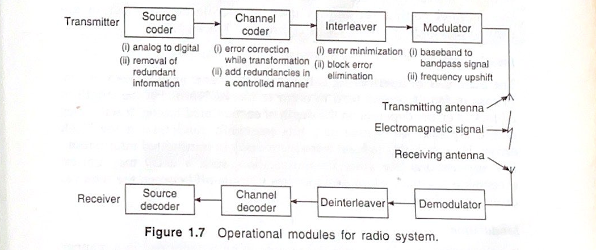

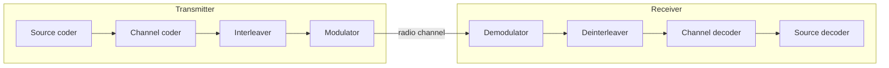

| Module | Task |
| :--- | :--- |
| **Source coder** | converts the analog voice to digital bits and **removes redundancy**, so fewer bits are sent |
| **Channel coder** | **adds controlled redundancy** (parity, error-correcting codes) so the receiver can **detect and correct** bit errors caused by noise |
| **Interleaver** | **shuffles the bit order** across frames, so a burst (block) error from a fade becomes scattered single errors after deinterleaving |
| **Modulator** | puts the digital baseband signal onto a **high-frequency carrier** for radiation from a small antenna |
| **Demodulator** | recovers the baseband pulses from the received carrier |
| **Deinterleaver** | restores the original bit order (scattering any burst errors) |
| **Channel decoder** | uses the redundancy to **correct errors** |
| **Source decoder** | turns the bits back into **speech** (digital to analog) |

The receiver undoes the transmitter's steps in **reverse order**.

> 💡 Squeeze, protect, shuffle, lift; then undo backwards.

**(b) Answer.**

| Scheme | What changes | Remarks |
| :--- | :--- | :--- |
| **ASK** (amplitude shift keying) | carrier **amplitude** for 0 and 1 | simple, but very sensitive to noise and fading; not used in cellular radio |
| **FSK** (frequency shift keying) | carrier **frequency** for 0 and 1 | constant amplitude, good noise immunity, but needs more bandwidth |
| **PSK** (phase shift keying) | carrier **phase**; in BPSK a 0/1 change shifts the phase by **180°** | constant amplitude and frequency; best noise immunity and bandwidth use |

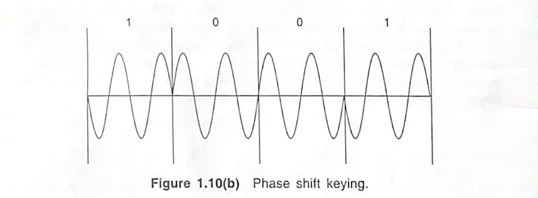

**PSK is preferred** in digital cellular systems. It resists noise and amplitude distortion best, and it uses bandwidth efficiently (see A4).

**(c) Answer.**

1. **Simplex:** one direction only. *E.g.* a pager.
2. **Half-duplex:** both directions, but **one at a time** over a shared channel. *E.g.* walkie-talkie (press to talk).
3. **Full-duplex:** both directions **simultaneously** (at the same time). *E.g.* telephone, cellular phone.

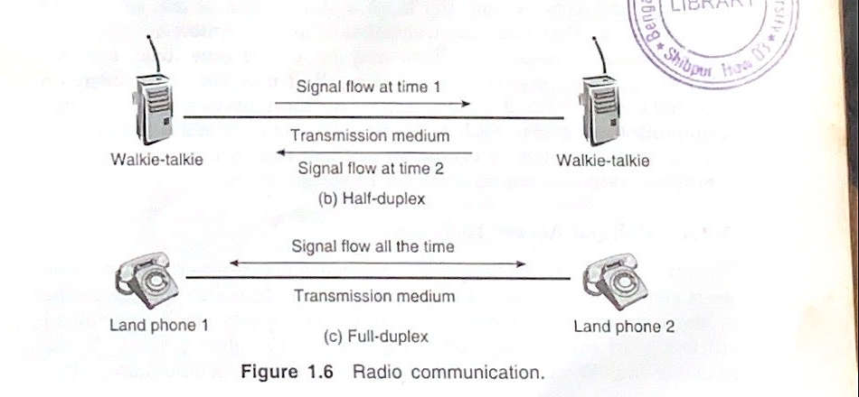

Full duplex is implemented by:
- **FDD:** two frequency bands, one per direction, separated by a fixed gap. A **duplexer** separates them on one antenna. Used in cellular WANs.
- **TDD:** one band, alternating time slots. No duplexer. Used in short-range cordless systems.

### B2. 🎯 2023 Mid Q3(a), 2025 Mid Q3(a) + 2024 Mid Q1(c) + ✍️

**(a)** Describe the channel-assignment strategies in a 2G cellular network. What is channel borrowing, and what are its constraints? **[10]**
**(b)** Define location tracking (location management). Write two implementation techniques. **[5]**
**(c)** Explain cell splitting and cell sectoring as capacity-improving methods. **[5]**

**(a) Answer.**

The goal is to use the fixed spectrum so that **few calls are blocked**, without breaking the co-channel reuse distance.

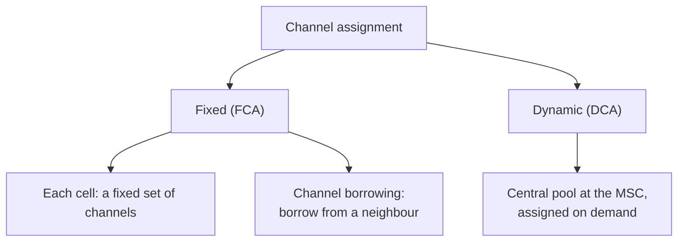

1. **Fixed channel assignment (FCA):** each cell gets a **predetermined set** of channels. A call is served only if one of that cell's channels is free. Otherwise it is **blocked**, even if neighbours are idle. Simple, but poor when traffic is uneven.
2. **Channel borrowing** (a variant of fixed): when all its channels are busy, a cell **borrows a free channel from a neighbouring cell**. The **MSC** supervises this process.
   - **Constraints:** the borrowed channel must **not be in use by any co-channel cell of the lending cell**. It must be **locked** in those co-channel cells while borrowed, so it causes no interference. The MSC must check this, which adds signalling and computation.
3. **Dynamic channel assignment (DCA):** channels are **not given permanently**. All are kept in a **central pool** at the MSC. For each call request, the serving BS asks the MSC. The MSC assigns a channel considering:
   - the **likelihood of future blocking** in the cell,
   - the **reuse distance** (co-channel interference),
   - adjacent-channel separation, and
   - **cost**.
   Adapts to hot spots and lowers blocking, but needs real-time computation at the MSC.

> 💡 Fixed = own pot; borrowing = ask the neighbour; dynamic = one shared pot at the MSC.

**(b) Answer.**

**Location tracking (location management):** keeping track of a mobile station's **current location**. This lets the network deliver a call or message and establish a **seamless connection**. Together with **handoff management**, it makes up **mobility management**.

The network keeps two databases:
- The **HLR** (permanent profile and current location; authenticates the subscriber before updates).
- The **VLR** (visiting mobiles; authenticates them with the HLR).
A roaming mobile must **register** with the visited network, which informs the home network.

**Two techniques:**

1. **Paging the whole network:** the mobile does not report its location. When a call arrives, the MSC **pages every cell**. No update traffic, but very high **paging overhead**.
2. **Location areas with location update:** cells are grouped into **location areas**. The mobile sends a **location update** whenever it crosses into a new location area. A call is then paged **only in that area's cells**. This reduces paging overhead at the cost of location updates.

📘 Larger location areas mean fewer updates but more paging, and vice versa.

**(c) Answer.**

**Cell splitting:** a congested cell is divided into **smaller cells**, each with its own base station, with **lower antenna height and transmit power**. Halving the radius gives about **4 times** as many cells in the same area. Therefore, the channels are reused more often. The **reuse ratio $Q = D/R$ is kept constant**. Cost: more handoffs and more sites.

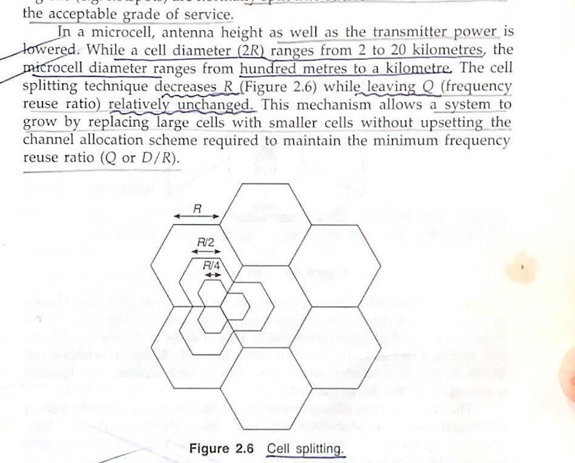

**Cell sectoring:** keep the cell size, but replace the omni antenna with **directional antennas** (3 × 120° or 6 × 60°). Each sector uses a subset of the channels. It receives interference from fewer co-channel cells (2 instead of 6 with 120°; 1 with 60°). The higher S/I allows a **smaller cluster size**, so more capacity. Cost: handoffs between sectors and lower **trunking efficiency** (smaller channel pools).

### B3. 🎯 2023 End Q2(a), Q2(b), 2025 End Q2(a), 2024 End Q2(c)

**(a)** Define GOS. Write the assumptions for a blocked-calls-cleared trunking system. **[5]**
**(b)** Define Erlang. How many users can be supported for 0.5% blocking probability with 20 trunked channels in a blocked-calls-cleared system? Each user generates 0.1 Erlang of traffic. From the Erlang chart, the total system load for 0.5% blocking is 11.10. **[5]**
**(c)** A cell has 20 channels. On average each user makes 3 calls/hour, and the average call lasts 2 minutes. The offered load from the Erlang B table is 12.03. How many users can be supported with 1% blocking? **[5]**
**(d)** Distinguish blocked-calls-cleared and blocked-calls-delayed systems. Write the Erlang B formula. **[5]**

**(a) Answer.**

**Trunking** lets many users share a small number of channels, because they rarely all call at once. **GOS (Grade of Service)** measures a user's ability to get a channel during the **busiest hour**: it is the **probability that a call attempt is blocked**. GOS = 0.001 means 1 call in 1000 is blocked in the busy hour. (ITU-T: the busy hour is found from the average busy-hour traffic over the **30 busiest days** of the year.)

**Assumptions of a blocked-calls-cleared (LCC) system:**

1. Call arrivals follow a **Poisson** distribution with a **fixed** average rate.
2. Arrivals are **memoryless**: any user, **including one just blocked**, may request a channel at any time.
3. The time a user occupies a channel is **exponentially distributed**, so long calls are less likely.
4. There is a **finite number of channels**.
5. There is an **infinite number of users**.

**(b) Answer.**

**Erlang:** the unit of traffic intensity. One Erlang = one channel **completely occupied**. The formula is $A = \lambda h$.

From the chart, $C = 20$ channels at GOS 0.5% carry $A = 11.10$ Erlangs. Each user offers $A_{pu} = 0.1$ Erlang. So:

$$n = \frac{A}{A_{pu}} = \frac{11.10}{0.1} = \mathbf{111 \text{ users}}$$

**(c) Answer.**

1. Holding time $h = 2$ min $= 2/60 = 1/30$ hour.
2. Traffic per user $A_{pu} = \lambda h = 3 \times \dfrac{1}{30} = 0.1$ Erlang.
3. Table: $C = 20$, GOS 1% → $A = 12.03$ Erlangs.
4. Users $n = 12.03 / 0.1 = 120.3 \Rightarrow \mathbf{120 \text{ users}}$ (round **down**, or the GOS would be exceeded).

> 💡 Users = table load ÷ load per user. Convert minutes to hours first.

**(d) Answer.**

| | Blocked calls cleared (LCC) | Blocked calls delayed (LCD) |
| :--- | :--- | :--- |
| All channels busy | the call is **blocked and denied** access | the call is **queued** until a channel frees |
| Model | **Erlang B** | 📘 Erlang C |
| Used by | **cellular systems** | queuing systems |

**Erlang B** (blocking probability $P$ = GOS, for offered load $A$ and $C$ channels):

$$P = \frac{\dfrac{A^C}{C!}}{\displaystyle\sum_{x=0}^{C}\dfrac{A^x}{x!}}$$

In practice the **Erlang B table** is read instead: it gives the load $A$ for given $C$ and GOS (*e.g.* $C = 20$: 11.10 at 0.5%, 12.03 at 1%).

### B4. 🎯 2025 End Q2(b), Q2(c), Q2(d) + 2024 End Q2(b)

*In the context of a CDMA-based cellular network:*

**(a)** Are the codes (0, 1, 0, 1) and (0, 1, 1, 0) orthogonal? Justify. **[5]**
**(b)** Two mobile stations A and B send data (+1, −1) and (+1, +1) using the codes (−1, +1, −1, +1) and (−1, +1, +1, −1). Derive the encoded signal received by the base station, and show how the BS recovers each user's data. **[5]**
**(c)** Write the demerits of CDMA. **[5]**
**(d)** How do you prove whether the chip code (+1, −1, +1, +1, −1, +1, +1, +1, −1, −1, −1) is orthogonal or not? **[5]**

**(a) Answer.**

Two codes are **orthogonal** when their **inner product (cross-correlation) is 0**.

Map binary 0 → −1 and 1 → +1:

$$c_a = (0, 1, 0, 1) \to (-1, +1, -1, +1), \qquad c_b = (0, 1, 1, 0) \to (-1, +1, +1, -1)$$

$$c_a \cdot c_b = (-1)(-1) + (+1)(+1) + (-1)(+1) + (+1)(-1) = 1 + 1 - 1 - 1 = 0$$

The inner product is 0, so **yes, the codes are orthogonal**: at the receiver, one user's signal contributes nothing when correlated with the other's code.

**(b) Answer.**

Each MS sends its **code** for data bit +1 and the **complement** of its code for −1, i.e. encoded = data × code, chip by chip.

$$\text{signal}_a = (+1)(-1, +1, -1, +1),\ (-1)(-1, +1, -1, +1) = (-1, +1, -1, +1,\ +1, -1, +1, -1)$$

$$\text{signal}_b = (+1)(-1, +1, +1, -1),\ (+1)(-1, +1, +1, -1) = (-1, +1, +1, -1,\ -1, +1, +1, -1)$$

The signals add in the air, so the **base station receives**:

$$\text{signal}_a + \text{signal}_b = \mathbf{(-2, +2, 0, 0,\ 0, 0, +2, -2)}$$

**Recovering the data:** take the inner product of each 4-chip block with the user's code (divide by 4):

| | Block 1 $(-2, 2, 0, 0)$ | Block 2 $(0, 0, 2, -2)$ | Data |
| :--- | :---: | :---: | :---: |
| with $c_a$ | $2 + 2 + 0 + 0 = +4$ → +1 | $0 + 0 - 2 - 2 = -4$ → −1 | (+1, −1) ✓ |
| with $c_b$ | $2 + 2 + 0 + 0 = +4$ → +1 | $0 + 0 + 2 + 2 = +4$ → +1 | (+1, +1) ✓ |

Because the codes are orthogonal, the other user's part cancels to 0.

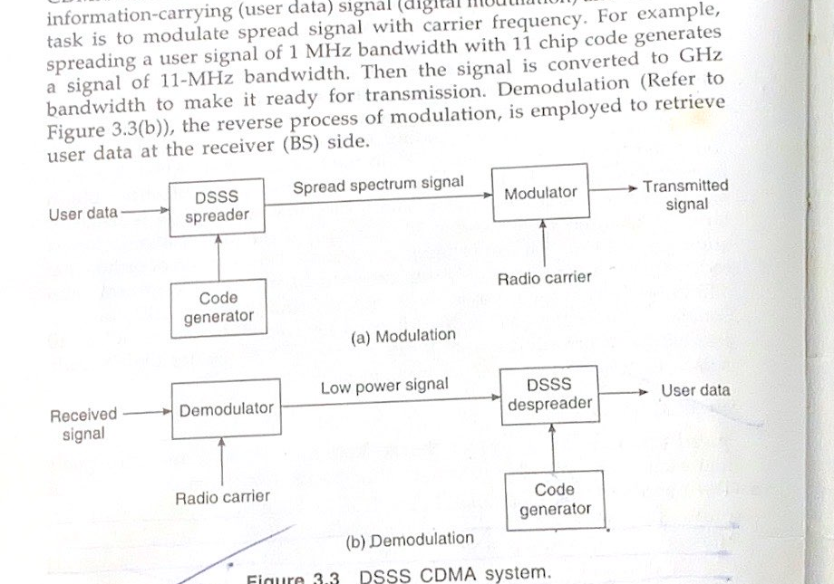

**(c) Answer.**

1. **Near-far problem:** a nearby mobile drowns a distant one. Therefore, **fast, precise power control** is essential; errors in it reduce capacity.
2. **Self-interference (multiple-access interference):** on the reverse link the codes are not perfectly orthogonal (PN codes, unsynchronised mobiles). Every extra user **raises the noise** for all; quality falls as load grows (soft capacity).
3. **Strict synchronisation** at chip level is needed, so receivers and base stations are **complex and costly**.
4. **Wide bandwidth** is needed for spreading; with few users it is **not economic**.
5. **Code management:** generating and assigning orthogonal codes for many moving users is hard; at cell edges, soft handoff ties up resources in several base stations.
6. 📘 Cell **breathing**: as load rises, a cell's coverage shrinks.

> 💡 CDMA's costs: power control, noise from others, tight timing.

**(d) Answer.**

Orthogonality is a property of **two** codes: code $x$ is orthogonal to code $y$ if $x \cdot y = 0$. A good CDMA code also needs **high autocorrelation**: the absolute value of its inner product **with itself** must be high, so the receiver detects it strongly.

**Proof method:**

1. **Autocorrelation:** inner product of the code with itself. Every chip is ±1, so:

$$c \cdot c = \sum_{i=1}^{11} c_i^2 = 11$$

   the maximum possible: the code is easy to detect. This is the **11-chip (Barker) code** used for ISDN and IEEE 802.11.
2. **Orthogonality:** take the inner product with another user's code (or with a shifted copy of itself). It is orthogonal to that code **only if the result is 0**. *E.g.* with its own complement it gives −11, so the two are **not** orthogonal (they are opposites, which is how a 0 bit is sent).

📘 Against its own shifted copies the code gives only 0 or −1 (aperiodic), tiny next to 11, which is why it is good for detecting the timing of a signal.

> 💡 Same code: big number. Different orthogonal code: zero.

### B5. 🎯 2024 End Q5(a) + 2023 Mid Q1(iii), Q1(iv) + ✍️

**(a)** Write a short note on spread spectrum. **[10]**
**(b)** Compare FDMA, TDMA and CDMA. **[10]**

**(a) Answer.**

**Spread spectrum** is a technique that gives **each user's signal a unique coding**. The **narrow-band** user data is multiplied by a very **wide-band spreading signal** (the code). Therefore, the transmitted signal occupies a **much larger bandwidth** than the data needs. Ideally the spreading signals of different users are **orthogonal**. This allows all users to use the **same carrier frequency at the same time**. It improves spectrum efficiency over FDMA and TDMA. (Originally military: hard to jam or intercept.)

**Terms:**

- **Chip:** one bit of the spreading code; chip period $T_c$, chip rate $1/T_c$ (millions of chips per second, "Mcps").
- **Spreading factor:** $T_b / T_c$ = chip rate ÷ data rate. *E.g.* a 1 MHz signal with an 11-chip code spreads to 11 MHz.

**DSSS (direct sequence spread spectrum):** the most popular form. Each data bit is multiplied by the user's chip sequence (send the code for 1, its complement for 0). The signal is then modulated onto the carrier. The receiver demodulates and **despreads** by correlating with the same code. Other users' signals look like low-level background **noise**.

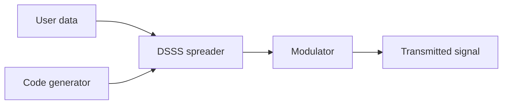

**Codes:**

- **Walsh codes:** mathematically **orthogonal**. Used on the **forward link** (BS → MS), where one BS sends to all users in perfect coordination.
- **PN (pseudo-noise) codes:** look random but are reproducible. Used on the **reverse link** (MS → BS), where moving mobiles cannot be perfectly coordinated.
- **Multiple spreading:** first spread with an orthogonal (Walsh) code to separate users in a cell, then with a PN code to separate cells.

**Analogy:** a party where each pair speaks a different **language** (code): every pair hears its own conversation and the rest is background noise, provided **no one shouts** (power control).

**Merits:** many users share the band (higher capacity), resistance to interference, jamming and multipath, privacy, and the same frequency in every cell. **Demerits:** wide bandwidth, power control and synchronisation complexity (see B4(c)).

**(b) Answer.**

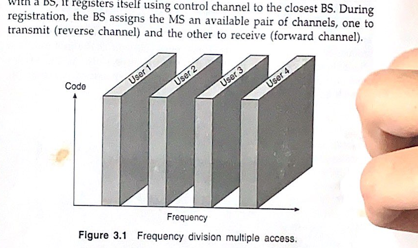

| Feature | FDMA | TDMA | CDMA |
| :--- | :--- | :--- | :--- |
| Users separated by | **frequency** band | **time slot** in a shared band | **code**, sharing frequency and time |
| Bandwidth per user | a narrow band (with **guard bands**) | the whole channel, for its slot | the **whole spectrum**, all the time |
| Transmission | **continuous** | **bursts** (discontinuous); saves battery | continuous, wideband |
| Synchronisation | low | high (slots, guard times) | very high (chip level) |
| Frequency planning | needed | needed | simple: **same frequency in all cells** |
| Power control | moderate | moderate | **critical** (near-far) |
| Capacity limit | hard | hard | **soft**: more users, more noise |
| Example (book) | 4 channels → 4 users | 4 channels × 3 slots → **12 users** | GSM uses FDMA + TDMA; IS-95 uses CDMA |

**2023 MCQs:**
- Whole bandwidth used simultaneously → **CDMA**.
- Incorrect statement about TDMA → "**single carrier frequency for a single user**" (in TDMA several users share one carrier; it does have high transmission rate and discontinuous transmission).

---

## GSM (textbook 3.3, pp. 58–72)

GSM architecture (BSS, NSS, OSS), the SIM and GPRS are answered in [Cellular_Networks_QA.md](Cellular_Networks_QA.md) (B5). This section adds the rest of textbook 3.3: protocol layers, channels, call set-up, handover and user validation.

### Part A — GSM terms

### A14. GSM frequency bands. 🎯 2025 Mid Q1(e), 2023 Mid Q1(viii) [2]

**Definition:** primary GSM uses two 25 MHz bands:
- **890–915 MHz uplink** (reverse link, MS → BTS)
- **935–960 MHz downlink** (forward link, BTS → MS)
These bands are 45 MHz apart (p. 66).

**Usage:** the bands are split into carriers, and each carrier is time-shared by **8 users** (FDMA + TDMA). The book takes 250 kHz carriers: $25000/250 = 100$ channels, or $(25000 - 2 \times 125)/250 = 99$ with 125 kHz guard bands.

✏️ Real GSM carriers are **200 kHz** wide, giving 124 carriers; the book's 250 kHz is its own simplification. In the exam, use the book's figure if the question follows the book.

> 💡 Mobile talks **up low** (890), tower talks **down high** (935).

### A15. IMSI and TMSI. ✍️ [2]

**Definition:** **IMSI** (international mobile subscriber identity) is the permanent subscriber identity stored in the **SIM**. It is like the MIN of AMPS. **TMSI** (temporary mobile subscriber identity) is a temporary identity the **VLR** gives to a roaming subscriber (p. 60).
**Usage:** the TMSI is sent over the air **instead of the IMSI**, which **conceals the user's identity**. The VLR may change it dynamically; it is valid only within that VLR's area. (The handset itself is identified by the **IMEI**, like the ESN of AMPS.)

### A16. EIR (Equipment Identity Register). ✍️ [2]

**Definition:** a database in the NSS holding the **IMEIs of invalid mobile stations**: stolen or blacklisted handsets, or types not approved (p. 61).
**Usage:** **security**. When an MS registers, it must give its IMEI. If the IMEI is on the list, **access is denied**. (The AC verifies the SIM; the EIR verifies the handset.) In some systems the EIR is integrated with the HLR.

### A17. Discontinuous transmission (DTX). ✍️ [2]

**Definition:** a **power-saving** mechanism of the RR sublayer: the transmitter is **switched off when the user is not speaking**. A person speaks less than 40% of the time in a normal conversation (p. 63).
**Usage:** saves battery (about 60% of the time the transmitter can be off). It needs an accurate **voice activity detector**. The receiver plays **comfort noise** so the listener does not hear total silence. (**Discontinuous reception:** in idle mode the MS listens only to the paging channel.)

### A18. SDCCH (Stand-alone Dedicated Control Channel). ✍️ [2]

**Definition:** a **bi-directional dedicated control channel** given to the MS between the network granting access (on AGCH) and the assignment of a traffic channel (p. 68).
**Usage:** while the MS waits for its TCH, call set-up information such as **authentication** data, the call set-up request and its confirmation are exchanged over the SDCCH.

### Part B — GSM questions

### B6. 🎯 2024 End Q2(a) + ✍️

**(a)** Which layer of the GSM protocol stack takes care of Radio Resource Management? What are the tasks managed by this module? **[10]** 🎯 2024 End Q2(a)
**(b)** Explain the three OSI layers of GSM and the protocols used at the A and A-bis interfaces. **[5]**
**(c)** Explain handover in GSM: its types and how the decision is taken. **[5]**

**(a) Answer** (pp. 61–63).

**The network layer (layer 3)** takes care of radio resource management. Layer 3 is divided into three sublayers:
- **Radio Resource management (RR)**
- **Mobility Management (MM)**
- **Call Management (CM)**
The **RR sublayer** does it.

**Where RR runs:** a part of RR, called **RR'**, is in the **BTS**. The rest is in the **BSC**. The BSC controls RR' through the **BTS management (BTSM)** unit. So most RR functions are done in the **BSS**. RR messages between the BSC and MSC are carried by **BSSAP**.

**RR session:** the time an MS is in **dedicated mode** and busy configuring radio channels. RR manages this session.

**Tasks of RR:**

1. **Set up, maintain and release radio channels** (the main task).
2. **Power control:** keeps the power just high enough for acceptable signal quality, to **minimise co-channel interference** and save power. The MS chooses the power level by measuring the **bit error ratio (BER)**. *E.g.* 3 wrong bits out of $10^5$ gives BER = $3 \times 10^{-5}$.
3. **Discontinuous transmission:** a person speaks less than 40% of the time, so the transmitter is turned off for the rest. A **voice activity detector** separates speech from noise, and **comfort noise** is played to the listener during silence.
4. **Discontinuous reception:** in idle mode the MS listens **only to the paging channel**, which uses little power.
5. **Handover:** when the signal from the serving BTS (BTS₁) falls below a threshold and that from BTS₂ rises, control of the ongoing call is switched to BTS₂.

**For contrast:** **MM** tracks the user's location (location areas, updates through the VLR to the HLR) and handles authentication and secure communication. **CM** handles call set-up, maintenance and termination, and SMS.

> 💡 RR = the radio: channels, power, DTX/DRX, handover. MM = where are you. CM = the call.

**(b) Answer** (pp. 61–64).

GSM is an OSI network with three layers:

| Layer | Job | Protocol by interface |
| :--- | :--- | :--- |
| **1 Physical** | creates **bursts**, multiplexes them into a **TDMA frame** and transmits; channel coding and error detection/correction; synchronisation; idle-channel detection; **encryption** on the air interface | **GMSK** modulation on Um; **PCM** on A-bis and A |
| **2 Data link** | packs data into **frames** (start/stop marks, checksums); detects and corrects errors or asks for retransmission | **LAPDm** (MS–BTS, Um); **LAPD** (BTS–BSC, A-bis); **MTP2 of SS7** (BSC–MSC, A) |
| **3 Network** | routing; sublayers **RR, MM, CM** | RR' in BTS, RR in BSC; MM and CM between MS and MSC |

**Extra protocols:**

- **A interface:** **SS7** (between BSC & MSC, MSC & HLR/VLR, MSC & MSC; carries the information for location update, handover, authentication and call routing) and **BSSAP** (MSC ↔ BSC; carries RR messages, allocates radio resources and handles mobility management).
- **A-bis interface:** **BTSM** (BTS management): lets the BSC control the radio equipment and frequency allocation of the BTS. A-bis is not yet standardised.
- **ISUP/R2:** part of SS7; used to set up calls with the **PSTN** (sends caller and called numbers to the next switch).

**(c) Answer** (pp. 65–66).

**Handover** = switching an ongoing call to a different channel (the GSM name for handoff).

**Types:**

- **Internal:** a different channel in the **same cell**, or a cell under the **same BSC**. Only one BSC is involved; the **MSC is told only after** the handover.
- **External:** between cells of **two BSCs under the same MSC**, or between cells under **different MSCs**.

**Who decides:** the MSC or the MS can start it. The MS keeps scanning the **broadcast control channels of up to 16 neighbouring cells**, keeps a list of the **6 best** by signal strength, and reports it to its BTS **at least once a second**. The BSC and MSC use this to decide.

**When:** GSM has no fixed rule; two techniques are used:

1. If the signal from the serving BTS drops below a threshold, **raise the transmit power**. If quality still does not improve, hand over. (Higher power may interfere with neighbouring cells.)
2. The MS keeps measuring the serving and neighbouring BTSs; hand over **as soon as a neighbour is stronger**. Avoids interference but is more complex.

GSM handover is a **hard handover** (break before make).

> **2023 Mid MCQs:**
> - (i) at the receiver end → **both demodulation and decoding** (the receiver undoes the transmitter's modulation and coding; B1).
> - (ii) stores data related to the user → **SIM** (IMSI, PIN, $K_i$ on the user's card; the HLR stores the operator's subscriber records).
> - (viii) uplink of primary GSM = **890–915 MHz**.
> - (x) the VLR is integrated with the **MSC** (one VLR per MSC, so both cover the same area).

### B7. ✍️ (textbook 2.11.2 and 3.3.8)

**(a)** Explain user validation (authentication) in AMPS. **[10]**
**(b)** Explain user validation in GSM. How does a dual-mode GSM-1900/AMPS phone authenticate? **[10]**

**(a) Answer** (guide §15, textbook 2.11.2).

**Problem:** early AMPS phones sent their serial number and phone number **in clear** over the air. Fraudsters picked them up with scanners and **cloned** them into other phones. The network needed to validate a phone without the secret ever going over the air.

**Identities:** **ESN** (electronic serial number, 32 bits, fixed in the handset) and **MIN** (mobile identification number, 34 bits, the phone number). The secret is the **A-key** (64 bits), stored in the handset and the network's authentication centre; it is **never transmitted**.

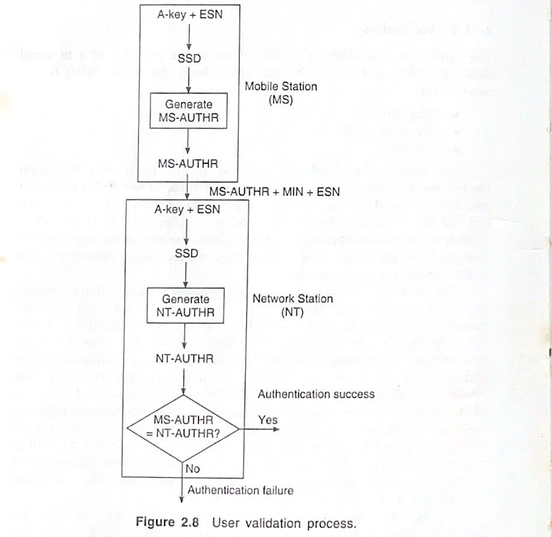

**Steps:**

1. **MS:** combines the **A-key** with its **ESN** to derive the **SSD** (shared secret data).
2. **MS:** runs the authentication algorithm (CAVE) on the SSD to compute **MS-AUTHR**.
3. **MS:** sends **MS-AUTHR** with its **MIN and ESN** to the network.
4. **Network:** takes the subscriber's stored **A-key** and the received **ESN**, derives the same **SSD**, and runs the same algorithm to get **NT-AUTHR**.
5. **Network:** compares **MS-AUTHR with NT-AUTHR**. Equal → **authenticated**, the call proceeds. Different → fraud; service denied.

A cloner who copies MIN and ESN still lacks the A-key, so cannot produce the right MS-AUTHR.

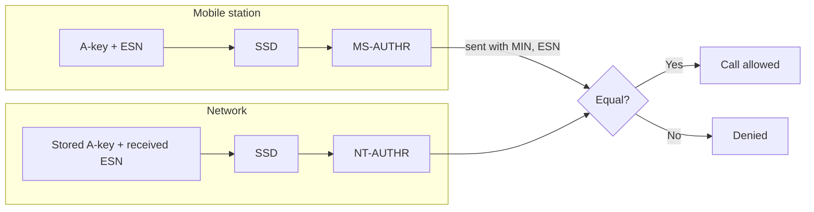

**(b) Answer** (p. 71).

**What the SIM holds:** the **IMSI**, the secret **authentication key $K_i$**, the **A3** algorithm and the **A8** ciphering-key-generating algorithm. GSM authentication checks the **SIM**, by **challenge and response**:

1. The network sends a **128-bit random number (RAND)** to the MS: the challenge.
2. The MS feeds **RAND and $K_i$** into **A3** to get the **signed response (SRES)**, and sends SRES back.
3. The network compares it with the **SRES supplied by the AC** (which holds a copy of $K_i$). A match → the subscriber is **valid**.
4. Then both ends compute the **ciphering key $K_c$** from RAND and $K_i$; $K_c$ is used to **encrypt and decrypt** the data on the air interface.

✏️ The book says A3 is run again to make $K_c$ and that $K_c$ goes "as input to the A8 algorithm for encryption". In the GSM standard, **A3** makes SRES, **A8** makes $K_c$ (as the book's own first sentence says), and **A5** does the encryption with $K_c$. Write the standard version and mention the book's wording only if asked to follow the book.

**Dual-mode GSM-1900/AMPS** (pp. 71–72): a key-based process like AMPS. The MS keys the **IMSI** with the hidden key **$K_i$** (the AMPS A-key) and runs an algorithm to get **MS-AUTHR**; it sends this with the keyed IMSI. The network computes **NT-AUTHR**; equal results authenticate the call. The handset's **IMEI** (the ESN equivalent) is not used, so a valid SIM works in **any valid GSM phone**.

| | AMPS | GSM |
| :--- | :--- | :--- |
| Secret | A-key (with ESN → SSD) | $K_i$ in the SIM |
| What is checked | the handset (ESN-tied) | the **SIM** |
| Challenge | — (MS-AUTHR vs NT-AUTHR) | 128-bit RAND → SRES |
| Encryption key | — | $K_c$ |

> 💡 GSM: RAND in, SRES out, $K_c$ for the rest of the call.

### B8. ✍️

**(a)** Classify the GSM logical channels and state the job of each. **[10]**
**(b)** Write the steps to set up a GSM call originated by a land phone, naming the channel used at each step. **[10]**

**(a) Answer** (pp. 66–68).

A **physical channel** is a time slot of a carrier frequency. A **logical channel** is defined by **the kind of information** it carries and is mapped onto physical channels.

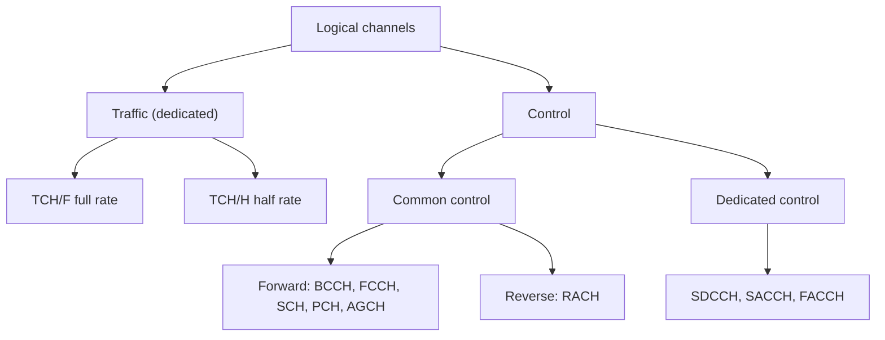

**Traffic channels** (user speech or data, both directions):

- **TCH/F:** speech at 13 kbps, or data at 12, 6 or 3.6 kbps.
- **TCH/H:** speech at 7 kbps, or data at 6 or 3.6 kbps.
- **TCH/8:** low-rate signalling, common and data channels.

**Common control channels** (one direction; used in idle and dedicated mode):

| Channel | Direction | Job |
| :--- | :--- | :--- |
| **BCCH** broadcast control | forward | broadcasts BTS identity, channel allocation and the list of adjacent BTSs |
| **FCCH** frequency correction and **SCH** synchronisation | forward | in the first slot of a frame; the MS locks to the BTS frequency and learns where slots start |
| **PCH** paging | forward | pages the MS for an incoming call |
| **RACH** random access | reverse | the MS asks for access (to call, or to answer a page) |
| **AGCH** access grant | forward | grants the RACH request; last common-channel message before dedicated channels |

**Dedicated control channels** (both directions):

| Channel | Job |
| :--- | :--- |
| **SDCCH** stand-alone dedicated | set-up signalling (*e.g.* authentication) while the MS waits for a TCH |
| **SACCH** slow associated | slow signalling alongside a TCH or SDCCH; carries **SMS** during a call |
| **FACCH** fast associated | urgent call-maintenance and handover information; **steals slots** from the TCH |

📘 Also **CBCH** (cell broadcast): forward, point-to-multipoint; broadcast SMS such as traffic or weather reports.

**(b) Answer** (pp. 69–71).

The call comes through the **PSTN** to the **MSC**, which checks the **HLR/VLR** that the MS is available, then pages through all BSCs/BTSs under it. Then:

| Step | Who | Message | Channel |
| :--- | :--- | :--- | :--- |
| 0 | BTS | synchronisation; network/BTS identity | FCCH, SCH; BCCH |
| 1 | BTS | **paging request** | **PCH** |
| 2 | MS | detects the page; **channel request** | **RACH** |
| 3 | BTS | grants access, assigns an SDCCH/SACCH | **AGCH** |
| 4 | MS | paging acknowledgement | SDCCH |
| 5 | BTS | authentication/encryption request | SDCCH |
| 6 | MS | authentication response | SDCCH |
| 7 | BTS | call set-up | SDCCH |
| 8 | MS | set-up response / connection confirmation | SDCCH |
| 9 | BTS | acknowledgement; assign **TCH** | FACCH |
| 10 | both | **voice communication** | **TCH** |
| 11 | MS ↔ BTS | disconnection request, grant, channel release, grant | FACCH |

**Call from an MS:** the MS monitors the **BCCH**, synchronises, sends a request on **RACH**, gets an SDCCH on **AGCH**, authenticates and sets up on **SDCCH**, then gets a **TCH** (no paging). For **mobile-to-mobile**, the caller does these steps, and the called MS is paged and set up as above.
