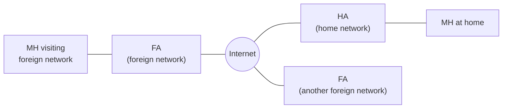
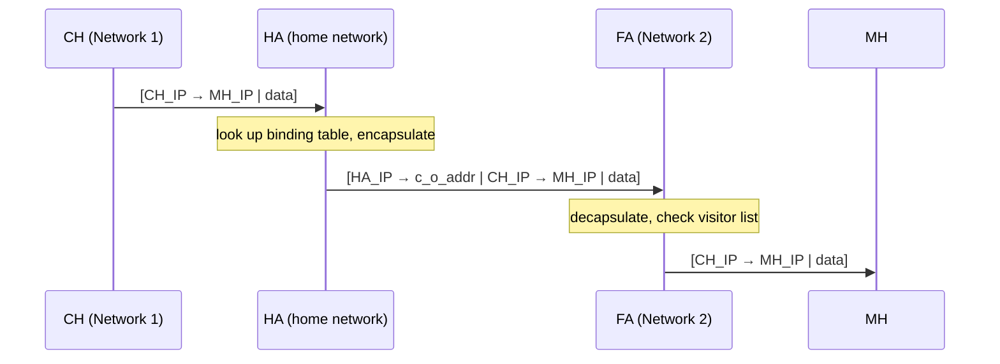
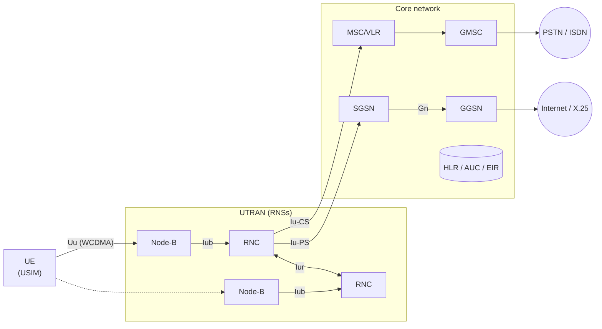

# Mobile IP and UMTS (Textbook 6.4 and Chapter 7) — Exam Questions and Answers

From the textbook (Sipra DasBit and Biplab K. Sikdar, *Mobile Computing*, PHI, `Mobile Computing - SDB.pdf`): **Section 6.4 Mobile IP** (pp. 141–148) and **Chapter 7, Overview of Third Generation Cellular Network (UMTS)** (pp. 154–174). There is no learning guide for these yet. Each answer is written in full from the book, cited as (p. 143). Try each question first, then read the answer.

**End-sem pattern:** Full marks 50, 3 hours. **Q1 is compulsory**: five terms, "define and state their usage", 5 × 2 = 10. Then answer **any two of Q2–Q5**, 20 marks each. Questions are split into parts. Examples include 10 + 10, 10 + 5 + 5 or 5 + 5 + 5 + 5.
**Here:** Part A = 2-mark terms (Q1 style). Part B = 20-mark questions (Q2–Q5 style).
**Tags:** 🎯 real paper (year, question); ✍️ practice to cover the book; 📘 beyond the book. 💡 = memory hook.
**UMTS has been a full 20-mark question (Q3) in every end-sem paper**. Mobile IP terms or tunnelling appear every year.

| Topic in the book | Question |
| :--- | :--- |
| Mobile IP: why, architecture (6.4, 6.4.1) | A1–A4, B1(a) |
| Agent discovery, registration (6.4.2) | A5, B1(a) |
| Tunnelling, delivering packets (6.4.2) | A6, B1(b), B2(a) |
| Mobile IP security (6.4.3) | B2(b) |
| 3G history, features, radio interfaces, spectrum (7.1–7.4) | B6(b) |
| UMTS services, traffic classes (7.5.1) | A7, A8, B3(c), B6(b) |
| UMTS architecture: CN, UTRAN, UE (7.5.2) | A9, A10, A11, B3(a), B3(b), B4(a), B5(b) |
| Location tracking, handover (7.5.3) | A12, A13, B5(a), B6(a) |
| Protocol stack, session management (7.5.4) | A14, B4(b), B5(c) |
| CS and PS call set-up (7.5.5–7.5.6) | B5(a), B7 |
| Power control, user validation (7.5.7–7.5.8) | B6(c) |

---

## Part A — 2-mark terms: define and state their usage

### A1. Home Agent (HA). 🎯 2025 End Q1(a) [2]

**Definition:** a **router** with an interface on the mobile host's (MH's) **home link** (p. 142).
**Usage:** the **main point** (anchor point) for communication with the mobile host. It tracks the MH's movement in a **mobility-binding table**. It **intercepts** packets sent to the MH's home address. Then, it **tunnels** them to its current care-of-address.

### A2. Foreign Agent (FA). 🎯 2024 End Q1(b) [2]

**Definition:** a **router located on the MH's foreign link** (the network the MH is visiting) (p. 142).
**Usage:** it keeps a **visitor list** that maps where to forward data for each visiting MH. Its tasks are:
- It advertises itself.
- It offers a **care-of-address**.
- It passes the MH's **registration** to the HA.
- It **decapsulates** tunnelled packets and delivers them to the MH.

### A3. Care-of-address. 🎯 2025 End Q1(b) [2]

**Definition:** the **IP address associated with a mobile host while it visits a foreign link** (p. 142). It changes each time the MH moves to another foreign link. (The **home address** is permanent and never changes.)
**Usage:** the HA tunnels the MH's packets **to the care-of-address**. There are two kinds:
- **Foreign agent care-of-address:** the FA's IP address. Many MHs **share** this address.
- **Collocated care-of-address:** an address **temporarily given to the MH's own interface** (*e.g.* via DHCP) when no FA is available. **One MH** uses it alone.

### A4. Mobility-binding table. 🎯 2024 End Q1(e) [2]

**Definition:** a table kept by the **Home Agent** (p. 142). It has entries for **MH_IP** (home address), **c_o_addr** (care-of-address) and **life_time**.
**Usage:** it maps each MH's **permanent address to its current care-of-address**. So, the HA knows where to tunnel packets. The HA updates this table at every registration. (The FA's **visitor list** holds MH_IP, HA_IP and life_time.)

> 💡 HA: binding table (home → care-of). FA: visitor list.

### A5. Agent advertisement and agent solicitation. ✍️ [2]

**Definition:** the two messages of **agent discovery** (p. 143).
- **Advertisement:** the HA and FA **periodically broadcast** their presence.
- **Solicitation:** sent by an MH that needs an advertisement **immediately** and cannot wait.
Both messages use **ICMP router discovery** messages.
**Usage:** the MH learns whether it is at home or away. If it is away, it **collects a care-of-address**. If no advertisement arrives within **life_time**, the MH decides that it has moved or the link failed. Then, it sends a solicitation.

### A6. Reverse tunnel. ✍️ [2]

**Definition:** a tunnel **from the FA back to the HA** (p. 145). Packets **sent by the MH** flow through this tunnel.
**Usage:** the MH sends packets using its home address. This makes it look like the MH is always in its home network. The packets go through the HA to the correspondent node.

### A7. UMTS traffic classes. 🎯 2024 End Q3(c) [2]

**Definition:** UMTS groups traffic into four classes (p. 157):
- **Conversational** (class A: voice, video telephony).
- **Streaming** (class B: multimedia, video on demand).
- **Interactive** (class C: web browsing, database access).
- **Background** (class D: e-mail, SMS, downloading).
**Usage:** each class gets QoS based on the service it needs. Classes A and B are more sensitive to delay and bit errors. So, class D receives lower error protection.

### A8. Supplementary service (multicall). ✍️ [2]

**Definition:** a service that **cannot be offered separately** (p. 157). The network provides it with a basic telecommunication service. Examples include call forwarding, call waiting, call hold and call barring.
**Usage:** UMTS adds **multicall**. A subscriber can **keep two simultaneous calls in the CS domain**. For example, they can hold a video call and a voice call at once.

### A9. Node-B. ✍️ [2]

**Definition:** the **physical unit of radio transmission and reception** in UMTS (p. 159). It is the equivalent of the GSM base station. It connects one or more antennas (cells) to the UEs.
**Usage:** it handles air-interface transmission and reception, modulation/demodulation, power measurement and **closed-loop power control**, and signal-strength measurement for handover. Operators can collocate it with a GSM BTS to cut costs.

### A10. RNC (Radio Network Controller). ✍️ [2]

**Definition:** the **controlling equipment** for a group of Node-Bs, equivalent to the GSM **BSC** (p. 159). The RNC that connects to a Node-B is its **controlling RNC (CRNC)**. Node-Bs plus their CRNC form a **radio network subsystem (RNS)**.
**Usage:** it handles **radio resource management**, admission control, **CDMA code assignment**, power control and handover control.

### A11. USIM. ✍️ [2]

**Definition:** User Service Identity Module (p. 161). It is the UMTS version of the SIM card, with the **same physical form**. It stores all data needed for **authentication and access**.
**Usage:** it identifies the subscriber. Its capacity is in **megabytes** (a SIM card is in kilobytes). So, it can hold user profiles and downloaded applications.

### A12. Softer handover. 🎯 2023 End Q1(a) [2]

**Definition:** a special case of **soft handover** (p. 163). A UE moves from one cell to another. Both cells are **controlled by the same Node-B**. This is an **intra-Node-B** handover.
**Usage:** when the RNC decides that a new link is needed, it tells the Node-B to set it up. The Node-B starts receiving the UE's data on the **antenna set covering the new cell**. It needs no new Node-B or RNC. So, it is the cheapest handover.

### A13. Hard handover. ✍️ [2]

**Definition:** a handover where **all old radio links are removed before the new ones are established** ("break before make") (p. 164).
**Usage:** in UMTS, it is used when the **carrier frequency changes** (inter-frequency). It is also used for handover to **another system such as GSM** (dual-mode UEs; transparent to the user). GSM's TDMA handover is the classic hard handover.

### A14. PDP context. ✍️ [2]

**Definition:** the set of parameters that describes a **packet data connection** under the **Packet Data Protocol** (pp. 165–166). The UE, SGSN and GGSN all define it. It includes:
- PDP type (*e.g.* IPv4).
- PDP address (*e.g.* IP address).
- QoS profile requested (*e.g.* maximum bit rate 128 kbps).
- QoS profile negotiated.
**Usage:** the system must **activate** it before any data transfer between the UE and the core network. With PDP type IP, it gives an IP address to the UE.

---

## Part B — 20-mark questions

### B1. 🎯 2025 End Q5(a), 2023 End Q2(d) + 2025 End Q1(a, b), 2024 End Q1(b, e)

**(a)** What is Mobile IP? Describe its architecture and how it works: agent discovery and registration. **[10]**
**(b)** Write a short note on tunnelling in Mobile IP. **[10]**

**(a) Answer.**

**Why Mobile IP (p. 141):** when a portable device moves to another network, its **network prefix changes**. Because of this, others cannot reach it at its fixed IP address, and its sessions end. Giving it a new IP address at every move forces it to stop and restart its communications.
**Mobile IP** is an open standard from the **IETF**. It lets a user **keep the same (permanent) IP address** while roaming between IP networks. So, ongoing sessions are not dropped. It is a **network-layer** solution. Because of this, it works over any medium (*e.g.* from wired Ethernet to WLAN).

**Architecture (p. 142):**

| Component | Role |
| :--- | :--- |
| **Mobile Host (MH)** | Changes its point of attachment while keeping ongoing communication, using only its **permanent IP address**. |
| **Home Agent (HA)** | Router on the MH's **home link**; main point (anchor point); keeps the **mobility-binding table** (MH_IP, c_o_addr, life_time). |
| **Foreign Agent (FA)** | Router on the **foreign link**; keeps a **visitor list** (MH_IP, HA_IP, life_time). |
| **Home address** | The MH's permanent IP address. |
| **Care-of-address** | The MH's address on the foreign link: the **FA's** address (shared) or a **collocated** address (one MH, *e.g.* from DHCP). |



**How it works: three sub-processes** (p. 143): **agent discovery, registration, tunnelling.**

**1. Agent discovery:**

- **Agent advertisement:** the HA and FA **periodically broadcast** their presence. From it, the MH learns whether it is at home or away. If it is away, it **collects a care-of-address**.
- **Agent solicitation:** an MH that cannot wait for the next advertisement asks for one. Any agent that receives it replies at once. Both use **ICMP router discovery** messages.
- **life_time** is the longest allowed gap between two advertisements. If the MH hears none within this time, it assumes it has moved to a new FA. It may also mean the link failed. Then, it solicits.
- If no FA is available, the MH acts as its **own FA**. It uses a **collocated care-of-address** obtained via **DHCP**.

**2. Registration:** tells the HA the current care-of-address.

1. The MH sends a **registration request** (MH_IP, HA_IP, care-of-address) to its HA **through the FA**.
2. The FA checks the request's validity and forwards it to the HA.
3. The HA records the care-of-address in its **mobility-binding table**. Then, it sends packets to it.
4. When the MH moves again, it re-registers through the new FA. The HA updates the table.
5. Back home, it sends a **deregistration** request to remove its care-of-addresses.

**(b) Answer.**

**Tunnelling (pp. 144–146):** when a packet for the MH reaches its home network, the **HA intercepts** it. It looks up the care-of-address in the binding table. It builds a **new IP datagram** whose destination is the **care-of-address**. Then, it puts the original datagram **inside its payload** (encapsulation).
Using an outer datagram with a different destination address is **tunnelling**. The FA **decapsulates** it (removes the outer datagram). It reads MH_IP from the original datagram, checks its **visitor list**, and delivers the packet.
The tunnel is a **logical construct** between the encapsulating and decapsulating devices. Its entry and exit points are the outer source and destination.



**Example (Figure 6.12):** a correspondent host (CH) in Network 1 sends a packet to an MH in Network 2. The packet contains: source CH_IP, destination MH_IP, payload. The HA adds an outer header (source **HA_IP**, destination **c_o_addr**, the FA's address). The FA strips it and delivers the inner packet.

| Packet | Outer header | Inner header |
| :--- | :--- | :--- |
| CH → home network | — | CH_IP → MH_IP |
| HA → FA (in the tunnel) | HA_IP → c_o_addr | CH_IP → MH_IP |
| FA → MH | — | CH_IP → MH_IP |

**Reverse tunnel:** the MH's own packets can flow **FA → HA** and on to the correspondent.

**Encapsulation methods:**

1. **IP-in-IP** (default): an extra IP header is put on top. The original packet is the payload. The tunnel looks like a single virtual link.
2. **Minimal encapsulation** (optional): redundant fields of IP-in-IP are dropped, so there is **less overhead**. It works only when the original packet is **not fragmented**.
3. **GRE (Generic Routing Encapsulation)** (optional): supports **multi-protocol** encapsulation. It puts a packet of one protocol suite (*e.g.* Novell NetWare) inside another (IP). Packet format: [HA_IP, c_o_addr | GRE | original header | payload].

**Routing loop:** if the tunnel is set up badly, a packet may re-enter the same tunnel. It can be encapsulated again and again, growing without end. **GRE has an explicit mechanism to prevent this.**

> 💡 Tunnel = letter in an envelope: HA writes the new address, FA opens it.

### B2. ✍️

**(a)** Write the steps for delivering packets to a mobile host. **[5]**
**(b)** How does Mobile IP secure the registration process? **[10]**
**(c)** Why is Mobile IP needed? How do HA, FA and care-of-address together keep a session alive? **[5]**

**(a) Answer** (p. 147).

A correspondent host sends to the MH's **home address** (MH_IP). If the MH is at home, it receives the packet directly. Otherwise:

1. The **HA intercepts** packets for the MH's home address. It consults the **mobility-binding table** for its care-of-address.
2. It builds a new packet: destination = **care-of-address**, source = **HA_IP**. The payload is the original packet (**encapsulation**).
3. The HA **sends** the encapsulated packet.
4. The **FA** receives it, **removes the outer header** and finds MH_IP.
5. The FA **checks its visitor list** and delivers the packet to the MH.

**(b) Answer** (pp. 147–148).

**The threat:** during registration, a **malicious node may pose as an FA**. It could forward a fake registration request to the HA. The HA would then send the MH's data packets to the malicious FA.

**The fix: a security association** between the HA and the MH. This is a negotiation that sets how the sender converts data before sending it. It is based on a **security association table** known to both in advance.

| Security association table | Registration message |
| :--- | :--- |
| SPI · authentication algorithm · secret key · uniqueness identifier | SPI · authenticator · timestamp |

- **SPI (Security Parameter Index):** identifies the security association between the two nodes. It points to the algorithm, secret key and uniqueness identifier to use.
- **Algorithm:** commonly **keyed MD5 with a 128-bit key**.
- **Uniqueness identifier:** usually a **timestamp**. Each registration message carries one.
- The association is set up **manually or by automated key management**.

**Steps:**

1. Every registration request or reply carries an **authentication extension**. This is the **SPI** followed by an **authenticator**, computed from the parameters the SPI points to.
2. The receiver computes the authenticator itself from the SPI's parameters and **compares** them. A match proves that the sender knows the secret key. The authenticator protects the **whole message**.
3. The receiver checks the **timestamp**. If it is reasonable, the HA accepts the message. Otherwise, the HA rejects it. This prevents a **replay attack** (an attacker re-sending a captured valid message later).

The **MH–HA** authentication extension is **mandatory**. The **MH–FA** and **FA–HA** extensions are optional (the FA removes or adds them when relaying).

> 💡 SPI picks the key; the authenticator proves it; the timestamp stops replays.

**(c) Answer.**

Without Mobile IP, moving to a new network changes the network prefix. So, the device would need a **new IP address**. Every TCP session (which is tied to the IP address) would break.
Mobile IP keeps the **home address fixed**:

- The **HA** always receives packets for the home address. It knows the current **care-of-address** from the binding table.
- The MH tells the HA its care-of-address by **registration** after **agent discovery**.
- The HA **tunnels** packets to the care-of-address. The **FA** delivers them.

So, correspondents always use the same address, and the session survives the move. For example, a laptop can move from wired Ethernet to WLAN without interrupting service. 📘 GPRS also uses Mobile IP. This lets the home network forward packets to a roaming user (p. 149).

### B3. 🎯 2024 End Q3

*Answer the following for the Universal Mobile Telecommunications System (UMTS):*

**(a)** What are the major components of the core network? Briefly state the tasks of each. **[10]**
**(b)** What roles are played by the RNC? **[5]**
**(c)** Write the names of the traffic types supported in such a system. **[5]**

**(a) Answer** (pp. 158–159).

A UMTS network has three domains:
- The **Core Network (CN)**.
- The **UMTS Terrestrial Radio Access Network (UTRAN)**.
- The **User Equipment (UE)**.
The CN is like the GSM/GPRS core, but UMTS uses an entirely new radio interface.



**Main functions of the CN:** **switching and routing** of user traffic. It holds the **databases** and **network management** functions for **intersystem handover** and **location management**.
It talks to the UTRAN through the **Iu** interface (like GSM's A interface). The MSC connects through **Iu-CS**, and the SGSN connects through **Iu-PS**.

The CN is divided into a **circuit-switched** and a **packet-switched** domain:

| Component | Domain | Task |
| :--- | :--- | :--- |
| **MSC** (Mobile Switching Centre) | CS | Handles all **circuit-switched** operations, such as connecting two subscribers. |
| **VLR** (Visitor Location Register) | CS (shared) | Temporary data on UEs in the MSC's area; location tracking at **LA** level. |
| **GMSC** (Gateway MSC) | CS | The CS **gateway** to external circuit networks (PSTN/ISDN). |
| **SGSN** (Serving GPRS Support Node) | PS | Handles **packet-switched** operations; tracks UEs at **routing area** level; session management; authentication in the PS domain. |
| **GGSN** (Gateway GPRS Support Node) | PS | The PS **gateway** to external data networks (Internet, X.25). |
| **HLR** (Home Location Register) | shared | Permanent subscriber profiles and current location. |
| **AUC** (Authentication Centre) | shared | Generates the **authentication vector** (RAND, AUTN, XRES, CK, IK) to check the UE. |
| **EIR** (Equipment Identity Register) | shared | List of valid and stolen terminal identities. |

EIR, HLR, VLR and AUC are **shared by both domains**.

**(b) Answer** (pp. 159–160).

The RNC controls a group of Node-Bs. It is the UTRAN's equivalent of the GSM **BSC**. Its roles are:

1. **Radio resource management:** the RNC handles the entire radio resource management. This takes the burden off the CN.
2. **Admission control:** it computes the **traffic in each cell**. It decides to **accept or reject a new call**. This keeps interference below a threshold (essential in CDMA).
3. **CDMA code assignment:** it gives each UE a **unique WCDMA code**. So, the data of one UE is separated from all others.
4. **Power control:** using the Node-B's measurements, the **CRNC adjusts the power** of the radio signal at the Node-B and UE.
5. **Handover control:** using the measured **frame error rate (FER)** and signal strengths, it takes **handover decisions**. It assists **soft handover** between cells, RNCs and RNSs.

RNCs talk to Node-Bs over **Iub**, to each other over **Iur** (no GSM equivalent), and to the CN over **Iu**.

> 💡 RNC = the radio brain: admit, code, power, hand over.

**(c) Answer** (p. 157).

| Class | Name | Examples | Sensitivity |
| :--- | :--- | :--- | :--- |
| **A** | **Conversational** | Voice, video telephony | Real time; most sensitive to delay. |
| **B** | **Streaming** | Multimedia, video on demand | Real time, one way. |
| **C** | **Interactive** | Web browsing, database access | Request–response; needs low errors. |
| **D** | **Background** | E-mail, SMS, downloading | Not time critical; **lower error protection**. |

UMTS supports **real-time and non-real-time** traffic in both the **CS** and **PS** domains. It offers three bit-rate options:
- **Constant**.
- **Dynamically variable**.
- **Dynamically variable with a guaranteed minimum**.

Traffic can be **point-to-point** or **point-to-multipoint**. QoS depends on **delay, bit error ratio and data rate**.

### B4. 🎯 2023 End Q3

**(a)** What are the major components of UTRAN? Briefly state the tasks of each. **[15]**
**(b)** In the UMTS signalling protocol stack, what roles are played by "Call management" and "Mobility management"? **[5]**

**(a) Answer** (pp. 158–160).

**UTRAN** (UMTS Terrestrial Radio Access Network) is the new radio network of UMTS. It gives the **User Equipment** access to the core network. It consists of **Node-Bs** and **RNCs**.


**Structure:**

- **Node-B** = the GSM base station; **RNC** = the GSM BSC.
- A group of Node-Bs connects to one RNC, its **controlling RNC (CRNC)**.
- Node-Bs plus their CRNC = a **Radio Network Subsystem (RNS)**. The UTRAN consists of several RNSs.
- Interfaces:
  - **Uu** (WCDMA air interface, UE–Node-B).
  - **Iub** (Node-B–RNC).
  - **Iur** (RNC–RNC, no GSM equivalent; handles radio resource management between RNCs).
  - **Iu** to the core (**Iu-CS** to the MSC, **Iu-PS** to the SGSN).

**1. Node-B:** the physical unit of radio transmission and reception. It connects one or more antennas (cells). It can be collocated with a GSM BTS.
It measures the power of the radio links and sends the values to its CRNC. It also measures signal strength and computes the **frame error rate**. This lets the CRNC decide on handover.
Functions:
- Air-interface **transmission and reception**.
- **Modulation and demodulation**.
- **Measurement of power** of the radio links to the UEs.
- **Closed-loop power control**.
- **Measurement of signal strengths** of the radio links to the UEs.

**2. RNC:** controls its Node-Bs and performs:
- **Radio resource management** (removes the burden from the CN).
- **Admission control** (accepts or rejects new calls from the cell traffic, keeping interference low).
- **CDMA code assignment** (a unique WCDMA code per UE).
- **Power control** (adjusts power at the Node-B and UE).
- **Handover control** (decisions from the Node-B's measurements; soft handover between cells, RNCs and RNSs).

WCDMA, the UTRAN air interface, has two modes: **FDD** and **TDD**.

**3. User Equipment (UE)** (connects to the UTRAN): a phone, PDA etc., attached to a Node-B over Uu. It can connect to **more than one cell or Node-B** at once (soft handover).
It carries the **USIM**. It is identified by IMSI and TMSI (CS) or IMSI and P-TMSI (PS).
It helps the Node-B with signal-strength and power-control measurements. It takes part in handover and radio resource management with the RNC. It also takes part in bearer negotiation with the CN.
Modes: **PS + CS**, **PS only** or **CS only**.

> 💡 UTRAN = Node-Bs (radio) + RNCs (control), grouped into RNSs.

**(b) Answer** (p. 164).

| Layer | UE ↔ Node-B | UE ↔ RNC | UE ↔ core |
| :--- | :--- | :--- | :--- |
| Top (CS domain) | | | **CM, MM** (UE ↔ MSC) |
| Top (PS domain) | | | **SM, UMM** (UE ↔ SGSN) |
| Layer 3 | | **RRC** | |
| Layer 2 | | **RLC, MAC** | |
| Layer 1 | **PHY** | | |

The UMTS signalling stack has **PHY** (layer 1), **MAC** and **RLC** (layer 2) and **RRC** (layer 3).
Above them, in the **CS domain**, the top two layers are **CM** and **MM**. They are defined between the **UE and the MSC**:

- **Call Management (CM):** manages **call establishment and call release**. It also manages **supplementary services** such as call forwarding and call barring.
- **Mobility Management (MM):** handles the **CS-domain mobility management of the UE**. The main example task is the **LA (location area) update**.

(In the **PS domain**, the matching layers are **SM** [session management] and **UMM** [UMTS mobility management]. They are defined between the UE and the SGSN. UMM does the **RA update**.)

### B5. 🎯 2025 End Q3

*In the context of UMTS, answer the following:*

**(a)** Write the algorithmic steps for location tracking and for setting up a call originated by a land phone. **[10]**
**(b)** What are the major functionalities of Node-B? **[5]**
**(c)** What is session management? Which protocol is used for packet data communication? Name the parameters that describe such a packet data connection. **[5]**

**(a) Answer** (pp. 161–162, 166–167).

**Location tracking.** The network keeps location information for each UE. The UE updates it when it detects a change of location. This occurs when it starts receiving a **broadcast message different** from the previous one. Cells are grouped in three levels:

| Area | Made of | Managed by |
| :--- | :--- | :--- |
| **URA** (UTRAN routing area) | Cells of one or more Node-Bs under **one RNC** | RNC |
| **RA** (routing area) | One or more URAs under one RNC | SGSN |
| **LA** (location area) | One or more RAs managed by the same SGSN | MSC/VLR |

Steps:

1. **CS domain:** the CN (**MSC/VLR**) tracks which **LA** the UE is in.
2. **PS domain:** the **SGSN** tracks the UE at **RA** level (which serving RNC). The **UTRAN** tracks it at **cell** level.
3. For the SGSN, the UE is **idle** or **connected**. For the UTRAN, it is **idle**, **cell-connected** or **URA-connected**.
4. When the UE starts a data access, a PS signalling connection to the SGSN is set up → **connected**. This triggers a connection to the serving RNC → **cell-connected**. The serving RNC tracks its cell, and data flows.
5. If no data flows for a set time → **URA-connected** (still connected, tracked by URA only). New data → back to **cell-connected**.
6. After a further idle period → **idle** (CN and UTRAN). From URA-connected, the UE goes to cell-connected first, then to idle.

**Call originated by a land phone (L→M):** the call comes to the **MSC** through the **PSTN**. The MSC checks with the **HLR/VLR** whether the called UE is available. If so, a traffic channel is assigned after messages among the MSC, RNC and UE:

1. **RNC:** periodically broadcasts system information.
2. **MSC/VLR:** asks the RNC to track the called UE.
3. **RNC:** broadcasts on the **paging channel** to track the UE.
4. **UE:** detects the page, replies and sends an **RRC connection request**.
5. **RNC:** grants it by assigning a channel to the UE.
6. **UE:** sends RRC connection set-up completion information.
7. **RNC:** relays the completion to the MSC/VLR.
8. **MSC/VLR:** asks the RNC to **authenticate** the UE and secure the communication.
9. **RNC:** forwards the request to the UE.
10. **UE:** sends authentication and security data.
11. **RNC:** forwards the response to the MSC/VLR.
12. **MSC/VLR:** sends the **connection set-up request**.
13. **RNC:** forwards it to the UE.
14. **UE:** confirms the connection set-up.
15. **RNC:** relays the confirmation to the MSC/VLR.
16. **MSC/VLR:** instructs the RNC to assign a **radio bearer** (channels for voice).
17. **RNC:** assigns the channel to the UE.
18. **UE:** sends the channel assignment response and generates the **alert** (ring tone).

```mermaid
sequenceDiagram
    participant UE
    participant RNC
    participant MSC as MSC/VLR
    MSC->>RNC: Track the called UE
    RNC->>UE: Page
    UE->>RNC: RRC connection request
    RNC->>UE: Assign channel
    UE->>RNC: RRC set-up complete
    RNC->>MSC: Relay
    MSC->>UE: Authentication request (via RNC)
    UE->>MSC: Authentication data (via RNC)
    MSC->>UE: Connection set-up (via RNC)
    UE->>MSC: Confirm (via RNC)
    MSC->>RNC: Assign radio bearer
    RNC->>UE: Assign channel
    UE->>RNC: Response; ring
```

**(b) Answer** (pp. 159–160).

Node-B is the **physical unit of radio transmission and reception** to and from UEs. It connects one or more antennas (cells). It can be **collocated with a GSM BTS**, and its **CRNC** controls it.

1. **Air-interface transmission and reception** over the WCDMA **Uu** interface.
2. **Modulation and demodulation.**
3. **Measurement of the power** of the radio links to the UEs. Values are sent to the CRNC, which adjusts power.
4. **Closed-loop power control:** each time slot, it measures the signals received from UEs. It tells near UEs to reduce power and far ones to increase it.
5. **Measurement of signal strengths** of the radio links and calculation of the **frame error rate**. This helps the RNC decide on handover.

**(c) Answer** (pp. 165–166).

**Session management (SM):** the entity that manages the **establishment, maintenance and release** of a packet connection, or **session**. Its states are **active** or **inactive**. Packet data can flow **only when SM is active**. SM is defined between the UE and the SGSN.

**Protocol:** **PDP (Packet Data Protocol)**. It supports data transfer from packet networks such as the Internet (IP) and X.25.

**PDP context parameters** (defined in the UE, SGSN and GGSN):

1. **PDP type** (*e.g.* IPv4).
2. **PDP address** type (*e.g.* IP address). With type IP, the context gives an IP address to the UE.
3. **QoS profile requested** (*e.g.* maximum bit rate 128 kbps for Internet access).
4. **QoS profile negotiated**.
5. 📘 Also the access point name of the external network (GGSN).

A PDP context can be activated, deactivated or modified. Two service classes (*e.g.* class B video-on-demand and class C web browsing) need **two PDP contexts**.

### B6. ✍️

**(a)** Explain the types of handover in UMTS: soft, softer and hard. **[10]**
**(b)** What are the features of 3G? What services does UMTS provide, and at what data rates? **[5]**
**(c)** Explain power control and user validation in UMTS. **[5]**

**(a) Answer** (pp. 162–164).

UMTS mainly supports **soft handover** ("make before break"). At least one radio link always exists between the UE and the UTRAN.

**Three types of soft handover:**

1. **Inter-Node-B, intra-RNC:** the UE moves between cells under two Node-Bs of the **same RNC**. The RNC tells the new Node-B to set up a link. It receives data from **both** Node-Bs, picks the **better quality** one and sends it to the CN. When the UE moves away from the old Node-B, the RNC drops that link.
2. **Inter-RNC, intra-SGSN:** the two Node-Bs are under **different RNCs** of the **same SGSN**. The old (serving) RNC asks the new RNC over **Iur** for radio resources. The new RNC passes the UE's data to the old RNC. The old RNC picks the better packets and sends them to the CN. When the UE leaves the old RNC's area, the new RNC becomes the serving RNC: **serving RNC relocation**.
3. **Inter-SGSN:** the new RNC is under a **different SGSN**. The old RNC reports to the old SGSN, which contacts the new SGSN over the **Gn** interface. The new SGSN prepares the new RNC, and buffered packets are forwarded. Finally, the old SGSN drops its link, and the new SGSN and RNC take charge.

**Softer handover:** a special case, between two cells of the **same Node-B** (intra-Node-B). The Node-B simply receives on the antenna set of the new cell.

**Hard handover:** all old links are removed **before** new ones are set up. It is used when the **carrier frequency changes** (inter-frequency). It is also used for handover to **another system such as GSM** (dual-mode UEs; transparent to the user). GSM's TDMA handover is the classic hard handover.

| | Soft | Softer | Hard |
| :--- | :--- | :--- | :--- |
| Links during handover | Old and new together | Two cells of one Node-B | Old cut first |
| Between | Node-Bs / RNCs / SGSNs | Sectors of one Node-B | Frequencies or systems |

> 💡 Soft: hold both hands. Softer: same body, other hand. Hard: let go first.

**(b) Answer** (pp. 154–158).

**Features of 3G:**
- Higher data rates than 2G for **multimedia**.
- Both **packet-switched** (web browsing) and **circuit-switched** (real-time video) services.
- Voice quality comparable to the PSTN.
- A wide variety of terminals.
- Greater capacity and spectrum efficiency.
- **Global roaming**.
Radio interfaces under IMT-2000 include W-CDMA, CDMA2000 and TD-CDMA. The dominant technology is **CDMA**. Spectrum: 1885–2025 and 2110–2200 MHz.

**Data rates:**
- 144 kbps for high-speed mobiles (vehicles).
- 384 kbps for slow (pedestrian) users.
- **2 Mbps** for stationary (indoor) users.
UMTS targets:
- At least 144 kbps rural outdoor (target 384).
- 384 kbps urban outdoor (target 512).
- 2 Mbps indoor and low-range outdoor.

**Services:**

- **Bearer services:** unlike GSM's fixed bearers, parameters (traffic type, traffic characteristics, QoS) are **negotiated per application**. They can also be renegotiated. They are connection-oriented or connectionless.
- **Teleservices:** voice, SMS (point-to-point and cell broadcast), point-to-multipoint Internet access; new: the **wideband adaptive multi-rate codec**.
- **Supplementary services:** call forwarding, waiting, hold, barring; new: **multicall**.
- Also new: the **virtual home environment (VHE)**, which gives visiting subscribers their customised features anywhere.
- **Open service access (OSA)**, which allows third-party applications.

**(c) Answer** (pp. 171–172).

**Power control:** in CDMA, the base station must receive all UEs at about the **same power**. However, far UEs arrive weaker (the **near-far effect**). Two techniques:

- **Open loop:** during **set-up**, the UE measures the signal strength received from the Node-B. It uses this to estimate the needed power.
- **Closed loop:** once the call is running, the Node-B measures each UE's signal in **every time slot**. It tells near UEs to lower power and far UEs to raise it.

Node-B power is also kept to the minimum needed, because signals from different Node-Bs are not orthogonal.

**User validation:** unlike GSM, **the network authenticates the UE and the UE also authenticates the network** (mutual).

1. For a location update or call/data request, the MSC (CS) or SGSN (PS) sends the UE's **IMSI** to the **HLR/AUC**.
2. The HLR/AUC generates a 5-part **authentication vector**:
   - **RAND** (random number).
   - **AUTN** (authentication token).
   - **XRES** (expected response).
   - **CK** (ciphering key).
   - **IK** (integrity key).
3. The CN sends **RAND and AUTN** to the UE. If AUTN is acceptable, the **UE authenticates the network**.
4. The UE computes **RES** and returns it. The CN compares RES with **XRES**. A match **authenticates the UE**.
5. The UE computes CK and IK. Both sides use them for **ciphering and integrity** of the data.

### B7. ✍️

**(a)** Write the steps for setting up a UMTS call originated by a UE. **[10]**
**(b)** Write the steps for PS data transfer originated by the core network. **[10]**

**(a) Answer** (p. 168).

The call may go to a land phone (M→L) or another UE (M→M). The originating UE gets a traffic channel through messages among the MSC, RNC and UE:

1. **RNC:** periodically broadcasts system information.
2. **UE:** sends an **RRC connection request**.
3. **RNC:** grants it, assigning a channel.
4. **UE:** sends RRC set-up completion and a **service request**.
5. **RNC:** relays the service request to the **MSC/VLR**.
6. **MSC/VLR:** asks the RNC to **authenticate** the UE and secure the communication.
7. **RNC:** forwards the request to the UE.
8. **UE:** sends authentication and security data.
9. **RNC:** forwards it to the MSC/VLR.
10. **UE:** sends a **connection set-up request**.
11. **RNC:** relays it to the MSC/VLR.
12. **MSC/VLR:** grants it and instructs the RNC to assign a **radio bearer** for voice.
13. **RNC:** grants the radio bearer and assigns the channel.
14. **UE:** sends the channel assignment response.

For **M→M**, the called UE is then tracked (paged) and gets its channel by the land-phone steps (B5(a)).

**(b) Answer** (pp. 170–171).

When the **SGSN receives a downlink packet** for a UE:

1. **SGSN:** receives the packet. It sends a **paging message** to the UTRAN/RNC to track the UE.
2. **RNC:** broadcasts on the **paging channel**.
3. **UE:** detects the page. It replies and sends an **RRC connection request**.
4. **RNC:** grants it, assigning a channel.
5. **UE:** sends RRC set-up completion, a **paging response** and a **service request**.
6. **RNC:** relays the service request to the SGSN.
7. **SGSN:** asks the RNC to **authenticate** the UE.
8. **RNC → UE → RNC → SGSN:** authentication request and data exchanged.
9. **SGSN:** sends a **PDP context activation request**. The RNC forwards it.
10. **UE:** **activates the PDP context** and confirms. The RNC relays the confirmation.
11. **SGSN:** instructs the RNC to assign a **radio bearer** for PS communication.
12. **RNC:** assigns the channel. The **UE** responds. The RNC forwards the confirmation.
13. **SGSN:** **starts the downlink data transfer**.

📘 PS transfer originated by the **UE** is the same without paging:
The UE sends the service request and completes authentication. Next, it sends the **PDP context activation request**, receives a radio bearer, and starts **uplink** transfer.
