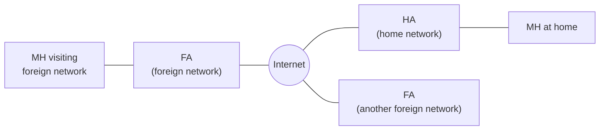
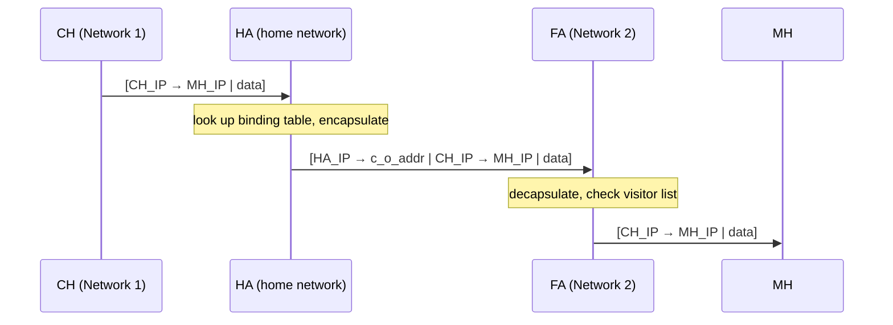
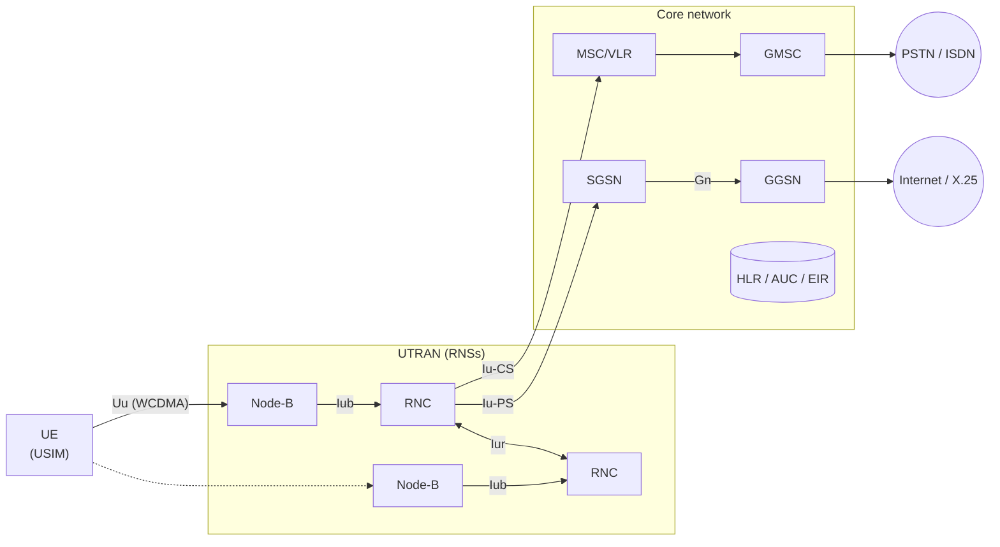
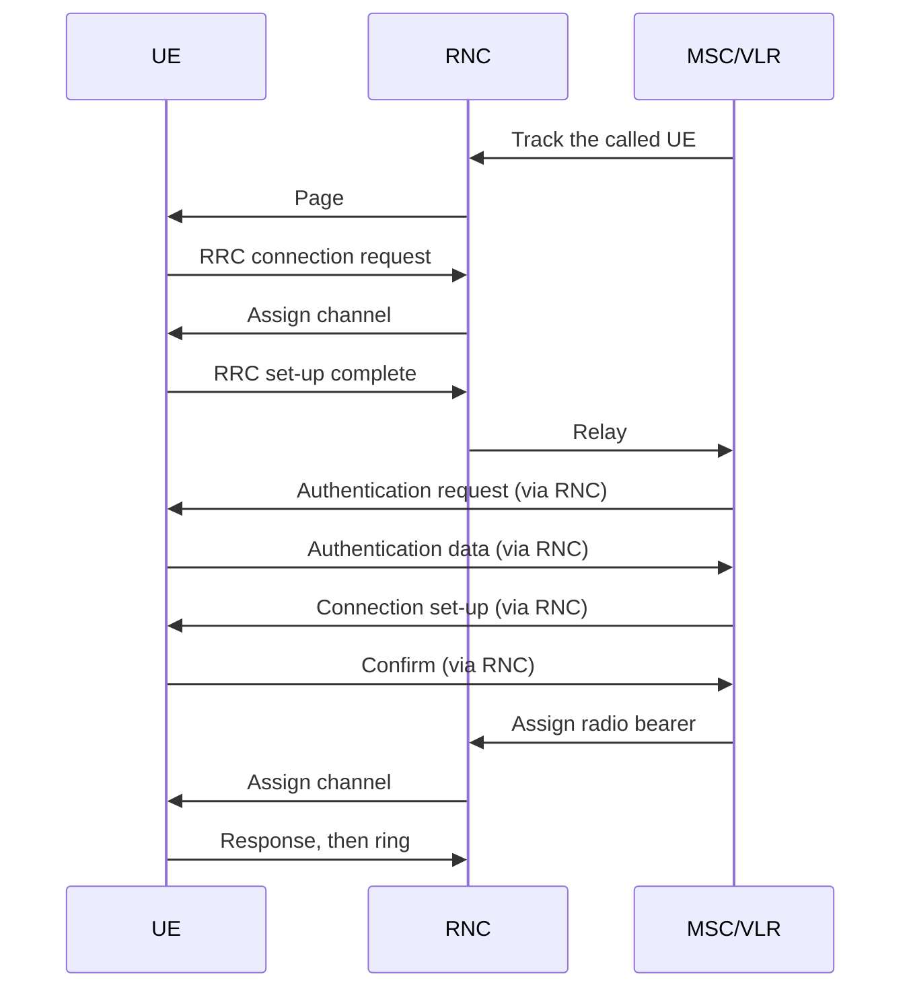

# Mobile IP and UMTS (Textbook 6.4 and Chapter 7) — Exam Questions and Answers

From the textbook (Sipra DasBit and Biplab K. Sikdar, *Mobile Computing*, PHI, `Mobile Computing - SDB.pdf`): **Section 6.4 Mobile IP** (pp. 141–148) and **Chapter 7, Overview of Third Generation Cellular Network (UMTS)** (pp. 154–174). There is no learning guide for these yet. Each answer is written in full from the book, cited as (p. 143). Try each question first, then read the answer.

**End-sem pattern:** Full marks 50, 3 hours. **Q1 is compulsory**: five terms, "define and state their usage", 5 × 2 = 10. Then answer **any two of Q2–Q5**, 20 marks each. Questions are split into parts. Examples include 10 + 10, 10 + 5 + 5 or 5 + 5 + 5 + 5.
**Here:** Part A = 2-mark terms (Q1 style). Part B = 20-mark questions (Q2–Q5 style).
**This file keeps only the past-paper questions (🎯) and a few likely ones (✍️).** Every past question from the 2023–2025 mid-sem and end-sem papers on this topic is here.
**Tags:** 🎯 real paper (year, question); ✍️ likely question (not asked yet, but close to a past one); 📘 beyond the book. 💡 = memory hook.
**UMTS has been a full 20-mark question (Q3) in every end-sem paper**. Mobile IP terms or tunnelling appear every year.

| No. | Question | Source |
| :--- | :--- | :--- |
| A1 | Home Agent (HA) | 🎯 2025 End Q1(a) |
| A2 | Foreign Agent (FA) | 🎯 2024 End Q1(b) |
| A3 | Care-of-address | 🎯 2025 End Q1(b) |
| A4 | Mobility-binding table | 🎯 2024 End Q1(e) |
| A5 | UMTS traffic classes | 🎯 2024 End Q3(c) |
| A6 | USIM | ✍️ |
| A7 | Softer handover | 🎯 2023 End Q1(a) |
| A8 | Hard handover | ✍️ |
| A9 | PDP context | ✍️ |
| B1(a) | What is Mobile IP? Describe its architecture and how it works: agent discovery and… [10] | 🎯 2025 End Q5(a), 2023 End Q2(d) + 2025 End Q1(a, b), 2024 End Q1(b, e) |
| B1(b) | Write a short note on tunnelling in Mobile IP. [10] | 🎯 2025 End Q5(a), 2023 End Q2(d) + 2025 End Q1(a, b), 2024 End Q1(b, e) |
| B2(a) | Write the steps for delivering packets to a mobile host. [5] | ✍️ |
| B2(b) | How does Mobile IP secure the registration process? [10] | ✍️ |
| B3(a) | What are the major components of the core network? Briefly state the tasks of each. [10] | 🎯 2024 End Q3 |
| B3(b) | What roles are played by the RNC? [5] | 🎯 2024 End Q3 |
| B3(c) | Write the names of the traffic types supported in such a system. [5] | 🎯 2024 End Q3 |
| B4(a) | What are the major components of UTRAN? Briefly state the tasks of each. [15] | 🎯 2023 End Q3 |
| B4(b) | In the UMTS signalling protocol stack, what roles are played by "Call management" and… [5] | 🎯 2023 End Q3 |
| B5(a) | Write the algorithmic steps for location tracking and for setting up a call originated by a… [10] | 🎯 2025 End Q3 |
| B5(b) | What are the major functionalities of Node-B? [5] | 🎯 2025 End Q3 |
| B5(c) | What is session management? Which protocol is used for packet data communication? Name the… [5] | 🎯 2025 End Q3 |
| B6(a) | Explain the types of handover in UMTS: soft, softer and hard. [10] | ✍️ |
| B7(a) | Write the steps for setting up a UMTS call originated by a UE. [10] | ✍️ |

---

## Part A — 2-mark terms: define and state their usage

### A1. Home Agent (HA). 🎯 2025 End Q1(a) [2]

**Definition:** a **router** with an interface on the mobile host's (MH's, the moving device's) **home link** (home network) (p. 142).
**Usage:** it is the **main point** (anchor point) for talking to the mobile host. It tracks the MH's movement in a **mobility-binding table** (a list linking home address to current foreign address). It **intercepts** (catches) packets sent to the MH's home address. Then it **tunnels** (wraps and forwards) them to the MH's current care-of-address (temporary address on the visited network).

> 💡 Home Agent = your home post office that catches and forwards your mail when you travel.

### A2. Foreign Agent (FA). 🎯 2024 End Q1(b) [2]

**Definition:** a **router located on the MH's** (mobile host's) **foreign link** (the network the MH is visiting) (p. 142).
**Usage:** it keeps a **visitor list** that shows where to forward data for each visiting MH. Its tasks are:
- It advertises itself so visiting MHs can find it.
- It offers a **care-of-address** (temporary local address).
- It passes the MH's **registration** to the HA (Home Agent).
- It **decapsulates** (unwraps) tunnelled packets and delivers them to the MH.

> 💡 Foreign Agent = hotel reception: announces itself, gives a temporary address, tells home, and opens forwarded mail.

### A3. Care-of-address. 🎯 2025 End Q1(b) [2]

**Definition:** the **IP address associated with a mobile host (MH) while it visits a foreign link** (visited network) (p. 142). It changes each time the MH moves to another foreign link. (The **home address** is permanent and never changes.)
**Usage:** the HA (Home Agent) tunnels (wraps and forwards) the MH's packets **to the care-of-address**. There are two kinds:
- **Foreign agent care-of-address:** the FA's (Foreign Agent's) IP address. Many MHs **share** this address.
- **Collocated care-of-address:** an address **temporarily given to the MH's own interface** (*e.g.* via DHCP) when no FA is available. **One MH** uses it alone.

> 💡 Care-of-address = temporary travel address. FA care-of = shared hotel address; collocated = private rented address.

### A4. Mobility-binding table. 🎯 2024 End Q1(e) [2]

**Definition:** a table kept by the **Home Agent (HA)** (p. 142). Each row stores **MH_IP** (home address), **c_o_addr** (care-of-address) and **life_time**.
**Usage:** it maps each MH's (mobile host's) **permanent address to its current care-of-address**. Because of this, the HA knows where to tunnel (wrap and forward) packets. The HA updates this table at every registration. (The Foreign Agent's **visitor list** holds MH_IP, HA_IP and life_time.)

> 💡 HA: binding table (home → care-of). FA: visitor list.

### A5. UMTS traffic classes. 🎯 2024 End Q3(c) [2]

**Definition:** UMTS groups traffic into four classes (p. 157):
- **Conversational** (class A: voice, video telephony).
- **Streaming** (class B: multimedia, video on demand).
- **Interactive** (class C: web browsing, database access).
- **Background** (class D: e-mail, SMS, downloading).
**Usage:** each class gets **QoS** (service quality) based on what the service needs. Classes A and B are more sensitive to delay and bit errors. Because of this, class D gets lower error protection.

> 💡 **C-S-I-B** (Conversational, Streaming, Interactive, Background) — from live talk (A) down to patient background jobs (D).

### A6. USIM. ✍️ [2]

**Definition:** User Service Identity Module (p. 161). It is the UMTS version of the SIM card and has the **same physical form**. It stores all data needed for **authentication** (checking identity) **and access**.
**Usage:** it identifies the subscriber. Its memory is in **megabytes** (while a SIM card is in kilobytes). Because it has much more space, it can hold user profiles and downloaded applications.

> 💡 **U**SIM = **U**MTS SIM: same size, **M**egabytes (not **K**ilobytes), holds profiles and apps.

### A7. Softer handover. 🎯 2023 End Q1(a) [2]

**Definition:** a special case of **soft handover** (making the new link before breaking the old one) (p. 163). A **UE** (User Equipment, the phone) moves from one cell to another. The **same Node-B** (UMTS base station) **controls both cells**. This is an **intra-Node-B** (inside one Node-B) handover.
**Usage:** when the **RNC** (Radio Network Controller) decides a new link is needed, it tells the Node-B to set it up. The Node-B starts receiving the UE's data on the **antenna set covering the new cell**. It needs no new Node-B or RNC. Because of this, it is the cheapest handover.

> 💡 Softer = same Node-B, different antenna set (cheapest handover).

### A8. Hard handover. ✍️ [2]

**Definition:** a handover where the network **removes all old radio links before it sets up the new ones** ("break before make") (p. 164).
**Usage:** UMTS uses it when the **carrier frequency changes** (inter-frequency). UMTS also uses it for handover to **another system such as GSM** (on dual-mode UEs, transparent to the user so they notice nothing). GSM's TDMA handover is the classic hard handover.

> 💡 Hard handover = "break before make" — used when changing frequency or system (like UMTS → GSM).

### A9. PDP context. ✍️ [2]

**Definition:** the set of parameters (settings) that describes a **packet data connection** under the **Packet Data Protocol (PDP)** (pp. 165–166). The UE (User Equipment), SGSN (Serving GPRS Support Node) and GGSN (Gateway GPRS Support Node) all define it. It includes:
- PDP type (*e.g.* IPv4).
- PDP address (*e.g.* IP address).
- QoS (service quality) profile requested (*e.g.* maximum bit rate 128 kbps).
- QoS profile negotiated.
**Usage:** the system must **activate** it before any data moves between the UE and the core network. With PDP type IP, it gives an IP address to the UE.

> 💡 PDP context = packet-data ticket (Type, Address, Requested QoS, Negotiated QoS) — activate it first, then send data.

---

## Part B — 20-mark questions

### B1. 🎯 2025 End Q5(a), 2023 End Q2(d) + 2025 End Q1(a, b), 2024 End Q1(b, e)

**(a)** What is Mobile IP? Describe its architecture and how it works: agent discovery and registration. **[10]**
**(b)** Write a short note on tunnelling in Mobile IP. **[10]**

**(a) Answer.**

**In short:** Mobile IP lets a moving device keep its permanent IP address across networks by finding a local agent and registering its temporary foreign address with home.

**Why Mobile IP (p. 141):**
- When a portable device moves to another network, its **network prefix changes**.
- Because of this, others cannot reach it at its fixed IP address, and its sessions end.
- Giving it a new IP address at every move forces it to stop and restart its communications.
- **Mobile IP** is an open standard from the **IETF**. It lets a user **keep the same (permanent) IP address** while roaming between IP networks. Because of this, ongoing sessions do not drop.
- It is a **network-layer** solution. Because of this, it works over any medium (*e.g.* from wired Ethernet to WLAN).

**Architecture (p. 142):**

| Component | Role |
| :--- | :--- |
| **Mobile Host (MH)** | Moves between networks while keeping active sessions, using only its **permanent IP address**. |
| **Home Agent (HA)** | Router on the MH's **home link**; anchor point; keeps the **mobility-binding table** (MH_IP, c_o_addr, life_time). |
| **Foreign Agent (FA)** | Router on the **foreign link** (visited network); keeps a **visitor list** (MH_IP, HA_IP, life_time). |
| **Home address** | The MH's permanent IP address. |
| **Care-of-address** | Temporary address on the foreign link: the **FA's** address (shared) or a **collocated** address (one MH, *e.g.* from DHCP). |

**How it works: three sub-processes** (p. 143): **agent discovery, registration, tunnelling.**

**1. Agent discovery:**

- **Agent advertisement:** the HA and FA **periodically broadcast** (regularly announce) their presence. From this, the MH learns if it is at home or away. If it is away, it **collects a care-of-address**.
- **Agent solicitation:** an MH that cannot wait for the next advertisement asks for one. Any agent that hears it replies at once. Both use **ICMP router discovery** messages.
- **life_time** is the longest allowed gap between two advertisements. If the MH hears none within this time, it assumes it moved to a new FA or the link failed. It then sends a solicitation.
- If no FA is available, the MH acts as its **own FA**. It uses a **collocated care-of-address** obtained via **DHCP**.

**2. Registration:** tells the HA the current care-of-address (so the HA knows where to forward packets).

1. The MH sends a **registration request** (MH_IP, HA_IP, care-of-address) to its HA **through the FA**.
2. The FA checks if the request is valid and forwards it to the HA.
3. The HA saves the care-of-address in its **mobility-binding table**. Then it sends packets to that address.
4. When the MH moves again, it re-registers through the new FA. The HA then updates the table.
5. When back home, the MH sends a **deregistration** request to remove its care-of-addresses.

> 💡 Three steps: **D → R → T** (**D**iscover agent → **R**egister care-of-address → **T**unnel packets).

**(b) Answer.**

**In short:** Tunnelling wraps the original packet inside a new outer IP packet so the Home Agent can send it to the Foreign Agent, which unwraps and delivers it.

**Tunnelling (pp. 144–146):**
- When a packet for the MH (mobile host) reaches its home network, the **HA** (Home Agent) **intercepts** (catches) it.
- The HA looks up the MH's **care-of-address** (temporary foreign address) in its **mobility-binding table**.
- It builds a **new IP datagram** (packet) whose destination is the **care-of-address**. It puts the original datagram **inside its payload** (data part). This wrapping is **encapsulation**.
- Using an outer datagram with a different destination address is **tunnelling**.
- The **FA** (Foreign Agent) **decapsulates** (unwraps) it by removing the outer datagram. It reads MH_IP from the original datagram, checks its **visitor list**, and delivers the packet to the MH.
- The tunnel is a **logical construct** (virtual path) between the encapsulating and decapsulating devices. Its entry and exit points are the outer source and outer destination.

**Example (Figure 6.12):**
- A correspondent host (CH, the sender) in Network 1 sends a packet to an MH in Network 2.
- The packet holds source CH_IP, destination MH_IP, and payload.
- The HA adds an outer header: source **HA_IP**, destination **c_o_addr** (the FA's address).
- The FA strips this outer header and delivers the inner packet to the MH.

| Packet | Outer header | Inner header |
| :--- | :--- | :--- |
| CH → home network | — | CH_IP → MH_IP |
| HA → FA (in the tunnel) | HA_IP → c_o_addr | CH_IP → MH_IP |
| FA → MH | — | CH_IP → MH_IP |

**Reverse tunnel:** the MH's own packets can also flow **FA → HA** and then to the correspondent host.

**Encapsulation methods:**

1. **IP-in-IP** (default): adds an extra IP header on top. The original packet becomes the payload. The tunnel looks like a single virtual link.
2. **Minimal encapsulation** (optional): drops repeated fields of IP-in-IP, so there is **less overhead** (less extra header data). It works only when the original packet is **not fragmented** (not split into pieces).
3. **GRE (Generic Routing Encapsulation)** (optional): supports **multi-protocol** encapsulation. It puts a packet of one protocol suite (*e.g.* Novell NetWare) inside another (IP). Packet format: [HA_IP, c_o_addr | GRE | original header | payload].

**Routing loop:** if a tunnel is set up badly, a packet may re-enter the same tunnel. It gets encapsulated again and again and grows without end. **GRE has an explicit mechanism to prevent this.**

> 💡 Tunnel = letter in an envelope: HA writes the new address, FA opens it.

### B2. ✍️

**(a)** Write the steps for delivering packets to a mobile host. **[5]**
**(b)** How does Mobile IP secure the registration process? **[10]**

**(a) Answer** (p. 147).

**In short:** Packets go to the mobile host's home network, where the Home Agent wraps and sends them to the Foreign Agent for final delivery.

A correspondent host (the sender) sends packets to the MH's (mobile host's) **home address** (MH_IP). If the MH is at home, it gets the packet directly. Otherwise:

1. The **HA** (Home Agent) **intercepts** (catches) packets sent to the MH's home address. It checks the **mobility-binding table** (home-to-foreign address list) for the care-of-address.
2. The HA builds a new packet: destination = **care-of-address**, source = **HA_IP**. It puts the original packet inside as payload (**encapsulation**).
3. The HA **sends** the encapsulated packet.
4. The **FA** (Foreign Agent) receives it, **removes the outer header** (decapsulates it), and finds MH_IP.
5. The FA **checks its visitor list** and delivers the packet to the MH.

> 💡 **I-E-S-R-D**: **I**ntercept → **E**ncapsulate → **S**end → **R**emove outer header → **D**eliver.

**(b) Answer** (pp. 147–148).

**In short:** Mobile IP stops fake registrations by sharing a secret key between the mobile host and Home Agent, attaching an authenticator, and checking a timestamp.

**The threat:** during registration, a **malicious node may pose as an FA** (Foreign Agent). It could forward a fake registration request to the HA (Home Agent). Then the HA would send the MH's (mobile host's) data packets to that malicious FA.

**The fix: a security association** between the HA and the MH. This is an agreement that sets how the sender converts data before sending it. It uses a **security association table** that both nodes already know in advance.

| Security association table | Registration message |
| :--- | :--- |
| SPI · authentication algorithm · secret key · uniqueness identifier | SPI · authenticator · timestamp |

- **SPI (Security Parameter Index):** identifies the security association between the two nodes. It points to the algorithm, secret key and uniqueness identifier to use.
- **Algorithm:** commonly **keyed MD5 with a 128-bit key**.
- **Uniqueness identifier:** usually a **timestamp**. Each registration message carries one.
- Both nodes set up the association **manually or by automated key management**.

**Steps:**

1. Every registration request or reply carries an **authentication extension**. It holds the **SPI** followed by an **authenticator**, computed from the parameters the SPI points to.
2. The receiver computes the authenticator itself from the SPI's parameters and **compares** them. A match proves the sender knows the secret key. The authenticator protects the **whole message**.
3. The receiver checks the **timestamp**. If it is reasonable, the HA accepts the message. Otherwise, the HA rejects it. This stops a **replay attack** (an attacker re-sending a captured valid message later).

The **MH–HA** authentication extension is **mandatory** (required). The **MH–FA** and **FA–HA** extensions are optional (the FA removes or adds them when relaying).

> 💡 SPI picks the key; the authenticator proves it; the timestamp stops replays.

### B3. 🎯 2024 End Q3

*Answer the following for the Universal Mobile Telecommunications System (UMTS):*

**(a)** What are the major components of the core network? Briefly state the tasks of each. **[10]**
**(b)** What roles are played by the RNC? **[5]**
**(c)** Write the names of the traffic types supported in such a system. **[5]**

**(a) Answer** (pp. 158–159).

**In short:** The UMTS core network routes traffic and manages users through circuit-switched (voice) nodes, packet-switched (data) nodes, and shared databases.

A UMTS network has three domains:
- The **Core Network (CN)**.
- The **UMTS Terrestrial Radio Access Network (UTRAN)** (the radio access network).
- The **User Equipment (UE)** (the user's phone or device).

The CN is like the GSM/GPRS core, but UMTS uses an entirely new radio interface.

**Main functions of the CN:**
- It handles **switching and routing** of user traffic.
- It holds the **databases** and **network management** functions for **intersystem handover** (handover to another system like GSM) and **location management** (tracking where UEs are).
- It talks to the UTRAN over the **Iu** interface (like GSM's A interface). The MSC connects over **Iu-CS**, and the SGSN connects over **Iu-PS**.

The CN splits into a **circuit-switched (CS)** domain and a **packet-switched (PS)** domain:

| Component | Domain | Task |
| :--- | :--- | :--- |
| **MSC** (Mobile Switching Centre) | CS | Handles all **circuit-switched** operations, such as connecting two subscribers. |
| **VLR** (Visitor Location Register) | CS (shared) | Holds temporary data on UEs in the MSC's area; tracks location at **LA** (location area) level. |
| **GMSC** (Gateway MSC) | CS | Acts as the CS **gateway** to external circuit networks (PSTN/ISDN). |
| **SGSN** (Serving GPRS Support Node) | PS | Handles **packet-switched** operations; tracks UEs at **routing area** level; does session management and PS authentication. |
| **GGSN** (Gateway GPRS Support Node) | PS | Acts as the PS **gateway** to external data networks (Internet, X.25). |
| **HLR** (Home Location Register) | shared | Stores permanent subscriber profiles and current location. |
| **AUC** (Authentication Centre) | shared | Generates the **authentication vector** (RAND, AUTN, XRES, CK, IK) to check the UE. |
| **EIR** (Equipment Identity Register) | shared | Keeps a list of valid and stolen terminal identities. |

EIR, HLR, VLR and AUC are **shared by both domains**.

> 💡 Core = **CS** (MSC, VLR, GMSC) + **PS** (SGSN, GGSN) + **Shared DBs** (HLR, AUC, EIR).

**(b) Answer** (pp. 159–160).

**In short:** The RNC controls a group of Node-Bs and manages all radio resources, call admission, CDMA codes, power, and handovers.

The **RNC** (Radio Network Controller) controls a group of **Node-Bs** (UMTS base stations). It is the UTRAN's equivalent of the GSM **BSC**. Its roles are:

1. **Radio resource management:** the RNC manages all radio resources. This takes the burden off the CN (Core Network).
2. **Admission control:** it computes the **traffic in each cell**. It decides to **accept or reject a new call**. This keeps interference below a threshold (essential in CDMA).
3. **CDMA code assignment:** it gives each UE (User Equipment) a **unique WCDMA code**. Because of this, one UE's data stays separate from all others.
4. **Power control:** using the Node-B's measurements, the **CRNC** (Controlling RNC) **adjusts the radio signal power** at both the Node-B and the UE.
5. **Handover control:** using the measured **frame error rate (FER)** and signal strengths, it makes **handover decisions**. It assists **soft handover** (holding old and new links together) between cells, RNCs and RNSs (Radio Network Subsystems).

RNCs talk to Node-Bs over **Iub**, to each other over **Iur** (no GSM equivalent), and to the CN over **Iu**.

> 💡 RNC = the radio brain: admit, code, power, hand over.

**(c) Answer** (p. 157).

**In short:** UMTS supports four traffic classes (Conversational, Streaming, Interactive, Background) across real-time and non-real-time services with flexible bit rates.

| Class | Name | Examples | Sensitivity |
| :--- | :--- | :--- | :--- |
| **A** | **Conversational** | Voice, video telephony | Real time; most sensitive to delay. |
| **B** | **Streaming** | Multimedia, video on demand | Real time, one way. |
| **C** | **Interactive** | Web browsing, database access | Request–response; needs low errors. |
| **D** | **Background** | E-mail, SMS, downloading | Not time critical; **lower error protection**. |

- UMTS supports **real-time and non-real-time** traffic in both the **CS** (circuit-switched) and **PS** (packet-switched) domains.
- It offers three bit-rate options:
  - **Constant**.
  - **Dynamically variable**.
  - **Dynamically variable with a guaranteed minimum**.
- Traffic can be **point-to-point** (one-to-one) or **point-to-multipoint** (one-to-many).
- **QoS** (service quality) depends on **delay, bit error ratio and data rate**.

> 💡 **C-S-I-B** (A–D) + 3 bit rates (constant, variable, variable with minimum) + 3 QoS factors (delay, bit error ratio, data rate).

### B4. 🎯 2023 End Q3

**(a)** What are the major components of UTRAN? Briefly state the tasks of each. **[15]**
**(b)** In the UMTS signalling protocol stack, what roles are played by "Call management" and "Mobility management"? **[5]**

**(a) Answer** (pp. 158–160).

**In short:** UTRAN is the UMTS radio network made of Node-Bs (radio stations) and RNCs (controllers), grouped into RNSs to connect user phones to the core network.

**UTRAN** (UMTS Terrestrial Radio Access Network) is the new radio network of UMTS. It gives the **User Equipment (UE)** (the user's phone) access to the core network (CN). It consists of **Node-Bs** and **RNCs** (Radio Network Controllers).

**Structure:**

- **Node-B** = the GSM base station; **RNC** = the GSM BSC.
- A group of Node-Bs connects to one RNC, called its **controlling RNC (CRNC)**.
- Node-Bs plus their CRNC form a **Radio Network Subsystem (RNS)**. The UTRAN consists of several RNSs.
- Interfaces:
  - **Uu** (WCDMA air interface, between UE and Node-B).
  - **Iub** (between Node-B and RNC).
  - **Iur** (between RNC and RNC; no GSM equivalent; handles radio resource management between RNCs).
  - **Iu** to the core (**Iu-CS** to the MSC, **Iu-PS** to the SGSN).

**1. Node-B:** the physical unit for radio transmission and reception. It connects one or more antennas (cells) and can be collocated with (placed at the same site as) a GSM BTS. It measures link power and sends the values to its CRNC. It also measures signal strength and computes the **frame error rate**, because the CRNC needs these to decide on handover. Functions:
- Air-interface **transmission and reception**.
- **Modulation and demodulation**.
- **Measurement of power** of the radio links to the UEs.
- **Closed-loop power control** (measuring UE signals each time slot to tell near UEs to lower power and far UEs to raise it).
- **Measurement of signal strengths** of the radio links to the UEs.

**2. RNC:** controls its Node-Bs and performs:
- **Radio resource management** (takes this burden off the CN).
- **Admission control** (accepts or rejects new calls based on cell traffic, because interference must stay low).
- **CDMA code assignment** (gives a unique WCDMA code to each UE).
- **Power control** (adjusts power at the Node-B and UE).
- **Handover control** (makes handover decisions from Node-B measurements; handles soft handover between cells, RNCs and RNSs).

WCDMA, the UTRAN air interface, has two modes: **FDD** and **TDD**.

**3. User Equipment (UE)** (connects to the UTRAN): a phone, PDA, etc., attached to a Node-B over **Uu**.
- It can connect to **more than one cell or Node-B** at once (for soft handover).
- It carries the **USIM** (UMTS SIM card). The network identifies it by IMSI and TMSI (CS) or IMSI and P-TMSI (PS).
- It helps the Node-B with signal-strength and power-control measurements.
- It takes part in handover and radio resource management with the RNC. It also takes part in bearer negotiation (setting up traffic channels) with the CN.
- Modes: **PS + CS**, **PS only**, or **CS only**.

> 💡 UTRAN = Node-Bs (radio) + RNCs (control), grouped into RNSs.

**(b) Answer** (p. 164).

**In short:** In the circuit-switched domain, Call Management handles call setup, release and extra services, while Mobility Management tracks user movement such as location area updates.

| Layer | UE ↔ Node-B | UE ↔ RNC | UE ↔ core |
| :--- | :--- | :--- | :--- |
| Top (CS domain) | | | **CM, MM** (UE ↔ MSC) |
| Top (PS domain) | | | **SM, UMM** (UE ↔ SGSN) |
| Layer 3 | | **RRC** | |
| Layer 2 | | **RLC, MAC** | |
| Layer 1 | **PHY** | | |

The UMTS signalling stack has **PHY** (layer 1), **MAC** and **RLC** (layer 2), and **RRC** (layer 3). Above them, in the **CS** (circuit-switched) **domain**, the top two layers are **CM** and **MM**. They work between the **UE** (User Equipment) **and the MSC** (Mobile Switching Centre):

- **Call Management (CM):** manages **call establishment and call release** (starting and ending calls). It also manages **supplementary services** (extra services) such as call forwarding and call barring.
- **Mobility Management (MM):** handles the **CS-domain mobility management of the UE** (tracking where the phone moves). Its main example task is the **LA (location area) update**.

(In the **PS** [packet-switched] **domain**, the matching layers are **SM** [session management] and **UMM** [UMTS mobility management]. They work between the UE and the SGSN [Serving GPRS Support Node]. UMM does the **RA** [routing area] **update**.)

> 💡 CS (UE ↔ MSC): **CM** = Calls, **MM** = Movement (LA update). PS (UE ↔ SGSN): **SM** = Sessions, **UMM** = Movement (RA update).

### B5. 🎯 2025 End Q3

*In the context of UMTS, answer the following:*

**(a)** Write the algorithmic steps for location tracking and for setting up a call originated by a land phone. **[10]**
**(b)** What are the major functionalities of Node-B? **[5]**
**(c)** What is session management? Which protocol is used for packet data communication? Name the parameters that describe such a packet data connection. **[5]**

**(a) Answer** (pp. 161–162, 166–167).

**In short:** UMTS tracks a phone across three area sizes (URA, RA, LA) and three connection states, and sets up a land-to-mobile call by paging, connecting, authenticating, setting up, and assigning a voice channel.

**Location tracking.**
- The network keeps location information for each **UE** (User Equipment, the phone).
- The UE updates its location when it detects a change. This happens when it receives a **broadcast message different** from the previous one.
- Cells are grouped into three levels:

| Area | Made of | Managed by |
| :--- | :--- | :--- |
| **URA** (UTRAN routing area) | Cells of one or more Node-Bs under **one RNC** | RNC |
| **RA** (routing area) | One or more URAs under one RNC | SGSN |
| **LA** (location area) | One or more RAs managed by the same SGSN | MSC/VLR |

Steps:

1. **CS** (circuit-switched) **domain:** the CN (Core Network, **MSC/VLR**) tracks which **LA** the UE is in.
2. **PS** (packet-switched) **domain:** the **SGSN** tracks the UE at **RA** level (which serving RNC it is under). The **UTRAN** (radio access network) tracks it at **cell** level.
3. For the SGSN, the UE is **idle** or **connected**. For the UTRAN, it is **idle**, **cell-connected**, or **URA-connected**.
4. When the UE starts data access, a PS signalling link to the SGSN opens → **connected**. This triggers a link to the serving RNC → **cell-connected**. The serving RNC tracks its cell, and data flows.
5. If no data flows for a set time, the UE moves to **URA-connected** (still connected, tracked by URA only). New data moves it back to **cell-connected**.
6. After a further idle period, the UE moves to **idle** (in both CN and UTRAN). From URA-connected, it goes to cell-connected first, then to idle.

**Call originated by a land phone (L→M):**
- The call reaches the **MSC** (Mobile Switching Centre) through the **PSTN** (land-phone network).
- The MSC checks with the **HLR/VLR** (location databases) if the called UE is available.
- If it is, the MSC, RNC (Radio Network Controller) and UE exchange these steps to assign a traffic channel:

1. **RNC:** periodically broadcasts system information.
2. **MSC/VLR:** asks the RNC to track the called UE.
3. **RNC:** broadcasts on the **paging channel** to track the UE.
4. **UE:** detects the page, replies, and sends an **RRC connection request**.
5. **RNC:** grants it by assigning a channel to the UE.
6. **UE:** sends RRC connection set-up completion information.
7. **RNC:** relays the completion to the MSC/VLR.
8. **MSC/VLR:** asks the RNC to **authenticate** (verify) the UE and secure the communication.
9. **RNC:** forwards the request to the UE.
10. **UE:** sends authentication and security data.
11. **RNC:** forwards the response to the MSC/VLR.
12. **MSC/VLR:** sends the **connection set-up request**.
13. **RNC:** forwards it to the UE.
14. **UE:** confirms the connection set-up.
15. **RNC:** relays the confirmation to the MSC/VLR.
16. **MSC/VLR:** tells the RNC to assign a **radio bearer** (channels for voice).
17. **RNC:** assigns the channel to the UE.
18. **UE:** sends the channel assignment response and creates the **alert** (ring tone).

> 💡 Areas: **URA ⊂ RA ⊂ LA**. L→M call: **Page → RRC connect → Authenticate → Connection set-up → Radio bearer → Ring**.

**(b) Answer** (pp. 159–160).

**In short:** Node-B is the UMTS base station that handles radio transmission, modulation, power control, and signal measurements for its controlling RNC.

Node-B is the **physical unit of radio transmission and reception** to and from UEs (User Equipment, the phones). It connects one or more antennas (cells). It can be **collocated with a GSM BTS** (placed at the same site), and its **CRNC** (Controlling RNC) controls it.

1. **Air-interface transmission and reception** over the WCDMA **Uu** interface (the wireless link to phones).
2. **Modulation and demodulation.**
3. **Measurement of the power** of the radio links to the UEs. It sends these values to the CRNC, which adjusts the power.
4. **Closed-loop power control:** each time slot, it measures signals received from UEs. It tells near UEs to reduce power and far ones to increase it.
5. **Measurement of signal strengths** of the radio links and calculation of the **frame error rate**. This helps the RNC decide on handover.

> 💡 Node-B = **T-M-P-C-S**: **T**ransmit/receive, **M**odulate/demodulate, **P**ower measure, **C**losed-loop power control, **S**ignal strength & FER.

**(c) Answer** (pp. 165–166).

**In short:** Session management controls packet sessions using the PDP protocol, where each packet connection is defined by a PDP context storing its type, address and QoS profiles.

**Session management (SM):** the entity that manages the **establishment, maintenance and release** (starting, keeping and ending) of a packet connection, or **session**.
- Its states are **active** or **inactive**.
- Packet data can flow **only when SM is active**.
- SM is defined between the UE (User Equipment) and the SGSN (Serving GPRS Support Node).

**Protocol:** **PDP (Packet Data Protocol)**. It supports data transfer from packet networks such as the Internet (IP) and X.25.

**PDP context parameters** (defined in the UE, SGSN and GGSN [Gateway GPRS Support Node]):

1. **PDP type** (*e.g.* IPv4).
2. **PDP address** type (*e.g.* IP address). With type IP, the context gives an IP address to the UE.
3. **QoS** (service quality) **profile requested** (*e.g.* maximum bit rate 128 kbps for Internet access).
4. **QoS profile negotiated**.
5. 📘 Also the access point name of the external network (GGSN).

You can activate, deactivate, or modify a PDP context. Two service classes (*e.g.* class B video-on-demand and class C web browsing) need **two PDP contexts** (because each class needs its own QoS settings).

> 💡 SM uses **PDP**; a **PDP context** stores **Type, Address, Requested QoS, Negotiated QoS** (+ access point name). One service class = one context.

### B6. ✍️

**(a)** Explain the types of handover in UMTS: soft, softer and hard. **[10]**

**(a) Answer** (pp. 162–164).

**In short:** UMTS uses soft handover (new link before old drops) across Node-Bs, RNCs or SGSNs, softer handover inside one Node-B, and hard handover (old drops first) when changing frequency or system.

UMTS mainly supports **soft handover** ("make before break"). At least one radio link always exists between the UE (User Equipment) and the UTRAN (radio access network).

**Three types of soft handover:**

1. **Inter-Node-B, intra-RNC:** the UE moves between cells under two Node-Bs (base stations) of the **same RNC** (Radio Network Controller).
   - The RNC tells the new Node-B to set up a link.
   - It receives data from **both** Node-Bs, picks the **better quality** one, and sends it to the CN (Core Network).
   - When the UE moves away from the old Node-B, the RNC drops that link.
2. **Inter-RNC, intra-SGSN:** the two Node-Bs are under **different RNCs** of the **same SGSN** (Serving GPRS Support Node).
   - The old (serving) RNC asks the new RNC over **Iur** (the RNC-to-RNC link) for radio resources.
   - The new RNC passes the UE's data to the old RNC. The old RNC picks the better packets and sends them to the CN.
   - When the UE leaves the old RNC's area, the new RNC becomes the serving RNC. This is called **serving RNC relocation**.
3. **Inter-SGSN:** the new RNC is under a **different SGSN**.
   - The old RNC reports to the old SGSN, which contacts the new SGSN over the **Gn** interface.
   - The new SGSN prepares the new RNC, and buffered (waiting) packets are forwarded to it.
   - Finally, the old SGSN drops its link, and the new SGSN and RNC take charge.

**Softer handover:** a special case between two cells of the **same Node-B** (intra-Node-B). The Node-B simply receives on the antenna set of the new cell.

**Hard handover:** the network removes all old links **before** it sets up new ones ("break before make").
- UMTS uses it when the **carrier frequency changes** (inter-frequency).
- UMTS also uses it for handover to **another system such as GSM** (on dual-mode UEs; transparent to the user, so they notice nothing).
- GSM's TDMA handover is the classic hard handover.

| | Soft | Softer | Hard |
| :--- | :--- | :--- | :--- |
| Links during handover | Old and new together | Two cells of one Node-B | Old cut first |
| Between | Node-Bs / RNCs / SGSNs | Sectors of one Node-B | Frequencies or systems |

> 💡 Soft: hold both hands. Softer: same body, other hand. Hard: let go first.

### B7. ✍️

**(a)** Write the steps for setting up a UMTS call originated by a UE. **[10]**

**(a) Answer** (p. 168).

**In short:** To start a call from a phone, the UE requests an RRC link, sends a service request, completes authentication, requests connection setup, and gets a voice radio bearer.

The call may go to a land phone (M→L) or another UE (M→M). The calling UE (User Equipment) gets a traffic channel through these steps among the MSC (Mobile Switching Centre), RNC (Radio Network Controller), and UE:

1. **RNC:** periodically broadcasts system information.
2. **UE:** sends an **RRC connection request**.
3. **RNC:** grants it and assigns a channel.
4. **UE:** sends RRC set-up completion and a **service request**.
5. **RNC:** relays the service request to the **MSC/VLR**.
6. **MSC/VLR:** asks the RNC to **authenticate** (verify) the UE and secure the communication.
7. **RNC:** forwards the request to the UE.
8. **UE:** sends authentication and security data.
9. **RNC:** forwards it to the MSC/VLR.
10. **UE:** sends a **connection set-up request**.
11. **RNC:** relays it to the MSC/VLR.
12. **MSC/VLR:** grants it and instructs the RNC to assign a **radio bearer** (channels for voice).
13. **RNC:** grants the radio bearer and assigns the channel.
14. **UE:** sends the channel assignment response.

For **M→M** (mobile-to-mobile), the network then tracks (pages) the called UE and gives it a channel using the land-phone steps (B5(a)).

> 💡 M→L/M call: **RRC connect → Service request → Authenticate → Connection set-up → Radio bearer** (starts with RRC request, not paging).
