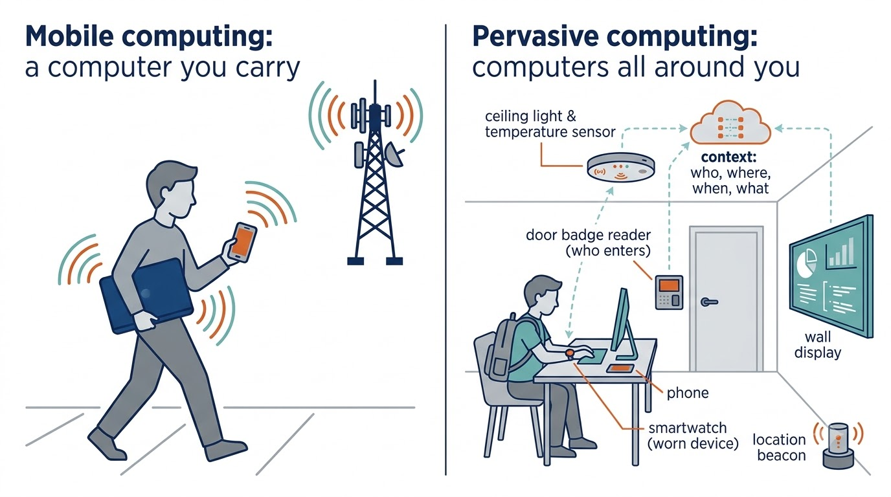
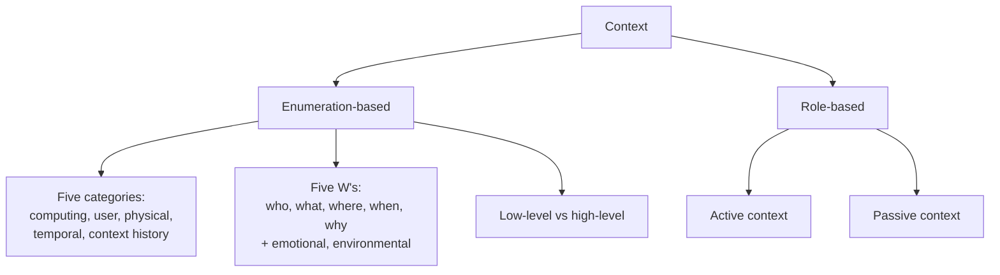
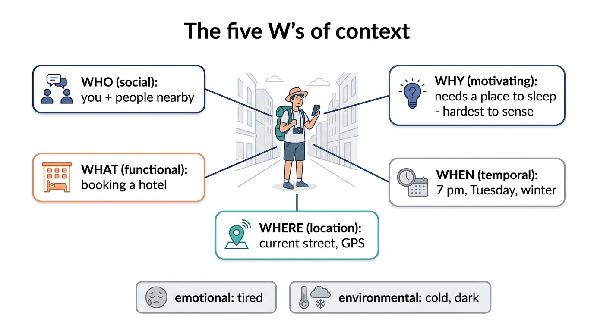
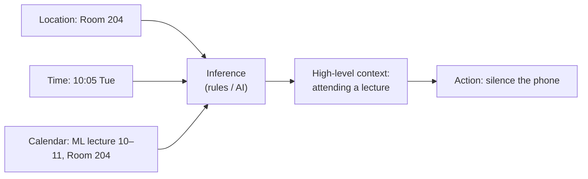

# Pervasive and Context-Aware Computing — Learning Guide

Source: `Pervasive_Computing.pdf` (7 pages), cited as (p. 3).
**📘 Beyond the notes** = gap filled from outside the PDF. **✏️ Note discrepancy** = the PDF is wrong, outdated or unclear.

## Contents

1. [From mobile to pervasive computing](#1-from-mobile-to-pervasive-computing)
2. [Three ways to adapt](#2-three-ways-to-adapt)
3. [History and goal of ubiquitous computing](#3-history-and-goal-of-ubiquitous-computing)
4. [What a context is](#4-what-a-context-is)
5. [Context-aware applications and their core capabilities](#5-context-aware-applications-and-their-core-capabilities)
6. [Types of context-aware applications](#6-types-of-context-aware-applications)
7. [Developing context-aware applications and middleware](#7-developing-context-aware-applications-and-middleware)
8. [Location and service discovery](#8-location-and-service-discovery)

---

## 1. From mobile to pervasive computing

**Mobile computing (p. 1)** is driven by three things: **portable, lightweight hardware**, **wireless communication**, and new **application and system software**. Technology drives new applications, which in turn drive demand for new technology. Devices keep getting smaller and more portable.

**Pervasive computing (p. 1)** uses **small, battery-powered, wireless computing and sensing devices embedded in our environment** to give **contextual information** to new kinds of applications. Where mobile computing is "a computer you carry", pervasive computing is "computers all around you that know the situation".


*Figure: 📘 illustration (AI-generated). Embedded and worn devices sense who, where, when and what, and pass that context to applications.*

**The key requirement (p. 1).** Mobile computing succeeds only if the system **adapts gracefully to changes in the environment**: bandwidth falls, the battery drains, the user moves.

---

## 2. Three ways to adapt

| Approach (p. 1) | Who adapts | Adapts to | Example |
| :--- | :--- | :--- | :--- |
| **Application-transparent** | **system software** only (OS, networking), independent of the application | changes in operating conditions: a big drop in bandwidth, a low battery | the OS compresses all traffic when bandwidth drops; the app never knows |
| **Application-aware** | system software **and** the application, collaborating | changes in available computing and communication resources | a video app, told bandwidth fell, switches itself to low resolution |
| **Context-aware** (one step further) | the application | resources **and** contextual information: who is nearby, time of day, where the system is, the user's **emotional state**, the action being performed, and the **intention** behind it | a phone that silences itself because you are in a lecture |

The examples are 📘 illustrations.

**Where context comes from (p. 1):** sensors embedded in the environment; devices worn by users; repositories of **historical data** on how the application is used; **user profiles**.

**Example: WISE in Kolkata (p. 1).** A first-time tourist in Kolkata has a PDA with a wireless service and a context-based Web information service, **WISE**, but no hotel booking.

1. They ask WISE for hotels. It uses their **itinerary**, **preferences** (price range) and **current location**, and lists **nearby** hotels.
2. They pick one and open the online reservation form.
3. Most fields are **filled in automatically from the user profile**: pay by the credit card that earns frequent-flier miles; a non-smoking room.

Every context type from section 4 appears here: location (where), time and itinerary (when), the profile (who), the task of booking (what).

---

## 3. History and goal of ubiquitous computing

**History (p. 2).**

- Pioneering context-aware work began in the **early 1990s** at **Xerox PARC** and **Olivetti Research** (later AT&T Laboratories Cambridge), under the vision of **ubiquitous computing**. Since the **mid-1990s** it is also called **pervasive computing**.
- **Weiser (1991)** foresaw, following **Moore's law**, very cheap (disposable) interconnected specialised computers all around us, some **embedded** in our surroundings, some **worn**.
- **The danger:** if these devices behave like mainframes and PCs, where users must work hard to get anything done, we would be **constantly distracted** by them.

> ✏️ **Note discrepancy (p. 2).** The pioneer is **Mark** Weiser (not "Marc"), and the paper is "**The Computer for the 21st Century**", *Scientific American*, 1991. "Fig. 4.1" (and "See chapter 4", struck out on p. 1) refer to the textbook the notes come from; the figure is not included.

**The goal (p. 2).** Design computing infrastructure that **integrates seamlessly with the environment and becomes almost invisible**, like Weiser's "**profound technologies**", which "weave themselves into the fabric of everyday life until they are indistinguishable from it":

- the **electric motor**: a typical car has more than 25, and nobody thinks about them;
- **writing**: whiteboards, notepads and Post-it notes are everywhere without being a distraction.

**Why context-aware mobile computing is essential (p. 2).** Motion is part of daily life, so a ubiquitous system that does not support **mobility** cannot become invisible. Ubiquitous computing is **broader than mobile computing**: it is about the **mobility of people**, not just of computers.

---

## 4. What a context is

**Humans already do this (p. 2).** We adjust to who is near and where we are: relaxed with close friends, careful in a formal meeting. As we mature we learn which context matters when. A computer needs a way to **capture, store and process** context to do the same.

**Two computer-friendly definitions (p. 2):** **enumeration-based** (list the kinds of context) and **role-based** (define context by what it does for the application).



**Enumeration-based: five categories (pp. 2–3).**

| Category | Includes |
| :--- | :--- |
| **Computing** | network connectivity, communication costs, bandwidth, local resources (printers, displays, workstations) |
| **User** | user profiles, location, people nearby |
| **Physical** | lighting and noise levels, traffic conditions, temperature |
| **Temporal** | time of day, week, month, season |
| **Context history** | a record of computing, user and physical context over a time span |

**The five W's (p. 3; Abowd and Mynatt, 2000)**, which may become the core of a universal definition:

| W | Context type | Meaning |
| :--- | :--- | :--- |
| **Who** | social | the user's identity and the people nearby; the system responds according to the user's preferences |
| **What** | functional | what task the user is performing |
| **Where** | location | where the system is: raw (latitude, longitude) or higher level (room number). **The most widely used** context in applications |
| **When** | temporal | time of day, week, month, season (as above) |
| **Why** | motivating | **why** the user is doing the task: one of the **hardest** to determine |

Plus two more (p. 3): **emotional** context (the user's emotional state) and **environmental** context (room temperature, illumination level).


*Figure: 📘 illustration (AI-generated), using a WISE-style tourist. Why is the hardest to sense: no sensor measures intention.*

**Low-level vs high-level (pp. 3–4).**

- **Low-level** context is sensed **directly** by sensors or by simple processing such as a database lookup: room temperature, devices near the user.
- **High-level** context **combines** low-level context with sophisticated processing (machine vision, AI).
- *Example:* current **location** + current **time** + the user's **calendar** → "**in a meeting**", "**attending a lecture**" or "**waiting at the airport**".



**Role-based (p. 4).** Context is the set of environmental states and settings that either **determines an application's behaviour** or in which an application event occurs and **is interesting to the user**. Two kinds:

- **Active context:** used by the application to **adapt its behaviour**. *E.g.* location used to pick the nearest printer.
- **Passive context:** **not critical** for adaptation, but shown to the user to improve their understanding of the situation. *E.g.* a "you are here" map display.

📘 The same item can be either: the temperature is active context for a thermostat app and passive context for a weather widget.

---

## 5. Context-aware applications and their core capabilities

**Definition (p. 4).** Context-aware devices and applications **respond intelligently to changes in the environment** to improve the user's computing environment. They tend to be **mobile** for two reasons: (1) the user's context changes **most often** when the user is mobile; (2) the **need** for context-aware behaviour is greatest in a mobile environment.

**What they can do (p. 4):** give a context-aware **user interface**; present contextual and non-contextual information; offer **context-sensitive information services**; adapt either **proactively** (e.g. automatic reconfiguration) or **reactively** (e.g. context-sensitive querying).

**Four core capabilities (pp. 4–5).** An application should have some of these to be called context-aware:

| Capability | Meaning | Example |
| :--- | :--- | :--- |
| **Contextual sensing** | detect environmental states and **present** them to the user | GPS location shown on a map with a "**you are here**" marker |
| **Contextual adaptation** | **adapt behaviour** using context | 📘 screen brightness follows room light |
| **Contextual resource discovery** | **discover available resources** to better meet the user's needs | 📘 finding the projector in the room you just entered |
| **Contextual augmentation** | **attach context to digital data** | 📘 a photo tagged with the place and time it was taken |

---

## 6. Types of context-aware applications

**Three dimensions (p. 5).**

1. **Function or service type:** broadly, applications that **provide information** or that **actuate a command**.
2. **Initiation:** **explicitly** by the user (manual) or **implicitly** by the application (automatic).
3. **Adaptation:** the five forms below.

**Contextual selection (p. 5).** Selecting and presenting physical or virtual objects **based on the user's context**. The most important kind in mobile computing is **proximity selection**, based mainly on **location**:

1. resources and devices **near** the user, such as printers or speakers;
2. **places** closest to the user, such as gas stations and restaurants;
3. objects the user is interacting with, such as **the group of people in the room** to send information to.

Other selections are possible, e.g. by **social** context.

- **User interface (p. 5).** Visual effects can show relative ordering, e.g. **font size by distance**: the closer the object, the larger the font.
- **Saving resources (p. 5).** The app may tune the **granularity and accuracy** of what it shows. *Example:* nearly lunchtime, driving in an unfamiliar city: update **nearer restaurants more often** than distant ones.

> 📘 **Beyond the notes — the restaurant rule in numbers.** Suppose the update interval grows with distance, interval = 20 s per km. A restaurant 0.5 km away refreshes every 10 s; one 5 km away every 100 s. Over 10 minutes that is 60 updates for the near one and only 6 for the far one: the far restaurant cannot change much in relevance while you drive, so the saved messages cost nothing.

**Contextual information and commands (pp. 5–6).**

- **Contextual information applications:** answers are shaped by context; queries are **parameterised** with contextual information, mainly the user's **location**. *E.g.* "restaurants" silently becomes "restaurants near me".
- **Contextual commands:** commands whose behaviour depends on context. *E.g.* **print** goes by default to the **nearest printer**.

> ✏️ **Note discrepancy (pp. 5–6).** The text reads "Contextual information applications modulate their responses based on the context … In contrast, contextual *selection* applications provide information about the context itself. These applications can be viewed as parameterizing user's queries …". The parameterised-query description belongs to **contextual information** applications (as in Schilit et al., 1994, where the categories are proximate selection, automatic contextual reconfiguration, contextual information and commands, and context-triggered actions). Read it as above.

**Automatic contextual reconfiguration (p. 6).** The system **reconfigures itself automatically** when context changes. *E.g.* the application switches to the **display device available** to the user.

**Context-triggered actions (p. 6).** Simple **IF–THEN rules** that say how the software responds automatically to context changes. The **IF** condition is built from **contextual predicates** (true/false tests on context); the **THEN** action runs when the condition becomes true.

```text
IF   location = "Library"  AND  time in 09:00–17:00
THEN set phone to silent
```

📘 Read it as: "whenever I am in the library during the day, silence the phone".

| Form | Initiated by | Example |
| :--- | :--- | :--- |
| Proximity selection | user (manual) | list of nearby printers |
| Contextual information / commands | user | "print" → nearest printer |
| Automatic reconfiguration | system (automatic) | switch to the room's display |
| Context-triggered action | system (automatic) | silent mode in the library |

---

## 7. Developing context-aware applications and middleware

**Three steps (p. 6).**

1. **Identify relevant context** — application-dependent.
2. **Specify context-aware behaviours** — the general part, used in many applications.
3. **Integrate with mechanisms that acquire context** — platform-dependent.

Two approaches for step 2 are **context-triggered actions** (section 6) and **Stick-e notes**.

> 📘 **Beyond the notes — Stick-e notes** (Brown, 1996; Pascoe, 1997). The electronic version of a Post-it note: a piece of information (text, a reminder, a web page) attached to a **context** instead of a place on a fridge. Each note has a trigger context (e.g. a location, a time, a nearby person). When the user's current context **matches**, the note "pops up". *E.g.* a note about a monument's history, attached to the monument's location, appears when a visitor arrives there. It is a context-triggered action written as content rather than as a rule.

**Middleware support (pp. 6–7).** Context-aware apps need help **acquiring and delivering** context data, because context comes from **heterogeneous and distributed** sources:

- **Hardware and software sensors:** motion detectors, noise and temperature sensors, location systems.
- **System-recorded input:** e.g. the user–system **interaction history**; essential for **context-based retrieval**.
- **Other applications:**
  - the user's **personal computing space**: schedules, calendars, address books, contact lists, to-do lists;
  - the **distributed computing environment**: applications running nearby, e.g. services of a **shopping mall** or **freeway system**.

📘 Middleware hides this mess: the application asks one service "where is the user, and what are they doing?" instead of talking to every sensor and calendar itself.

**Summary (p. 7).** Context-aware computing is a new, fast-moving field with real applications already, e.g. the **Google search engine** using location to give location-dependent results. The topic covered what a context is, how context-aware behaviour is specified, and the middleware that supports it.

> ✏️ **Note discrepancy (p. 7).** The cited link (local.google.com/lochp) is long dead; location-aware search is now built into ordinary Google and Maps.

---

## 8. Location and service discovery

**Service discovery (p. 7).** The process of **automatically detecting devices and services on a network**. A **service discovery protocol (SDP)** is a networking standard that does this by identifying resources.

**In microservices (p. 7).** Running service instances change **dynamically** and have **dynamically assigned network locations**, so a client must use a **service-discovery mechanism** to reach a service. A key part of it is the **service registry**.

> 📘 **Beyond the notes — how a registry works.**
>
> 1. **Register:** each service instance, on start-up, tells the registry its name and address (e.g. "printing at 10.0.0.7:631") and keeps sending heartbeats.
> 2. **Discover:** a client asks the registry "where is printing?" and gets the live addresses.
> 3. **Deregister:** instances that stop sending heartbeats are removed.
>
> Real SDPs: Bluetooth SDP, UPnP/SSDP, SLP (Service Location Protocol), mDNS/DNS-SD (Apple Bonjour). This is **contextual resource discovery** from section 5: discovering the services available where you are. The same idea appears in 5G as the NRF.
