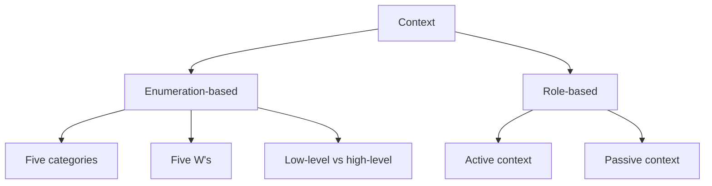
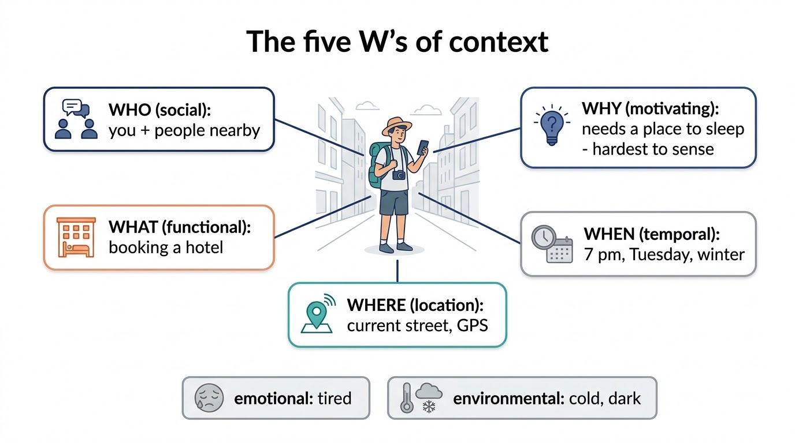

# Pervasive and Context-Aware Computing — Exam Questions and Answers

Companion to [Pervasive_Computing_Learning_Guide.md](Pervasive_Computing_Learning_Guide.md) (ma'am's notes `Pervasive_Computing.pdf`). Try each question first, then read the answer.

**End-sem pattern:** Full marks 50, 3 hours. **Q1 is compulsory**: five terms, "define and state their usage", 5 × 2 = 10. Then answer **any two of Q2–Q5**, 20 marks each, split into parts such as 10 + 10, 10 + 5 + 5 or 5 + 5 + 5 + 5.
**Here:** Part A = 2-mark terms (Q1 style). Part B = 20-mark questions (Q2–Q5 style).
**Tags:** 🎯 real paper (year, question); ✍️ practice to cover the notes; 📘 beyond the notes. 💡 = memory hook.
This topic has come **every year** as a 10-mark short note in Q5: "Pervasive Computing" (2023, 2025) and "Context-Aware Computing and Applications" (2024).

| Topic in the guide | Question |
| :--- | :--- |
| Mobile vs pervasive computing (§1) | A1, B1(a) |
| Three ways to adapt (§2) | A2, B1(b) |
| History and goal of ubiquitous computing (§3) | B1(c) |
| What a context is (§4) | A3, A4, A5, B2(a) |
| Context-aware applications, core capabilities (§5) | A6, B2(b) |
| Types of context-aware applications (§6) | A7, A8, B3(a) |
| Developing applications, middleware (§7) | B3(b) |
| Service discovery (§8) | A9, B3(c) |

---

## Part A — 2-mark terms: define and state their usage

### A1. Pervasive computing. ✍️ [2]

**Definition:** the use of **small, battery-powered, wireless computing and sensing devices embedded in our environment**. These devices give **contextual information** (data about the situation) to new kinds of applications. People also call this **ubiquitous computing**.
**Usage:** applications that know the situation and adapt. For example, a phone silences itself in a lecture, or a tourist guide lists nearby hotels.

> 💡 Mobile = a computer you carry; pervasive = computers all around you that know the situation.

### A2. Application-aware adaptation. ✍️ [2]

**Definition:** the **system software and the application collaborate** (work together) to adapt to changes. They adapt to changes in available computing and communication resources.
**Usage:** for example, the system tells a video app that bandwidth has dropped. The video app then switches to low resolution. (In **application-transparent** adaptation, only the system adapts, and the app never knows.)

### A3. Context. ✍️ [2]

**Definition:** the set of environmental states and settings that **determines an application's behaviour**. It also means the setting where an application event occurs that is **interesting to the user**. People often list context as the five W's: who, what, where, when, and why.
**Usage:** context-aware applications use context to adapt. For example, location + time + calendar tell the phone that you are in a lecture.

### A4. Active and passive context. ✍️ [2]

**Definition:** **active context** is context that the application uses to **adapt its behaviour**. **Passive context** is not critical for adaptation. Instead, the app **shows it to the user** to improve their understanding.
**Usage:** an app uses location to pick the **nearest printer** as active context. A "**you are here**" map display is passive context. 📘 The same item can be either: temperature is active for a thermostat app, but passive for a weather widget.

### A5. Low-level and high-level context. ✍️ [2]

**Definition:** **low-level** context is sensed **directly** by sensors or simple processing (such as room temperature or nearby devices). **High-level** context **combines** low-level context with sophisticated processing (such as machine vision or AI).
**Usage:** location + time + calendar → "**in a meeting**", "attending a lecture", or "waiting at the airport".

### A6. Context-aware application. 🎯 2024 End Q5(b) (part) [2]

**Definition:** a device or application that **responds intelligently to changes in its environment**. It does this to improve the user's computing environment.
**Usage:** these applications are mostly **mobile**. Context changes most often when the user moves, so the need is greatest there. For example, WISE (a context-based Web information service) lists hotels near a tourist. It uses their itinerary, preferences, and location.

### A7. Proximity selection. ✍️ [2]

**Definition:** the most important kind of **contextual selection**. It means choosing and presenting objects **based on the user's location**.
**Usage:** nearby **devices** (printers, speakers), nearby **places** (gas stations, restaurants), and objects the user interacts with (*e.g.* the group of people in the room). The UI can show closer objects in a **larger font**.

### A8. Context-triggered action. ✍️ [2]

**Definition:** a simple **IF–THEN rule**. The IF part comes from **contextual predicates** (true/false tests on context). The THEN action runs automatically when the condition becomes true.
**Usage:** specifying context-aware behaviour. For example: `IF location = "Library" AND time in 09:00–17:00 THEN set phone to silent`.

### A9. Service discovery. ✍️ [2]

**Definition:** the process of **automatically detecting devices and services on a network**. A **service discovery protocol (SDP)** does this work.
**Usage:** a client finds a service whose location changes dynamically (*e.g.* microservices) by asking a **service registry**. In pervasive computing, this is how a device finds the printer or projector in a newly entered room.

---

## Part B — 20-mark questions

### B1. 🎯 2025 End Q5(b), 2023 End Q5(b) + ✍️

**(a)** Write a short note on pervasive computing. **[10]**
**(b)** Describe the three approaches to adaptation in mobile computing. **[5]**
**(c)** What is the history and goal of ubiquitous computing? **[5]**

**(a) Answer.**

**Mobile computing** is driven by portable lightweight hardware, wireless communication, and new application and system software. **Pervasive computing** goes further. It uses **small, battery-powered, wireless computing and sensing devices embedded in the environment**. These devices give **contextual information** to new kinds of applications.

**Key requirement:** the system must **adapt gracefully** to changes in the environment. For example, bandwidth falls, the battery drains, or the user moves. The most advanced form is **context-aware** adaptation.

**Where context comes from:**
- Sensors embedded in the environment
- Devices worn by users
- Repositories of **historical usage data**
- **User profiles**

**Context:** the five W's:
- **Who:** identity and people nearby
- **What:** the task being done
- **Where:** location (the most used context)
- **When:** time
- **Why:** user intention (the hardest to sense)
It also includes emotional context and environmental context.

**Goal (Weiser, 1991):** computing that **integrates seamlessly with the environment and becomes almost invisible**. It should be like the electric motor or writing. It must support the **mobility of people**, so it is broader than mobile computing.

**Example, WISE in Kolkata:** a tourist with a PDA asks WISE for hotels. The system uses their **itinerary**, **preferences**, and **current location** to list nearby hotels. It then fills most of the booking form from their **profile** (such as a credit card with frequent-flier miles and a non-smoking room).

**Applications:**
- Proximity selection (finding the nearest printer)
- Contextual information and commands ("print" goes to the nearest printer)
- Automatic reconfiguration
- Context-triggered actions (setting the phone to silent in the library)

**Middleware** gathers context from heterogeneous sources (many different types of sources) and delivers it to the apps.

**Challenges:** 📘 sensing context accurately (especially *why*), keeping location and personal data private, battery life of tiny devices, and keeping devices from distracting the user.

> 💡 Embedded + wireless + context-aware = invisible computing.

**(b) Answer.**

| Approach | Who adapts | Adapts to | Example (📘) |
| :--- | :--- | :--- | :--- |
| **Application-transparent** | **system software** only (OS, network), without the application | changes in operating conditions: bandwidth drops, low battery | the OS compresses all traffic; the app never knows |
| **Application-aware** | system software **and** the application, working together | changes in computing and communication resources | a video app switches to low resolution |
| **Context-aware** | the application, taking adaptation one step further | resources **and context**: people nearby, time, location, the user's **emotional state**, the action, and its **intention** | the phone silences itself in a lecture |

**(c) Answer.**

**History:**

- Pioneering context-aware work started in the **early 1990s** at **Xerox PARC** and **Olivetti Research** (later AT&T Laboratories Cambridge). It began under the name **ubiquitous computing**. Since the mid-1990s, people also call it **pervasive computing**.
- **Mark Weiser (1991)** followed Moore's law. He predicted very cheap, connected, special-purpose computers all around us. Some would be **embedded** in our surroundings, and some would be **worn**.
- **Danger:** if these devices behave like PCs and demand attention, we will be **constantly distracted**.

**Goal:** design computing that **integrates seamlessly with the environment and becomes almost invisible**. This is like Weiser's "profound technologies" that weave themselves into everyday life:

- The **electric motor**: a car has more than 25 motors, and no one thinks about them.
- **Writing**: whiteboards, notepads, and sticky Post-it notes are everywhere without distracting us.

Because movement is part of daily life, an invisible system must support **mobility**. Ubiquitous computing is about the mobility of **people**, not just computers.

### B2. 🎯 2024 End Q5(b) + ✍️

**(a)** What is a context? Explain the enumeration-based and role-based definitions of context. **[10]**
**(b)** Write a short note on context-aware computing and applications. **[10]**

**(a) Answer.**

Humans adjust to context naturally. For example, people are relaxed with friends, but careful in a meeting. A computer needs to **capture, store, and process** context to do the same. Here are two computer-friendly definitions:

**1. Enumeration-based** (list the kinds of context):

*Five categories:*

| Category | Includes |
| :--- | :--- |
| **Computing** | network connectivity, communication cost, bandwidth, nearby resources (printers, displays) |
| **User** | user profile, location, people nearby |
| **Physical** | lighting, noise level, traffic conditions, temperature |
| **Temporal** | time of day, week, month, season |
| **Context history** | a record of computing, user, and physical context over time |

*Five W's* (Abowd and Mynatt, 2000):

| W | Context | Meaning |
| :--- | :--- | :--- |
| **Who** | social | the user's identity and people nearby |
| **What** | functional | the task being performed |
| **Where** | location | raw (latitude, longitude) or high-level (room number); **most widely used** |
| **When** | temporal | time of day, week, month, season |
| **Why** | motivating | why the user does the task; **hardest** to determine |

This also includes **emotional** context (the user's mood) and **environmental** context (such as temperature and light).

*Low-level vs high-level:*
- **Low-level context** is sensed directly by sensors (such as room temperature).
- **High-level context** combines low-level context with AI (such as location + time + calendar → "in a meeting").

**2. Role-based** (define context by what it does): context is the environmental states and settings that **determine an application's behaviour**. It is also the setting where an event occurs that **interests the user**.

- **Active context:** context used to **adapt behaviour** (for example, location → nearest printer).
- **Passive context:** context that is **shown to the user** only (for example, a "you are here" map).

**(b) Answer.**

**Context-aware computing:** devices and applications that **respond intelligently to changes in their environment**. They use context to improve the user's computing environment. They are mostly **mobile**. Context changes most often when the user moves, so the need is greatest there.

**What they do:**
- Provide a context-aware user interface
- Present contextual information
- Offer context-sensitive information services
- Adapt **proactively** before the user asks (automatic reconfiguration) or **reactively** after a request (context-sensitive queries)

**Four core capabilities:**

| Capability | Meaning | Example |
| :--- | :--- | :--- |
| **Contextual sensing** | detect and **present** environmental states | GPS "you are here" marker |
| **Contextual adaptation** | **adapt behaviour** to context | 📘 brightness follows room light |
| **Contextual resource discovery** | **find resources** nearby | 📘 the projector in this room |
| **Contextual augmentation** | **attach context to data** | 📘 photo tagged with place and time |

**Types of applications** (classified by adaptation):

1. **Contextual selection**, mainly **proximity selection**: nearby printers, restaurants, and people in the room.
2. **Contextual information:** queries silently use context (such as searching "restaurants" → "restaurants near me").
3. **Contextual commands:** a command adapts to context (for example, "print" goes to the nearest printer).
4. **Automatic contextual reconfiguration:** the system changes its setup (for example, switching to the display screen available in the room).
5. **Context-triggered actions:** automatic IF–THEN rules (such as setting the phone to silent in the library).

**Examples:** WISE lists hotels near a tourist and pre-fills the booking form from their profile. **Google search** gives location-dependent results.

**Building them:**
1. Identify relevant context.
2. Specify behaviour (using context-triggered actions or Stick-e notes).
3. Integrate with mechanisms that acquire context.
**Middleware** collects context from sensors, interaction history, and other applications.

> 💡 Sense, adapt, discover, augment.

### B3. ✍️

**(a)** Classify context-aware applications and explain each type with an example. **[10]**
**(b)** What are the steps in developing a context-aware application? Why is middleware needed? **[5]**
**(c)** What is service discovery? How does a service registry work? **[5]**

**(a) Answer.**

Context-aware applications are classified along three dimensions:

1. **Function or service type:** applications that **provide information**, or applications that **actuate a command** (execute an action).
2. **Initiation:** **explicitly** by the user (manual) or **implicitly** by the application (automatic).
3. **Form of adaptation:** the five types below.

| Form | What it does | Initiated by | Example |
| :--- | :--- | :--- | :--- |
| **Contextual (proximity) selection** | selects and presents objects based on context, mainly **location** | user | list of nearby printers; nearest gas station; people in the room |
| **Contextual information** | answers shaped by context; queries **parameterised** (filled in) with location | user | "restaurants" → restaurants near me |
| **Contextual commands** | a command behaves according to context | user | **print** → nearest printer |
| **Automatic contextual reconfiguration** | the system reconfigures itself when context changes | system | switch output to the display available in the room |
| **Context-triggered actions** | IF–THEN rules fire automatically | system | silent mode in the library |

**Selection details:** the UI can use **font size by distance** (closer = larger). To **save resources**, nearer objects are updated more often. For example, if you drive near lunchtime, nearer restaurants refresh more often than distant ones. 📘 With an interval of 20 s per km, a restaurant 0.5 km away refreshes every 10 s, and one 5 km away refreshes every 100 s.

**(b) Answer.**

**Three steps:**

1. **Identify relevant context:** this step is application-dependent.
2. **Specify context-aware behaviour:** this is the general design step. For example, developers use **context-triggered actions** or **Stick-e notes** (📘 an electronic Post-it attached to a context, which pops up when the user's context matches, *e.g.* a monument's history appearing on arrival).
3. **Integrate with mechanisms that acquire context:** this step is platform-dependent.

**Middleware is needed** because context comes from **heterogeneous, distributed** sources (many different sources across the network):

- Hardware and software **sensors**: motion, noise, temperature, and location systems.
- **System-recorded input**: the user's interaction history, needed for context-based retrieval.
- **Other applications**: the user's personal space (calendar, address book, to-do list) and the surrounding environment (services of a shopping mall or freeway).

Middleware hides this complexity. The application asks one service for the context instead of talking to every sensor itself.

**(c) Answer.**

**Service discovery:** automatically detecting devices and services on a network. A **service discovery protocol (SDP)** does this by identifying resources. In **microservices**, service instances change dynamically and have dynamically assigned addresses. Because of this, clients need a discovery mechanism centered on a **service registry**.

📘 **How a registry works:**

1. **Register:** each service instance, on start-up, tells the registry its name and address (*e.g.* "printing at 10.0.0.7:631") and keeps sending heartbeats.
2. **Discover:** a client asks "where is printing?" and gets the live addresses.
3. **Deregister:** instances that stop sending heartbeats are removed.

Real protocols include: Bluetooth SDP, UPnP/SSDP, SLP, and mDNS/DNS-SD (Apple Bonjour). It is an example of **contextual resource discovery**. 5G's **NRF** (Network Repository Function) works the same way.

> 💡 Register, discover, drop the silent ones.