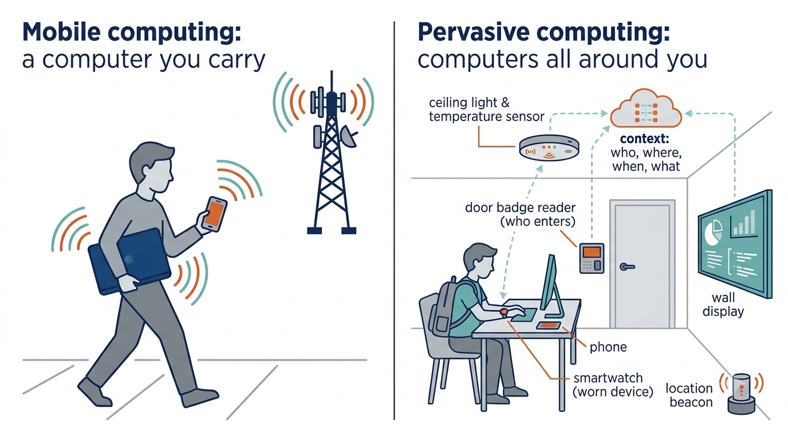
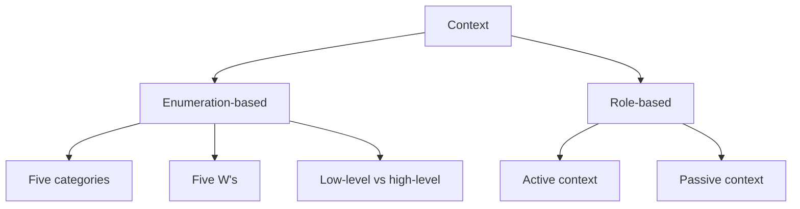

# Pervasive and Context-Aware Computing — Exam Questions and Answers

Companion to [Pervasive_Computing_Learning_Guide.md](Pervasive_Computing_Learning_Guide.md) (ma'am's notes `Pervasive_Computing.pdf`). Try each question first, then read the answer.

**End-sem pattern:** Full marks 50, 3 hours. **Q1 is compulsory**: five terms, "define and state their usage", 5 × 2 = 10. Then answer **any two of Q2–Q5**, 20 marks each, split into parts such as 10 + 10, 10 + 5 + 5 or 5 + 5 + 5 + 5.
**Here:** Part A = 2-mark terms (Q1 style). Part B = 20-mark questions (Q2–Q5 style).
**This file keeps only the past-paper questions (🎯) and a few likely ones (✍️).** Every past question from the 2023–2025 mid-sem and end-sem papers on this topic is here.
**Tags:** 🎯 real paper (year, question); ✍️ likely question (not asked yet, but close to a past one); 📘 beyond the notes. 💡 = memory hook.
This topic has come **every year** as a 10-mark short note in Q5: "Pervasive Computing" (2023, 2025) and "Context-Aware Computing and Applications" (2024).

| No. | Question | Source |
| :--- | :--- | :--- |
| A1 | Pervasive computing | ✍️ |
| A2 | Context | ✍️ |
| A3 | Context-aware application | 🎯 2024 End Q5(b) (part) |
| B1(a) | Write a short note on pervasive computing. [10] | 🎯 2025 End Q5(b), 2023 End Q5(b) |
| B2(a) | What is a context? Explain the enumeration-based and role-based definitions of context. [10] | ✍️ |
| B2(b) | Write a short note on context-aware computing and applications. [10] | 🎯 2024 End Q5(b) |
| B3(a) | Classify context-aware applications and explain each type with an example. [10] | ✍️ |

---

## Part A — 2-mark terms: define and state their usage

### A1. Pervasive computing. ✍️ [2]

**Definition:** the use of **small, battery-powered, wireless computing and sensing devices embedded in our environment** (built into our surroundings). These devices give **contextual information** (data about the situation) to new kinds of applications. People also call this **ubiquitous computing** (computing that is everywhere).
**Usage:** applications use it to know the situation and adapt. For example, a phone silences itself in a lecture, or a tourist guide lists nearby hotels.

> 💡 Mobile = a computer you carry; pervasive = computers all around you that know the situation.

### A2. Context. ✍️ [2]

**Definition:** the set of environmental states and settings (conditions around the device) that **determines an application's behaviour**. It also means the setting where an application event occurs that is **interesting to the user**. People often list context as the **five W's**: who, what, where, when, and why.
**Usage:** **context-aware** (situation-aware) applications use context to adapt. For example, location + time + calendar tell the phone that you are in a lecture.

> 💡 Context = the 5 W's (Who, What, Where, When, Why) that guide how an app acts.

### A3. Context-aware application. 🎯 2024 End Q5(b) (part) [2]

**Definition:** a device or application that **responds intelligently to changes in its environment**. It does this to improve the user's computing environment.
**Usage:** these applications are mostly **mobile**. Context changes most often when the user moves, so the need is greatest there. For example, **WISE** (a context-based Web information service) lists hotels near a tourist. It uses their itinerary (travel plan), preferences, and location.

> 💡 Context-aware = notice a change around you, then adjust the app on its own.

---

## Part B — 20-mark questions

### B1. 🎯 2025 End Q5(b), 2023 End Q5(b)

**(a)** Write a short note on pervasive computing. **[10]**

**(a) Answer.**

**In short:** Pervasive computing embeds small wireless sensors all around us so apps can sense the situation and adapt silently.

- **Mobile computing** uses portable lightweight hardware, wireless communication, and new application and system software.
- **Pervasive computing** goes further. It uses **small, battery-powered, wireless computing and sensing devices embedded in the environment** (built into our surroundings). These devices give **contextual information** (data about the situation) to new kinds of applications.

**Key requirement:**
- The system must **adapt gracefully** (adjust smoothly without failing) to changes in the environment.
- It needs this because bandwidth (data speed) can fall, the battery can drain, or the user can move.
- The most advanced form is **context-aware** (situation-aware) adaptation.

**Where context comes from:**
- Sensors embedded in the environment
- Devices that users wear
- Repositories (storage databases) of **historical usage data** (past usage records)
- **User profiles** (saved user preferences)

**Context — the five W's:**
- **Who:** identity and people nearby
- **What:** the task the user is doing
- **Where:** location (the most used context)
- **When:** time
- **Why:** user intention (what the user wants to do; the hardest to sense)
- It also includes **emotional context** and **environmental context**.

**Goal (Weiser, 1991):**
- Computing should **integrate seamlessly with the environment and become almost invisible** (blend in smoothly).
- It should feel as natural as the electric motor or writing.
- It must support the **mobility of people**, so it is broader than mobile computing.

**Example, WISE in Kolkata:**
1. A tourist carries a **PDA** (Personal Digital Assistant, a handheld computer) and asks **WISE** (a context-based Web information service) for hotels.
2. WISE uses their **itinerary** (travel plan), **preferences**, and **current location** to list nearby hotels.
3. It then fills most of the booking form from their **profile**. For example, it picks their credit card with frequent-flier miles and a non-smoking room.

**Applications:**
- **Proximity selection** (choosing nearby items, such as finding the nearest printer)
- **Contextual information and commands** (for example, "print" goes to the nearest printer)
- **Automatic reconfiguration** (changing setup on its own)
- **Context-triggered actions** (actions started by the situation, such as setting the phone to silent in the library)

**Middleware** (middle-layer software) gathers context from **heterogeneous sources** (many different types of sources) and delivers it to the apps.

**Challenges:** 📘
- Sensing context accurately (especially *why*)
- Keeping location and personal data private
- Battery life of tiny devices
- Keeping devices from distracting the user

> 💡 Embedded + wireless + context-aware = invisible computing.

### B2. 🎯 2024 End Q5(b) + ✍️

**(a)** What is a context? Explain the enumeration-based and role-based definitions of context. **[10]** ✍️
**(b)** Write a short note on context-aware computing and applications. **[10]**

**(a) Answer.**

**In short:** Context is the user's situation, defined either by listing its types (enumeration-based) or by its job (role-based).

Humans adjust to context naturally. For example, people stay relaxed with friends, but act carefully in a meeting. A computer must **capture, store, and process** context to do the same, because it cannot sense situations like humans do. Here are two computer-friendly definitions:

**1. Enumeration-based** (list the kinds of context):

*Five categories:*

| Category | Includes |
| :--- | :--- |
| **Computing** | network connectivity (network link), communication cost, bandwidth (data speed), nearby resources (printers, displays) |
| **User** | user profile, location, people nearby |
| **Physical** | lighting, noise level, traffic conditions, temperature |
| **Temporal** | time of day, week, month, season |
| **Context history** | a record of computing, user, and physical context over time |

*Five W's* (Abowd and Mynatt, 2000):

| W | Context | Meaning |
| :--- | :--- | :--- |
| **Who** | social | the user's identity and people nearby |
| **What** | functional | the task the user is doing |
| **Where** | location | raw (latitude, longitude) or high-level (room number); **most widely used** |
| **When** | temporal (time) | time of day, week, month, season |
| **Why** | motivating (reason) | why the user does the task; **hardest** to determine |

This also includes **emotional** context (the user's mood) and **environmental** context (such as temperature and light).

*Low-level vs high-level:*
- **Low-level context:** sensors measure it directly (such as room temperature).
- **High-level context:** AI combines low-level context to infer meaning (such as location + time + calendar → "in a meeting").

**2. Role-based** (define context by what it does):
- Context is the environmental states and settings that **determine an application's behaviour**.
- It is also the setting where an event occurs that **interests the user**.
- **Active context:** the app uses it to **adapt behaviour** (for example, location → nearest printer).
- **Passive context:** the app only **shows it to the user** (for example, a "you are here" map).

> 💡 Enumeration = LIST it (5 categories, 5 W's, low/high); Role = USE it (Active acts, Passive shows).

**(b) Answer.**

**In short:** Context-aware apps sense changes around the user, then adapt their interface, information, or actions to help.

**Context-aware computing:** devices and applications that **respond intelligently to changes in their environment**. They use context to improve the user's computing environment. They are mostly **mobile**. Context changes most often when the user moves, so the need is greatest there.

**What they do:**
- Provide a context-aware user interface
- Present contextual information
- Offer context-sensitive information services
- Adapt **proactively** before the user asks (automatic reconfiguration, or changing setup on its own) or **reactively** after a request (context-sensitive queries)

**Four core capabilities:**

| Capability | Meaning | Example |
| :--- | :--- | :--- |
| **Contextual sensing** | detect and **present** environmental states | GPS "you are here" marker |
| **Contextual adaptation** | **adapt behaviour** to context | 📘 brightness follows room light |
| **Contextual resource discovery** | **find resources** nearby | 📘 the projector in this room |
| **Contextual augmentation** | **attach context to data** (add context tags) | 📘 photo tagged with place and time |

**Types of applications** (classified by adaptation):

1. **Contextual selection**, mainly **proximity selection** (choosing nearby items): nearby printers, restaurants, and people in the room.
2. **Contextual information:** queries silently use context (such as searching "restaurants" → "restaurants near me").
3. **Contextual commands:** a command adapts to context (for example, "print" goes to the nearest printer).
4. **Automatic contextual reconfiguration** (changing setup on its own): the system changes its setup (for example, switching to the display screen available in the room).
5. **Context-triggered actions:** automatic IF–THEN rules fire on their own (such as setting the phone to silent in the library).

**Examples:**
- **WISE** (a context-based Web information service) lists hotels near a tourist and pre-fills the booking form from their profile.
- **Google search** gives location-dependent results.

**Building them:**
1. Identify relevant context.
2. Specify behaviour (using context-triggered actions or Stick-e notes).
3. Integrate with mechanisms that acquire (collect) context.

**Middleware** (middle-layer software) collects context from sensors, interaction history, and other applications.

> 💡 Sense, adapt, discover, augment.

### B3. ✍️

**(a)** Classify context-aware applications and explain each type with an example. **[10]**

**(a) Answer.**

**In short:** We classify context-aware apps by service type, who starts them, and five forms of adaptation.

We classify context-aware applications along **three dimensions**:

1. **Function or service type:** apps that **provide information**, or apps that **actuate a command** (execute an action).
2. **Initiation** (who starts it): **explicitly** by the user (manual) or **implicitly** by the application (automatic).
3. **Form of adaptation:** the five types below.

| Form | What it does | Initiated by | Example |
| :--- | :--- | :--- | :--- |
| **Contextual (proximity) selection** | selects and shows objects using context, mainly **location** (nearness) | user | list of nearby printers; nearest gas station; people in the room |
| **Contextual information** | shapes answers by context; queries **parameterised** (filled in) with location | user | "restaurants" → restaurants near me |
| **Contextual commands** | changes how a command behaves based on context | user | **print** → nearest printer |
| **Automatic contextual reconfiguration** | **reconfigures** itself (changes its setup) when context changes | system | switch output to the display available in the room |
| **Context-triggered actions** | fires IF–THEN rules automatically | system | silent mode in the library |

**Selection details:**
- **Font size by distance:** the UI (user interface) can use **font size by distance** (closer = larger).
- **Refresh rate by distance:** the app updates nearer objects more often because this **saves resources**.
- **Driving example:** if you drive near lunchtime, nearer restaurants refresh more often than distant ones.
- 📘 **Number example:** with an interval of 20 s per km, a restaurant 0.5 km away refreshes every 10 s, and one 5 km away refreshes every 100 s.

> 💡 3 user-led (Select, Info, Command) + 2 system-led (Reconfigure, Trigger).
