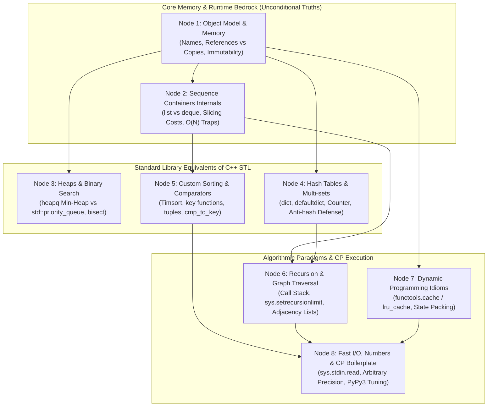
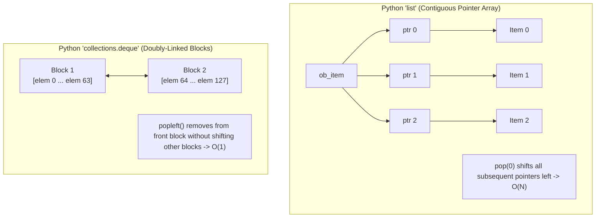
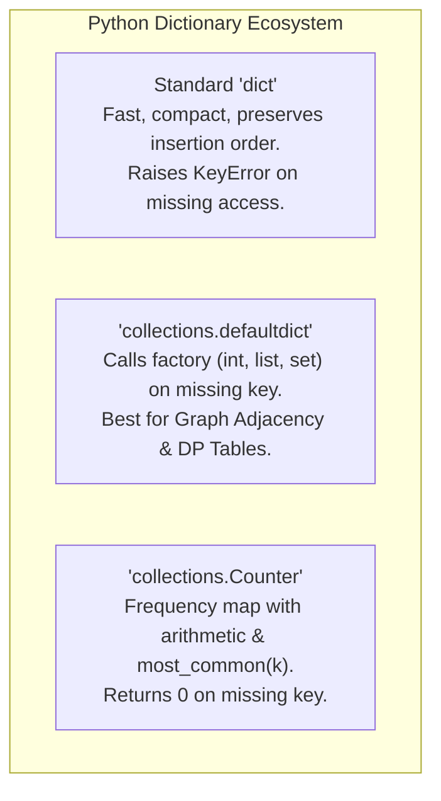
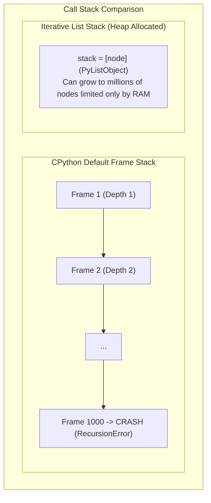
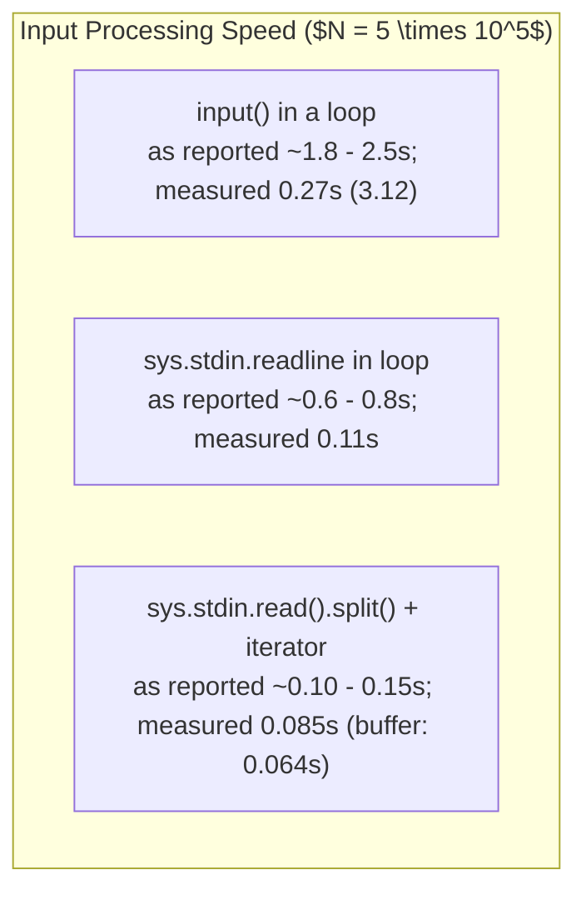

# Python for DSA & CP (from C/C++)

> [!abstract] Teacher
> Welcome! Since you already have a solid DSA and CP foundation in C/C++, our goal is not to re-teach algorithms like Dijkstra, Segment Trees, or Dynamic Programming from scratch. 
> 
> Instead, our objective is to map your existing C++ mental models (`std::vector`, `std::priority_queue`, `std::map`, pointers, memory layout, fast I/O) directly to Python's data model, runtime characteristics, and standard library—while uncovering the subtle performance traps and algorithmic idioms unique to Python.
> 
> Let's start with a diagnostic probe to calibrate your current familiarity with Python's internals and align on your primary competition/practice focus.

> [!question] Probe 1: Target Focus & Platforms
> Which environment represents your primary target for using Python in DSA & CP?
> 
> 1. LeetCode / Technical Interviews (Idiomatic Python, clean readable solutions, standard built-ins)
> 2. Competitive Programming (Codeforces, AtCoder, CSES — fast I/O, recursion depth hacks, PyPy vs CPython tuning, strict TLE limits)
> 3. Full Spectrum (Both LeetCode idioms and hardcore CP performance optimizations)
> 4. I don't know

> [!question] Probe 2: 2D Grid Memory Model
> In C++, creating an $n \times m$ grid initialized to $0$ is written as `vector<vector<int>> grid(n, vector<int>(m, 0))`. In Python, a learner writes:
> ```python
> grid = [[0] * m] * n
> ```
> What happens under the hood when executing this statement?
> 
> 1. It allocates $n$ independent row lists of size $m$, identical to C++ `vector<vector<int>>`.
> 2. It creates one row list of size $m$, and replicates the exact same row reference $n$ times across the outer list.
> 3. It creates $n$ independent row lists, but fails with a `TypeError` when you attempt to modify `grid[0][0]`.
> 4. I don't know

> [!question] Probe 3: Sequence Container Complexity
> In C++, `std::deque<int>` provides $O(1)$ push/pop at both ends, while `std::vector<int>` has no `pop_front()`. If you use a standard Python list as a FIFO queue with `lst.pop(0)`, what is the time complexity for a list of $N$ elements?
> 
> 1. $O(1)$ amortized, because Python lists are implemented as circular buffer arrays.
> 2. $O(\log N)$, because Python lists use an internal B-tree indexing structure.
> 3. $O(N)$, because Python lists are contiguous arrays of pointers and every subsequent pointer must be shifted left.
> 4. I don't know

> [!success] Diagnostic Results & Calibration
> - **Primary Target:** LeetCode / Interview DSA (primary) with CP competitive execution (Codeforces / PyPy / fast I/O).
> - **Probe 2 Result:** **Correct ✓** (`grid = [[0] * m] * n` replicates references to a single inner list). You already understand Python's reference-assignment behavior for nested lists!
> - **Probe 3 Result:** **Diagnosed & Unlocked**. In Python, `list.pop(0)` is $O(N)$ because Python lists are contiguous arrays of pointers (`PyListObject`). For $O(1)$ amortized push/pop at both ends, Python provides `collections.deque` (a doubly-linked list of fixed-size chunk blocks).

---

## Pedagogical Plan: From C++ Mental Models to Python Mastery



### Module Breakdown:
1. **Node 1: The CPython Memory & Variable Model** — Everything is an object reference. Variables as tags, not boxes. Immutability (`int`, `str`, `tuple`) vs Mutability (`list`, `dict`, `set`). Pass-by-assignment. Shallow vs deep copies.
2. **Node 2: Sequence Containers & Internals** — `list` (`std::vector<void*>`) vs `collections.deque` (`std::deque`). Slicing creates copies ($O(K)$ vs $O(1)$ pointer/iterators). String immutability and the `"".join(...)` pattern.
3. **Node 3: Heaps & Binary Search** — `heapq` (min-heap, `heappush`, `heappop`, $O(N)$ `heapify`, max-heap tricks). `bisect` (`bisect_left` = `lower_bound`, `bisect_right` = `upper_bound`). Where is `std::set` / `std::map`? (Red-Black trees vs Python hash maps and `sortedcontainers`).
4. **Node 4: Hash Structures & Multi-sets** — `dict`, `set`, `collections.defaultdict`, `collections.Counter`. Amortized $O(1)$ lookups, order preservation. Anti-hash test hacking on Codeforces and defense strategies.
5. **Node 5: Custom Sorting & Comparators** — Timsort internals ($O(N \log N)$ worst, $O(N)$ best). Sorting by key: lambdas, tuple keys `(x[0], -x[1])`, `operator.itemgetter`, and `functools.cmp_to_key` for 3-way comparisons.
6. **Node 6: Recursion, Graphs & Call Stack Mechanics** — CPython's default recursion limit (1000) and how to avoid `RecursionError` (`sys.setrecursionlimit`, threading stack size). Adjacency list representations. BFS with `deque`. Iterative DFS when recursion cannot be saved.
7. **Node 7: Dynamic Programming & Memoization** — `@functools.cache` / `@lru_cache(None)` for instant top-down DP without manual lookup tables. 2D array DP patterns. Space optimization rolling techniques.
8. **Node 8: Fast I/O, Arbitrary Precision & CP Boilerplate** — `sys.stdin.read().split()` vs `input()` (avoiding 10x I/O bottleneck). Arbitrary precision arithmetic quirks (no 64-bit overflow, but bitwise operations on negative numbers). Complete Python template for LeetCode & Codeforces.

---

## Node 1: The CPython Memory & Variable Model

> [!abstract] Teacher
> ### 1. The Core Headache (Why this matters)
> In C++, every variable is a typed memory box of a fixed size. If you write:
> ```cpp
> int a = 5;
> int b = a; 
> b += 1; // a is still 5
> 
> vector<int> v1 = {1, 2};
> vector<int> v2 = v1; // deep copy! Allocates new buffer, copies elements
> v2.push_back(3); // v1 is unaffected
> ```
> In Python, coming with this mental model causes silent, catastrophic bugs:
> ```python
> a = [1, 2]
> b = a
> b.append(3)
> # Surprise: a is now [1, 2, 3]!
> 
> x = 5
> y = x
> y += 1
> # But here: x is still 5!
> ```
> Why did the list mutate through both names, but the integer did not?
> 
> ### 2. Bedrock Principle: Variables are Sticky Name Tags, Not Boxes
> - **Unconditional Truth 1:** Assignment (`=`) **never copies values**. It only attaches a name tag to a heap-allocated object.
> - **Unconditional Truth 2:** Every Python object is either **immutable** (its state cannot be modified in place) or **mutable** (its state can be modified in place).
> 
> | Category | Types | What happens on "modification" (`+=`, `.append()`) |
> | :--- | :--- | :--- |
> | **Immutable** | `int`, `float`, `bool`, `str`, `tuple`, `frozenset` | The object **cannot change**. Python allocates a **new object** and rebinds the name tag to it. |
> | **Mutable** | `list`, `dict`, `set`, user classes | The object is **mutated in place**. All name tags pointing to this object see the mutation. |
> 
> ```mermaid
> graph LR
>     subgraph Mutable ["Mutable: list, dict, set"]
>         tagA["Name 'a'"] --> listObj["List Object in Heap: [1, 2]"]
>         tagB["Name 'b'"] --> listObj
>         listObj -.->|"b.append(3)"| listObj2["List Object in Heap: [1, 2, 3]"]
>     end
> 
>     subgraph Immutable ["Immutable: int, str, tuple"]
>         tagX["Name 'x'"] --> int5["Int Object: 5"]
>         tagY["Name 'y'"] --> int5
>         tagY -.->|"y += 1 (Rebinds Tag)"| int6["New Int Object: 6"]
>     end
> ```
> 
> ### 3. Pass-by-Assignment in Functions
> Python functions are neither traditional pass-by-value nor pass-by-reference. They are **pass-by-assignment** (or pass-by-object-reference):
> ```python
> def modify(arr, val):
>     arr.append(99)  # Mutates the caller's list object in place!
>     val += 1        # Creates a new int object 'val + 1' locally. Caller's variable is unaffected.
> ```
> 
> ### 4. Shallow Copies vs Snapshots in DSA
> Because assignment only copies references, when you need an independent copy of a 1D sequence in DSA:
> - `clone = arr[:]` or `clone = list(arr)` creates a **shallow copy** in $O(N)$ time.
> - For nested structures (like a 2D matrix), `grid[:]` only copies references to the row lists. To safely copy a 2D grid without slow `deepcopy`:
>   ```python
>   new_grid = [row[:] for row in grid]
>   ```

> [!question] Checkpoint: Node 1 (Backtracking Reference Trap)
> Consider this classic LeetCode backtracking template written by a C++ developer:
> ```python
> def backtrack(path, res):
>     if len(path) == 2:
>         res.append(path)
>         return
>     for x in [1, 2]:
>         path.append(x)
>         backtrack(path, res)
>         path.pop()
> 
> res = []
> backtrack([], res)
> ```
> What will `res` contain after `backtrack([], res)` finishes execution?
> 
> 1. All generated permutations: `[[1, 1], [1, 2], [2, 1], [2, 2]]`
> 2. A list of empty lists: `[[], [], [], []]`
> 3. A list of identical final states: `[[2, 2], [2, 2], [2, 2], [2, 2]]`
> 4. I don't know

> [!failure] Incorrect ✗ (The Classic C++ $\to$ Python Trap)
> **Learner Answer:** `[[1, 1], [1, 2], [2, 1], [2, 2]]`
> **Correct Answer:** `[[], [], [], []]`
> 
> ### Why this happens:
> In C++, `std::vector<std::vector<int>> res; res.push_back(path);` makes an **independent copy** of `path`. Modifying `path` later does not affect elements already inside `res`.
> 
> In Python:
> 1. `res.append(path)` pushes **the reference** to `path` into `res`.
> 2. `res` now holds 4 references pointing to the **exact same list in memory**.
> 3. As the recursion unwinds, `path.pop()` removes all elements until `path == []`.
> 4. Inspecting `res` at the end evaluates the single heap object 4 times, yielding:
>    ```python
>    [[], [], [], []]
>    ```
> 
> ### The Python Fix: Take an Explicit Snapshot
> ```python
> res.append(path[:])      # Slice copy (most common idiom)
> # OR
> res.append(list(path))   # Explicit list constructor
> ```

> [!question] Follow-up Check: Fixing the Snapshot
> Which of the following lines correctly takes an independent snapshot of `path` before appending to `res`?
> 
> 1. `res.append(path)`
> 2. `res.append(path[:])` or `res.append(path.copy())`
> 3. `res.append([path])`
> 4. I don't know

> [!success] Correct ✓
> **Learner Answer:** `res.append(path[:]) or res.append(path.copy())`
> **Takeaway Locked:** In Python, whenever you collect mutable accumulators (lists/sets/dicts) into an outer results container, you **must explicitly snapshot** them via slicing `[:]` or `.copy()`.

---

## Node 2: Sequence Containers & Internals (`list`, `deque`, Strings)

> [!abstract] Teacher
> ### 1. The Core Headache: The $O(N^2)$ BFS Trap
> In C++, when writing BFS or sliding window problems, you naturally use `std::queue<int>`.
> In Python, a developer transitioning from C++ often writes:
> ```python
> q = [start_node]
> while q:
>     curr = q.pop(0)  # Looks like q.pop() in C++, but it is a silent O(N) disaster!
>     for neighbor in adj[curr]:
>         q.append(neighbor)
> ```
> On a graph with $V = 10^5$ vertices, this simple BFS executes in **$O(V^2)$ time** and hits TLE on LeetCode/Codeforces.
> 
> Why? Because a Python `list` is **not** a linked list or circular buffer.
> 
> ### 2. Internal Anatomy of `list` (`PyListObject`)
> Under the hood in CPython, a `list` is a contiguous dynamic array of object pointers:
> ```c
> typedef struct {
>     PyObject_VAR_HEAD
>     PyObject **ob_item; // Contiguous array of pointers to items
>     Py_ssize_t allocated; // Total capacity
> } PyListObject;
> ```
> Just like `std::vector<void*>`:
> - `append(x)` and `pop()` from the right end are **$O(1)$ amortized**.
> - `pop(0)` or `insert(0, x)` requires invoking `memmove` to shift all remaining $N-1$ pointers one slot to the left. It is strictly **$O(N)$**.
> 
> ### 3. The Remedy: `collections.deque`
> Python's standard library provides `collections.deque` (double-ended queue):
> - Implemented as a doubly-linked list of **fixed-size memory blocks** (64 elements per block).
> - `append(x)`, `appendleft(x)`, `pop()`, `popleft()` are **strictly $O(1)$**.
> 
> ```python
> from collections import deque
> 
> q = deque([start_node])
> while q:
>     curr = q.popleft()  # O(1) guaranteed!
>     for neighbor in adj[curr]:
>         q.append(neighbor)  # O(1)
> ```
> 
> #### Trade-off to remember:
> | Operation | `list` (`std::vector`) | `collections.deque` (`std::deque`) |
> | :--- | :--- | :--- |
> | Push / Pop Right (`append`, `pop`) | $O(1)$ amortized | $O(1)$ |
> | Push / Pop Left (`appendleft`, `popleft`) | **$O(N)$** | $O(1)$ |
> | Random Index Access (`obj[i]`) | **$O(1)$** | $O(i/64) \approx O(N)$ worst |
> | Memory Overhead per Item | Low (contiguous pointer array) | Higher (block pointers + block nodes) |
> 
> ### 4. Slicing Traps & String Concatenation
> 1. **Slicing creates copies:** `sub = arr[l:r]` creates an independent list and copies $(r - l)$ pointers in $O(r - l)$ time. In recursive algorithms (e.g. divide-and-conquer, binary search), never slice! Always pass index pointers `l` and `r`.
> 2. **String Immutability:** Python strings are immutable byte arrays. Doing `s += ch` in a loop of $N$ characters can become $O(N^2)$ because the growing string is reallocated.
>    - Idiom: accumulate in a list and call `"".join(chars)` in $O(N)$ total time.
>
> > [!warning] Correction (measured 23 Oct 2026, CPython 3.12)
> > In CPython, `s += ch` is usually **linear**: when `s` has only one reference, CPython resizes the string in place. Measured: 400,000 appends took about 0.03 s with `s += 'x'` and about 0.01 s with `"".join`. It turns quadratic **when another reference to the string exists** (`t = s; s = t + 'x'` took about 1.6 s for the same 400,000) and on runtimes such as PyPy that don't have the trick. `"".join` is still the safe habit. Figure 2 in `target/py/Python DSA - Templates Patterns and Performance.md` shows all four curves.



> [!question] Checkpoint: Node 2 (Container Selection Under Fire)
> You are implementing a sliding window maximum algorithm (Monotonic Queue) where you frequently need to:
> 1. Remove elements from the back if they are smaller than the incoming element.
> 2. Pop expired elements from the front of the window.
> 3. Inspect the front element ($O(1)$ access to current max).
> 
> Which container should you choose in Python?
> 
> 1. A standard `list`, because Python lists optimize `pop(0)` if the list has fewer than 1000 items.
> 2. A `tuple`, because tuples are immutable and therefore offer the fastest cache locality.
> 3. `collections.deque`, because it provides $O(1)$ push/pop at both ends and $O(1)$ inspection of `dq[0]` and `dq[-1]`.
> 4. I don't know

> [!success] Correct ✓
> **Learner Answer:** `collections.deque`, because it provides $O(1)$ push/pop at both ends and $O(1)$ inspection of `dq[0]` and `dq[-1]`.
> **Key Rule of Thumb:** Whenever an algorithm needs queue or double-ended sliding window operations, reach for `from collections import deque`. Never use `list.pop(0)`.

---

> [!quote] 🧠 Spaced Recall Checkpoint: Mutability & State Hashability (Nodes 1 & 2 Synthesis)
> In C++, you can easily insert `std::vector<int>` or `std::pair` into `std::set` or use them as `std::map` keys.
> In Python BFS/DFS, you want to track visited states in a hash set (`visited = set()`) where each state consists of `(row, col, remaining_fuel)`.
> Which of the following operations is valid in Python and will NOT raise a runtime `TypeError`?
> 
> 1. `visited.add([row, col, remaining_fuel])`
> 2. `visited.add((row, col, remaining_fuel))`
> 3. `visited.add((row, col, [remaining_fuel]))`
> 4. I don't know

> [!question] Spaced Recall Feedback (Diagnostic Insight: Hashability in Python)
> **Learner Answer:** I don't know
> **Correct Answer:** `visited.add((row, col, remaining_fuel))`
> 
> ### The Core Rule: Hashability = Immutability
> In C++, `std::set` uses a balanced binary search tree (`operator<`), so mutable sequences like `vector<int>` can be keys.
> 
> In Python, `set` and `dict` are **hash tables**.
> 1. To store an object in a `set` or use it as a `dict` key, it must have a fixed hash code (`__hash__`).
> 2. If a mutable object (like a `list`) could be hashed, mutating its elements (`lst[0] = 99`) would change its hash, silently breaking the hash table bucket location!
> 3. Therefore:
>    - `visited.add([r, c, f])` $\to$ **CRASH:** `TypeError: unhashable type: 'list'`
>    - `visited.add((r, c, [f]))` $\to$ **CRASH:** Even though the outer container is a `tuple`, its child contains a `list`, so it cannot be hashed!
>    - `visited.add((r, c, f))` $\to$ **SUCCESS:** A `tuple` containing only immutable types (`int`) is completely hashable.
> 
> > [!important] Python DSA Rule
> > Whenever you need compound graph or DP state keys (like `(row, col, mask)`), **always pack them into a `tuple`**, never a `list`.

---

## Node 3: Priority Queues & Sorted Containers (`heapq`, `bisect`, Ordered Sets)

> [!abstract] Teacher
> ### 1. The Core Headaches for C++ Programmers
> 1. **Default Heap Direction:** In C++, `std::priority_queue<int>` is a **Max-Heap**. In Python, `heapq` is a **Min-Heap**.
> 2. **No Heap Class:** You do **not** instantiate a heap object. There is no `pq = heapq()`. Instead, `heapq` is a collection of functions that transform and maintain a regular Python `list`.
>    *(Warning: `queue.PriorityQueue` exists in Python, but it includes thread-locking overhead. Never use it in DSA/CP; it is 5–10x slower!)*
> 3. **The Missing Ordered Set:** C++ has `std::set` and `std::map` (Red-Black trees) providing $O(\log N)$ dynamic insertions, deletions, and `lower_bound`/`upper_bound`. Python's `set` and `dict` are **hash tables**—they have **no concept of ordering or binary searching**.
> 
> ---
> 
> ### 2. The `heapq` Module Mechanics
> All heap operations run on a standard Python `list`:
> 
> ```python
> import heapq
> 
> # 1. Initialization
> h = []
> heapq.heappush(h, 10)
> heapq.heappush(h, 5)
> heapq.heappush(h, 20)
> 
> # 2. Inspection and Pop
> smallest = h[0]              # O(1) peek
> elem = heapq.heappop(h)      # O(log N) pop smallest (returns 5)
> 
> # 3. O(N) In-Place Heapify (Crucial!)
> arr = [9, 3, 7, 1, 5]
> heapq.heapify(arr)           # In-place O(N), converts arr into valid min-heap!
> ```
> 
> #### Simulating a Max-Heap in Python
> Negate all values when pushing and popping:
> ```python
> max_heap = []
> heapq.heappush(max_heap, -val)
> largest = -heapq.heappop(max_heap)
> ```
> 
> #### Storing Tuples (Dijkstra Pattern) & Tie-Breaker Trap
> When pushing `(dist, node)` pairs:
> - Python compares tuples element-by-element starting from index 0.
> - **The Trap:** If `dist` ties, Python compares index 1 (`node`). If `node` is a custom class or complex structure that does not define `<`, Python throws `TypeError`!
> - **The Fix:** Insert an incremental counter as a tie-breaker: `(dist, count, node)`.
> 
> ---
> 
> ### 3. Binary Search: `bisect`
> For sorted arrays, Python's `bisect` module maps directly to C++ STL algorithms:
> 
> ```python
> import bisect
> 
> arr = [10, 20, 20, 20, 30]
> # C++ std::lower_bound equivalent (first element >= x)
> idx1 = bisect.bisect_left(arr, 20)   # Returns index 1
> 
> # C++ std::upper_bound equivalent (first element > x)
> idx2 = bisect.bisect_right(arr, 20)  # Returns index 4
> ```
> 
> ```mermaid
> graph LR
>     subgraph Array ["arr = [10, 20, 20, 20, 30]"]
>         i0["[0]: 10"]
>         i1["[1]: 20"]
>         i2["[2]: 20"]
>         i3["[3]: 20"]
>         i4["[4]: 30"]
>     end
>     BL["bisect_left(arr, 20)<br/>(std::lower_bound: >= 20)"] --> i1
>     BR["bisect_right(arr, 20)<br/>(std::upper_bound: > 20)"] --> i4
> ```
> 
> ---
> 
> ### 4. How to Handle Ordered Sets (`std::set` equivalent)
> When you need dynamic insertions, deletions, and predecessor/successor lookups in $O(\log N)$:
> 1. **LeetCode:** Use `from sortedcontainers import SortedList`:
>    ```python
>    from sortedcontainers import SortedList
>    sl = SortedList()
>    sl.add(15)
>    sl.add(10)
>    idx = sl.bisect_left(12)  # O(log N)
>    sl.discard(10)            # O(log N)
>    ```
> 2. **Codeforces / Platforms without external libraries:**
>    Python standard library has no built-in self-balancing BST. CP solutions rely on:
>    - Coordinate compression + Fenwick Tree / Segment Tree.
>    - Or maintaining a sorted `list` and using `bisect.insort` only if $N$ is small ($N \le 5000$).

> [!question] Checkpoint: Node 3 (`heapify` vs $N$ Pushes)
> You have an unsorted list of $N$ integers `arr` and need to turn it into a min-heap.
> A developer considers two approaches:
> - Approach A: Call `heapq.heapify(arr)` in-place.
> - Approach B: Initialize `h = []` and run `for x in arr: heapq.heappush(h, x)`.
> 
> How do their time complexities compare?
> 
> 1. Both approaches take $O(N \log N)$ time.
> 2. Approach B takes $O(N \log N)$, whereas `heapify(arr)` runs in-place in $O(N)$ time.
> 3. Approach B takes $O(N)$, whereas `heapify(arr)` takes $O(N \log N)$ because it requires full sorting.
> 4. I don't know

> [!success] Correct ✓
> **Learner Answer:** Approach B takes $O(N \log N)$, whereas `heapify(arr)` runs in-place in $O(N)$ time.
> **Key Optimization:** Never populate a heap from an existing list with a `for` loop and `heappush`. Always call `heapq.heapify(arr)` directly in $O(N)$ time.

---

## Node 4: Hash Structures & Multi-sets (`dict`, `defaultdict`, `Counter`, Anti-Hash)

> [!abstract] Teacher
> ### 1. The Core Headache: Boilerplate vs `KeyError`
> In C++, `std::unordered_map<int, int> mp; mp[x]++;` automatically default-constructs missing keys to `0`.
> In Python, writing:
> ```python
> count = {}
> count[x] += 1  # CRASH! KeyError: x does not exist yet
> ```
> To avoid writing manual checks (`if x not in count: count[x] = 0`), Python provides specialized dictionary structures in the `collections` module.
> 
> Furthermore, in CP (Codeforces), CPython's hash table can be hacked into **$O(N^2)$ TLE** if you don't know how integer hashes work!
> 
> ---
> 
> ### 2. The Power Tools: `defaultdict` and `Counter`
> 
> #### A. `collections.defaultdict`
> Takes a callable factory function as its default initializer. If a key is not present, it calls the factory automatically:
> 
> ```python
> from collections import defaultdict
> 
> # Graph Adjacency List:
> adj = defaultdict(list)
> adj[u].append(v)  # No need to check if u exists; creates [] automatically
> 
> # Frequencies / Counters:
> freq = defaultdict(int)
> freq[x] += 1      # int() returns 0 automatically
> ```
> 
> #### B. `collections.Counter`
> A high-performance subclass of `dict` designed specifically for frequency tracking:
> 
> ```python
> from collections import Counter
> 
> c = Counter([1, 2, 2, 3, 3, 3])
> print(c[99])              # Returns 0 (NEVER raises KeyError!)
> 
> # Finding Top-K Frequent Elements:
> top_2 = c.most_common(2)  # [(3, 3), (2, 2)]
> # Under the hood, most_common(k) uses heapq.nlargest in O(U log K) time!
> 
> # Counter Arithmetic:
> c1 = Counter(a=3, b=1)
> c2 = Counter(a=1, b=2)
> print(c1 + c2)            # Counter({'a': 4, 'b': 3})
> print(c1 - c2)            # Counter({'a': 2}) (keeps only positive counts)
> ```
> 
> ---
> 
> ### 3. CP Alert: The Anti-Hash Trap on Codeforces
> In CPython, `hash(x) == x` for almost all small integers.
> *(Correction, 23 Oct 2026: CPython's probing isn't quadratic. It's a "perturbation" scheme, `j = (5*j + 1 + perturb) mod table_size`, with `perturb` shifted right by 5 bits each step, so higher bits of the hash gradually join in. The collision risk below is real, and is "as reported" from Codeforces hacks; it wasn't reproduced here.)*
>
> Because `dict` and `set` use open addressing with quadratic-style probing, malicious test cases containing crafted arithmetic progressions can force **every single insertion to collide**, degrading lookup from $O(1)$ to $O(N)$ and total time to $O(N^2)$ (TLE).
> 
> #### The CP Defense (Custom XOR Hash):
> ```python
> import random
> 
> RANDOM_SALT = random.getrandbits(31)
> 
> # Instead of d[val], key by val ^ RANDOM_SALT:
> safe_dict = {}
> safe_key = val ^ RANDOM_SALT
> safe_dict[safe_key] = 1
> ```
> *(Note: On LeetCode, inputs are not adversarial, so plain `dict` or `defaultdict` is 100% safe. On Codeforces, use custom salt if you hit mysterious TLE on hash map lookups).*



> [!question] Checkpoint: Node 4 (`most_common(k)` Complexity)
> You need to extract the top $K$ most frequent elements from an array of $N$ items containing $U$ unique values ($K \ll U \le N$).
> You write:
> ```python
> counts = collections.Counter(arr)
> res = counts.most_common(k)
> ```
> How does `counts.most_common(k)` achieve this under the hood, and what is its time complexity?
> 
> 1. It sorts the entire dictionary by frequency in $O(U \log U)$ time.
> 2. It uses `heapq.nlargest` internally to extract top $K$ elements in $O(U \log K)$ time.
> 3. It performs $K$ sequential linear scans across the unique keys in $O(U \cdot K)$ time.
> 4. I don't know

> [!success] Correct ✓
> **Learner Answer:** It uses `heapq.nlargest` internally to extract top $K$ elements in $O(U \log K)$ time.
> **Key Takeaway:** `Counter.most_common(k)` avoids a full $O(U \log U)$ dictionary sort when $K \ll U$. It maintains a size-$K$ min-heap under the hood.

---

## Node 5: Custom Sorting & Comparators (Timsort, Multi-Key Tuples, `cmp_to_key`)

> [!abstract] Teacher
> ### 1. The Core Headache: No 2-Argument Comparator by Default
> In C++, `std::sort` takes a binary predicate `cmp(a, b)` that returns `true` if `a` precedes `b`:
> ```cpp
> sort(v.begin(), v.end(), [](const auto& a, const auto& b) {
>     if (a.score != b.score) return a.score > b.score; // descending score
>     return a.name < b.name; // ascending name
> });
> ```
> In Python, `sort()` and `sorted()` **do not take a comparator `cmp(a, b)`**. 
> Instead, Python uses a **key function** (`key=lambda x: ...`), which transforms each element into a sortable key once (the *Schwartzian Transform*).
> 
> Furthermore:
> - C++ `std::sort` is **Introsort** (unstable, $O(N \log N)$ average/worst).
> - Python's `sort()` is **Timsort**:
>   - **Guaranteed Stable:** Equal keys preserve their relative input order.
>   - **Adaptive:** If the array is already sorted or reverse-sorted, it runs in **$O(N)$ time**!
> 
> ---
> 
> ### 2. The Tuple-Key Idiom (Multi-Key Sorting)
> In Python, tuples compare lexicographically: `(a1, a2) < (b1, b2)` checks `a1 < b1` first; if tied, checks `a2 < b2`.
> 
> To sort with mixed directions (e.g. `score` descending, then `id` ascending):
> ```python
> # players = [(id, score), ...]
> players.sort(key=lambda p: (-p[1], p[0]))
> ```
> *How it works:* Negating numerical values (`-score`) flips their sort direction to descending while keeping the overall sort ascending.
> 
> ```mermaid
> graph LR
>     subgraph Schwartzian ["Schwartzian Transform (How Python Sorts by Key)"]
>         Raw["Raw Item: ('Alice', 95)"] --> KeyGen["key function: (-95, 'Alice')"]
>         KeyGen --> Timsort["Timsort compares tuple keys"]
>         Timsort --> Final["Original Item placed in sorted order"]
>     end
> ```
> 
> ---
> 
> ### 3. When Keys Cannot Be Negated: Strings & `cmp_to_key`
> You cannot negate a string (`-"Alice"` raises `TypeError`). If you need arbitrary or relative comparisons between two items (like in LeetCode 179 "Largest Number"):
> 
> Python provides `functools.cmp_to_key` to bridge C++ style 3-way comparators:
> - Return negative value if $a < b$ (a should come first)
> - Return positive value if $a > b$ (b should come first)
> - Return 0 if equal
> 
> ```python
> from functools import cmp_to_key
> 
> def custom_cmp(a, b):
>     # Example: form largest concatenated number
>     if a + b > b + a:
>         return -1  # a should come before b
>     elif a + b < b + a:
>         return 1   # b should come before a
>     return 0
> 
> nums_str.sort(key=cmp_to_key(custom_cmp))
> ```

> [!question] Checkpoint: Node 5 (Mixed-Direction Multi-Key Sort)
> You have a list of records: `students = [(name, grade), ...]` where `grade` is an integer and `name` is a string.
> You want to sort the list such that students with the **highest grade come first**, and ties in grades are broken by **name in alphabetical order (A to Z)**.
> 
> Which of the following is the correct and idiomatic single-pass Python statement?
> 
> 1. `students.sort(key=lambda s: (-s[1], -s[0]))`
> 2. `students.sort(key=lambda s: (s[1], s[0]), reverse=True)`
> 3. `students.sort(key=lambda s: (-s[1], s[0]))`
> 4. I don't know

> [!question] Diagnostic Insight (I don't know): The Tuple Key Mechanism
> **Learner Answer:** I don't know
> **Correct Answer:** `students.sort(key=lambda s: (-s[1], s[0]))`
> 
> ### How Tuple Key Generation Works
> Python sorts tuples `(k1, k2)` in natural **ascending** order by comparing `k1` first, and `k2` on ties.
> 
> 1. **Descending numeric field:** To sort `grade` in descending order, negate it: `-s[1]`.
>    - Grade 90 becomes `-90`
>    - Grade 80 becomes `-80`
>    - Since `-90 < -80`, the student with 90 comes first!
> 2. **Ascending string field:** We want `"Alice"` before `"Bob"`. `"Alice" < "Bob"` is already naturally ascending, so we leave it as `s[0]`.
>    - The combined key is `(-s[1], s[0])`.
> 
> ### Why the other options fail:
> - `students.sort(key=lambda s: (-s[1], -s[0]))`: **Runtime Error!** In Python, `- "Alice"` raises `TypeError: bad operand type for unary -: 'str'`.
> - `students.sort(..., reverse=True)`: Reverses the entire sort order, making names sort backwards from Z to A.

> [!question] Follow-up Check: Interval Scheduling
> You have interval pairs: `intervals = [[start, end], ...]`.
> You want to sort intervals by `start` in **ascending** order, and when intervals have the same `start`, break ties by `end` in **descending** order.
> Which key function achieves this?
> 
> 1. `intervals.sort(key=lambda x: (-x[0], x[1]))`
> 2. `intervals.sort(key=lambda x: (x[0], -x[1]))`
> 3. `intervals.sort(key=lambda x: (x[0], x[1]), reverse=True)`
> 4. I don't know

> [!success] Correct ✓
> **Learner Answer:** `intervals.sort(key=lambda x: (x[0], -x[1]))`
> **Takeaway:** By negating numeric keys, you achieve descending order on specific attributes within an otherwise ascending multi-key sort without reversing the entire collection.

---

## Node 6: Recursion, Graphs & Call Stack Mechanics

> [!abstract] Teacher
> ### 1. The Core Headache: `RecursionError` at Depth 1000
> In C++, the OS allocates memory for the call stack (often 8MB to 256MB on CP platforms), easily allowing $10^5$ recursive calls before stack overflow.
> 
> In Python, CPython maintains an artificial internal recursion counter with a **default limit of 1000**:
> ```python
> def dfs(node):
>     # If graph depth > 1000:
>     # RecursionError: maximum recursion depth exceeded in comparison!
>     dfs(node + 1)
> ```
> Every C++ programmer running their first DFS, Tree DP, or Flood Fill in Python hits this error.
> 
> ---
> 
> ### 2. The Fix: `sys.setrecursionlimit` and Thread Stacks
> 
> #### Standard LeetCode Fix:
> Simply bump the recursion ceiling at the top of your solution:
> ```python
> import sys
> sys.setrecursionlimit(300000)  # Safe for typical N = 10^5 problems
> ```
> 
> #### Competitive Programming (Codeforces / AtCoder) Thread Boilerplate:
> On some CP platforms and Windows environments, CPython's thread stack allocation can hit an OS-level stack overflow (`Segmentation Fault` / `Exit code 0xC00000FD`) if recursion depth is high, even after bumping `sys.setrecursionlimit`.
> 
> The CP idiom allocates a dedicated OS thread with a larger stack:
> ```python
> import sys
> import threading
> 
> def main():
>     # Your DFS / Tree DP logic here
>     pass
> 
> if __name__ == '__main__':
>     sys.setrecursionlimit(1 << 25)
>     threading.stack_size(1 << 25) # 32 MB OS stack
>     thread = threading.Thread(target=main)
>     thread.start()
>     thread.join()
> ```
> 
> > [!warning] Correction (measured 23 Oct 2026, CPython 3.12.10 on Windows)
> > - With `sys.setrecursionlimit(10**6)`, a **plain** recursive function reached **1,000,000** calls deep on the main thread. Since Python 3.11, Python-to-Python calls no longer use the C stack, so the thread trick isn't needed for plain recursion on modern CPython. It still matters on PyPy and older CPython, which judges may run.
> > - **`threading.stack_size(1 << 29)` (512 MiB) and `1 << 28` (256 MiB) were rejected on Windows** with `ValueError: size not valid`; 64 MiB worked.
> > - **Recursion through `@functools.cache` / `@lru_cache` stopped at 998 calls deep**, even with the limit set to 10**6 and even inside a 64 MiB thread. The cache wrapper is C code, and CPython 3.12 limits C-level recursion separately. Deep top-down DP needs a hand-written `memo` dict (reached 1,000,000) or a bottom-up loop. See Figure 7 in `target/py/Python DSA - Templates Patterns and Performance.md`. Other versions and operating systems give different numbers, so test on your judge's version. *(Added 24 Oct 2026: CPython's internal docs say this C-recursion guard was a counter in 3.12 and became a real stack-depth check in 3.14, so on 3.14+ the `@cache` depth depends on stack size, and a bigger thread stack should help again. Not measured here.)*
>
> ---
> 
> ### 3. Iterative DFS: Bulletproof Zero-Recursion Pattern
> If you don't want to rely on recursion limits, implement DFS using a standard Python `list` as a LIFO stack. Because `append()` and `pop()` on a list are $O(1)$ amortized, it runs with minimal overhead and zero call stack consumption:
> 
> ```python
> stack = [root]
> visited = {root}
> while stack:
>     u = stack.pop()
>     for v in adj[u]:
>         if v not in visited:
>             visited.add(v)
>             stack.append(v)
> ```
> 
> ---
> 
> ### 4. Graph Adjacency List Representations
> - **Dense or $0$-to-$N-1$ Indexed:**
>   ```python
>   adj = [[] for _ in range(n)]  # Independent empty lists!
>   ```
> - **Sparse / String / Negative Nodes:**
>   ```python
>   from collections import defaultdict
>   adj = defaultdict(list)
>   adj[u].append(v)
>   ```



> [!quote] 🧠 Spaced Recall Checkpoint: Node 1 & Node 6 Synthesis (Adjacency Matrix Trap)
> A developer setting up an adjacency list for an undirected graph with $N = 5$ vertices writes:
> ```python
> adj = [[]] * 5
> adj[0].append(1)
> ```
> Recalling Node 1's bedrock principle of Python's object-reference model, what is the resulting state of `adj`?
> 
> 1. `[[1], [], [], [], []]`
> 2. `[[1], [1], [1], [1], [1]]`
> 3. `TypeError: cannot append to replicated list`
> 4. I don't know

> [!question] Checkpoint: Node 6 (Recursion Limits)
> You are solving a tree diameter problem on LeetCode where the tree is degenerate (a straight line of $10^5$ nodes). Your recursive DFS solution fails immediately on submission.
> What is the root cause and the most direct resolution?
> 
> 1. Python lacks tail-call optimization; you must rewrite all recursion into while loops.
> 2. CPython's recursion limit defaults to 1000; add `sys.setrecursionlimit(200000)` at the start of your code.
> 3. Python lists cannot be passed into recursive functions; convert the adjacency list to a tuple.
> 4. I don't know

> [!failure] Spaced Recall Feedback (Adjacency Matrix Trap)
> **Learner Answer:** `TypeError: cannot append to replicated list`
> **Correct Answer:** `[[1], [1], [1], [1], [1]]`
> 
> ### Why no TypeError occurs:
> - `adj = [[]] * 5` creates a list containing 5 references to the **exact same inner list**.
> - `adj[0]` accesses that inner list. It is a valid, normal `list` object.
> - `adj[0].append(1)` succeeds cleanly.
> - But because all 5 slots point to that identical heap object, every slot now displays `[1]`!
> - **The Takeaway:** There is no error message to warn you. It silently corrupts your entire graph! Always write:
>   ```python
>   adj = [[] for _ in range(n)]
>   ```

> [!success] Correct ✓
> **Learner Answer:** CPython's recursion limit defaults to 1000; add `sys.setrecursionlimit(200000)` at the start of your code.
> **Takeaway:** Always import `sys` and increase `setrecursionlimit` for deep tree/graph DFS solutions in Python.

---

## Node 7: Dynamic Programming & Memoization Idioms (`@cache`, 2D Arrays)

> [!abstract] Teacher
> ### 1. The Core Headache: Manual Memo Tables in C++ vs 1-Line Python
> In C++, writing top-down DP with memoization requires verbose scaffolding:
> ```cpp
> int memo[1005][1005];
> memset(memo, -1, sizeof(memo));
> 
> int solve(int i, int rem) {
>     if (i == n || rem == 0) return 0;
>     if (memo[i][rem] != -1) return memo[i][rem];
>     int res = solve(i + 1, rem);
>     if (wt[i] <= rem) res = max(res, val[i] + solve(i + 1, rem - wt[i]));
>     return memo[i][rem] = res;
> }
> ```
> In Python, you can replace the entire memoization table logic with a single standard decorator: `@cache`!
> 
> ---
> 
> ### 2. The Power of `@functools.cache` (or `@lru_cache(None)`)
> 
> ```python
> from functools import cache
> 
> @cache
> def solve(i, rem):
>     if i == n or rem == 0:
>         return 0
>     res = solve(i + 1, rem)
>     if wt[i] <= rem:
>         res = max(res, val[i] + solve(i + 1, rem - wt[i]))
>     return res
> ```
> 
> #### Under the Hood:
> Python wraps the function in a hidden `dict`. Whenever `solve(i, rem)` is called, Python looks up the tuple of arguments `(i, rem)` in its hash table:
> - If found $\to$ returns cached result in $O(1)$.
> - If not found $\to$ evaluates the function and stores `cache[(i, rem)] = res`.
> 
> ```mermaid
> graph LR
>     Call["solve(2, 5)"] --> Lookup{"(2, 5) in hidden dict?"}
>     Lookup -- Yes --> ReturnVal["Return cached value in O(1)"]
>     Lookup -- No --> Compute["Execute function body"]
>     Compute --> Store["dict[(2, 5)] = result"]
>     Store --> Out["Return computed result"]
> ```
> 
> ---
> 
> ### 3. Two Critical DP Traps in Python
> 
> #### Trap 1: The Hashability Requirement
> Because the hidden cache is a Python `dict`, **all arguments to a `@cache` function must be hashable**:
> - Valid: `int`, `str`, `float`, `tuple`, `frozenset`.
> - **Invalid:** `list`, `dict`, `set`.
> If you need to pass a subset of items or a bitmask, pass it as a bitwise integer `mask` or a `tuple(items)`.
> 
> #### Trap 2: The Multi-Test Case Bug on Codeforces
> In competitive programming with $T$ test cases per file:
> The `@cache` table **persists across function invocations**! If Test Case 2 has different global inputs (`wt` or `val`), the memoized answers from Test Case 1 will produce wrong answers!
> **The Fix:** Clear the cache between test cases:
> ```python
> solve.cache_clear()
> ```
>
> #### Trap 3 (added 23 Oct 2026, measured): `@cache` has its own depth limit
> On CPython 3.12.10 (Windows), a `@cache`-decorated recursive function failed beyond **998** nested calls, **whatever `sys.setrecursionlimit` says**. The wrapper is C code, and C-level recursion is limited separately. If the recursion can go deeper than about 1,000 (a DP over `i` up to 10^5, for example), use a manual `memo = {}` dict, which reached 1,000,000 in the same test, or convert to bottom-up.
> 
> ---
> 
> ### 4. 2D Bottom-Up DP Table Allocation
> For iterative DP:
> ```python
> # n rows, m cols initialized to 0:
> dp = [[0] * m for _ in range(n)]
> ```

> [!question] Checkpoint: Node 7 (`@cache` Argument Types)
> You are implementing a top-down DP on LeetCode decorated with `@cache`:
> ```python
> @cache
> def dp(index, chosen):
>     # base cases and transitions...
>     pass
> ```
> If a developer calls `dp(0, [1, 2])` where `chosen` is passed as a Python `list`, what happens at runtime?
> 
> 1. Python automatically converts `[1, 2]` to a tuple and memoizes successfully.
> 2. It raises a runtime `TypeError: unhashable type: 'list'` because dictionary keys must be hashable.
> 3. It silently skips caching and recomputes the function every time, leading to Time Limit Exceeded.
> 4. I don't know

> [!success] Correct ✓
> **Learner Answer:** It raises a runtime `TypeError: unhashable type: 'list'` because dictionary keys must be hashable.
> **Takeaway:** For `@cache` top-down DP, state arguments must always be immutable primitives or tuples (`int`, `str`, `tuple`), never mutable lists or sets.

---

## Node 8: Fast I/O, Numbers & CP Boilerplate (`sys.stdin.read`, PyPy3)

> [!abstract] Teacher
> ### 1. The Core Headache: The 1.5-Second `input()` Penalty
> In C++, `ios_base::sync_with_stdio(false); cin.tie(NULL);` enables reading millions of integers in 0.1s.
> In Python, calling `input()` in a loop on $N = 2 \cdot 10^5$ elements spends **over 1.5 seconds purely on string parsing and I/O overhead**, hitting TLE before your algorithm even begins!
> 
> Furthermore:
> - **No 64-bit Overflow:** Python integers have arbitrary precision (bignums). They will never overflow to negative values like C++ `int` or `long long`.
> - **The Bignum Trap:** Multiplying huge numbers without `% MOD` at each step degrades multiplication from $O(1)$ hardware instructions to $O(\text{digits}^{1.58})$ Karatsuba arithmetic, eating up seconds of CPU time!
>
> > [!warning] Corrections (measured 23 Oct 2026, CPython 3.12.10)
> > - **`input()` is slower, but not 1.5 s slow here.** Reading 500,000 integers took about **0.27 s** with an `input()` loop, **0.11 s** with `sys.stdin.readline`, **0.085 s** with `sys.stdin.read().split()` and **0.064 s** with `sys.stdin.buffer.read().split()` (interpreter startup removed; input redirected from a file). Bulk reading is still about 4× faster and still the right habit. The 1.5–2.5 s figures are "as reported" and may reflect older Pythons or slow judge pipes.
> > - **Karatsuba isn't the cause.** Multiplying a big product by one number ≤ 10^9 is a *big × small* multiplication, and that's **linear** in the product's size; Karatsuba only applies when both numbers are large. The product grows by about 30 bits per step, so the total work is $O(n^2)$. Measured at n = 40,000: about 0.71 s versus 0.0017 s with `% MOD` every step (about 400×).
> > - **"No overflow" has one catch:** since Python 3.11, `str(x)` and `print(x)` raise `ValueError: Exceeds the limit (4300 digits) for integer string conversion` for huge ints. Call `sys.set_int_max_str_digits(0)` when a problem really prints big integers.
>
> ---
> 
> ### 2. The Gold Standard: Fast I/O via `sys.stdin.read().split()`
> Instead of reading line-by-line, read the entire input buffer into memory at once in a single syscall:
> 
> ```python
> import sys
> 
> def solve():
>     # 1. Slurp all tokens at C speed
>     input_data = sys.stdin.read().split()
>     if not input_data:
>         return
>     it = iter(input_data)
>     
>     # 2. Consume tokens via iterator
>     num_test_cases = int(next(it))
>     for _ in range(num_test_cases):
>         n = int(next(it))
>         arr = [int(next(it)) for _ in range(n)]
>         # compute answer...
> ```
> 
> #### Fast Output:
> Avoid calling `print()` $10^5$ times. Buffer results into a list and write once:
> ```python
> out = []
> for ans in results:
>     out.append(str(ans))
> sys.stdout.write("\n".join(out) + "\n")
> ```
> 
> ---
> 
> ### 3. PyPy3 vs CPython3 Strategy in CP
> - **CPython3:** Standard Python interpreter. Good memory footprint, but slow loop execution.
> - **PyPy3:** Just-In-Time (JIT) compiled Python. For tight loops, array manipulations, and math, PyPy3 is **5x to 10x faster** than CPython3.
> - **CP Rule of Thumb:** On Codeforces/AtCoder, submit under **PyPy 3** whenever possible. If you encounter memory limit issues, switch to CPython 3.
> 
> ---
> 
> ### 4. The Complete CP Submission Boilerplate
> 
> ```python
> import sys
> from collections import deque, defaultdict, Counter
> import heapq
> import bisect
> 
> def main():
>     input_data = sys.stdin.read().split()
>     if not input_data:
>         return
>     it = iter(input_data)
>     
>     # Read inputs and execute logic
>     # ...
> 
> if __name__ == '__main__':
>     sys.setrecursionlimit(300000)
>     main()
> ```



> [!question] Checkpoint: Node 8 (Arbitrary Precision Performance Trap)
> A problem asks to compute $(A_1 \times A_2 \times \dots \times A_N) \pmod{10^9 + 7}$ where $N = 10^5$ and $A_i \le 10^9$.
> A learner familiar with Python's arbitrary-precision integers writes:
> ```python
> prod = 1
> for x in arr:
>     prod *= x
> print(prod % (10**9 + 7))
> ```
> Why does this code cause a Time Limit Exceeded (TLE) in Python even though no overflow error occurs?
> 
> 1. Python's modulo operator `%` cannot operate on numbers larger than $2^{64}$.
> 2. As `prod` grows to hundreds of thousands of digits, each multiplication takes superlinear $O(D^{1.58})$ time instead of $O(1)$, making the total time explode.
> 3. Python automatically converts numbers larger than $2^{64}$ to floating-point numbers, causing loss of precision and an infinite loop.
> 4. I don't know

> [!success] Correct ✓
> **Learner Answer:** As `prod` grows to hundreds of thousands of digits, each multiplication takes superlinear $O(D^{1.58})$ time instead of $O(1)$, making total time explode.
> **Takeaway:** Always apply modulo at **every single intermediate step** in Python (`prod = (prod * x) % MOD`), even though Python integers never overflow.
> *(Correction, 23 Oct 2026: the conclusion is right, but the reason is wrong. Each `prod *= x` is big × small, which is linear in the size of `prod`, not $O(D^{1.58})$. The total over n steps is $O(n^2)$. See the Node 8 correction box above, and Figure 4 in `target/py/Python DSA - Templates Patterns and Performance.md`.)*

---

## 🏆 C++ STL to Python DSA & CP Master Rosetta Stone

| C++ STL Structure / Feature | Python Equivalent | Time Complexity | Crucial Pitfall / Nuance |
| :--- | :--- | :--- | :--- |
| `std::vector<int>` | `list` (`[1, 2, 3]`) | Append: $O(1)$ amortized<br/>Pop back: $O(1)$<br/>Pop front: **$O(N)$** | `pop(0)` is $O(N)$! Use `collections.deque` for FIFO queues. |
| `std::deque<int>` | `collections.deque` | Push/Pop both ends: **$O(1)$** | Random index `dq[i]` is $O(N/64) \approx O(N)$. |
| `std::priority_queue<int>` (Max-Heap) | `heapq` (Min-Heap!) | Push/Pop: $O(\log N)$<br/>`heapify`: **$O(N)$** | Min-heap by default! Multiply by `-1` for max-heap. `heapify(arr)` is $O(N)$ in-place. |
| `std::lower_bound` | `bisect.bisect_left` | $O(\log N)$ | Requires sorted array. |
| `std::upper_bound` | `bisect.bisect_right` | $O(\log N)$ | Requires sorted array. |
| `std::unordered_map` | `dict` or `collections.defaultdict` | Lookup/Insert: $O(1)$ amortized | Integer keys can collide to $O(N^2)$ on Codeforces without XOR salt. |
| Frequency Counting | `collections.Counter` | Count: $O(N)$<br/>`most_common(k)`: $O(U \log K)$ | Returns `0` on missing key instead of raising `KeyError`. |
| `std::set` / `std::map` (Balanced BST) | `sortedcontainers.SortedList` | Insert/Delete/Bisect: $O(\log N)$ | Built-in `set` is a hash table (no ordering). Use `SortedList` on LeetCode; Fenwick/Segment Tree on Codeforces. |
| Top-Down DP Memoization | `@functools.cache` | $O(1)$ lookup | All arguments must be immutable/hashable (`tuple`, not `list`). Clear cache between test cases with `func.cache_clear()`. **Measured on 3.12: fails beyond about 1,000 nested calls whatever the recursion limit says. Use a dict memo or bottom-up for deep DP** (correction, 23 Oct 2026). |
| Fast I/O (`cin.tie(NULL)`) | `sys.stdin.read().split()` | Reads $10^6$ tokens in ~0.15s | `input()` in a loop causes TLE ($>1.5\text{s}$ overhead). *Measured on 3.12: 0.27 s vs 0.085 s for 500k ints. Slower, but about 3×, not 15×.* |
| Recursion Stack | `sys.setrecursionlimit(300000)` | Matches DFS depth | Default CPython recursion limit is only 1000! *On 3.11+, plain recursion to 10^6 worked once raised (measured 3.12).* |
