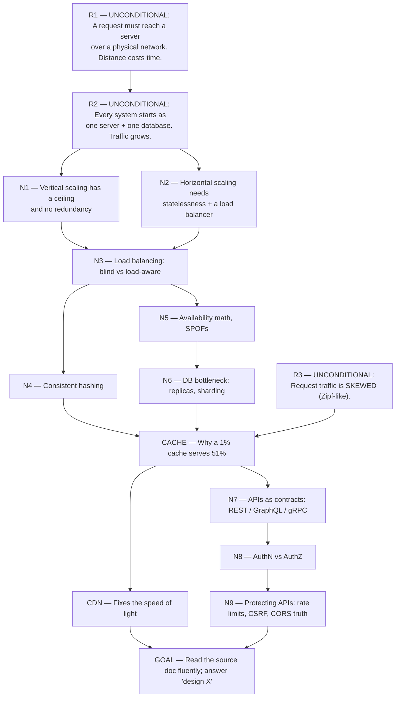
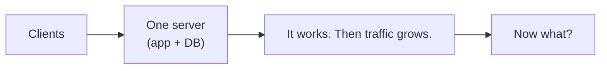
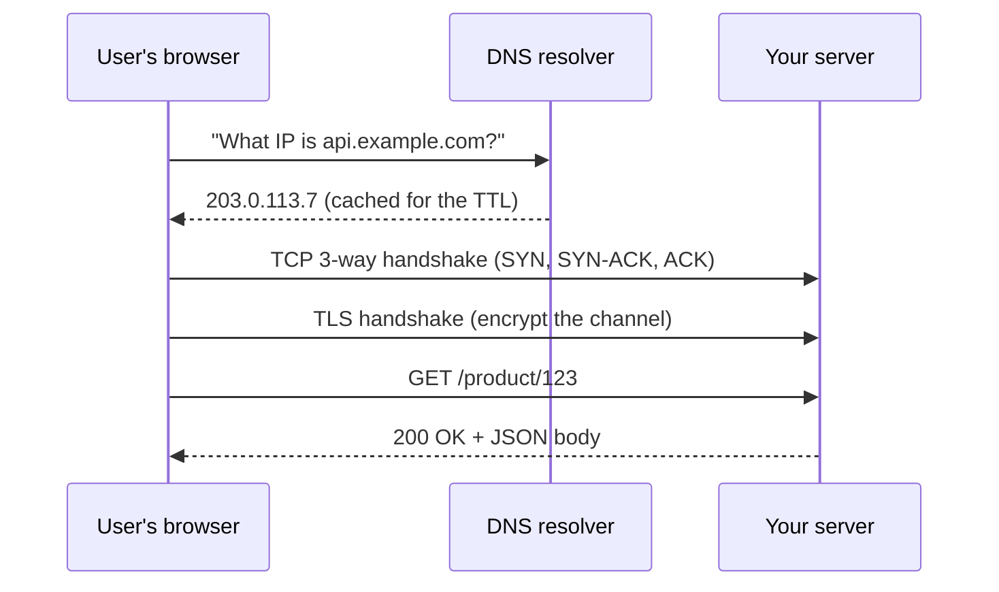

# System Design — Live Session Notes

> **Source:** [[System Design - APIs Databases Caching CDNs and Scaling]]
> **Goal:** Deep understanding of the request → scale → cache → secure arc, built from first principles.

---

## Phase 1 — Probing the learner

> [!abstract] Teacher
> Before I teach anything, I need to find the edge of what you already understand. The gap between *"I can answer this cold"* and *"I don't know"* is where the real learning happens. I'm going to ask a handful of diagnostic questions. Answer in chat; the note updates as we go.
>
> Don't worry about being wrong. A miss tells me exactly where to aim.

### Probe 1 — Foundations

> [!question] Checkpoint: Why vertical scaling isn't the whole answer
> Your app runs on one server with one database. Traffic doubles every few months. The cheapest, fastest fix is to rent a bigger machine. Why is that *not* a complete answer?
>
> 1. Bigger machines are always more expensive per unit of compute, so it loses money immediately.
> 2. There is a largest machine you can rent, and that machine is still a single point of failure.
> 3. A bigger machine cannot run the same code as a smaller one, so you'd need a rewrite.
> 4. I don't know

> [!question] I don't know
> **Learner Answer:** I don't know
> **Correct Answer:** Option 2 — there is a largest machine, and it is still one machine.
>
> Vertical scaling has two hard walls, and neither is about cost. First the **ceiling**: hardware tops out (biggest instance you can rent), and you'll reach it. Second the **redundancy**: a bigger machine is still a *single* machine — when it dies, everything dies with it. That second wall is the reason horizontal scaling exists at all. See §2.1 / §4.1.

### Probe 2 — Load balancing

> [!question] Checkpoint: Round robin with a slow server
> Four servers behind a load balancer. Three are fast; one is *half as fast*. The balancer uses plain round robin. What actually goes wrong?
>
> 1. Nothing much — round robin is fair, so each server gets a quarter of the work.
> 2. The slow server's queue grows without bound, and the slowest 1% of requests explode into multi-second waits.
> 3. The same user keeps landing on different servers, so their login session is lost.
> 4. I don't know

> [!success] Correct ✓
> **Learner Answer:** Option 2
> **Correct Answer:** Option 2 — the slow server's queue grows without bound; the tail explodes.
>
> You already have the key intuition: *blind* algorithms (round robin, random) keep feeding a struggling server its full share, while *load-aware* ones (least connections, power of two choices) route around it. You proved this cold — so this node is at your **floor**, and we can build on it quickly. The simulation in §4.2 is the receipt: p99 goes from ~15 s to thousands of seconds.

### Probe 3 — Caching

> [!question] Checkpoint: What a tiny cache is worth
> You add a cache in front of your database. It can only hold **1% of your items**. Roughly what fraction of requests does it serve?
>
> 1. About 1% — you only cached 1% of the items, so you can only serve 1% of requests.
> 2. About 5–10% — the math roughly tracks the storage fraction.
> 3. About 40–70% — real traffic is skewed, so a few hot items absorb most of the requests.
> 4. I don't know

> [!failure] Incorrect ✗
> **Learner Answer:** Option 2
> **Correct Answer:** Option 3 — real traffic is skewed; a 1% cache serves 40–70% of requests.
>
> This is the single most counter-intuitive fact in the whole guide, and it's the reason caching exists. You reasoned linearly: *1% of storage → ~1% of hits*. That is exactly the natural guess — but it's wrong, because request traffic is **not uniform**. Item popularity follows a power-law / Zipf-like curve: a handful of items are requested constantly. The measured simulation (§8, figure 10) shows a 1%-sized LRU cache hitting **51%**. This is your **ceiling** for today — we'll build it from the skew intuition up.

### Probe 4 — Security

> [!question] Checkpoint: Does CORS stop CSRF?
> A teammate says: *"We don't need CSRF protection, we have CORS configured properly."* What's your reaction?
>
> 1. Sounds right — CORS blocks cross-origin requests, so the attack can't happen.
> 2. Wrong — CORS mainly controls whether another site's JavaScript can *read* your response; the request itself can still be sent with cookies.
> 3. Wrong — CORS only applies to WebSocket connections, not to normal HTTP requests.
> 4. I don't know

> [!failure] Incorrect ✗
> **Learner Answer:** Option 1
> **Correct Answer:** Option 2 — CORS controls *reading* the response, not *sending* the request.
>
> This is the **most common security misconception** in web development, and the guide flags it as a correction (§12, item 2). The intuition to install: a browser will happily *send* a cross-site form POST with your cookies attached — CORS only hides the *reply* from the attacker's JavaScript. The damage is already done server-side. We'll fix this node explicitly later.

---

## Phase 2 — The Dependency Map

---

# Part I — Foundations

## Node R1 + R2 — The two unconditional truths

> [!abstract] Teacher
> **R1. Every request must physically travel to a server, and distance costs time.**
>
> This is not a design choice. Light in fibre travels ~200,000 km/s, and real cables route ~1.5× longer than the straight-line distance. A message from Sydney to a Virginia data centre and back takes roughly **200 milliseconds** — and *nothing you write in code makes that faster*. You can compress, cache, and parallelize, but you cannot beat physics. This is the anchor the CDN node later hangs on.
>
> **R2. Every system starts as one server running one program, talking to one database.**
>
> This is where you begin, always. Traffic then grows. The entire subject is the consequence of R2 colliding with growth — each fix removes one bottleneck and *creates the next one*. That "fix creates a new problem" rhythm is the spine of every system-design answer.

> [!abstract] Teacher
> **Why R2 matters so much in interviews.** Almost every "design X" question is secretly: *walk the path from client to database and ask where it breaks first.* DNS? TLS handshake? App CPU? The database? Network distance? You don't need to recite architectures — you need this reflex:
>
> > **"What is the first thing that runs out of capacity, and what does fixing it break next?"**

### The full request path (where R1 and R2 meet)

A user opening your app triggers this exact sequence:

> **How to read that out loud:** "First the browser asks DNS to translate a *name* into an *IP address*. Then it opens a pipe to that address (TCP), locks the pipe (TLS), and only then asks its actual question. **Four round trips happen before your application code even runs.**" That is R1 biting you four times.

*Every arrow here is a round trip that R1 makes costly. This is why "the server responded in 20 ms" and "the user waited 1.5 seconds" are both true.*

> [!question] Checkpoint: Node R1/R2
> A user in Sydney reports your app "feels slow." Server logs show the app handling every request in **20 ms**, yet the user waits **over a second**. What's the dominant cause?
>
> 1. The server's CPU is overloaded, so the 20 ms measurement is misleading.
> 2. A database query is slow but doesn't appear in the app logs.
> 3. The time is spent in physics — DNS, TCP, TLS, and request round trips each cost ~200 ms crossing the Pacific before and around the 20 ms of app work.
> 4. I don't know

> [!success] Correct ✓
> **Learner Answer:** Option 3
> **Correct Answer:** Option 3 — the time is governance by physics, not by your code.
>
> You just derived the central thesis of the whole CDN chapter from first principles. Four round trips (DNS → TCP → TLS → request), each ~200 ms Sydney↔Virginia, is ~800 ms *before* DNS caching effects — and your 20 ms of app work is a rounding error on top. This is exactly quiz Q9 in the source doc. Remember this feeling when we reach the CDN node: **we will not fix this with better code, only with physics (put a copy near the user).**
