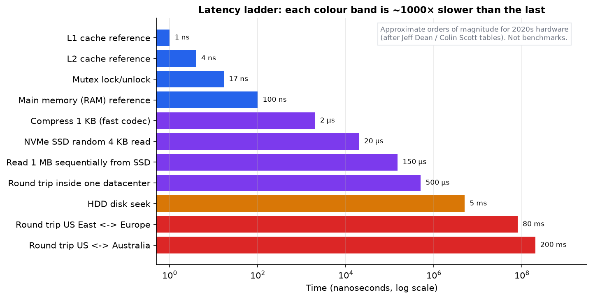
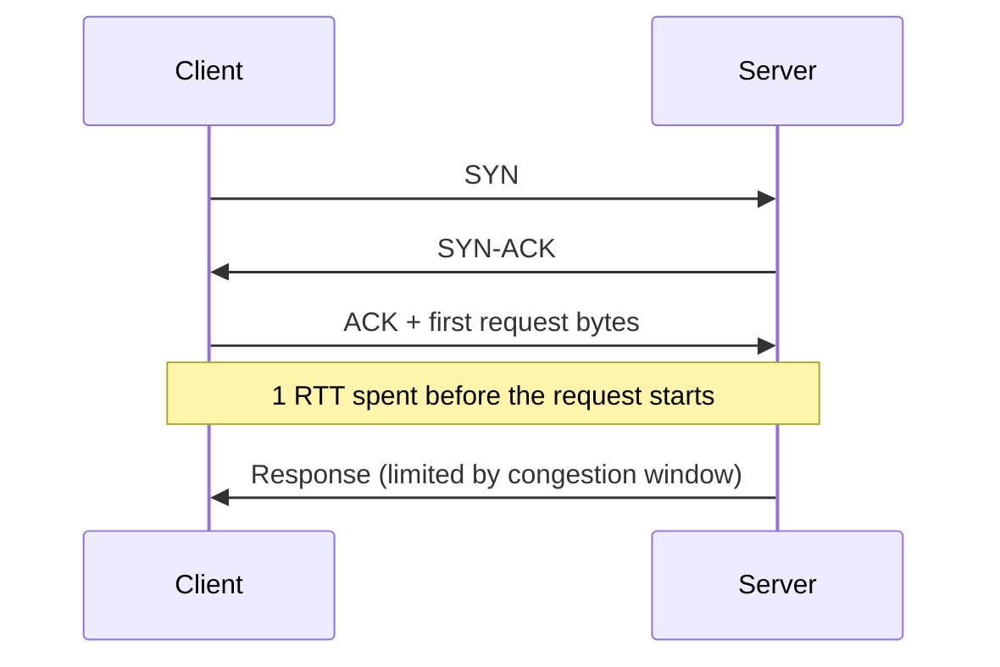
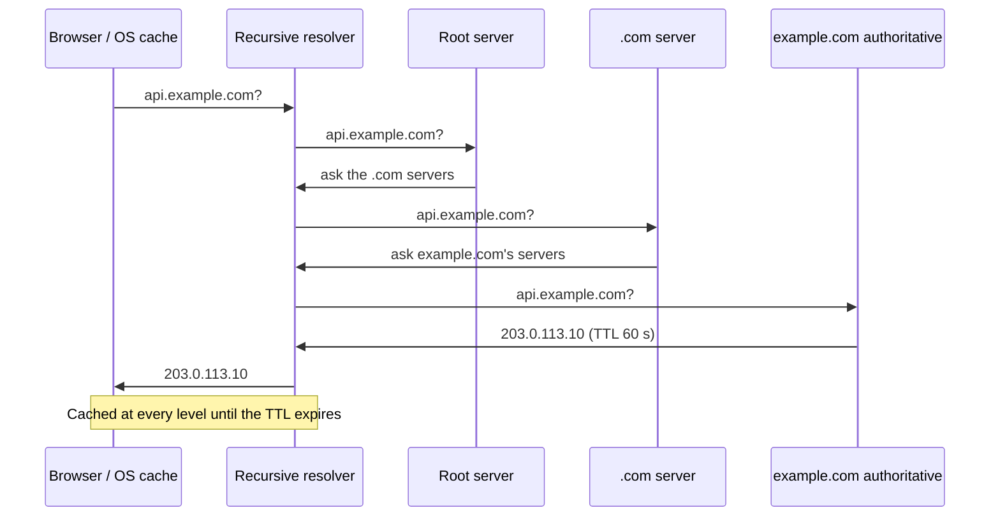
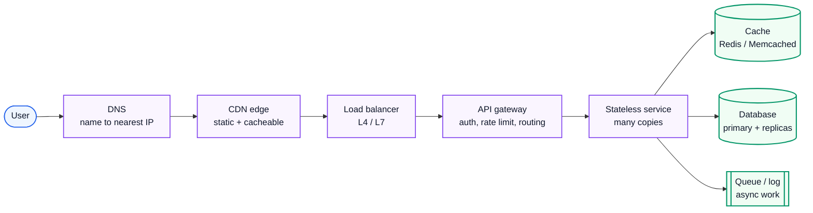
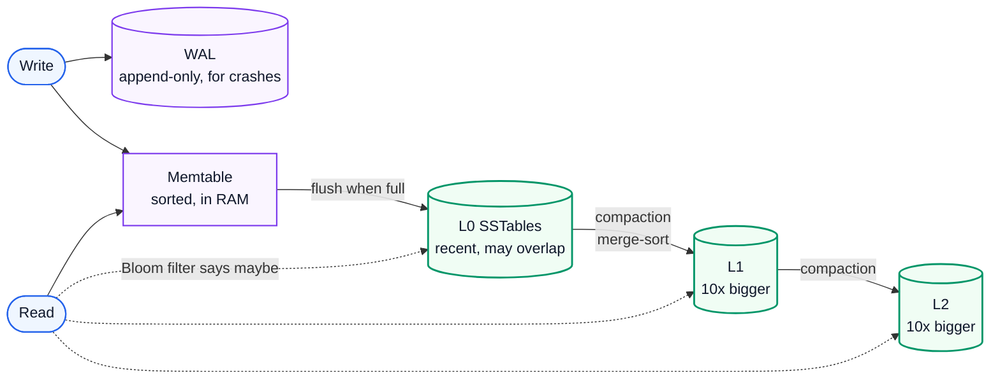
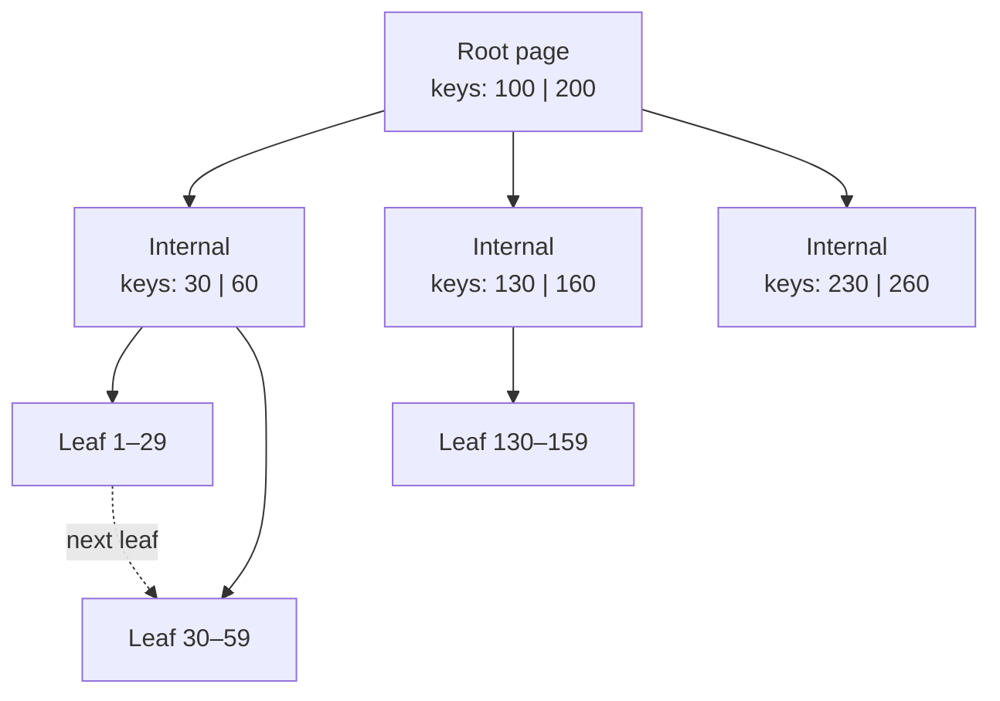
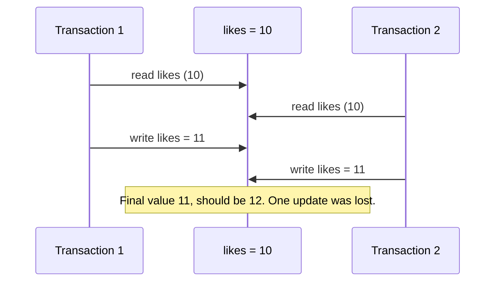

# System Design 1: Foundations, Building Blocks and Storage

> **Series:** **Part 1 (this file)** · [Part 2: Distributed Systems Theory](System%20Design%202%20-%20Distributed%20Systems%20Theory.md) · [Part 3: Building Real Systems in 2026](System%20Design%203%20-%20Building%20Real%20Systems%20in%202026.md)
> **Related notes (go deeper on specific topics):** [APIs, Databases, Caching, CDNs and Scaling](System%20Design%20-%20APIs%20Databases%20Caching%20CDNs%20and%20Scaling.md) · [Scaling to 1 Million Requests per Second](Scaling%20to%201%20Million%20Requests%20per%20Second.md)
> **Source:** built from research (textbooks, papers and official specs listed in [References](#12-references)). Every number in this guide was recomputed with Python; figures come from [make_figs.py](../figures/system_design_theory/make_figs.py) and code from [system_design_theory.py](../code/system_design_theory.py).
> **Facts re-checked:** 21 October 2026.

**The big picture:** every large system is a set of trade-offs between speed, cost, correctness and survival. To make those trade-offs well, you need to know what the machine, the network and the storage engine are *physically* doing underneath. This part builds that ground floor.

Diagram colours: 🔵 input / primary · 🟣 processing · 🟢 result · 🟠 trade-off · 🔴 failure

---

## Contents

0. [How to use this guide](#0-how-to-use-this-guide)
1. [TL;DR](#1-tldr)
2. [How a system designer thinks](#2-how-a-system-designer-thinks)
3. [The hardware and OS facts that shape every design](#3-the-hardware-and-os-facts-that-shape-every-design)
4. [Networking for system designers](#4-networking-for-system-designers)
5. [The building blocks](#5-the-building-blocks)
6. [Storage engines: how a database really stores data](#6-storage-engines-how-a-database-really-stores-data)
7. [Data models and choosing a database](#7-data-models-and-choosing-a-database)
8. [Transactions and isolation](#8-transactions-and-isolation)
9. [Probabilistic and spatial data structures](#9-probabilistic-and-spatial-data-structures)
10. [Self-check](#10-self-check)
11. [Glossary](#11-glossary)
12. [References](#12-references)

---

## 0. How to use this guide

| If you have… | Read |
|---|---|
| 10 minutes | §0.1, §1 (TL;DR) and the latency ladder figure in §2.4 |
| 1 hour | §2, §5 and §6: thinking method, building blocks, storage engines |
| A weekend | Everything, then the self-check in §10, then move to Part 2 |

The three parts build on each other. Part 1 is *one machine and its neighbours*. Part 2 is *many machines that must agree*. Part 3 is *the real systems people build from all of that*.

### 0.1 First, in completely plain words

Picture a restaurant. One cook can run a small restaurant fine. When the queue goes out of the door, you have choices. You can hire a faster cook, but there is a limit. You can hire more cooks, but now they need to share the fridge and agree on who cooks what. You can prepare popular dishes in advance, but then they might go stale. You can open a second branch across town, but now the two menus can drift apart.

**System design is that same problem with computers.** "Requests" are customers, "servers" are cooks, the "database" is the fridge, a "cache" is the pre-made dishes, and a "CDN" is the branch near the customer.

Three ideas run through everything:

1. **Physics sets the limits.** Reading from memory takes about 100 nanoseconds. A round trip across the Pacific takes about 200 milliseconds, two million times longer. No clever code beats the speed of light.
2. **Every fix creates a new problem.** A cache makes reads fast, but now data can be stale. Copies of the database survive crashes, but now the copies can disagree.
3. **There is no best design, only a design that fits.** A bank and a social feed need opposite trade-offs. Your job is to know the options and pick on purpose.

This part teaches the ground floor: how to reason about requirements and numbers, what the hardware and network really do, the standard building blocks, and how databases store and protect data.

---

## 1. TL;DR

1. **Start from requirements**, not technologies. Non-functional requirements (latency, availability, consistency, durability, cost) decide the architecture.
2. **Estimate before designing.** One day is 86,400 seconds, so 1 million requests per day is only about 12 per second on average. Always multiply by a peak factor.
3. **Know the latency ladder.** RAM ≈ 100 ns, SSD ≈ 20 µs, same-datacenter round trip ≈ 0.5 ms, cross-continent ≈ 80–200 ms. Each step is about 1,000× slower.
4. **Sequential I/O beats random I/O**, by about 500× on spinning disks and still a lot on SSDs. Log-structured designs exist because of this.
5. **Round trips are the enemy of latency.** TCP + TLS 1.3 costs 2 round trips before the request even starts. QUIC (HTTP/3) cuts that to 1, or 0 on resumption.
6. **Caching** trades freshness for speed. A 90% hit ratio with a 1 ms cache and a 20 ms database gives an average of 3 ms and 10× less database load.
7. **B-trees** update pages in place, which makes reads fast and predictable. **LSM-trees** append and merge later, which makes writes fast. Neither wins everywhere.
8. **Isolation levels** are about which anomalies you allow. "Repeatable read" and "snapshot isolation" still allow *write skew*. Only serializable stops everything.
9. **Probabilistic structures** trade a small, known error for huge memory savings. A Bloom filter needs about 10 bits per key for 1% false positives. HyperLogLog counts billions of distinct items in 12 KB at about 0.8% error.

---

## 2. How a system designer thinks

### 2.1 Requirements come first

**The problem.** If you start by picking Kafka and Cassandra, you have answered a question nobody asked. Different requirements produce different architectures.

**How it works.** Split requirements into two kinds:

- **Functional requirements**: what the system does. "Users can post a photo." "Users see a feed of people they follow."
- **Non-functional requirements (NFRs)**: how well it must do it. These drive the design:

| NFR | The question it asks | Typical way to state it |
|---|---|---|
| **Scalability** | How much load, and how fast does it grow? | 50k reads/s at peak, growing 2× per year |
| **Latency** | How fast must one request be? | p99 < 200 ms for the feed |
| **Availability** | What fraction of time must it work? | 99.95% monthly |
| **Consistency** | Can a user see stale or out-of-order data? | "A user always sees their own post at once" |
| **Durability** | Can we ever lose acknowledged data? | Zero loss of payments; feed likes can be lossy |
| **Cost** | What can we spend? | < $0.01 per 1,000 requests |
| **Security & compliance** | Who may see what, and where may data live? | EU data stays in the EU |

Two habits separate strong designers:

1. **Use percentiles, not averages.** "p99 = 200 ms" means 99% of requests finish within 200 ms. Averages hide the slow requests, and slow requests are the ones users remember. (Part 3 §3 shows why tails get worse at scale.)
2. **Requirements can differ inside one system.** In a shopping site, the payment path needs strong consistency and zero data loss. The "recommended for you" path can be stale, lossy and approximate. Design each path for its own needs.

### 2.2 Trade-offs are the job

**The problem.** Every important decision gives something up. Engineers who don't name the cost end up paying it by surprise.

The classic trade-offs you will meet again and again:

| You gain… | …and pay with | Example |
|---|---|---|
| Lower latency | Staleness | Caches, read replicas, CDNs |
| Strong consistency | Latency and availability during failures | Consensus on every write (Part 2) |
| Write throughput | Read cost and background work | LSM-trees (§6.2) |
| Read speed | Write cost and storage | Indexes, denormalisation |
| Availability | Possible conflicts to merge | Multi-leader and leaderless replication (Part 2) |
| Simplicity | Scale ceiling | One big database vs sharding |
| Flexibility | Performance | Generic JSON documents vs typed columns |
| Cost savings | Headroom | Running servers hot (Part 3 §3: latency explodes near 100%) |

A good design document names each trade-off and says *why* this side was chosen for this requirement.

### 2.3 Back-of-the-envelope estimation

**The problem.** "Do we need one database or a hundred?" You must answer this before choosing anything, and you have minutes, not days.

**How it works.** Estimate four things: **traffic (QPS)**, **storage**, **bandwidth**, and **memory for caching**. Round hard. You want the right power of ten, not three significant figures.

The two facts that make it fast:

$$
\text{average QPS} = \frac{\text{requests per day}}{86{,}400}
$$

Read that out loud: *average queries per second is the daily request count divided by the number of seconds in a day (86,400).*

$$
\text{peak QPS} \approx \text{average QPS} \times \text{peak factor}
$$

*Peak traffic is the average times a peak factor.* The peak factor is usually 2–5 for consumer apps (evenings, events).

A handy shortcut: **1 million per day ≈ 12 per second** (1,000,000 / 86,400 = 11.57).

**Worked example: a Twitter-like service.** Assume 300 million daily active users. Each posts 2 times a day and reads 100 posts a day. Each post with its metadata is about 1 KB.

| Quantity | Calculation | Result |
|---|---|---|
| Write QPS (average) | 300M × 2 / 86,400 | **≈ 6,900/s** |
| Write QPS (peak, ×3) | 6,944 × 3 | ≈ 21,000/s |
| Read QPS (average) | 300M × 100 / 86,400 | **≈ 347,000/s** |
| Read QPS (peak, ×3) | 347,222 × 3 | ≈ 1,000,000/s |
| New storage per day | 600M posts × 1 KB | 600 GB/day |
| Storage over 5 years | 600 GB × 365 × 5 | ≈ **1.1 PB** (text only) |

Notice what the numbers already tell you, before any design:

- The **read:write ratio is 50:1**. Optimise reads: caching, precomputed feeds, replicas.
- **1 million reads per second** cannot come from one database. You need caching and partitioning.
- **1.1 PB** does not fit on one machine. Storage must be partitioned (sharded).

Media (photos, video) is usually 100× bigger than text and goes in object storage plus a CDN. Estimate it separately.

### 2.4 The latency ladder: numbers every engineer should know

**The problem.** You cannot judge a design without knowing what each step costs. "Call the database twice" is fine inside a datacenter (about 1 ms) and terrible across continents (about 400 ms).



*Fig 1 (fig01_latency_ladder.png). Orders of magnitude, not benchmarks. Exact values change with hardware; the ratios are what matter.*

The rules to take away:

1. **Memory is about 1,000× faster than SSD access, and SSD is about 25× faster than a datacenter round trip.** Keep hot data in RAM.
2. **A network round trip inside a datacenter (~0.5 ms) costs as much as thousands of memory reads.** Batch your calls. Avoid chatty protocols.
3. **Cross-continent round trips (80–200 ms) are set by the speed of light in fibre** (about 200,000 km/s, two-thirds of the speed in a vacuum). The only fix is to move data closer to the user: CDNs, edge computing, regional replicas.
4. **Sequential reads are much faster than random ones** (see §3.2).

---

## 3. The hardware and OS facts that shape every design

### 3.1 The memory hierarchy and locality

**The problem.** CPUs are much faster than memory. A CPU can do hundreds of operations in the time one RAM access takes. Without caches, it would sit idle most of the time.

**How it works.** Hardware stacks small, fast memories in front of big, slow ones: registers → L1 cache (~1 ns) → L2 (~4 ns) → L3 (~10–40 ns) → RAM (~100 ns) → SSD → disk → network. Each level holds copies of data the level below holds.

Caches work because programs show **locality**:

- **Temporal locality**: data used now will likely be used again soon.
- **Spatial locality**: data next to what you used will likely be used soon. Memory moves in **cache lines** (usually 64 bytes), so reading one byte brings its 63 neighbours along for free.

**Why this matters for system design:** the same idea repeats at every scale. A CDN is a cache for a datacenter. Redis is a cache for a database. The OS page cache is a cache for the disk. Each one only pays off when the access pattern has locality, which real traffic usually does: a few items are very popular. That skew is why a cache holding 1% of items can serve half the requests (see the [caching chapter in the earlier guide](System%20Design%20-%20APIs%20Databases%20Caching%20CDNs%20and%20Scaling.md)).

### 3.2 Disks: random vs sequential

**The problem.** Storage speed depends heavily on the *pattern* of access, not just the device.

**How it works.**

- A **hard disk (HDD)** has a spinning platter and a moving arm. A random read must move the arm (seek) and wait for the platter to rotate: about 5–10 ms. That limits it to roughly **100 random operations per second (IOPS)**. Reading *sequentially*, the arm stays put and data streams at about 200 MB/s.
- An **SSD** has no moving parts. Random reads take about 20–100 µs, and NVMe drives reach hundreds of thousands of IOPS. But SSDs write in pages and erase in larger blocks. Many small random overwrites cause **write amplification** inside the drive and wear it out faster.

**Worked example.** Read 4 KB blocks at random from an HDD at 100 IOPS:

$$
100 \ \tfrac{\text{ops}}{\text{s}} \times 4 \ \text{KB} = 400 \ \text{KB/s}
$$

*One hundred operations per second, four kilobytes each, gives four hundred kilobytes per second.* The same disk reads sequentially at 200 MB/s, which is **500× faster** (200,000 KB/s ÷ 400 KB/s). An NVMe SSD at 100,000 IOPS × 4 KB gives 400 MB/s even for random reads. That is why SSDs changed database design, and why log-structured storage (§6.2) still helps: turning random writes into sequential ones pays off on every device.

### 3.3 The page cache, fsync and what "saved" really means

**The problem.** When your program calls `write()`, the data has usually *not* reached the disk. If the power fails, it can vanish. Databases that promise durability must handle this.

**How it works.**

1. `write()` copies data into the OS **page cache** (RAM) and returns at once. This is fast.
2. The OS flushes dirty pages to disk later, often seconds later.
3. `fsync()` forces the data to stable storage and waits. This is slow: about a millisecond or more on SSDs, more on HDDs.

So every durable database faces a trade-off: **fsync on every commit** (safe, slow) vs **group commit** (wait a few milliseconds, fsync many transactions together) vs **async flush** (fast, can lose the last moments of data in a crash). Settings like PostgreSQL's `synchronous_commit` or Kafka's `acks` and flush settings are exactly this dial.

> **Durability is a spectrum.** "Written to the page cache" < "fsynced to one disk" < "replicated to another machine" < "replicated to another datacenter". Each step survives a bigger disaster and costs more latency.

### 3.4 Concurrency: threads, event loops and locks

**The problem.** A server must handle many requests at once. Most of each request's time is spent *waiting* (for the database, the network, the disk), not computing.

**How it works.** There are two main models:

| Model | How it works | Strength | Weakness |
|---|---|---|---|
| **Thread per request** | Each request gets an OS thread that blocks while waiting | Simple code | Each thread costs memory (often ~1 MB of stack) and context switches cost CPU. Tens of thousands of threads hurt. |
| **Event loop (async I/O)** | One thread per core juggles thousands of connections using `epoll`/`kqueue`/`io_uring` and never blocks | Handles huge numbers of idle connections cheaply (Node.js, Nginx, Netty) | One slow computation blocks everyone on that loop |
| **Lightweight threads** | The runtime maps many cheap "green threads" onto few OS threads (Go goroutines, Java virtual threads) | Simple blocking-style code with event-loop efficiency | Runtime-specific behaviour |

When threads share data, they need **synchronisation**:

- A **mutex (lock)** lets one thread at a time into a critical section. Under heavy **contention**, threads queue on the lock and adding cores stops helping (this is the serial fraction in Amdahl's law, Part 3 §3).
- A **deadlock** happens when two threads each hold a lock the other needs. The standard prevention is to always take locks in the same global order.
- **Lock-free** structures use atomic CPU instructions such as compare-and-swap (CAS): "set X to new only if it still equals old". The same CAS idea reappears in distributed systems as conditional writes and optimistic concurrency (§8.5).

**The key insight:** the same problems (races, lost updates, deadlocks) come back at distributed scale in Part 2, but worse, because machines can also crash halfway and messages can be delayed.

---

## 4. Networking for system designers

### 4.1 The layers that matter

You need four layers in your head:

| Layer | Job | Examples |
|---|---|---|
| Application (L7) | Meaning of messages | HTTP, gRPC, DNS, WebSocket |
| Transport (L4) | Process-to-process delivery | TCP, UDP, QUIC (runs over UDP) |
| Network (L3) | Machine-to-machine routing | IP, BGP routing between networks |
| Link (L2) | Next hop on the wire | Ethernet, Wi-Fi |

"L4 load balancer" and "L7 load balancer" (§5.1) refer to these layers: what the balancer can see and act on.

### 4.2 TCP: reliable, ordered, and full of round trips

**The problem.** IP delivers packets on a best-effort basis. They can be lost, duplicated, reordered or delayed. Applications want a clean, ordered stream of bytes.

**How it works.**

1. **Three-way handshake.** Client sends SYN, server replies SYN-ACK, client sends ACK. That costs **one round trip (RTT)** before any data flows.
2. **Reliability.** Every byte has a sequence number. The receiver acknowledges what it got, and the sender retransmits what goes missing.
3. **Flow control.** The receiver advertises a window: "I have room for N more bytes." This stops a fast sender from drowning a slow receiver.
4. **Congestion control.** The sender also limits itself to protect the *network*. It starts slowly (**slow start**), roughly doubling its congestion window every RTT, and backs off when it sees loss. Modern algorithms include CUBIC (the Linux default) and BBR.



**Worked example: why a "small" 1 MB response is slow on a new connection.** Modern TCP starts with an initial window of 10 segments × 1,460 bytes = 14.6 KB. The window doubles each RTT: 14.6, 29.2, 58.4, 116.8, 233.6, 467.2, 934.4 KB…

| RTT | Sent this RTT | Total sent |
|---|---|---|
| 1 | 14.6 KB | 14.6 KB |
| 2 | 29.2 KB | 43.8 KB |
| 3 | 58.4 KB | 102.2 KB |
| 4 | 116.8 KB | 219.0 KB |
| 5 | 233.6 KB | 452.6 KB |
| 6 | 467.2 KB | 919.8 KB |
| 7 | 934.4 KB | 1,854.2 KB ✓ |

So 1 MB needs **7 RTTs** of slow start. At 100 ms RTT, that is 700 ms, even on a gigabit link. This is why connection reuse (keep-alive, connection pools) and CDNs near users matter so much.

**Bandwidth-delay product.** To keep a pipe full, the amount of data "in flight" must equal bandwidth × RTT:

$$
\text{BDP} = \text{bandwidth} \times \text{RTT}
$$

*The bytes you must have in flight equal the link speed times the round-trip time.* For 1 Gbit/s and 100 ms: $10^9 \times 0.1 / 8 = 12.5$ MB. If the windows are smaller than that, the link sits idle part of the time.

**Head-of-line (HOL) blocking.** TCP delivers bytes strictly in order. If one packet is lost, every later byte waits for its retransmission, even bytes that belong to unrelated requests sharing the connection. Keep this in mind for HTTP/2 below.

### 4.3 UDP

UDP sends independent datagrams with no handshake, no ordering, no retransmission and no congestion control. It suits cases where a late packet is useless anyway (live video, games, VoIP), or where the application builds its own reliability on top. QUIC is the big example.

### 4.4 HTTP/1.1 → HTTP/2 → HTTP/3

**The problem.** A web page needs dozens of resources. Each round trip costs latency, so protocols evolved to waste fewer.

| Version | Key idea | Remaining problem |
|---|---|---|
| **HTTP/1.1** (1997) | Keep-alive: reuse a TCP connection for several requests, one after another | Only one request in flight per connection, so browsers open ~6 connections per host |
| **HTTP/2** (2015) | Multiplexing: many concurrent streams over one TCP connection, binary framing, header compression (HPACK) | One lost TCP packet stalls *all* streams (TCP head-of-line blocking) |
| **HTTP/3** (2022, RFC 9114) | Runs over **QUIC** (RFC 9000) on UDP. Each stream is independent, so loss on one doesn't stall the others. TLS 1.3 is built into the handshake. Connections survive network changes (Wi-Fi → mobile) via connection IDs. | UDP is sometimes blocked or throttled by middleboxes, so clients fall back to HTTP/2 |


*Fig 2 (fig02_handshake_rtts.png). Counting round trips at RTT = 100 ms: handshake RTTs plus one for the request itself.*

Reading the figure: TCP (1 RTT) + TLS 1.2 (2 RTT) + request (1 RTT) = 4 RTT = 400 ms. TLS 1.3 cuts its handshake to 1 RTT, giving 300 ms. QUIC merges the transport and TLS handshakes into 1 RTT, giving 200 ms. On a repeat visit, **0-RTT** sends the request with the very first packet, giving 100 ms.

> **0-RTT has a catch.** Data in the first flight can be *replayed* by an attacker. Only use it for idempotent requests, such as a GET with no side effects. Idempotency comes back in Part 2 §7.

### 4.5 TLS 1.3 in one paragraph (and the post-quantum change)

TLS gives you three things: **confidentiality** (encryption), **integrity** (no tampering), and **authentication** (the server proves its identity with a certificate signed by a trusted authority). In TLS 1.3, client and server agree a fresh shared key with an ephemeral key exchange, which gives *forward secrecy*: stealing the server's long-term key later cannot decrypt past traffic. **mTLS** (mutual TLS) makes the client present a certificate too. It is the standard way services authenticate each other inside a zero-trust network (Part 3 §7).

**What changed by 2026:** the major browsers and CDNs now use a **hybrid post-quantum key exchange** (`X25519MLKEM768`) by default. It combines a classical elliptic-curve exchange with ML-KEM (the NIST post-quantum standard, FIPS 203), so the session stays safe if either one is broken. The motivation is "harvest now, decrypt later": attackers may record traffic today and decrypt it once quantum computers arrive. Certificates (signatures) are still mostly classical. That migration is harder and still under way.

### 4.6 DNS: the internet's phone book

**The problem.** Humans and configs use names (`api.example.com`). Machines route by IP address. Something must translate, fast, billions of times a day.

**How it works.**



Ideas a designer uses:

- **TTL (time to live)** controls how long answers are cached. A low TTL (30–60 s) lets you fail over quickly but sends more queries. A high TTL is cheap but slow to change. Many clients ignore TTLs and cache longer, so never rely on DNS for instant failover.
- **GeoDNS / latency-based routing**: answer with the IP of the nearest region.
- **Anycast**: announce *the same IP* from many locations. The internet's routing protocol (BGP) delivers each user to the nearest one. CDNs and public resolvers (such as 1.1.1.1 and 8.8.8.8) work this way, which also spreads out DDoS traffic.

---

## 5. The building blocks

These are the Lego bricks of every architecture. The [earlier guide](System%20Design%20-%20APIs%20Databases%20Caching%20CDNs%20and%20Scaling.md) has simulations for load balancing, consistent hashing and cache hit ratios. Here we focus on the theory and the failure modes.



### 5.1 Load balancers

**The problem.** Many server copies are useless unless traffic is spread across them, and sent only to healthy ones.

**How it works.**

- An **L4 load balancer** sees only IP addresses and ports. It forwards TCP/UDP connections without reading them. It is very fast and protocol-agnostic, but it cannot route by URL or header.
- An **L7 load balancer** terminates the connection and reads HTTP. It can route `/api/*` and `/images/*` to different pools, retry, add headers, and terminate TLS. It costs more CPU, and it sees the plaintext.

**Algorithms** (simulated in the earlier guide):

| Algorithm | Idea | Use when |
|---|---|---|
| Round robin / weighted | Take turns, possibly weighted by capacity | Requests cost about the same |
| Least connections / least outstanding requests | Send to the least busy server | Request costs vary |
| **Power of two choices** | Pick 2 servers at random, send to the less loaded one | Large fleets. Close to the best possible, with no global state. |
| Consistent hashing on a key | The same key always goes to the same server | You need cache affinity or sticky sessions (Part 2 §3) |

**Health checks** remove dead servers: *active* checks probe an endpoint every few seconds, and *passive* checks watch real traffic for errors. A load balancer must itself be redundant: an active-passive pair sharing a floating IP, or many instances behind anycast or DNS.

### 5.2 Reverse proxy, API gateway, service mesh

These overlap, so here's the distinction:

- **Reverse proxy** (Nginx, Envoy, HAProxy): sits in front of servers, terminates TLS, caches, compresses, and forwards.
- **API gateway**: a reverse proxy with API-specific *policy* at the edge: authentication, rate limiting, request validation, API keys and quotas, routing to many backend services, and sometimes response aggregation.
- **Service mesh** (Istio, Linkerd): the same features (mTLS, retries, timeouts, traffic shifting, telemetry) applied to *internal* service-to-service traffic. It is done with a proxy beside each service (sidecar) or a per-node proxy (the newer "ambient" or sidecar-less mode).

Rule of thumb: the gateway handles **north-south** traffic (clients into your system). The mesh handles **east-west** traffic (between your services).

### 5.3 Caching: the theory and the failure modes

**The problem.** The database is the slowest and hardest-to-scale part of most systems, and most reads ask for the same few items again and again.

**How it works.** Keep copies of hot data in a faster store. The core formula is expected latency:

$$
T_{\text{avg}} = h \cdot T_{\text{hit}} + (1 - h) \cdot T_{\text{miss}}
$$

*The average latency is the hit ratio times the hit time, plus the miss ratio times the miss time.* Here $h$ is the hit ratio (the fraction of requests found in the cache). The miss time includes the cache check *and* the database trip.

**Worked example.** Cache hit = 1 ms. Miss = 1 ms (check) + 20 ms (database) = 21 ms.

| Hit ratio $h$ | Average latency | Database load (fraction of reads) |
|---|---|---|
| 50% | 0.5 × 1 + 0.5 × 21 = **11 ms** | 50% |
| 90% | 0.9 × 1 + 0.1 × 21 = **3 ms** | 10% |
| 99% | 0.99 × 1 + 0.01 × 21 = **1.2 ms** | 1% |

Read the last column again: **going from 90% to 99% hits cuts database load by another 10×.** The last few percent of hit ratio are often worth more than they look.

**Patterns** (who loads and who writes):

| Pattern | Reads | Writes | Trade-off |
|---|---|---|---|
| **Cache-aside** (most common) | App checks the cache; on a miss it reads the DB and fills the cache | App writes the DB, then *deletes* the cache key | Simple. Brief staleness is possible. The first read after a delete is slow. |
| **Read-through** | Cache loads from the DB itself on a miss | — | App code is simpler; needs a cache that knows the DB |
| **Write-through** | — | Write goes to the cache *and* DB synchronously | Cache always fresh; writes are slower |
| **Write-back (write-behind)** | — | Write to the cache, flush to the DB later | Very fast writes; **data loss** if the cache dies before flushing |
| **Write-around** | — | Write straight to the DB, skipping the cache | Avoids filling the cache with data nobody reads |

> **Why "delete", not "update", on write?** If two writers update the cache in different orders from the DB, the cache ends up wrong *forever*. Deleting lets the next read fetch the truth. A small race remains (a slow reader can re-insert a stale value), which is why caches also use TTLs as a safety net.

**Eviction**: when the cache is full, something must go. **LRU** (least recently used) is the default and works well with temporal locality. **LFU** (least frequently used) protects long-term popular items from one-off scans. **TTL** expires entries by age, which bounds staleness.

**The failure modes** (these are what senior engineers ask about):

| Failure | What happens | Defence |
|---|---|---|
| **Cache stampede (thundering herd)** | A hot key expires; thousands of requests miss at once and all hit the DB | Request coalescing (one loader, the rest wait), locks, refreshing early with a random margin |
| **Cache penetration** | Requests for keys that *don't exist* always miss and hit the DB (often an attack) | Cache negative results briefly; put a Bloom filter (§9.1) in front |
| **Cache avalanche** | Many keys expire at the same moment, or the cache cluster restarts empty | Add random jitter to TTLs; warm the cache; keep the cache replicated |
| **Hot key** | One key (a celebrity's profile) overloads one cache node | Replicate the hot key to several nodes; add a small in-process cache in front |
| **Inconsistency** | The cache and the DB disagree | TTLs, delete-on-write, or invalidation driven by change data capture (Part 3 §2) |

### 5.4 CDNs

**The problem.** The speed of light makes far-away users slow (Fig 1), and serving the same video bytes to millions of people from one origin is expensive.

**How it works.** A **content delivery network** is a global fleet of caching servers (points of presence, or PoPs) near users.

- **Pull CDN**: on a miss, the edge fetches from your origin and caches according to `Cache-Control` headers. Easy; the first user in each region pays the miss.
- **Push CDN**: you upload content ahead of time. Good for big, predictable files.
- **Cache key design** matters: decide which query parameters, headers and cookies make two requests "the same". Version static files by content hash (`app.3f9a1c.js`) so they can be cached "forever" and replaced instantly.
- **Edge compute** (Workers, Lambda@Edge, Wasm at the edge) runs small pieces of code at the PoP: auth checks, A/B routing, personalisation.
- An **origin shield** is a middle cache layer that collapses misses from many PoPs into one origin request.

### 5.5 Stateless services and where state goes

**The problem.** If server A holds a user's session in memory, every request from that user must go to A. Scaling, deploys and crashes all break it.

**How it works.** Make application servers **stateless**: any server can handle any request. Push the state out to a shared store (database, Redis), or into the request itself (a signed token such as a JWT). Then you can add, remove or replace servers freely, which is the foundation of autoscaling (Part 3 §5). The [earlier guide](System%20Design%20-%20APIs%20Databases%20Caching%20CDNs%20and%20Scaling.md) compares server sessions and JWTs.

**The general principle:** *push state to the edges of the system and keep the middle stateless.* The state that remains (databases, queues, caches) is where all the hard problems of Part 2 live.

---

## 6. Storage engines: how a database really stores data

This is the part most engineers skip, and it explains most database behaviour. There are two dominant families: **log-structured (LSM-trees)** and **page-oriented (B-trees)**.

### 6.1 Start with the simplest database: a log

**The problem.** We want to store key-value pairs durably and find them again quickly.

**The naive approach.** Append every write to the end of a file: `key,value\n`. Writing is as fast as the disk allows, because it is purely sequential. But reading means scanning the whole file from the end: O(n). Useless at scale.

**The fix: an index.** Keep an in-memory hash map from each key to its byte offset in the file. Reads become one seek. This is exactly how Bitcask (Riak's engine) works. Two limits remain:

1. All keys must fit in RAM.
2. Range queries ("all keys between `user:100` and `user:200`") are impossible, because a hash map has no order.

The log also grows forever, so you periodically **compact** it: rewrite it keeping only the latest value for each key, then delete the old segments. Deletes are written as special **tombstone** records.

### 6.2 SSTables and LSM-trees

**The problem.** We want the write speed of a log *plus* sorted order (for range scans) *plus* keys that don't all fit in RAM.

**How it works.**

1. Writes go to an in-memory **sorted** structure called the **memtable** (a balanced tree or skip list), *and* are appended to a **write-ahead log (WAL)** on disk so a crash can't lose them.
2. When the memtable reaches a size limit (tens to hundreds of MB), it is written out as an immutable, sorted file: a **Sorted String Table (SSTable)**. This is one big sequential write.
3. A **read** checks the memtable, then SSTables from newest to oldest. Each SSTable has a sparse index (one key per block) and a **Bloom filter** (§9.1) that answers "definitely not here" without touching the disk.
4. In the background, **compaction** merges SSTables (like the merge step of merge sort), dropping overwritten values and tombstones.



**Two compaction strategies:**

- **Size-tiered** (Cassandra's classic default): merge SSTables of similar size. Cheap on writes, but a key can live in many files, and compaction temporarily needs a lot of spare disk.
- **Leveled** (RocksDB, LevelDB): each level is about $T$ times bigger than the previous one ($T$ is the size ratio, often 10), and files inside a level don't overlap. A read touches at most one file per level. The cost is more rewriting.

**How many levels?** With a size ratio $T = 10$, a first level of 256 MB and 1 TB of data:

$$
L \approx \log_{T} \frac{\text{data size}}{\text{level-1 size}} = \log_{10} \frac{10^{12}}{2.56 \times 10^{8}} \approx 3.6 \ \Rightarrow \ 4 \ \text{levels}
$$

*The number of levels is the base-T logarithm of how many times bigger the data is than the first level.* Each byte gets rewritten roughly up to $T$ times per level as it sinks. So with leveled compaction, the total rewriting (**write amplification**) is commonly in the tens.

LSM-trees power RocksDB, Cassandra, ScyllaDB, HBase, Bigtable, LevelDB, and the storage layers of CockroachDB, TiDB and many time-series databases.

### 6.3 B-trees

**The problem.** We want predictable, fast reads and in-place updates, and we can afford some write cost.

**How it works.** A B-tree breaks the database into fixed-size **pages** (often 4–16 KB). Each page holds sorted keys and pointers to child pages. A lookup starts at the root and follows one pointer per level down to a leaf. In a **B+ tree** (what databases actually use), all values live in the leaves, and leaves are linked for fast range scans.



**Worked example: tree height.** A 16 KB page holding entries of about 32 bytes (key + child pointer) has a **fanout** $f \approx 16{,}384 / 32 = 512$. Take $f = 500$ for round numbers. For a billion rows:

$$
h = \lceil \log_{f} N \rceil = \lceil \log_{500} 10^{9} \rceil = \lceil 3.33 \rceil = 4
$$

*The height is the base-f logarithm of the row count, rounded up.* Three levels hold $500^3 = 125$ million keys, and four hold 62.5 billion. So **any of a billion rows is reachable in 4 page reads.** The top two or three levels are tiny and stay in RAM, so a lookup usually costs **one or two disk reads**. That predictability is why B-trees dominate OLTP databases (PostgreSQL, MySQL InnoDB, SQL Server, Oracle, SQLite).

**Writes and crashes.** Updating a page in place is dangerous: a crash mid-write can leave a half-written page, and a page split touches several pages. So B-tree databases first write every change to a **write-ahead log (WAL, also called a redo log)** and fsync it. After a crash, they replay the WAL. Concurrency inside the tree uses lightweight page locks called *latches*.

### 6.4 B-tree vs LSM: amplification is the real trade-off

Every storage engine pays in three currencies (sometimes called the **RUM conjecture**: you can optimise two of **R**ead, **U**pdate and **M**emory/space overhead, not all three):

- **Read amplification**: disk reads per logical read.
- **Write amplification**: bytes written to disk per byte the user wrote.
- **Space amplification**: disk used per byte of live data.

| | **B-tree** | **LSM-tree** |
|---|---|---|
| Write pattern | Random in-place page writes (plus the WAL) | Sequential appends and merges |
| Write throughput | Good | Usually higher, especially on HDDs and for heavy ingest |
| Read latency | Low and predictable (one path) | Can check several levels; Bloom filters help; range scans merge levels |
| Space | Some fragmentation (half-empty pages after splits) | Compresses well; temporary bloat before compaction |
| Write amplification | Whole page rewritten for a small change | Rewrites during compaction (often 10–30× when leveled) |
| Background work | Little | Compaction can steal disk bandwidth and cause latency spikes |
| Best for | Read-heavy OLTP, strong transactions | Write-heavy ingest: logs, metrics, messaging, time series |

There is no winner. Measure with *your* workload.

### 6.5 Indexes

**The problem.** Without an index, a query must scan every row. An index makes reads fast but costs extra writes and storage.

Key ideas:

- **Primary vs secondary index.** The primary index is on the primary key. A secondary index is on another column (such as `email`).
- **Clustered index**: the table rows are *stored inside* the index's leaves in key order (InnoDB's primary key). Other indexes then point to the primary key.
- **Covering index**: the index contains every column the query needs, so the table itself is never touched.
- **Composite index** on `(country, city, age)` follows the **leftmost prefix rule**: it helps queries filtering on `country`, or `country + city`, but not on `city` alone. Order the columns by how you query.
- **Every index slows writes.** Each insert must update every index on the table. Index for your actual query patterns, not "just in case".
- Specialised indexes: **inverted indexes** for full-text search (§7.7), **GiST/R-trees** for geometry, **HNSW** graphs for vector similarity (Part 3 §9).

---

## 7. Data models and choosing a database

**The problem.** The shape of your data and your access patterns should pick the database. Popularity should not.

### 7.1 Relational (SQL)

Data lives in tables of rows and columns with a fixed **schema**. Relations are expressed with foreign keys and combined with **joins**. **Normalisation** stores each fact once, which avoids update anomalies but needs joins to reassemble data. Relational databases give you powerful ad-hoc queries (SQL), strong transactions (§8) and decades of tooling. **PostgreSQL** is the default choice for new systems in 2026 for good reason: with extensions it also covers JSON documents (`jsonb`), full-text search, geospatial data (PostGIS) and vectors (`pgvector`).

### 7.2 Document

Each record is a self-contained JSON-like **document** (MongoDB, Couchbase, Firestore). A document maps naturally onto objects in code and gives **locality**: one read fetches the whole aggregate (a user with their addresses). Weaknesses: many-to-many relationships and joins are awkward, and duplicated (denormalised) data must be kept in sync by your code. Choose it when data is naturally tree-shaped and accessed as a whole.

### 7.3 Wide-column

Rows are identified by a **partition key**. Inside a partition, columns are sorted by a **clustering key** (Cassandra, ScyllaDB, HBase, Bigtable). Built on LSM-trees, they handle massive write volumes and scale horizontally. The trade-off is that **you design tables around queries**: one table per access pattern, no joins, limited secondary indexes. They are great for time-ordered data per entity (messages per chat, events per device).

### 7.4 Key-value

The simplest model: `get(key)`, `put(key, value)`. In-memory stores (Redis, Memcached) give microsecond latency for caches, sessions, counters, leaderboards and rate limiters. Durable distributed ones (DynamoDB, etcd, FoundationDB) give predictable latency at huge scale. DynamoDB-style systems are really key-value plus a sort key, close to wide-column.

### 7.5 Graph

Data is **nodes and edges**, both with properties (Neo4j, Amazon Neptune; query languages Cypher, Gremlin, and the ISO standard GQL). They suit queries that follow relationships many hops deep: "friends of friends who like X", fraud rings, knowledge graphs. A relational database needs one self-join per hop, which gets slow and awkward fast.

### 7.6 Time-series

Data is append-mostly measurements keyed by time (metrics, IoT sensors, prices): TimescaleDB, InfluxDB, Prometheus, ClickHouse. They use columnar compression (deltas between consecutive timestamps compress extremely well), time-based partitioning, cheap deletion of whole old partitions (retention), and **downsampling** (keep per-second data for a day, per-minute data for a year).

### 7.7 Search engines and the inverted index

**The problem.** "Find documents containing *distributed* and *consensus*" by scanning every document is hopeless at scale.

**How it works.** An **inverted index** maps each term to its **posting list**: the IDs (and positions) of the documents containing it. A query intersects posting lists, then **ranks** results, classically with BM25 (term frequency, inverse document frequency, length normalisation; see the [BM25 guide](../Theory/BM25%20-%20Keyword%20Search%20for%20AI%20Agents.md)). Text goes through **analysis** first: tokenising, lowercasing, stemming. Elasticsearch and OpenSearch (both built on Lucene) are the standard engines. They are usually *secondary* stores fed from the main database, not the source of truth.

### 7.8 Vector databases

They store **embeddings**, vectors that capture meaning, and answer "find the nearest vectors" using approximate nearest neighbour (ANN) indexes such as HNSW. This is the retrieval half of AI systems, covered properly in [Part 3 §9](System%20Design%203%20-%20Building%20Real%20Systems%20in%202026.md). In practice: pgvector inside Postgres, vector search inside existing engines (Elasticsearch, Redis), or dedicated stores (Pinecone, Qdrant, Weaviate, Milvus).

### 7.9 Object, block and file storage

| Kind | Interface | Examples | Use for |
|---|---|---|---|
| **Block** | Raw fixed-size blocks; a filesystem or DB sits on top | AWS EBS, local NVMe | Database disks, VM disks |
| **File** | Hierarchical paths, POSIX operations | NFS, EFS | Shared files between servers |
| **Object** | `PUT`/`GET` whole objects by key over HTTP; flat namespace; effectively unlimited | Amazon S3, GCS, Azure Blob, MinIO | Images, video, backups, logs, data lakes (Part 3 §8) |

Object storage is cheap, extremely durable (S3 is designed for 11 nines of durability) and massively scalable, but each request has high latency (tens of ms) and objects are replaced whole, not edited in place. The standard pattern: **put the bytes in object storage, put the metadata in a database, put a CDN in front.**

### 7.10 Choosing: a decision table

| If your dominant need is… | Start with |
|---|---|
| General-purpose, transactions, ad-hoc queries | **PostgreSQL** (or MySQL) |
| Massive write throughput, known query patterns, multi-region | Wide-column (Cassandra/ScyllaDB) or DynamoDB |
| Microsecond reads, ephemeral data | Redis / Memcached |
| Tree-shaped records read and written as a whole | Document store (or Postgres `jsonb`) |
| Deep relationship traversal | Graph database |
| Full-text relevance search | Elasticsearch / OpenSearch |
| Metrics and events over time | Time-series DB / ClickHouse |
| Analytics over billions of rows | Columnar warehouse or lakehouse (Part 3 §8) |
| Global SQL with strong consistency | Distributed SQL (Spanner, CockroachDB, YugabyteDB; Part 2) |
| Semantic similarity | Vector index (pgvector first; dedicated if it outgrows it) |

Big systems use several (**polyglot persistence**). The hard part then becomes keeping them in sync, which is what change data capture solves (Part 3 §2).

---

## 8. Transactions and isolation

### 8.1 What ACID actually means

**The problem.** Many things happen at once, and things fail halfway. Without guarantees, money disappears and inventory goes negative.

A **transaction** groups several reads and writes into one unit. ACID names four guarantees, and each word is more specific than it sounds:

- **Atomicity**: all or nothing. If anything fails, every write in the transaction is rolled back. (This is about *aborting*, not about concurrency.)
- **Consistency**: the application's invariants hold, such as "balances never go negative". This is mostly the *application's* job, helped by constraints. It is **not** the "C" in CAP (Part 2).
- **Isolation**: concurrent transactions don't interfere with each other. Ideally each behaves as if it ran alone. This is the hard one, covered below.
- **Durability**: once committed, data survives crashes (WAL + fsync, §3.3, and replication).

### 8.2 The anomalies: what can go wrong

The isolation levels below are defined by which of these they prevent. Learn the anomalies and the levels make sense.

| Anomaly | What happens | Example |
|---|---|---|
| **Dirty read** | You read another transaction's *uncommitted* write, which might be rolled back | You see a balance that never really existed |
| **Dirty write** | You overwrite another transaction's uncommitted write | Two half-finished updates get mixed |
| **Read skew (non-repeatable read)** | You read the same data twice and get different answers because someone committed in between | A backup or report sees money "in flight" between two accounts and adds up wrong |
| **Lost update** | Two transactions read-modify-write the same value; one update silently disappears | Two clicks on "like" both read 10 and both write 11 |
| **Write skew** | Two transactions read the *same* data, each decides it's safe, then they write *different* rows, and together they break an invariant | Two on-call doctors both see "2 on call", both go off call, and now nobody is on call |
| **Phantom** | A query's *set of matching rows* changes because another transaction inserted or deleted rows | Two bookings check "is this room free 2–3 pm?" and both insert a booking |

**The lost update, step by step:**



**Write skew is the subtle one.** Neither transaction overwrote the other's data, so row-level conflict checks miss it. The bug is in the *decision* each made from data that changed underneath it.

### 8.3 Isolation levels

| Level | Prevents | Still allows | Notes |
|---|---|---|---|
| Read uncommitted | Dirty writes | Everything else | Rarely used |
| **Read committed** | Dirty reads and writes | Read skew, lost updates, write skew, phantoms | **PostgreSQL's default**, and Oracle's and SQL Server's |
| **Snapshot isolation** (Postgres calls it *repeatable read*) | + read skew, + most lost updates | **Write skew**, some phantoms | Each transaction reads a consistent snapshot |
| Repeatable read (MySQL InnoDB default) | Read skew for plain reads | Write skew, lost updates in some patterns | Names differ between vendors, so check the docs |
| **Serializable** | Everything: the result equals *some* one-at-a-time order | Nothing | Costs throughput, and aborts that clients must retry |

> **Vendor names lie.** The SQL standard defined isolation levels by three anomalies before snapshot isolation existed. That's why "repeatable read" means different things in PostgreSQL and MySQL, and why Oracle's "serializable" has historically been snapshot isolation. Always test the anomaly you care about.

### 8.4 How databases implement isolation

1. **Two-phase locking (2PL)**: readers take shared locks and writers take exclusive locks, all held until commit (the "growing then shrinking" phases). It is truly serializable, but readers and writers block each other and deadlocks happen (the database detects them and aborts one transaction). To stop phantoms it also locks *ranges* of the index (predicate or next-key locks).
2. **MVCC (multi-version concurrency control)**: every write creates a new *version* of the row tagged with its transaction ID. Each transaction reads the versions that were committed when its snapshot was taken. **Readers never block writers, and writers never block readers.** Old versions are garbage-collected later (PostgreSQL's VACUUM). MVCC is how snapshot isolation is built.
3. **Serializable snapshot isolation (SSI)**: MVCC plus tracking of read-write dependencies between concurrent transactions. When a dangerous pattern (a potential cycle) appears, one transaction is aborted at commit time. It is serializable with no read locks. It is *optimistic*: cheap when conflicts are rare. PostgreSQL's `SERIALIZABLE` level uses it.

### 8.5 Fixing lost updates and write skew in practice

- **Atomic operations**: `UPDATE posts SET likes = likes + 1 WHERE id = 7`. The database does the read-modify-write as one step.
- **Explicit locks**: `SELECT … FOR UPDATE` locks the rows you read, so the others wait.
- **Compare-and-set (optimistic concurrency)**: keep a `version` column and write `UPDATE … SET balance = 50, version = 8 WHERE id = 1 AND version = 7`. If 0 rows changed, someone got there first: re-read and retry. This is the CAS idea from §3.4 again.
- **Materialise the conflict**: for write skew on rows that don't exist yet (room bookings), create rows to lock, such as one row per room per time slot.
- **Unique constraints**: let the database reject the second booking.
- Or simply use **serializable** and retry on abort.

The distributed version of all this (transactions across machines: 2PC, Sagas) is in [Part 2 §7](System%20Design%202%20-%20Distributed%20Systems%20Theory.md).

---

## 9. Probabilistic and spatial data structures

**The problem.** At scale, exact answers can cost too much memory. Exactly counting the distinct visitors among a billion 64-bit IDs needs about 8 GB. Often an answer within 1% is fine, and costs kilobytes.

### 9.1 Bloom filters: "definitely not" or "probably yes"

**The problem.** Before an expensive lookup (a disk read, a network call), you want to know cheaply whether the key could exist at all.

**How it works.**

1. Start with an array of $m$ bits, all 0, and pick $k$ independent hash functions.
2. **Add** an item: hash it $k$ ways and set those $k$ bits to 1.
3. **Query** an item: hash it $k$ ways. If *any* of those bits is 0, the item was **definitely never added**. If all are 1, it was **probably** added: the bits may have been set by other items, which is a false positive.

There are **no false negatives**, ever. You cannot delete items (a Counting Bloom filter or a Cuckoo filter adds that).

**The maths.** After inserting $n$ items, the false-positive probability is approximately:

$$
p \approx \left(1 - e^{-kn/m}\right)^{k}
$$

*The chance of a false positive is the chance that one bit is set, which is one minus e to the minus k n over m, raised to the power k, because all k bits must be set by accident.*

For a target $p$, the best choices are:

$$
m = -\frac{n \ln p}{(\ln 2)^2}, \qquad k = \frac{m}{n} \ln 2
$$

*The bits needed equal minus n times the natural log of p, divided by the square of ln 2. The best number of hash functions is bits per item times ln 2 (about 0.69).*

**Worked example.** One million keys at a 1% false-positive rate:

- Bits per key: $m/n = -\ln(0.01) / (\ln 2)^2 = 4.605 / 0.4805 = 9.59$ bits.
- Total memory: $9.59 \times 10^6$ bits ≈ **1.2 MB** (vs tens of MB to store the keys themselves).
- Hash functions: $k = 9.59 \times 0.693 = 6.6$, so use **7**.


*Fig 3 (fig03_bloom_filter.png). The green curve is the best achievable rate. Red dots are measured from a simulation with 5,000 keys, and they sit on the theory line. Each extra ~4.8 bits per key cuts the false-positive rate 10×.*

Code is useful here, because the whole structure fits in a few lines (from [system_design_theory.py](../code/system_design_theory.py)):

```python
class BloomFilter:
    def __init__(self, n_items, fp_rate):
        self.m = math.ceil(-n_items * math.log(fp_rate) / math.log(2) ** 2)  # bits
        self.k = max(1, round(self.m / n_items * math.log(2)))                # hash functions
        self.bits = bytearray(self.m)

    def _positions(self, item):
        d = hashlib.sha256(item.encode()).digest()
        a, b = int.from_bytes(d[:8], "big"), int.from_bytes(d[8:16], "big")
        return [(a + i * b) % self.m for i in range(self.k)]   # double hashing

    def add(self, item):
        for p in self._positions(item):
            self.bits[p] = 1

    def might_contain(self, item):
        return all(self.bits[p] for p in self._positions(item))
```

Actual output for 100,000 keys at a 1% target:

```text
bits=958,506 (117 KiB), k=7
false negatives: 0   false positives: 0.98%
```

The "double hashing" line builds $k$ hash functions from two, as $h_1 + i \cdot h_2$. That's a standard trick that keeps the same error rate.

**Where Bloom filters live:** LSM-tree SSTables (skip files that can't hold the key, §6.2), cache-penetration defence (§5.3), CDNs (don't cache one-hit wonders), web crawlers (have I seen this URL?), and spell checkers.

### 9.2 HyperLogLog: counting distinct items in kilobytes

**The problem.** "How many unique visitors today?" An exact answer needs a set of every ID seen.

**The intuition.** Hash every item to a random-looking bit string. In random bits, a run of $r$ leading zeros happens with probability $2^{-r}$. If the longest run of leading zeros you've seen is 20, you've probably seen around $2^{20}$ (about a million) distinct items. Duplicates hash identically, so they don't change the answer. One such estimate is very noisy, so HyperLogLog splits items into $m$ buckets (registers) by their first few hash bits, keeps the maximum run per bucket, and combines the buckets with a harmonic mean plus bias corrections.

**The maths.** The relative standard error is:

$$
\text{error} \approx \frac{1.04}{\sqrt{m}}
$$

*The typical error is 1.04 divided by the square root of the number of registers.*

**Worked example.** With $m = 16{,}384$ registers: error $= 1.04 / 128 \approx 0.0081$, about 0.81%. Each register needs only 6 bits, so memory = 16,384 × 6 / 8 = **12 KB**, whatever the count, even billions. Compare 8 GB for an exact set of a billion IDs. This is exactly Redis's `PFADD`/`PFCOUNT`. HLLs also **merge**: the union of two HLLs is the register-wise maximum, so daily counts combine into weekly counts for free.

### 9.3 Count-Min Sketch: approximate frequencies

**The problem.** "Which search terms are trending?" or "Has this IP sent too many requests?" across billions of events.

**How it works.** Keep a 2-D array of counters with $d$ rows and $w$ columns, and one hash function per row. To add an item, increment one counter in each row. To estimate its count, take the **minimum** over its $d$ counters. Collisions only ever *add* to a counter, so the minimum is the least polluted estimate. It never underestimates.

With $w = \lceil e/\varepsilon \rceil$ and $d = \lceil \ln(1/\delta) \rceil$, the estimate exceeds the true count by at most $\varepsilon N$ (where $N$ is the total of all counts), with probability at least $1 - \delta$.

*Read it as: the width sets how big the error can be, and the depth sets how often you may exceed it.* For ε = 0.1% and δ = 1%: $w = 2{,}719$ and $d = 5$, so about 13,600 counters. Combine it with a small heap to track the **top-k heavy hitters**.

### 9.4 Geospatial indexing

**The problem.** "Find restaurants within 2 km" is a 2-D range query. Ordinary B-tree indexes sort along one dimension.

**How it works.** Map 2-D space onto 1-D keys (or a tree) that preserve nearness:

- **Geohash**: repeatedly split the world in half, alternating longitude and latitude, and record each choice as a bit. Encode the bits in base-32. Nearby points share prefixes, so "nearby" becomes a *prefix range query* on an ordinary index. A 6-character geohash is a cell of about 1.2 km × 0.6 km. At 7 characters it's about 153 m × 153 m. **Edge case:** two points can be 1 m apart across a cell boundary with completely different prefixes, so always search the target cell *and its 8 neighbours*.
- **Quadtree**: recursively split a square into four children until each holds at most K points. It adapts to density: dense cities get deep trees, oceans stay shallow. Typically kept in memory.
- **Google S2** (sphere → cube → Hilbert curve cells) and **Uber H3** (hexagons, whose neighbours are all equidistant) are the production-grade grids. They are used for ride matching, surge-pricing zones and delivery areas.
- **R-trees** (PostGIS, via GiST indexes) index rectangles and polygons, not only points.

---

## 10. Self-check

<details>
<summary>1. A service gets 50 million requests a day with a peak factor of 4. What peak QPS do you design for?</summary>

50,000,000 / 86,400 ≈ 579/s on average. × 4 ≈ **2,300/s** at peak. (Shortcut: 1M/day ≈ 12/s, so 50M ≈ 580/s.)
</details>

<details>
<summary>2. Why does a new HTTPS connection fetching 1 MB take far longer than 1 MB ÷ bandwidth?</summary>

Handshakes (TCP 1 RTT + TLS 1.3 1 RTT) plus **TCP slow start**: starting from 14.6 KB and doubling each RTT takes about 7 RTTs to send 1 MB. Latency-bound, not bandwidth-bound. Fixes: connection reuse, CDNs near the user, HTTP/3.
</details>

<details>
<summary>3. Your cache hit ratio rises from 95% to 99%. By how much does database read load fall?</summary>

From 5% of reads to 1%: **5× less**. Small hit-ratio gains at the top end matter a lot.
</details>

<details>
<summary>4. Which engine would you pick for 500k writes/s of sensor data with mostly recent-range reads, and why?</summary>

An **LSM-based** store (wide-column or time-series): sequential writes, good compression, and cheap whole-partition retention. A B-tree would pay random page writes on every insert.
</details>

<details>
<summary>5. Two doctors go off call at the same moment under snapshot isolation, and nobody is left. Which anomaly is it, and give two fixes.</summary>

**Write skew.** Fixes: `SELECT … FOR UPDATE` on the rows checked; serializable isolation (SSI) and retry; or materialise the conflict as a row that both transactions must update.
</details>

<details>
<summary>6. A Bloom filter says "present". What do you know? And if it says "absent"?</summary>

"Present" = **probably** present (false positives possible). "Absent" = **definitely** absent (no false negatives).
</details>

<details>
<summary>7. Why must a geohash proximity search also look at neighbouring cells?</summary>

Points close together can sit on opposite sides of a cell boundary and share no prefix, so searching one cell misses them.
</details>

---

## 11. Glossary

| Term | Meaning |
|---|---|
| **NFR** | Non-functional requirement: how well (latency, availability, durability, cost…) |
| **QPS / RPS** | Queries / requests per second |
| **p99** | 99th percentile: 99% of requests are at least this fast |
| **RTT** | Round-trip time: there and back over the network |
| **IOPS** | Input/output operations per second a storage device can do |
| **fsync** | System call forcing buffered data onto stable storage |
| **Slow start** | TCP's ramp-up: the window doubles each RTT from a small start |
| **HOL blocking** | Head-of-line blocking: later data stuck behind a lost or slow earlier piece |
| **QUIC** | UDP-based transport with built-in TLS 1.3 and independent streams; carries HTTP/3 |
| **Anycast** | One IP announced from many places; routing picks the nearest |
| **L4 / L7 LB** | Load balancer acting on connections (L4) or on HTTP content (L7) |
| **Cache-aside** | App reads cache → on miss reads DB and fills cache; writes delete the key |
| **Stampede** | Many simultaneous misses on one key overwhelming the backend |
| **WAL** | Write-ahead log: durable record of changes, written before the data itself |
| **Memtable / SSTable** | LSM's in-memory sorted buffer / immutable sorted file on disk |
| **Compaction** | Background merging of SSTables that removes old versions and tombstones |
| **Fanout** | Child pointers per B-tree page; sets the tree height |
| **Write amplification** | Bytes physically written per byte the user wrote |
| **MVCC** | Multi-version concurrency control: readers see snapshots, writers add versions |
| **Snapshot isolation** | Each transaction reads one consistent snapshot; still allows write skew |
| **SSI** | Serializable snapshot isolation: MVCC plus conflict detection, abort on danger |
| **Write skew** | Two transactions decide on the same data, write different rows, break an invariant |
| **Bloom filter** | Bit array answering "definitely not / probably yes" |
| **HyperLogLog** | Sketch estimating distinct counts at ~1.04/√m error |
| **Count-Min Sketch** | Counter grid estimating frequencies, never underestimating |
| **Geohash** | Base-32 string for a lat/long cell; shared prefix ≈ nearby |

---

## 12. References

- Martin Kleppmann and Chris Riccomini, *Designing Data-Intensive Applications*, 2nd edition, O'Reilly, 2026 ([author's page](https://martin.kleppmann.com/2026/03/24/designing-data-intensive-applications-2e.html)). Chapters on storage engines, encoding and transactions underpin §6–§8.
- Alex Petrov, *Database Internals*, O'Reilly, 2019 (B-trees, LSM-trees, compaction).
- Patrick O'Neil et al., "The Log-Structured Merge-Tree (LSM-Tree)", *Acta Informatica*, 1996.
- Hal Berenson et al., "A Critique of ANSI SQL Isolation Levels", SIGMOD 1995 (the anomaly definitions in §8).
- Michael Cahill, Uwe Röhm, Alan Fekete, "Serializable Isolation for Snapshot Databases", SIGMOD 2008 (SSI).
- Burton Bloom, "Space/Time Trade-offs in Hash Coding with Allowable Errors", *CACM*, 1970.
- Philippe Flajolet et al., "HyperLogLog: the analysis of a near-optimal cardinality estimation algorithm", 2007.
- Graham Cormode and S. Muthukrishnan, "An Improved Data Stream Summary: The Count-Min Sketch", 2005.
- RFC 9000 (QUIC), RFC 9114 (HTTP/3), RFC 8446 (TLS 1.3), RFC 6928 (TCP initial window of 10).
- On post-quantum TLS adoption (2026): [Post-quantum TLS: what's actually shipping in 2026](https://unveilscan.unveiltech.com/blog/post-quantum-tls.html); NIST FIPS 203 (ML-KEM).
- Latency figures after Jeff Dean's "Numbers Everyone Should Know" and Colin Scott's interactive update.

**Next:** [Part 2: Distributed Systems Theory](System%20Design%202%20-%20Distributed%20Systems%20Theory.md), where many machines must agree on what is true.
