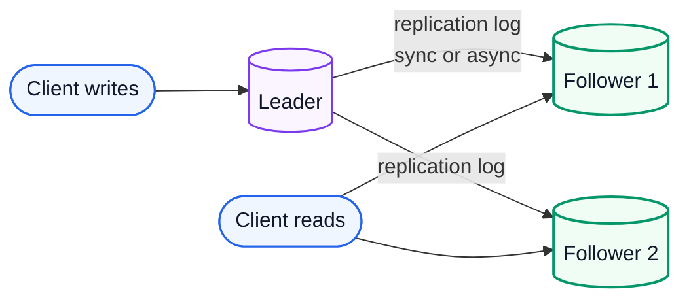
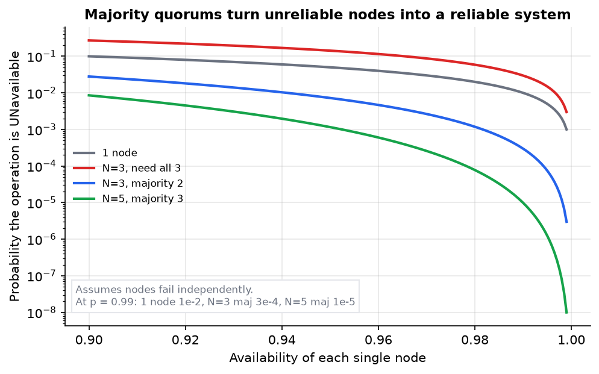
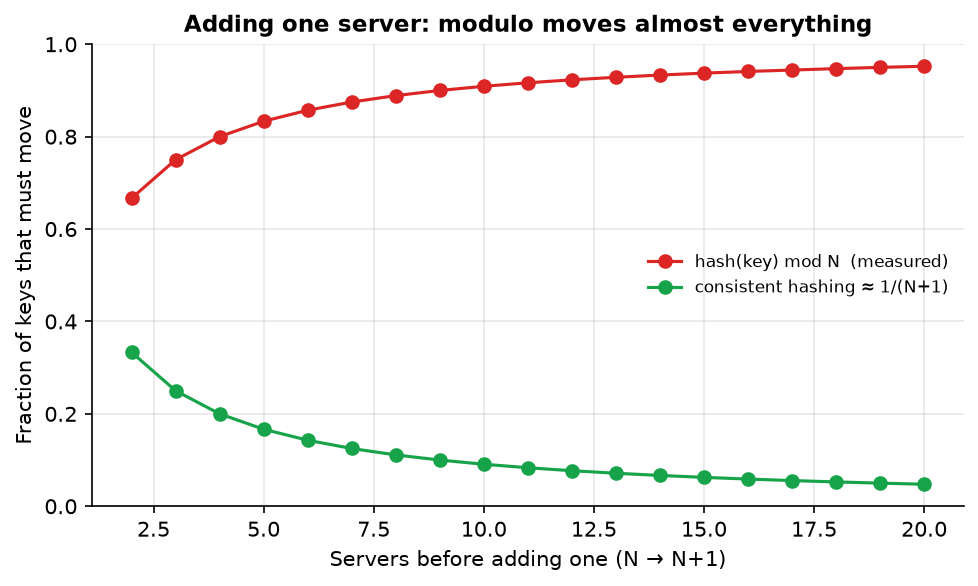
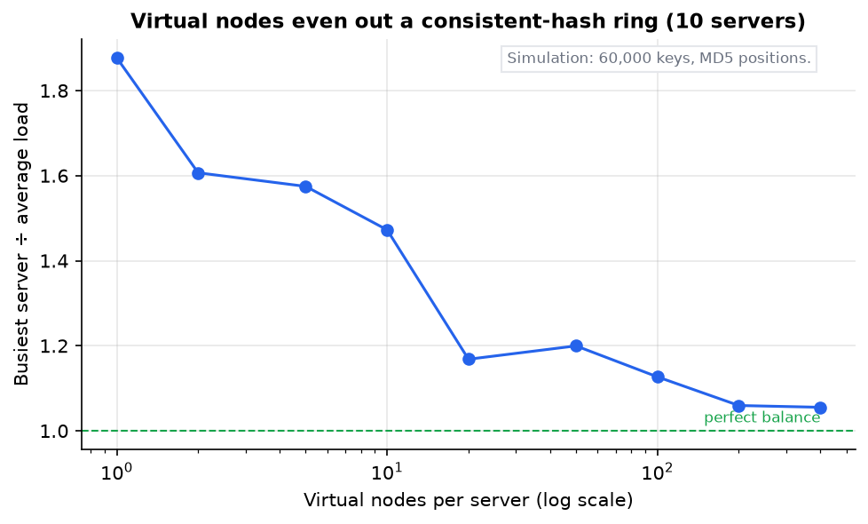
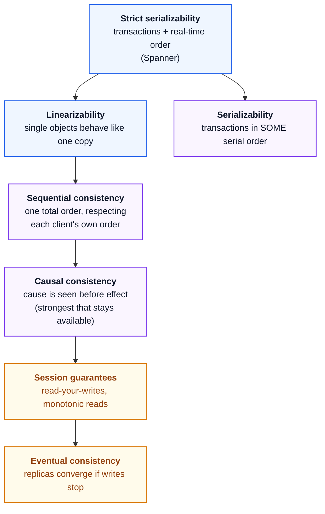
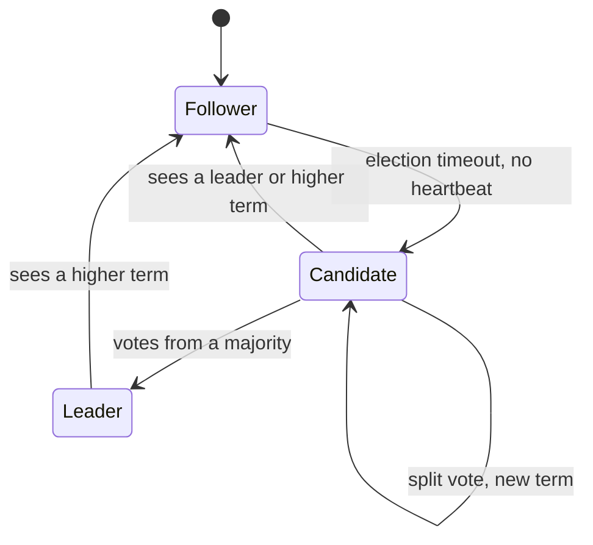
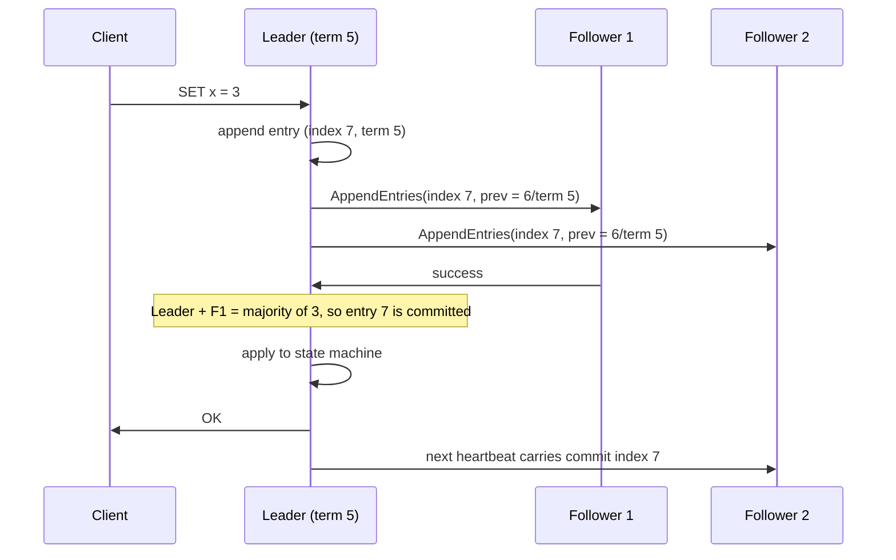
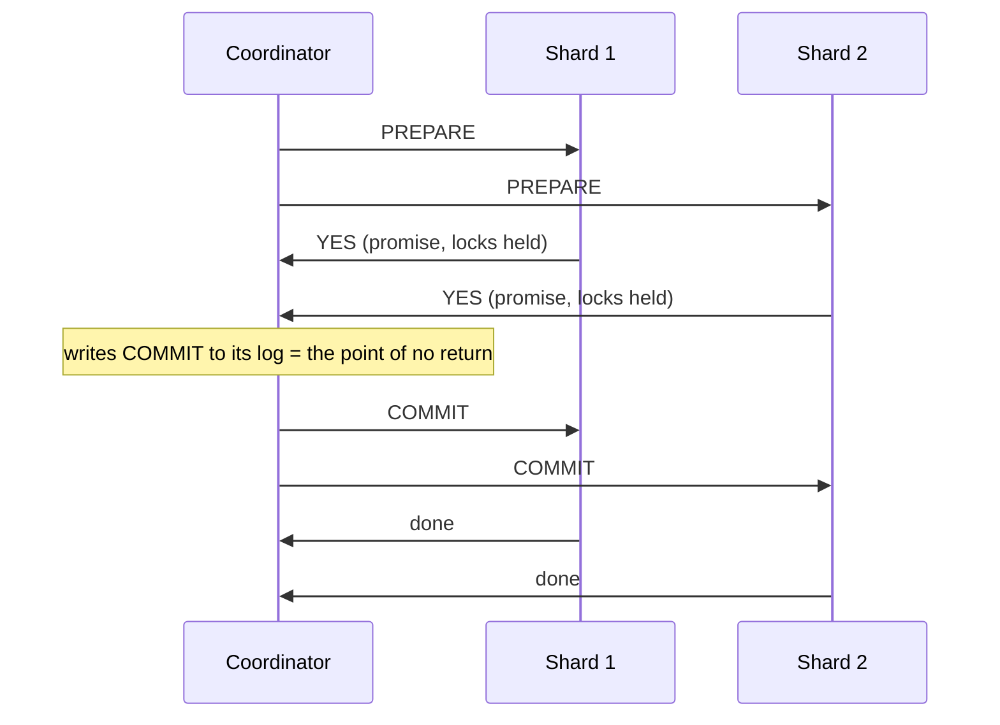
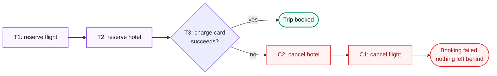
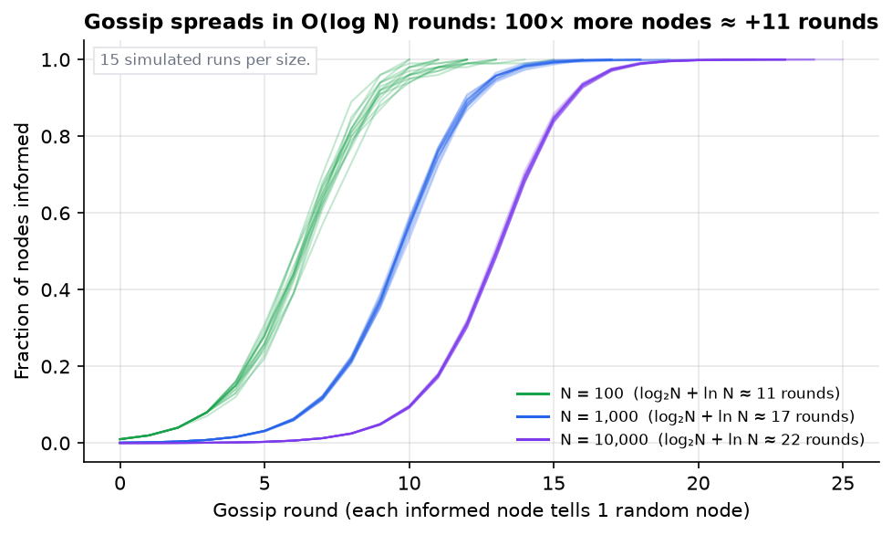

# System Design 2: Distributed Systems Theory

> **Series:** [Part 1: Foundations, Building Blocks and Storage](System%20Design%201%20-%20Foundations%20Building%20Blocks%20and%20Storage.md) · **Part 2 (this file)** · [Part 3: Building Real Systems in 2026](System%20Design%203%20-%20Building%20Real%20Systems%20in%202026.md)
> **Source:** built from research: the classic papers (Lamport, FLP, Dynamo, Raft, Spanner, SWIM, CRDTs), Kleppmann and Riccomini's *DDIA* 2nd edition, and the MIT 6.5840 course. Full list in [References](#14-references). Every number recomputed with Python; figures from [make_figs.py](../figures/system_design_theory/make_figs.py); code from [system_design_theory.py](../code/system_design_theory.py).
> **Facts re-checked:** 21 October 2026.

**The big picture:** once data lives on more than one machine, machines can crash, messages can be lost or delayed, and clocks disagree. This part teaches how systems still keep copies in sync (replication), split data up (partitioning), define what "correct" means (consistency models), order events without a shared clock, agree on decisions (consensus), and stay correct across failures (transactions, idempotency, CRDTs, gossip).

Diagram colours: 🔵 input / primary · 🟣 processing · 🟢 result · 🟠 trade-off · 🔴 failure

---

## Contents

0. [How to use this guide](#0-how-to-use-this-guide)
1. [TL;DR](#1-tldr)
2. [Why distributed systems are hard](#2-why-distributed-systems-are-hard)
3. [Replication](#3-replication)
4. [Partitioning (sharding)](#4-partitioning-sharding)
5. [Consistency models, CAP and PACELC](#5-consistency-models-cap-and-pacelc)
6. [Time and ordering](#6-time-and-ordering)
7. [Consensus](#7-consensus)
8. [Distributed transactions and exactly-once](#8-distributed-transactions-and-exactly-once)
9. [CRDTs: convergence without coordination](#9-crdts-convergence-without-coordination)
10. [Failure detection, gossip and anti-entropy](#10-failure-detection-gossip-and-anti-entropy)
11. [Putting it together: how real systems choose](#11-putting-it-together-how-real-systems-choose)
12. [Self-check](#12-self-check)
13. [Glossary](#13-glossary)
14. [References](#14-references)

---

## 0. How to use this guide

| If you have… | Read |
|---|---|
| 10 minutes | §0.1, §1, then the table in §11 |
| 1 hour | §2, §3, §5: failure, replication and consistency, the core vocabulary |
| A weekend | Everything in order. §6 → §7 → §8 build on each other. |

This is the most theory-heavy part, and the one that most separates senior engineers from everyone else. Read slowly. Most sections start from a concrete failure story.

### 0.1 First, in completely plain words

Imagine three friends keeping the same shopping list on three separate notepads, talking only by text message. Messages sometimes arrive late or not at all. Phones sometimes die. Nobody's watch shows exactly the same time.

Now try to answer some simple questions:

- If Alice adds "milk" and Bob crosses off "milk" at about the same time, **what's on the list?**
- If Carol's phone is silent, **is it dead, or just slow?** You can't tell from the outside.
- If you want all three lists to always match, **you must wait for replies before every change.** And if a phone is dead, you wait forever, or you give up on "always match".

That's distributed systems. Everything in this file is a precise answer to one of those questions:

1. **Replication**: keeping several notepads in sync.
2. **Partitioning**: when the list is too long, splitting it so each friend keeps part of it.
3. **Consistency models**: what exactly "in sync" promises.
4. **Clocks and ordering**: deciding what happened first without trusting watches.
5. **Consensus**: getting a majority to agree on one answer, even if someone is unreachable.
6. **Transactions, idempotency and CRDTs**: making changes safe when messages repeat, fail halfway, or arrive in any order.

---

## 1. TL;DR

1. **Partial failure is the defining problem.** Some parts work while others don't, and you often cannot tell a slow node from a dead one.
2. **Replication** is single-leader (simple, ordered), multi-leader (writes in many places, conflicts) or leaderless (quorums). Asynchronous replication means followers lag behind, so you need session guarantees such as *read-your-writes*.
3. **Quorums:** with $N$ replicas, writes to $W$ and reads from $R$ overlap when $R + W > N$. With node availability 0.99, a 3-node majority quorum is unavailable only 0.03% of the time. Five nodes: about 0.001%.
4. **Partition with consistent hashing.** Adding one server to `hash mod N` moves $N/(N+1)$ of all keys. Consistent hashing moves about $1/(N+1)$.
5. **Linearizability** = the system behaves like one copy, in real-time order. It costs a round trip to a quorum, so latency grows with distance.
6. **CAP:** *during a network partition* you choose consistency or availability. **PACELC** adds: *else* (no partition) you choose latency or consistency. That second choice is the one you make every day.
7. **Don't order events by wall clocks.** Use Lamport clocks for a total order consistent with causality, and vector clocks to *detect* concurrency. Spanner waits out its clock uncertainty (TrueTime) to get global order.
8. **Consensus** (Raft, Paxos) lets $2f + 1$ nodes survive $f$ crashes. It's what elections, locks, configuration and ordered logs are built on. FLP says it can't be guaranteed to finish in a fully asynchronous network. Real systems use timeouts and accept that.
9. **2PC** is atomic but blocks if the coordinator dies. **Sagas** trade isolation for availability using compensating actions. "**Exactly-once**" really means at-least-once delivery + idempotent processing.
10. **CRDTs** are data types whose merges always converge, so replicas can accept writes without coordinating.

---

## 2. Why distributed systems are hard

### 2.1 Partial failure

**The problem.** On one computer, things mostly work or crash entirely. Across a network, *some* things fail while others keep going. Your request was sent, and no reply came. Possibilities:

1. The request was lost before arriving.
2. The remote node is down.
3. The remote node is overloaded or paused (garbage collection, a VM migration) and will answer later.
4. It processed the request, but the **reply** was lost.
5. The reply is just delayed.

**From the sender's side, all five look identical.** The only tool you have is a **timeout**, and a timeout cannot tell "dead" from "slow". Case 4 is especially dangerous: if you retry, the action may happen **twice**. That's why idempotency (§8.5) runs through everything.

### 2.2 The eight fallacies of distributed computing

These are assumptions newcomers make that are all false (L. Peter Deutsch and others at Sun, 1990s):

1. The network is reliable.
2. Latency is zero.
3. Bandwidth is infinite.
4. The network is secure.
5. Topology doesn't change.
6. There is one administrator.
7. Transport cost is zero.
8. The network is homogeneous.

Every pattern in this file exists because one of them is false.

### 2.3 System models: what we assume can go wrong

To reason precisely, algorithms state a **system model**: what kinds of failure and timing they tolerate.

**Node failure models:**

| Model | Meaning | Who uses it |
|---|---|---|
| **Crash-stop** | A node works correctly, then stops forever | Simplest proofs |
| **Crash-recovery** | A node may crash and later restart, keeping what it saved to disk | Raft, Paxos, most databases |
| **Omission** | A node may drop messages it should have sent or received | Network-fault reasoning |
| **Byzantine** | A node may do *anything*: lie, send contradictory messages, be malicious | Blockchains, aerospace, untrusted parties |

**Timing models:**

| Model | Meaning |
|---|---|
| **Synchronous** | Message delay and processing speed have known upper bounds. Unrealistic for the internet. |
| **Asynchronous** | No bounds at all. A message can take any finite time. Very pessimistic. |
| **Partially synchronous** | The system behaves synchronously *most* of the time, but sometimes exceeds the bounds for a while. **The realistic model.** Raft and Paxos stay *safe* (never return wrong answers) in all cases, and stay *live* (make progress) when timing is good. |

> **Safety vs liveness.** A *safety* property says "nothing bad ever happens" (two leaders never both commit). A *liveness* property says "something good eventually happens" (a leader is eventually elected). Good distributed algorithms never give up safety. They give up liveness temporarily when the network misbehaves.

### 2.4 Network partitions and gray failures

- A **network partition** splits nodes into groups that can't reach each other, while each group still works. Studies of production networks found partitions are routine, not exotic: misconfigured switches, failed links, firewall changes.
- A **gray failure** is a component that is *partly* broken: a disk that is slow but not dead, a NIC dropping 2% of packets, a node passing health checks while failing real requests. These are often worse than crashes, because the system doesn't route around them. Defences: health checks that test real work, outlier detection ("this host's p99 is 10× its peers"), and having callers report what they see.

### 2.5 Process pauses: the node that doesn't know it was gone

A thread can freeze for seconds: a stop-the-world garbage collection, a VM being live-migrated, a laptop lid closing, heavy swapping. The paused node then wakes up **believing no time passed**. If it thought it held a lock or was the leader, it may now act on stale authority. This is why distributed locks need **fencing tokens** (§7.6), not just timeouts.

---

## 3. Replication

**The problem.** One copy of data means one failure loses it, all reads compete for one machine, and far-away users are slow. **Replication** keeps copies (replicas) on several machines for **durability**, **availability**, **read scaling** and **lower latency**.

The hard part isn't copying. It's **handling changes** to data that exists in several places.

### 3.1 Single-leader replication

**How it works.** One replica is the **leader** (primary). All writes go to it. It writes the change to its log and streams the log to **followers** (replicas, secondaries), which apply changes in the same order. Reads can go to the leader or to followers.



**Synchronous vs asynchronous:**

| Mode | The leader confirms a write after… | Gain | Cost |
|---|---|---|---|
| **Synchronous** | every follower has it | No data loss on leader failure | One slow or dead follower blocks all writes |
| **Asynchronous** | writing it locally | Fast; followers can't block writes | A leader crash loses writes that hadn't reached followers yet |
| **Semi-synchronous** | at least one follower has it | Usually a good middle ground | Slightly slower writes |

**Failover is where the danger lives.** When the leader dies, a follower must be promoted. Things that go wrong:

1. **Lost writes**: with async replication, the new leader may be missing the old leader's last writes. If the old leader comes back, its extra writes conflict. (GitHub had an incident in 2012 where a promoted, out-of-date MySQL replica reused auto-increment IDs that Redis already held, and private data was shown to the wrong users.)
2. **Split brain**: the old leader isn't dead, only partitioned. Now *two* nodes accept writes. You need fencing (§7.6), or consensus-based leader election (§7) where a leader needs a majority.
3. **Choosing the timeout**: too short, and you fail over during a brief slowdown (making load worse). Too long, and writes are unavailable for a long time.

### 3.2 Replication lag and the guarantees users notice

With async followers, a read from a follower may return **old data**. The lag is usually milliseconds, but under load it can be seconds or minutes. "**Eventual consistency**" promises only that, if writes stop, replicas *eventually* converge. That's very weak. Three practical guarantees fix the anomalies users actually notice:

| Guarantee | Anomaly it prevents | How to get it |
|---|---|---|
| **Read-your-writes** | "I posted a comment, refreshed, and it's gone." | Read the user's *own* data from the leader for a while after they write; or remember the write's log position and only read from replicas that have caught up to it |
| **Monotonic reads** | "The comment appeared, then disappeared on the next refresh." (Two reads hit replicas with different lag.) | Pin each user to one replica (for example, by hashing the user ID) |
| **Consistent prefix reads** | Seeing an answer before its question, because the two came from different partitions with different lag | Write causally related data to the same partition, or track causality (§6) |

These are called **session guarantees**. They're cheap, and they're usually what product requirements actually mean by "consistent".

### 3.3 Multi-leader replication

**The problem.** Single-leader means every write travels to one location. With users on several continents, or apps that work offline, you want writes to be accepted in several places.

**How it works.** Several leaders (often one per datacenter) each accept writes and replicate to each other asynchronously. An offline mobile app is the extreme case: every device is a leader. So is a collaborative editor.

**The cost: write conflicts.** Two leaders can change the same record concurrently. Ways to resolve them:

| Strategy | How | Danger |
|---|---|---|
| **Last-writer-wins (LWW)** | Keep the write with the highest timestamp | **Silently drops data**, and clock skew (§6.1) can make an *older* write win |
| **Merge values** | Keep both and combine (union of sets, concatenation) | Needs domain logic |
| **Record the conflict and ask** | Store all versions ("siblings") and let the app or user pick | Pushes complexity to the app |
| **CRDTs** (§9) | Data types designed so every merge order gives the same answer | Not every data type has a natural CRDT |

Avoid conflicts where you can: route all writes for a given record to one "home" leader.

### 3.4 Leaderless replication and quorums

**How it works.** No leader. The client (or a coordinator node) sends each write to **all $N$ replicas** and waits for **$W$ acknowledgements**. Each read asks replicas and waits for **$R$ responses**, then takes the newest version. Amazon's Dynamo (2007) made this popular; Cassandra, ScyllaDB and Riak follow it.

**The quorum condition:**

$$
R + W > N
$$

*If the number of replicas you read from plus the number you wrote to is more than the total number of replicas, at least one replica you read from has the latest write.*

Why: the write set and the read set together have $R + W$ members, but only $N$ distinct replicas exist. So they must share at least $R + W - N \geq 1$ replica. That's the pigeonhole principle.

**Worked example.** $N = 3$, $W = 2$, $R = 2$: $2 + 2 = 4 > 3$ ✓, so the sets share at least one replica. The system tolerates **one** unavailable replica for both reads and writes. Common tunings:

| Setting | Effect |
|---|---|
| $N=3, W=2, R=2$ | Balanced; tolerates 1 failure |
| $N=3, W=3, R=1$ | Fast reads; any single failure blocks writes |
| $N=3, W=1, R=1$ | Fastest and most available; no overlap guarantee (eventual consistency only) |

**How reliable is a quorum?** If each node is up independently with probability $p$, the chance that at least $W$ of $N$ are up is:

```math
P(\text{available}) = \sum_{i=W}^{N} \binom{N}{i} p^{i} (1-p)^{N-i}
```

*Add up the probabilities of exactly W, W+1, …, N nodes being up. Each term is "ways to choose which i nodes are up" times "probability those i are up and the rest are down".*

With $p = 0.99$:

| Setup | Availability | Unavailable |
|---|---|---|
| 1 node | 0.99 | 1% |
| $N=3$, need all 3 | 0.9703 | **3% (worse than one node!)** |
| $N=3$, majority 2 | 0.999702 | 0.03% |
| $N=5$, majority 3 | 0.99999015 | 0.001% |



*Fig 4 (fig04_quorum_availability.png). Requiring **all** replicas makes things worse than a single node. Requiring a **majority** makes things far better. This assumes independent failures. Correlated failures (one rack, one region, one bad deploy) are why replicas are spread across failure domains.*

**Mechanisms that keep leaderless replicas converging:**

- **Read repair**: when a read sees a stale replica, the client writes the newest value back to it.
- **Anti-entropy**: a background process compares replicas using Merkle trees (§10.4) and copies missing data.
- **Sloppy quorums and hinted handoff**: if some home replicas are unreachable, accept the write on *other* nodes temporarily with a "hint", and hand it back later. Writes stay available, but $R + W > N$ no longer guarantees overlap with the home replicas.

> **Quorums are not linearizability.** Even with $R + W > N$, concurrent writes, partial write failures (a write that reached only 1 of the required 2) and LWW conflict resolution can produce non-linearizable results. Quorums give "probably fresh", not "behaves like one copy". For that you need consensus (§7).

---

## 4. Partitioning (sharding)

**The problem.** Replication copies *all* the data to each replica. When the data or the write load is bigger than one machine, you must **split** it. Each piece (a **partition** or **shard**) lives on different machines, and each partition is usually *also* replicated.

**The goal:** spread data *and load* evenly, and avoid **hot spots** (one partition taking a disproportionate share).

### 4.1 Range vs hash partitioning

| | **Range partitioning** | **Hash partitioning** |
|---|---|---|
| How | Each partition owns a contiguous key range (A–F, G–M…) | Partition = function of `hash(key)` |
| Range scans | **Efficient**: neighbouring keys sit together | **Lost**: neighbours scatter everywhere |
| Load balance | Risky: sequential keys (timestamps!) all hit the newest partition | Even, if the hash is good |
| Used by | Bigtable, HBase, Spanner, CockroachDB, MongoDB (ranged) | Cassandra, DynamoDB, Redis Cluster, MongoDB (hashed) |

A common hybrid is a **compound key**: hash the first part, sort by the second. Cassandra's `PRIMARY KEY ((user_id), timestamp)` hashes `user_id` to pick the partition, then stores each user's rows sorted by time. You get balanced load *and* efficient range scans within one user.

### 4.2 Why `hash mod N` fails, and consistent hashing

**The naive approach:** `partition = hash(key) mod N`. It's simple and balanced, until $N$ changes. Going from 4 to 5 servers, a key stays put only if $h \bmod 4 = h \bmod 5$. Measured over many keys: **80% of keys move**. In general, $N/(N+1)$ of keys move.

**Consistent hashing** (Karger et al., 1997) places both servers and keys on a ring of hash values ($0$ to $2^{m}-1$). Each key belongs to the first server clockwise from it. When a server joins, it takes keys only from its clockwise neighbour, about $1/(N+1)$ of the total.



*Fig 5 (fig05_rehash_moved.png). At 10 → 11 servers, modulo moves 90.9% of keys. Consistent hashing moves about 9.1%. Moving data is the expensive part of scaling, so this difference is everything.*

**Virtual nodes.** With one point per server, the ring's arcs are random lengths, and one server can easily get nearly twice its fair share. The fix: give each server many points (**virtual nodes**). More points mean arcs average out. It also lets a bigger machine take more points, and spreads a failed server's load across *all* survivors instead of dumping it on one neighbour.



*Fig 6 (fig06_vnode_balance.png). Simulation with 10 servers and 60,000 keys: with 1 point each, the busiest server carries 1.87× the average. At 100 points it carries 1.12×, and at 200 about 1.06×.*

### 4.3 Rebalancing strategies in practice

1. **Fixed number of partitions, many more than nodes** (Riak, Elasticsearch, Couchbase, Redis Cluster's 16,384 slots): create, say, 1,000 partitions up front for 10 nodes. Adding a node *moves whole partitions*, never splitting keys. Simple, but you must choose the count well in advance.
2. **Dynamic splitting** (HBase, MongoDB, CockroachDB, Spanner): a range splits in two when it grows past a size threshold (CockroachDB's default range size is 512 MiB), and small neighbours merge. Adapts to data automatically.
3. **Rebalance deliberately.** Fully automatic rebalancing combined with automatic failure detection can cascade: an overloaded node looks dead, its data moves, which overloads others. Many operators keep a human in the loop for big moves.

### 4.4 Hot spots and hot keys

Hashing balances *keys*, not *traffic*. If one key is very hot (a celebrity's posts, a viral product), its partition melts regardless of the hash.

**Key salting:** append a random suffix 0–9 to the hot key on write (`celebrity_123#7`), spreading its writes across 10 partitions. Reads must then gather all 10 and combine them. Only do this for keys you *know* are hot, because it multiplies read cost.

### 4.5 Secondary indexes on partitioned data

**The problem.** Data is partitioned by `user_id`. Now you want "all red cars". Where does the index live?

| | **Local index (document-partitioned)** | **Global index (term-partitioned)** |
|---|---|---|
| Layout | Each partition indexes only its own rows | The index itself is partitioned by the indexed *term* (`color=red` lives on one index partition) |
| Writes | Fast: one partition | Slower: a write may update index partitions on other nodes (often asynchronously, so the index lags) |
| Reads | **Scatter/gather**: ask *every* partition and merge, so tail latency suffers (Part 3 §3) | Read one index partition |
| Examples | MongoDB, Cassandra, Elasticsearch | DynamoDB global secondary indexes, Riak Search |

### 4.6 Request routing

How does a client know which node owns a key? Three options: (1) ask any node, which forwards the request (Cassandra, Riak use gossip to share the map); (2) a routing tier that knows the map; (3) partition-aware clients. The authoritative map usually lives in a consensus-backed store such as ZooKeeper or etcd (§7.7), which everyone subscribes to.

---

## 5. Consistency models, CAP and PACELC

**The problem.** "Consistent" means many things. Precise models let you say exactly what a system promises, and what it costs.

### 5.1 Linearizability: behaving like a single copy

**Definition in plain words:** the system acts as if there is **one copy** of the data, and every operation takes effect **instantly at some point between its start and its finish**. Once any read has seen a new value, every later read (in real time) sees it or something newer.

**Example of a violation.** Alice and Bob both watch a match score. The final whistle blows. Alice's refresh shows "Final: 2–1". She tells Bob, who refreshes and sees "1–1, 89th minute". Bob read *after* Alice in real time but got an *older* value, so this system isn't linearizable. Each replica will eventually show 2–1, but the *real-time order* was broken.

**Where you need it:**

- **Leader election and locks**: everyone must agree on who holds the lock *right now*.
- **Uniqueness constraints**: two users must not both claim username `alice`.
- **Cross-channel timing**: a user uploads a photo and then sends a message saying "resize it". If the resizer reads a stale store, the photo isn't there yet.

**What it costs:** every linearizable write (and often read) must reach a quorum of replicas *before it returns*. If replicas span regions, that's at least one cross-region round trip, 80–200 ms (Part 1 Fig 1). During a partition, the minority side **cannot serve linearizable operations at all**.

### 5.2 The ladder of consistency models

From strongest to weakest (simplified; the full map has more branches):



Two definitions worth separating, because people mix them up:

- **Serializability** is about *transactions* (groups of operations): the result equals *some* serial order. That order may disagree with real time.
- **Linearizability** is about *single objects*, and requires real-time order.
- **Strict serializability** is both: transactions in an order consistent with real time.

**Causal consistency** deserves special attention. It guarantees that if event A could have influenced B (B's author had seen A), everyone sees A before B. Concurrent events can appear in different orders on different replicas. It is the **strongest model that stays available during network partitions**, which makes it a sweet spot for many apps (comments and replies, chat).

### 5.3 CAP, stated correctly

The CAP theorem (Brewer's conjecture in 2000, proved by Gilbert and Lynch in 2002) is widely misquoted as "pick two of three". The correct statement:

> When a **network partition** happens, a system must choose between **Consistency** (here meaning *linearizability*) and **Availability** (every request to a non-failed node gets a non-error response).

Things to understand:

1. **Partitions aren't optional.** Networks *will* partition, so "CA" isn't a real choice for a distributed system. The choice is only what to do *during* a partition.
2. The **C** in CAP is linearizability, **not** the C in ACID.
3. CAP's **A** is very strict (*every* non-failed node responds). Many "CP" systems are still highly available in practice: the majority side keeps working.
4. CAP says nothing about latency or about life *without* partitions, which is most of the time.

### 5.4 PACELC: the more useful version

Daniel Abadi's **PACELC** (2012) extends CAP:

> If there is a **P**artition, choose **A**vailability or **C**onsistency; **E**lse (normal operation), choose **L**atency or **C**onsistency.

The "else" half is the trade-off you make on *every request*. Even with a perfect network, strong consistency costs a round trip to a quorum.

| System (default settings) | P → | E → | Why |
|---|---|---|---|
| Dynamo-style: Cassandra, Riak, DynamoDB default reads | A | L | Accepts writes on both sides; local reads; eventual convergence |
| Spanner, CockroachDB, etcd, ZooKeeper | C | C | Consensus on every write; the minority side stops |
| MongoDB (majority writes, primary reads) | C | C | Primary election; reads from the primary |
| Systems with *tunable* consistency (Cassandra's `QUORUM` vs `ONE`) | per request | per request | You choose for each operation |

**Worked example: the latency side of PACELC.** You run 3 replicas in Virginia, Oregon and Frankfurt, with the leader in Virginia. RTTs from Virginia: Oregon ≈ 70 ms, Frankfurt ≈ 90 ms. A majority write needs the leader plus **one** follower, so it waits for the *fastest* follower: ≈ 70 ms. With 5 replicas (leader + 4), it needs 2 followers, so it waits for the *second-fastest*. **Where you place replicas sets your write latency.** Many systems therefore keep a majority inside one region and accept losing it if that region fails, or they pick a 3-region layout carefully.

---

## 6. Time and ordering

**The problem.** "Which happened first?" decides conflicts, log order and transaction visibility. But each machine has its own clock, and those clocks disagree.

### 6.1 Physical clocks are unreliable

- Computer clocks use quartz crystals that **drift**, typically tens of parts per million. At 50 ppm: $50 \times 10^{-6} \times 86{,}400 \text{ s} = 4.3$ seconds per day. At 200 ppm, 17 seconds per day.
- **NTP** corrects drift by asking time servers. Over the internet it's typically accurate to milliseconds or tens of milliseconds, worse under network congestion. Clocks can **jump backwards** when corrected. Leap seconds add more trouble.
- A **time-of-day clock** (wall clock) can jump. A **monotonic clock** only moves forward and is right for measuring durations (timeouts), but its value means nothing on another machine.

**Why this bites: LWW with skewed clocks.** Node A's clock is 2 seconds fast. A client writes `x = 1` via A at true time 10.0 s (stamped 12.0). Another client writes `x = 2` via B at true time 11.0 s (stamped 11.0). Last-writer-wins keeps `x = 1`, the *older* write, and silently discards the newer one. **Never use wall-clock timestamps to order events that matter**, unless the clock uncertainty is known and handled (as Spanner does, §6.5).

### 6.2 Happens-before

Lamport's 1978 paper defined the order that actually matters: **causality**. Event $a$ **happens before** $b$ (written $a \rightarrow b$) if:

1. $a$ and $b$ are on the same process and $a$ came first, or
2. $a$ is sending a message and $b$ is receiving that message, or
3. there's a chain: $a \rightarrow c$ and $c \rightarrow b$.

If neither $a \rightarrow b$ nor $b \rightarrow a$, the events are **concurrent**: neither could have known about the other. Concurrency here means *not knowing*, not "at the same instant".

### 6.3 Lamport clocks

**How it works.** Each node keeps a counter $C$.

1. Before each local event or send: $C \leftarrow C + 1$. Attach $C$ to the message.
2. On receiving a message with timestamp $t$: $C \leftarrow \max(C, t) + 1$.

**The guarantee:**

$$
a \rightarrow b \implies L(a) < L(b)
$$

*If a happened before b, then a's Lamport timestamp is smaller than b's.* Break ties by node ID, and you get a **total order** consistent with causality. Every node can sort events the same way without asking anyone.

**The limitation:** the converse is false. $L(a) < L(b)$ does **not** mean $a$ happened before $b$; they might be concurrent. Lamport clocks can't *detect* concurrency, which you need to spot conflicts.

### 6.4 Vector clocks

**How it works.** Each node keeps a vector with one counter per node.

1. On a local event, node $i$ increments its own entry: $V[i] \leftarrow V[i] + 1$.
2. Send the whole vector with each message.
3. On receive, take the element-wise maximum, then increment your own entry.

**Comparing:** $V_a \leq V_b$ if every entry of $V_a$ is $\leq$ the matching entry of $V_b$.

- If $V_a \leq V_b$ (and they differ), then $a \rightarrow b$: $b$ has seen everything $a$ had.
- If neither $V_a \leq V_b$ nor $V_b \leq V_a$: **concurrent**, a real conflict.

$$
a \rightarrow b \iff V_a < V_b
$$

*a happened before b exactly when a's vector is less than or equal to b's in every entry and different in at least one.* Unlike Lamport clocks, this works in both directions.

This is short enough that code makes it concrete (from [system_design_theory.py](../code/system_design_theory.py)):

```python
def vc_merge(a, b):
    return {n: max(a.get(n, 0), b.get(n, 0)) for n in a.keys() | b.keys()}

def vc_compare(a, b):
    nodes = a.keys() | b.keys()
    le = all(a.get(n, 0) <= b.get(n, 0) for n in nodes)
    ge = all(a.get(n, 0) >= b.get(n, 0) for n in nodes)
    if le and ge: return "equal"
    if le: return "a happened before b"
    if ge: return "b happened before a"
    return "CONCURRENT (conflict)"

base = {"A": 1}                       # A writes v1
b_write = vc_merge(base, {"B": 1})    # B read v1, then wrote v2
c_write = vc_merge(base, {"C": 1})    # C read v1, then wrote v3 (never saw v2)
```

Actual output:

```text
v1 vs v2: a happened before b
v2 vs v3: CONCURRENT (conflict)
resolved clock: {'A': 1, 'B': 2, 'C': 1} | v3 vs resolved: a happened before b
```

B and C both built on v1 without seeing each other's write, so the vectors `{A:1, B:1}` and `{A:1, C:1}` are incomparable: a conflict the database must keep or merge, never silently drop. Once B merges both and writes again, the new clock `{A:1, B:2, C:1}` dominates both.

**The cost:** one entry per node (or per client), so vectors grow. Dynamo-style systems use *version vectors* per replica, and prune old entries.

### 6.5 Hybrid logical clocks and TrueTime

- **Hybrid logical clocks (HLC)** (Kulkarni et al., 2014) combine a physical timestamp with a logical counter. They stay close to wall-clock time (useful for humans and for "read as of 5 s ago"), while still respecting causality like a Lamport clock. CockroachDB and YugabyteDB use them.
- **Google Spanner's TrueTime** (2012) takes another path: GPS receivers and atomic clocks in every datacenter, and an API that returns an **interval** `[earliest, latest]` guaranteed to contain the true time. The uncertainty ε is typically a few milliseconds. On commit, Spanner picks timestamp $s$, then **waits until `TT.now().earliest > s`** ("commit wait") before making the write visible. After that wait, every later transaction anywhere will get a larger timestamp. That gives **external consistency** (strict serializability) globally, paid for with a few milliseconds of waiting per write. Precise clocks turn ordering into a hardware problem.

---

## 7. Consensus

**The problem.** Many tasks need a group of nodes to **agree on one thing**, even when some nodes crash and messages are delayed:

- Which node is the leader? (exactly one)
- Who holds this lock?
- Did this transaction commit or abort?
- What is the next entry in the replicated log? (agreeing on a sequence of values)

The last one is the general form. A **replicated state machine** is a deterministic program on every node that applies the same commands in the same order, so every node ends up in the same state. Agreeing on that order *is* consensus. It's equivalent to **total order broadcast**.

**What consensus must guarantee:**

1. **Agreement**: no two nodes decide differently.
2. **Validity**: the decided value was actually proposed.
3. **Integrity**: each node decides at most once.
4. **Termination**: every non-crashed node eventually decides.

### 7.1 FLP impossibility

Fischer, Lynch and Paterson proved in 1985 that in a **fully asynchronous** system where even **one** node may crash, no deterministic algorithm can guarantee all four properties. Intuitively: you can never distinguish a crashed node from a very slow one, so there's always some schedule of delays that keeps the algorithm undecided forever.

**What real systems do:** keep *safety* always, and get *liveness* using timeouts (partial synchrony) and randomness. Raft can, in theory, keep failing to elect a leader. In practice, randomised timeouts make that vanishingly unlikely.

### 7.2 Majorities: why $2f + 1$

Consensus algorithms use **majority quorums**: any two majorities of the same group share at least one node, so two conflicting decisions can't both gather a majority. To survive $f$ crashed nodes, you need $N = 2f + 1$:

| Nodes $N$ | Majority | Failures tolerated $f = \lfloor (N-1)/2 \rfloor$ |
|---|---|---|
| 3 | 2 | 1 |
| 4 | 3 | 1 (the 4th node adds cost, not tolerance) |
| 5 | 3 | 2 |
| 7 | 4 | 3 |

So consensus clusters almost always have an **odd** size: 3 or 5, sometimes 7. Bigger clusters mean slower writes (waiting for more acknowledgements) for little gain.

### 7.3 Paxos in one page

Lamport's **Paxos** (published 1998, "Paxos Made Simple" 2001) is the original practical consensus algorithm. Single-decree Paxos, for agreeing on *one* value:

1. **Prepare (phase 1).** A proposer picks a unique, increasing proposal number $n$ and asks a majority of acceptors: "Promise to ignore proposals numbered below $n$, and tell me any value you've already accepted."
2. **Promise.** Each acceptor that hasn't promised a higher number agrees, and reports its highest-numbered accepted value, if any.
3. **Accept (phase 2).** If a majority promised, the proposer sends `accept(n, v)`. Here $v$ **must be** the value of the highest-numbered proposal reported in phase 1, if any was reported; otherwise the proposer may pick its own value.
4. **Accepted.** Acceptors accept unless they've since promised a higher number. Once a majority accepts, $v$ is **chosen**.

The key trick is step 3: a new proposer is forced to adopt any value that *might* already be chosen, so a decision, once made, can never change. **Multi-Paxos** runs this for each log slot, with a stable leader that skips phase 1. Paxos is famously hard to understand and to implement fully, which is why Raft was created.

### 7.4 Raft, step by step

**Raft** (Ongaro and Ousterhout, 2014) was designed to be *understandable*. It splits consensus into **leader election**, **log replication** and **safety**. It powers etcd (and therefore Kubernetes), Consul, CockroachDB, TiKV, Kafka's KRaft controller and many more.

**Roles and terms.** Each node is a **follower**, **candidate** or **leader**. Time is divided into numbered **terms**, and each term has at most one leader. Terms act as a logical clock: any node that sees a higher term immediately steps down to follower.



**Leader election.**

1. Followers expect regular **heartbeats** from the leader. If none arrives within an **election timeout**, randomised per node (the paper uses 150–300 ms), the follower becomes a candidate.
2. The candidate increments the term, votes for itself and requests votes from all other nodes.
3. Each node grants **at most one vote per term**, and only to a candidate whose log is **at least as up to date** as its own (the *election restriction*; see Safety below).
4. A majority of votes makes it leader. It starts sending heartbeats at once.
5. **Why randomised timeouts?** If all followers timed out together, they'd split the vote forever. Random timeouts mean one node usually times out first and wins before the others even start.

**Log replication.**



1. The client sends a command to the leader, which appends it to its log.
2. The leader sends `AppendEntries` to followers, including the index and term of the *previous* entry. A follower rejects the request if its log doesn't match there (the **log matching** check), and the leader backs up and resends earlier entries until the logs agree. This repairs divergent followers automatically.
3. Once the entry is stored on a **majority**, it is **committed**. The leader applies it and replies to the client.

**Safety: why a committed entry is never lost.** A committed entry lives on a majority. Any future leader needs votes from a majority. Those two majorities overlap in at least one node, and the election restriction means that node only votes for a candidate whose log is at least as up to date, so it already contains the entry. **Every future leader has every committed entry.** (One subtle extra rule: a leader only counts replicas toward commit for entries from its *own* current term. Older entries become committed indirectly. This closes a corner case described in the Raft paper's Figure 8.)

**Also part of Raft:** membership changes (joint consensus, or single-server changes) and log compaction via snapshots.

**The cost.** Each write costs one round trip from the leader to a majority, plus disk fsyncs. All writes funnel through one leader. Systems scale this by running **many independent Raft groups**, one per data range: CockroachDB, TiKV and YugabyteDB run thousands of them ("multi-Raft").

### 7.5 What consensus is used for

You almost never write consensus code yourself. You use a system built on it:

- **Coordination services**: **etcd** (Raft) and **ZooKeeper** (Zab, a Paxos-like protocol) offer small, linearizable key-value stores with watches, leases and ephemeral nodes. They are used for leader election, service discovery, configuration, distributed locks and shard maps. Kubernetes stores its entire cluster state in etcd.
- **Replicated databases**: Spanner (Paxos per split), CockroachDB/TiDB/YugabyteDB (Raft per range).
- **Logs**: Kafka's KRaft controllers (Raft for metadata; ZooKeeper support was removed in Kafka 4.0).

### 7.6 Leases, locks and fencing tokens

**The problem.** A **lease** is a lock with an expiry: "you hold the lock for 10 seconds; renew it or lose it." It makes sure a crashed holder doesn't block everyone forever. But remember process pauses (§2.5):

1. Client 1 gets the lease, then freezes in a 15-second GC pause.
2. The lease expires. Client 2 gets it and writes to storage.
3. Client 1 wakes up, *believes it still holds the lease*, and writes too. Data is corrupted.

**The fix: fencing tokens.** Each time the lock service grants the lease, it returns a **monotonically increasing token** (33, then 34…). Every write to storage carries the token, and **storage rejects any token lower than the highest it has seen**. Client 1's late write with token 33 is refused, because 34 was already seen. The protection lives in the *resource*, not in the client's belief. etcd's revision numbers and ZooKeeper's `zxid` work well as fencing tokens.

> Redis-based "Redlock" was criticised by Kleppmann (2016) exactly because it relies on timing assumptions and provides no fencing token. Use a lock for **efficiency** (avoiding duplicate work) if occasional double-holding is harmless. Use consensus plus fencing for **correctness**.

### 7.7 Byzantine fault tolerance

If nodes may *lie* (be malicious or arbitrarily buggy), crash-tolerant algorithms break. Byzantine fault-tolerant (BFT) protocols such as PBFT (1999) and its descendants (Tendermint, HotStuff) need

$$
N \geq 3f + 1
$$

*To tolerate f lying nodes you need at least three times f plus one nodes in total.* For example, 4 nodes for 1 traitor, 7 for 2. They also need more message rounds. BFT matters for blockchains and systems spanning mutually distrustful organisations. Inside one company's datacenter, crash tolerance plus authentication and checksums is the norm.

---

## 8. Distributed transactions and exactly-once

### 8.1 The atomic commit problem

**The problem.** A transaction writes to two different databases (or two partitions): debit account A on shard 1, credit account B on shard 2. Either both happen or neither does, even if a machine crashes in the middle.

### 8.2 Two-phase commit (2PC)

**How it works.** A **coordinator** drives the participants:

1. **Phase 1, prepare:** the coordinator asks every participant, "Can you commit?" Each participant writes everything needed to commit to durable storage, takes the necessary locks, and votes *yes* (a **promise**: "I will commit if told to, even after a crash") or *no*.
2. **Phase 2, commit/abort:** if *all* vote yes, the coordinator durably logs "commit" and tells everyone to commit. If any says no (or times out), it tells everyone to abort.



**The fatal weakness: blocking.** Once a participant has voted yes, it **cannot decide alone**. It promised to commit if told to, and it doesn't know whether others voted no. If the coordinator crashes now, participants are stuck **in doubt**, holding locks, until the coordinator recovers. Everything else touching those rows waits.

**Availability cost:** a 2PC commit needs *every* participant up. With a coordinator plus 3 participants each available 99.9% of the time: $0.999^4 = 0.996$. That's 0.4% unavailability, worse than any single node.

**Modern fixes:** make the coordinator itself fault tolerant by replicating its decision log with consensus. Spanner and CockroachDB run 2PC *across Paxos/Raft groups*, so no single crash blocks the protocol. (Three-phase commit tries to avoid blocking without consensus, but it assumes bounded delays, so it isn't safe under network partitions and is rarely used.)

### 8.3 Sagas: long transactions without locks

**The problem.** Booking a trip touches a flight service, a hotel service and a payment service, owned by different teams and maybe different companies. Holding locks across all of them for seconds (2PC) is unacceptable, and often impossible.

**How it works.** A **saga** is a sequence of *local* transactions $T_1, T_2, \dots, T_n$. Each one has a **compensating transaction** $C_i$ that semantically undoes it ("cancel the booking", "refund the payment"). If step $k$ fails, run $C_{k-1}, \dots, C_1$ in reverse.



Two styles:

- **Orchestration**: a central orchestrator (often a durable workflow engine such as Temporal; Part 3 §2) calls each step and decides what's next. It's easy to see and change the flow.
- **Choreography**: each service reacts to events from the previous one. Services are loosely coupled, but the flow is hard to see as a whole.

**The trade-off you accept:** sagas give up **isolation**. Other transactions can see intermediate states (the hotel is reserved but not paid). You handle that with semantic locks (a "PENDING" status), by ordering steps so the riskiest comes last, and by making compensations and retries idempotent.

### 8.4 The outbox pattern: dual writes done right

**The problem.** A service must update its database *and* publish an event ("OrderCreated") to Kafka. Doing two separate writes is a classic bug. If the process crashes between them, you get a database change with no event, or an event for a change that was rolled back.

**How it works.** In the *same local transaction* as the business change, insert the event into an `outbox` table. A separate relay (a poller, or change data capture reading the database log, such as Debezium) publishes outbox rows to the message broker and marks them sent. Since both writes share one ACID transaction, they succeed or fail together. The relay may publish an event **more than once** (it crashes after publishing, before marking), so consumers must be idempotent. That's the next topic.

### 8.5 Delivery semantics and idempotency

| Semantics | Meaning | How |
|---|---|---|
| **At-most-once** | Never duplicated; may be lost | Send once, don't retry |
| **At-least-once** | Never lost; may be duplicated | Retry until acknowledged |
| **Exactly-once** | Effect happens exactly once | At-least-once **+** idempotent processing or deduplication |

Over an unreliable network, exactly-once *delivery* is impossible: the sender can't know whether a lost acknowledgement means the message was processed (§2.1). What you **can** build is exactly-once **effect**:

- **Idempotent operations**: doing it twice equals doing it once. "Set status = PAID" is idempotent. "Add $30" is not.
- **Idempotency keys**: the client generates a unique key per logical operation and sends it on every retry. The server stores the key with the result, **in the same transaction as the effect**, and returns the stored result for repeats. Stripe's API popularised this.

```python
class PaymentService:
    def __init__(self):
        self.results = {}    # idempotency_key -> stored response (in real life: a DB table, same transaction)
        self.balance = 100

    def charge(self, idem_key, amount):
        if idem_key in self.results:          # retry of a request we already did
            return self.results[idem_key]
        self.balance -= amount
        resp = {"status": "charged", "amount": amount, "balance": self.balance}
        self.results[idem_key] = resp
        return resp
```

Three retries of the same request (actual output):

```text
attempt 1 {'status': 'charged', 'amount': 30, 'balance': 70}
attempt 2 {'status': 'charged', 'amount': 30, 'balance': 70}
attempt 3 {'status': 'charged', 'amount': 30, 'balance': 70}
```

The client was charged once. In a real service, the "check key, then act" must be **atomic**: a unique constraint on the key column, inserted in the same database transaction as the charge. Otherwise two concurrent retries can both pass the check.

- **Deduplication by sequence number**: a consumer remembers the last offset or message ID processed per producer or partition, and skips anything older. Kafka's idempotent producer and transactions use this to give exactly-once semantics *inside* Kafka's read-process-write pipelines.

---

## 9. CRDTs: convergence without coordination

**The problem.** Multi-leader and offline-first systems accept writes everywhere, and they conflict (§3.3). Last-writer-wins loses data. Asking the user is annoying. Can we design data so that conflicts **merge automatically and correctly**?

**The idea.** A **Conflict-free Replicated Data Type** (Shapiro et al., 2011) is a data type whose **merge** function is:

- **commutative**: merge(a, b) = merge(b, a), so order doesn't matter;
- **associative**: merge(merge(a, b), c) = merge(a, merge(b, c)), so grouping doesn't matter;
- **idempotent**: merge(a, a) = a, so duplicates don't matter.

Then any replicas that have received the same set of updates, **in any order, any number of times**, end up in the same state. This guarantee is called **strong eventual consistency**. No coordination is needed, and it pairs perfectly with gossip and at-least-once delivery.

**Examples, from simple to clever:**

| CRDT | State | Merge | Use |
|---|---|---|---|
| **G-Counter** (grow-only) | One count per replica: `{A: 5, B: 3}` | Element-wise max; value = sum | Likes, views |
| **PN-Counter** | Two G-Counters: increments P and decrements N | Merge each; value = P − N | Counters that can go down |
| **LWW-Register** | Value + timestamp | Keep the higher timestamp | Simple fields where losing one concurrent write is acceptable |
| **OR-Set** (observed-remove) | Each add gets a unique tag; remove deletes only the tags it has *seen* | Union of adds, minus seen removes | Shopping carts: "add wins" over a concurrent remove |
| **Sequence CRDTs** (RGA, Yjs, Automerge, Fugue) | Each character has a unique, ordered ID | Interleave by ID | Collaborative text editing |

**Worked example: G-Counter.** Replica A counts 5 likes and B counts 3; they sync: `{A:5, B:3}`, total 8. Then A gets 2 more (`{A:7, B:3}`) while B gets 1 more (`{A:5, B:4}`). Merging with element-wise max gives `{A:7, B:4}`, total **11** = 8 + 2 + 1 ✓. Merge B into A or A into B, once or ten times: always 11. A single shared integer couldn't do this. Two replicas each writing "9" and "11" would conflict.

**CRDTs vs operational transformation (OT).** Google Docs historically used **OT**: a central server transforms concurrent edits against each other. CRDTs need no central server, which enables **local-first software**: apps that work fully offline, sync peer-to-peer or via any relay, and still converge (Figma's multiplayer, Linear's sync engine and many newer apps use CRDT-inspired designs). The costs are metadata overhead (IDs per character, tombstones) and semantics that are sometimes surprising (deleted items can "resurrect" under concurrent edits, depending on the type).

---

## 10. Failure detection, gossip and anti-entropy

### 10.1 Heartbeats and the timeout dilemma

Nodes send periodic **heartbeats**. Miss enough of them and the node is declared dead. The timeout is a direct trade-off:

- **Short timeout**: fast detection, but false alarms during GC pauses or network blips. Each false alarm triggers failover and data movement, which can overload the cluster and cause *more* false alarms (a cascade).
- **Long timeout**: few false alarms, but slow recovery from real failures.

### 10.2 The phi-accrual failure detector

Instead of a yes/no timeout, the **φ (phi) accrual detector** (Hayashibara et al., 2004; used by Cassandra and Akka) outputs a **suspicion level** that rises the longer a heartbeat is overdue, based on the *observed* distribution of past heartbeat intervals:

$$
\varphi(t) = -\log_{10} P(\text{a heartbeat arrives later than } t)
$$

*Phi is minus the base-10 logarithm of the probability that a heartbeat would be this late if the node were alive.* So φ = 1 means a 10% chance the node is merely late; φ = 3 means 0.1%; φ = 8 means one in a hundred million. Each application picks its own threshold (Cassandra's default is 8). And because the distribution is learned, the detector adapts to a naturally jittery network.

### 10.3 Gossip and SWIM

**The problem.** In a 10,000-node cluster, every node heartbeating every other node costs $N^2 = 10^8$ messages per round. That doesn't scale.

**Gossip (epidemic) protocols.** Every round, each node picks a few random peers and exchanges what it knows (membership, who's suspected, metadata versions). Information spreads like a rumour. With push gossip to 1 random peer per round, everyone learns of an update in about

$$
\text{rounds} \approx \log_{2} N + \ln N
$$

*The number of rounds grows with the logarithm of the cluster size: about log base 2 of N, plus the natural log of N.*

**Worked example.** N = 1,000: $\log_2 1000 + \ln 1000 = 9.97 + 6.91 \approx 17$ rounds. Simulated: 18.0 rounds on average. N = 100,000: theory ≈ 28, simulated 29.6. **100× more nodes costs only ~12 more rounds**, and each node sends a constant number of messages per round.



*Fig 7 (fig07_gossip_spread.png). The S-shaped curves: slow start, explosive middle, slow tail (finding the last few uninformed nodes takes several rounds). Each 10× more nodes shifts the curve right by only a few rounds.*

**SWIM** (Das, Gupta and Motivala, 2002), used by HashiCorp's Serf/Consul memberlist, refines failure detection: a node pings one random peer each period. If there's no ack, it asks *k other nodes* to ping that peer indirectly. This avoids false alarms caused by a single bad link. Suspicion is then spread by gossip, piggybacked on the pings themselves. The load per node stays constant whatever the cluster size.

### 10.4 Anti-entropy with Merkle trees

**The problem.** Two replicas each hold 1 million keys. Find which keys differ without sending all of them.

**How it works.** Build a **Merkle tree**: hash each key range into a leaf, then hash pairs of hashes up to a single root. Two replicas compare roots: equal means identical, and you're done in one message. If they differ, compare the children and descend only into subtrees whose hashes differ. With about a million leaves, the tree is $\log_2 10^6 \approx 20$ levels deep. A handful of differing keys are found by exchanging a few hashes per level, instead of a million records. Dynamo, Cassandra (repair) and Riak use this for background anti-entropy. The same structure secures Git commits, blockchains and certificate transparency logs.

---

## 11. Putting it together: how real systems choose

| System | Replication | Partitioning | Consistency | Conflict / ordering tool |
|---|---|---|---|---|
| **Amazon Dynamo** (2007 paper) | Leaderless, sloppy quorums, hinted handoff | Consistent hashing + virtual nodes | Eventual; tunable N/R/W | Vector clocks; app merges siblings; Merkle anti-entropy; gossip membership |
| **Cassandra / ScyllaDB** | Leaderless, tunable per query | Consistent hashing (token ring) | Tunable: `ONE` … `QUORUM` … `ALL` | LWW timestamps; Lightweight Transactions use Paxos; phi-accrual + gossip |
| **DynamoDB** | Leader per partition (Multi-Paxos inside) | Hash partitions, auto-split | Eventual reads by default; strongly consistent reads optional; transactions | Optional global tables with LWW across regions |
| **Google Spanner** | Paxos group per split | Range (splits) | **Strict serializability** (external consistency) | TrueTime + commit wait; 2PC across Paxos groups |
| **CockroachDB / YugabyteDB / TiDB** | Raft per range | Range, auto-split | Serializable (Cockroach default) / snapshot or serializable | HLC timestamps; 2PC across Raft groups |
| **MongoDB** | Single-leader replica sets (Raft-like election) | Range or hashed | Tunable read/write concerns; causal sessions | Election terms; oplog |
| **Kafka** | Leader per partition with in-sync replicas | Topic partitions | Ordered per partition; `acks=all` for durability | KRaft (Raft) for metadata; idempotent producers |
| **etcd / ZooKeeper** | Raft / Zab | None (small data) | Linearizable writes | Revisions / zxid usable as fencing tokens |

**How to read this table in a design review:** for each piece of data, ask (1) what happens to writes during a partition, (2) what a read can return during replication lag, (3) how concurrent writes are resolved, and (4) what a failover can lose. If you can answer those four, you understand the system.

---

## 12. Self-check

<details>
<summary>1. N = 5 replicas. Pick R and W so reads always overlap the latest write and up to 2 nodes can fail for both reads and writes.</summary>

$W = 3$, $R = 3$: $3 + 3 = 6 > 5$, and each operation still works with 2 nodes down.
</details>

<details>
<summary>2. You go from 8 to 9 cache servers with hash mod N. Roughly what fraction of cached keys now map to a different server?</summary>

$N/(N+1) = 8/9 \approx 0.89$, so about 89%. A near-total cache flush and a stampede on the database. With consistent hashing it would be about $1/9 \approx 0.11$, so 11%.
</details>

<details>
<summary>3. Why is "pick 2 of C, A, P" a misleading summary of CAP?</summary>

Partitions are not optional, so you only choose C or A *during* a partition. And C means linearizability, not ACID consistency. PACELC adds the everyday latency-vs-consistency choice.
</details>

<details>
<summary>4. Two writes have Lamport timestamps 7 and 9. Did the first happen before the second?</summary>

Not necessarily. $L(a) < L(b)$ doesn't imply $a \rightarrow b$; they may be concurrent. You need vector clocks to tell.
</details>

<details>
<summary>5. A 4-node Raft cluster: how many failures does it tolerate? Why is that a poor choice?</summary>

Majority = 3, so it tolerates **1**, the same as 3 nodes, while paying for an extra node and a larger quorum.
</details>

<details>
<summary>6. A client with an expired lease writes after a GC pause. What stops the corruption?</summary>

A **fencing token**: storage rejects writes with a token lower than the highest it has seen.
</details>

<details>
<summary>7. Why can 2PC block, and how do Spanner/CockroachDB avoid it?</summary>

Participants that voted yes can't decide alone if the coordinator dies. Making the coordinator's decision replicated by Paxos/Raft removes the single point of failure.
</details>

<details>
<summary>8. Why must a consumer of an outbox relay be idempotent?</summary>

The relay can publish and then crash before marking the row sent, so it publishes again. At-least-once delivery + idempotent processing = exactly-once effect.
</details>

<details>
<summary>9. What three properties must a CRDT's merge have, and why each?</summary>

Commutative (order of arrival doesn't matter), associative (grouping of merges doesn't matter), idempotent (duplicates don't matter). Together they guarantee convergence under any delivery pattern.
</details>

---

## 13. Glossary

| Term | Meaning |
|---|---|
| **Partial failure** | Some components fail while others work, and you can't always tell which |
| **Partially synchronous** | Timing is usually bounded but occasionally not; the realistic model |
| **Safety / liveness** | "Nothing bad happens" / "something good eventually happens" |
| **Gray failure** | Partly broken component that evades simple health checks |
| **Leader / follower** | Replica accepting writes / replica copying the leader's log |
| **Split brain** | Two nodes both believe they're leader |
| **Replication lag** | Delay before a follower reflects the leader's writes |
| **Read-your-writes** | A user always sees their own updates |
| **Quorum** | Minimum replicas that must respond: $R + W > N$ ensures overlap |
| **Hinted handoff** | Temporarily storing writes for an unreachable replica elsewhere |
| **Read repair / anti-entropy** | Fixing stale replicas on read / in the background |
| **Consistent hashing** | Ring placement so adding a node moves ~1/(N+1) of keys |
| **Virtual node** | Many ring positions per server, to balance load |
| **Scatter/gather** | Querying all partitions and merging results |
| **Linearizability** | Behaves like a single copy, respecting real-time order |
| **Serializability** | Transactions equivalent to *some* serial order |
| **Causal consistency** | Effects never seen before their causes |
| **CAP / PACELC** | Partition → C or A; Else → L or C |
| **Happens-before (→)** | Causal order: same process, or message send→receive, or a chain |
| **Lamport clock** | Counter giving a total order consistent with causality |
| **Vector clock** | Per-node counters that detect concurrency |
| **HLC** | Hybrid logical clock: physical time + logical counter |
| **TrueTime / commit wait** | Spanner's bounded-uncertainty clock; waiting out ε for global order |
| **Consensus** | Nodes agreeing on a value (or log order) despite failures |
| **FLP** | No deterministic async consensus can guarantee termination with one crash |
| **Term (Raft)** | Numbered leadership epoch; at most one leader per term |
| **Commit (Raft)** | Entry stored on a majority; never lost after that |
| **Lease** | Time-limited lock |
| **Fencing token** | Increasing number that lets storage reject stale lock holders |
| **BFT** | Byzantine fault tolerance; needs $3f + 1$ nodes |
| **2PC** | Two-phase commit: prepare (vote) then commit/abort |
| **Saga** | Sequence of local transactions with compensations |
| **Outbox** | Writing events to a table in the same transaction, then relaying them |
| **Idempotency key** | Client-chosen ID making retries safe |
| **CRDT** | Data type whose merge is commutative, associative and idempotent |
| **φ-accrual** | Failure detector outputting a suspicion level |
| **Gossip** | Random peer-to-peer exchange spreading info in O(log N) rounds |
| **SWIM** | Gossip-based membership with indirect probes |
| **Merkle tree** | Hash tree for finding differences cheaply |

---

## 14. References

- Leslie Lamport, "Time, Clocks, and the Ordering of Events in a Distributed System", *CACM*, 1978.
- Michael Fischer, Nancy Lynch, Michael Paterson, "Impossibility of Distributed Consensus with One Faulty Process", *JACM*, 1985.
- Leslie Lamport, "The Part-Time Parliament", 1998; "Paxos Made Simple", 2001.
- Diego Ongaro and John Ousterhout, "In Search of an Understandable Consensus Algorithm (Raft)", USENIX ATC 2014.
- Giuseppe DeCandia et al., "Dynamo: Amazon's Highly Available Key-value Store", SOSP 2007.
- James Corbett et al., "Spanner: Google's Globally-Distributed Database", OSDI 2012.
- Seth Gilbert and Nancy Lynch, "Brewer's Conjecture and the Feasibility of Consistent, Available, Partition-Tolerant Web Services", 2002.
- Daniel Abadi, "Consistency Tradeoffs in Modern Distributed Database System Design" (PACELC), *IEEE Computer*, 2012.
- David Karger et al., "Consistent Hashing and Random Trees", STOC 1997.
- Sandeep Kulkarni et al., "Logical Physical Clocks" (HLC), 2014.
- Marc Shapiro et al., "Conflict-free Replicated Data Types", SSS 2011.
- Abhinandan Das, Indranil Gupta, Ashish Motivala, "SWIM", DSN 2002. Naohiro Hayashibara et al., "The φ Accrual Failure Detector", SRDS 2004.
- Miguel Castro and Barbara Liskov, "Practical Byzantine Fault Tolerance", OSDI 1999.
- Hector Garcia-Molina and Kenneth Salem, "Sagas", SIGMOD 1987.
- Martin Kleppmann, "How to do distributed locking", 2016 (fencing tokens, the Redlock critique).
- Martin Kleppmann and Chris Riccomini, *Designing Data-Intensive Applications*, 2nd ed., O'Reilly, 2026 ([author's page](https://martin.kleppmann.com/2026/03/24/designing-data-intensive-applications-2e.html)).
- MIT 6.5840 Distributed Systems, Spring 2026 ([course site](https://pdos.csail.mit.edu/6.824)). The labs (MapReduce, Raft, a fault-tolerant KV store) are the best hands-on follow-up to this guide.

**Next:** [Part 3: Building Real Systems in 2026](System%20Design%203%20-%20Building%20Real%20Systems%20in%202026.md), where all this theory becomes messaging, reliability, infrastructure, security and AI systems.
