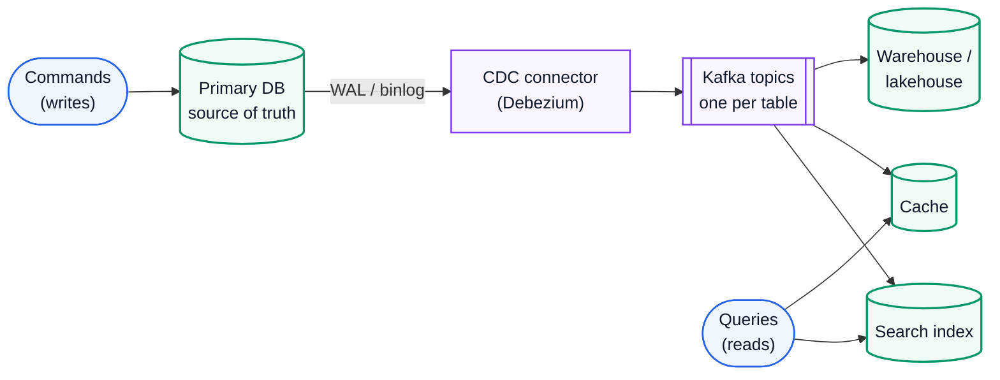
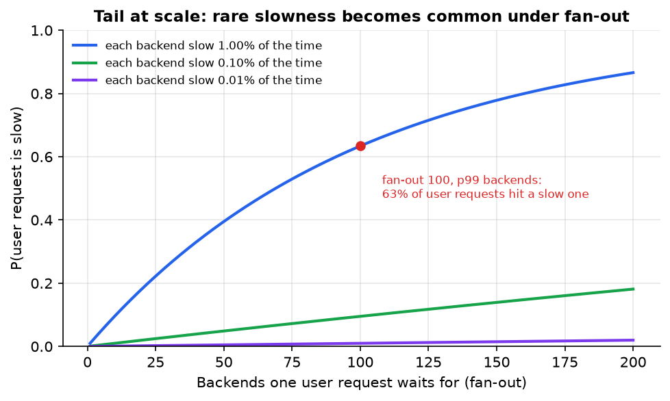
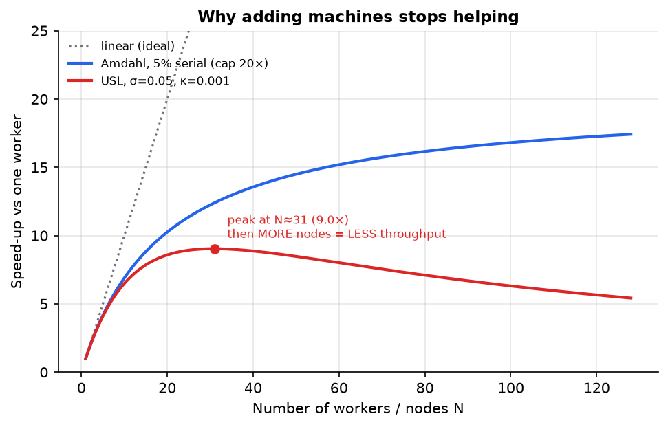
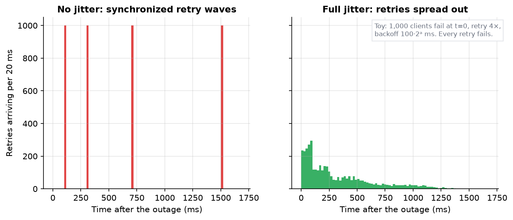
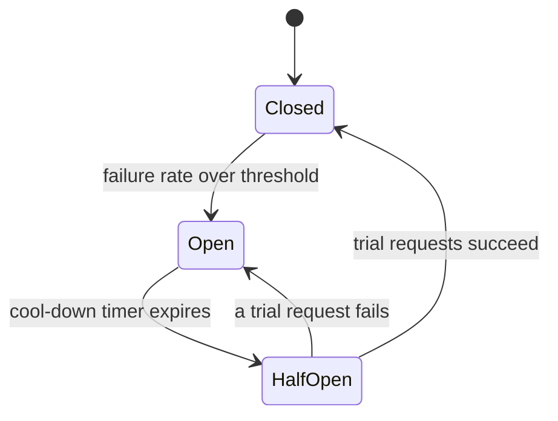
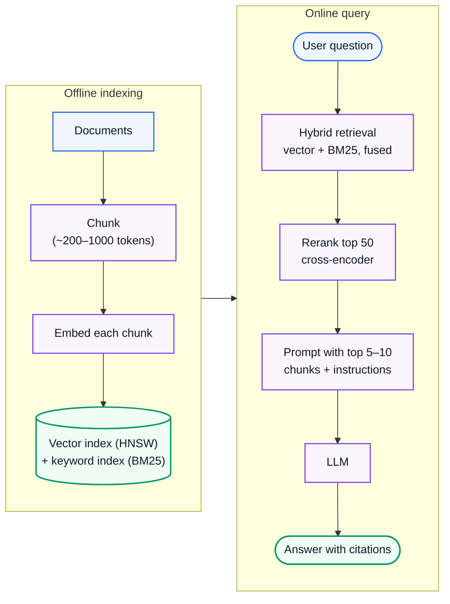
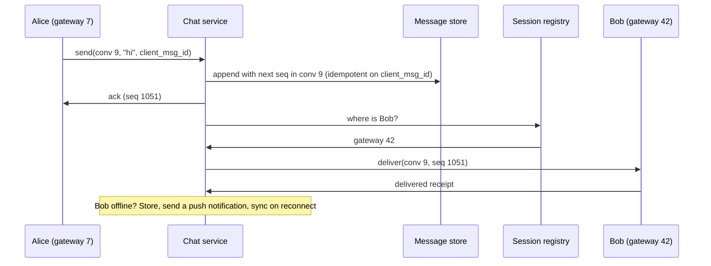

# System Design 3: Building Real Systems in 2026

> **Series:** [Part 1: Foundations, Building Blocks and Storage](System%20Design%201%20-%20Foundations%20Building%20Blocks%20and%20Storage.md) · [Part 2: Distributed Systems Theory](System%20Design%202%20-%20Distributed%20Systems%20Theory.md) · **Part 3 (this file)**
> **Related notes:** [APIs, Databases, Caching, CDNs and Scaling](System%20Design%20-%20APIs%20Databases%20Caching%20CDNs%20and%20Scaling.md) (auth, rate limiting, web security in depth) · [Scaling to 1 Million Requests per Second](Scaling%20to%201%20Million%20Requests%20per%20Second.md) · [Platform Engineering at Atlassian](../Theory/Platform%20Engineering%20-%20Lessons%20from%208%20Years%20at%20Atlassian.md) · [Agent Harnesses](../Theory/Agent%20Harnesses%20-%20Why%20the%20Scaffold%20Beats%20the%20Model.md) · [Multi-head Latent Attention (KV cache)](../Theory/Multi-head%20Latent%20Attention%20-%20Shrinking%20the%20KV%20Cache.md)
> **Source:** built from research: papers, official specs and engineering write-ups listed in [References](#13-references). Every number recomputed with Python; figures from [make_figs.py](../figures/system_design_theory/make_figs.py); code from [system_design_theory.py](../code/system_design_theory.py).
> **Facts re-checked:** 21 October 2026. Things that moved recently: OAuth 2.1 is **still an IETF draft** (revision -16, September 2026); hybrid post-quantum key exchange is now the browser default; Kafka runs without ZooKeeper since 4.0; LLM serving and agent infrastructure are now standard system-design topics.

**The big picture:** Parts 1 and 2 gave you the bricks and the physics. This part is how real systems are put together and kept alive: how services talk, how work flows asynchronously, why latency explodes under load, how to survive failure, how infrastructure and security are built, how data and AI systems work, and a repeatable method for designing anything.

Diagram colours: 🔵 input / primary · 🟣 processing · 🟢 result · 🟠 trade-off · 🔴 failure

---

## Contents

0. [How to use this guide](#0-how-to-use-this-guide)
1. [TL;DR](#1-tldr)
2. [APIs and communication](#2-apis-and-communication)
3. [Messaging, streaming and async workflows](#3-messaging-streaming-and-async-workflows)
4. [Performance theory: queues, tails and scaling laws](#4-performance-theory-queues-tails-and-scaling-laws)
5. [Reliability engineering](#5-reliability-engineering)
6. [Cloud-native infrastructure and observability](#6-cloud-native-infrastructure-and-observability)
7. [Security architecture](#7-security-architecture)
8. [Data and analytics systems](#8-data-and-analytics-systems)
9. [AI and LLM systems](#9-ai-and-llm-systems)
10. [Architecture patterns](#10-architecture-patterns)
11. [The design method, applied to three systems](#11-the-design-method-applied-to-three-systems)
12. [Self-check and glossary](#12-self-check-and-glossary)
13. [References](#13-references)

---

## 0. How to use this guide

| If you have… | Read |
|---|---|
| 10 minutes | §0.1, §1, and Fig 8 (queue latency) in §4 |
| 1 hour | §3, §4, §5: async systems, performance and reliability, the core of production engineering |
| A weekend | Everything, then work through §11's three designs on paper *before* reading the answers |

### 0.1 First, in completely plain words

Back to the restaurant from Part 1. By now you have many cooks, shared fridges and branches across town. This part covers running the place day to day:

- **How orders travel** (APIs): the order ticket format, so every cook reads it the same way.
- **Not making customers wait for everything** (queues): take the order, give them a ticket number, and cook in the background.
- **Why the kitchen falls apart at 95% busy** (queueing theory): when cooks are almost always busy, the line grows *explosively*, not gradually.
- **Surviving bad nights** (reliability): don't let one broken oven take down the kitchen, and don't let everyone re-order at the same moment.
- **The building, the alarms and the locks** (infrastructure, observability, security).
- **The accounts office** (analytics) and **the new robot chef** (AI systems), which has its own very particular physics.

And finally, **a method**: the steps a senior engineer follows to design any system from a blank page.

---

## 1. TL;DR

1. **APIs**: REST for public resources, gRPC for internal service calls, GraphQL for flexible client-shaped reads. Use cursor pagination and idempotency keys, and evolve schemas only additively.
2. **Queues** decouple producers from consumers in time and rate. **Logs** (Kafka) also keep history, so consumers can replay. Order exists only *within a partition*.
3. **Little's Law:** concurrent requests = arrival rate × time in system. 10,000 req/s × 50 ms = 500 in flight.
4. **Queueing:** at a 10 ms service time, mean latency is 20 ms at 50% utilisation, 100 ms at 90% and 1,000 ms at 99%. **Never run near 100%.**
5. **Tail at scale:** if each backend is slow 1% of the time, a request fanning out to 100 backends is slow **63%** of the time.
6. **Reliability toolkit:** timeouts → retries with exponential backoff **and jitter** → retry budgets → circuit breakers → bulkheads → load shedding. Watch for *metastable* failures, where retries keep a system down after the trigger is gone.
7. **Availability math:** three 99.9% services in series give 99.7%. Two 99% replicas in parallel give 99.99%. A 99.9% SLO allows 43.2 minutes of downtime per 30 days: that's your **error budget**.
8. **Cloud-native** = declarative desired state + controllers that reconcile reality toward it (Kubernetes). Deploy gradually (canaries) and measure with OpenTelemetry.
9. **Security**: zero trust (authenticate every request, mTLS between services), OAuth 2.1/OIDC, passkeys, relationship-based authorisation, envelope encryption, signed supply chains, post-quantum TLS.
10. **Analytics** uses columnar storage. Lakehouses (Iceberg tables on object storage) are now the default data platform.
11. **LLM serving is memory-bound.** A 70B-class model needs 320 KiB of KV cache *per token*, so memory, not compute, limits how many users share a GPU. RAG = retrieve (hybrid search + rerank) → generate.
12. **Method:** requirements → estimates → API → data model → high-level design → deep dives → failure modes → evolution.

---

## 2. APIs and communication

### 2.1 Choosing an API style

**The problem.** Services and clients must agree on how to ask for things. The style decides coupling, performance and how easy change is.

| Style | Model | Strengths | Weaknesses | Typical use |
|---|---|---|---|---|
| **REST** over HTTP + JSON | Resources (`/orders/42`) + HTTP verbs | Universal, cacheable (GET), human-readable, great tooling | Over- and under-fetching; many round trips for nested data | Public APIs, CRUD |
| **gRPC** (HTTP/2 + Protobuf) | Typed remote procedure calls from a `.proto` contract | Fast binary encoding, generated clients, streaming in both directions, deadlines built in | Not natively callable from browsers (needs gRPC-Web or a proxy); harder to debug by eye | Internal service-to-service calls |
| **GraphQL** | Client sends a query shaped like the response it wants | One round trip, no over-fetching, strongly typed schema | Caching is harder (POST to one endpoint); expensive queries must be limited (depth/cost limits); N+1 resolver problem (fixed with batching such as DataLoader) | Rich front-ends aggregating many backends |
| **WebSocket / SSE** | Long-lived connection; server pushes | Real-time updates | Stateful connections complicate scaling and load balancing | Chat, live dashboards, notifications |
| **Webhooks** | You call *their* URL when an event happens | Push between companies | Delivery must be retried, signed and idempotent | Payment events, integrations |

The [8 laws of REST API design guide](../Theory/REST%20API%20Design%20-%20The%208%20Laws.md) covers REST conventions in depth.

### 2.2 Contracts and schema evolution

**The problem.** Producers and consumers deploy at different times. During a rolling deploy, old and new code run side by side, and stored data written years ago must still be readable.

**How it works.** Two directions of compatibility:

- **Backward compatible**: *new* code can read data written by *old* code.
- **Forward compatible**: *old* code can read data written by *new* code (it must ignore what it doesn't know).

Protobuf, Avro and Thrift make both possible with rules:

1. Fields are identified by **number** (Protobuf/Thrift) or by schema resolution (Avro), not by position.
2. **Only add optional fields.** Old readers skip unknown field numbers; new readers use defaults when a field is missing.
3. **Never reuse or change a field number's type.** Mark removed fields as `reserved`.
4. For JSON APIs: add fields freely, never rename or remove without a deprecation window, and version (`/v2/`) only on genuinely breaking changes.

A **schema registry** (common with Kafka) enforces these rules on every producer at publish time.

### 2.3 Pagination, idempotency and other API essentials

- **Offset pagination** (`?offset=1000000&limit=20`) makes the database walk past a million rows every time, and pages shift when rows are inserted. **Cursor pagination** (`?after=<last_id>`, implemented as `WHERE id > :last_id ORDER BY id LIMIT 20`) is O(page size) with an index, and stable under inserts. Use cursors for anything large.
- **Idempotency keys** on every non-idempotent operation (POST payments, orders) make client retries safe (Part 2 §8.5).
- **Timeouts and deadlines**: gRPC propagates a deadline so downstream services stop working on a request the caller has already given up on.
- **Rate limits** with clear `429` responses and `Retry-After` headers (algorithms and simulations are in the [earlier guide](System%20Design%20-%20APIs%20Databases%20Caching%20CDNs%20and%20Scaling.md)).
- **Service discovery**: callers find healthy instances through DNS, a registry (Consul, etcd) or the platform itself (Kubernetes Services).

---

## 3. Messaging, streaming and async workflows

### 3.1 Why go asynchronous

**The problem.** In a synchronous chain (A calls B calls C), the user waits for the *sum* of the latencies. The chain is only as available as the *product* of the availabilities (§5.4), and a spike at A hits C directly.

**The fix.** Put a **message broker** between them. The producer writes a message and moves on; consumers process it when they can. You gain:

1. **Temporal decoupling**: the consumer can be down for a while; messages wait.
2. **Load levelling**: a burst fills the queue instead of crushing the consumer.
3. **Fan-out**: many independent consumers can react to one event.

The costs: eventual consistency (the work isn't done when the user gets "OK"), harder debugging, and the delivery-semantics problems from Part 2 §8.5.

### 3.2 Queues vs logs

| | **Message queue** (RabbitMQ, SQS, ActiveMQ) | **Log** (Kafka, Redpanda, Pulsar, Kinesis) |
|---|---|---|
| Model | Messages are delivered to a consumer and **deleted** once acknowledged | Messages are **appended** to a durable, ordered log and **kept** for a retention period |
| Consumers | Compete for messages (work distribution) | Each consumer group tracks its own **offset**; many groups read independently |
| Replay | No (once consumed, gone) | **Yes**: rewind the offset and reprocess history |
| Ordering | Usually none across competing consumers | Strict **within a partition** |
| Best for | Task queues, jobs, per-message routing | Event streams, CDC, event sourcing, analytics pipelines |

### 3.3 Kafka internals worth knowing

**How it works.**

- A **topic** is split into **partitions**, each an append-only log replicated across brokers. Every message has an **offset** in its partition.
- Producers choose the partition by **key** (`hash(key) mod partitions`), so all events for one key (one order, one user) stay **in order** in one partition.
- A **consumer group** shares partitions among its members. Each partition goes to exactly one member, so **the partition count caps a group's parallelism**: 12 partitions means at most 12 useful consumers in that group.
- **Replication**: each partition has a leader and followers. The **in-sync replicas (ISR)** are the followers that are caught up. With `acks=all` and `min.insync.replicas=2` (replication factor 3), a write is acknowledged only once at least 2 replicas have it. That survives a broker loss without losing data.
- **Retention** by time or size; **log compaction** keeps only the latest value per key, which turns a topic into a durable table of the current state.
- **Metadata** is managed by an internal Raft quorum (**KRaft**); ZooKeeper support was removed in Kafka 4.0 (2025).

**Worked example: sizing partitions.** You need to ingest 1 GB/s, and one consumer instance processes about 10 MB/s. Partitions needed ≥ 1,000 MB/s ÷ 10 MB/s = **100**. Add headroom (say 150–200), because adding partitions later changes which partition each key maps to, and that breaks per-key ordering during the change.

### 3.4 Backpressure

**The problem.** If producers are permanently faster than consumers, queues grow without limit: memory runs out, or latency becomes hours.

**The options, in order of preference:** (1) **scale consumers** if the work can be parallelised; (2) **apply backpressure**: slow the producer down with bounded queues, TCP-style flow control, or reactive streams' demand signalling; (3) **shed load** by dropping or rejecting low-priority work (§5.3). A queue is a shock absorber for *bursts*. It can't fix a *sustained* rate mismatch. Little's Law (§4.1) tells you how deep the queue gets.

### 3.5 Event-driven patterns: event sourcing, CQRS, CDC

- **Event sourcing**: store the **sequence of events** ("Deposited 50", "Withdrew 20") as the source of truth, not the current state. Current state = fold over the events. You get a complete audit trail, time travel ("what was the balance last Tuesday?") and new views built by replaying. The costs: versioning event schemas forever, snapshots to avoid replaying millions of events, and "deleting" data for privacy (often solved with crypto-shredding: encrypt per user and delete the key).
- **CQRS (Command Query Responsibility Segregation)**: separate the **write model** (validates commands, emits events) from one or more **read models** (denormalised views optimised for each query: a search index, a cache, a reporting table). Read models are updated asynchronously, so they are eventually consistent. It's often paired with event sourcing, but doesn't require it.
- **Change Data Capture (CDC)**: read the database's own replication log (the PostgreSQL WAL, the MySQL binlog) and publish every row change as an event (Debezium is the standard tool). This is how you keep caches, search indexes and warehouses in sync with the database **without dual writes** (Part 2 §8.4). The database stays the source of truth.



### 3.6 Stream processing: time, windows and watermarks

**The problem.** "Count clicks per minute" sounds easy, until events arrive late and out of order (a phone was offline for 10 minutes).

**How it works.**

- **Event time** (when it happened) vs **processing time** (when the system saw it). Correct analytics uses event time.
- **Windows** group the infinite stream: **tumbling** (fixed and non-overlapping: 12:00–12:01, 12:01–12:02), **sliding/hopping** (overlapping: a 5-minute window every minute), **session** (bursts of activity separated by a gap of inactivity).
- A **watermark** is the processor's claim: "I believe I've now seen all events with event time ≤ T." When the watermark passes the end of a window, the window's result is emitted. Events that arrive later still are **late data**: drop them, send them to a side output, or update the result (allowed lateness).
- **The trade-off**: an aggressive watermark gives fast but sometimes incomplete results. A conservative one gives complete but slow results.
- **Stateful processing** (running counts, joins) needs fault-tolerant state. Flink takes periodic consistent **checkpoints** across all operators (a variant of the Chandy-Lamport snapshot algorithm), and on failure restores state and replays the log from the matching offsets. That's exactly-once *state*, combined with transactional sinks for exactly-once *output*.

Engines: Apache Flink (the reference), Kafka Streams (a library inside your service), Spark Structured Streaming, and managed equivalents.

### 3.7 Durable execution and workflow orchestration

**The problem.** Business processes span minutes to months (order → payment → shipping → a 30-day return window). Writing them as code over queues and cron jobs, with manual state tracking, retries and compensations, is where bugs live.

**How it works.** **Durable execution** engines (Temporal, Restate, AWS Step Functions, Azure Durable Functions) let you write the workflow as ordinary code. The engine **records every step's result in an event history**. If the worker crashes, another worker *replays* the history to rebuild the exact state, and continues from the next step. Timers ("wait 30 days") and retries are built in. Your workflow code must be **deterministic** (no direct randomness or clock reads, which go through the engine's APIs instead), because replay must produce the same decisions. This is the natural home for sagas (Part 2 §8.3), and increasingly for long-running AI agents (§9.5).

---

## 4. Performance theory: queues, tails and scaling laws

### 4.1 Little's Law

**The problem.** How many requests are "inside" the system at once? That sets the thread pools, connection pools and memory you need.

$$
L = \lambda W
$$

*The average number of items in a system equals the average arrival rate times the average time each item spends inside.* It holds for any stable system, whatever the distributions.

**Worked example.** 10,000 requests/s, each spending 50 ms in the service: $L = 10{,}000 \times 0.05 = 500$ concurrent requests. If a downstream slowdown raises $W$ to 500 ms, concurrency jumps to **5,000**. Pools sized for 500 run out and requests start queueing or failing. **A latency problem quickly becomes a capacity problem.** (The [1M RPS guide](Scaling%20to%201%20Million%20Requests%20per%20Second.md) applies this at extreme scale.)

### 4.2 Why latency explodes near full utilisation

**The problem.** Teams want servers "efficiently" busy at 90–95%. Queueing theory says that's exactly where latency becomes unbearable.

**How it works.** Model a server as an **M/M/1 queue**: random (Poisson) arrivals at rate $\lambda$, random (exponential) service times with mean $S$, and one server. Utilisation is $\rho = \lambda S$. Mean time in the system:

$$
W = \frac{S}{1 - \rho}
$$

*Mean response time is the service time divided by one minus the utilisation.* As utilisation $\rho$ approaches 1, the denominator approaches 0 and the wait goes to infinity.

**Worked example.** Service time $S = 10$ ms:

| Utilisation ρ | Mean latency $W$ | vs. idle |
|---|---|---|
| 50% | 10 / 0.5 = **20 ms** | 2× |
| 80% | 10 / 0.2 = **50 ms** | 5× |
| 90% | 10 / 0.1 = **100 ms** | 10× |
| 95% | 10 / 0.05 = **200 ms** | 20× |
| 99% | 10 / 0.01 = **1,000 ms** | 100× |

Going from 90% to 99% busy (only 10% more throughput) makes latency **10× worse**. In this model the response time is exponentially distributed, so the 99th percentile is $W \ln 100 \approx 4.6 W$: at 90% utilisation, p99 ≈ 460 ms.


*Fig 8 (fig08_queue_latency.png). Real systems aren't exactly M/M/1, but the hockey-stick shape is universal. Variability (in arrivals or in service time) is what creates the queue. Lower variability (batching, uniform work) moves the knee to the right.*

**Design rules that follow:** target 50–70% utilisation for latency-sensitive services; autoscale on utilisation or queue depth *before* the knee; and remember that a "small" traffic increase near the knee causes a huge latency increase.

### 4.3 The tail at scale

**The problem.** Your backend's p99 is 100 ms. The user-facing request calls 100 backends in parallel and waits for all of them. What's the user's latency?

**How it works.** If each backend is independently slow with probability $q$, the chance that a request touching $n$ backends hits at least one slow one is:

$$
P(\text{slow}) = 1 - (1 - q)^{n}
$$

*The chance of at least one slow backend is one minus the chance that all n are fast.*

**Worked example.** $q = 0.01$, i.e. 1% (each backend's p99): fan-out 1 gives 1%; fan-out 10 gives $1 - 0.99^{10} \approx 0.096$, i.e. 9.6%; fan-out 100 gives $1 - 0.99^{100} \approx 0.634$, i.e. **63.4%**. The backend's rare 1-in-100 slowness becomes the user's *typical* experience.



*Fig 10 (fig10_tail_fanout.png). This is why large systems obsess over p99 and p99.9 of their **backends**, not their averages.*

**Defences** (Dean and Barroso, "The Tail at Scale", 2013):

- **Hedged requests**: send the request to one replica; if there's no reply by the p95 latency, send a second copy to another replica and take whichever answers first. It costs about 5% extra load and cuts the tail dramatically.
- **Tied requests**: send to two replicas at once, and the one that starts work tells the other to cancel.
- **Fewer fan-out hops**, partial results ("good enough" search answers), and isolating background work (compaction, GC) from serving.

### 4.4 Amdahl's law and the Universal Scalability Law

**The problem.** Why does doubling the servers rarely double the throughput, and why does it sometimes *reduce* it?

**Amdahl's law.** If a fraction $p$ of the work parallelises perfectly and $1 - p$ is serial:

$$
S(N) = \frac{1}{(1 - p) + p/N}
$$

*Speed-up on N workers is one over the serial part plus the parallel part divided by N.* As $N \to \infty$, $S \to 1/(1-p)$. With 5% serial work ($p = 0.95$): 16 workers give $1/(0.05 + 0.95/16) = 9.1\times$, and **no number of workers ever exceeds 20×**.

**The Universal Scalability Law** (Neil Gunther) adds **coherence cost**: workers must also coordinate *with each other* (cache invalidation, locks, consensus, cross-shard queries), and that cost grows with pairs of workers:

$$
C(N) = \frac{N}{1 + \sigma (N - 1) + \kappa N (N - 1)}
$$

*Capacity on N nodes is N divided by one, plus a contention term σ times (N − 1), plus a coherence term κ times N times (N − 1).* $\sigma$ is the contention (serial) fraction and $\kappa$ is the cost of each pair of nodes keeping each other in sync. Because the κ term grows like $N^2$, capacity **peaks** and then **falls**, at:

$$
N^{\ast} = \sqrt{\frac{1 - \sigma}{\kappa}}
$$

**Worked example.** $\sigma = 0.05$, $\kappa = 0.001$: $N^{\ast} = \sqrt{0.95 / 0.001} = \sqrt{950} \approx 31$ nodes, giving 9.0× capacity. At 100 nodes, capacity *drops* to 6.3×. Adding machines made it slower.



*Fig 9 (fig09_scalability_laws.png). You can fit σ and κ to your own load-test measurements to predict where your system stops scaling. **The design lesson:** shared-nothing architectures (independent partitions, no cross-node coordination on the hot path) drive κ toward 0. That's why partitioning (Part 2 §4) scales and global locks don't.*

---

## 5. Reliability engineering

### 5.1 Timeouts, retries and jitter

**The problem.** Calls fail transiently (a dropped packet, a restarting pod). Retrying fixes most transient failures. But naive retries turn a small problem into an outage.

**How it works, layer by layer:**

1. **Always set timeouts.** A call without a timeout can hang forever, holding a thread, a connection and memory (Little's Law again). Base the timeout on the downstream's measured p99.9, and **propagate deadlines** so inner calls give up when the outer request has.
2. **Retry only what is safe**: idempotent operations, or those protected by idempotency keys. Retry only retryable errors (timeouts, 503) and never client errors (400).
3. **Exponential backoff**: wait $\text{base} \times 2^{\text{attempt}}$ (capped) between tries, giving the dependency room to recover.
4. **Jitter**: randomise the wait. Without it, every client that failed at the same instant retries at the same instant. That's a synchronised wave that hits the recovering service again and again.



*Fig 11 (fig11_retry_jitter.png). Toy simulation: 1,000 clients fail at t = 0 and retry 4 times with backoff 100·2ᵃ ms. Left: every retry lands in four spikes of 1,000 requests. Right: "full jitter" (sleep a uniform random time between 0 and the backoff) spreads them out, so the peak is under 300 per 20 ms.*

Full jitter is one line (from [system_design_theory.py](../code/system_design_theory.py)):

```python
def backoff_full_jitter(attempt, base=0.1, cap=10.0, rng=random):
    """Seconds to sleep before retry number `attempt` (0-based)."""
    return rng.uniform(0, min(cap, base * 2 ** attempt))
```

```text
sleeps (s): [0.024, 0.109, 0.148, 0.483, 1.001, 0.21]
```

Notice the last sleep (0.21 s) is *shorter* than the one before. That's intended: each sleep is random in $[0, \text{base} \cdot 2^{a}]$, so clients de-synchronise.

5. **Retry budgets.** Retries multiply load *across layers*. If each of 3 layers retries 3 times, one user request can become $3^3 = 27$ requests at the bottom, exactly when the bottom is struggling. Cap retries as a fraction of traffic (for example "retries ≤ 10% of requests" per client), and retry at **one** layer only, usually the one closest to the user.

### 5.2 Circuit breakers and bulkheads

**Circuit breaker.** When a dependency is failing, stop calling it for a while. You fail fast instead of piling up waiting threads, and you give it room to recover.



- **Closed**: calls flow normally; failures are counted over a sliding window.
- **Open**: calls fail immediately (return a fallback: cached data, a default, or a clear error).
- **Half-open**: let a few trial calls through. Success closes the breaker; failure re-opens it.

**Bulkheads** (named after a ship's watertight compartments): give each dependency its **own** bounded resource pool (threads, connections, queue). If the recommendations service hangs, it can exhaust only *its* 20 threads, not the 200 that checkout also needs.

### 5.3 Load shedding and metastable failures

**Load shedding.** When demand exceeds capacity, **reject some requests deliberately and early**, instead of slowing down for everyone. A fast `503` (or `429`) costs microseconds. A request that queues, times out after 10 s and is retried costs far more. Techniques: priority-aware admission (keep checkout, shed analytics), concurrency limits that adapt to latency (Netflix's adaptive concurrency limits, inspired by TCP congestion control), and dropping requests that have already waited longer than their deadline.

**Metastable failures** (Bronson et al., HotOS 2021) are the scariest pattern in large systems. A temporary trigger (a traffic spike, a brief slowdown, a cache flush) pushes the system into a bad state that **sustains itself after the trigger is gone**:

1. Something slows the service briefly.
2. Requests time out, and clients retry, which adds load.
3. More load means more timeouts, which means more retries.
4. The trigger has passed, but the system stays overloaded. Its own retry traffic keeps it down.

Other self-sustaining loops: a cache that empties under load (every miss hits the DB, which is too slow to refill the cache), and GC thrashing from queued requests. **Defences:** retry budgets and jitter, load shedding, circuit breakers, slow ramp-up after recovery, and (critically) the ability to *drop* load to break the loop.

### 5.4 Availability math and the nines

**Serial dependencies** (A needs B needs C) multiply:

$$
A_{\text{serial}} = \prod_{i} A_i
$$

*The availability of a chain is the product of each link's availability.* Three services at 99.9%: $0.999^3 \approx 0.9970$, i.e. 99.70%. **Every synchronous dependency reduces your availability.**

**Parallel redundancy** (any one of several replicas is enough):

$$
A_{\text{parallel}} = 1 - \prod_{i} (1 - A_i)
$$

*A redundant group fails only if every member fails at once.* Two independent 99% replicas: $1 - 0.01^2 = 0.9999$, i.e. 99.99%. Two "nines" of components gave four nines of service, *if* failures are independent. That's why replicas go in different availability zones.

| Availability | Downtime per year | Per 30 days |
|---|---|---|
| 99% ("two nines") | 3.65 days (5,256 min) | 7.2 hours (432 min) |
| 99.9% | 8.76 hours (525.6 min) | **43.2 min** |
| 99.99% | 52.6 min | 4.3 min |
| 99.999% | 5.3 min | 26 seconds |

Each extra nine costs roughly an order of magnitude more engineering. At 99.99%, a human can't even respond to an alert in time, so recovery must be **automatic**.

### 5.5 SLIs, SLOs, SLAs and error budgets

- **SLI (service level indicator)**: a measured ratio of good events. "Fraction of requests served successfully in under 300 ms."
- **SLO (objective)**: the target for the SLI over a window. "99.9% over 30 days." An *internal* goal.
- **SLA (agreement)**: a *contract* with customers, with penalties. Always looser than the SLO, so you have warning before you owe money.
- **Error budget** = $1 - \text{SLO}$. For 99.9% over 30 days, that's $0.001 \times 43{,}200$ min = **43.2 minutes** of allowed badness. While budget remains, ship features and take risks. When it's spent, freeze risky launches and fix reliability. It turns "reliability vs speed" from an argument into a number.
- **Burn-rate alerting**: alert when the budget is being consumed fast (for example, at a rate that would spend a month's budget in two days), rather than on every blip. This is the standard practice from Google's SRE workbook.

> **100% is the wrong target.** Users can't tell 99.99% from 100% (their own Wi-Fi is less reliable), and chasing it stops all change. Pick the SLO users actually need.

### 5.6 Disaster recovery, cells and chaos

**Two numbers define a DR plan:**

- **RPO (recovery point objective)**: how much data you can afford to lose, measured in time ("the last 5 minutes"). It's set by backup frequency and replication mode.
- **RTO (recovery time objective)**: how long you can be down.

| Strategy | RPO / RTO | Cost |
|---|---|---|
| Backup and restore | Hours / hours–days | Low |
| Pilot light (data replicated, minimal compute idle) | Minutes / tens of minutes | Medium |
| Warm standby (a scaled-down full copy running) | Seconds–minutes / minutes | High |
| Multi-site active-active | ≈ 0 / ≈ 0 | Highest, plus all of Part 2's consistency problems |

Back-up rules: the **3-2-1 rule** (3 copies, 2 media types, 1 off-site), *immutable* backups (ransomware deletes mutable ones), and **regular restore tests**. A backup you've never restored is a hope, not a backup.

**Cell-based architecture** (used heavily at AWS): instead of one giant deployment, run many identical, independent **cells**, each serving a subset of customers with its own full stack. A bad deploy or poison request takes down one cell, not everyone, which limits the **blast radius**. A thin routing layer maps customers to cells. **Shuffle sharding** goes further: give each customer a random *combination* of a few workers, so two customers rarely share all their workers, and one noisy or malicious customer can't take down the others.

**Chaos engineering** (Netflix's Chaos Monkey, now a discipline): deliberately inject failures in controlled experiments (kill instances, add latency, partition networks, fail an AZ) to verify that the resilience mechanisms above actually work. Start with a hypothesis ("checkout's SLO holds if one cache node dies"), limit the blast radius, then automate it.

---

## 6. Cloud-native infrastructure and observability

### 6.1 Containers and Kubernetes

**The problem.** "It works on my machine." Apps need consistent packaging, and fleets need something to place, restart, scale and connect thousands of processes.

**Containers** package an app with its dependencies into an image. At runtime they're ordinary processes isolated by Linux **namespaces** (separate views of processes, network, filesystem) and limited by **cgroups** (CPU and memory caps). They're lighter than VMs because they share the host kernel, which also makes their isolation weaker. Sandboxes such as gVisor and Firecracker microVMs (used by serverless platforms) add stronger isolation for untrusted code.

**Kubernetes** is built on one idea: **declarative desired state + reconciliation loops.**

1. You declare what you want ("3 replicas of image v2, each with 1 CPU") as API objects, stored in etcd (consensus, Part 2 §7).
2. **Controllers** continuously compare desired state with actual state, and act to close the gap: start a pod, reschedule from a dead node, roll out a new version.
3. The **scheduler** places pods onto nodes based on resource requests, affinity rules and constraints.

Core objects: **Pod** (one or more co-located containers), **Deployment** (rolling updates of stateless pods), **StatefulSet** (stable identity and storage for databases), **Service** (a stable virtual IP and DNS name with load balancing over pods), **Ingress / Gateway API** (L7 entry), **HorizontalPodAutoscaler** (scale on metrics). **Operators** extend the same loop to complex software: a Postgres operator knows how to fail over, back up and upgrade a database.

### 6.2 Serverless

**Functions-as-a-Service** (Lambda, Cloud Run, Cloud Functions) run your code per request or event and scale to zero. You don't manage servers.

- **Gains**: no capacity planning, pay per use, automatic scaling.
- **Costs**: **cold starts** (starting a new instance adds latency, from milliseconds for lightweight runtimes to seconds for heavy ones), execution time limits, statelessness, vendor lock-in, and *higher unit cost at steady high load*. A continuously busy service is usually cheaper on reserved containers. Serverless wins for spiky, event-driven or low-traffic work.

### 6.3 Infrastructure as code, GitOps and deployment strategies

- **Infrastructure as Code** (Terraform/OpenTofu, Pulumi, CloudFormation): infrastructure defined in versioned files, reviewed like code and applied repeatably. Drift detection shows when reality differs from the code.
- **GitOps** (Argo CD, Flux): Git holds the desired state of the cluster; an agent continuously reconciles the cluster to match it. Rollback = `git revert`.

**Deployment strategies** (most outages are caused by changes, so *how* you change matters):

| Strategy | How | Rollback | Risk |
|---|---|---|---|
| **Rolling** | Replace instances a few at a time | Roll forward or back gradually | Old and new versions run together, so they must be compatible (§2.2) |
| **Blue-green** | Stand up a full new environment, switch traffic at once | Instant (switch back) | Double the capacity during the switch; the database schema must suit both |
| **Canary** | Send 1% → 5% → 25% → 100% to the new version, with automated checks on SLIs at each step | Stop and shift back | **Best practice.** Small blast radius, real-traffic validation |
| **Feature flags** | Ship code dark; turn features on per user or percentage at runtime | Flip the flag | Decouples *deploy* from *release*; flags need cleaning up |

**Schema changes** follow **expand → migrate → contract**: add the new column (compatible with old code), deploy code that writes both and reads the new one, backfill, then remove the old column in a *later* release. Never make a breaking schema change in the same step as the code change.

### 6.4 eBPF, WebAssembly and platform engineering

- **eBPF** runs small, verified programs *inside the Linux kernel* safely, attached to network events, system calls or functions. It powers high-performance networking and load balancing (Cilium, Meta's Katran), deep observability without code changes (continuous profiling, per-request network tracing), and runtime security (Falco, Tetragon). It's now the foundation of cloud-native networking.
- **WebAssembly (Wasm) on the server**: a portable, sandboxed bytecode that starts in microseconds, with capability-based security through WASI. It's used for plugins (Envoy filters, database UDFs), edge functions, and multi-tenant code isolation that's lighter than containers.
- **Platform engineering**: a dedicated team builds an **internal developer platform**, the paved road of templates, CI/CD, infrastructure and observability defaults, so product teams ship without each rebuilding the stack. See the [Atlassian platform engineering guide](../Theory/Platform%20Engineering%20-%20Lessons%20from%208%20Years%20at%20Atlassian.md).

### 6.5 Cost (FinOps) and carbon as design constraints

In 2026, cost is a first-class non-functional requirement, not an afterthought:

- **Know your unit economics**: cost per request, per user, per GB stored. Track it like latency.
- **The usual big lines**: compute you leave idle, **data egress** (moving data out of a cloud or across regions is often far more expensive than storing it), over-provisioned databases, and log volume.
- **Levers**: right-sizing, autoscaling, spot/preemptible instances for fault-tolerant batch work (often much cheaper), committed-use discounts for the steady baseline, storage tiering (hot → infrequent access → archive), caching to cut egress, and ARM instances.
- **Carbon-aware design**: shift flexible batch work to times and regions with cleaner electricity. Efficiency usually cuts carbon and cost together.

### 6.6 Observability

**The problem.** In a distributed system, "why is checkout slow?" can involve 30 services. You must be able to ask *new* questions of production without shipping new code.

**The signals:**

| Signal | What it is | Best for | Watch out for |
|---|---|---|---|
| **Metrics** | Numeric time series (counters, gauges, histograms) | Dashboards, SLOs, alerts; cheap at any traffic level | **Cardinality**: a label like `user_id` creates millions of series and blows up cost |
| **Logs** | Timestamped event records (structured JSON, ideally) | Detail on specific events, debugging | Volume and cost; sample or tier them |
| **Traces** | The path of one request across services: a tree of **spans** with timings | Finding *where* latency or errors come from | Needs context propagation everywhere; sampling decisions |
| **Profiles** | Where CPU and memory go, continuously | Finding hot code paths in production | Overhead (eBPF-based profilers keep it low) |

**OpenTelemetry (OTel)** is the vendor-neutral standard for producing and shipping all of these: SDKs, auto-instrumentation and the OTel Collector. Traces, metrics and logs are stable, and profiling is being added as a further signal. **Trace context** travels between services in the W3C `traceparent` header, so spans from every service join into one trace.

**Sampling**: **head sampling** decides at the start of a request (cheap, but may drop the interesting traces). **Tail sampling** decides after the request finishes, so it can keep all errors and slow traces (more useful, but it must buffer whole traces).

**What to measure** (two classic checklists):

- **RED** for request-driven services: **R**ate, **E**rrors, **D**uration (latency distribution).
- **USE** for resources (CPU, disk, network, pools): **U**tilisation, **S**aturation (queue length), **E**rrors.
- Google SRE's **four golden signals**: latency, traffic, errors, saturation.

**Alerting philosophy:** page a human only for **symptoms that hurt users** (SLO burn rate), not for causes ("CPU 80%"). Cause-based signals go on dashboards for diagnosis. After incidents, write **blameless postmortems** that focus on how the system allowed the failure, not who triggered it.

---

## 7. Security architecture

This section is about architecture-level security. The [earlier guide](System%20Design%20-%20APIs%20Databases%20Caching%20CDNs%20and%20Scaling.md) covers sessions vs JWT, OAuth flows, CORS, CSRF, XSS, injection and the OWASP Top 10:2025 in detail.

### 7.1 Zero trust

**The problem.** The old model ("hard shell, soft centre": a firewall outside, everything trusted inside) fails as soon as one internal machine is compromised. The attacker then moves laterally with no resistance.

**How it works** (Google's BeyondCorp; NIST SP 800-207): **never trust the network location; verify every request.**

1. **Strong identity for every user and every workload.** Services get cryptographic identities (SPIFFE/SPIRE IDs, or certificates issued by the service mesh).
2. **mTLS between all services**: encrypted and mutually authenticated.
3. **Authorise each request** using identity, device health and context, against least-privilege policies.
4. **Assume breach**: segment the network, keep credentials short-lived, and log everything for detection.

### 7.2 Authentication: OAuth 2.1, OIDC and passkeys

- **OAuth 2.0** is *delegated authorisation*: letting an app access an API on a user's behalf with **access tokens**. **OpenID Connect (OIDC)** adds *authentication* on top: an **ID token** saying who the user is. They're the basis of "Sign in with…" and of enterprise SSO.
- **OAuth 2.1** consolidates a decade of security lessons. It requires **PKCE** on the authorization-code flow for *all* clients, removes the implicit flow and the password grant, and requires exact redirect-URI matching. **Status:** as of September 2026 it is still an IETF Internet-Draft (revision -16), not yet an RFC, but its rules are already what modern identity providers implement. Design to OAuth 2.1 today.
- **Tokens**: keep access tokens short-lived (minutes) and refresh them with **rotating refresh tokens**. Bind tokens to the client where possible (sender-constrained tokens such as DPoP or mTLS) so a stolen token is useless elsewhere.
- **Passkeys (WebAuthn/FIDO2)**: public-key credentials stored on the user's device or synced through their platform's password manager. The private key never leaves the device, and each credential is bound to the site's domain, so **passkeys are phishing-resistant** in a way passwords and SMS codes are not. They're now supported across all major platforms and are the recommended default for consumer sign-in.

### 7.3 Authorization models at scale

| Model | Rule shape | Fits |
|---|---|---|
| **RBAC** (role-based) | User → role → permissions ("editors can edit") | Internal tools, coarse permissions |
| **ABAC** (attribute-based) | Policy over attributes of user, resource, environment ("doctors in ward 3 may read ward-3 records during their shift") | Rich, contextual rules; engines such as OPA/Rego and Cedar |
| **ReBAC** (relationship-based) | Permission follows relationships in a graph ("can view if member of a group that owns the folder that contains the doc") | Sharing models like Google Drive, GitHub orgs |

**Google Zanzibar** (2019) is the reference ReBAC system. It stores relationship tuples (`doc:readme#viewer@group:eng#member`) and answers permission checks across Google's products at millions of checks per second, with low latency. It uses **zookies** (consistency tokens) to avoid the "new enemy" problem: checking a permission against data that's older than a recent revocation. Open-source descendants: **SpiceDB**, **OpenFGA**. Design principle: **centralise authorisation decisions in one service with one model**, rather than scattering `if user.is_admin` checks across services.

### 7.4 Secrets, encryption and keys

- **Secrets management** (Vault, cloud secret managers): no secrets in code or images. Inject them at runtime, rotate them automatically, and prefer **dynamic, short-lived credentials** (a database password valid for one hour) over long-lived ones.
- **Encryption in transit** (TLS/mTLS everywhere) and **at rest**.
- **Envelope encryption** is how at-rest encryption scales: each object is encrypted with its own random **data key (DEK)**. The DEK is encrypted by a **key-encryption key (KEK)** that never leaves the **KMS/HSM**. The object is stored with its *encrypted* DEK. To read it, ask the KMS to decrypt the DEK (one small, audited, rate-limited call), then decrypt the data locally. Rotating the KEK means re-wrapping small DEKs, not re-encrypting petabytes. Deleting one user's key makes their data unrecoverable (**crypto-shredding**, useful for GDPR erasure).

### 7.5 Supply chain security

**The problem.** Modern apps are mostly *other people's code*: hundreds of dependencies, base images and CI actions. Attacks now target that chain (the SolarWinds build compromise in 2020; the xz-utils backdoor discovered in 2024).

**Defences:**

- **SBOM** (software bill of materials, in SPDX or CycloneDX format): an inventory of every component in each artifact, so you can answer "are we affected by this CVE?" in minutes.
- **SLSA** (Supply-chain Levels for Software Artifacts): a framework of build-integrity levels. Builds run on hardened, isolated builders and produce signed **provenance** (what source, which builder, what steps).
- **Sigstore** (cosign, Fulcio, Rekor): keyless signing of artifacts tied to an identity, recorded in a public transparency log. Deployments verify signatures before running anything.
- Pin dependencies by hash, review upgrades, scan continuously, and give CI tokens least privilege.

### 7.6 Post-quantum readiness and multi-tenancy

- **Post-quantum cryptography**: as Part 1 §4.5 described, the browser default is now hybrid `X25519MLKEM768` key exchange. The next steps for system designers: inventory where your systems use public-key crypto, make sure your TLS stack (for example OpenSSL 3.5+) negotiates the hybrid groups, and plan the slower migration to post-quantum **signatures** (ML-DSA, FIPS 204) for certificates, code signing and tokens. The goal is **crypto-agility**: being able to swap algorithms without redesigning.
- **Multi-tenancy isolation** (one platform, many customers): choose per tier, from shared tables with a `tenant_id` on every row (cheapest; enforce it with row-level security) to a schema per tenant to a database or cell per tenant (strongest isolation; noisy neighbours can't hurt others; most expensive). Tenant context must flow through every layer: caches, queues, logs, search indexes.

---

## 8. Data and analytics systems

### 8.1 OLTP vs OLAP

| | **OLTP** (transactions) | **OLAP** (analytics) |
|---|---|---|
| Queries | Many small reads and writes by key | Few huge scans and aggregations |
| Data per query | A few rows | Millions to billions of rows, few columns |
| Users | End users through the app | Analysts, dashboards, ML pipelines |
| Storage layout | **Row-oriented** + B-tree indexes (Part 1 §6) | **Column-oriented** + compression |
| Examples | PostgreSQL, MySQL, DynamoDB | Snowflake, BigQuery, Redshift, ClickHouse, DuckDB |

### 8.2 Why columnar storage wins for analytics

**The problem.** `SELECT country, SUM(revenue) FROM sales GROUP BY country` over a 100-column table. A row store reads every column of every row from disk.

**How it works.** A **column store** keeps each column's values together. The query reads **only the 3 columns it needs**: 3/100 = **3% of the I/O**. Values in one column are similar, so they compress extremely well (run-length encoding, dictionary encoding, bit-packing), often 5–10×. And **vectorised execution** processes batches of a column with SIMD CPU instructions. Combined, analytic scans can be orders of magnitude faster. The open file formats are **Parquet** and **ORC**.

### 8.3 Warehouse, lake, lakehouse

- **Data warehouse**: structured, cleaned, schema-on-write data in a managed columnar engine. Fast and governed, but storage and compute are coupled to the vendor.
- **Data lake**: raw files of any kind (Parquet, JSON, images) dumped on cheap object storage. Flexible and cheap, but it became a "data swamp": no transactions, no schema enforcement, unclear "current" state.
- **Lakehouse**: open **table formats** (Apache **Iceberg**, Delta Lake, Apache Hudi) add a **metadata layer** on top of Parquet files in object storage. That layer gives you ACID transactions (via atomic swaps of metadata pointers), schema evolution, **time travel** (query a past snapshot), and partition pruning. Many engines (Spark, Trino, Flink, Snowflake, DuckDB…) can then read and write *the same tables*. In 2026, Iceberg has become the de-facto interoperable table format, supported by all the major warehouses and clouds.

### 8.4 Batch and stream processing architectures

- **Batch**: MapReduce (Google, 2004) introduced **map → shuffle → reduce** over a distributed filesystem, with fault tolerance by re-running failed tasks. **Spark** generalised it: in-memory datasets, a DAG of transformations, SQL. Batch is simple to reason about and can be recomputed from scratch.
- **Lambda architecture**: run a **batch layer** (accurate, slow) and a **speed layer** (approximate, real-time) side by side, and merge them at query time. It works, but you maintain *two* codebases for the same logic.
- **Kappa architecture** (Jay Kreps, 2014): **everything is a stream**. Keep the log (Kafka) long enough, process with a stream processor, and "reprocess" by replaying the log through a new version of the job. One codebase. It became the default as stream processors matured (§3.6).
- **Real-time OLAP** (ClickHouse, Apache Druid, Apache Pinot) ingests streams and answers analytical queries in sub-seconds, for user-facing analytics ("your post's views in the last hour").

### 8.5 Data mesh and data contracts

- **Data mesh** (Zhamak Dehghani): an *organisational* pattern. Domain teams own their data as **products** (documented, quality-checked, discoverable), on a shared self-serve platform with federated governance. It addresses the bottleneck of one central data team owning every pipeline.
- **Data contracts**: explicit, versioned agreements between data producers and consumers (schema, meaning, freshness and quality guarantees), enforced in CI and at ingestion. They're the data-world version of API contracts (§2.2). They stop an upstream column rename from silently breaking 40 dashboards.

---

## 9. AI and LLM systems

AI features are now ordinary parts of system design, with their own physics. The model is one component. The system around it (retrieval, serving, caching, evaluation, guardrails) decides quality, latency and cost.

### 9.1 Classic ML systems in one page

- **Training vs serving.** Offline pipelines train models on historical data; online services serve predictions with low latency.
- **Feature stores** keep features consistent between the two: an **offline store** (historical, for training) and an **online store** (low-latency key-value, for serving), computed from the same definitions. The problem they prevent is **training/serving skew**: a model trained on features computed one way and served with features computed another way silently degrades.
- **Recommendation systems** run as a **funnel**: *candidate generation* (cheap retrieval of thousands of items from millions, often via embeddings and ANN search) → *ranking* (an expensive model scores hundreds) → *re-ranking* (business rules, diversity, freshness) → a dozen shown to the user.
- **Monitoring**: data drift and concept drift, delayed ground truth, and A/B tests on business metrics (not just offline accuracy).

### 9.2 LLM inference: prefill, decode and the memory wall

**The problem.** An LLM generates text one token at a time, and every token needs the entire model's weights to be read from GPU memory. Serving many users fast and cheaply is a hardware-physics problem.

**How it works.** A request has two phases:

1. **Prefill**: process the whole prompt in parallel. This is **compute-bound** (big matrix multiplications) and sets **time to first token (TTFT)**.
2. **Decode**: generate output tokens one by one. Each step reads all the weights *and* the attention state of all previous tokens, to produce one token per sequence. This is **memory-bandwidth-bound**. It sets **time per output token (TPOT)**.

**Worked example: the decode speed limit.** Assume a 70B-parameter model in FP16 (2 bytes per parameter) = **140 GB of weights**, split across 2 GPUs with about 3.35 TB/s of memory bandwidth each (6.7 TB/s total, H100-class). Each decode step must stream all 140 GB, so for a single sequence:

$$
\text{tokens/s} \leq \frac{\text{memory bandwidth}}{\text{bytes of weights}} = \frac{6.7 \times 10^{12}}{1.4 \times 10^{11}} \approx 48
$$

*A single sequence can generate at most bandwidth divided by model size tokens per second.* The GPUs' arithmetic units sit mostly idle. **The fix is batching**: one pass over the weights can serve *many* sequences at once, so throughput grows almost linearly with batch size, until something else runs out. That something is the **KV cache**.

### 9.3 The KV cache: why memory limits batch size

**The problem.** To avoid recomputing attention over all previous tokens at every step, the model caches each token's **keys and values** for every layer. That cache grows with every token of every concurrent request.

$$
\text{KV bytes per token} = 2 \times n_{\text{layers}} \times n_{\text{kv heads}} \times d_{\text{head}} \times \text{bytes per value}
$$

*Per token you store a key and a value (the 2), for every layer, for every key-value head, each of the head's dimension, at the chosen precision.*

**Worked example** (an assumed 70B-class shape: 80 layers, head dimension 128, FP16, with grouped-query attention using 8 KV heads):

- Per token: $2 \times 80 \times 8 \times 128 \times 2 = 327{,}680$ bytes = **320 KiB**.
- One request with an 8K-token context: 320 KiB × 8,192 = **2.5 GiB**. At 128K context: **40 GiB**.
- On 2 × 80 GB GPUs, after 140 GB of weights about 20 GB is left: **only about 7 concurrent 8K-token requests** fit.
- Without grouped-query attention (64 KV heads, classic multi-head), it would be 2,560 KiB per token, 8× worse.


*Fig 12 (fig12_kv_cache.png). Assumed model shape, back-of-envelope. The point: long contexts and many users compete for the same GPU memory. Architectures that shrink the KV cache, like grouped-query attention and DeepSeek's multi-head latent attention (see the [MLA guide](../Theory/Multi-head%20Latent%20Attention%20-%20Shrinking%20the%20KV%20Cache.md)), translate directly into more users per GPU.*

**The serving techniques that follow from this physics:**

| Technique | Problem solved | Idea |
|---|---|---|
| **Continuous batching** (Orca, 2022) | Static batches wait for their longest sequence | Add and remove sequences from the batch at *every* decode step |
| **PagedAttention** (vLLM, 2023) | KV memory fragmentation wasted much of the cache | Store the KV cache in fixed-size blocks like OS virtual-memory pages; allocate on demand; share blocks between requests |
| **Prefix caching** | The same long system prompt is recomputed for every request | Reuse KV blocks for shared prefixes (also sold as "prompt caching" by API providers) |
| **Quantisation** (FP8, INT4) | Weights and KV take too much memory and bandwidth | Fewer bytes per value: more speed and more capacity, with a small quality cost to measure |
| **Speculative decoding** | One token per expensive step | A small draft model proposes several tokens; the big model verifies them in one pass |
| **Disaggregated prefill/decode** | Compute-bound and memory-bound phases interfere | Run prefill and decode on separate GPU pools and transfer the KV cache between them |
| **Model routing** | Using the largest model for everything is slow and costly | Send easy requests to small, cheap models and hard ones to big models |

Serving engines: vLLM, SGLang, TensorRT-LLM, and the managed APIs. The metrics to set SLOs on are **TTFT**, **TPOT** (or tokens/s per user), throughput (tokens/s per GPU), and **cost per million tokens**.

### 9.4 Retrieval-augmented generation (RAG) and vector search

**The problem.** Models don't know your private or recent data, and they make things up when they're unsure. You want answers grounded in *your* documents, with citations.

**How it works.**



1. **Chunking**: split documents into passages that fit the embedding model and carry one idea each. Use overlap or structure-aware splits (headings, paragraphs), and keep metadata (source, date, permissions).
2. **Embedding**: map each chunk to a vector (hundreds to a few thousand dimensions) where similar meanings are close together.
3. **Hybrid retrieval**: vectors find *semantic* matches but miss exact terms (product codes, names). Keyword search (**BM25**, see the [BM25 guide](../Theory/BM25%20-%20Keyword%20Search%20for%20AI%20Agents.md)) catches those. Run both and fuse the rankings, commonly with **reciprocal rank fusion**: score $= \sum 1/(k + \text{rank})$ across the lists.
4. **Reranking**: a cross-encoder scores (question, chunk) pairs jointly. That's much more accurate than vector similarity, but too slow for millions of chunks, so it's applied only to the top few dozen.
5. **Generation** with instructions to answer only from the context and to cite sources.
6. **Enforce permissions at retrieval time** (filter by the user's access rights). Otherwise RAG becomes a data-leak engine.

**Vector indexes (approximate nearest neighbour):**

- **HNSW** (hierarchical navigable small world graphs): a layered graph you search greedily from coarse to fine. Search cost is roughly logarithmic, recall is high, and it's the default almost everywhere. The cost is memory (the graph plus full vectors in RAM).
- **IVF** (inverted file): cluster the vectors (k-means) and search only the closest few clusters.
- **Product quantisation (PQ)**: compress each vector into a few bytes by quantising sub-vectors.

**Worked example: memory.** 10 million chunks × 1,024 dimensions × 4 bytes (FP32) = **40.96 GB** of raw vectors, before the index. With PQ at 64 bytes per vector: 10M × 64 = **640 MB**, a 64× reduction, at some loss of recall (usually recovered by re-scoring the top candidates with full vectors). Trade-off triangle: **recall vs latency vs memory**.

### 9.5 Agents, tools and MCP

**The problem.** Many tasks need multiple steps, actions and external data: "find the failing test, fix it, open a PR". A single prompt-response can't do that.

**How it works.** An **agent** is an LLM in a loop: decide → call a **tool** (search, code execution, an API) → observe the result → decide again, until done. The system around the loop (the **harness**) matters as much as the model: context management, tool design, memory, verification and limits (see the [agent harness guide](../Theory/Agent%20Harnesses%20-%20Why%20the%20Scaffold%20Beats%20the%20Model.md) and the [agent workflows as DAGs guide](../Theory/Graph%20Engineering%20-%20Agent%20Workflows%20as%20DAGs.md)).

System-design concerns specific to agents:

- **Tool protocols**: the **Model Context Protocol (MCP)**, an open standard introduced by Anthropic in 2024 and now widely supported across AI clients and platforms, standardises how agents discover and call tools and data sources. It's a client-server protocol, so one MCP server (for your database, ticketing system or docs) works with many agent clients. Design tools like APIs: clear schemas, idempotent where possible, least-privilege credentials.
- **Durability**: agent runs can take minutes to hours. Run them on durable execution (§3.7) so a crash resumes instead of restarting, with checkpoints and human approval steps for risky actions.
- **Memory**: short-term (the context window, compacted or summarised as it fills) and long-term (facts stored in a database or vector store and retrieved when relevant; see the [agent memory guide](../Theory/Agent%20Memory%20-%20Long-Term%20Memory%20with%20Mem0.md)).
- **Security**: **prompt injection** is the defining threat. Text inside a retrieved web page, email or file can contain instructions the model may follow. Defences are architectural: treat all tool output as untrusted data, give agents least-privilege and scoped credentials, require confirmation for irreversible actions, isolate code execution in sandboxes, and filter outputs that could exfiltrate data (such as URLs with embedded secrets).
- **Cost and loop control**: budget limits on steps, tokens and wall time; detection of loops that repeat the same failing action.

### 9.6 The LLM platform layer: gateways, caching, evals and guardrails

- **LLM gateway**: one internal entry point to all model providers. It handles authentication, per-team quotas and budgets, routing and **fallback** between models and providers, retries with backoff, logging, and PII redaction. It's an API gateway (Part 1 §5.2) specialised for tokens.
- **Caching**: *exact* response caching for repeated prompts; provider **prompt/prefix caching** for long shared prefixes (cheaper and faster TTFT); **semantic caching** (return a cached answer when a new question's embedding is close to a past one). Semantic caching is risky, because "close" questions can need different answers, so use it only for narrow, low-risk domains with conservative thresholds.
- **Evaluations (evals)**: you can't unit-test free text with `assertEquals`. Build eval sets of real tasks with graded expectations: exact checks where possible, rubric-based **LLM-as-judge** where not (calibrated against human labels). Run them in CI on every prompt or model change, like a regression suite, and monitor production samples continuously. **Evals are the test suite of AI systems.**
- **Guardrails**: input and output classifiers (safety, PII, off-topic), structured-output validation (JSON schema), groundedness checks for RAG, and rate limits against abuse.
- **Observability**: trace every step (prompt, retrieved chunks, tool calls, tokens, latency, cost) with OpenTelemetry's generative-AI conventions or dedicated LLM tracing tools. Without traces, agent failures are impossible to debug.

---

## 10. Architecture patterns

### 10.1 Monolith, modular monolith, microservices

| | **Monolith** | **Modular monolith** | **Microservices** |
|---|---|---|---|
| Deploy unit | One | One, with strictly enforced internal module boundaries | Many independently deployable services |
| Calls between parts | In-process function calls | In-process, through module interfaces | Network calls (latency, partial failure, Part 2) |
| Data | One shared database | One database, schemas owned per module | **Database per service** |
| Strength | Simple to build, test, debug and deploy | Simplicity *plus* clear boundaries, ready to split later | Independent scaling, deploys and team autonomy |
| Weakness | Boundaries erode; one team's change can break everyone | Discipline needed to keep boundaries | Distributed-systems complexity; needs strong platform and observability |
| Fits | Small teams, new products | **Most companies' best default** | Many teams, a mature platform, parts with very different scaling needs |

**The key insight:** microservices solve an **organisational** scaling problem (many teams stepping on each other) at the price of a **technical** one (distributed systems). Several well-known companies have publicly moved parts of their systems *back* toward monoliths when the price outweighed the benefit. Start modular; split out a service when a boundary is stable *and* there's a concrete reason (scaling profile, team ownership, release cadence).

### 10.2 Domain-driven design and boundaries

- **Bounded context**: a part of the business with its own consistent model and language. "Customer" means something different in Billing (a payment method, invoices) and in Support (tickets, satisfaction). Don't force one shared model on both. **Service boundaries should follow bounded contexts.**
- **Aggregate**: a cluster of objects that must be consistent together (an order and its line items), changed only through its root, inside one transaction. Cross-aggregate consistency is eventual (events, sagas). This maps naturally onto partitions and transaction boundaries.
- **Hexagonal architecture (ports and adapters)**: business logic sits at the centre with no dependency on frameworks or databases. Adapters plug into ports: REST controllers in, database repositories out. It makes the core testable and the infrastructure swappable.

### 10.3 Migration and integration patterns

- **Strangler fig**: replace a legacy system gradually. Put a routing layer in front, move one capability at a time to the new system, and route its traffic there, until the old system is "strangled" and can be removed. It avoids the risky big-bang rewrite.
- **Anti-corruption layer**: a translation layer between your clean model and a legacy or external system's messy one, so their concepts don't leak into yours.
- **Backend for frontend (BFF)**: a thin backend per client type (web, iOS, TV) that aggregates and shapes data for exactly that client.
- **Sidecar / ambassador**: deploy cross-cutting helpers (proxy, telemetry agent, secrets fetcher) as a separate process beside each service, as the service mesh does.

### 10.4 Conway's Law

> "Organizations which design systems are constrained to produce designs which are copies of the communication structures of these organizations." (Melvin Conway, 1968)

Your architecture will mirror your org chart, whether you plan it or not. The **inverse Conway manoeuvre** uses this deliberately: shape the teams (*Team Topologies*' stream-aligned teams, platform teams, enabling teams) to match the architecture you want. A design that cuts across team boundaries will be hard to build and harder to own.

---

## 11. The design method, applied to three systems

### 11.1 A repeatable framework

```mermaid
flowchart LR
    accTitle: System design method
    accDescr: Eight steps from requirements through estimates, API, data model, high-level design, deep dives, failure modes and evolution.
    R["1. Requirements<br/>functional + NFRs"] --> E["2. Estimates<br/>QPS, storage, bandwidth"]
    E --> A["3. API<br/>key operations"]
    A --> D["4. Data model<br/>entities, access patterns"]
    D --> H["5. High-level design<br/>boxes and arrows"]
    H --> DD["6. Deep dives<br/>the 2–3 hardest parts"]
    DD --> F["7. Failure modes<br/>what breaks, blast radius"]
    F --> EV["8. Evolution<br/>10x growth, trade-offs named"]
    class R,E primary;
    class A,D,H,DD intermediate;
    class F warning;
    class EV target;
    classDef primary fill:#EFF6FF,stroke:#2563EB,stroke-width:1.5px,color:#0F172A;
    classDef intermediate fill:#FAF5FF,stroke:#7C3AED,stroke-width:1.5px,color:#0F172A;
    classDef warning fill:#FFFBEB,stroke:#D97706,stroke-width:1.5px,color:#92400E;
    classDef target fill:#F0FDF4,stroke:#059669,stroke-width:2px,color:#0F172A;
```



1. **Requirements**: ask before drawing. Who uses it, what are the core operations, what scale, what latency, what consistency, what can be lost?
2. **Estimates** (Part 1 §2.3): enough to know which parts need scaling.
3. **API**: the handful of key operations and their shapes.
4. **Data model**: entities, relationships and *access patterns*, which decide the database (Part 1 §7).
5. **High-level design**: the simplest architecture that meets the requirements.
6. **Deep dives**: the hardest 2–3 parts (the hot path, the consistency-critical part, the biggest scale).
7. **Failure modes**: for each component, what happens when it dies, slows down or partitions?
8. **Evolution**: what breaks at 10×, and which trade-offs you made on purpose.

### 11.2 Worked design 1: URL shortener

**Requirements.** Create a short link for a long URL; redirect from it quickly; links last years. NFRs: redirect p99 < 50 ms; very high availability for reads; 100M new links per day; reads 100× writes.

**Estimates.**

| Quantity | Calculation | Result |
|---|---|---|
| Writes | 100M / 86,400 | **≈ 1,160/s** |
| Reads | 100 × writes | **≈ 116,000/s** |
| Storage, 10 years | 500 bytes × 100M × 365 × 10 | **≈ 183 TB** |
| Codes needed in 10 years | 100M × 3,650 | 365 billion |
| 7-character base-62 codes | $62^7$ | **3.52 trillion** ✓ (enough; 6 chars = 56.8 billion is not) |

**API.** `POST /links {long_url}` → `{code}`; `GET /{code}` → redirect.

**The deep dive: generating unique codes.**

| Option | How | Trade-off |
|---|---|---|
| Hash the URL (e.g. first 7 base-62 chars of a SHA-256) | Deterministic | Collisions must be detected and retried; the same URL always gets the same code (sometimes wanted, sometimes not) |
| Global counter → base-62 | Unique by construction | A single counter is a bottleneck and a single point of failure; codes are guessable (enumerable) |
| **Counter ranges** | Each app server leases a block of 1M IDs from a coordination store (etcd or a DB row), then hands them out locally | No per-request coordination; a crash only wastes the unused part of a block |
| **Snowflake-style IDs** | 64 bits = 41-bit millisecond timestamp + 10-bit machine ID + 12-bit sequence | No coordination at all; 4,096 IDs per ms per machine; time-ordered; 41 bits of ms lasts about 69.7 years. Codes are longer (up to 11 base-62 chars) |

**Design.** Stateless app servers behind a load balancer; a key-value store or a sharded database keyed by `code` (a pure key lookup, hash-partitioned); a cache in front (popular links are extremely skewed, so the hit ratio is high); a CDN or edge layer for the hottest redirects. Use a **302** (temporary) redirect if you need click analytics, because browsers cache 301s and skip your server. Analytics are written **asynchronously** (log → Kafka → analytics store), never on the redirect's critical path.

**Failure modes.** The cache cluster dies → the DB must survive the read load, or the edge keeps serving stale entries. The ID lease store is down → servers continue on already-leased blocks. Abuse → rate-limit creation and scan target URLs for malware.

### 11.3 Worked design 2: news feed

**Requirements.** Users follow others; their home feed shows recent posts from people they follow, ranked. NFRs: feed load p99 < 200 ms; posting can take a little longer; a feed can be a few seconds stale. Using Part 1 §2.3's numbers: about 7k posts/s and about 350k feed reads/s on average.

**The deep dive: fan-out.**

- **Fan-out on write (push)**: when a user posts, insert the post ID into every follower's precomputed feed (in a cache or wide-column store). Reads are trivial: fetch your feed list. **Problem: celebrities.** A user with 100M followers produces 100M writes per post. At 1M feed inserts/s, that single post takes **100 seconds** to propagate and eats the whole write capacity.
- **Fan-out on read (pull)**: at read time, fetch recent posts from everyone you follow and merge them. Writes are trivial, but reads are expensive (a scatter/gather over hundreds of followees, with the tail-latency problem from §4.3).
- **Hybrid (what large platforms do)**: push for ordinary users; **pull for celebrities**. At read time, merge your precomputed feed with fresh posts from the few celebrities you follow. The threshold (for example, over 100k followers) is a tunable trade-off.

**Design.** A post service writes posts to a sharded store (by `post_id`) and emits `PostCreated` events to Kafka. Fan-out workers consume the events and update follower feed lists (keep only the latest ~1,000 IDs per user, in Redis or a wide-column store). The feed service reads the feed list, merges celebrity posts, **hydrates** IDs into full posts (cached heavily), then **ranks** them with an ML model (the candidate → rank funnel from §9.1). Media goes in object storage behind a CDN.

**Failure modes.** A lagging fan-out → feeds are a bit stale, which is acceptable by the NFRs. Hot posts → cache and replicate their hydration. A new user with no feed cache → build it on the fly by pulling.

### 11.4 Worked design 3: chat system

**Requirements.** One-to-one and group messaging; online delivery in under a second; offline users get messages later (and push notifications); messages ordered within each conversation; message history; presence (online/offline). Scale: 100M concurrent connections at peak.

**Connections.** Clients hold a persistent **WebSocket** to a **gateway** tier. If each gateway server holds about 500k idle connections (it's an event-loop server, Part 1 §3.4; memory per connection is the limit), you need $100{,}000{,}000 / 500{,}000 = $ **200 gateway servers**, plus headroom for failover and reconnect storms. A **session registry** (a fast key-value store with TTLs) maps `user_id → gateway` so messages can be routed to the right server.

**Message flow.**



**The deep dives.**

1. **Ordering.** Assign a **per-conversation sequence number** at the chat service: the conversation is the unit of ordering, so all of a conversation's writes go through one partition owner. There's no global order, and none is needed (Part 2 §6: order only what users can see).
2. **Storage.** A wide-column store partitioned by `conversation_id` and clustered by `seq`: writes are appends, and "load the last 50 messages" is one partition range scan (Part 2 §4.1's compound key).
3. **Exactly-once effect.** Clients retry sends over flaky mobile networks, so a client-generated `client_msg_id` makes the append idempotent (Part 2 §8.5). Clients sync by asking "everything after seq N" on reconnect, which also repairs any missed pushes.
4. **Groups.** Small groups: fan out to each member's gateway. Very large channels: members pull or subscribe, like the celebrity case in the news feed.
5. **Presence.** Heartbeats over the WebSocket update a TTL key. Changes are fanned out only to contacts who are online and looking, and batched, because presence is chatty and doesn't need to be exact.
6. **Security.** End-to-end encryption (the Signal protocol, or MLS, RFC 9420, for large groups) means the server stores ciphertext it can't read. That rules out server-side search and moderation of message content, which is a product trade-off to decide explicitly.

**Failure modes.** A gateway dies → its clients reconnect to others with jittered backoff (§5.1; otherwise, a reconnect storm). Then they sync from their last seq. A chat-service partition owner fails → leadership moves (consensus-backed) and clients retry idempotently.

### 11.5 Systems to practise next

Work each through all eight steps, on paper, before looking anything up:

| Category | Systems | The key concept each one tests |
|---|---|---|
| Core | Rate limiter · distributed key-value store · unique ID generator | Algorithms + quorums (Part 2 §3) · consistent hashing · clock-free uniqueness |
| Social | Notification system · comments with replies · "people you may know" | Fan-out, idempotency · causal ordering · graph queries |
| Media | Video platform (upload → transcode → adaptive streaming) · photo sharing | Async pipelines, object storage, CDN economics |
| Location | Ride matching · proximity search · delivery ETA | Geospatial indexes (Part 1 §9.4), real-time state |
| Commerce | Payment system with a double-entry ledger · flash-sale ticketing · stock exchange order book | Strong consistency, idempotency, sagas · contention · ordering and latency |
| Infra | Web crawler · metrics/monitoring system · distributed job scheduler · search autocomplete | Politeness and dedup (Bloom filters) · time series · leases and fencing · tries and caching |
| Collaboration | Collaborative document editor · file sync (Dropbox) | CRDTs/OT (Part 2 §9) · chunking, dedup and conflict handling |
| AI | Chat assistant at scale · enterprise RAG · LLM gateway · coding-agent platform | KV-cache capacity (§9.3) · retrieval with permissions · routing and budgets · durable sandboxed agents |

---

## 12. Self-check and glossary

<details>
<summary>1. A service handles 2,000 req/s at 80 ms average latency. How many requests are in flight? What if latency degrades to 800 ms?</summary>

Little's Law: $2{,}000 \times 0.08 = 160$. At 800 ms: **1,600**, a 10× jump in concurrency that can exhaust pools and memory.
</details>

<details>
<summary>2. Your servers run at 90% utilisation with 10 ms service time. Product wants 5% more traffic on the same fleet. What happens to mean latency (M/M/1)?</summary>

90% → 94.5%: $10/0.1 = 100$ ms → $10/0.055 \approx 182$ ms. **5% more traffic, ~80% more latency.** Add capacity instead.
</details>

<details>
<summary>3. Why do retries need jitter, and why should only one layer retry?</summary>

Without jitter, clients that failed together retry together: synchronised waves. Retrying at several layers multiplies load ($3^3 = 27$× for 3 layers × 3 tries) exactly when the backend is weakest.
</details>

<details>
<summary>4. Your service synchronously calls 4 dependencies, each 99.95% available. What's your best-case availability?</summary>

$0.9995^4 \approx 0.9980$, so 99.80% (assuming your own code never fails). That's about 86 minutes of downtime per 30 days, against 22 minutes for a single 99.95% component.
</details>

<details>
<summary>5. Why can't you fix a slow LLM decode by buying GPUs with more compute (FLOPS)?</summary>

Decode is **memory-bandwidth-bound**: each token step streams all the weights. More bandwidth, batching (limited by KV-cache memory), quantisation and speculative decoding help. More FLOPs mostly help prefill.
</details>

<details>
<summary>6. In RAG, why combine BM25 with vector search, and where must permissions be enforced?</summary>

Vectors miss exact tokens (IDs, names); BM25 catches them. Permissions must be enforced **at retrieval**, so that unauthorised chunks never enter the prompt.
</details>

<details>
<summary>7. News feed: why not fan out on write for everyone?</summary>

Celebrities: one post becomes millions of writes (100M followers at 1M writes/s = 100 s). Use the hybrid: push for normal users, pull for celebrities.
</details>

**Glossary**

| Term | Meaning |
|---|---|
| **gRPC** | Typed RPC over HTTP/2 with Protobuf |
| **Backward / forward compatible** | New code reads old data / old code reads new data |
| **Cursor pagination** | Paging by "after this key" instead of offsets |
| **Consumer group** | Kafka consumers sharing a topic's partitions |
| **ISR** | In-sync replicas of a Kafka partition |
| **Backpressure** | Slowing producers to match consumers |
| **Event sourcing / CQRS** | Events as source of truth / separate write and read models |
| **CDC** | Change data capture: streaming a DB's own change log |
| **Watermark** | A stream processor's estimate that event time T is complete |
| **Durable execution** | Workflows whose state is persisted per step and replayed after crashes |
| **Little's Law** | $L = \lambda W$ |
| **Utilisation (ρ)** | Fraction of time a server is busy |
| **Hedged request** | Duplicate request sent after a delay to cut tail latency |
| **USL** | Universal Scalability Law: contention + coherence costs |
| **Full jitter** | Random backoff uniformly in [0, cap] |
| **Retry budget** | Limit on retries as a share of traffic |
| **Circuit breaker** | Stops calls to a failing dependency, then probes |
| **Bulkhead** | Separate resource pools per dependency |
| **Load shedding** | Rejecting excess work early |
| **Metastable failure** | Overload sustained by its own retries after the trigger is gone |
| **SLI / SLO / SLA** | Measured indicator / internal target / external contract |
| **Error budget** | 1 − SLO: allowed unreliability |
| **RPO / RTO** | Tolerable data loss / downtime |
| **Cell / shuffle sharding** | Independent stack copies / random worker combinations per customer |
| **Reconciliation loop** | Controller driving actual state toward desired state |
| **Canary** | Gradual rollout to a small share of traffic, with checks |
| **Expand–contract** | Safe, multi-step schema migration |
| **eBPF** | Verified programs running inside the Linux kernel |
| **OpenTelemetry** | Vendor-neutral standard for traces, metrics and logs |
| **RED / USE** | Rate-Errors-Duration / Utilisation-Saturation-Errors |
| **Zero trust** | Verify every request; no implicit network trust |
| **PKCE** | OAuth proof key that stops authorisation-code interception |
| **Passkey** | Phishing-resistant public-key credential (WebAuthn) |
| **ReBAC / Zanzibar** | Relationship-based authorisation / Google's system for it |
| **Envelope encryption** | Data keys wrapped by a master key in a KMS |
| **SBOM / SLSA / Sigstore** | Component inventory / build-integrity levels / artifact signing |
| **Columnar storage** | Storing each column contiguously for fast scans |
| **Lakehouse / Iceberg** | Warehouse features on object storage / the open table format |
| **Kappa architecture** | Everything as a replayable stream |
| **Prefill / decode** | Processing the prompt / generating tokens one at a time |
| **TTFT / TPOT** | Time to first token / time per output token |
| **KV cache** | Stored attention keys and values for previous tokens |
| **Continuous batching / PagedAttention** | Per-step batch membership / paged KV memory |
| **RAG** | Retrieval-augmented generation |
| **HNSW / PQ** | Graph-based ANN index / vector compression |
| **MCP** | Model Context Protocol: standard for agent tools and data sources |
| **Prompt injection** | Malicious instructions hidden in data an LLM reads |
| **Evals** | Graded test sets for AI behaviour |
| **Bounded context** | A domain area with its own consistent model |
| **Strangler fig** | Incremental replacement of a legacy system |
| **Conway's Law** | Systems mirror the communication structure of their organisations |

---

## 13. References

- Jeffrey Dean and Luiz André Barroso, "The Tail at Scale", *CACM*, 2013.
- Neil Gunther, *Guerrilla Capacity Planning* (Universal Scalability Law), 2007. Gene Amdahl, 1967.
- John D. C. Little, "A Proof for the Queuing Formula L = λW", 1961.
- Nathan Bronson et al., "Metastable Failures in Distributed Systems", HotOS 2021.
- Marc Brooker, "Exponential Backoff and Jitter", AWS Architecture Blog, 2015; the AWS Builders' Library on timeouts, retries, and cell-based architecture / shuffle sharding.
- Betsy Beyer et al., *Site Reliability Engineering* and *The Site Reliability Workbook*, Google/O'Reilly (SLOs, error budgets, burn-rate alerts; free online).
- Jay Kreps, "Questioning the Lambda Architecture", 2014; Tyler Akidau et al., "The Dataflow Model", VLDB 2015 (windows and watermarks).
- Jeffrey Dean and Sanjay Ghemawat, "MapReduce", OSDI 2004. Matei Zaharia et al., "Resilient Distributed Datasets" (Spark), NSDI 2012.
- Ruoming Pang et al., "Zanzibar: Google's Consistent, Global Authorization System", USENIX ATC 2019.
- NIST SP 800-207 *Zero Trust Architecture*, 2020; NIST FIPS 203 (ML-KEM) and FIPS 204 (ML-DSA), 2024.
- IETF, [draft-ietf-oauth-v2-1](https://datatracker.ietf.org/doc/draft-ietf-oauth-v2-1/) (OAuth 2.1, still a draft as of revision -16, September 2026).
- [Post-quantum TLS: what's actually shipping in 2026](https://unveilscan.unveiltech.com/blog/post-quantum-tls.html).
- Gyeong-In Yu et al., "Orca: A Distributed Serving System for Transformer-Based Generative Models", OSDI 2022 (continuous batching).
- Woosuk Kwon et al., "Efficient Memory Management for Large Language Model Serving with PagedAttention" (vLLM), SOSP 2023.
- Yu. A. Malkov and D. A. Yashunin, "Efficient and robust approximate nearest neighbor search using HNSW graphs", 2016/2018. Hervé Jégou et al., "Product Quantization for Nearest Neighbor Search", 2011.
- Patrick Lewis et al., "Retrieval-Augmented Generation for Knowledge-Intensive NLP Tasks", NeurIPS 2020.
- Model Context Protocol specification ([modelcontextprotocol.io](https://modelcontextprotocol.io)).
- Eric Evans, *Domain-Driven Design*, 2003. Matthew Skelton and Manuel Pais, *Team Topologies*, 2019. Melvin Conway, "How Do Committees Invent?", 1968.
- Alex Xu, *System Design Interview*, volumes 1 and 2 (for more worked designs in the §11 format).
- Martin Kleppmann and Chris Riccomini, *Designing Data-Intensive Applications*, 2nd ed., O'Reilly, 2026.

**Back to:** [Part 1](System%20Design%201%20-%20Foundations%20Building%20Blocks%20and%20Storage.md) · [Part 2](System%20Design%202%20-%20Distributed%20Systems%20Theory.md)
