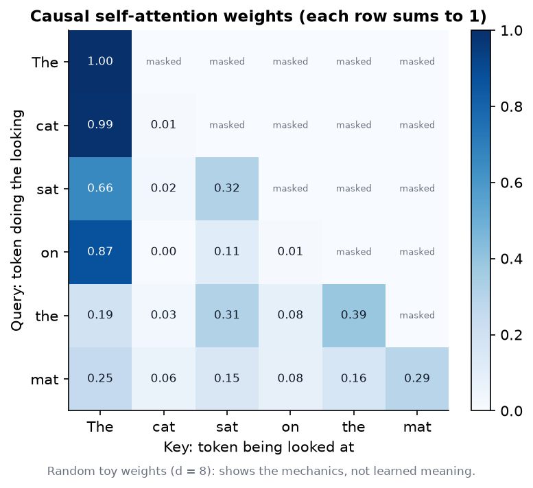
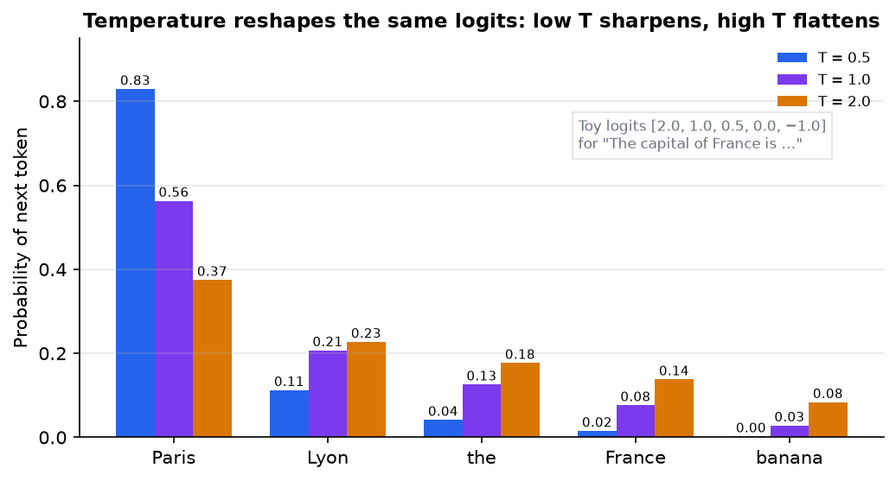

# AI Engineering 1: How LLMs Work

> **Series (AI engineering):** [0 Start Here](AI%20Engineering%200%20-%20Start%20Here.md) · **1 How LLMs Work** · [2 Prompting and Context Engineering](AI%20Engineering%202%20-%20Prompting%20and%20Context%20Engineering.md) · [3 Evals and Quality](AI%20Engineering%203%20-%20Evals%20and%20Quality.md) · [4 Retrieval and RAG](AI%20Engineering%204%20-%20Retrieval%20and%20RAG.md) · [5 Agents](AI%20Engineering%205%20-%20Agents.md) · [6 Production LLM Engineering](AI%20Engineering%206%20-%20Production%20LLM%20Engineering.md) · [7 Safety, Security and Governance](AI%20Engineering%207%20-%20Safety%20Security%20and%20Governance.md) · [8 Serving and GPU Infrastructure](AI%20Engineering%208%20-%20Serving%20and%20GPU%20Infrastructure.md) · [9 Customising Models](AI%20Engineering%209%20-%20Customising%20Models.md)
> **Source:** built from research: papers, official docs and course notes listed in [References](#15-references). Every number recomputed with Python. Figures: [make_figs.py](../../figures/ai_engineering/make_figs.py). Code: [ai_tokens_and_sampling.py](../../code/ai_tokens_and_sampling.py).
> **Facts re-checked:** 22 October 2026. This field moves monthly, so model names and context sizes here are examples of the state of things in late 2026, not permanent facts. The mechanisms are stable.

**The big picture:** a large language model is a function that reads a sequence of tokens and outputs a probability for every possible next token. Everything an AI engineer does (prompting, retrieval, agents, evals, serving) is shaped by four facts about that function: it works on **tokens**, it can only see its **context window**, it **samples** from probabilities, and it was **trained** to produce plausible text, not true text.

Diagram colours: 🔵 input · 🟣 processing · 🟢 result · 🟠 trade-off · 🔴 failure

---

## Contents

0. [How to use this guide](#0-how-to-use-this-guide)
1. [TL;DR](#1-tldr)
2. [Tokens and tokenization](#2-tokens-and-tokenization)
3. [Embeddings: meaning as geometry](#3-embeddings-meaning-as-geometry)
4. [The transformer and self-attention](#4-the-transformer-and-self-attention)
5. [Context windows and long context](#5-context-windows-and-long-context)
6. [How models are made](#6-how-models-are-made)
7. [Sampling: temperature, top-p and logprobs](#7-sampling-temperature-top-p-and-logprobs)
8. [Why models hallucinate](#8-why-models-hallucinate)
9. [Reasoning models and test-time compute](#9-reasoning-models-and-test-time-compute)
10. [Multimodal models](#10-multimodal-models)
11. [Open-weight vs closed, and small models](#11-open-weight-vs-closed-and-small-models)
12. [Thinking critically: decisions and trade-offs](#12-thinking-critically-decisions-and-trade-offs)
13. [Self-check](#13-self-check)
14. [Glossary](#14-glossary)
15. [References](#15-references)

---

## 0. How to use this guide

| If you have… | Read |
|---|---|
| 10 minutes | §0.1, §1, and Fig 1 in §7 |
| 1 hour | §2, §4, §5, §7, §8: the parts that change how you build things |
| A weekend | Everything, then the self-check |

You don't need to train models to be an AI engineer, but you do need an accurate mental model of what's inside. Most production bugs in AI apps (cost blow-ups, truncated context, flaky outputs, confident wrong answers) trace back to one of the mechanisms in this guide.

### 0.1 First, in completely plain words

Imagine an extremely well-read autocomplete. It has read a large slice of the internet, books and code. You give it the start of some text, and it predicts what comes next, one small piece at a time.

- It doesn't read letters or whole words. It reads **tokens**: chunks such as "un", "believ", "able". Costs, limits and speed are all counted in tokens.
- It represents each token as a long list of numbers (an **embedding**), where similar meanings end up close together.
- Inside, a mechanism called **attention** lets every token look back at the earlier tokens and decide which ones matter for predicting the next one.
- It can only look at a limited amount of text at once: its **context window**. Anything outside it doesn't exist for the model.
- It doesn't pick "the" answer. It produces **probabilities** for every possible next token, and then one is **sampled**. That's why the same question can get different answers.
- It was trained first to imitate text (so it learned language and facts), then tuned to be a helpful assistant, and now often trained to **think step by step** before answering.
- Because it was trained to produce *likely* text, it sometimes produces fluent, confident text that's false: a **hallucination**.

Keep those seven points in mind. The rest of this guide makes each one precise.

---

## 1. TL;DR

1. **Tokens are the unit of everything:** price, context limits, speed. In English, 1 token ≈ 4 characters ≈ ¾ of a word. Other languages and code often need more tokens per word.
2. **Embeddings** turn tokens and texts into vectors. Similar meanings point in similar directions, measured with cosine similarity. That's the basis of semantic search.
3. **Self-attention** computes $\text{softmax}(QK^{\top}/\sqrt{d})V$: each token mixes in information from the earlier tokens it finds relevant. Its cost grows with the **square** of the sequence length.
4. **Context windows** are now hundreds of thousands to millions of tokens, but quality falls off well before the limit, and information in the middle gets used less reliably. More context is not free accuracy.
5. **Training pipeline:** pretraining (predict the next token over trillions of tokens) → supervised fine-tuning (imitate good answers) → preference tuning (prefer better answers) → reinforcement learning with checkable rewards (learn to reason).
6. **Temperature** rescales the probabilities before sampling: low = focused and repeatable, high = varied. **Top-p** samples only from the smallest set of tokens covering probability p.
7. **Hallucinations** happen because training rewards plausible continuations, and evaluations often reward guessing over saying "I don't know". Grounding (retrieval, tools) and verification reduce them; nothing removes them entirely.
8. **Reasoning models** spend extra tokens thinking before answering. Accuracy on hard problems rises with that "test-time compute", at the cost of latency and money.
9. **Model choice** is a spectrum: frontier closed models, strong open-weight models you can host, and small models that run on a laptop or phone. Weight memory ≈ parameters × bytes per parameter: an 8B model at 4-bit needs about 4 GB.

---

## 2. Tokens and tokenization

**The problem.** A neural network needs a fixed vocabulary of symbols. Whole words don't work: there are too many of them, new ones appear constantly ("vibecoding"), and typos would be unknown. Single characters do work, but sequences become very long, which is slow and expensive (attention cost grows with length squared, §4). We need something in between.

**The idea: subword tokens.** Keep common words whole, and break rare words into reusable pieces. "unbelievable" might become `un` + `believ` + `able`. Every possible string can still be written, falling back to single characters or bytes in the worst case.

**How it works: byte-pair encoding (BPE).** Most modern tokenizers use BPE or a close relative (SentencePiece, WordPiece). Training a BPE tokenizer:

1. Start with every word split into characters (in practice, bytes), plus an end-of-word marker.
2. Count every adjacent pair of symbols across the training text.
3. **Merge the most frequent pair** into a new symbol and add it to the vocabulary.
4. Repeat until the vocabulary reaches the target size (modern models use roughly 32,000 to over 200,000 tokens).

To tokenize new text, apply the learned merges in the same order.

**Worked example.** A tiny corpus: "low" ×5, "lower" ×2, "newest" ×6, "widest" ×3. Running six merges ([ai_tokens_and_sampling.py](../../code/ai_tokens_and_sampling.py), actual output):

```text
merge 1: 'e' + 's' -> 'es'  (seen 9 times)
merge 2: 'es' + 't' -> 'est'  (seen 9 times)
merge 3: 'est' + '_' -> 'est_'  (seen 9 times)
merge 4: 'l' + 'o' -> 'lo'  (seen 7 times)
merge 5: 'lo' + 'w' -> 'low'  (seen 7 times)
merge 6: 'n' + 'e' -> 'ne'  (seen 6 times)
   low _
   low e r _
   ne w est_
   w i d est_
```

"es" appears 9 times (6 in "newest" + 3 in "widest"), so it merges first. The suffix "est_" becomes one token, because it's common. Rare words like "widest" stay partly split. Real tokenizers do exactly this on terabytes of text.

**What this means in practice:**

| Fact | Consequence for engineers |
|---|---|
| ~4 characters ≈ 1 token in English (≈ 0.75 words per token) | 1,000 words ≈ 1,333 tokens. Use the provider's token counter for real budgets. |
| Non-English languages and code often use more tokens for the same content | The same feature can cost more, and fill the context faster, in Hindi or Bengali than in English |
| Numbers split unpredictably ("12345" may be "123" + "45") | One reason models are weak at exact arithmetic: give them a calculator tool (Guide 5) |
| The model sees tokens, not letters | "How many r's in strawberry?" is hard: the letters are hidden inside tokens |
| Each model family has its own tokenizer | Token counts and prices aren't comparable across providers without counting with each one |
| Whitespace and capitalisation change tokens | " Paris" and "Paris" can be different tokens; formatting affects cost and sometimes behaviour |

**Special tokens** mark structure: start and end of a message, the boundary between system, user and assistant turns, and tool calls. The chat API wraps your messages in these for you, which is why the API's message structure matters (Guide 2).

---

## 3. Embeddings: meaning as geometry

**The problem.** Token IDs are just integers. ID 4,512 being close to 4,513 means nothing. The model needs a representation where *meaning* has structure.

**How it works.** Each token ID is mapped to a learned vector of a few thousand numbers: its **embedding**. During training, tokens used in similar contexts are pushed toward similar vectors. Inside the model, these vectors are transformed layer by layer, so each position's vector comes to represent "this token, in this context".

Separately, **embedding models** turn a whole sentence or document into one vector, trained so that texts with similar meaning land close together. These are what power semantic search and RAG (Guide 4). Typical sizes are a few hundred to a few thousand dimensions.

**Measuring closeness: cosine similarity.** Compare the *directions* of two vectors, ignoring their lengths:

$$
\cos(\mathbf{a}, \mathbf{b}) = \frac{\mathbf{a} \cdot \mathbf{b}}{\Vert \mathbf{a} \Vert \Vert \mathbf{b} \Vert}
$$

*Cosine similarity is the dot product of the two vectors divided by the product of their lengths.* It's 1 when they point the same way, 0 when unrelated (at right angles), and −1 when opposite. If the vectors are normalised to length 1 (many embedding models do this), cosine similarity is just the dot product, which is why vector databases often use the dot product directly.

**Worked example** with toy 3-dimensional vectors (real ones have hundreds of dimensions):

| Text | Vector |
|---|---|
| "cat" | [0.9, 0.8, 0.1] |
| "kitten" | [0.85, 0.9, 0.15] |
| "invoice" | [0.1, 0.05, 0.95] |

For cat vs kitten: dot product $= 0.9 \times 0.85 + 0.8 \times 0.9 + 0.1 \times 0.15 = 1.5$. Lengths: $\sqrt{0.81+0.64+0.01} = 1.208$ and $\sqrt{0.7225+0.81+0.0225} = 1.247$. Cosine $= 1.5 / (1.208 \times 1.247) \approx 0.996$. For cat vs invoice the code gives **0.195**. Close in meaning, close in angle.

**Things to know about embeddings:**

- **They capture topical similarity, not truth or logic.** "The drug is safe" and "the drug is not safe" can embed very close together. Retrieval finds *related* text, not *correct* text.
- **Each embedding model has its own space.** Vectors from two models can't be compared. Changing the model means re-embedding everything.
- **Matryoshka embeddings** are trained so the first $k$ dimensions are already a usable embedding. You can truncate to save storage, at a small loss in quality.

---

## 4. The transformer and self-attention

**The problem.** To predict the next word in "The trophy didn't fit in the suitcase because **it** was too big", the model must work out that "it" means the trophy. Meaning depends on other words, sometimes far away. Older recurrent networks passed information along one step at a time and forgot distant context. They also couldn't be trained in parallel.

**The idea: attention.** Let every position look at every earlier position *directly*, and learn how much each one matters. That's the core of the **transformer** (Vaswani et al., 2017), the architecture behind essentially every modern LLM.

**How it works, step by step.** For each token's vector $x$, the layer computes three vectors with learned weight matrices:

- a **query** $q = x W_Q$: "what am I looking for?"
- a **key** $k = x W_K$: "what do I contain?"
- a **value** $v = x W_V$: "what will I hand over if chosen?"

Then:

1. **Score** every pair: how well does token $i$'s query match token $j$'s key? (A dot product.)
2. **Scale** the scores by $1/\sqrt{d}$, where $d$ is the key length, so they don't grow so large that softmax saturates.
3. **Mask** future positions (set their scores to $-\infty$), so a token can't peek at the words it's supposed to predict. This is a **causal** model.
4. **Softmax** each row into weights that are positive and sum to 1.
5. **Mix**: each token's output is the weighted average of the value vectors.

> **Softmax in one paragraph.** Softmax turns any list of scores into probabilities: raise $e$ (≈ 2.718) to the power of each score, then divide each result by their total. For scores [2, 1, 0]: $e^2 = 7.39$, $e^1 = 2.72$, $e^0 = 1$, total 11.11, giving **[0.665, 0.245, 0.090]**. Three properties make it useful: every output is positive, they sum to 1, and bigger scores get *disproportionately* bigger shares (a score 1 higher gets 2.7× the weight). So "softmax" really means "a soft version of picking the max": mostly the top item, a little of the rest. It appears twice in an LLM: here, to turn match scores into attention weights, and at the very end, to turn the final scores into next-token probabilities (§7).

$$
\text{Attention}(Q, K, V) = \text{softmax}\left(\frac{QK^{\top}}{\sqrt{d}}\right) V
$$

*For every token, compare its query with all keys, scale by the square root of the key size, turn the scores into weights with softmax, and take the weighted average of the values.*

**Worked example** (3 tokens, 2 dimensions, from the code; real models use thousands):

```text
scores (scaled, masked):
 [[0.707  -inf  -inf]
 [0.    0.707  -inf]
 [0.707 0.707 1.414]]
weights:
 [[1.    0.    0.   ]
 [0.33  0.67  0.   ]
 [0.248 0.248 0.503]]
outputs:
 [[10.     0.   ]
 [ 3.302  6.698]
 [ 5.     5.   ]]
```

Read the second row: token 2's query is [0, 1]. It matches its own key [0, 1] (score $1/\sqrt{2} = 0.707$) better than token 1's key [1, 0] (score 0). After softmax: weights 0.33 and 0.67. Its output is $0.33 \times [10, 0] + 0.67 \times [0, 10] = [3.30, 6.70]$, mostly its own value, partly token 1's. Every row sums to 1, and the upper triangle is masked.



*Fig 2 (f02_attention_heatmap.png). The same computation on six tokens with random toy weights. It shows the mechanics (causal mask, rows summing to 1), not learned meaning. In a trained model, specific heads learn patterns such as "look at the previous token" or "look at the noun this pronoun refers to".*

**The rest of the transformer block:**

```mermaid
flowchart LR
    accTitle: One transformer block
    accDescr: Token vectors pass through multi-head attention and a feed-forward network, each with a residual connection and normalisation; dozens of blocks are stacked and the final vector predicts the next token.
    IN(["Token vectors<br/>+ position info"]) --> ATT["Multi-head<br/>self-attention<br/>(tokens share info)"]
    ATT --> ADD1["Add + normalise<br/>(residual)"]
    ADD1 --> FFN["Feed-forward network<br/>(per token: stores<br/>much of the 'knowledge')"]
    FFN --> ADD2["Add + normalise<br/>(residual)"]
    ADD2 --> REP{{"Repeat for<br/>N layers"}}
    REP --> OUT(["Final vector →<br/>probabilities over<br/>the vocabulary"])
    class IN primary;
    class ATT,ADD1,FFN,ADD2,REP intermediate;
    class OUT target;
    classDef primary fill:#EFF6FF,stroke:#2563EB,stroke-width:1.5px,color:#0F172A;
    classDef intermediate fill:#FAF5FF,stroke:#7C3AED,stroke-width:1.5px,color:#0F172A;
    classDef target fill:#F0FDF4,stroke:#059669,stroke-width:2px,color:#0F172A;
```



- **Multi-head attention** runs several attention computations in parallel (heads), each free to learn a different kind of relationship. Their outputs are combined.
- **Position information** is added because attention by itself ignores order. Modern models use **RoPE** (rotary position embeddings), which rotate queries and keys by an angle that depends on position.
- **Feed-forward networks** process each position independently. They hold most of the parameters. **Mixture-of-experts (MoE)** models have many feed-forward "experts" and route each token to only a few, so a model can have a huge total parameter count but use only a fraction per token. Many frontier and open models (DeepSeek, Qwen, gpt-oss, Mixtral) are MoE.
- **Residual connections** add each layer's input to its output, so information and gradients flow through dozens of layers.
- A model is dozens of these blocks stacked. The final vector at the last position is turned into a probability for every token in the vocabulary.

**The cost that shapes everything: attention is quadratic.** Every token is scored against every earlier token, so a sequence of $n$ tokens needs about $n^2$ scores per head per layer. At $n = 100{,}000$ that's $10^{10}$ scores. That's why long prompts are slow to process, and why architectures keep inventing ways around it (sparse and linear attention, sliding windows, compressed key-value caches).

**The KV cache.** When generating, each new token needs the keys and values of all previous tokens. Recomputing them every step would waste work, so they're stored in a **KV cache**. That makes generation fast, but the cache grows with every token of every conversation. It's the main reason serving long contexts is memory-hungry (Guide 8 §4). Variants such as **grouped-query attention** (several query heads share one key/value head) exist mainly to shrink this cache.

---

## 5. Context windows and long context

**The problem.** The model only knows two things: what's in its weights (from training) and what's in its **context window** (this request). Anything you want it to use right now must fit in the context.

**How it works.** The context window is the maximum number of tokens the model can process in one request, **input plus output combined**. In late 2026, frontier models offer windows of hundreds of thousands to over a million tokens, and many open models offer 128K or more. The window covers everything: system prompt, tool definitions, retrieved documents, conversation history, the user's message, and the answer being generated.

**Long context is not free accuracy.** Three effects matter in practice:

1. **"Lost in the middle."** Liu et al. (2023) showed that models use information at the *start* and *end* of a long context more reliably than information in the *middle*. Newer models are much better at simple retrieval tasks ("find the needle"), but the effect persists for harder tasks.
2. **Quality degrades as context grows** ("context rot"). Tests that require *reasoning over* many scattered facts, not just finding one, show accuracy falling well before the advertised limit. Distracting, irrelevant text makes it worse.
3. **Cost and latency grow** with every token: you pay for input tokens, and prefill time grows with length (§4).

**Rules that follow:**

- Put the most important instructions at the **start** (system prompt), and the question **after** long documents. Many providers recommend placing long documents *before* the question.
- Give the model **less, more relevant** context instead of everything. That's the whole idea of retrieval (Guide 4) and context engineering (Guide 2).
- Reserve room for the output. If input fills the window, the answer gets cut off.
- Conversation history grows every turn. Long-running chats and agents must **compact** it: summarise or drop old turns (Guide 2 §6).

---

## 6. How models are made

**The problem.** A raw text predictor isn't an assistant. Ask it a question and it may continue with more questions, because that's what text on the internet looks like. Turning it into something useful and safe takes several training stages. You don't need to run them, but knowing them explains model behaviour, and Guide 9 covers the ones you *can* run.

```mermaid
flowchart LR
    accTitle: LLM training pipeline
    accDescr: Pretraining on trillions of tokens produces a base model; supervised fine-tuning on demonstrations makes an instruction model; preference tuning aligns it; reinforcement learning with verifiable rewards adds reasoning.
    D[("Trillions of tokens<br/>web, books, code")] --> PT["1. Pretraining<br/>predict the next token"]
    PT --> BASE(["Base model<br/>knows language + facts,<br/>not an assistant"])
    BASE --> SFT["2. Supervised fine-tuning<br/>imitate good answers"]
    SFT --> PREF["3. Preference tuning<br/>RLHF / DPO: prefer<br/>better answers"]
    PREF --> RL["4. RL with verifiable rewards<br/>maths, code, tasks<br/>→ learns to reason"]
    RL --> FINAL(["Assistant /<br/>reasoning model"])
    class D primary;
    class PT,SFT,PREF,RL intermediate;
    class BASE,FINAL target;
    classDef primary fill:#EFF6FF,stroke:#2563EB,stroke-width:1.5px,color:#0F172A;
    classDef intermediate fill:#FAF5FF,stroke:#7C3AED,stroke-width:1.5px,color:#0F172A;
    classDef target fill:#F0FDF4,stroke:#059669,stroke-width:2px,color:#0F172A;
```



**1. Pretraining.** Predict the next token over a huge corpus. The loss is **cross-entropy**:

$$
\mathcal{L} = -\frac{1}{N}\sum_{t=1}^{N} \log p_{\theta}(x_t \mid x_{\lt t})
$$

*The loss is the average, over every position, of minus the log-probability the model gave to the token that actually came next.* Predicting the actual next token with probability 1 costs 0; assigning it a low probability costs a lot. To predict well across trillions of tokens, the model is forced to learn grammar, facts, reasoning patterns and coding. Almost everything a model "knows" comes from this stage, so its knowledge stops at a **training cutoff date**.

> **Why logarithms?** Two reasons. First, the probability of a whole sentence is the *product* of its tokens' probabilities, which quickly becomes a uselessly tiny number; logs turn products into *sums*, which computers handle well. Second, $-\log p$ punishes confident mistakes hard: giving the right token probability 0.9 costs $-\ln 0.9 = 0.105$, but giving it 0.01 costs $-\ln 0.01 = 4.6$, about 44× more. You'll see log-probabilities again in sampling (§7), evals and preference tuning.

> **How training actually changes the weights.** Training repeats one loop billions of times: run a batch of text through the model, compute the loss, then work out, for every weight, which direction to nudge it so the loss would go down. That direction is the **gradient**, computed efficiently by **backpropagation**. Each weight is moved a small step against its gradient (**gradient descent**); the step size is the **learning rate**. Modern training uses the **Adam** optimiser, which keeps two running averages per weight to choose better step sizes. That's why training needs several times more memory than running a model (more in Guide 9 §4).

**Scaling laws** (Kaplan et al. 2020; Hoffmann et al. 2022, "Chinchilla") show loss falls predictably as you grow parameters, data and compute. Training compute is approximately:

$$
C \approx 6 N D
$$

*Training compute in FLOPs is about six times the number of parameters N times the number of training tokens D.* **Worked example:** Chinchilla's compute-optimal rule is about 20 tokens per parameter, so a 70B model wants about 1.4T tokens: $C \approx 6 \times 7 \times 10^{10} \times 1.4 \times 10^{12} = 5.9 \times 10^{23}$ FLOPs. Modern models deliberately train far *past* that point. Meta's Llama 3 70B used about 15T tokens (≈ 214 per parameter), because a smaller model trained longer is cheaper to *serve*, and serving is where most of the money goes.

**2. Supervised fine-tuning (SFT).** Train on example conversations: a prompt and an ideal response, written by people or by stronger models. The model learns the *format* of being an assistant: answer the question, follow instructions, use the chat structure and tool-call format.

**3. Preference tuning.** Showing one ideal answer can't express "this answer is better than that one". So collect **pairs** of responses with a judgment of which is better, from humans or AI (RLAIF; Anthropic's Constitutional AI uses written principles). Two main methods:

- **RLHF** (reinforcement learning from human feedback, used for InstructGPT/ChatGPT in 2022): train a reward model on the preferences, then optimise the LLM against it with reinforcement learning (PPO).
- **DPO** (direct preference optimisation, 2023): skip the reward model and directly raise the probability of the preferred answer relative to the rejected one. Simpler and widely used (Guide 9 §6).

This stage shapes tone, helpfulness, honesty, and refusing harmful requests.

**4. Reinforcement learning with verifiable rewards (RLVR).** The step behind reasoning models (§9). Give the model problems whose answers can be **checked automatically** (maths with known answers, code with tests, tasks with a verifiable end state). Sample several attempts, reward the correct ones, and update. DeepSeek-R1 (January 2025) showed in public that long, self-correcting chains of reasoning *emerge* from this, using an algorithm called GRPO that compares each attempt against the average of its group (Guide 9 §9).

---

## 7. Sampling: temperature, top-p and logprobs

**The problem.** The model outputs a probability for every token in its vocabulary. Something has to choose one. Always picking the most likely token (**greedy decoding**) is repetitive and can get stuck in loops. Picking completely at random produces nonsense.

**How it works.** The network's raw outputs are **logits** $z_i$, one per token. **Softmax with temperature** $T$ turns them into probabilities:

$$
p_i = \frac{e^{z_i / T}}{\sum_j e^{z_j / T}}
$$

*Each token's probability is e raised to its logit divided by the temperature, normalised so everything sums to 1.* Dividing by a small $T$ stretches the gaps between logits, so the top token dominates. A large $T$ shrinks the gaps, flattening the distribution. As $T \to 0$, it becomes greedy decoding.

**Worked example.** Next token after "The capital of France is", with toy logits [2.0, 1.0, 0.5, 0.0, −1.0] for [Paris, Lyon, the, France, banana]:

| Temperature | Paris | Lyon | the | France | banana |
|---|---|---|---|---|---|
| 0.5 | **0.829** | 0.112 | 0.041 | 0.015 | 0.002 |
| 1.0 | **0.563** | 0.207 | 0.126 | 0.076 | 0.028 |
| 2.0 | **0.375** | 0.227 | 0.177 | 0.138 | 0.084 |



*Fig 1 (f01_temperature.png). At T = 2, "banana" goes from 0.2% to 8.4%. That's how high temperatures produce strange outputs.*

**Top-p (nucleus) sampling** keeps only the smallest set of tokens whose probabilities add up to at least $p$, renormalises, and samples from those. At $T = 1$ and $p = 0.9$: Paris + Lyon + the = 0.896, which is just under 0.9, so France is added (0.972). Banana is cut. The kept probabilities renormalise to [0.579, 0.213, 0.129, 0.078]. Top-p cuts off the long tail of unlikely tokens while still allowing variety. (**Top-k** keeps a fixed number of tokens instead.)

**Practical settings:**

| Task | Typical setting |
|---|---|
| Extraction, classification, code, anything with one right answer | Low temperature (0–0.3) |
| General assistant replies | The provider's default (often around 1.0, tuned with top-p) |
| Brainstorming, creative writing | Higher temperature |
| Reasoning models | Usually the provider's fixed defaults; some APIs don't let you change sampling for them |

> **Temperature 0 is not fully deterministic.** Batched GPU arithmetic can change the order of floating-point additions between requests, which can flip a near-tie between two tokens. Don't build systems that assume byte-identical outputs. Test with repeated runs (Guide 3).

**Logprobs.** Many APIs can return the log-probability of each generated token, and its top alternatives. Useful for: confidence signals in classification (the probability of "yes" vs "no"), spotting where a model was uncertain, and calibrating thresholds. A low logprob on a key fact is a hint, not proof, that it may be wrong.

---

## 8. Why models hallucinate

**The problem.** A model states a fake citation, an API that doesn't exist, or a wrong date, fluently and confidently. Users trust fluent text, so this is the most damaging failure in AI products.

**Why it happens.** Hallucination isn't a random bug. It follows from how models are built:

1. **The training objective rewards plausibility.** Pretraining rewards text that *looks like* the training data. A made-up citation that has the right format is a plausible continuation.
2. **Some facts are effectively unlearnable.** Facts seen once or twice in training (a person's birthday, an obscure paper's title) can't be learned reliably from patterns. The model fills the gap with something pattern-shaped.
3. **Evaluations reward guessing.** Kalai et al. (OpenAI, 2025, "Why Language Models Hallucinate") argue that most benchmarks score answers as simply right or wrong, so a model that guesses gets more points than one that says "I don't know". Training toward those scores teaches models to bluff. They argue for scoring that gives credit for appropriate uncertainty.
4. **Missing context.** Asked about your company's internal policy, the model has no way to know it, but it still produces a fluent answer.
5. **Knowledge cutoff.** Anything after the training data ends is unknown, unless provided in the context.

**What reduces hallucinations** (you will see each again later in the series):

| Technique | Why it helps | Guide |
|---|---|---|
| **Grounding**: put the source material in the context (RAG) | The answer can be copied from evidence instead of recalled | 4 |
| **Tools**: search, calculators, code execution, databases | Facts and arithmetic come from systems that are actually correct | 5 |
| **Permission to say "I don't know"**, and asking for citations | Lets the model abstain; citations can be checked | 2 |
| **Verification**: a second pass, rule checks, or a judge model | Catches unsupported claims before users see them | 3, 7 |
| **Evals that measure groundedness** | You can't reduce what you don't measure | 3 |
| **Reasoning models** | Often better at catching their own mistakes, but they can also produce confident wrong reasoning | §9 |

No technique gets hallucinations to zero. Design the product so that errors are **visible and recoverable**: show sources, let users check them, and keep a human in the loop for consequential actions.

---

## 9. Reasoning models and test-time compute

**The problem.** A normal model produces its answer immediately, token by token. For a hard maths problem or a tricky bug, the first tokens commit it to an approach before it has thought anything through. People learned to prompt "think step by step" (**chain-of-thought**, Wei et al. 2022), which helped a lot. Could models do this by themselves, and better?

**How it works.** **Reasoning models** generate a long internal chain of thought (often hidden from the user or summarised) *before* the final answer. In it they explore approaches, check intermediate results, notice mistakes and backtrack. The behaviour is trained with reinforcement learning on verifiable problems (§6, step 4). OpenAI's o1 (September 2024) introduced the category; DeepSeek-R1 (January 2025) showed openly how to train it; and by 2026 most frontier models are **hybrid**: you choose how much to think, through a thinking budget or an "effort" setting.

**Test-time compute.** The key finding: accuracy on hard problems keeps rising as the model spends more tokens thinking. It's a second scaling axis, besides model size. Instead of only "train a bigger model", you can also "let the model think longer on this request".

**The trade-offs:**

| Gain | Cost |
|---|---|
| Much better maths, coding, planning, multi-step analysis | Thinking tokens cost money and time: answers can take seconds to minutes |
| Better at checking their own work | For simple tasks (classification, extraction, chit-chat) they add latency for no gain |
| Fewer prompt tricks needed | Harder to steer *how* they think; less predictable output length |

**Practical rules:**

- Use reasoning (or a higher effort level) for hard, multi-step problems; use a fast model or low effort for simple, high-volume tasks. Routing between the two is a big cost lever (Guide 6 §3).
- With reasoning models, say **what** you want and **how it will be judged**. Don't micromanage the steps. "Think step by step" is mostly redundant (Guide 2 §8).
- Budget for the thinking tokens. They usually count toward output tokens and the context window.

---

## 10. Multimodal models

**The problem.** Much of the world's information isn't plain text: screenshots, scanned PDFs, charts, photos, audio, video. Early pipelines converted everything to text first (OCR, speech-to-text) and lost layout and nuance along the way.

**How it works.** Modern frontier models are **natively multimodal** for input (and some for output):

- **Images** are cut into small patches. A vision encoder turns each patch into a vector, and those vectors enter the transformer as if they were tokens. An image therefore costs hundreds to a few thousand tokens, depending on its resolution. Larger images cost more and are often downscaled.
- **Audio** is turned into audio tokens the same way. **Speech-to-speech** models take audio in and produce audio out directly, without a text step in between, which cuts latency for voice agents (Guide 6 §12).
- **Generation**: some models also produce images or audio. Many products still combine a language model with separate image or speech models.

**What engineers use it for, and the catches:**

| Use | Watch out for |
|---|---|
| Document understanding: PDFs with tables, forms, charts (often better than OCR + text) | Small text and dense tables can still be misread; check numbers |
| Screenshots and UI understanding (computer-use agents, Guide 5) | Image tokens add up fast in long agent sessions |
| Charts and diagrams | Exact values read from charts are approximate |
| Voice interfaces | Latency budgets are tight (Guide 6) |

---

## 11. Open-weight vs closed, and small models

**The problem.** "Which model?" is one of the first architecture decisions in any AI project. The options differ in quality, cost, control, privacy and licence.

| | **Closed (API) models** | **Open-weight models** |
|---|---|---|
| Examples (late 2026) | Anthropic Claude, OpenAI GPT, Google Gemini families | Meta Llama, Alibaba Qwen, DeepSeek, Mistral, Google Gemma, OpenAI gpt-oss |
| Access | Through the provider's API only | Download the weights; run them anywhere |
| Quality at the frontier | Usually the best on the hardest tasks | Close behind, sometimes level on specific tasks |
| Cost model | Pay per token; no infrastructure | Pay for GPUs (Guide 8); cheap at high, steady volume |
| Data control | Data goes to the provider (check retention and zero-retention options) | Data can stay entirely on your infrastructure |
| Customisation | Prompting; some offer fine-tuning | Full fine-tuning, LoRA, quantisation, distillation (Guide 9) |
| Operations | The provider handles scaling and uptime | You run serving, scaling and upgrades |

**"Open weights" isn't the same as "open source".** Most open models publish weights, not their training data or full training code. Licences differ a lot: some are permissive (Apache 2.0, MIT: gpt-oss, many Qwen and Mistral models), while others are custom licences with usage restrictions (Llama's community licence, for example, has conditions for very large companies and an acceptable-use policy). **Read the licence before you ship.** It's a legal dependency like any other (Guide 7 §9).

**How much memory does a model need?** For the weights alone:

$$
\text{weight memory} \approx \text{parameters} \times \text{bytes per parameter}
$$

*Memory for the weights is the number of parameters times how many bytes each one takes.*

| Model size | FP16/BF16 (2 bytes) | INT8 (1 byte) | 4-bit (0.5 bytes) |
|---|---|---|---|
| 8B | 16 GB | 8 GB | **4 GB** (fits on a laptop or phone) |
| 70B | 140 GB | 70 GB | 35 GB |

Add memory for the KV cache and activations on top (Guide 8). For MoE models, *all* experts must usually sit in memory even though only a few are used per token.

**Small and on-device models** (roughly 1–8B parameters, often quantised to 4-bit) are increasingly useful:

- Classification, extraction, routing, summarisation, simple chat: often good enough, at a fraction of the cost and latency.
- On-device: privacy (data never leaves the phone or laptop), offline use, zero per-token cost.
- As the fast first stage of a pipeline: a small model handles the easy 80%, and a large model handles the rest (Guide 6 §3).
- As targets for **distillation**: teach a small model one narrow task using a big model's outputs (Guide 9 §7).

**The engineering habit:** don't pick "the best model". Pick the *cheapest model that passes your evals* for each task, and re-check when new models arrive, which in this field is every few months (Guide 3).

---

## 12. Thinking critically: decisions and trade-offs

This guide is about mechanisms. Use them to *diagnose* behaviour instead of guessing.

**Questions to ask before you build or debug**

1. **Weights, context or sampling?** Is this behaviour coming from what the model learned (weights), what it was shown (context), or chance (sampling)? Each has a different fix.
2. **Could the model possibly know this?** Is the fact rare, private, or after the training cutoff? If so, it must come from the context.
3. **How many tokens is this, really,** in every language and format we support? Tokens are cost, latency and context space.
4. **Does this task need reasoning, or pattern matching** that a small, fast model can do?
5. **What does a fluent wrong answer cost here?** That sets how much grounding, verification and human review you need.

**Where the popular claims break**

| Claim | Why it's incomplete |
|---|---|
| "The context window is 1M tokens, so we can use 1M tokens" | Advertised capacity isn't effective capacity: quality, cost and latency all degrade long before the limit (§5) |
| "Temperature 0 means deterministic" | Floating-point and batching effects can still change outputs (§7) |
| "The model said it was confident" | Stated confidence isn't calibrated. Logprobs are a better but imperfect signal; grounding and checks are better still. |
| "LLMs just predict the next word, so they can't reason" *and* "LLMs reason like people" | Both oversimplify. Next-token training on vast data produces real problem-solving ability *and* characteristic blind spots (letter counting, unusual arithmetic, confident gaps). Judge by testing on your task, not by slogans. |
| "Model X tops the leaderboard, so it's best" | Best on *that* benchmark, at *that* setting. Your task, cost and latency may rank models differently. |

**Decision scenarios.** Try each before opening the reasoning.

<details>
<summary>A. A support bot states a wrong refund window, confidently. What do you check, in what order?</summary>

Use the weights/context/sampling triad. (1) Was the correct policy *in the context* for that request? If not, it's a knowledge gap: the model answered from memory or guessed, so fix retrieval (Guide 4), not the prompt. (2) If it *was* in the context, was it buried in a long context, contradicted by another document, or overridden by a vague instruction? That's a context-engineering problem (Guide 2). (3) Re-run the same request several times. If answers vary, sampling and ambiguity are involved: lower the temperature, tighten the instructions, require a citation. The order matters because each step rules out a cheaper explanation before you change anything.
</details>

<details>
<summary>B. You must extract 12 fields from 1 million invoices a day. Reasoning model or small fast model?</summary>

Extraction is mostly pattern recognition, so a reasoning model mostly adds latency and thinking tokens. Start with a small model plus structured outputs, and measure accuracy per field on a labelled sample. If a minority of invoices (odd layouts, handwriting) fail, **cascade**: send only those to a stronger model. The decision rests on three numbers you can measure (accuracy, cost per invoice, latency), not on which model is "smarter".
</details>

<details>
<summary>C. A colleague proposes putting all 800,000 tokens of product docs into every request "because the window fits it". Your response?</summary>

Work it out. Every request now pays for 800k input tokens, and prefill takes seconds. Quality may *drop*: relevant passages get lost in the middle, and contradictory old docs distract the model. Ask what fraction of the docs a typical question needs (usually a tiny one). Then compare retrieval against long context on cost per question, latency and eval accuracy. The window size tells you what's *possible*, not what's *wise*.
</details>

**Understand deeply vs look up when needed**

| Understand (lasts for years) | Look up (changes every few months) |
|---|---|
| Tokens drive cost, limits and speed | Current context-window sizes and prices |
| Attention cost grows with length²; the KV cache grows with every token | Which models use MoE, GQA or other variants |
| Outputs are sampled from probabilities | Each provider's sampling defaults |
| Training rewards plausibility, which causes hallucination | The current best model on any benchmark |

---

## 13. Self-check

<details>
<summary>1. A feature processes 3,000-word documents. Roughly how many input tokens is that in English, and why might it be more for another language?</summary>

About 3,000 / 0.75 = **4,000 tokens**. Tokenizers are usually trained mostly on English, so other scripts and languages split into more, smaller tokens.
</details>

<details>
<summary>2. Why does the transformer scale attention scores by 1/√d?</summary>

Dot products of long vectors grow with their length. Large scores make softmax saturate (one weight ≈ 1, the rest ≈ 0), which makes gradients vanish and training unstable. Dividing by √d keeps the scores in a reasonable range.
</details>

<details>
<summary>3. Your prompt is 150,000 tokens in a 200,000-token window, and answers are sometimes cut off. Why?</summary>

The window covers input **plus output**. With 150k in, at most 50k remain for output, and the API's max-output setting may be lower still. Long reasoning output can use that up. Reserve room for output, and trim the input.
</details>

<details>
<summary>4. At T = 1, the probabilities are [0.563, 0.207, 0.126, 0.076, 0.028]. Which tokens does top-p 0.8 keep?</summary>

Cumulative: 0.563, 0.770, 0.896. 0.770 < 0.8, so the third token is needed: it keeps the **top 3**.
</details>

<details>
<summary>5. Give two reasons models hallucinate, and the main fix for each.</summary>

Training rewards plausible text, and many facts are rare or after the cutoff → **ground** answers in retrieved sources and tools. Evaluations and training reward guessing → allow and reward "I don't know", and **verify** before showing answers.
</details>

<details>
<summary>6. When is a reasoning model the wrong choice?</summary>

For simple, high-volume or latency-sensitive tasks (classification, extraction, autocomplete, chit-chat), thinking adds cost and seconds of delay with no quality gain.
</details>

<details>
<summary>7. How much memory do the weights of a 70B model need at 4-bit, and why isn't that the whole story?</summary>

$70 \times 10^9 \times 0.5$ bytes = **35 GB**. Serving also needs memory for the KV cache (which grows with context length and concurrent users) and for activations.
</details>

---

## 14. Glossary

| Term | Meaning |
|---|---|
| **Token** | The unit a model reads and writes: a word or piece of a word |
| **BPE** | Byte-pair encoding: builds a vocabulary by repeatedly merging the most frequent pair |
| **Embedding** | A vector representing a token or text; similar meanings → nearby vectors |
| **Cosine similarity** | Similarity of two vectors' directions, from −1 to 1 |
| **Transformer** | The architecture of modern LLMs: stacked attention + feed-forward blocks |
| **Self-attention** | Each token mixing in information from relevant earlier tokens |
| **Q / K / V** | Query ("what I'm looking for"), key ("what I contain"), value ("what I pass on") |
| **Causal mask** | Blocks attention to future tokens |
| **Multi-head attention** | Several attention computations in parallel, each learning different patterns |
| **RoPE** | Rotary position embeddings: encoding position by rotating queries and keys |
| **MoE** | Mixture of experts: only a few feed-forward experts run per token |
| **KV cache** | Stored keys and values of previous tokens, reused during generation |
| **Context window** | Maximum tokens (input + output) a model handles per request |
| **Lost in the middle** | Weaker use of information placed mid-context |
| **Pretraining** | Next-token prediction over a huge corpus |
| **Cross-entropy loss** | Average of minus the log-probability given to the true next token |
| **Scaling laws** | Predictable loss improvements with more parameters, data and compute |
| **SFT** | Supervised fine-tuning on example conversations |
| **RLHF / DPO** | Preference tuning via a reward model + RL / directly from preference pairs |
| **RLVR / GRPO** | RL with automatically checkable rewards / a group-relative RL algorithm |
| **Logits** | Raw, unnormalised scores for each possible next token |
| **Temperature** | Divisor on logits: low = sharper, high = flatter |
| **Top-p (nucleus)** | Sample only from the smallest token set covering probability p |
| **Logprobs** | Log-probabilities of generated tokens, returned by some APIs |
| **Hallucination** | Fluent, confident output that is false or unsupported |
| **Chain-of-thought** | Reasoning written out step by step before the answer |
| **Reasoning model** | Model trained to think at length before answering |
| **Test-time compute** | Extra computation (thinking tokens) spent per request |
| **Open-weight model** | Model whose weights are downloadable (not necessarily open source) |
| **Quantisation** | Storing weights in fewer bits (8, 4) to save memory |

---

## 15. References

- Ashish Vaswani et al., "Attention Is All You Need", NeurIPS 2017.
- Rico Sennrich, Barry Haddow, Alexandra Birch, "Neural Machine Translation of Rare Words with Subword Units" (BPE), ACL 2016. The toy corpus in §2 follows their example.
- Jared Kaplan et al., "Scaling Laws for Neural Language Models", 2020. Jordan Hoffmann et al., "Training Compute-Optimal Large Language Models" (Chinchilla), 2022.
- Meta AI, "The Llama 3 Herd of Models", 2024 (15T training tokens).
- Long Ouyang et al., "Training language models to follow instructions with human feedback" (InstructGPT), 2022. Rafael Rafailov et al., "Direct Preference Optimization", 2023. Yuntao Bai et al., "Constitutional AI", Anthropic, 2022.
- DeepSeek-AI, "DeepSeek-R1: Incentivizing Reasoning Capability in LLMs via Reinforcement Learning", arXiv:2501.12948, 2025. Zhihong Shao et al., "DeepSeekMath" (GRPO), arXiv:2402.03300, 2024.
- Jason Wei et al., "Chain-of-Thought Prompting Elicits Reasoning in Large Language Models", 2022.
- Nelson F. Liu et al., "Lost in the Middle: How Language Models Use Long Contexts", 2023.
- Adam Tauman Kalai, Ofir Nachum, Santosh Vempala, Edwin Zhang, "Why Language Models Hallucinate", OpenAI, 2025.
- Ari Holtzman et al., "The Curious Case of Neural Text Degeneration" (nucleus sampling), ICLR 2020.
- Joshua Ainslie et al., "GQA: Training Generalized Multi-Query Transformer Models", 2023. Jianlin Su et al., "RoFormer" (RoPE), 2021.
- Aditya Kusupati et al., "Matryoshka Representation Learning", NeurIPS 2022.

**Next:** [Guide 2: Prompting and Context Engineering](AI%20Engineering%202%20-%20Prompting%20and%20Context%20Engineering.md), how to put the right tokens into that context window.
