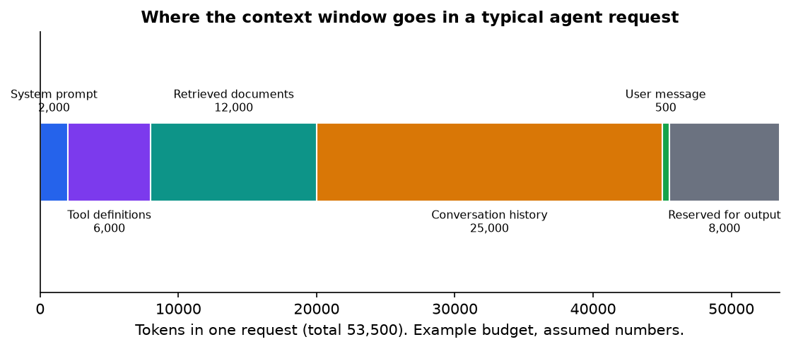
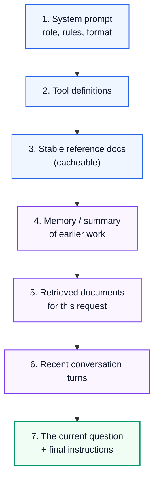
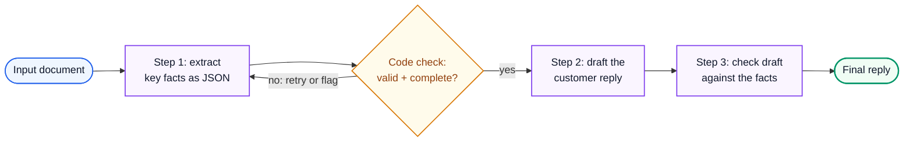

# AI Engineering 2: Prompting and Context Engineering

> **Series (AI engineering):** [0 Start Here](AI%20Engineering%200%20-%20Start%20Here.md) · [1 How LLMs Work](AI%20Engineering%201%20-%20How%20LLMs%20Work.md) · **2 Prompting and Context Engineering** · [3 Evals and Quality](AI%20Engineering%203%20-%20Evals%20and%20Quality.md) · [4 Retrieval and RAG](AI%20Engineering%204%20-%20Retrieval%20and%20RAG.md) · [5 Agents](AI%20Engineering%205%20-%20Agents.md) · [6 Production LLM Engineering](AI%20Engineering%206%20-%20Production%20LLM%20Engineering.md) · [7 Safety, Security and Governance](AI%20Engineering%207%20-%20Safety%20Security%20and%20Governance.md) · [8 Serving and GPU Infrastructure](AI%20Engineering%208%20-%20Serving%20and%20GPU%20Infrastructure.md) · [9 Customising Models](AI%20Engineering%209%20-%20Customising%20Models.md)
> **Source:** built from research: provider prompting guides, papers and engineering write-ups listed in [References](#15-references). Every number recomputed with Python. Figures: [make_figs.py](../../figures/ai_engineering/make_figs.py). Code: [ai_structured_output.py](../../code/ai_structured_output.py).
> **Facts re-checked:** 22 October 2026.

**The big picture:** the model can only act on the tokens you give it. **Prompting** is writing clear instructions. **Context engineering** is the bigger job: deciding *everything* that goes into the context window (instructions, examples, tools, retrieved documents, history, memory), in what order, and what gets left out or compressed. In 2026 it's the core day-to-day skill of AI engineering.

Diagram colours: 🔵 input · 🟣 processing · 🟢 result · 🟠 trade-off · 🔴 failure

---

## Contents

0. [How to use this guide](#0-how-to-use-this-guide)
1. [TL;DR](#1-tldr)
2. [How a request is built: system, user and assistant](#2-how-a-request-is-built-system-user-and-assistant)
3. [Writing clear instructions](#3-writing-clear-instructions)
4. [Examples: zero-shot and few-shot](#4-examples-zero-shot-and-few-shot)
5. [Structured outputs](#5-structured-outputs)
6. [Context engineering](#6-context-engineering)
7. [Templates and prompt chaining](#7-templates-and-prompt-chaining)
8. [Prompting reasoning models](#8-prompting-reasoning-models)
9. [Long context or retrieval?](#9-long-context-or-retrieval)
10. [Techniques that faded](#10-techniques-that-faded)
11. [Managing prompts like code](#11-managing-prompts-like-code)
12. [Thinking critically: decisions and trade-offs](#12-thinking-critically-decisions-and-trade-offs)
13. [Self-check](#13-self-check)
14. [Glossary](#14-glossary)
15. [References](#15-references)

---

## 0. How to use this guide

| If you have… | Read |
|---|---|
| 10 minutes | §0.1, §1, §3 |
| 1 hour | §2–§6: the essentials of reliable prompts and the context budget |
| A weekend | Everything. Then take a prompt you use at work and rewrite it with §3 and §6. |

### 0.1 First, in completely plain words

Think of the model as a brilliant new colleague with **no memory of you, your company or yesterday**. Every request, you hand them a folder. Whatever is in the folder is all they know about the task.

- **Prompting** is writing the task note on top of the folder: what you want, why, what good looks like, what to avoid, and the format of the answer.
- **Context engineering** is deciding what else goes *into* the folder: which documents, which past messages, which tools they may use, which examples. Too little and they guess. Too much and they get lost in it, and every page costs money and time.

Good prompts aren't magic phrases. They're clear briefs, the same kind you'd write for a capable human who has never seen your project.

---

## 1. TL;DR

1. **Use the message roles properly.** The system prompt holds stable instructions and rules; user messages hold the task and data; assistant turns hold earlier replies.
2. **Be explicit and give the reason.** Say what you want, the context, the constraints, the output format and how success is judged. Explaining *why* a rule exists helps the model apply it sensibly.
3. **Separate instructions from data** with XML tags or clear delimiters. Put long documents *before* the question.
4. **Few-shot examples** teach format and style quickly. Keep them diverse, or the model copies them too literally.
5. **Structured outputs:** use the provider's schema-constrained mode where available, and *always* validate. Retrying with the error message fixes most failures: at a 95% first-try success rate, two retries give about 99.99% (if failures are independent).
6. **Context engineering:** the context window is a budget. A typical agent request is ~50k tokens spread across system prompt, tools, documents, history and output reserve. Keep it small and high-signal; retrieve just in time; compact old history; put the stable parts first so they can be cached.
7. **Chain prompts** when a task has distinct steps that can each be checked. One giant prompt is harder to debug.
8. **Reasoning models** want goals and success criteria, not step-by-step micromanagement.
9. **Long context vs retrieval:** stuffing a 250k-token manual into every query can cost ~50× more than retrieving the relevant 5k tokens. Caching narrows that gap.
10. **Treat prompts as code:** version them, test them against evals, and review the changes.

---

## 2. How a request is built: system, user and assistant

**The problem.** A chat model isn't fed one big string you control. It's fed a structured conversation, and the structure carries meaning that the model was trained on.

**How it works.** A request is a list of messages, each with a **role**:

| Role | What goes there | Why |
|---|---|---|
| **System** | Stable instructions: the job, rules, tone, output format, tool-use policy, safety constraints | Models are trained to weight it as the operator's standing instructions, and it stays the same across turns (so it caches well, §6) |
| **User** | The current task, question and data | What changes from request to request |
| **Assistant** | The model's earlier replies (and its tool calls) | Gives the conversation memory. You can also *pre-fill* the start of a reply on some APIs to force a format. |
| **Tool / tool result** | Results returned from tools the model called | Covered in Guide 5 |

The API turns these into special tokens (Guide 1 §2) in the model's chat template. That's why you should use the roles rather than writing "User: … Assistant: …" into one big text block.

**What belongs in a good system prompt:**

1. The **role and goal**, concretely ("You answer customer questions about Acme's billing for small businesses").
2. **Context** the model can't know: who the users are, what the product does.
3. **Rules and constraints**, each with a short reason.
4. **Output format.**
5. **What to do when unsure** ("If the answer isn't in the provided documents, say so and offer to escalate").

> **"You are a world-class expert…"** (role prompting) used to give measurable gains. With current models the effect is small. A sentence of real context about the task does far more than a grand title. Keep a role if it sets useful context ("you're reviewing code for a security audit"), not as a magic phrase.

---

## 3. Writing clear instructions

**The problem.** Most bad outputs come from ambiguous prompts. The model fills gaps with plausible guesses, and its guesses aren't your intentions.

**The principles that consistently matter:**

1. **Be explicit about what you want.** "Summarise this" leaves length, audience and focus open. "Summarise this incident report in 5 bullet points for an executive: impact, cause, fix, what's still at risk, next steps" doesn't.
2. **Give the reason.** "Never use ellipses, because this text is read aloud by a speech engine that can't pronounce them" lets the model generalise ("avoid other symbols it can't read aloud too"). A bare rule is followed only literally.
3. **Say what to do, not only what not to do.** "Write in flowing paragraphs" works better than "Don't use bullet points".
4. **Define success.** Tell it how the answer will be judged ("Correct if every claim cites a sentence from the document").
5. **Specify the output format exactly**, ideally with a schema or a short example (§4, §5).
6. **Handle the edge cases:** missing information, ambiguous requests, out-of-scope requests.
7. **Match the prompt's style to the output you want.** A prompt written in heavy markdown tends to get markdown back.

**Separate instructions from data with delimiters.** When a prompt mixes your instructions with documents, emails or user input, wrap each part in clearly named tags:

```xml
<instructions>
Answer the question using only the contract below. Quote the clause you rely on.
If the contract doesn't answer it, reply "Not covered by this contract."
</instructions>

<contract>
... 40 pages ...
</contract>

<question>
Can either party terminate early without penalty?
</question>
```

Tags help in three ways: the model knows exactly where each part begins and ends; you can refer to parts by name ("using the `<contract>`"); and it makes data look like **data**, not instructions. That's a first line of defence against prompt injection (Guide 7 §3), though not a complete one.

**Order matters for long inputs.** Put long documents **near the top**, and the specific question and final instructions **at the end**. Providers report noticeably better answers this way, and it matches what we know about models using the start and end of the context best (Guide 1 §5).

**Ask for quotes first on long documents.** "First extract the passages relevant to the question into `<quotes>`, then answer using only those" focuses the model on evidence and makes the answer checkable.

---

## 4. Examples: zero-shot and few-shot

**The problem.** Some requirements are hard to describe but easy to show: a tone, a labelling style, an output layout.

**How it works.**

- **Zero-shot**: instructions only, no examples. Modern models do most tasks well this way. Try it first.
- **Few-shot**: include a handful of input → output examples (Brown et al., 2020, showed large models learn from examples in the prompt, "in-context learning"). The model infers the pattern.

**How to choose examples:**

| Do | Avoid |
|---|---|
| 3–5 examples covering **different** cases, including an edge case | Five near-identical examples: the model copies their surface features (length, phrasing, even topics) |
| Wrap them in `<example>` tags, clearly separated from the real input | Examples that disagree with your written instructions: the examples usually win |
| Include a "hard negative": an input that should be refused, or labelled "other" | Only easy cases |
| Use real (anonymised) data from your domain | Toy examples unlike real traffic |

> **The over-fitting trap.** If every example summary is exactly three sentences long, every output will be three sentences, even when the input needs one or six. Vary the examples on every dimension you *don't* want copied.

---

## 5. Structured outputs

**The problem.** Software can't use "Sure! Here's the classification: it's probably billing." It needs `{"category": "billing", "priority": 2}`, every time, matching a schema, or the pipeline breaks.

**How it works: three levels of reliability.**

1. **Ask for JSON in the prompt.** Works most of the time, but you'll still get stray prose, missing fields and invented values.
2. **JSON mode**: the API guarantees syntactically valid JSON, but not *your* schema.
3. **Schema-constrained decoding** ("structured outputs" in most APIs; also tool/function-call schemas): you supply a JSON Schema, and at each generation step the decoder **masks out every token that would break the schema**. The output is then guaranteed to parse and match the structure (Willard and Louf, 2023, describe the grammar-constrained technique). Open-source serving engines offer the same through libraries such as Outlines, XGrammar and llguidance.

Even with constrained decoding, **validate anyway**. A schema can guarantee `"priority"` is an integer, but not that the integer is *sensible*, that a quoted text actually appears in the document, or that an ID exists in your database. Those are business rules for your own code.

**Validate, then retry with the error.** When validation fails, send the error back to the model and ask again. The model is usually good at fixing a specific, clearly described mistake. The demo uses a scripted stand-in model ([ai_structured_output.py](../../code/ai_structured_output.py), actual output):

```text
attempt 1: INVALID -> Output was not valid JSON (Expecting value at char 0). Return only a JSON object.
attempt 2: INVALID -> Field 'category' must be one of ['billing', 'bug', 'feature_request', 'other'], got 'payments'.
attempt 3: OK -> {'category': 'billing', 'priority': 2, 'summary': 'Customer was charged twice for one order'}
```

The core loop:

```python
for attempt in range(1, max_attempts + 1):
    reply = model(messages)
    data, error = validate(reply)          # parse + schema + business rules
    if data:
        return data
    messages += [{"role": "assistant", "content": reply},
                 {"role": "user", "content": f"Your reply was invalid: {error} Try again."}]
```

**How much do retries help?** If each attempt independently succeeds with probability $p$, then the chance of success within $k$ attempts is:

$$
P(\text{success within } k) = 1 - (1 - p)^{k}
$$

*The chance of succeeding at least once is one minus the chance of failing every time.*

| First-try success $p$ | 1 attempt | 2 attempts | 3 attempts |
|---|---|---|---|
| 90% | 90% | 99% | 99.9% |
| 95% | 95% | 99.75% | 99.9875% |
| 99% | 99% | 99.99% | 99.9999% |

The catch: failures are often **not** independent. If an input is genuinely ambiguous, the model may fail the same way every time. Cap the retries, log the failures, and send persistent failures to a fallback (a stronger model, a human queue, or a safe default). Each retry also adds latency and cost.

**Design tips for schemas:** keep them shallow; use enums for categories; include a field for uncertainty or "not found" so the model isn't forced to invent a value; and put a `reasoning` field *before* the answer fields when the task needs thought (generation runs in order, so the reasoning comes first).

---

## 6. Context engineering

**The problem.** Prompts used to be one well-written instruction. Today's applications, especially agents, assemble context from many sources on every request: system prompt, tool definitions, retrieved documents, conversation history, memories, tool results. The prompt wording is now the *small* part. Deciding **which tokens reach the model** decides quality, cost and latency. Anthropic's 2025 engineering write-up named this **context engineering**: finding the smallest set of high-signal tokens that maximises the chance of the outcome you want.



*Fig 3 (f03_context_budget.png). An example budget with assumed numbers. Notice the user's actual message is under 1% of what the model reads. Conversation history is usually the part that grows without limit.*

**Why "more context" isn't better:** every token costs money and latency (Guide 6), long contexts degrade quality ("context rot", Guide 1 §5), and irrelevant text actively distracts the model. Attention is a limited budget, too.

**The techniques:**

| Technique | What it means | Example |
|---|---|---|
| **Minimal, high-signal instructions** | The smallest system prompt that fully specifies the behaviour | Cut repeated rules and long lists of edge cases nobody hits |
| **Just-in-time retrieval** | Don't preload everything; give the model ways to fetch what it needs when it needs it | Search and file-reading tools instead of pasting the whole codebase (Guides 4, 5) |
| **Lean tool definitions** | Few, well-described, non-overlapping tools | 10 clear tools beat 60 overlapping ones; load rarely used tools on demand |
| **Trim tool outputs** | Return what the model needs, not raw dumps | Return the 20 matching log lines, not 5 MB of logs |
| **Compaction** | Summarise old conversation turns as the window fills; keep decisions, open issues and key facts | Agents summarise and restart with the summary plus recent turns |
| **Structured notes / memory** | The model writes durable notes outside the context and reads them back later | A `progress.md` or to-do file in long agent tasks (Guide 5 §6) |
| **Sub-agents** | Hand a messy sub-task to a fresh context; get back only a short result | Research agent returns a 1-page summary, not 80 pages of search results |
| **Cache-friendly ordering** | Stable content first (system prompt, tools, fixed documents), changing content last | Enables prompt caching: large discounts on the repeated prefix (Guide 6 §9) |

**Worked example: the budget.** The request in Fig 3 totals 2,000 + 6,000 + 12,000 + 25,000 + 500 + 8,000 = **53,500 tokens**. Two cheap improvements: compacting the 25,000-token history to a 3,000-token summary plus recent turns, and loading tools on demand (6,000 → 2,000). Together they save 26,000 tokens, about **49% of the request**, on *every* call. And because the system prompt and tools come first and rarely change, they can be served from the prompt cache.

**Order of the context, top to bottom:**



Stable-to-changing order serves two goals at once: it makes the prefix cacheable, and it puts the specific question at the end, where models attend well.

---

## 7. Templates and prompt chaining

**Prompt templates.** Real prompts are templates with variables filled at runtime: the user's name, the retrieved documents, today's date. Keep templates in version control (§11), render them with a proper templating library, and **never** paste untrusted text into the *instruction* parts. Put it inside data tags (§3). Include the current date when it matters; the model doesn't know it.

**Prompt chaining.** Split a complex task into a sequence of smaller prompts, where each step's output feeds the next:



| Single prompt | Chain |
|---|---|
| Fewer calls, lower latency | Each step is simpler, so more reliable |
| Hard to tell which part failed | Each step can be tested and evaluated on its own (Guide 3) |
| One model for everything | Each step can use a different model: cheap for extraction, strong for writing |
| | Code-based **gates** between steps catch errors early |

Chaining is the simplest form of a **workflow**: fixed steps, written by you. When the steps can't be known in advance, you move to an **agent**, which decides its own steps (Guide 5 §3).

---

## 8. Prompting reasoning models

**The problem.** Reasoning models (Guide 1 §9) think before answering. Prompts written for older models, with detailed step-by-step instructions, can make them *worse*, because they constrain a thinking process the model already does better on its own.

**What works:**

1. **State the goal, the constraints and how success is judged.** Leave the *method* to the model unless you have a specific reason.
2. **Don't add "think step by step".** It's redundant, and some providers advise against it.
3. **Give the full context up front.** The thinking can only use what's provided.
4. **Use the effort or thinking-budget setting** instead of prompt tricks to trade depth for speed and cost.
5. **Examples still help with output format.** They help less with the reasoning itself.
6. **Ask for verification when it matters:** "Before finishing, check your answer against the test cases."

---

## 9. Long context or retrieval?

**The problem.** Context windows now hold entire manuals or codebases. Why bother with retrieval (Guide 4) if you can paste everything in?

**Worked example.** A 500-page product manual is about 250,000 tokens. The relevant part for a typical question is about 5,000 tokens. With an assumed price of \$3 per million input tokens, for 1,000 questions a day:

| Approach | Tokens per question | Daily input cost |
|---|---|---|
| Paste the whole manual | 250,000 | 250M tokens → **\$750** |
| Retrieve the relevant 5k | 5,000 | 5M tokens → **\$15** |
| Whole manual, served from the prompt cache (cache reads at 0.1× price) | 250,000 | ≈ **\$75**, plus occasional cache writes |

Retrieval is 50× cheaper here, and faster. Caching closes most of the gap, but not the latency or "context rot" problems.

| Prefer **long context** when… | Prefer **retrieval** when… |
|---|---|
| The material is small enough to fit comfortably (tens of thousands of tokens) | The corpus is large, or larger than any window |
| The task needs the *whole* thing at once (summarise a contract, cross-reference a codebase) | Each question needs a small, findable part |
| It's reused across many requests (cache it) | Content changes often, or differs per user (permissions) |
| You're prototyping | You need citations, freshness and cost control at scale |

In practice they combine: retrieve candidates generously, then let a long-context model read them all (Guide 4 §9).

---

## 10. Techniques that faded

Some famous techniques matter much less with 2026 models. Know them, because you'll see them in older code and papers.

| Technique | What it was | Status now |
|---|---|---|
| **Role prompting** | "You are a world-class X" | Small effect; real context about the task matters more (§2) |
| **"Think step by step" (chain-of-thought prompting)** | Asking for reasoning before the answer (Wei et al., 2022) | Built into reasoning models; still useful for *non-reasoning* models on multi-step tasks, and when you need visible reasoning for review |
| **Self-consistency** | Sample many reasoning paths, take the majority answer (Wang et al., 2022) | Expensive (N× the cost); reasoning models largely do this internally. Still useful for high-stakes answers with a single checkable output. |
| **Magic words** ("I'll tip \$200", "this is very important to my career") | Emotional or incentive phrases | Unreliable; clear instructions beat them |
| **ALL-CAPS and repeated warnings** | "YOU MUST NEVER…" | Modern models follow calm, explicit instructions. Shouting can make them over-apply a rule. |

---

## 11. Managing prompts like code

**The problem.** A one-word change to a system prompt can fix one case and silently break ten others. Prompts are part of your application's logic, so they need the same discipline as code.

- **Version control.** Prompts live in the repository (or a prompt registry), with history, review and rollback. Every production response is logged with the prompt *version* that produced it.
- **Test before shipping.** Every prompt change runs against an eval set: a fixed collection of real inputs with checks (Guide 3). "It looked better on three examples" is not evidence.
- **Pin model versions.** Use dated model identifiers in production, and treat a model upgrade like a dependency upgrade: run the evals first.
- **Change one thing at a time,** so you know what caused an improvement or a regression.
- **Keep prompts readable.** A clear prompt that a teammate can understand beats a clever one nobody dares to edit.

---

## 12. Thinking critically: decisions and trade-offs

Prompting looks like writing, but it's really **specification under uncertainty**: you're defining a job for a reader who can't ask you questions.

**Questions to ask before writing or changing a prompt**

1. **What would a smart new hire need to know** to do this well on day one? Is all of it in the context?
2. **Who consumes the output: a person or code?** Code needs strict structure and validation; people need clarity and the right length.
3. **What's the smallest context that works?** Every extra token costs money and attention.
4. **What's stable across requests, and what changes?** Stable parts go first and get cached.
5. **How will I know this change helped?** If the answer is "it looked better on 3 examples", you don't know yet (Guide 3).

**Where common advice breaks**

| Advice | When it fails |
|---|---|
| "Add more examples" | Examples get copied too literally; past a handful, diversity matters more than count |
| "Add a rule for every failure" | Prompts grow into contradictory rulebooks; the model can't tell which rule wins |
| "Structured output solves reliability" | It guarantees *shape*, not *correctness* |
| "This prompt trick works" | Tricks are model-specific. Re-test every prompt when you change models. |
| "Long context removes the need for retrieval" | It moves the cost and quality problems, not removes them (§9) |

**Decision scenarios**

<details>
<summary>A. After six months, the system prompt is 4,000 words of rules and quality is getting worse. What do you do?</summary>

Treat it as a code smell. Run error analysis on current failures (Guide 3 §4), then check which rules relate to actual failures. Look for contradictions ("be concise" vs "always explain fully"), and rules for cases that never occur. Rewrite as a short brief: goal, context, a few principles *with reasons*, output format. Move rare, situation-specific guidance into material retrieved only when relevant. Compare old vs new on the same eval set. Shorter is not automatically better, but a rulebook nobody can reason about is worse.
</details>

<details>
<summary>B. 3% of JSON outputs fail validation. Options: a retry loop, constrained decoding, or fine-tuning. Which first?</summary>

Look at *why* they fail. Syntax and shape errors → turn on constrained decoding: cheap, and it removes the whole class. Business-rule errors (invalid values, made-up IDs) → validate in code and retry with the specific error message. Check whether failures repeat on the same inputs: if they do, retries won't help, and the input or instructions are ambiguous. Fine-tuning comes last: it's the most expensive option, and it's only justified if a specific, persistent behaviour still fails after the cheaper fixes.
</details>

<details>
<summary>C. Should the 60-page refund policy (~30k tokens) go into every support request?</summary>

It depends on numbers you can find: request volume, how many policy sections a typical question needs, whether the policy changes often, and whether prompt caching applies. At low volume, with questions spanning the whole policy, including it (with caching) is simple and robust. At high volume with targeted questions, retrieve the relevant sections. Either way, measure answer accuracy on real questions. "Simple first" is a good default, but "simple" must still pass the evals.
</details>

**Understand deeply vs look up when needed**

| Understand | Look up |
|---|---|
| Ambiguity is the main cause of bad outputs | Each provider's recommended prompt formats |
| Instructions vs data must be separated | Exact structured-output API syntax |
| The context window is a budget, and order matters | Current caching rules and discounts |
| Prompts are code: version and test them | Which "tricks" a given model responds to |

---

## 13. Self-check

<details>
<summary>1. Where should stable rules go, and why does it matter for cost?</summary>

In the **system prompt**, at the start of the context. Stable content first forms a fixed prefix that can be **prompt-cached**, so it's billed at a fraction of the price on repeat requests.
</details>

<details>
<summary>2. Your few-shot examples are all 3-sentence summaries, and every output is 3 sentences. What's wrong and how do you fix it?</summary>

The model copies the surface features of the examples. Vary the examples' length (and any other feature you don't want copied), and state the length rule explicitly.
</details>

<details>
<summary>3. Constrained decoding guarantees the output matches the schema. Why validate anyway?</summary>

The schema can't check business rules: whether values are sensible, whether quoted text exists in the source, whether IDs exist. Those need code checks.
</details>

<details>
<summary>4. First-try validity is 90%. With up to 3 attempts, what's the success rate, and why might the real number be lower?</summary>

$1 - 0.1^3 = 0.999$, i.e. 99.9%, if failures were independent. They often aren't: hard or ambiguous inputs fail repeatedly, so cap retries and use a fallback.
</details>

<details>
<summary>5. Name four context-engineering techniques for a long-running agent.</summary>

Compaction (summarising old history), just-in-time retrieval via tools, trimming tool outputs, structured notes or memory outside the context, sub-agents with their own contexts, and lean tool definitions. Any four.
</details>

<details>
<summary>6. How should you change an old step-by-step prompt for a reasoning model?</summary>

Replace the prescribed steps with the goal, the constraints, the full context and the success criteria. Drop "think step by step". Control depth with the effort or thinking-budget setting.
</details>

---

## 14. Glossary

| Term | Meaning |
|---|---|
| **System prompt** | Stable, operator-level instructions at the start of the context |
| **Role prompting** | Assigning the model a persona; small effect on modern models |
| **Delimiters / XML tags** | Markers separating instructions from data |
| **Zero-shot / few-shot** | Instructions only / instructions plus examples |
| **In-context learning** | Learning a task pattern from examples in the prompt, with no weight changes |
| **JSON mode** | API guarantee of syntactically valid JSON |
| **Constrained decoding** | Masking tokens during generation so output must match a schema or grammar |
| **Context engineering** | Choosing and arranging everything in the context window |
| **Context budget** | How a request's tokens are split across sources |
| **Compaction** | Summarising old context to free space |
| **Just-in-time retrieval** | Fetching information via tools when needed, instead of preloading |
| **Prompt chaining** | Splitting a task into sequential prompts with checks between them |
| **Gate** | A code check between chain steps |
| **Effort / thinking budget** | Setting controlling how much a reasoning model thinks |
| **Self-consistency** | Majority vote over several sampled reasoning paths |
| **Prompt registry** | Versioned store of prompts used in production |

---

## 15. References

- Anthropic, "Prompt engineering overview" and "Claude prompting best practices", Claude documentation (accessed October 2026).
- Anthropic Applied AI team, "Effective context engineering for AI agents", Anthropic Engineering blog, September 2025.
- OpenAI, "Introducing Structured Outputs in the API", August 2024; OpenAI prompting guides for reasoning models.
- Brandon T. Willard and Rémi Louf, "Efficient Guided Generation for Large Language Models" (Outlines), 2023.
- Tom Brown et al., "Language Models are Few-Shot Learners" (GPT-3), NeurIPS 2020.
- Jason Wei et al., "Chain-of-Thought Prompting Elicits Reasoning in Large Language Models", 2022.
- Xuezhi Wang et al., "Self-Consistency Improves Chain of Thought Reasoning in Language Models", 2022.
- Nelson F. Liu et al., "Lost in the Middle: How Language Models Use Long Contexts", 2023.

**Next:** [Guide 3: Evals and Quality](AI%20Engineering%203%20-%20Evals%20and%20Quality.md), how to know whether a prompt change actually helped.
