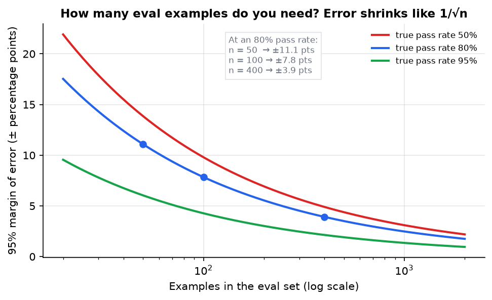
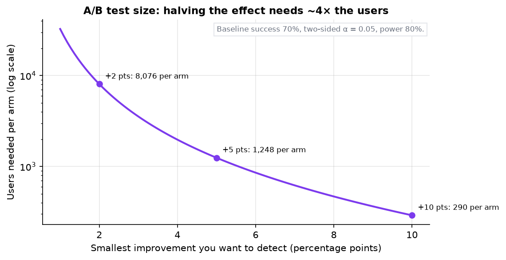
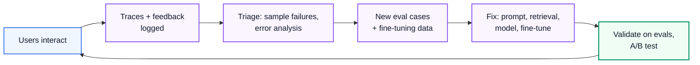

# AI Engineering 3: Evals and Quality

> **Series (AI engineering):** [0 Start Here](AI%20Engineering%200%20-%20Start%20Here.md) · [1 How LLMs Work](AI%20Engineering%201%20-%20How%20LLMs%20Work.md) · [2 Prompting and Context Engineering](AI%20Engineering%202%20-%20Prompting%20and%20Context%20Engineering.md) · **3 Evals and Quality** · [4 Retrieval and RAG](AI%20Engineering%204%20-%20Retrieval%20and%20RAG.md) · [5 Agents](AI%20Engineering%205%20-%20Agents.md) · [6 Production LLM Engineering](AI%20Engineering%206%20-%20Production%20LLM%20Engineering.md) · [7 Safety, Security and Governance](AI%20Engineering%207%20-%20Safety%20Security%20and%20Governance.md) · [8 Serving and GPU Infrastructure](AI%20Engineering%208%20-%20Serving%20and%20GPU%20Infrastructure.md) · [9 Customising Models](AI%20Engineering%209%20-%20Customising%20Models.md)
> **Source:** built from research: practitioner guides, papers and statistics references listed in [References](#18-references). Every number recomputed with Python. Figures: [make_figs.py](../../figures/ai_engineering/make_figs.py). Code: [ai_eval_harness.py](../../code/ai_eval_harness.py).
> **Facts re-checked:** 24 October 2026.

**The big picture:** an LLM app can't be unit-tested like normal code, because the same input gives varied, free-text outputs, and "correct" is often a judgment call. **Evals** are how you measure quality anyway: a dataset of real inputs, a way to grade outputs (code checks, LLM judges, humans), and the statistics to know whether a difference is real. Teams that build evals first improve steadily. Teams that tune prompts by feel go in circles.

Diagram colours: 🔵 input · 🟣 processing · 🟢 result · 🟠 trade-off · 🔴 failure

---

## Contents

0. [How to use this guide](#0-how-to-use-this-guide)
1. [TL;DR](#1-tldr)
2. [Eval-driven development](#2-eval-driven-development)
3. [Building the eval dataset](#3-building-the-eval-dataset)
4. [Error analysis: look at your data](#4-error-analysis-look-at-your-data)
5. [Deterministic checks](#5-deterministic-checks)
6. [LLM-as-a-judge](#6-llm-as-a-judge)
7. [Human evaluation](#7-human-evaluation)
8. [Groundedness, retrieval and agent evals](#8-groundedness-retrieval-and-agent-evals)
9. [Offline vs online evals](#9-offline-vs-online-evals)
10. [Regression testing in CI](#10-regression-testing-in-ci)
11. [A/B testing in production](#11-ab-testing-in-production)
12. [User feedback and the data flywheel](#12-user-feedback-and-the-data-flywheel)
13. [Cost and latency are quality too](#13-cost-and-latency-are-quality-too)
14. [Benchmarks and leaderboards](#14-benchmarks-and-leaderboards)
15. [Thinking critically: decisions and trade-offs](#15-thinking-critically-decisions-and-trade-offs)
16. [Self-check](#16-self-check)
17. [Glossary](#17-glossary)
18. [References](#18-references)

---

## 0. How to use this guide

| If you have… | Read |
|---|---|
| 10 minutes | §0.1, §1, §4 |
| 1 hour | §2–§6: the eval loop, error analysis and judges, which is the core of the skill |
| A weekend | Everything, then build a 50-example eval for something you're working on |

### 0.1 First, in completely plain words

Imagine running a kitchen where every dish comes out slightly different, and "good" depends partly on taste. You can't check each dish against one exact recipe. So you do three things:

1. **Taste a lot of dishes and write down what goes wrong** ("too salty", "cold in the middle"). Then count which problems happen most. That's **error analysis**.
2. **For each common problem, set up a quick test.** A thermometer for "cold in the middle" (a code check). A trained taster for "too salty" (an LLM judge, checked against your own taste).
3. **Before changing the recipe, test the new version on the same set of dishes**, and only keep the change if it's really better, not just lucky on three plates. That's a **regression eval**, with enough examples to trust the result.

That's the whole discipline. The rest is doing it carefully.

---

## 1. TL;DR

1. **Eval-driven development:** collect real examples → look at outputs → name the failure modes → build a check for each → change the system → re-run everything. Repeat.
2. **Error analysis comes first.** Read ~100 traces, write a note on each failure (*open coding*), group the notes into failure modes (*axial coding*), count them. Fix the biggest bucket first.
3. **Prefer code checks** (valid JSON, citation present, banned phrases, length) wherever the criterion is objective. They're free, fast and deterministic.
4. **LLM judges** for subjective criteria: one judge per failure mode, **binary pass/fail**, with a written rubric. **Calibrate** each judge against human labels (TPR, TNR, Cohen's kappa) before trusting it.
5. **Sample size matters.** At an 80% pass rate, 50 examples give ±11 points of uncertainty, 100 give ±8, 400 give ±4. Small evals can't detect small improvements.
6. **A/B tests** need far more: detecting +5 points on a 70% baseline needs about **1,250 users per arm**. Halving the effect size quadruples the sample.
7. **Offline evals** (before shipping) and **online evals** (production monitoring) complement each other. Production traffic is where new failure modes appear.
8. **Run evals in CI** on every prompt or model change, several times per case where outputs vary (report consistency as well as averages).
9. **Feedback loops** (thumbs, edits, retries, escalations) turn production into new eval cases: the **data flywheel**.
10. **Cost and latency are eval dimensions.** Choose the cheapest, fastest configuration that passes the quality bar.
11. **Public leaderboards** are a starting filter, not evidence for your task. Contamination and benchmark over-fitting are common.

---

## 2. Eval-driven development

**The problem.** Prompt changes in LLM apps have non-local effects. Fixing one case can break others you didn't look at. Without measurement, teams spot-check three examples, ship, and find out from users.

**How it works.** Treat evals like tests in test-driven development, but statistical:

```mermaid
flowchart LR
    accTitle: Eval-driven development loop
    accDescr: Collect real inputs, run the system, analyse errors into failure modes, build checks and judges, change the system, then re-run the full eval and repeat; production traces feed back in.
    A["1. Collect real inputs<br/>(logs, edge cases)"] --> B["2. Run the system,<br/>save full traces"]
    B --> C["3. Error analysis<br/>name failure modes"]
    C --> D["4. Build checks:<br/>code + LLM judges"]
    D --> E["5. Change prompt, model,<br/>retrieval or tools"]
    E --> F["6. Re-run full eval<br/>compare to baseline"]
    F -->|"better, no regressions"| G(["Ship + monitor"])
    F -->|"worse or unclear"| C
    G -.->|"new production traces"| A
    class A,B primary;
    class C,D,E intermediate;
    class F warning;
    class G target;
    classDef primary fill:#EFF6FF,stroke:#2563EB,stroke-width:1.5px,color:#0F172A;
    classDef intermediate fill:#FAF5FF,stroke:#7C3AED,stroke-width:1.5px,color:#0F172A;
    classDef warning fill:#FFFBEB,stroke:#D97706,stroke-width:1.5px,color:#92400E;
    classDef target fill:#F0FDF4,stroke:#059669,stroke-width:2px,color:#0F172A;
```



Two principles make it work:

- **Evals come from your failures, not from a generic checklist.** Off-the-shelf metrics ("helpfulness score", "coherence") rarely track what goes wrong in *your* product. Build checks for the failure modes you actually observe.
- **Save full traces**: the input, every intermediate step (retrieved documents, tool calls), the output, the prompt and model version, latency and cost. You can't debug what you didn't record (Guide 6 §10).

---

## 3. Building the eval dataset

**The problem.** An eval is only as good as its examples. Ten hand-picked happy-path questions measure nothing useful.

**Where examples come from:**

| Source | Strength | Watch out for |
|---|---|---|
| **Production logs** (anonymised) | Real distribution of what users ask | Privacy: redact PII (Guide 7 §7); consent and retention rules |
| **Known failures** (bug reports, support escalations) | Targets what actually broke | Over-represents rare problems if you only add failures |
| **Edge cases** you design | Covers boundaries: empty input, very long input, other languages, ambiguity | Can drift away from real usage |
| **Adversarial cases** | Prompt injection, jailbreaks, out-of-scope requests | Belongs in a separate safety suite too (Guide 7 §6) |
| **Synthetic data** | Fills gaps fast before you have users | Tends to be cleaner and more generic than real input |

**A "golden dataset"** is a curated set of inputs, ideally with reference answers or grading notes, that stays stable so results are comparable over time. Version it like code. Add to it whenever production reveals a new failure mode, but keep a frozen core so trends stay meaningful.

**Generating useful synthetic inputs.** Asking a model "give me 100 test questions" produces bland, repetitive ones. Instead, define the **dimensions** that vary in real usage, combine them, and generate one input per combination:

| Dimension | Values |
|---|---|
| Persona | new user, expert admin, frustrated customer |
| Intent | billing question, bug report, cancellation |
| Difficulty | answer in docs, answer needs two docs combined, not answerable |
| Style | terse, rambling, non-native English |

3 × 3 × 3 × 4 = **108 combinations**, each a targeted test. Review a sample by hand. Discard unrealistic ones.

> **Four statistics ideas you need (no prior stats assumed).**
> 1. **Noise.** A pass rate measured on a sample isn't the true pass rate, just as 10 coin flips rarely give exactly 5 heads. Run the same eval on a *different* 100 cases and you'd get a slightly different number.
> 2. **Standard error: the size of that noise.** For a pass rate $p$ measured on $n$ cases, it's $\sqrt{p(1-p)/n}$. At $p = 0.8$, $n = 100$: $\sqrt{0.16/100} = 0.04$, i.e. about 4 points. It shrinks with $\sqrt{n}$, so 4× the cases halves the noise.
> 3. **95% confidence interval.** About 95% of the time, the true value lies within ±1.96 standard errors of the measured one. That's where the 1.96 in the formulas comes from: 1.96 × 4 points ≈ ±7.8 points.
> 4. **Significance and power** (for comparing two versions). *Significance* (often written α = 5%) is the false-alarm rate you accept: the chance of declaring a winner when there's really no difference. *Power* (often 80%) is the chance of detecting a real improvement of the size you care about. Higher confidence or higher power both need more data.
>
> The habit these build: **before believing any difference between two numbers, ask how big the noise is.**

**How big?** It depends on the size of the difference you need to detect. The margin of error of a measured pass rate $\hat{p}$ over $n$ independent examples is approximately:

$$
\text{margin of error} \approx 1.96 \sqrt{\frac{\hat{p}(1 - \hat{p})}{n}}
$$

*The 95% margin of error is 1.96 times the square root of the pass rate times the fail rate, divided by the number of examples.*



*Fig 4 (f04_eval_margin_of_error.png). At an 80% pass rate: 50 examples → ±11.1 points, 100 → ±7.8, 400 → ±3.9. To halve the uncertainty you need 4× the examples.*

**The practical reading:** with 50 examples, a change from 78% to 84% is noise. Use the small set for fast iteration and *catching large regressions*. Use several hundred examples (or a paired comparison, below) to confirm small improvements. Near 0% or 100%, or with very few examples, use the **Wilson interval** rather than this formula. The demo shows 3 passes out of 6 has a 95% interval of **19%–81%**: almost no information.

**Paired comparison: the cheap way to compare two versions.** The margin above is for *one* pass rate measured on a random sample. When you compare an old and a new version, run both on the **same** cases. Then most cases tell you nothing new: they pass under both versions, or fail under both. All the evidence sits in the cases that **flipped**:

| | New version passes | New version fails |
|---|---|---|
| **Old version passes** | no information | **flipped to fail** ($b$) |
| **Old version fails** | **flipped to pass** ($c$) | no information |

If the change made no real difference, each flipped case is equally likely to go either way, like a coin toss. So the question is just: are $c$ and $b$ more lopsided than coin tosses would be? (This is **McNemar's test**, or equivalently a sign test on the flips.)

**Worked example.** Old 85%, new 88% on the same 200 cases: a net gain of 6 cases. Two very different stories give that same +3 points:

- 14 flipped to pass and 8 flipped to fail. With 22 fair coin tosses, a split at least as lopsided as 14 to 8 (in either direction) happens about 29% of the time ($p \approx 0.29$), so this is weak evidence. The change helped some cases and hurt others.
- 6 flipped to pass and none flipped to fail. Six tosses all landing the same way happens by chance only $2/2^6 \approx 0.03$ of the time, about 3%, ($p \approx 0.03$). That's fair evidence of a real, consistent improvement.

The habit: always look at the flipped cases, not just the two averages. Reading the cases that flipped to fail also tells you *what* the change broke.

---

## 4. Error analysis: look at your data

**The problem.** Teams jump straight to generic metrics and judges, then optimise numbers that don't match what users experience. The highest-value eval activity is also the least glamorous: **reading outputs**.

**How it works** (the method popularised by Hamel Husain and Shreya Shankar, borrowed from qualitative research):

1. **Sample about 100 traces** from real or realistic traffic, across the variety of inputs.
2. **Open coding:** for each trace, record **pass or fail**, and for failures a short free-text note on the *first* thing that went wrong ("ignored the date range the user gave", "cited a doc that doesn't contain the claim"). Don't force categories yet. Note the first upstream error, because later problems usually follow from it.
3. **Axial coding:** group the notes into a small set of **failure modes**, with clear names.
4. **Count** each mode, and sort.
5. **Fix and measure** the biggest buckets first. Then build an automated check or judge for each important mode, so it stays fixed.
6. **Repeat** after every significant change, and whenever production behaviour shifts.

**Worked example.** 100 traces from a support assistant; 31 failures. After axial coding:

| Failure mode | Count | Share of failures | Fix | Check to add |
|---|---|---|---|---|
| Answer not supported by retrieved docs | 12 | 39% | Retrieval quality (Guide 4) + "only answer from sources" | Groundedness judge |
| Missed constraint from the user (dates, plan type) | 8 | 26% | Prompt: restate constraints before answering | Constraint-check judge |
| Wrong tone for an angry customer | 5 | 16% | Add guidance + examples | Tone judge |
| Malformed JSON for the UI | 4 | 13% | Structured outputs (Guide 2 §5) | Code check |
| Other | 2 | 6% | — | — |

The top two modes are **65%** of failures. That's where the next week of work goes, and which judges are worth building. A generic "helpfulness" score wouldn't have pointed there.

> **Who should do error analysis?** Someone with domain expertise and taste: ideally the product owner or a domain expert, with an engineer. One "benevolent dictator" of quality often works better than a committee, because consistent judgment matters.

---

## 5. Deterministic checks

**The problem.** Many failure modes are objective. Using an LLM to check "is this valid JSON?" is slower, costs money and is less reliable than code.

**Use code wherever the criterion is objective:**

| Check | Example |
|---|---|
| Format | Parses as JSON; matches the schema; required sections present |
| Content rules | Contains a citation in the right format; doesn't contain banned phrases; mentions the product name correctly |
| Length | Under N characters or tokens |
| Exact or fuzzy match | Classification label equals the reference; extracted date equals the reference |
| Execution | Generated code compiles and passes unit tests; generated SQL runs and returns the expected rows |
| Tool use | The agent called `refund()` with the right order ID and never called `delete_account()` |
| Grounding (partial) | Every quoted string actually appears in the source document |

The demo runs four checks on six outputs ([ai_eval_harness.py](../../code/ai_eval_harness.py), actual output):

```text
q1: PASS
q2: PASS
q3: FAIL ['valid_json']
q4: FAIL ['has_citation']
q5: FAIL ['no_banned_phrase']
q6: PASS
pass rate 3/6 = 50%, 95% CI 19%-81%  <- 6 cases tell you very little
for comparison, 80/100: 95% CI 71.1%-86.7%
```

Code checks are deterministic and free, so run them on **every** production response too, not only in offline evals. They make cheap guardrails (Guide 7 §5).

---

## 6. LLM-as-a-judge

**The problem.** Many important qualities have no code check: "Is this answer supported by the sources?", "Did it address all parts of the question?", "Is the tone appropriate?" Humans can judge these but are slow and expensive. A strong model can grade them at scale, *if* you set it up properly.

**How to build a judge that works:**

1. **One judge per failure mode** (from §4). Not one judge scoring "overall quality".
2. **Binary pass/fail**, not 1–10 scores. Scales invite inconsistency (what separates a 6 from a 7?). Binary decisions are easier to calibrate and to act on.
3. **A rubric written like a spec:** what counts as pass, what counts as fail, borderline examples of each.
4. **Give the judge what it needs:** the input, the output, the retrieved sources or reference answer.
5. **Ask for a short critique before the verdict**, so the judgment rests on stated reasons (and you can read why it failed).
6. **Use a capable model** for the judge, often stronger than the model being judged.

**Rubric example (groundedness):**

```text
You are checking whether an answer is supported by the provided sources.

PASS if every factual claim in <answer> is stated in, or directly implied by, <sources>.
FAIL if any factual claim is missing from <sources>, contradicts them, or adds specifics
(numbers, dates, names) the sources don't contain.
Greetings, apologies and offers to help are not factual claims.

Write a one-sentence critique naming the first unsupported claim (or "none"),
then output PASS or FAIL.
```

**Pairwise comparison.** To compare two versions, show the judge both answers and ask which is better. That's often more reliable than scoring each one separately, and it's how many leaderboards work. But judges have **position bias**: they favour the first or second answer. **Run each pair twice with the order swapped**, and count a win only when both orders agree.

**Known judge biases:**

| Bias | Description | Mitigation |
|---|---|---|
| Position bias | Prefers whichever answer comes first (or second) | Swap the order and require agreement |
| Verbosity bias | Prefers longer answers | Rubric says length isn't quality; compare at similar lengths |
| Self-preference | Prefers outputs from its own model family | Use a different family as judge, or calibrate |
| Leniency | Passes things a domain expert would fail | Calibrate against expert labels |

**Calibrating the judge: does it agree with humans?** Before trusting a judge, have a domain expert label 100 or more traces, run the judge on the same traces, and compare. Measure three things:

- **True positive rate (TPR)**: when the human says pass, how often does the judge also say pass?
- **True negative rate (TNR)**: when the human says fail, how often does the judge also say fail? Failures are what you care about catching, so TNR matters a lot.
- **Cohen's kappa**: agreement corrected for chance:

$$
\kappa = \frac{p_o - p_e}{1 - p_e}
$$

*Kappa is the observed agreement minus the agreement you'd expect by chance, divided by the maximum possible improvement over chance.* 1 means perfect agreement, 0 means no better than chance. Raw agreement alone is misleading when most cases pass: a judge that always says "pass" agrees 90% of the time if 90% of cases pass.

**Worked example** (demo output). 100 traces, laid out as a table of who said what:

| | Human: pass | Human: fail | Judge total |
|---|---|---|---|
| **Judge: pass** | 70 (agree) | 10 (judge too lenient) | 80 |
| **Judge: fail** | 5 (judge too strict) | 15 (agree) | 20 |
| **Human total** | 75 | 25 | 100 |

- Observed agreement $p_o = (70 + 15)/100 = 0.85$.
- The judge passes 80%, the human 75%. Chance agreement $p_e = 0.80 \times 0.75 + 0.20 \times 0.25 = 0.65$.
- $\kappa = (0.85 - 0.65)/(1 - 0.65) \approx 0.571$: moderate agreement.
- TPR = 70/75 = **0.933**; TNR = 15/25 = **0.600**. The judge misses 40% of real failures. **Improve the rubric before using it.**

```text
raw agreement 0.85, chance agreement 0.65, Cohen's kappa 0.571
judge TPR 0.933, TNR 0.600
judge reports 80% pass on a new batch -> corrected estimate 75.0%
```

**Correcting the judge's numbers.** With TPR and TNR known, a judge-measured pass rate $q$ can be corrected to estimate the true rate $p$:

$$
p = \frac{q - (1 - \text{TNR})}{\text{TPR} + \text{TNR} - 1}
$$

*The true pass rate is the judge's pass rate minus its false-pass rate, divided by how much better than random the judge is.* Here: $(0.80 - 0.40)/(0.933 + 0.600 - 1) = 0.40 / 0.533 = 0.75$. The judge said 80%, the best estimate is **75%**. This only works if TPR and TNR stay stable, so re-calibrate when you change the judge or the product.

---

## 7. Human evaluation

**The problem.** Judges and code checks are proxies. Somewhere, someone with real expertise must define what "good" means and keep checking that the proxies still match it.

**Where humans are essential:**

- **Defining quality** in the first place (error analysis, writing rubrics).
- **Labelling calibration sets** for judges (§6).
- **High-stakes domains**: medical, legal, financial outputs need expert review, at least on samples.
- **Final checks before big launches**, and periodic audits after.

**Doing it well:**

- **Written guidelines with examples**, so different annotators judge consistently.
- **Measure inter-annotator agreement** (Cohen's kappa for two raters; Krippendorff's alpha for more). Low agreement means the *task is ambiguous*. Fix the definition before collecting more labels.
- **Make labelling fast**: a simple custom review interface showing the input, output and sources, with pass/fail buttons, often beats a general-purpose labelling platform.
- **Pairwise preferences** are faster and more consistent for humans too ("which is better?" vs "rate 1–7").

---

## 8. Groundedness, retrieval and agent evals

Different system types need specific metrics. The details are in their own guides; here is the map:

| System part | Key question | Main metrics | Where |
|---|---|---|---|
| **Generation with sources** | Is every claim supported by the provided context? | **Faithfulness / groundedness** (judge or claim-by-claim check); citation accuracy | Guide 4 §13 |
| **Retrieval** | Did we fetch the documents that contain the answer? | Recall@K, precision@K, MRR, nDCG | Guide 4 §13 |
| **End-to-end RAG** | Is the final answer correct and complete? | Answer correctness vs reference; groundedness; "I don't know" when appropriate | Guide 4 §13 |
| **Agents** | Did it reach the goal, efficiently and safely? | Task success (end state); trajectory checks (right tools, right order, no forbidden actions); steps and cost per task; consistency over repeated runs | Guide 5 §13 |

**Faithfulness vs correctness.** They're different, and you need both. An answer can be *faithful* to a wrong document (retrieval failed), or *correct* but unsupported by the retrieved documents (the model used its own knowledge, which may hallucinate next time). Measuring them separately tells you *which component* to fix.

---

## 9. Offline vs online evals

| | **Offline evals** | **Online evals** |
|---|---|---|
| When | Before shipping: development and CI | After shipping, on live traffic |
| Data | Fixed, curated dataset | Real production traces (sampled) |
| Grading | Reference answers, code checks, judges, humans | Code checks, judges, user signals; usually no reference answer |
| Purpose | Compare versions; catch regressions | Detect real-world failures, drift and new failure modes |
| Speed | Fast, repeatable | Continuous, but noisier |

**Online evaluation in practice:**

- Run **code checks on 100%** of traffic (they're free).
- Run **LLM judges on a sample**, stratified to over-sample risky segments (new features, low-confidence outputs, complaints).
- **Dashboards over time**: pass rate per failure mode, by model version and prompt version.
- **Alert on shifts.** A sudden drop often means a model update from the provider, a change in user behaviour, or a broken retrieval index.
- Feed interesting production failures back into the **offline** dataset (§12).

---

## 10. Regression testing in CI

**The problem.** Every change to a prompt, model, retrieval setting or tool can regress something. Like code, it needs automated tests before merge.

**How it works:**

1. The eval suite (dataset + code checks + calibrated judges) runs automatically on every change to prompts, model configuration or retrieval.
2. The report compares against the **baseline** (the current production version): overall and **per failure mode**, because an average can hide a big regression in one category.
3. **Gates**: block the change if a critical check falls (for example, any regression in the safety suite), or if the overall pass rate drops by more than the noise margin.
4. Inspect **changed cases** individually: outputs that flipped from pass to fail.

**Handling non-determinism.** Outputs vary between runs (Guide 1 §7), so a single run per case is noisy. Run critical cases several times and report **consistency** as well as the average. Two useful measures:

- **pass@k**: the chance that *at least one* of $k$ attempts succeeds, $1 - (1 - p)^k$. Relevant when you can retry or pick the best result.
- **pass^k**: the chance that *all* $k$ attempts succeed, $p^k$ (used by the τ-bench agent benchmark). Relevant when users see every run, and you need it to work *every time*.

**Worked example.** An agent succeeds 90% of the time per run. pass@3 = $1 - 0.1^3$ = 99.9%, but pass^3 = $0.9^3$ = **72.9%**, and pass^8 = **43%**. "90% accurate" means more than half of users who try it 8 times will hit a failure. Consistency is a requirement of its own.

**Treat prompts and model versions like dependencies:** pin dated model versions in production, and re-run the full suite before adopting a new one.

---

## 11. A/B testing in production

**The problem.** Offline evals measure output quality as *you* define it. Whether users actually succeed more (resolve their issue, finish the task, come back) can only be measured with real users.

**How it works.** Randomly split users (or sessions) between version A (control) and version B. Compare a **primary metric** (task success, resolution rate, conversion), and watch **guardrail metrics** (latency, cost, complaints, safety flags) to make sure B doesn't win by breaking something else.

**How many users?** For a success-rate metric, the users needed **per arm** to detect an improvement from $p_1$ to $p_2$ is approximately:

$$
n \approx \frac{(z_{\alpha/2} + z_{\beta})^{2} \left[p_1(1 - p_1) + p_2(1 - p_2)\right]}{(p_2 - p_1)^{2}}
$$

*Users per arm equals a constant set by your confidence and power, times the combined variance of the two rates, divided by the square of the difference you want to detect.* With the usual 95% confidence ($z_{\alpha/2} = 1.96$) and 80% power ($z_{\beta} = 0.84$), the constant is $(1.96 + 0.84)^2 \approx 7.85$.

**Worked example.** Baseline resolution rate 70%. You want to detect an improvement to 75% (+5 points):

$$
n \approx \frac{7.85 \times (0.70 \times 0.30 + 0.75 \times 0.25)}{0.05^{2}} = \frac{7.85 \times 0.3975}{0.0025} \approx 1{,}248
$$

*About 1,250 users per arm.*



*Fig 5 (f05_ab_sample_size.png). The difference you want to detect is squared in the denominator, so halving it needs about 4× the users. Detecting +2 points needs about 8,000 users per arm.*

**Pitfalls:** stopping as soon as the result looks significant ("peeking", which inflates false positives: fix the sample size in advance, or use sequential testing methods); novelty effects (users try the new thing, then revert); and splitting by request when the unit should be the user (one user seeing both versions contaminates both).

---

## 12. User feedback and the data flywheel

**The problem.** Your eval set reflects the failures you already know about. Users keep finding new ones. You need a pipeline from production back into evals and improvements.

**Signals:**

| Explicit signals | Implicit signals |
|---|---|
| Thumbs up/down, star ratings | User edits the generated text before sending it (how much?) |
| "Report a problem" with a reason | Regenerates or rephrases the question immediately |
| Written comments | Abandons the session; escalates to a human |
| | Copies or uses the output (accepts the code suggestion, sends the email) |

Explicit feedback is clear but rare (a few percent of interactions) and biased toward the extremes (very happy or very annoyed). Implicit signals are plentiful but noisy. Use both, and **validate signals against error analysis**: a thumbs-down tells you *something* failed, a trace review tells you *what*.

**The data flywheel:**



Each turn makes the eval set more representative and the product better. Over time, the logged, labelled data becomes valuable in its own right: material for fine-tuning or distillation (Guide 9), and something competitors don't have. Mind privacy and consent when using user data (Guide 7 §7).

---

## 13. Cost and latency are quality too

**The problem.** A configuration that passes 2% more eval cases but costs 5× more and takes 4 seconds longer may be the wrong choice. Users experience latency, and the business pays the bill.

**How it works.** Record **cost per task** and **latency** for every eval run. Report latency as percentiles: **p50** (the median: half of requests are faster) and **p95** (95% are faster; the slowest 1 in 20 are slower), for both time to first token and total time. Averages hide the slow tail that users remember. Then compare configurations on quality, cost and latency together:

| Configuration | Pass rate | Cost / 1k tasks | p95 latency |
|---|---|---|---|
| Large model, high effort | 94% | high | slow |
| Large model, low effort | 92% | medium | medium |
| Small model + better retrieval | 91% | low | fast |
| Small model, no retrieval | 78% | lowest | fastest |

*Illustrative.* If the quality bar is 90%, the third row may be the best product, even though it's not the "best model". Look for the **Pareto frontier**: configurations where nothing else is better on all three dimensions. Then pick from it using the product's needs. Routing easy requests to cheap models and hard ones to expensive models (Guide 6 §3) often beats any single configuration.

---

## 14. Benchmarks and leaderboards

**The problem.** Every model release comes with benchmark tables. Engineers need to know what those numbers can and can't tell them.

**What to know:**

- **Contamination.** Benchmark questions leak onto the internet and into training data, so models can score well by memory. Newer benchmarks use held-out, private or continuously refreshed questions, or tasks created after the training cutoff.
- **Saturation.** Older benchmarks (for example MMLU) are near the ceiling for frontier models and no longer separate them. The field keeps moving to harder ones: expert-level question sets, real software-engineering tasks (SWE-bench and its successors), long-horizon agent tasks.
- **Goodhart's law.** "When a measure becomes a target, it ceases to be a good measure." Labs optimise for prominent benchmarks, so scores can rise faster than real-world usefulness.
- **Human-preference arenas** (such as LMArena) rank models by pairwise votes from users. They're useful for general chat quality, but reflect the voters' tasks and tastes (style and length influence votes), not yours.
- **Benchmark settings differ.** Effort level, tools allowed, number of attempts and prompt format all change scores. Compare like with like.

**The rule:** use public benchmarks to build a **shortlist**. Decide with **your own evals** on your own data. A model that's 3 points better on a leaderboard can easily be worse on your task, slower, or 5× more expensive.

---

## 15. Thinking critically: decisions and trade-offs

Evals are where critical thinking becomes a daily habit: every claim about quality must answer "compared to what, measured how, and how sure are we?"

**Questions to ask before trusting any quality number**

1. **What would a user call a failure here?** Does the metric measure that, or a convenient proxy?
2. **Which failures are expensive, and which are just annoying?** Weight your attention accordingly.
3. **How big is the noise compared with the difference?** (Fig 4)
4. **Who decided what "good" means,** and do they have domain expertise?
5. **Is the eval set still representative** of what users do *now*?

**Where eval practice goes wrong**

| Belief | The problem |
|---|---|
| "One overall quality score is enough" | Averages hide a collapse in one failure mode behind gains in another |
| "The LLM judge is the ground truth" | It's a measuring instrument with its own error rates (TPR, TNR) and biases |
| "We pass 100% of our evals" | The eval is probably too easy or stale. Add the cases production is failing on. |
| "The eval score went up, so the product improved" | You can over-fit prompts to the eval set too (Goodhart's law applies to *your* evals). Keep a held-out set you rarely look at. |
| "Users didn't complain, so it's fine" | Most users leave silently. Absence of complaints is weak evidence. |

**Decision scenarios**

<details>
<summary>A. A judge says the new version scores 88% vs the old 85%, on 200 cases. The judge's TNR is 0.6. Ship?</summary>

Two problems. The noise at n = 200 and p ≈ 0.86 is about ±5 points, bigger than the 3-point gap. And a TNR of 0.6 means the judge misses 40% of real failures, so it can't see the difference you care about most. Better: compare the versions **on the same cases** (paired), and read every case that flipped from pass to fail; improve the judge's rubric and recalibrate it; then decide. The decision is "not yet, and here's how we'll find out", not "no".
</details>

<details>
<summary>B. A product manager asks for a dashboard showing a "helpfulness score from 1 to 10". How do you respond?</summary>

Ask what decision the number would drive. A vague 1–10 score drifts and can't tell you what to fix. Propose instead: pass rates on the top named failure modes (binary, calibrated judges), plus a business outcome (resolution rate, escalations). Keep the conversation about *decisions*: "if groundedness drops below 95%, we roll back" is actionable; "helpfulness fell from 7.2 to 6.9" isn't.
</details>

<details>
<summary>C. The thumbs-down rate fell by half after a release. Is the new version better?</summary>

Maybe, but check what else changed. Did the feedback button move or get harder to find (fewer clicks of any kind)? Did the user mix change? Did fewer people use the feature at all? Compare the *total* feedback rate, task-completion and escalation rates, and read a sample of traces from both versions. A metric changing is an observation. Explaining *why* it changed is the analysis.
</details>

**Understand deeply vs look up when needed**

| Understand | Look up |
|---|---|
| Noise shrinks with √n | Exact formulas for intervals and sample sizes |
| Judges are instruments to calibrate | Current eval tooling and platforms |
| Error analysis before metrics | Benchmark names and leaderboards |
| Consistency (pass^k) is a separate requirement | Specific statistical tests |

---

## 16. Self-check

<details>
<summary>1. Your new prompt scores 84% vs the old 78% on a 50-example eval. Ship it?</summary>

Not on that evidence. At n = 50, each score has about ±11 points of margin, so the difference is within noise. Run a larger eval (several hundred) or a paired comparison on the same cases, and check per-failure-mode results.
</details>

<details>
<summary>2. Describe open coding and axial coding.</summary>

Open coding: read traces and write a free-text note on the first failure in each, without predefined categories. Axial coding: group those notes into a small set of named failure modes, then count them to prioritise.
</details>

<details>
<summary>3. Why binary pass/fail judges instead of 1–10 scores?</summary>

Binary decisions are more consistent, easier to calibrate against humans (TPR/TNR), and directly actionable. Numeric scales invite arbitrary distinctions and drift.
</details>

<details>
<summary>4. A judge agrees with humans 90% of the time. Is it good?</summary>

Not necessarily. If 90% of cases pass, a judge that always says "pass" also agrees 90% of the time, while catching zero failures. Check TNR and Cohen's kappa.
</details>

<details>
<summary>5. TPR = 0.9, TNR = 0.8, and the judge reports 70% pass. Estimate the true pass rate.</summary>

$p = (0.70 - 0.20)/(0.9 + 0.8 - 1) = 0.50/0.70 \approx 0.714$, so about **71%**.
</details>

<details>
<summary>6. An agent succeeds 95% of the time per run. What's pass^5, and what does it mean?</summary>

$0.95^5 \approx 0.774$, so about 77%: the chance that five runs in a row all succeed. A user who runs it five times has about a 23% chance of hitting at least one failure.
</details>

<details>
<summary>7. Baseline 70%. You plan an A/B test to detect +5 points. Roughly how many users, and what if you want to detect +2.5?</summary>

About 1,250 per arm. Halving the effect needs roughly 4× the users: about 5,000 per arm.
</details>

---

## 17. Glossary

| Term | Meaning |
|---|---|
| **Eval** | A dataset plus grading method for measuring LLM system quality |
| **Trace** | Full record of one request: input, intermediate steps, output, metadata |
| **Golden dataset** | Curated, versioned set of eval inputs (often with references) |
| **Error analysis** | Reading traces to find and count failure modes |
| **Open / axial coding** | Free-text failure notes / grouping notes into failure modes |
| **Failure mode** | A named, recurring way the system fails |
| **Deterministic check** | Code-based assertion on an output |
| **LLM-as-a-judge** | Using a model to grade outputs against a rubric |
| **Rubric** | Written pass/fail criteria for a judge or human rater |
| **Pairwise comparison** | Judging which of two outputs is better |
| **Position bias** | Judge preference for a position (first or second) regardless of content |
| **TPR / TNR** | How often the judge passes true passes / fails true failures |
| **Cohen's kappa** | Agreement between two raters, corrected for chance |
| **Margin of error** | Uncertainty range on a measured rate (≈ 1.96·√(p(1−p)/n)) |
| **Paired comparison / McNemar's test** | Comparing two versions on the same cases, using only the cases that flipped |
| **Wilson interval** | A better confidence interval for proportions with small n or extreme p |
| **Offline / online eval** | Pre-release on a fixed dataset / on live traffic |
| **Regression test** | Re-running evals to catch quality drops after a change |
| **pass@k / pass^k** | At least one of k attempts succeeds / all k succeed |
| **A/B test** | Randomised comparison of two versions on real users |
| **Guardrail metric** | Metric that must not get worse in an experiment (latency, cost, safety) |
| **Data flywheel** | Production → feedback → evals and training data → better product → more usage |
| **Pareto frontier** | Options not beaten on every dimension by any other option |
| **Contamination** | Benchmark items present in training data |

---

## 18. References

- Hamel Husain, "Your AI Product Needs Evals" (2024) and the LLM Evals FAQ; Hamel Husain and Shreya Shankar's AI evals course material (error analysis, open and axial coding, binary judges). Secondary summary: Langfuse, "Error analysis to evaluate LLM applications", August 2025.
- Quinn McNemar, "Note on the sampling error of the difference between correlated proportions or percentages", *Psychometrika*, 1947 (the paired test in §3).
- Shreya Shankar et al., "Who Validates the Validators? Aligning LLM-Assisted Evaluation of LLM Outputs with Human Preferences", UIST 2024.
- Lianmin Zheng et al., "Judging LLM-as-a-Judge with MT-Bench and Chatbot Arena", NeurIPS 2023 (position, verbosity and self-preference biases).
- Shunyu Yao et al., "τ-bench: A Benchmark for Tool-Agent-User Interaction in Real-World Domains", 2024 (the pass^k metric).
- Jacob Cohen, "A Coefficient of Agreement for Nominal Scales", 1960. Edwin B. Wilson, "Probable Inference, the Law of Succession, and Statistical Inference", 1927.
- W. J. Rogan and B. Gladen, "Estimating prevalence from the results of a screening test", 1978 (the correction formula in §6).
- Ron Kohavi, Diane Tang, Ya Xu, *Trustworthy Online Controlled Experiments*, Cambridge University Press, 2020.
- Carlos E. Jimenez et al., "SWE-bench: Can Language Models Resolve Real-World GitHub Issues?", 2023.

**Next:** [Guide 4: Retrieval and RAG](AI%20Engineering%204%20-%20Retrieval%20and%20RAG.md), giving the model the right knowledge to work from.
