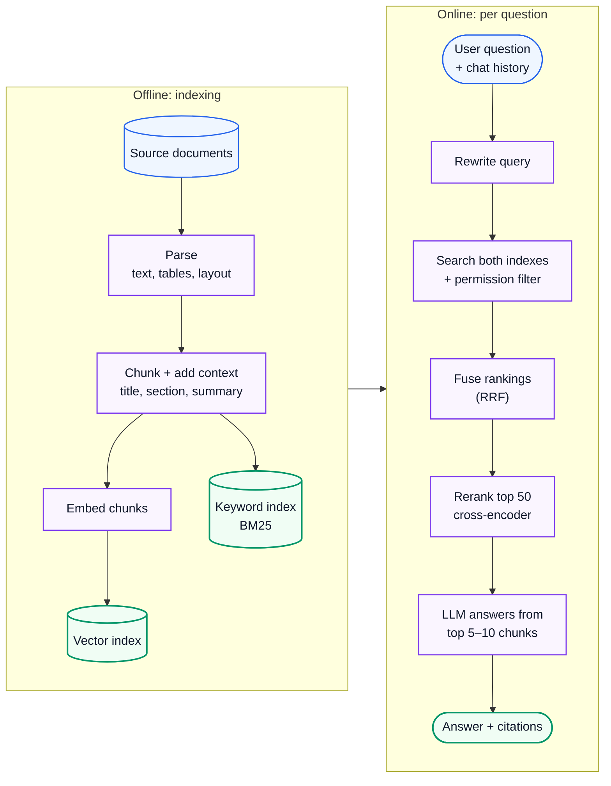
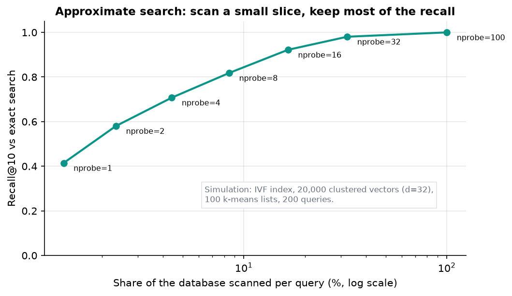

# AI Engineering 4: Retrieval and RAG

> **Series (AI engineering):** [0 Start Here](AI%20Engineering%200%20-%20Start%20Here.md) · [1 How LLMs Work](AI%20Engineering%201%20-%20How%20LLMs%20Work.md) · [2 Prompting and Context Engineering](AI%20Engineering%202%20-%20Prompting%20and%20Context%20Engineering.md) · [3 Evals and Quality](AI%20Engineering%203%20-%20Evals%20and%20Quality.md) · **4 Retrieval and RAG** · [5 Agents](AI%20Engineering%205%20-%20Agents.md) · [6 Production LLM Engineering](AI%20Engineering%206%20-%20Production%20LLM%20Engineering.md) · [7 Safety, Security and Governance](AI%20Engineering%207%20-%20Safety%20Security%20and%20Governance.md) · [8 Serving and GPU Infrastructure](AI%20Engineering%208%20-%20Serving%20and%20GPU%20Infrastructure.md) · [9 Customising Models](AI%20Engineering%209%20-%20Customising%20Models.md)
> **Source:** built from research: papers, engineering write-ups and docs listed in [References](#18-references). Every number recomputed with Python. Figures: [make_figs.py](../../figures/ai_engineering/make_figs.py). Code: [ai_hybrid_retrieval.py](../../code/ai_hybrid_retrieval.py).
> **Facts re-checked:** 24 October 2026.

**The big picture:** models don't know your private data, recent events, or anything after their training cutoff, and they hallucinate when they guess. **Retrieval-augmented generation (RAG)** fixes that by finding the relevant pieces of your documents at question time and putting them in the context, so the model answers *from evidence* and can cite it. Most of the quality of a RAG system is decided before the model writes a word: in parsing, chunking, search and ranking.

Diagram colours: 🔵 input · 🟣 processing · 🟢 result · 🟠 trade-off · 🔴 failure

---

## Contents

0. [How to use this guide](#0-how-to-use-this-guide)
1. [TL;DR](#1-tldr)
2. [RAG architecture](#2-rag-architecture)
3. [Document parsing](#3-document-parsing)
4. [Chunking strategies](#4-chunking-strategies)
5. [Embedding models](#5-embedding-models)
6. [Vector search and ANN indexes](#6-vector-search-and-ann-indexes)
7. [Metadata and permission filtering](#7-metadata-and-permission-filtering)
8. [Hybrid search: BM25 + vectors](#8-hybrid-search-bm25--vectors)
9. [Reranking](#9-reranking)
10. [Query rewriting](#10-query-rewriting)
11. [Citations and grounding](#11-citations-and-grounding)
12. [Agentic RAG and GraphRAG](#12-agentic-rag-and-graphrag)
13. [Evaluating RAG](#13-evaluating-rag)
14. [Keeping the index fresh](#14-keeping-the-index-fresh)
15. [Thinking critically: decisions and trade-offs](#15-thinking-critically-decisions-and-trade-offs)
16. [Self-check](#16-self-check)
17. [Glossary](#17-glossary)
18. [References](#18-references)

---

## 0. How to use this guide

| If you have… | Read |
|---|---|
| 10 minutes | §0.1, §1, §2 |
| 1 hour | §2–§9: the retrieval pipeline end to end |
| A weekend | Everything, then measure Recall@K on your own documents (§13) |

### 0.1 First, in completely plain words

Imagine an open-book exam. The student (the model) is smart but hasn't memorised your company's handbook. Before each question, an assistant runs to the library, finds the most relevant pages, and puts them on the desk. The student answers using those pages, and points to the page each fact came from.

RAG is that assistant. Its job has two halves:

1. **Before any questions** (offline): cut the books into page-sized pieces, label each one, and build fast indexes so pieces can be found by *words* (like a book index) and by *meaning* (so "refund" finds "reimbursement").
2. **At question time** (online): turn the question into a good search, find candidate pieces, put the best ones in order, and hand them to the model with instructions to answer only from them.

If the assistant brings the wrong pages, the smartest student still answers wrongly. That's why most of this guide is about finding the right pages.

---

## 1. TL;DR

1. **RAG = retrieve, then generate.** Offline: parse → chunk → embed → index. Online: rewrite query → search → filter → rerank → generate with citations.
2. **Parsing is underrated.** Garbage tables and lost headings ruin everything downstream. Vision-capable models now parse complex PDFs well.
3. **Chunk by structure** (sections, paragraphs), a few hundred tokens each, with a little overlap. Add context to each chunk (document title, section, a one-line summary): Anthropic's "contextual retrieval" cut retrieval failures by 35% with contextual embeddings alone, and by 49% when also applied to BM25.
4. **Embeddings find meaning; BM25 finds exact words** (codes, names, IDs). Use **both** and fuse them (reciprocal rank fusion). In the demo, hybrid search fixed both single methods' failures.
5. **ANN indexes** (HNSW, IVF, PQ) trade a little recall for huge speed-ups. In the simulation, scanning 17% of the data kept 92% recall.
6. **Rerank** the top ~50–100 candidates with a cross-encoder. It's the single best quality upgrade after hybrid search: reranking took Anthropic's total failure reduction to 67%.
7. **Filter by permissions at retrieval time.** Otherwise RAG leaks documents users shouldn't see.
8. **Rewrite queries:** turn "and what about for EU customers?" into a standalone question before searching.
9. **Make citations checkable,** and let the model say "not found".
10. **Evaluate retrieval and generation separately:** Recall@K / MRR / nDCG for search; faithfulness and correctness for answers.
11. **Agentic RAG** lets the model search repeatedly. **GraphRAG** helps with questions about relationships across a whole corpus. Both cost more, so use them when simple RAG measurably fails.

---

## 2. RAG architecture

**The problem.** Fine-tuning a model on your documents is slow, expensive, hard to update, doesn't give citations, and still hallucinates (Guide 9 §2). Pasting every document into the context is too expensive at scale and degrades quality (Guide 2 §9).

**How it works.** RAG (Lewis et al., 2020) splits the job into an offline indexing pipeline and an online query pipeline:



**Where RAG systems fail** (each maps to a section below):

| Failure | Typical cause | Section |
|---|---|---|
| The answer exists but wasn't retrieved | Bad parsing, bad chunking, query mismatch, no keyword search | §3, §4, §8, §10 |
| Retrieved, but ranked too low to be used | No reranker; too few chunks passed to the model | §9 |
| Retrieved and used, but the answer still adds unsupported facts | Weak grounding instructions; model fills gaps | §11 |
| Shows a document the user may not see | Permissions not enforced at retrieval | §7 |
| Correct last month, wrong now | Stale index | §14 |

---

## 3. Document parsing

**The problem.** Real documents are PDFs with two-column layouts, tables, headers and footers on every page, scanned images, slides and spreadsheets. Naive text extraction scrambles reading order, flattens tables into number soup, and repeats page footers through every chunk. Everything downstream inherits the damage.

**How it works.** Choose a parser per document type:

| Content | Approach |
|---|---|
| Clean HTML, Markdown, DOCX | Structural parsing: keep headings, lists and tables as structure |
| Digital PDFs (text layer present) | Layout-aware PDF parsers that detect columns, headings and tables |
| Scanned PDFs, images | OCR, or a vision-language model reading the page image |
| Complex pages: tables, charts, forms, mixed layouts | **Vision-language models** (Guide 1 §10) asked to convert the page to Markdown or structured JSON. Often the best quality in 2026, at a per-page cost. |
| Spreadsheets, databases | Usually *don't* chunk them as text. Query them with tools (SQL, Guide 5). |

**Good practice:**

- **Keep the structure.** Convert to Markdown-like text with headings, lists and tables preserved. Headings become chunk context (§4).
- **Tables:** keep each table whole with its caption and headers. Or convert rows into sentences ("Plan: Pro. Price: \$20/month. Users: 10."), so a chunk of rows still makes sense on its own.
- **Images and charts:** generate a text description with a vision model, so they become searchable.
- **Strip boilerplate:** repeated headers, footers, page numbers, navigation menus.
- **Keep metadata:** source, title, URL, section path, page number, date, author, and **access permissions** (§7).
- **Spot-check parsed output** by eye for each document type. Parsing bugs are silent.

---

## 4. Chunking strategies

**The problem.** Embedding models and the context window work on limited lengths, and search should return the *specific* passage that answers a question, not a 90-page manual. So documents are split into **chunks**. Too large, and a chunk mixes several topics: its embedding becomes a blurry average, and it wastes context. Too small, and a chunk loses the context needed to understand it ("It increased by 3%": what did?).

**The strategies:**

| Strategy | How | Good for |
|---|---|---|
| **Fixed size + overlap** | Every N tokens, overlapping by M | Quick baseline; uniform text |
| **Recursive / structural** | Split on headings, then paragraphs, then sentences, until chunks fit the target size | **The default for most documents** |
| **Semantic** | Start a new chunk where the meaning shifts (consecutive sentence embeddings become dissimilar) | Long unstructured text such as transcripts |
| **Document-specific** | Code by function or class; Q&A pages per question; contracts per clause | Domains with natural units |
| **Small-to-big (parent–child)** | Search small, precise chunks; hand the model the larger *parent* section around each hit | Precise matching *and* enough surrounding context |

**Typical starting point:** 200–800 tokens per chunk, 10–20% overlap, split on structure. Then **measure Recall@K** (§13) with a few sizes on your own data. There's no universal best size.

**Worked example.** A 10,000-token document, 500-token chunks, 50-token overlap. Each new chunk advances by 500 − 50 = 450 tokens, so the count is $\lceil (10{,}000 - 50)/450 \rceil = \lceil 22.1 \rceil = 23$ chunks. The overlap costs about 10% extra storage and embedding work. In exchange, a sentence near a boundary appears whole in at least one chunk.

**Add context to every chunk.** A chunk saying "The limit is 50 MB" is useless out of context. Two techniques:

1. **Chunk headers:** prepend the document title and section path ("Upload API › Limits › Free plan: The limit is 50 MB").
2. **Contextual retrieval** (Anthropic, 2024): have an LLM write a 1–2 sentence description of where each chunk sits in its document, and prepend it *before* embedding and BM25 indexing. In Anthropic's tests, the top-20 retrieval failure rate fell from 5.7% to 3.7% (a 35% relative reduction) with contextual embeddings, to 2.9% (49%) with contextual BM25 added, and to 1.9% (**67%**) with reranking on top (§9). It costs one LLM call per chunk at indexing time; prompt caching makes that affordable, because the whole document is the shared prefix for each of its chunks.

---

## 5. Embedding models

**The problem.** The embedding model decides what "similar" means for your search. A general web-trained model may not know that "MI" means myocardial infarction in your medical documents, or that two product codes are related.

**How it works.** A bi-encoder embedding model maps a query and each chunk *independently* into the same vector space (Guide 1 §3). Retrieval finds chunks whose vectors are closest to the query's vector.

**Choosing one:**

| Factor | What to check |
|---|---|
| Quality on *your* data | Public leaderboards (MTEB / MMTEB) shortlist candidates; then measure Recall@K on your own queries (§13) |
| Language coverage | Multilingual models if your users or documents aren't English-only |
| Max input length | Must cover your chunk size |
| Dimensions | Higher can be better but costs memory and speed (§6). Matryoshka models let you truncate. |
| Query vs document handling | Many models expect different prefixes or modes for queries and documents. Use them, or quality drops. |
| Cost, latency, hosting | API vs self-hosted; privacy requirements |

**Fine-tuning embeddings** helps when your domain vocabulary is unusual. Train on (query, relevant passage) pairs, with **hard negatives** (passages that look relevant but aren't) using a **contrastive loss**: training that pulls each query's vector *towards* its correct passage and pushes it *away* from the wrong ones. Hard negatives matter because easy negatives (an unrelated passage about shipping) teach nothing the model doesn't already know; near-misses teach the fine distinctions your users care about. A few thousand pairs can give clear gains, and the pairs can be generated synthetically by having an LLM write questions for your chunks. Measure before and after.

**Lock-in warning:** vectors from different models live in different spaces. Changing the embedding model means **re-embedding the whole corpus** (§14). Store the raw chunk text, and record which model and version produced each index.

---

## 6. Vector search and ANN indexes

**The problem.** Finding the nearest vectors exactly means comparing the query with *every* stored vector. That's fine for 100,000 chunks, and too slow for 100 million at interactive latency.

**How it works: approximate nearest neighbour (ANN) search.** Accept a small chance of missing a true neighbour in exchange for searching only a small part of the data.

- **IVF (inverted file index):** group all vectors into, say, 1,000 clusters of similar vectors (using **k-means**, which repeatedly assigns each vector to its nearest cluster centre, then moves each centre to the average of its members), and keep one list per cluster. At query time, find the few nearest cluster centres and search only those lists. The parameter **nprobe** (lists searched) trades speed for recall.
- **HNSW (hierarchical navigable small world)** (Malkov and Yashunin, 2016): a layered graph where each vector links to its near neighbours. The top layers are sparse "highways", the bottom layer is dense. Search starts at the top, greedily walks toward the query, and drops down a layer at a time. Cost grows roughly logarithmically with corpus size, and recall is high. **The default in most vector databases.** The cost is memory (graph links), and slower inserts.


*Fig 16 (f16_hnsw_layers.png). A real greedy search on a toy graph of 40 points. Long hops on the sparse top layer get close fast; the dense bottom layer refines. Six nodes visited instead of 40. Real indexes keep a list of the best `ef_search` candidates instead of a single path, which is how they avoid getting stuck in a local dead end.*
- **PQ (product quantisation):** compress each vector by splitting it into sub-vectors and replacing each with the ID of its nearest centroid. 1,024 floats become, say, 64 bytes. Distances are approximated from the codes. Often combined with IVF (IVF-PQ), with exact re-scoring of the top candidates.



*Fig 6 (f06_ann_recall_vs_work.png). Simulation: IVF over 20,000 clustered vectors, 100 lists, 200 queries. Searching 8 of 100 lists (8.5% of the data) finds 82% of the true top-10; 16 lists (16.5%) find 92%. Tune nprobe (or HNSW's `ef_search`) on your own recall target.*

**Worked example: memory for 10 million chunks at 1,024 dimensions.**

| Storage | Bytes per vector | Total |
|---|---|---|
| float32 | 4,096 | **40.96 GB** |
| float16 | 2,048 | 20.48 GB |
| int8 (scalar quantisation) | 1,024 | 10.24 GB |
| binary (1 bit per dimension) | 128 | 1.28 GB |
| PQ, 64-byte codes | 64 | **0.64 GB** |
| + HNSW bottom-layer links (32 neighbours × 4 bytes) | +128 | +1.28 GB |

Quantised vectors lose some precision. The common pattern is **search with compressed vectors, then re-score the top few hundred with full precision.**

**Where to store vectors:**

- **pgvector** inside PostgreSQL: one database for vectors, metadata and permissions, with transactions and joins. The sensible default up to tens of millions of vectors.
- **Search engines with vector support** (Elasticsearch, OpenSearch): keyword and vector search together.
- **Dedicated vector databases** (Pinecone, Qdrant, Weaviate, Milvus and others): for very large scale, heavy filtering or specialised features.

Choose on scale, filtering needs, operational fit and hybrid-search support, not hype.

---

## 7. Metadata and permission filtering

**The problem.** A company knowledge base contains HR files, board minutes and customer contracts. If retrieval ignores who is asking, the model will happily quote a salary spreadsheet to an intern. **RAG without access control is a data-leak engine.**

**How it works.** Store metadata with every chunk (tenant ID, document ID, access groups, date, type, language), and **filter at query time**:

- **Pre-filtering:** restrict the search to chunks the user may access, then find the nearest ones. Always correct, but a very selective filter can make some ANN indexes slow or less accurate.
- **Post-filtering:** find the nearest K, then drop forbidden ones. Fast, but if most of the top K are forbidden you may return almost nothing. Don't rely on it for security unless you over-fetch generously.
- Modern vector stores support **filtered ANN search** that applies filters during the graph or list traversal. Use it.

**Rules for permission-aware RAG:**

1. **Enforce permissions in the retrieval layer, from the user's identity**, never by asking the model to "only show allowed documents". The model can't keep secrets it has been shown.
2. **Sync permissions from the source system** (SharePoint, Google Drive, Confluence), and update them when they change. A revoked share must disappear from search quickly.
3. **Multi-tenant systems** filter by tenant ID on every query, or use a separate index per tenant.
4. Metadata filters also improve *quality*: "only documents from 2026", "only the user's product version".

---

## 8. Hybrid search: BM25 + vectors

**The problem.** Each search method fails in a predictable way:

- **Vector search** understands paraphrase ("refund" ≈ "reimbursement") but is fuzzy about **exact tokens**: error codes, product SKUs, names, rare acronyms. All error codes "mean roughly the same thing" to an embedding.
- **Keyword search (BM25)** nails exact terms, but misses synonyms and paraphrases.

**How it works.** Run both, and merge the ranked lists.

**BM25** scores a document by its query-word matches, weighting rare words more (inverse document frequency) and saturating repeated words, with length normalisation (Robertson and Zaragoza, 2009):

$$
\text{BM25}(q, d) = \sum_{w \in q} \text{IDF}(w) \cdot \frac{f(w, d) (k_1 + 1)}{f(w, d) + k_1 \left(1 - b + b \frac{\vert d \vert}{\text{avgdl}}\right)}
$$

> **IDF and saturation, with numbers.** **IDF** (inverse document frequency) measures how *informative* a word is: words found in nearly every document tell you nothing. In a 1,000-document corpus, "the" appearing in 990 documents gets IDF ≈ 0.01, while "E1043" appearing in just one gets IDF ≈ 6.5, about 600× more weight. **Saturation**: with $k_1 = 1.2$ (and an average-length document), one occurrence scores 1.0, two score 1.375, and ten only 1.96 (the cap is 2.2). Repeating a word ten times doesn't make a document ten times more relevant, which also blunts keyword stuffing.

*For each query word, multiply how rare the word is across the corpus by a term-frequency score that grows with repeats but levels off, and is reduced for longer-than-average documents.* Here $f(w, d)$ is how often word $w$ appears in document $d$, $\vert d \vert$ is the document's length, avgdl is the average length, and $k_1 \approx 1.2$, $b \approx 0.75$ are the usual settings.

**Reciprocal rank fusion (RRF)** (Cormack et al., 2009) merges rankings without needing comparable scores:

$$
\text{RRF}(d) = \sum_{r \in \text{rankings}} \frac{1}{k + \text{rank}_r(d)}
$$

*A document's fused score is the sum, over each ranked list, of one over (k plus its position in that list).* With the usual $k = 60$: 1st place adds $1/61 = 0.0164$, 2nd adds $0.0161$, 10th adds $0.0143$. Documents ranked well by *both* methods rise to the top. The constant $k$ stops any single top position from dominating.

**Worked example** ([ai_hybrid_retrieval.py](../../code/ai_hybrid_retrieval.py), actual output). Eight help-centre snippets, three queries. The "embedding" is a toy concept vector standing in for a real model:

```text
Q: 'how do I get a refund for broken goods'   relevant: ['d1', 'd5']
  BM25   top-3 ['d1']  recall@2=0.50  MRR=1.00  nDCG@3=0.61
  vector top-3 ['d5', 'd1']  recall@2=1.00  MRR=1.00  nDCG@3=1.00
  hybrid top-3 ['d1', 'd5']  recall@2=1.00  MRR=1.00  nDCG@3=1.00

Q: 'what does E1043 mean'   relevant: ['d2']
  BM25   top-3 ['d2']  recall@2=1.00  MRR=1.00  nDCG@3=1.00
  vector top-3 ['d8', 'd2', 'd6']  recall@2=1.00  MRR=0.50  nDCG@3=0.63
  hybrid top-3 ['d2', 'd8', 'd6']  recall@2=1.00  MRR=1.00  nDCG@3=1.00

Q: 'my card payment keeps failing'   relevant: ['d2', 'd6']
  BM25   top-3 ['d2', 'd6']  recall@2=1.00  MRR=1.00  nDCG@3=0.80
  vector top-3 ['d6', 'd2', 'd8']  recall@2=1.00  MRR=1.00  nDCG@3=1.00
  hybrid top-3 ['d2', 'd6', 'd8']  recall@2=1.00  MRR=1.00  nDCG@3=0.80

Average over the 3 queries:
  BM25   recall@2=0.83  MRR=1.00  nDCG@3=0.80
  vector recall@2=1.00  MRR=0.83  nDCG@3=0.88
  hybrid recall@2=1.00  MRR=1.00  nDCG@3=0.93
```

Read it query by query:

1. **Paraphrase:** "refund for broken goods" vs d5's "Reimbursement… damaged items". BM25 shares no words with d5 and misses it. Vector search finds both.
2. **Exact code:** "E1043". Vector search ranks d8 (a *different* error code) above d2, because both are "about errors". BM25 matches the exact token and ranks d2 first.
3. **Hybrid** keeps the best of both and wins on average. In query 3 fusion put the less relevant d2 first. Ordering subtleties like that are what a **reranker** (§9) fixes.

---

## 9. Reranking

**The problem.** First-stage retrieval must be fast over millions of chunks, so it compares a query vector with chunk vectors computed *separately*. It can't look at how the query and chunk relate word by word. Relevant chunks end up at position 23 instead of 3, and the model only sees the top few.

**How it works: two-stage retrieval.**

1. **Retrieve** a generous candidate set, such as the top 50–150 from hybrid search (cheap, high recall).
2. **Rerank** with a **cross-encoder**: a model that reads the query *and* each candidate *together* and outputs a relevance score. It's far more accurate, because it can attend across both texts, but too slow to run over the whole corpus.
3. Pass the **top 5–20** to the LLM.

| | Bi-encoder (embedding search) | Cross-encoder (reranker) |
|---|---|---|
| Input | Query and chunk encoded separately | Query + chunk encoded together |
| Precompute chunks? | Yes, once | No: runs per (query, chunk) pair |
| Speed | Milliseconds over millions | Tens to hundreds of ms for ~100 candidates |
| Accuracy | Good recall | Much better precision |

**A middle option: late interaction.** Models such as **ColBERT** (Khattab and Zaharia, 2020) store one small vector *per token* of each chunk, not one per chunk. At query time, each query token finds its best-matching chunk token, and the scores are summed. That captures word-level matches like a cross-encoder, while chunk vectors can still be computed in advance like a bi-encoder. The price is storage: dozens to hundreds of vectors per chunk. **ColPali** (Faysse et al., 2024) applies the same idea to *images of pages*, so PDFs with tables and charts can be searched without parsing them to text first (§3).

Rerankers are available as hosted APIs and as open models. An LLM can also rerank, at higher cost. In Anthropic's contextual-retrieval experiments, adding a reranker took the retrieval failure reduction from 49% to **67%**. Rerankers also let you set a **relevance threshold** and pass *nothing* when nothing is relevant, which helps the model say "not found" (§11).

---

## 10. Query rewriting

**The problem.** Users don't write good search queries. In a chat, the latest message is often meaningless alone: "and for EU customers?" Searching that literally returns garbage.

**Techniques:**

| Technique | What it does | Example |
|---|---|---|
| **Standalone rewrite** | Use the chat history to rewrite the latest message as a complete question | "and for EU customers?" → "What is the refund period for EU customers?" |
| **Multi-query** | Generate several phrasings, search each, fuse the results | "cancel subscription" → also "end plan", "stop billing" |
| **Decomposition** | Split a compound question into sub-questions and retrieve for each | "Compare the 2025 and 2026 pricing" → two searches |
| **HyDE** (hypothetical document embeddings) | Have the LLM write a *hypothetical answer*, then search with its embedding, which looks more like real documents than a short question does | Helps short or vague questions (Gao et al., 2022) |
| **Routing** | Decide which index or tool to use: docs search, SQL database, web, or no retrieval at all | "How many orders last week?" → SQL, not document search |
| **Filter extraction** | Turn constraints into metadata filters | "policies from 2026 in German" → `year=2026, lang=de` |

Each technique adds an LLM call (latency and cost). A small, fast model is usually enough for rewriting. Measure whether it improves Recall@K on your data (§13).

---

## 11. Citations and grounding

**The problem.** Even with the right chunks in context, models blend retrieved facts with their own memory, and they sometimes invent details. Users need to be able to **check** answers.

**How it works:**

1. **Instruct grounding explicitly:** "Answer only from the documents in `<sources>`. If they don't contain the answer, say so." Give the model a dignified way out; otherwise it fills the gap (Guide 1 §8).
2. **Label each chunk** with an ID and source: `<source id="3" title="Refund policy" url="…">…</source>`.
3. **Require citations per claim:** "Cite the source id after each sentence, like [3]." Or use a provider's built-in citations feature, which returns exact quoted spans.
4. **Verify citations in code** (Guide 3 §5): does each cited ID exist among the retrieved chunks? Does each quoted span actually appear in that chunk?
5. **Check groundedness with a judge** on a sample, or on every high-stakes answer (Guide 3 §6).
6. **Show sources in the UI** so users can click through. That's both a trust feature and an error-catching feature.

---

## 12. Agentic RAG and GraphRAG

**Agentic RAG.** In basic RAG, retrieval happens once, before generation. Hard questions need more: search, read, realise something is missing, search again with a better query, follow a reference. **Agentic RAG** gives the model search as a **tool** (Guide 5) and lets it decide when and what to search, how many times, and when it has enough:

| Basic RAG | Agentic RAG |
|---|---|
| One retrieval per question | As many as needed |
| Fixed pipeline, predictable cost | Adapts to the question; variable cost and latency |
| Good for direct factual questions | Good for multi-hop questions ("Which of our suppliers in the 2026 audit also appear in the open incidents?") and research tasks |

Coding agents searching a codebase with grep and file reads are agentic retrieval. Often it works better than vector search over code, because code has exact names to match.

**GraphRAG.** Some questions are about the *whole* corpus, not any single chunk: "What are the main themes in these 5,000 customer interviews?" or "How are these companies connected?" Chunk retrieval can't answer those well. **GraphRAG** (Microsoft Research, Edge et al., 2024) uses an LLM to extract **entities and relationships** into a knowledge graph, detects **communities** of related entities, and pre-writes summaries for each community. Queries can then use the graph structure and the summaries.

- **Use it when:** questions are about relationships, themes or aggregations across many documents.
- **Costs:** indexing is expensive (many LLM calls over the whole corpus), and the graph must be maintained as documents change.
- **Start with** good hybrid RAG + reranking. Add a graph only if evals show relationship-style questions are failing.

---

## 13. Evaluating RAG

**The problem.** When a RAG answer is wrong, you need to know *which stage* failed. Measure retrieval and generation separately.

**Retrieval metrics.** For each test question, label which chunks are relevant, then measure the ranked results:

- **Recall@K:** the fraction of relevant chunks that appear in the top K.

$$
\text{Recall@K} = \frac{\vert \text{relevant} \cap \text{top-}K \vert}{\vert \text{relevant} \vert}
$$

*Of all the chunks that should have been found, what fraction made it into the top K?* This is the most important retrieval metric for RAG: if the evidence isn't retrieved, nothing downstream can fix it.

- **Precision@K:** the fraction of the top K that is relevant (how much noise you pass to the model).
- **MRR (mean reciprocal rank):** $1/\text{rank}$ of the first relevant result, averaged over queries. It rewards getting a good result *first*.
- **nDCG@K:** handles graded relevance (2 = answers it, 1 = related). Gains are discounted by $\log_2(\text{rank} + 1)$, and the total is divided by the ideal ordering's score, so 1.0 is perfect.

$$
\text{DCG@K} = \sum_{i=1}^{K} \frac{2^{\text{rel}_i} - 1}{\log_2(i + 1)}, \qquad \text{nDCG@K} = \frac{\text{DCG@K}}{\text{IDCG@K}}
$$

*DCG adds up each result's relevance gain, shrinking it the lower it sits in the list; nDCG divides by the best possible DCG.* **Worked example** (query 3 above): hybrid ranked d2 (relevance 1) first and d6 (relevance 2) second. DCG = $(2^1 - 1)/\log_2 2 + (2^2 - 1)/\log_2 3 = 1 + 3/1.585 = 2.893$. The ideal order (d6 then d2) gives $3 + 1/1.585 = 3.631$. nDCG = 2.893 / 3.631 = **0.80**, matching the demo.

**Generation metrics** (Guide 3 §8): **faithfulness** (are claims supported by the retrieved context?), **answer correctness** (vs a reference answer), **citation accuracy**, and **appropriate abstention** (says "not found" when the answer isn't in the corpus). Include unanswerable questions in the eval set on purpose.

**Diagnosing by stage:**

| Recall@K | Faithfulness | Correctness | Diagnosis |
|---|---|---|---|
| Low | — | Low | **Retrieval problem**: parsing, chunking, embeddings, hybrid, query rewriting |
| High | Low | Low | **Generation problem**: grounding instructions, model choice, too much noisy context |
| High | High | Low | Sources are wrong or outdated, or the question was misread |
| High | High | High | Working. Check latency and cost next. |

**Building the retrieval eval set cheaply:** sample chunks, have an LLM write questions that each chunk answers, then review by hand. That gives (question, relevant chunk) pairs. Add real user questions with labels as soon as you have traffic.

---

## 14. Keeping the index fresh

**The problem.** Documents change daily: policies are updated, pages deleted, permissions revoked. A stale index gives confidently outdated answers, and still exposes documents that should be gone.

**How it works:**

- **Incremental indexing:** detect changes (modified timestamps, content hashes, webhooks, or change data capture from databases), and re-parse, re-chunk and re-embed **only what changed**. Keep stable chunk IDs, so updates replace old chunks instead of adding duplicates.
- **Deletes are critical:** removing a document must remove *all* its chunks from every index (vector, keyword, caches) promptly. That's a privacy and correctness requirement (data-erasure requests, Guide 7 §7).
- **Permission changes** must propagate fast. Treat them as high-priority updates.
- **Model changes** (a new embedding model, a new chunking strategy) require a full re-index. Build the new index alongside the old one (**blue-green indexes**), evaluate it, then switch traffic, keeping the old one for rollback.
- **Freshness metadata:** store `updated_at`, prefer recent documents where it matters, and show dates in citations.
- **Monitor:** index lag (time from source change to searchable), document counts per source, and failed parses.

---

## 15. Thinking critically: decisions and trade-offs

RAG systems fail quietly: they return *something*, fluently. Critical thinking here means always asking which stage failed.

**Questions to ask before building or debugging retrieval**

1. **Is this a retrieval failure or a generation failure?** Measure Recall@K before touching the prompt.
2. **Who may see which documents,** and does retrieval enforce it?
3. **How fresh must answers be,** and what's the index lag?
4. **What do users actually ask,** compared with how the documents are written? (Vocabulary gaps are the classic failure.)
5. **Do we need RAG at all?** For a small, stable corpus, long context plus caching may be simpler.

**Where common RAG advice breaks**

| Advice | Nuance |
|---|---|
| "RAG = a vector database" | Keyword search is often essential (codes, names), and agentic search with tools may beat both for some data |
| "Retrieve more chunks to be safe" | More noise, more cost, and relevant chunks get lost in the middle. Rerank and pass fewer. |
| "Chunk size X is best practice" | Best depends on your documents and questions. Measure. |
| "RAG fixes hallucination" | It reduces it. The model can still ignore, misread or embellish sources. Verify citations. |
| "High retrieval scores = good answers" | Only if the eval questions resemble real ones |

**Decision scenarios**

<details>
<summary>A. Answers about recently changed policies are often wrong. Where do you look?</summary>

Freshness and duplicates. Is the new policy indexed yet (index lag)? Are the old *and* new versions both in the index, so retrieval returns the outdated one? Check document versioning, de-duplication of superseded documents, date metadata and filters, and that deletions cascade. The model may be answering faithfully from the wrong document: a high faithfulness score with a wrong answer points straight here.
</details>

<details>
<summary>B. The legal team has 200 contracts (about 2M tokens). Build a full RAG stack with a dedicated vector database?</summary>

Size the problem first. 200 documents is small. Options, simplest first: full-text plus vector search in the database you already have (Postgres with pgvector); or, for per-contract questions, load the single relevant contract into a long-context model with caching. A dedicated vector database adds operations work and buys nothing at this scale. Choose the simplest design that passes your evals, and know what would make you change it (corpus growth, latency).
</details>

<details>
<summary>C. Recall@10 is 0.95 on your eval set, but users say answers are often wrong. What's going on?</summary>

Suspect the eval set. If it was generated from chunks (questions written to match each chunk), it's easier than real usage: real users ask conversationally, across several documents, or about things the docs don't cover. Sample real queries, label them, and re-measure. Also check the generation side (faithfulness), and whether "wrong" means the source documents themselves are wrong or outdated.
</details>

**Understand deeply vs look up when needed**

| Understand | Look up |
|---|---|
| Retrieval and generation fail differently, so measure separately | Current best embedding and reranker models |
| Exact match vs semantic match trade-off | Vector database feature comparisons |
| Permissions must be enforced in retrieval | Index tuning parameters (ef, nprobe) |
| Recall vs latency vs memory | Parser tools for specific formats |

---

## 16. Self-check

<details>
<summary>1. Users search for error code "E4410" and get answers about other error codes. Why, and what fixes it?</summary>

Pure vector search is fuzzy on exact tokens: all error codes embed close together. Add keyword search (BM25) and fuse the rankings (hybrid). A reranker then helps order the results.
</details>

<details>
<summary>2. Why add context (title, section, summary) to chunks before embedding?</summary>

Chunks often lack the context needed to understand them ("the limit is 50 MB"). Adding it makes both the embedding and BM25 match the right queries. Anthropic measured a 35–49% reduction in retrieval failures.
</details>

<details>
<summary>3. How many 400-token chunks with 40-token overlap does a 7,240-token document produce?</summary>

Stride = 360. $\lceil (7{,}240 - 40)/360 \rceil = \lceil 20 \rceil = 20$ chunks.
</details>

<details>
<summary>4. Pre-filtering vs post-filtering for permissions: which is safer, and why?</summary>

Pre-filtering (or filtered ANN): forbidden chunks are never candidates. Post-filtering can return very few results if most of the top-K are forbidden, and it's easy to get wrong. Never rely on the model to hide forbidden content.
</details>

<details>
<summary>5. Recall@10 is 0.95 but answers are often unsupported. Where's the problem?</summary>

Retrieval is fine, so it's the generation stage: grounding instructions, too much noisy context, or the model mixing in its own knowledge. Check faithfulness, tighten the instructions, rerank to pass fewer and better chunks, and verify citations.
</details>

<details>
<summary>6. Compute nDCG@2 for a ranking [B, A] where A has relevance 2 and B has relevance 1.</summary>

DCG = $1/1 + 3/\log_2 3 = 1 + 1.893 = 2.893$. IDCG (A then B) = $3 + 1/1.585 = 3.631$. nDCG = **0.80**.
</details>

<details>
<summary>7. When is GraphRAG worth its cost?</summary>

When important questions concern relationships, themes or aggregation across many documents, and evals show chunk-based hybrid RAG fails on them. Indexing is expensive and the graph needs maintenance.
</details>

---

## 17. Glossary

| Term | Meaning |
|---|---|
| **RAG** | Retrieval-augmented generation: retrieve evidence, then generate from it |
| **Chunk** | A passage of a document indexed as one unit |
| **Overlap** | Tokens shared between neighbouring chunks |
| **Contextual retrieval** | Prepending LLM-written context to each chunk before indexing |
| **Small-to-big** | Search small chunks, return their larger parent sections |
| **Bi-encoder** | Encodes query and document separately (embedding search) |
| **Late interaction (ColBERT)** | One vector per token; query tokens matched to their best chunk tokens |
| **Cross-encoder / reranker** | Scores a (query, document) pair jointly; more accurate, slower |
| **ANN** | Approximate nearest-neighbour search |
| **HNSW** | Layered proximity-graph ANN index |
| **IVF / nprobe** | Clustered ANN index / number of clusters searched |
| **PQ** | Product quantisation: compressing vectors into short codes |
| **Pre-/post-filtering** | Applying metadata filters before / after nearest-neighbour search |
| **BM25** | Classic keyword ranking function (term frequency, IDF, length normalisation) |
| **Hybrid search** | Combining keyword and vector search |
| **RRF** | Reciprocal rank fusion: merging rankings by summing 1/(k + rank) |
| **Query rewriting** | Transforming the user's input into better search queries |
| **HyDE** | Searching with the embedding of a hypothetical answer |
| **Grounding / faithfulness** | Answer supported by the provided context |
| **Agentic RAG** | Retrieval as a tool the model calls repeatedly |
| **GraphRAG** | RAG over an LLM-built entity graph with community summaries |
| **Recall@K / Precision@K** | Share of relevant items found in top K / share of top K that are relevant |
| **MRR** | Mean of 1 / rank of the first relevant result |
| **nDCG** | Rank-discounted graded relevance, normalised to the ideal |
| **Blue-green index** | Building a new index alongside the old, then switching |

---

## 18. References

- Patrick Lewis et al., "Retrieval-Augmented Generation for Knowledge-Intensive NLP Tasks", NeurIPS 2020.
- Anthropic, "Introducing Contextual Retrieval", September 2024 (the 35% / 49% / 67% failure-rate reductions, top-20 retrieval).
- Yu. A. Malkov and D. A. Yashunin, "Efficient and robust approximate nearest neighbor search using Hierarchical Navigable Small World graphs", 2016/2018.
- Hervé Jégou, Matthijs Douze, Cordelia Schmid, "Product Quantization for Nearest Neighbor Search", IEEE TPAMI, 2011. Jeff Johnson et al., "Billion-scale similarity search with GPUs" (FAISS), 2017.
- Stephen Robertson and Hugo Zaragoza, "The Probabilistic Relevance Framework: BM25 and Beyond", 2009.
- Gordon V. Cormack, Charles L. A. Clarke, Stefan Büttcher, "Reciprocal Rank Fusion outperforms Condorcet and individual Rank Learning Methods", SIGIR 2009.
- Rodrigo Nogueira and Kyunghyun Cho, "Passage Re-ranking with BERT", 2019.
- Omar Khattab and Matei Zaharia, "ColBERT: Efficient and Effective Passage Search via Contextualized Late Interaction over BERT", SIGIR 2020. Manuel Faysse et al., "ColPali: Efficient Document Retrieval with Vision Language Models", 2024.
- Luyu Gao et al., "Precise Zero-Shot Dense Retrieval without Relevance Labels" (HyDE), 2022.
- Darren Edge et al., "From Local to Global: A Graph RAG Approach to Query-Focused Summarization", Microsoft Research, 2024.
- Niklas Muennighoff et al., "MTEB: Massive Text Embedding Benchmark", 2022, and its multilingual extension MMTEB, 2025.
- Kalervo Järvelin and Jaana Kekäläinen, "Cumulated gain-based evaluation of IR techniques" (nDCG), ACM TOIS, 2002.

**Next:** [Guide 5: Agents](AI%20Engineering%205%20-%20Agents.md), when the model doesn't just read evidence but takes actions.
