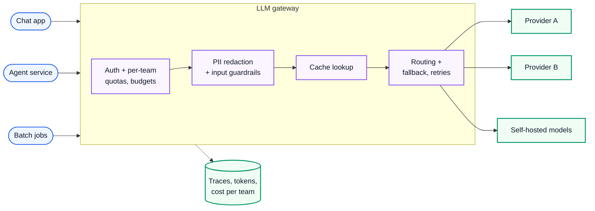
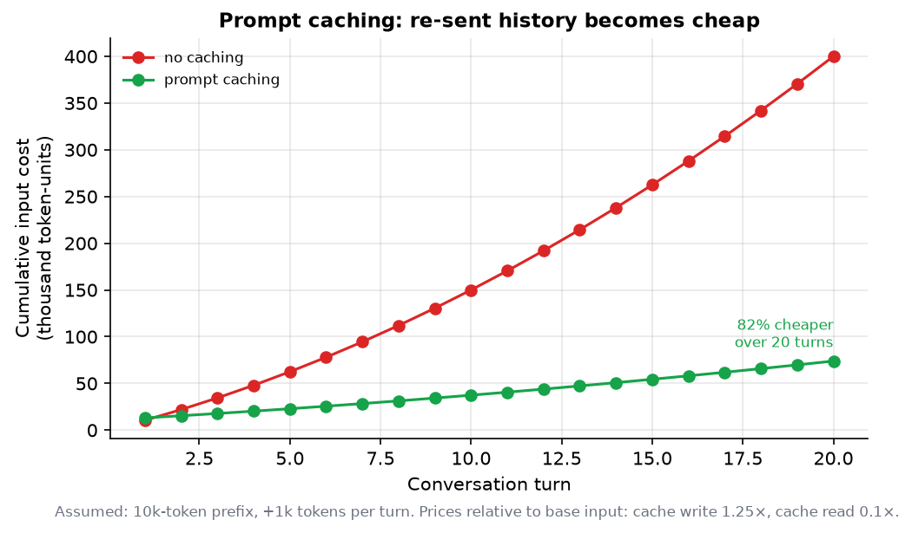
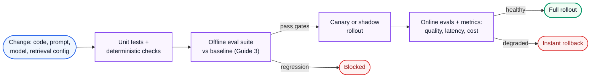

# AI Engineering 6: Production LLM Engineering

> **Series (AI engineering):** [0 Start Here](AI%20Engineering%200%20-%20Start%20Here.md) · [1 How LLMs Work](AI%20Engineering%201%20-%20How%20LLMs%20Work.md) · [2 Prompting and Context Engineering](AI%20Engineering%202%20-%20Prompting%20and%20Context%20Engineering.md) · [3 Evals and Quality](AI%20Engineering%203%20-%20Evals%20and%20Quality.md) · [4 Retrieval and RAG](AI%20Engineering%204%20-%20Retrieval%20and%20RAG.md) · [5 Agents](AI%20Engineering%205%20-%20Agents.md) · **6 Production LLM Engineering** · [7 Safety, Security and Governance](AI%20Engineering%207%20-%20Safety%20Security%20and%20Governance.md) · [8 Serving and GPU Infrastructure](AI%20Engineering%208%20-%20Serving%20and%20GPU%20Infrastructure.md) · [9 Customising Models](AI%20Engineering%209%20-%20Customising%20Models.md)
> **Source:** built from research: provider documentation, standards and engineering write-ups listed in [References](#17-references). Every number recomputed with Python. Figures: [make_figs.py](../../figures/ai_engineering/make_figs.py). Code: [ai_llm_router.py](../../code/ai_llm_router.py).
> **Facts re-checked:** 22 October 2026. Prices and limits change often. Numbers marked *assumed* are illustrative; check your provider's current pricing page.

**The big picture:** a demo that works once is easy. A product serving thousands of users needs to handle provider outages and rate limits, keep latency low enough that people stay, keep token costs from exploding, see what's happening in production, and ship changes safely. That's the same engineering as any backend service, applied to a dependency that's slow, expensive, rate-limited and non-deterministic.

Diagram colours: 🔵 input · 🟣 processing · 🟢 result · 🟠 trade-off · 🔴 failure

---

## Contents

0. [How to use this guide](#0-how-to-use-this-guide)
1. [TL;DR](#1-tldr)
2. [LLM APIs and SDKs](#2-llm-apis-and-sdks)
3. [Model selection, routing and fallbacks](#3-model-selection-routing-and-fallbacks)
4. [The LLM gateway](#4-the-llm-gateway)
5. [Streaming responses](#5-streaming-responses)
6. [Rate limits and retries](#6-rate-limits-and-retries)
7. [Latency optimisation](#7-latency-optimisation)
8. [Token cost management](#8-token-cost-management)
9. [Prompt caching and semantic caching](#9-prompt-caching-and-semantic-caching)
10. [Observability and tracing](#10-observability-and-tracing)
11. [CI/CD for LLM apps](#11-cicd-for-llm-apps)
12. [Voice and realtime apps](#12-voice-and-realtime-apps)
13. [AI product and UX patterns](#13-ai-product-and-ux-patterns)
14. [Thinking critically: decisions and trade-offs](#14-thinking-critically-decisions-and-trade-offs)
15. [Self-check](#15-self-check)
16. [Glossary](#16-glossary)
17. [References](#17-references)

---

## 0. How to use this guide

| If you have… | Read |
|---|---|
| 10 minutes | §0.1, §1, Fig 8 in §9 |
| 1 hour | §3, §5–§9: routing, streaming, limits, latency, cost and caching |
| A weekend | Everything, then add tracing and a cost dashboard to an app you run |

### 0.1 First, in completely plain words

Imagine your app depends on a brilliant but expensive contractor, reachable only by phone. Their line is sometimes busy, sometimes down, they charge per word spoken, and they speak slowly. Running a business on them means:

- **Having a backup contractor** for when the line is down (fallbacks).
- **Not calling the expensive one for easy questions** (routing to cheaper models).
- **Passing their words to your customers as they speak**, instead of waiting for the whole answer (streaming).
- **Not paying twice for the same long briefing** you read them every call (caching).
- **Keeping a call log** of every conversation, its cost and its duration (observability).
- **Testing a new contractor before switching** (evals and staged rollout).

---

## 1. TL;DR

1. **Treat the model API as an unreliable, slow, metered dependency.** Timeouts, retries with jittered backoff, fallbacks, budgets.
2. **Pin dated model versions** and upgrade deliberately, after evals.
3. **Route by difficulty:** sending 70% of traffic to a small model can cut costs by about 64% in the worked example (assumed prices). Validate quality per route with evals.
4. **Fallback chains** across models or providers: two independent 99.5% providers give about 99.998% availability.
5. **An LLM gateway** centralises keys, routing, quotas, caching, logging and fallbacks.
6. **Stream** responses: users see the first words after the time to first token (often under a second) instead of waiting ~10 s for the whole answer.
7. **Latency ≈ time to first token + output tokens × time per token.** Output length is usually the biggest lever: ask for shorter outputs.
8. **Cost = input tokens × input price + output tokens × output price.** Levers: routing, caching, shorter context, batch APIs (commonly ~50% off), output limits.
9. **Prompt caching:** stable prefixes are billed at a fraction of the price on reuse. In the worked example, an 82% lower input cost over a 20-turn chat. **Semantic caching** is riskier: similar questions can need different answers.
10. **Trace every call:** prompt version, model, tokens, cost, latency, tool calls and outcome. Use OpenTelemetry's generative-AI conventions.
11. **CI/CD:** evals as tests, canary or shadow rollouts, instant rollback of prompt or model changes.
12. **Voice** needs end-to-end latency under about 800 ms, so every stage is budgeted in milliseconds.
13. **UX:** stream, show sources, signal uncertainty, make outputs editable, and fail gracefully.

---

## 2. LLM APIs and SDKs

**The problem.** Every provider's API looks similar but differs in details that cause production bugs: token limits, error codes, streaming formats, tool-call formats, usage reporting.

**Anatomy of a request** (common across providers):

| Field | Purpose | Production advice |
|---|---|---|
| `model` | Which model | Use a **dated version** in production, not an alias that changes under you |
| `system` / `messages` | Instructions and conversation (Guide 2 §2) | Templates under version control |
| `max_tokens` (output limit) | Caps output length and cost | Always set it. Check the stop reason to detect truncation. |
| `temperature`, `top_p` | Sampling (Guide 1 §7) | Low for deterministic tasks; some reasoning models fix these |
| `tools`, `tool_choice` | Tool definitions; force or allow tool use (Guide 5 §4) | Validate every call |
| Structured output / schema | Constrain the output format (Guide 2 §5) | Still validate |
| `stream` | Receive tokens incrementally (§5) | Default for user-facing text |
| Reasoning effort / thinking budget | How much the model thinks (Guide 1 §9) | Tune per route; it costs tokens |

**Every response includes usage** (input, output and cached tokens) and a **stop reason** (finished, hit max tokens, tool call, refused). Log both on every call (§10). A response that stopped at `max_tokens` is truncated, not complete. Handle it.

**SDKs** (official provider SDKs, plus cross-provider libraries) handle authentication, retries for some errors, streaming parsing and typed responses. Two practical points:

- Many providers and open-source servers expose an **OpenAI-compatible** endpoint. That makes switching easier, but features (caching controls, tool details, reasoning settings) still differ.
- Keep a **thin internal abstraction** (or use a gateway, §4) so business code calls `complete(task, ...)` rather than a specific vendor's SDK everywhere. Don't over-abstract, though: provider-specific features such as caching are often where the savings are.

---

## 3. Model selection, routing and fallbacks

**The problem.** No single model is best on every axis. The strongest model is slow and expensive for easy requests. The cheapest fails hard ones. Any single provider will sometimes be down or rate-limited.

**Choosing models: decide per task, with evals.** Criteria: quality on *your* eval set (Guide 3), latency (time to first token and throughput), cost per task, context length, tool-use and structured-output reliability, modalities, data-handling terms (retention, region), and rate limits. The goal is the **cheapest model that passes the quality bar for each task** (Guide 3 §13).

**Routing strategies:**

| Strategy | How | Trade-off |
|---|---|---|
| **Static, by feature** | Autocomplete → small model; legal analysis → large model | Simple; no per-request intelligence |
| **Rule-based** | Long or complex inputs, certain intents, or premium users → large model | Cheap to run; brittle rules |
| **Classifier router** | A small model or classifier predicts difficulty and picks the model | Adds a little latency and cost; needs evaluation |
| **Cascade** | Try the cheap model first; escalate if a check fails (validation error, low confidence, judge fails it) | Saves money when most requests are easy; hard requests pay for two calls |

**Worked example** (assumed prices; [ai_llm_router.py](../../code/ai_llm_router.py)). A request has 2,000 input and 500 output tokens. Large model: USD 3 / USD 15 per million input / output tokens. Small model: USD 0.25 / USD 1.25.

Large: $2{,}000 \times 3/10^6 + 500 \times 15/10^6 = 0.0060 + 0.0075 = 0.0135$ dollars per request, which is **USD 13.50 per 1,000**. Small: **USD 1.125 per 1,000**.

```text
  all large: $13.50 per 1k requests | all small: $1.125
  route 70% small / 30% large: $4.84  (64% cheaper than all-large)
```

Routing pays only if the small model really handles that 70% at acceptable quality, so **evaluate each route separately**.

**Fallbacks.** When the primary model fails (outage, 5xx errors, persistent 429s, timeout), retry, then fall back to another model or provider. If two providers fail independently, each available 99.5% of the time:

$$
A = 1 - (1 - 0.995)^{2} = 1 - 0.005^{2} = 0.999975
$$

*The pair is down only when both are down at once: 0.5% times 0.5%.* That's about 99.998% availability. In practice failures are partly correlated (a shared cloud region, or a traffic surge hitting everyone), so treat this as an upper bound.

Demo output (the primary fails three times, then the fallback serves the request):

```text
  primary attempt 1: HTTP 429 -> retry after 0.12s
  primary attempt 2: HTTP 503 -> retry after 0.10s
  primary attempt 3: HTTP 503 -> give up on this provider
  fallback attempt 1: OK
  [fallback] answer
```

**Fallback cautions:** the fallback model must pass *your* evals for that task (different models need slightly different prompts); log every fallback so silent degradation is visible; and use a **circuit breaker** to stop hammering a provider that's clearly down.

---

## 4. The LLM gateway

**The problem.** As usage grows, every team ends up re-implementing keys, retries, logging, budgets and fallbacks, and nobody knows the total spend or which feature caused it.

**How it works.** One internal service sits between all applications and all model providers:



**What it centralises:** provider keys (applications never hold them); per-team and per-feature quotas and budgets; routing and fallback policy; retries and rate-limit smoothing; caching; PII redaction and guardrails (Guide 7); logging, tracing and cost attribution; and model version pinning. Open-source and commercial gateways exist, and many companies build a thin one themselves.

**Watch out for:** the gateway becoming a single point of failure (run several instances behind a load balancer), added latency (keep it a few milliseconds), and hiding provider-specific features that you need.

---

## 5. Streaming responses

**The problem.** Generating 500 tokens at 20 ms each takes about 10 seconds. A blank screen for 10 seconds feels broken. Users abandon slow interfaces.

**How it works.** With streaming, the server sends tokens as they're generated, usually over **Server-Sent Events** (SSE): one long HTTP response made of small events. The user starts reading after the **time to first token (TTFT)** instead of after the full generation.

$$
T_{\text{total}} \approx \text{TTFT} + n_{\text{out}} \times \text{TPOT}
$$

*Total time is roughly the time to the first token plus the number of output tokens times the time per output token.* **Worked example:** TTFT 0.5 s, 500 output tokens at 20 ms each: $0.5 + 500 \times 0.02 = 10.5$ s total. With streaming, the first words appear at **0.5 s**.

**Engineering details that bite:**

- **Proxies and load balancers that buffer responses** break streaming. Disable response buffering for streaming routes, and set timeouts long enough for long generations.
- **Long-lived connections:** by Little's Law (concurrency = arrival rate × duration), 20 requests/s × 10.5 s ≈ **210 open streams**. Use async servers that handle many idle connections cheaply.
- **Structured output and tool calls stream as partial JSON.** Parse incrementally, or wait for the complete object before acting.
- **Cancellation:** when the user hits "stop" or navigates away, cancel the upstream request. Otherwise you pay for tokens nobody reads.
- **Safety checks on streams:** output guardrails (Guide 7 §5) need either buffering of chunks before display, or the ability to retract text already shown.
- **Resumption:** if the connection drops, let the client reconnect and fetch the completed message rather than regenerating it.

---

## 6. Rate limits and retries

**The problem.** Providers limit **requests per minute** and **tokens per minute** (input and output, often separately), per model and per account tier. A traffic spike, or one runaway batch job, hits the limit, and `429 Too Many Requests` errors cascade to users.

**How it works:**

1. **Respect `Retry-After`** headers and the rate-limit headers that report remaining quota.
2. **Retry transient errors** (429, 500, 502, 503, and provider "overloaded" codes) with **exponential backoff and jitter**. Never retry client errors (400, 401, invalid request).
3. **Cap retries** and use **one retry layer** (not the SDK and your code and the gateway all retrying), or a single failure turns into a retry storm.
4. **Budget tokens, not just requests.** One 100k-token request uses as much quota as 100 small ones. Estimate tokens before sending, and queue when close to the limit.
5. **Prioritise:** interactive user traffic first; batch and background jobs get the leftover quota, or go through batch APIs (§8).
6. **Smooth bursts with a queue** for non-interactive work, so it never spikes into the limit.
7. **Plan capacity:** ask for higher tiers or reserved capacity before a launch; spread load across regions or providers.

---

## 7. Latency optimisation

**The problem.** Users notice every second, and agents with 10 sequential calls multiply every second by 10.

**Where the time goes:** network and queueing, then **prefill** (processing the input; grows with input length; sets TTFT), then **decode** (one output token at a time; usually the largest part).

| Lever | Effect | Note |
|---|---|---|
| **Shorter outputs** | Cuts decode time proportionally | "Answer in 3 sentences", tighter formats, lower `max_tokens`. Often the biggest win. |
| **Smaller or faster model** for the route | Faster per token, faster TTFT | Validate quality (§3) |
| **Lower reasoning effort** | Fewer thinking tokens before the answer | Per route, evaluated |
| **Prompt caching** | Lower TTFT on long, repeated prefixes | §9 |
| **Shorter input** | Faster prefill | Better retrieval and compaction (Guides 2, 4) |
| **Streaming** | Better *perceived* latency | §5 |
| **Parallel calls** | Run independent steps at once | Retrieval + classification in parallel; parallel tool calls |
| **Fewer sequential steps** | Each removed hop saves a full call | Merge chain steps; more powerful tools |
| **Speculative execution** | Start likely next steps early | Prefetch retrieval while the user is typing |
| **Region and endpoint choice** | Lower network round trips | Use providers' regional endpoints near your users |
| **Priority or provisioned tiers** | More predictable latency under load | Paid options at some providers |

Measure **p50 and p95** for TTFT and total time, per route. (p50 is the median: half of requests are faster. p95 means 95% are faster, so it describes the slowest 1 in 20. Averages hide these slow requests, and they're the ones users complain about.) Tails matter: one slow call in an agent chain delays the whole task.

---

## 8. Token cost management

**The problem.** LLM costs scale with usage, and can surprise you: a prompt that grew, a retrieval step that now returns 50 chunks, an agent stuck in a loop overnight, a feature that turned out popular.

**The cost formula:**

$$
\text{cost} = n_{\text{in}} \times p_{\text{in}} + n_{\text{cached}} \times p_{\text{cache}} + n_{\text{out}} \times p_{\text{out}}
$$

*Cost is input tokens times the input price, plus cached tokens times the (much lower) cache price, plus output tokens times the output price.* Output tokens usually cost several times more than input tokens, and reasoning tokens count as output.

**Levers, roughly from biggest to smallest:**

1. **Route** easy work to smaller models (§3). Often the single largest saving.
2. **Cache** repeated prefixes (§9).
3. **Shrink the input:** better retrieval (fewer, better chunks), compacted history, lean tool definitions (Guide 2 §6).
4. **Limit output:** concise formats, `max_tokens`, lower reasoning effort where it doesn't help.
5. **Batch APIs** for non-urgent work (evaluations, data processing, nightly jobs): providers commonly offer about **50% off** in exchange for results within hours.
6. **Fine-tune or distil** a small model for a high-volume narrow task (Guide 9).
7. **Self-host** at high, steady volume (Guide 8).

**Make cost visible and bounded:**

- Attribute cost per **feature, team, customer and request** (gateway tags, §4).
- Track **unit economics**: cost per conversation, per resolved ticket, per active user. Compare against revenue per user.
- **Budgets and alerts** per feature and per customer, and hard caps on agent runs (Guide 5 §12).
- Re-check routing and model choices as prices fall, which happens often.

---

## 9. Prompt caching and semantic caching

**Three kinds of caching** that are easy to confuse:

| Kind | What's reused | Risk |
|---|---|---|
| **Prompt (prefix) caching** | The model's internal computation (KV cache, Guide 8 §4) for an identical **prefix** of the input | None for correctness: the output is computed normally |
| **Exact response caching** | The whole answer, for byte-identical requests | Stale answers if underlying data changes; per-user data leaking across users |
| **Semantic caching** | A stored answer for a *similar* past question (embedding similarity) | Serving the wrong answer to a subtly different question |

**Prompt caching.** Long system prompts, tool definitions, documents and conversation histories are re-sent on every turn. If the start of the prompt is byte-identical to a recent request, the provider reuses the computation: faster TTFT, and a big discount on those tokens. Providers differ in the details. In late 2026, Anthropic's API uses explicit cache breakpoints, a 5-minute default lifetime (1 hour optional), cache writes at 1.25× the base input price (2× for the 1-hour cache) and cache reads at **0.1×**. Other providers cache automatically with their own discounts. **Design for it:** stable content first, changing content last (Guide 2 §6); don't put timestamps or random IDs at the top of the prompt.

**Worked example** (assumed: a 10,000-token stable prefix, the conversation grows 1,000 tokens per turn plus a 500-token user message; write 1.25×, read 0.1×). Without caching, turn $t$ costs its full input. With caching, each turn reads the previous turn's whole input from the cache at 0.1× and writes only the new tokens at 1.25×.



*Fig 8 (f08_prompt_caching_cost.png). Over 20 turns, cached input costs **82% less**. The saving grows with conversation length and prefix size. Caching also cuts TTFT on long prompts.*

**Semantic caching.** If a new question's embedding is very close to a past question's, return the stored answer and skip the model. It's tempting for FAQs, and dangerous in general, because **"similar" questions can need different answers.** The demo scores toy question pairs against a similarity threshold:

```text
  threshold 0.96: cache hits 1/7, wrong answers served 0
  threshold 0.92: cache hits 3/7, wrong answers served 1
  threshold 0.88: cache hits 5/7, wrong answers served 2
  threshold 0.83: cache hits 7/7, wrong answers served 3
```

"Refund policy for EU" vs "refund policy for US" had similarity 0.93 but need different answers. "Upgrade to Pro" vs "downgrade from Pro" scored 0.86. **Every hit-rate gain costs wrong answers.** Use semantic caching only for narrow, low-risk, non-personalised content, with a conservative threshold, cache keys that include the important parameters (user segment, region, language), a short lifetime, and an eval of the wrong-hit rate.

---

## 10. Observability and tracing

**The problem.** A user reports "the assistant gave a weird answer yesterday". Without a record of the exact prompt, retrieved documents, model version and tool calls, you can't reproduce or fix it. And you can't manage cost or latency you don't measure.

**What to record for every LLM call:**

- Timestamp, request ID, user or tenant (pseudonymised), feature or route.
- Model and version, prompt **template version**, parameters (temperature, effort, max tokens).
- The input and output (or references to them, with PII redacted and retention rules, Guide 7 §7).
- Tokens (input, cached, output, reasoning), cost, TTFT, total latency, stop reason.
- Tool calls with arguments and results; retrieved document IDs and scores.
- Outcome signals: validation pass or fail, guardrail flags, user feedback (Guide 3 §12).

**Traces, not just logs.** One user request may involve retrieval, three model calls and four tool calls. A **trace** links them all as nested **spans**, so you can see the whole tree and where the time and tokens went. **OpenTelemetry** (the standard for distributed tracing) has **semantic conventions for generative AI** (span names and attributes for model, tokens and operations), supported by most LLM observability tools. Using the standard keeps you from being locked into one vendor.

**Dashboards and alerts:** request volume, error and fallback rates, TTFT and total latency (p50/p95) per route, tokens and cost per feature, cache hit rates, guardrail trigger rates, eval pass rates on sampled traffic (Guide 3 §9). Alert on sudden changes: they usually mean a provider model update, a prompt change, or a broken retrieval index.

---

## 11. CI/CD for LLM apps

**The problem.** The behaviour of an LLM app lives partly in code and partly in prompts, model versions, retrieval settings and tool definitions. All of these need the same safety net as code: tests before merge, gradual rollout, fast rollback.

**A pipeline:**



**Practices:**

- **Prompts and model settings are configuration under version control**, deployed through the same pipeline as code (or through a prompt registry with versioning and approvals).
- **Evals run in CI** on every relevant change, with gates per failure mode (Guide 3 §10).
- **Shadow deployment:** send a copy of live traffic to the new version without showing its outputs to users, and compare offline. That's especially useful for model upgrades.
- **Canary:** expose a small share of users first, compare metrics, then expand.
- **Feature flags** to switch prompts, models or routes instantly, and to roll back without a deploy.
- **Model deprecations:** providers retire model versions on a schedule. Track the dates, and run the upgrade evals well before.

---

## 12. Voice and realtime apps

**The problem.** In conversation, people expect a reply within a fraction of a second. Pauses over about a second feel broken, and people talk over each other. Voice agents must hit latency targets that text apps never face.

**Two architectures:**

- **Cascaded:** speech-to-text → LLM → text-to-speech. Flexible (choose each component, inspect the text, use any LLM and tools), but every stage adds latency.
- **Speech-to-speech (realtime) models:** audio in, audio out, in one model (Guide 1 §10). Lower latency, and they preserve tone and emotion, with less fine-grained control and often higher cost.


*Fig 9 (f09_voice_latency_budget.png). An example budget with assumed numbers: 780 ms in total. Every stage must stream into the next (partial transcripts, the first sentence to speech as soon as it's generated), or the budget is blown.*

**Specifics of realtime conversation:**

- **End-of-turn detection:** deciding when the user has finished speaking (voice activity detection plus semantic cues). Too eager and you interrupt people; too cautious and you add delay.
- **Barge-in:** the user interrupts mid-reply, so stop speaking immediately, and truncate the conversation history to what was actually heard.
- **Transport:** WebRTC or WebSockets for low-latency audio streaming.
- **Short, spoken-style replies:** long paragraphs are painful to listen to. Write prompts for speech: no markdown, no lists, numbers written out the way they're said.
- **Tool calls** in voice need filler or acknowledgement ("Let me check that…") while they run.

---

## 13. AI product and UX patterns

**The problem.** The same model can feel magical or useless depending on the interface. AI outputs are probabilistic and sometimes wrong, so the UX has to make that manageable.

| Pattern | Why |
|---|---|
| **Stream output** and show progress for agents ("Searching docs… Reading 3 files…") | Perceived speed; trust that something is happening |
| **Show sources and citations** (Guide 4 §11) | Users can verify; errors become catchable |
| **Signal uncertainty honestly** ("I couldn't find this in your documents") | Calibrated trust; no confident bluffs |
| **Make outputs editable** (drafts, suggestions, diffs) rather than final | The human stays in control; edits are a feedback signal (Guide 3 §12) |
| **Confirm before consequential actions**, with exact details shown (Guide 5 §9) | Prevents costly mistakes |
| **Undo and history** | Mistakes become cheap |
| **Set expectations** about what the feature can and can't do, with example prompts | Fewer frustrated misuses |
| **Easy feedback** (thumbs, "report a problem") | Feeds the data flywheel |
| **Graceful failure:** a useful fallback when the model fails or times out | Never a blank screen or a raw stack trace |
| **Fit the interaction to the task** | Not everything should be a chat box: inline suggestions, one-click actions and forms are often better |

---

## 14. Thinking critically: decisions and trade-offs

Production engineering for LLMs is mostly about **seeing clearly** (traces, costs, percentiles) and **choosing trade-offs on purpose**.

**Questions to ask before launch, and every month after**

1. **What latency do users actually tolerate** for this feature, at p95, not on average?
2. **What's the cost per business outcome** (per resolved ticket, per active user), and is it below its value?
3. **What happens when the provider is down,** slow or rate-limiting us?
4. **Which knob moves cost most:** model choice, input length, output length, or caching?
5. **Can we see every request** (prompt version, tokens, latency, outcome) when something goes wrong?

**Where cost and latency intuition breaks**

| Intuition | Reality |
|---|---|
| "The cheapest model per token is the cheapest option" | More retries, longer outputs and more failures can cost more per *successful* task |
| "Caching is free money" | Prompt caching needs a stable prefix; semantic caching can serve wrong answers |
| "The fallback model is equivalent" | It needs its own evals, and possibly its own prompt |
| "Average latency looks fine" | Users experience the tail (p95/p99), and agents multiply it |
| "Costs scale with traffic" | Costs also scale with prompt growth, retrieval size and agent loops, often silently |

**Decision scenarios**

<details>
<summary>A. Monthly LLM spend doubled, but traffic didn't change. How do you investigate?</summary>

Break cost into its parts over time: requests × (input tokens, cached tokens, output tokens) × price, per route. Typical culprits: a prompt that grew; retrieval returning more chunks; the cache hit rate dropping (someone added a timestamp to the start of the prompt); a model or effort-default change; agents looping longer; retries during a provider incident. Tracing makes this a 10-minute query. Without it, it's a week of guessing.
</details>

<details>
<summary>B. Provider A is 30% cheaper but has twice the time to first token. Which do you choose?</summary>

Per route, not globally. For interactive chat, TTFT drives perceived speed, so B may be worth the premium. For background summarisation or batch jobs, latency barely matters, so A wins (or use a batch API). Check that both pass your evals, and compare cost per *successful* task, not per token.
</details>

<details>
<summary>C. Users say the assistant "feels slow". Where do you start?</summary>

Measure before optimising. Is TTFT high (long prompts, queueing, no streaming), or is total time high (long outputs, several sequential calls)? Look at p95, not the average. Typical fixes in order of impact: stream; shorten outputs; parallelise independent calls; cache the prompt prefix; use a smaller model for the easy routes. Pick by what the measurements show.
</details>

**Understand deeply vs look up when needed**

| Understand | Look up |
|---|---|
| Latency = TTFT + output tokens × time per token | Current prices, rate limits and cache rules |
| Cost formula and where the big levers are | Gateway and observability products |
| Retries need backoff, jitter and a single layer | Provider error codes |
| Prompt caching vs semantic caching risks | OpenTelemetry attribute names |

---

## 15. Self-check

<details>
<summary>1. A response's stop reason is "max_tokens". What does that mean, and what should your code do?</summary>

The output was truncated at the limit, so it's incomplete (and any JSON is probably broken). Detect it, then raise the limit, ask for a shorter format, continue the generation, or fail gracefully. Never treat it as a complete answer.
</details>

<details>
<summary>2. With assumed prices of $3/$15 (large) and $0.25/$1.25 (small) per million input/output tokens, what does routing 50% of 2,000-in/500-out requests to the small model cost per 1,000 requests?</summary>

$0.5 \times 13.50 + 0.5 \times 1.125 = 7.31$, so USD 7.31 per 1,000: about 46% cheaper than all-large.
</details>

<details>
<summary>3. TTFT is 0.8 s and decode runs at 25 ms per token. How long does a 400-token answer take, and when does the user see text if you stream?</summary>

$0.8 + 400 \times 0.025 = 10.8$ s in total. With streaming, the first text appears at about 0.8 s.
</details>

<details>
<summary>4. Why can three retry layers (SDK, app, gateway) each retrying 3 times be dangerous?</summary>

Retries multiply: up to $3 \times 3 \times 3 = 27$ attempts per request, during exactly the moment the provider is overloaded, which makes the overload worse (a retry storm). Retry in one layer, with backoff and jitter.
</details>

<details>
<summary>5. Which content should go first in a prompt to benefit from prompt caching?</summary>

Stable content: system prompt, tool definitions, fixed reference documents. Changing content (retrieved chunks, the latest user message) goes last. No timestamps or random IDs in the prefix.
</details>

<details>
<summary>6. Why is semantic caching risky for "What's the refund policy for EU customers?"</summary>

A cached answer for a highly similar but different question (US customers) can be served by mistake. The embedding similarity is high, but the right answer differs.
</details>

<details>
<summary>7. List five fields you should log for every LLM call.</summary>

Any five of: model version, prompt template version, input/output tokens (and cached), cost, TTFT and total latency, stop reason, tool calls, retrieved document IDs, user/tenant (pseudonymised), route/feature, guardrail flags, outcome or feedback.
</details>

---

## 16. Glossary

| Term | Meaning |
|---|---|
| **Pinned model version** | A dated model identifier that won't change silently |
| **Stop reason** | Why generation ended: finished, max tokens, tool call, refusal |
| **Routing** | Choosing a model per request (by feature, rules, classifier or cascade) |
| **Cascade** | Try a cheap model first; escalate when a check fails |
| **Fallback** | Switching to another model or provider when the primary fails |
| **Circuit breaker** | Stop calling a failing dependency for a cooling-off period |
| **LLM gateway** | Central service for keys, routing, quotas, caching, logging |
| **SSE** | Server-Sent Events: one-way streaming over HTTP |
| **TTFT / TPOT** | Time to first token / time per output token |
| **RPM / TPM** | Requests per minute / tokens per minute (rate limits) |
| **Exponential backoff + jitter** | Growing, randomised waits between retries |
| **Batch API** | Discounted asynchronous processing of many requests |
| **Unit economics** | Cost per business unit (conversation, ticket, user) |
| **Prompt (prefix) caching** | Reusing computation for an identical prompt prefix |
| **Semantic caching** | Reusing answers for embedding-similar questions |
| **Trace / span** | A linked record of one request / one operation within it |
| **OpenTelemetry GenAI conventions** | Standard attributes for tracing LLM calls |
| **Shadow deployment** | Running a new version on copied traffic without exposing outputs |
| **Canary** | Exposing a new version to a small share of users first |
| **Cascaded voice pipeline** | Speech-to-text → LLM → text-to-speech |
| **Speech-to-speech model** | Audio in, audio out, in one model |
| **Barge-in** | The user interrupting the agent mid-reply |

---

## 17. References

- Anthropic, "Prompt caching" and "Batch processing" documentation (cache pricing multipliers, lifetimes); secondary summaries: Portkey and Helicone gateway docs on Anthropic prompt caching (2025–2026). Accessed October 2026.
- OpenAI, "Prompt caching" and "Batch API" guides; provider rate-limit documentation.
- OpenTelemetry, "Semantic Conventions for Generative AI systems", opentelemetry.io (accessed October 2026).
- Marc Brooker, "Exponential Backoff and Jitter", AWS Architecture Blog, 2015; AWS Builders' Library, "Timeouts, retries, and backoff with jitter".
- Lingjiao Chen, Matei Zaharia, James Zou, "FrugalGPT: How to Use Large Language Models While Reducing Cost and Improving Performance", 2023 (LLM cascades).
- Isaac Ong et al., "RouteLLM: Learning to Route LLMs with Preference Data", 2024.
- WHATWG HTML Standard, "Server-sent events".
- Google PAIR, *People + AI Guidebook* (patterns for AI UX: expectations, explainability, feedback, errors).

**Next:** [Guide 7: Safety, Security and Governance](AI%20Engineering%207%20-%20Safety%20Security%20and%20Governance.md), keeping all of this safe from misuse and attack.
