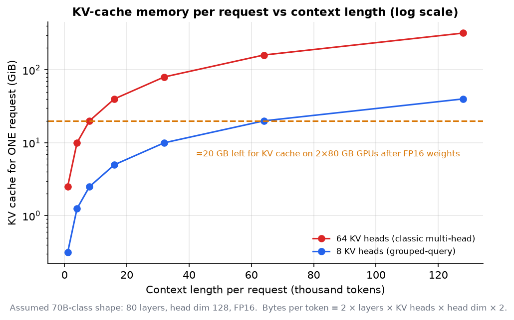
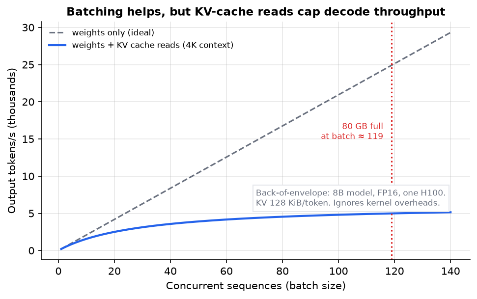
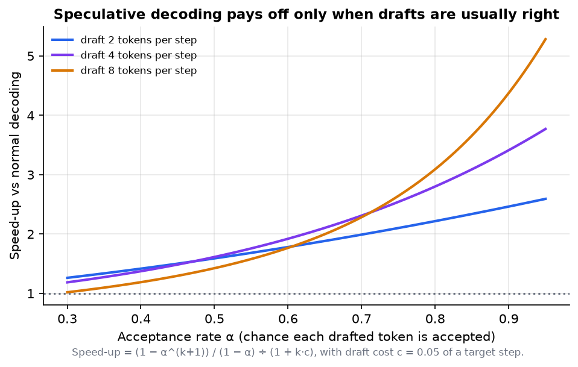

# AI Engineering 8: Serving and GPU Infrastructure

> **Series (AI engineering):** [0 Start Here](AI%20Engineering%200%20-%20Start%20Here.md) · [1 How LLMs Work](AI%20Engineering%201%20-%20How%20LLMs%20Work.md) · [2 Prompting and Context Engineering](AI%20Engineering%202%20-%20Prompting%20and%20Context%20Engineering.md) · [3 Evals and Quality](AI%20Engineering%203%20-%20Evals%20and%20Quality.md) · [4 Retrieval and RAG](AI%20Engineering%204%20-%20Retrieval%20and%20RAG.md) · [5 Agents](AI%20Engineering%205%20-%20Agents.md) · [6 Production LLM Engineering](AI%20Engineering%206%20-%20Production%20LLM%20Engineering.md) · [7 Safety, Security and Governance](AI%20Engineering%207%20-%20Safety%20Security%20and%20Governance.md) · **8 Serving and GPU Infrastructure** · [9 Customising Models](AI%20Engineering%209%20-%20Customising%20Models.md)
> **Source:** built from research: papers, hardware specifications and serving-engine documentation listed in [References](#17-references). Every number recomputed with Python. Figures: [make_figs.py](../../figures/ai_engineering/make_figs.py).
> **Facts re-checked:** 22 October 2026. GPU specifications differ between sources (dense vs sparse figures, usable vs nominal memory); the values here are dense figures from vendor-level listings, rounded. Throughput numbers are **back-of-envelope models**, not benchmarks.

**The big picture:** if you run open-weight models yourself, you meet a different physics from ordinary web services. Generating each token means reading the **entire model** from GPU memory, so single-user generation is limited by **memory bandwidth**, not compute. The whole art of LLM serving (batching, the KV cache, paged memory, quantisation, speculative decoding, parallelism, disaggregation) is about using expensive GPUs fully while keeping latency acceptable. This guide gives you the numbers to reason about it.

Diagram colours: 🔵 input · 🟣 processing · 🟢 result · 🟠 trade-off · 🔴 failure

---

## Contents

0. [How to use this guide](#0-how-to-use-this-guide)
1. [TL;DR](#1-tldr)
2. [GPU fundamentals](#2-gpu-fundamentals)
3. [Prefill vs decode](#3-prefill-vs-decode)
4. [KV cache maths](#4-kv-cache-maths)
5. [Batching](#5-batching)
6. [PagedAttention and prefix caching](#6-pagedattention-and-prefix-caching)
7. [Quantisation](#7-quantisation)
8. [Speculative decoding](#8-speculative-decoding)
9. [Multi-GPU parallelism](#9-multi-gpu-parallelism)
10. [Disaggregated prefill and decode](#10-disaggregated-prefill-and-decode)
11. [Serving engines](#11-serving-engines)
12. [Capacity planning and cost](#12-capacity-planning-and-cost)
13. [Thinking critically: decisions and trade-offs](#13-thinking-critically-decisions-and-trade-offs)
14. [Self-check](#14-self-check)
15. [Glossary](#15-glossary)
16. [Further reading](#16-further-reading)
17. [References](#17-references)

---

## 0. How to use this guide

| If you have… | Read |
|---|---|
| 10 minutes | §0.1, §1, Fig 10 in §2 |
| 1 hour | §2–§5: roofline, prefill vs decode, KV cache, batching |
| A weekend | Everything, then reproduce the §12 capacity estimate for a model you'd host |

You need this guide if you self-host models, choose GPUs, or want to understand why API providers price, limit and batch the way they do. If you only call hosted APIs, §3–§5 still explain the latency and cost behaviour you'll see.

### 0.1 First, in completely plain words

Picture a chef (the GPU's compute units) who is incredibly fast with a knife, working in a kitchen where every ingredient must be fetched from a storeroom down a corridor (memory). To make **one word** of output, the chef has to fetch **every ingredient in the storeroom**: all the model's weights, tens of gigabytes. For a single customer, the chef spends almost all the time walking the corridor and almost none cooking.

The fix is obvious once you see it: **cook for many customers per trip.** One trip down the corridor serves a whole batch of orders. That's batching, and it's why serving many users at once is far cheaper per user than serving one.

But each customer also has a growing pile of notes about their order so far (the KV cache), and those notes take up kitchen space. Run out of space and you can't take more customers. Most of this guide is about managing that trade-off: trips, batch size and space.

---

## 1. TL;DR

1. **Three GPU numbers matter:** memory capacity (does it fit?), memory bandwidth (how fast can you read the weights?) and compute (how fast can you multiply?). An H100 SXM has 80 GB, 3.35 TB/s and about 989 TFLOP/s dense BF16.
2. **Roofline:** a workload is memory-bound if it does fewer than ~295 FLOPs per byte read on an H100. **Decode at batch 1 does ~1 FLOP per byte**, so it's deeply memory-bound.
3. **Prefill** (reading the prompt) is compute-bound and sets time to first token. **Decode** (writing the answer) is memory-bound and sets time per token.
4. **Single-sequence speed limit ≈ bandwidth ÷ model bytes:** an 8B FP16 model on one H100 tops out around 209 tokens/s.
5. **KV cache** = 2 × layers × KV heads × head dim × bytes per token: 128 KiB per token for an 8B-class model, so 512 MiB for one 4K-token conversation. Memory for the KV cache, not compute, caps the batch size.
6. **Batching** multiplies throughput, but at long context **KV-cache reads dominate**. In the worked model, throughput only rises from ~200 to ~5,000 tokens/s as the batch grows from 1 to 119.
7. **Continuous batching + PagedAttention** (vLLM) keep GPUs full and memory unfragmented. **Prefix caching** reuses shared prompt prefixes.
8. **Quantisation** (FP8, INT4, FP4) shrinks weights and the KV cache. That means more speed and more capacity, at a small, measurable quality cost.
9. **Speculative decoding** gives ~1.5–3× speed-ups when drafts are usually accepted, and little or nothing on unpredictable text.
10. **Multi-GPU:** tensor parallel within a node for large models; pipeline across nodes; expert parallel for MoE; replicas for throughput.
11. **Disaggregated prefill/decode** helps at large scale with long prompts; it's not worth it for small deployments.
12. **Capacity plan in tokens/s,** include utilisation, and compare cost per million tokens with API prices before buying GPUs.

---

## 2. GPU fundamentals

**The problem.** To reason about speed and cost, you need to know which resource runs out first. For LLMs the answer is surprising: it's usually not compute.

**Units first.** A **FLOP** is one floating-point operation (one multiply or one add). **TFLOP/s** means trillions ($10^{12}$) per second and **PFLOP/s** means $10^{15}$ per second. **TB/s** is terabytes per second read from memory. **FP16/BF16, FP8, FP4** are number formats using 16, 8 or 4 bits per value: fewer bits means less memory, more speed and less precision (§7). "Dense" figures assume ordinary matrices; vendors also quote higher "sparse" figures that real LLM workloads rarely reach.

**The three numbers:**

| GPU (data-centre SXM parts) | Memory | Bandwidth | Dense BF16 | Dense FP8 | Dense FP4 |
|---|---|---|---|---|---|
| NVIDIA H100 | 80 GB HBM3 | 3.35 TB/s | ~989 TFLOP/s | ~1,979 TFLOP/s | — |
| NVIDIA H200 | 141 GB HBM3e | 4.8 TB/s | ~989 TFLOP/s | ~1,979 TFLOP/s | — |
| NVIDIA B200 (Blackwell) | ~180–192 GB HBM3e | 8 TB/s | — | ~4.5 PFLOP/s | ~9 PFLOP/s |
| NVIDIA B300 (Blackwell Ultra) | ~268–288 GB HBM3e | 8 TB/s | — | ~4.5 PFLOP/s | ~13.5 PFLOP/s |

*Rounded vendor-level figures, dense (not sparse). Sources disagree on B200/B300 memory (usable vs nominal). AMD (MI300-series and later) and Google TPUs are real alternatives, with their own software stacks.*

Notice the trend: compute grew much faster than bandwidth (H100 → B300: FP4 compute arrived, while bandwidth roughly doubled). That's why techniques that **save memory traffic** matter so much.

**Interconnect** matters once a model spans several GPUs: **NVLink** inside a server (hundreds of GB/s to over a TB/s per GPU), and InfiniBand or Ethernet between servers (much slower). It decides which parallelism strategies are practical (§9).

**The roofline model.** Any computation has an **arithmetic intensity**: FLOPs performed per byte moved from memory. The GPU can't go faster than either its compute peak or bandwidth × intensity:

$$
\text{attainable FLOP/s} = \min(\text{peak FLOP/s}, \ \text{bandwidth} \times \text{intensity})
$$

*Performance is capped by compute, or by how fast memory can feed the computation, whichever is lower.* The **ridge point**, where the two meet, is $989 \times 10^{12} / 3.35 \times 10^{12} \approx$ **295 FLOP/byte** on an H100. Below it you're memory-bound; above it, compute-bound.

*Fig 10 (f10_roofline.png). Decode at batch 1 reaches only about 3 TFLOP/s of a 989 TFLOP/s GPU: 0.3% of its compute.*

**Why decode is ~1 FLOP per byte.** Generating one token multiplies the token's vector by every weight matrix: about **2 FLOPs per parameter** (a multiply and an add). With FP16 weights, each parameter is **2 bytes**. So one sequence does about 2 FLOPs per 2 bytes = **1 FLOP per byte**. With a batch of $B$ sequences, the same weights are read *once* and used $B$ times, so intensity ≈ $B$ FLOP/byte. You'd need a batch of about 295 to become compute-bound, and KV-cache reads (§4) push that further away.

---

## 3. Prefill vs decode

**The problem.** "How fast is the model?" has two different answers, because generation has two phases with opposite bottlenecks.

| | **Prefill** | **Decode** |
|---|---|---|
| What | Process the whole prompt at once | Generate output tokens one at a time |
| Parallelism | All prompt tokens in parallel | Sequential: each token depends on the last |
| Bottleneck | **Compute** (big matrix multiplications) | **Memory bandwidth** (re-reading weights and KV cache every step) |
| User-visible metric | **Time to first token (TTFT)** | **Time per output token (TPOT)** or tokens/s |
| Grows with | Prompt length (attention part grows quadratically) | Output length × per-token time |

**Worked example: an 8B model in FP16 (16 GB of weights) on one H100.**

- **Decode, one user:** each token reads 16 GB. Time per token $\geq 16 \times 10^9 / 3.35 \times 10^{12} = 4.78$ ms, so at most **≈ 209 tokens/s**. That's the hard ceiling, set purely by bandwidth.
- **Prefill, a 4,000-token prompt:** about $2 \times 8 \times 10^9 \times 4{,}000 = 64$ TFLOP. At the 989 TFLOP/s peak that's **65 ms**. Real kernels reach perhaps 40–60% of peak (the **model FLOPs utilisation**, MFU), so expect roughly 110–160 ms.
- **A 70B model on 2 × H100** (140 GB FP16, split across both): per token $140 \times 10^9 / (2 \times 3.35 \times 10^{12}) = 20.9$ ms, so at most **≈ 48 tokens/s** for one user.

**Takeaways:** long prompts hurt TTFT (compute), long answers hurt total time (bandwidth), and the two phases compete for the same GPU when mixed in one batch. That conflict is what chunked prefill (§5) and disaggregation (§10) address.

---

## 4. KV cache maths

**The problem.** During decode, each new token attends to the keys and values of all previous tokens. Storing them (the KV cache, Guide 1 §4) avoids recomputation, but the cache grows with every token of every active conversation, and it lives in the same scarce GPU memory as the weights.

**The formula:**

$$
\text{KV bytes per token} = 2 \times n_{\text{layers}} \times n_{\text{kv heads}} \times d_{\text{head}} \times \text{bytes per value}
$$

*Per token, store one key and one value (the 2) for every layer and every key-value head, each with the head's dimension, at the chosen precision.*

**Worked examples** (FP16, 2 bytes per value):

| Model shape | Per token | 4K-token sequence | 128K-token sequence |
|---|---|---|---|
| 8B-class: 32 layers, 8 KV heads, head dim 128 | $2 \times 32 \times 8 \times 128 \times 2$ = **128 KiB** | 512 MiB | 16 GiB |
| 70B-class: 80 layers, 8 KV heads, head dim 128 | **320 KiB** | 1.25 GiB | 40 GiB |
| 70B-class without GQA: 64 KV heads | 2,560 KiB | 10 GiB | 320 GiB |

**How many users fit?** 8B model on one 80 GB H100: weights take 16 GB, leaving 64 GB. Each 4K-token conversation needs 0.537 GB, so at most $\lfloor 64 / 0.537 \rfloor = 119$ **concurrent sequences**, before activation memory and overheads (real numbers are lower). Double the context and capacity halves.

*Fig 15 (f15_kv_cache.png). For a 70B-class shape: with 64 KV heads, a single 8K-token request already needs 20 GiB. Grouped-query attention (8 KV heads) cuts that 8×.*

**Ways to shrink the KV cache:**

| Technique | Saving | Where |
|---|---|---|
| **Grouped/multi-query attention** (several query heads share KV heads) | 4–8× or more vs classic multi-head | Built into the model architecture |
| **Multi-head latent attention** (cache a compressed latent instead of K and V) | Large; used by DeepSeek-family models | Model architecture |
| **KV-cache quantisation** (FP8 or lower) | 2× (FP8 vs FP16) | Serving-engine setting |
| **Sliding-window / local attention layers** | Caps the cache for those layers | Model architecture |
| **Paged allocation** (§6) | Removes fragmentation waste | Serving engine |
| **Prefix sharing** (§6) | Shared prompt prefixes stored once | Serving engine |

---

## 5. Batching

**The problem.** At batch 1, a GPU uses well under 1% of its compute during decode (§2). Serving one user at a time wastes almost the whole machine.

**How it works.** Run many sequences through each decode step together. The weights are read once per step and used by every sequence in the batch.

**Static vs continuous batching.** Naive **static batching** waits until a batch is full, then runs it until the *longest* sequence finishes. Short requests sit idle, and new requests wait. **Continuous (in-flight) batching** (Yu et al., Orca, OSDI 2022) schedules **per step**: finished sequences leave immediately, and waiting requests join at the next step. That's the standard in every modern serving engine. **Chunked prefill** splits long prompts into pieces, mixed in with ongoing decode steps, so one huge prompt doesn't stall everyone's token stream.

**The throughput model.** Per decode step, the GPU must read the weights once plus *every* sequence's KV cache:

$$
t_{\text{step}} \approx \max\left(\frac{W + B \cdot KV_{\text{seq}}}{\text{bandwidth}}, \ \frac{2 P B}{\text{peak FLOP/s}}\right)
$$

*Step time is the larger of: the time to read the weights plus all B sequences' KV caches, or the time to do the arithmetic for B tokens.* Here $W$ is weight bytes, $P$ the parameter count, $B$ the batch size and $KV_{\text{seq}}$ one sequence's cache. Throughput is $B / t_{\text{step}}$ tokens per second.

**Worked example** (8B FP16, one H100, 4K context per sequence):

| Batch $B$ | Step time | Throughput |
|---|---|---|
| 1 | 4.94 ms | 203 tokens/s |
| 8 | 6.06 ms | 1,321 tokens/s |
| 32 | 9.90 ms | 3,231 tokens/s |
| 64 | 15.03 ms | 4,257 tokens/s |
| 119 (memory full) | 23.85 ms | 4,990 tokens/s |

*Fig 11 (f11_batch_throughput.png). Back-of-envelope; real engines reach a fraction of this. The dashed line ignores the KV cache and looks wonderful. The solid line includes it: at batch 119, the KV caches total 64 GB, four times the 16 GB of weights, so reading them dominates each step.*

**Two lessons:**

1. Batching gives a **~25× throughput gain** here (203 → 4,990 tokens/s). That's why API providers can charge so little per token.
2. Each user's tokens get **slower** as the batch grows: TPOT goes from 4.9 ms to 23.9 ms. **Batch size is a latency–throughput dial.** Serving engines expose limits (maximum concurrent sequences, maximum batched tokens) to set it.

At long context, the **KV cache dominates** memory *and* bandwidth. That's why the KV-shrinking techniques in §4 and the paged memory in §6 matter more than raw compute.

---

## 6. PagedAttention and prefix caching

**The problem.** Early serving systems reserved one contiguous block of memory per sequence, sized for the *maximum* possible length. Most sequences end far shorter, so most of the reserved memory sat unused. vLLM's authors measured that existing systems wasted a large majority of KV-cache memory to fragmentation and over-reservation.

**PagedAttention** (Kwon et al., SOSP 2023, the paper behind **vLLM**) borrows from operating-system virtual memory:

- The KV cache is split into fixed-size **blocks** (for example 16 tokens each).
- Each sequence has a **block table** mapping its logical token positions to physical blocks, which can sit anywhere in memory.
- Blocks are allocated **on demand** as the sequence grows, and freed the moment it ends.
- Waste drops to at most one partly-filled block per sequence, so many more sequences fit, and throughput rises.

**Prefix caching.** Many requests share a long prefix: the same system prompt, tool definitions or document. With paged blocks, sequences can **share** the physical blocks for an identical prefix (copy-on-write when they diverge). The prefix is computed once, stored once, and reused, which saves both prefill compute and memory. SGLang's **RadixAttention** organises cached prefixes in a radix tree so any shared prefix, not just exact repeats, is found and reused. This is the self-hosted equivalent of API prompt caching (Guide 6 §9), and it rewards the same prompt design: stable content first.

---

## 7. Quantisation

**The problem.** Weights and KV caches in FP16/BF16 take 2 bytes per value. Since decode is bandwidth-bound, **fewer bytes means proportionally faster decode**, and more memory left for batch size.

**How it works.** Store values in fewer bits, with scaling factors that map the small integers or floats back to the original range:

| Scheme | Bits | What's quantised | Notes |
|---|---|---|---|
| **FP8 (W8A8)** | 8 | Weights and activations | Native on H100 and later; usually near-lossless for large models; compute-efficient |
| **INT8 weight-only** | 8 | Weights | Simple; halves weight memory |
| **INT4 weight-only** (GPTQ, AWQ) | 4 | Weights | 4× smaller than FP16; popular for local and single-GPU serving; quality loss small but measurable, larger on small models |
| **FP4** (NVFP4, MXFP4) | 4 | Weights and activations | Native on Blackwell GPUs; open models increasingly ship FP4 (OpenAI's gpt-oss shipped MXFP4 weights) |
| **KV-cache FP8** | 8 | KV cache | Doubles how many tokens fit; usually small quality impact |

**Worked example.** 70B parameters: FP16 = 140 GB (two H100s); FP8 = 70 GB (one H100, tight); INT4 ≈ 35 GB (one GPU with plenty of KV room). For an 8B model, INT4 brings weights to **4 GB**: a laptop GPU or a phone (Guide 1 §11). Decode is bandwidth-bound, so going from FP16 to INT4 weights can make single-user decode up to **~4× faster** in the ideal case. Real gains are smaller, because of dequantisation overhead and KV-cache reads.

**The rule: quantisation is a quality trade-off you measure.** Run your evals (Guide 3) on the quantised model. Quality loss is often negligible at 8 bits, usually small at 4 bits for large models, and more visible for small models, long reasoning chains, maths and code.

---

## 8. Speculative decoding

**The problem.** Decode produces one token per expensive step, and the GPU's compute sits mostly idle (§2). Can one target-model step produce *several* tokens?

**How it works.**

1. A cheap **draft** proposes the next $k$ tokens. The draft can be a small model, extra prediction heads on the target model (Medusa, **EAGLE**, multi-token-prediction heads), or n-gram lookups in the prompt.
2. The large **target** model checks all $k$ tokens in **one forward pass**. That costs about the same as generating one token, because decode is memory-bound and verifying $k$ tokens is extra compute, which is idle anyway.
3. Accept the longest prefix of draft tokens that the target agrees with, plus one token from the target itself. With the standard acceptance rule, **the output distribution is exactly the target model's**, so there's no quality loss.

**The maths.** If each draft token is accepted with probability $\alpha$ (independently), the expected number of tokens produced per target step, with $k$ drafted tokens, is:

$$
E[\text{tokens per step}] = \frac{1 - \alpha^{k+1}}{1 - \alpha}
$$

*Expected tokens per verification step is a geometric series: one, plus α, plus α squared, up to α to the k.* Dividing by the extra cost of drafting ($1 + k c$, where $c$ is the draft cost relative to one target step) gives the speed-up.

**Worked example.** $\alpha = 0.7$, $k = 4$, $c = 0.05$: $E = (1 - 0.7^5)/(1 - 0.7) = 0.832 / 0.3 = 2.77$ tokens per step. Speed-up $= 2.77 / (1 + 4 \times 0.05) = 2.77 / 1.2 \approx 2.31$, so about **2.3× faster**. At $\alpha = 0.5$ the speed-up is only 1.62×; at $\alpha = 0.9$ it's 3.41×.

*Fig 12 (f12_speculative_decoding.png). Drafting more tokens helps only when the acceptance rate is high. At low α, long drafts waste work.*

**In practice:** acceptance rates depend heavily on the **workload**. Predictable text (code edits that copy much of the input, structured output, summarisation) accepts many drafts. Open-ended chat accepts few. Practitioner reports for EAGLE-3 in vLLM range from about 1.8× on code refactoring down to roughly no gain on general chat. Speculative decoding also helps most at **small batch sizes**: at large batches, the "idle" compute it relies on is already used. **Benchmark on your own traffic.**

---

## 9. Multi-GPU parallelism

**The problem.** A model's weights (plus its KV cache) may not fit on one GPU, or one GPU may be too slow for your latency target.

| Strategy | Splits | Communication | Use when |
|---|---|---|---|
| **Tensor parallelism (TP)** | Each layer's weight matrices across GPUs; every GPU works on every token | Heavy: an all-reduce in every layer | The model doesn't fit on one GPU, or you need lower per-token latency. Keep it **within one NVLink server** (TP 2, 4 or 8). |
| **Pipeline parallelism (PP)** | Different layers on different GPUs or servers | Light: activations passed between stages | The model spans multiple servers; often combined with TP inside each server |
| **Expert parallelism (EP)** | Different MoE experts on different GPUs | All-to-all token routing | Large mixture-of-experts models |
| **Data parallelism (replicas)** | Whole copies of the model | None between replicas | Scaling throughput once one copy meets your latency target |

**The communication terms in plain words.** In tensor parallelism, each GPU computes *part* of every layer's result, so after each layer the GPUs must combine their partial results and all receive the total. That combine-and-share step is an **all-reduce**. It happens dozens of times per token, which is why tensor parallelism needs the very fast links inside one server. **All-to-all** (expert parallelism) means every GPU sends some tokens to every other GPU, to reach whichever expert each token was routed to. **RDMA** (remote direct memory access), used in §10, lets one machine's network card read or write another machine's memory directly, without going through either CPU, which makes moving gigabytes of KV cache fast.

**Typical layouts:** an 8B model is replicated, one GPU each. A 70B model in FP16 uses TP=2 (or one GPU in FP8). A frontier-scale MoE uses TP within servers, EP across experts, and many replicas behind a load balancer.

---

## 10. Disaggregated prefill and decode

**The problem.** Prefill is compute-bound and bursty; decode is memory-bound and steady (§3). In one shared batch, a big prefill stalls everyone's decode steps (jittery TPOT), and you can't tune hardware or parallelism for each phase separately.

**How it works.** Run **separate pools of GPUs** for prefill and decode (DistServe, Zhong et al., 2024; Mooncake, 2024):

1. A prefill worker processes the prompt and builds its KV cache.
2. The KV cache is **transferred** to a decode worker over a fast interconnect (RDMA; libraries such as NVIDIA's NIXL; frameworks such as NVIDIA Dynamo and llm-d coordinate this).
3. The decode worker streams tokens. Each pool is sized and parallelised for its own phase.

**Trade-offs:** reported gains of roughly 2–3× throughput at equal hardware for **long-prompt, high-concurrency** workloads, with steadier latency. The costs are KV-transfer bandwidth, much more operational complexity, and wasted capacity when traffic is small. Practitioner guidance suggests it's rarely worth it below roughly 8 GPUs per model. Treat reported speed-ups as vendor and workload-specific, and measure your own.

---

## 11. Serving engines

**The problem.** Implementing continuous batching, paged KV caches, quantised kernels, speculative decoding and parallelism yourself would take a team years. Serving engines package all of it.

| Engine | Strengths | Typical use |
|---|---|---|
| **vLLM** | PagedAttention; continuous batching; broad model and hardware support; OpenAI-compatible server; prefix caching, speculative decoding, quantisation, disaggregation connectors | The default open-source choice for production serving |
| **SGLang** | RadixAttention prefix reuse; fast structured outputs; strong for agent and multi-call workloads; disaggregation support | Agentic and multi-turn workloads; high throughput |
| **TensorRT-LLM** (NVIDIA) | Highly optimised NVIDIA kernels, FP8/FP4 | Maximum performance on NVIDIA hardware |
| **llama.cpp / Ollama** | CPU and consumer-GPU inference; GGUF quantised formats; easy local setup | Laptops, desktops, on-device, prototyping |
| **Orchestration** (NVIDIA Dynamo, llm-d, KServe) | Multi-node routing, KV-aware load balancing, disaggregation, autoscaling | Large-scale deployments on Kubernetes |

Most expose an **OpenAI-compatible API**, so application code (and your gateway, Guide 6 §4) can switch between self-hosted and hosted models with little change. **Benchmark your own workload** (prompt and output lengths, concurrency, latency targets). Engines' relative performance changes release to release.

---

## 12. Capacity planning and cost

**The problem.** "How many GPUs do we need, and is it cheaper than an API?" You need an estimate before you buy or reserve hardware.

**Plan in tokens per second**, at peak, with your real prompt and output lengths:

1. **Demand:** peak requests/s × output tokens per request = output tokens/s needed. Track input tokens too (prefill load).
2. **Per-replica throughput** at a batch size that still meets your TPOT target (§5). Use a benchmark of your engine and model, not a theoretical peak.
3. **Replicas** = demand ÷ per-replica throughput, plus headroom for spikes and failures.

**Worked example** (8B FP16 on H100s, 4K context). The model in §5 gives 4,257 tokens/s at batch 64. Assume real engines reach **60%** of that, about 2,550 tokens/s per GPU, at TPOT ≈ 15 ms (fine for chat). Peak demand: 50,000 output tokens/s. Replicas = 50,000 / 2,554 ≈ 19.6. Add 30% headroom: **≈ 26 GPUs**.

**Cost per million output tokens.** Assume USD 2.50 per GPU-hour (cloud H100 prices vary widely). One GPU at 2,554 tokens/s produces about 9.2M tokens per hour: USD 2.50 / 9.2 ≈ **USD 0.27 per million tokens at 100% utilisation**. Real traffic varies through the day. At an average **40% utilisation** the effective cost is about **USD 0.68 per million**. Utilisation is the hidden variable in every self-hosting decision.

**Self-host or API?**

| Self-hosting wins when… | APIs win when… |
|---|---|
| Volume is high and steady (high utilisation) | Traffic is spiky or small (you'd pay for idle GPUs) |
| An open model meets your quality bar (evals) | You need frontier-model quality |
| Data must stay on your infrastructure | The provider's data terms are acceptable |
| You need customisation (fine-tunes, special decoding) | You don't want to run GPU infrastructure and on-call |

**Operational realities:**

- **Cold starts:** loading 140 GB of weights at ~2 GB/s takes **~70 s**, so autoscaling LLM servers is slow. Keep warm capacity, cache weights on local NVMe, and scale on queue depth and KV-cache utilisation, not CPU.
- **Health:** monitor KV-cache usage, queue length, TTFT and TPOT percentiles, preemptions (sequences evicted when memory runs out) and GPU errors.
- **Mixed fleets:** route long-context requests to large-memory GPUs, and batch jobs to cheaper or spot capacity.

---

## 13. Thinking critically: decisions and trade-offs

Infrastructure decisions are expensive and slow to reverse. Critical thinking here means **finding the true bottleneck with numbers** before spending money.

**Questions to ask before choosing hardware or tuning a server**

1. **What's the bottleneck: memory capacity, memory bandwidth, or compute?** (The roofline tells you.)
2. **What are the real prompt and output lengths, and the concurrency?** They decide KV-cache size and batch size.
3. **What latency per token do users need?** That caps the batch size.
4. **What will average utilisation be** over a day? It decides cost per token.
5. **Would an API be cheaper,** once you include operations and idle time?

**Where hardware intuition breaks**

| Intuition | Reality |
|---|---|
| "A GPU with more FLOPs makes generation faster" | Decode is bandwidth-bound; FLOPs mostly help prefill |
| "Bigger batches are always better" | Throughput rises, but each user's tokens slow down |
| "Quantisation is free speed" | Usually small quality loss, sometimes not. Evaluate it. |
| "Vendor benchmark: 3× faster" | On their workload, batch size and settings. Measure yours. |
| "We'll self-host to save money" | Only at high, steady utilisation; idle GPUs are expensive |

**Decision scenarios**

A. Your chat service has 8K-token average contexts. Throughput is poor, yet GPU compute utilisation is ~10%. What's happening, and what are the options?

Low compute use plus poor throughput points to memory: KV-cache reads (bandwidth) and KV-cache size (capacity) limit the batch. Options: FP8 KV cache (2× capacity); prefix caching if conversations share long prefixes; a model with fewer KV heads; a GPU with more memory and bandwidth; limiting or compacting context. Buying a GPU with more FLOPs wouldn't help. The roofline tells you which purchase is wasted.

B. Should you self-host a 70B open model or use an API?

Do the arithmetic: peak and average tokens per second → GPUs needed (§12) → cost at realistic utilisation, plus engineering and on-call time. Compare with API cost per token for the same volume. Then the non-cost factors: data residency, customisation, quality (eval both). Many teams find APIs cheaper until volume is large and steady. Some must self-host for data reasons regardless of cost.

C. You turned on speculative decoding and saw no speed-up. Why might that be?

Check the acceptance rate and the batch size. Open-ended chat has low acceptance (drafts are often wrong), and at large batch sizes the GPU's spare compute is already in use, so verification isn't "free" any more. It helps most for predictable outputs at small batch sizes. Measure acceptance on your traffic before concluding it's broken.

**Understand deeply vs look up when needed**

| Understand | Look up |
|---|---|
| Roofline: memory-bound vs compute-bound | GPU specifications and prices |
| Decode ≈ bandwidth ÷ model bytes | Serving-engine flags and versions |
| KV-cache size formula and its effect on batch size | Which quantisation formats a GPU supports |
| Utilisation drives cost per token | Current benchmark numbers |

---

## 14. Self-check

1. Why is single-user decode memory-bound, in one sentence with numbers?

Each token needs ~2 FLOPs per parameter while reading 2 bytes per parameter (FP16), so ~1 FLOP/byte, far below an H100's ~295 FLOP/byte ridge point.

2. Upper bound on single-user tokens/s for a 4B FP16 model on a GPU with 3.35 TB/s?

Weights = 8 GB. $3.35 \times 10^{12} / 8 \times 10^9 \approx$ **419 tokens/s**.

3. KV cache per token for 40 layers, 8 KV heads, head dim 128, FP16? And for a 32K-token conversation?

$2 \times 40 \times 8 \times 128 \times 2 = 163{,}840$ bytes = **160 KiB**. × 32,768 tokens = **5 GiB**.

4. Why does throughput level off with batch size at long context, even before memory is full?

Each decode step must read every sequence's KV cache. As the batch grows, KV bytes dominate the weight bytes, so step time grows almost linearly with batch size, and throughput (batch ÷ step time) flattens.

5. α = 0.8, k = 4, draft cost c = 0.05. Expected speed-up from speculative decoding?

$E = (1 - 0.8^5)/0.2 = 3.36$; speed-up $= 3.36/1.2 \approx$ **2.8×**.

6. When would you use tensor parallelism vs more replicas?

Tensor parallelism when the model doesn't fit on one GPU, or per-token latency must drop. Replicas when one copy already meets latency, and you need more total throughput.

7. A GPU costs USD 3/hour and sustains 2,000 tokens/s. Cost per million tokens at 50% utilisation?

7.2M tokens/hour at full use → USD 0.42 per million. At 50% utilisation: about **USD 0.83 per million**.

---

## 15. Glossary

| Term | Meaning |
|---|---|
| **HBM** | High-bandwidth memory on the GPU package |
| **Memory bandwidth** | Bytes per second the GPU can read from HBM |
| **Arithmetic intensity** | FLOPs per byte moved from memory |
| **Roofline / ridge point** | Performance cap from compute or bandwidth / intensity where they meet |
| **Prefill / decode** | Processing the prompt / generating tokens one at a time |
| **TTFT / TPOT** | Time to first token / time per output token |
| **MFU** | Model FLOPs utilisation: achieved ÷ peak compute |
| **KV cache** | Stored attention keys and values per token |
| **GQA / MLA** | Grouped-query attention / multi-head latent attention: KV-cache-shrinking designs |
| **Continuous batching** | Adding and removing sequences at every decode step |
| **Chunked prefill** | Splitting long prompts so they interleave with decode |
| **PagedAttention** | Block-based, on-demand KV-cache allocation (vLLM) |
| **Prefix caching / RadixAttention** | Reusing KV blocks of shared prompt prefixes |
| **Quantisation (FP8, INT4, FP4)** | Storing weights, activations or KV in fewer bits |
| **Speculative decoding** | Draft several tokens cheaply; verify in one target pass |
| **Acceptance rate (α)** | Probability a drafted token is accepted |
| **Tensor / pipeline / expert parallelism** | Splitting layers' matrices / layers / MoE experts across GPUs |
| **Disaggregated serving** | Separate GPU pools for prefill and decode |
| **NVLink** | High-bandwidth GPU-to-GPU interconnect within a server |
| **Preemption** | Evicting a sequence's KV cache when memory runs out |
| **Utilisation** | Share of capacity actually used; drives effective cost |

---

## 16. Further reading

- The vLLM and SGLang documentation and blogs, for current features and tuning guides.
- "How to Scale Your Model" (Google DeepMind's JAX scaling book, 2025), for a deeper treatment of rooflines and parallelism.

---

## 17. References

- Woosuk Kwon et al., "Efficient Memory Management for Large Language Model Serving with PagedAttention", SOSP 2023.
- Gyeong-In Yu et al., "Orca: A Distributed Serving System for Transformer-Based Generative Models", OSDI 2022.
- Lianmin Zheng et al., "SGLang: Efficient Execution of Structured Language Model Programs" (RadixAttention), 2024.
- Yaniv Leviathan, Matan Kalman, Yossi Matias, "Fast Inference from Transformers via Speculative Decoding", ICML 2023. Yuhui Li et al., EAGLE, EAGLE-2 and EAGLE-3 papers (2024–2025).
- Yinmin Zhong et al., "DistServe: Disaggregating Prefill and Decoding for Goodput-optimized LLM Serving", OSDI 2024. Ruoyu Qin et al., "Mooncake", 2024.
- Samuel Williams, Andrew Waterman, David Patterson, "Roofline: An Insightful Visual Performance Model for Multicore Architectures", CACM 2009.
- Elias Frantar et al., "GPTQ", 2022. Ji Lin et al., "AWQ: Activation-aware Weight Quantization", 2023.
- Joshua Ainslie et al., "GQA", 2023. DeepSeek-AI, "DeepSeek-V2" (multi-head latent attention), 2024.
- GPU figures: NVIDIA H100/H200 datasheets; B200/B300 specifications as summarised by DataCrunch, Runpod and SemiAnalysis InferenceX (2025–2026; values differ between sources).
- vLLM blog, "Prefill-Decode Disaggregation" (April 2026); NVIDIA Dynamo documentation (SGLang disaggregation). EAGLE-3 speed-up ranges: vLLM deployment write-ups and AWS Neuron tutorial (2025–2026).

**Next:** [Guide 9: Customising Models](AI%20Engineering%209%20-%20Customising%20Models.md), changing the model itself when prompting and retrieval aren't enough.
