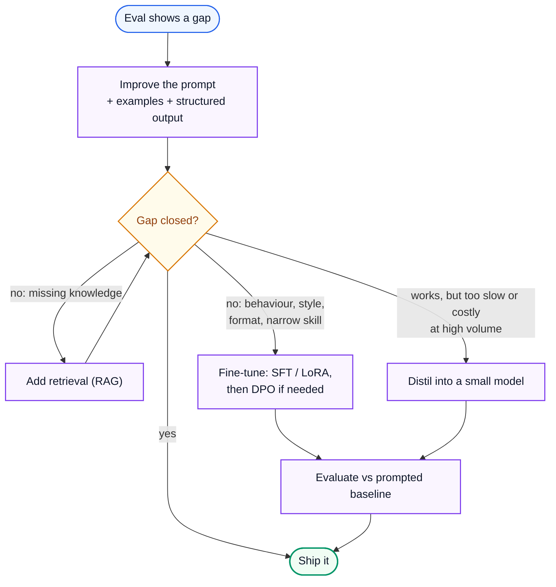
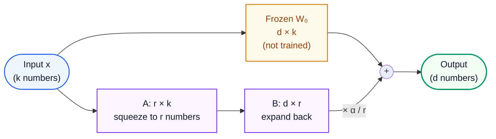
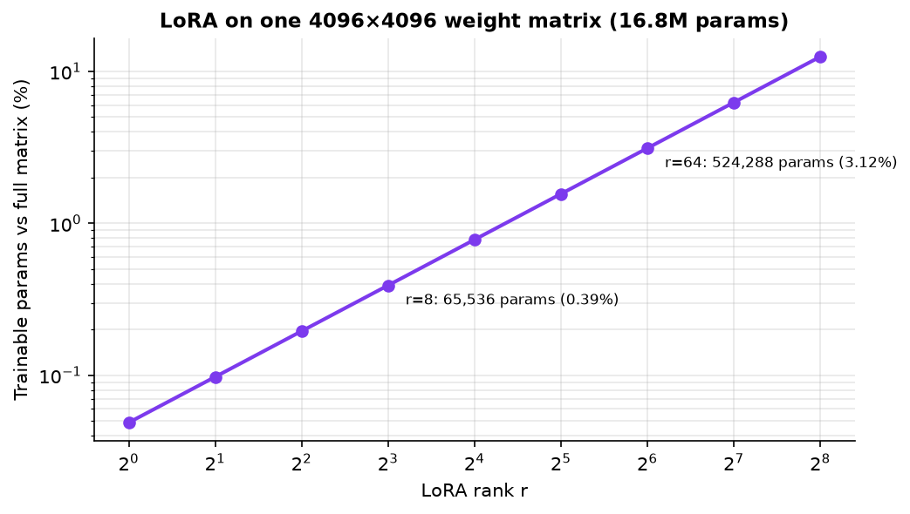
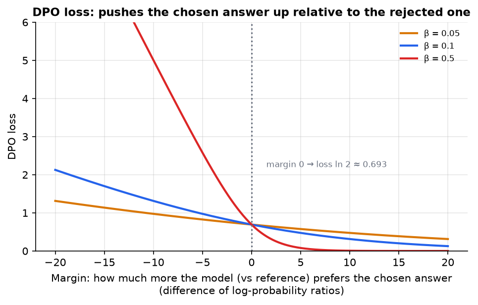

# AI Engineering 9: Customising Models

> **Series (AI engineering):** [0 Start Here](AI%20Engineering%200%20-%20Start%20Here.md) · [1 How LLMs Work](AI%20Engineering%201%20-%20How%20LLMs%20Work.md) · [2 Prompting and Context Engineering](AI%20Engineering%202%20-%20Prompting%20and%20Context%20Engineering.md) · [3 Evals and Quality](AI%20Engineering%203%20-%20Evals%20and%20Quality.md) · [4 Retrieval and RAG](AI%20Engineering%204%20-%20Retrieval%20and%20RAG.md) · [5 Agents](AI%20Engineering%205%20-%20Agents.md) · [6 Production LLM Engineering](AI%20Engineering%206%20-%20Production%20LLM%20Engineering.md) · [7 Safety, Security and Governance](AI%20Engineering%207%20-%20Safety%20Security%20and%20Governance.md) · [8 Serving and GPU Infrastructure](AI%20Engineering%208%20-%20Serving%20and%20GPU%20Infrastructure.md) · **9 Customising Models**
> **Source:** built from research: papers and documentation listed in [References](#16-references). Every number recomputed with Python. Figures: [make_figs.py](../../figures/ai_engineering/make_figs.py). Code: [ai_lora_dpo_grpo.py](../../code/ai_lora_dpo_grpo.py).
> **Facts re-checked:** 24 October 2026.

**The big picture:** prompting and retrieval change what the model *sees*. Fine-tuning changes what the model *is*: its weights. That's powerful for teaching a consistent behaviour, format, style or narrow skill, or for making a small, cheap model do what only a big one could. It's the wrong tool for adding knowledge, and it costs data, compute, evals and maintenance. This guide covers when to do it, and how the main methods work: supervised fine-tuning, LoRA, preference tuning (DPO), distillation, synthetic data, and reinforcement learning with verifiable rewards.

Diagram colours: 🔵 input · 🟣 processing · 🟢 result · 🟠 trade-off · 🔴 failure

---

## Contents

0. [How to use this guide](#0-how-to-use-this-guide)
1. [TL;DR](#1-tldr)
2. [When to prompt, retrieve or fine-tune](#2-when-to-prompt-retrieve-or-fine-tune)
3. [Data for fine-tuning](#3-data-for-fine-tuning)
4. [Supervised fine-tuning](#4-supervised-fine-tuning)
5. [LoRA and parameter-efficient fine-tuning](#5-lora-and-parameter-efficient-fine-tuning)
6. [Preference tuning: RLHF and DPO](#6-preference-tuning-rlhf-and-dpo)
7. [Distillation](#7-distillation)
8. [Synthetic data generation](#8-synthetic-data-generation)
9. [Reinforcement learning with verifiable rewards](#9-reinforcement-learning-with-verifiable-rewards)
10. [Evaluating and operating fine-tuned models](#10-evaluating-and-operating-fine-tuned-models)
11. [Thinking critically: decisions and trade-offs](#11-thinking-critically-decisions-and-trade-offs)
12. [Self-check](#12-self-check)
13. [Glossary](#13-glossary)
14. [Further reading](#14-further-reading)
15. [Series recap](#15-series-recap)
16. [References](#16-references)

---

## 0. How to use this guide

| If you have… | Read |
|---|---|
| 10 minutes | §0.1, §1, §2 |
| 1 hour | §2–§5: the decision, data, SFT and LoRA, which is what most teams actually use |
| A weekend | Everything, then fine-tune a small open model with LoRA on a narrow task and evaluate it against a prompted baseline |

### 0.1 First, in completely plain words

Think of a model as a skilled professional you've hired.

- **Prompting** is giving them clear instructions for today's task.
- **Retrieval** is handing them the right reference files.
- **Fine-tuning** is **sending them on a training course**, so they come back permanently changed: they write in your house style without being told, fill in your forms correctly every time, or handle one specialised job well.

Training courses are slow and costly, and they don't make someone memorise your whole filing cabinet reliably. That's still what the reference files (retrieval) are for. So you send people on courses for *skills and habits*, not for *facts*, and only after clear instructions and good files have proven not to be enough.

---

## 1. TL;DR

1. **Order of attack:** prompt engineering → retrieval → fine-tuning. Fine-tune when evals show a gap the cheaper options can't close.
2. **Fine-tune for form, not facts:** format, style, tone, a narrow task, tool-calling behaviour, or shrinking cost and latency by teaching a small model. Use retrieval for knowledge that changes or must be cited.
3. **Data quality beats quantity:** a few hundred to a few thousand clean, diverse, representative examples often suffice for SFT.
4. **SFT** trains on example conversations, with loss on the assistant tokens only.
5. **LoRA** trains small low-rank adapter matrices instead of the full weights. At rank 16 on all linear layers of an 8B model: 42M trainable parameters, 0.52% of the model. **QLoRA** keeps the frozen base in 4-bit, so an 8B base needs about 4 GB.
6. **DPO** learns from (chosen, rejected) pairs directly, without a reward model. Loss starts at ln 2 ≈ 0.693 and falls as the model prefers the chosen answers more than the reference model does.
7. **Distillation** trains a small model on a big model's outputs, often cutting serving cost by an order of magnitude for a narrow task. Check the teacher's terms of use.
8. **Synthetic data** fills gaps cheaply but needs filtering, deduplication and checks for diversity.
9. **RL with verifiable rewards (GRPO)** improves reasoning on tasks with automatic checks. Advantages are computed relative to a group of samples, so groups that all succeed or all fail teach nothing.
10. **Evaluate fine-tunes** against the prompted baseline on held-out data, and check that general abilities and safety didn't regress.

---

## 2. When to prompt, retrieve or fine-tune

**The problem.** Teams often fine-tune too early ("the model doesn't know our product, let's fine-tune it"), spend weeks, and end up with a model that still hallucinates product facts and is now stuck at last month's version of the docs.

| Goal | Best tool | Why |
|---|---|---|
| Use your company's knowledge, current and citable | **Retrieval** (Guide 4) | Easy to update, provides citations, works with any model |
| Follow a specific output format or schema reliably | **Prompting + structured outputs** first (Guide 2 §5); fine-tune if still unreliable | Constrained decoding often solves it with no training |
| Consistent style, tone or persona | **Fine-tuning** (SFT, then maybe DPO) | Hard to fully specify in words; easy to show with examples |
| A narrow, high-volume task (classification, extraction, routing) at low cost and latency | **Fine-tune or distil a small model** | A small tuned model can match a large prompted one on a narrow task |
| Better tool use or agent behaviour in your environment | Prompting and better tools first; then SFT or RL on successful trajectories | Behaviour learned from your own traces |
| Better reasoning on checkable tasks (maths, code, structured decisions) | **RL with verifiable rewards** (§9), usually via a provider or research team | Needs reward checks and significant compute |
| New language or highly specialised domain vocabulary | **Continued pretraining** on domain text, then SFT | Expensive; rarely needed for application teams |



**Why not fine-tune for facts?** Fine-tuning on documents teaches the model the *style* of those documents far more reliably than their *content*. Facts seen a few times are recalled unreliably (Guide 1 §8), can't be cited, and go stale. Research has also found that fine-tuning on facts the model didn't already know can *increase* its tendency to hallucinate (Gekhman et al., 2024). Retrieval keeps the facts in the context, where they can be checked.

**Costs of fine-tuning:** data collection and labelling; training compute; an eval pipeline (essential); serving the custom model (hosting, or a provider's fine-tuned-model pricing); and **maintenance**: when a better base model comes out, you redo the work.

---

## 3. Data for fine-tuning

**The problem.** The model learns exactly what the data shows, including its mistakes, inconsistencies and biases. Garbage in, confidently fluent garbage out.

**Format.** Supervised fine-tuning data is usually chat-formatted: a system prompt (optional), user messages and the ideal assistant response, plus tool calls and results if you're training tool use. Use the same chat template the model will see in production.

**What good data looks like:**

| Property | Why it matters |
|---|---|
| **Correct** | Every example is something you'd be happy for the model to copy exactly |
| **Consistent** | Same style and format rules throughout; contradictions teach confusion |
| **Representative** | Covers the real distribution of inputs: lengths, topics, edge cases, languages |
| **Diverse** | Avoids near-duplicates that over-train one pattern |
| **Includes the hard cases** | Refusals, "not enough information", ambiguous inputs, all with ideal responses |
| **Clean of PII and secrets** | Training data can be extracted from models (Guide 7 §7) |
| **Licensed and consented** | You have the right to train on it |

**How much?** It depends on the task and the base model. For style or format on a capable base, a few hundred excellent examples can work. Narrow skills typically use a few thousand. Start small, measure the learning curve (eval score vs number of examples), and add data where the errors are.

**Keep eval data separate.** Never train on the examples you evaluate with. Hold out a test set *before* building training data, and check for near-duplicates across the two. Otherwise your eval scores mean nothing.

**Where data comes from:** production traces with good outcomes (the data flywheel, Guide 3 §12); human-written gold examples; corrected model outputs (people fix the model's drafts); and synthetic generation (§8).

---

## 4. Supervised fine-tuning

**The problem.** You want the model to behave like your examples every time, without long instructions in every prompt.

**How it works.** Continue training the model on your examples with the same next-token objective as pretraining (Guide 1 §6), but **compute the loss only on the assistant's tokens**. The model learns to produce the responses, not to predict the user's messages:

$$
\mathcal{L}_{\text{SFT}} = -\frac{1}{\vert A \vert} \sum_{t \in A} \log p_{\theta}(x_t \mid x_{\lt t})
$$

*The loss is the average, over the assistant's tokens only (the set A), of minus the log-probability the model assigns to each correct token given everything before it.*

**Key settings and failure modes:**

- **Learning rate and epochs:** too high or too many, and the model **overfits** (memorises examples, gets worse on new inputs) or suffers **catastrophic forgetting** (loses general abilities). Typical runs use 1–3 epochs. Watch the validation loss and your eval scores, not just the training loss.
- **Full fine-tuning is memory-hungry.** Training nudges every weight in the direction that lowers the loss (its **gradient**), using the **Adam** optimiser, which keeps two running averages per weight to choose good step sizes. Per parameter, in mixed-precision training, you store: the weight in BF16 (2 bytes), its gradient (2), a full-precision FP32 master copy of the weight (4), and Adam's two averages in FP32 (4 + 4). That's roughly **16 bytes per parameter**. For an 8B model that's about **128 GB** before activations, so multiple GPUs. That's the main reason LoRA exists (§5).
- **Base vs instruct model:** most application fine-tunes start from an *instruction-tuned* model, so they keep its general assistant skills.
- **Provider fine-tuning APIs** (offered for some closed and open models) handle the infrastructure: you upload data and get back a model ID. Open-source frameworks (Hugging Face TRL, Unsloth, Axolotl, torchtune) do it on your own GPUs.

---

## 5. LoRA and parameter-efficient fine-tuning

**The problem.** Full fine-tuning updates billions of weights. It needs large GPUs, and produces a full-size copy of the model for every customisation.

**The idea.** The *change* needed to adapt a model to a task tends to be **low-rank**: it lives in a small subspace. So freeze the original weights $W_0$, and learn a small update made of two thin matrices (Hu et al., 2021):

$$
W = W_0 + \frac{\alpha}{r} B A, \qquad B \in \mathbb{R}^{d \times r}, \ A \in \mathbb{R}^{r \times k}, \ r \ll \min(d, k)
$$

*The adapted weight is the frozen original plus a scaled product of two thin matrices: B is d-by-r, A is r-by-k, and the rank r is much smaller than either dimension.* $B$ starts at zero, so training begins exactly at the original model. $\alpha$ is a scaling constant.

In a forward pass, the input takes two routes and the results are added:



Only A and B (purple) are trained. Squeezing through only r numbers is what makes the update "low-rank": it can only change the layer's behaviour along r directions. After training you can either keep the adapter separate (to swap adapters per request) or **merge** it, adding $\frac{\alpha}{r} BA$ into $W_0$ once so inference costs nothing extra.

**Worked example: one matrix.** A 4096 × 4096 weight has 16,777,216 parameters. LoRA with $r = 8$ trains $8 \times (4{,}096 + 4{,}096) = 65{,}536$ parameters: **0.39%** of that matrix.



*Fig 13 (f13_lora_params.png). Trainable parameters grow linearly with rank. Even rank 64 trains only about 3% of each matrix.*

**Worked example: a whole 8B-class model** (assumed Llama-3-8B-like shapes; LoRA on all attention and MLP projections; [ai_lora_dpo_grpo.py](../../code/ai_lora_dpo_grpo.py), actual output):

```text
rank  8:   21.0M trainable params = 0.26% of an 8.03B model (0.30% of its linear-layer weights)
rank 16:   41.9M trainable params = 0.52% of an 8.03B model (0.60% of its linear-layer weights)
rank 64:  167.8M trainable params = 2.09% of an 8.03B model (2.40% of its linear-layer weights)
full fine-tune memory, ~16 bytes/param (weights+grads+Adam states): 128 GB
```

**Why it's the default:**

- **Memory:** only the adapters need gradients and optimiser states. The frozen base can even be stored in 4-bit: **QLoRA** (Dettmers et al., 2023) keeps an 8B base at about **4 GB**, so fine-tuning fits on one consumer or mid-range GPU.
- **Storage and serving:** an adapter is tens to hundreds of MB, not a full model copy. Engines can serve **many adapters on one base model** (multi-LoRA serving), switching per request, so you can have one adapter per customer or per task.
- **Quality:** on most application fine-tunes, LoRA comes close to full fine-tuning, especially when applied to all linear layers with a sensible rank (8–64). Full fine-tuning can still win for large shifts in behaviour or domain.

**Practical defaults:** apply LoRA to all linear layers; rank 16–32; $\alpha$ around 1–2× the rank; and a higher learning rate than full fine-tuning (adapters start from zero). Then *evaluate* (§10).

---

## 6. Preference tuning: RLHF and DPO

**The problem.** SFT teaches "produce this answer". But many qualities are easier to express as comparisons: "this answer is better than that one": more helpful, more concise, safer, a better tone. And SFT can't easily teach the model what *not* to do.

**RLHF (reinforcement learning from human feedback)** (Ouyang et al., 2022):

1. Collect pairs of responses to the same prompt, with a human (or AI) judgment of which is better.
2. Train a **reward model** to predict those judgments.
3. Optimise the LLM with reinforcement learning (PPO) to maximise reward, with a penalty (KL divergence) for drifting too far from the starting model.

It's powerful but complex: several models in memory, an unstable training loop, and **reward hacking** (the policy finds outputs the reward model over-rates).

> **The RL vocabulary in plain words.** In reinforcement learning, the model being trained is called the **policy** (written $\pi_{\theta}$): it's the thing that decides what to output. A **reward** is a score for an output. **PPO** (proximal policy optimisation) is a standard RL algorithm that improves the policy in small, *clipped* steps, so one lucky or unlucky batch can't wreck it. **KL divergence** measures how different two probability distributions are: 0 when identical, growing as they drift apart. A **KL penalty** subtracts that difference from the reward, so the model can improve without wandering far from the sensible starting model into strange text that happens to fool the reward model. The **sigmoid** $\sigma(x) = 1/(1 + e^{-x})$ squashes any number into the range 0 to 1: $\sigma(0) = 0.5$, large positive numbers approach 1, and large negative numbers approach 0.

**DPO (direct preference optimisation)** (Rafailov et al., 2023) gets a similar result with a simple classification-style loss, with no separate reward model and no RL loop. For a prompt $x$ with chosen answer $y_w$ and rejected answer $y_l$:

$$
\mathcal{L}_{\text{DPO}} = -\log \sigma\left(\beta \left[ \log\frac{\pi_{\theta}(y_w \mid x)}{\pi_{\text{ref}}(y_w \mid x)} - \log\frac{\pi_{\theta}(y_l \mid x)}{\pi_{\text{ref}}(y_l \mid x)} \right]\right)
$$

*Take how much more the trained model likes the chosen answer than the frozen reference model does, subtract the same for the rejected answer, scale by β, squash through a sigmoid, and take minus the log.* Here $\pi_{\theta}$ is the model being trained, $\pi_{\text{ref}}$ is a frozen copy of the starting model (usually the SFT model), $\sigma$ is the sigmoid function, and $\beta$ controls how far the model may move from the reference.

**Worked example** (β = 0.1; log-probabilities summed over each answer's tokens; demo output):

```text
start (policy = reference)   margin  +0.0 -> loss 0.693
after some training          margin  +4.0 -> loss 0.513
wrong direction              margin  -4.0 -> loss 0.913
```

"After some training": the chosen answer's log-probability rose from −14 (reference) to −12 (+2), and the rejected one's fell from −13 to −15 (−2). The margin is $2 - (-2) = 4$, so the loss is $-\log \sigma(0.4) = -\log 0.599 = 0.513$. At the start, policy = reference, so the margin is 0 and the loss is $\ln 2 = 0.693$.



*Fig 14 (f14_dpo_loss.png). The loss pushes the margin positive. A larger β pushes harder per unit of margin, with less tolerance for drifting from the reference.*

**Preference data:** pairs from human raters, from an LLM judge (RLAIF), or from production signals (an answer users accepted vs one they edited heavily). Related methods (IPO, KTO, ORPO, SimPO) tweak the objective, or use unpaired thumbs-up/down data. DPO is the common starting point.

---

## 7. Distillation

**The problem.** A large frontier model does your task well, but it's too slow or too expensive at your volume. A small model is cheap but not good enough out of the box.

**How it works.** Use the large **teacher** model to produce outputs for many realistic inputs, then fine-tune a small **student** model on them. Two flavours:

- **Sequence-level (hard) distillation:** train the student with SFT on the teacher's *text outputs*. This works with any teacher, including API models.
- **Logit (soft) distillation** (Hinton et al., 2015): train the student to match the teacher's full *probability distribution* over tokens, which carries more information per example. It needs access to the teacher's logits, so it's usually for open models you run yourself.

**Reasoning distillation:** DeepSeek showed that small models fine-tuned (SFT only) on a large reasoning model's step-by-step traces gain much of its reasoning ability, far more than they'd get from RL on their own at that size.

**Worked economics** (assumed prices from Guide 6: large model USD 13.50 per 1,000 requests, small USD 1.125). At 10 million requests a month: **USD 135,000** with the teacher vs **USD 11,250** with a distilled student. Generating 10,000 training examples with the teacher (same request shape) costs about $10{,}000 \times 0.0135 =$ **USD 135**. The real costs are the engineering and evaluation work, and only if the student passes your evals on the narrow task.

**Caveats:**

- The student learns the teacher's **mistakes** too. Filter teacher outputs with checks or judges before training.
- Students are good at the **narrow** distribution they were trained on and worse off it. Route out-of-scope requests to the big model (Guide 6 §3).
- **Check the teacher's terms of use.** Many commercial providers prohibit using their outputs to train models that compete with them. Open-weight models with permissive licences are the safe choice for teachers.

---

## 8. Synthetic data generation

**The problem.** Good training (and eval) data is scarce, slow and expensive to create by hand, especially for rare cases and new products.

**Methods:**

| Method | Idea |
|---|---|
| **Seeded generation** (self-instruct style) | Start from a few hand-written examples; have a model generate many more of the same kind |
| **Dimension-based generation** | Define the axes that vary (persona, intent, difficulty, style), generate per combination (Guide 3 §3) |
| **Evolution** (Evol-Instruct style) | Rewrite seed tasks to be harder, more constrained or more specific |
| **Back-translation of outputs** | Start from real *answers* (documents, code) and generate the questions they answer, which is common for retrieval and QA data |
| **Rejection sampling with a verifier** | Generate many candidate answers, keep only those that pass a check (tests, exact answer, judge) |
| **Trajectory collection** | Run an agent many times; keep the successful runs as training examples for tool use |

**Quality control is the whole job:** deduplicate (exact and near-duplicate); filter with code checks and calibrated judges (Guide 3 §6); measure diversity (topics, lengths, styles); spot-check by hand; and keep real data in the mix. Training repeatedly on models' own generated data with no fresh real data can lose diversity and degrade quality ("model collapse", Shumailov et al., 2024). Synthetic data is best for *covering* cases, anchored by real examples.

---

## 9. Reinforcement learning with verifiable rewards

**The problem.** For tasks with a checkable answer (maths, code that must pass tests, extraction with a ground truth, agent tasks with a verifiable end state), you don't need to show the model *how* to solve them. You can let it try, check the result automatically, and reinforce what works. That's how reasoning models learned to think (Guide 1 §9).

**How it works: GRPO** (group relative policy optimisation; Shao et al., 2024, used for DeepSeek-R1):

1. For each prompt, sample a **group** of $G$ answers from the current model.
2. **Score** each one with an automatic reward: 1 if correct (tests pass, answer matches), 0 if not, sometimes plus small format rewards.
3. Compute each answer's **advantage** relative to its own group:

$$
A_i = \frac{r_i - \text{mean}(r_1, \dots, r_G)}{\text{std}(r_1, \dots, r_G)}
$$

*An answer's advantage is how much better its reward is than the group average, measured in standard deviations.* (The **standard deviation** measures how spread out the rewards are: the typical distance from the average. Dividing by it puts every group on the same scale, so a prompt where rewards vary a lot doesn't dominate training.)

4. Raise the probability of the tokens in above-average answers, and lower it for below-average ones, with a clipped update and a KL penalty to stay near the reference model (like PPO, but **with no separate value/critic model**, which saves a lot of memory).

**Worked example** (demo output):

```text
rewards [1, 0, 0, 1] -> advantages [1.0, -1.0, -1.0, 1.0]
rewards [1, 0, 0, 0, 0, 0, 0, 0] -> advantages [2.65, -0.38, -0.38, -0.38, -0.38, -0.38, -0.38, -0.38]
rewards [1, 1, 1, 1] -> advantages [0.0, 0.0, 0.0, 0.0]
rewards [0, 0, 0, 0] -> advantages [0.0, 0.0, 0.0, 0.0]
```

Read the last two rows carefully: when **every** answer in a group succeeds, or every one fails, all advantages are zero and **nothing is learned** from that prompt. RL needs problems at the edge of the model's ability: hard enough to fail sometimes, easy enough to succeed sometimes. Choosing that curriculum is a large part of the practical work. In row 2, one success among eight gets a large positive advantage (2.65): rare successes are strongly reinforced.

**DeepSeek-R1's recipe** (2025) shows how the methods combine: a small "cold-start" SFT on readable reasoning examples → large-scale RL with verifiable rewards → rejection sampling to build a new SFT dataset from the best outputs → a final RL stage for general helpfulness. Its R1-Zero variant showed that long, self-correcting reasoning can **emerge from RL alone**.

**Pitfalls:**

- **Reward hacking:** the model exploits flaws in the checker (special-casing the tests, gaming the format). Make verifiers robust; inspect samples.
- **GRPO keeps being refined.** Later variants change the details while keeping the group-relative idea: DAPO (2025) drops groups where every answer scored the same and tunes the clipping; Dr. GRPO (2025) removes normalisations that quietly reward longer wrong answers; GSPO (2025) applies the update per whole answer rather than per token, which made training more stable for MoE models. Know the core idea; look up the current variant.
- **Long, multi-step agent tasks** make credit assignment hard: which of 30 actions earned the reward? Active research area.
- **Compute:** many samples per prompt, at long lengths. Managed "reinforcement fine-tuning" offerings from providers let application teams use RL with their own graders without running the infrastructure.

---

## 10. Evaluating and operating fine-tuned models

**The problem.** Training loss going down doesn't mean the product got better. Fine-tunes can overfit, forget general skills, or lose safety behaviour, and these regressions are silent unless you test for them.

**Evaluate against the right baseline.** Compare the fine-tuned model with the **best prompted version** of the base model (and with a larger model), on the **held-out** eval set (Guide 3). If a good prompt gets 92% and the fine-tune gets 93%, the fine-tune probably isn't worth maintaining.

**Check for regressions:**

| Check | Why |
|---|---|
| Task eval on held-out data | Did it learn the task, or just memorise? |
| General-capability spot checks | Catastrophic forgetting: does it still follow instructions, reason and write well? |
| Safety and refusal suite (Guide 7 §6) | Fine-tuning, even on benign data, can weaken safety training (Qi et al., 2023) |
| Format and tool-call validity | Behaviour the product depends on |
| Latency and cost per request | The usual reason to fine-tune a small model in the first place |
| A/B test in production (Guide 3 §11) | Real user outcomes |

**Operating custom models:**

- **Version everything:** base model, dataset version, training config, adapter weights, eval results. You must be able to reproduce and roll back.
- **Plan for base-model upgrades.** A new base model will likely beat your fine-tune within months. Keep the data and pipeline so retraining on a new base is cheap, and re-run the comparison each time.
- **Keep the flywheel going** (Guide 3 §12): production traces → error analysis → new training examples → retrain → evaluate → ship.
- **Serving:** provider-hosted fine-tunes, or self-hosted adapters with multi-LoRA serving (§5, Guide 8 §11).

---

## 11. Thinking critically: decisions and trade-offs

Fine-tuning is the most expensive lever in this series. Critical thinking means proving you need it, then proving it worked.

**Questions to ask before fine-tuning**

1. **What exactly fails** with good prompting and retrieval? Name the failure modes, with counts.
2. **Is it a behaviour problem or a knowledge problem?** Fine-tuning fixes the first, not the second.
3. **Do we have enough clean, representative examples,** and the right to use them?
4. **What's the plan when a better base model ships** in three months?
5. **How will we prove the fine-tune beats the best prompted baseline,** without regressions?

**Where fine-tuning intuition breaks**

| Intuition | Reality |
|---|---|
| "Fine-tune it on our docs so it knows our product" | Teaches style more than facts; facts stay unreliable and stale. Use retrieval. |
| "More training data is better" | Inconsistent or noisy data teaches inconsistency. Quality first. |
| "The loss went down, so it's better" | Training loss says nothing about held-out quality, forgetting or safety |
| "RL is only for big labs" | Managed reinforcement fine-tuning exists, but you still need robust graders and evals |
| "A fine-tuned model is ours forever" | It ages fast as base models improve. The *data and pipeline* are the lasting asset. |

**Decision scenarios**

<details>
<summary>A. A ticket classifier runs on a large model: 94% accuracy, 5M requests a day, costs too high. What do you propose?</summary>

A strong case for distillation or fine-tuning a small model: narrow task, high volume, labelled data available (the large model's outputs, checked against human labels). Set the target ("≥ 93% at a tenth of the cost"), train, and evaluate on held-out real tickets. Route low-confidence predictions to the large model (a cascade), so the hard cases keep their quality. Check the large model's terms if you distil from an API.
</details>

<details>
<summary>B. Leadership says: "Fine-tune a model on our product so it knows everything about it." How do you respond?</summary>

Separate the goals. "Knows the facts" → retrieval over current docs, with citations (Guide 4). "Talks like us, follows our formats" → maybe SFT, *after* prompting has been tried. Explain the trade-off in their terms: fine-tuned facts go stale and can't be cited; retrieval updates the moment the docs change. Offer a small experiment comparing both on real questions.
</details>

<details>
<summary>C. Your fine-tune improved the task score by 6 points, but the refusal rate on your harmful-request test set dropped from 98% to 85%. Ship?</summary>

No. That's a safety regression, a known side effect of fine-tuning. Investigate: add safety examples (refusals) to the training mix, lower the learning rate or epochs, or use LoRA with a smaller rank. Re-run *both* evals. A gain on one axis doesn't excuse a loss on a critical one. Gates should block this automatically.
</details>

**Understand deeply vs look up when needed**

| Understand | Look up |
|---|---|
| Fine-tune for behaviour and cost, not facts | Hyperparameter defaults for a given framework |
| LoRA: low-rank update, tiny trainable fraction | Provider fine-tuning APIs and prices |
| DPO: push chosen above rejected, relative to a reference | The latest preference-tuning variants |
| GRPO: group-relative advantages need mixed outcomes | Model licences and terms of use |

---

## 12. Self-check

<details>
<summary>1. A team wants to fine-tune a model on their 2,000-page product manual so it can answer support questions. What do you recommend?</summary>

Retrieval (RAG) over the manual, not fine-tuning: facts stay current and citable, and fine-tuning teaches knowledge unreliably. Fine-tune only if evals then show a *behaviour* or format gap.
</details>

<details>
<summary>2. How many trainable parameters does LoRA rank 16 add to a 4096 × 11008 matrix?</summary>

$16 \times (4{,}096 + 11{,}008) = 241{,}664$. The full matrix has about 45.1M, so about 0.54%.
</details>

<details>
<summary>3. Why does QLoRA make fine-tuning a 70B model feasible on far less hardware?</summary>

The frozen base is stored in 4-bit (about 35 GB for 70B), and only the small adapters need gradients and optimiser states. Full fine-tuning needs ~16 bytes/param, about 1.1 TB.
</details>

<details>
<summary>4. In DPO, what's the loss when the policy equals the reference, and why?</summary>

$\ln 2 \approx 0.693$. Both log-ratios are 0, so the margin is 0, $\sigma(0) = 0.5$, and $-\log 0.5 = \ln 2$.
</details>

<details>
<summary>5. In GRPO, why do prompts where all 8 samples are correct contribute nothing?</summary>

All rewards are equal, so every advantage (reward minus group mean) is zero and no tokens are reinforced or discouraged. Training needs prompts the model sometimes solves and sometimes doesn't.
</details>

<details>
<summary>6. Name three checks before shipping a fine-tuned model.</summary>

Held-out task eval vs the best prompted baseline; general-capability regression; safety and refusal suite; format/tool-call validity; latency and cost; an A/B test. Any three.
</details>

<details>
<summary>7. What's the main legal risk in distilling from a commercial API model?</summary>

Terms of use: many providers forbid using outputs to train competing models. Use a permissively licensed open-weight teacher, or confirm the terms.
</details>

---

## 13. Glossary

| Term | Meaning |
|---|---|
| **Fine-tuning** | Further training a pretrained model's weights on your data |
| **SFT** | Supervised fine-tuning on example conversations |
| **Loss masking** | Computing the loss only on the assistant's tokens |
| **Overfitting** | Memorising training examples; worse on new inputs |
| **Catastrophic forgetting** | Losing general abilities after narrow fine-tuning |
| **LoRA** | Low-rank adaptation: training small matrices B·A added to frozen weights |
| **Rank (r)** | The inner dimension of LoRA's matrices; sets adapter size |
| **QLoRA** | LoRA with the frozen base model stored in 4-bit |
| **PEFT** | Parameter-efficient fine-tuning (LoRA and relatives) |
| **Multi-LoRA serving** | Serving many adapters on one base model |
| **RLHF** | Reward model from preferences + RL optimisation |
| **Reward model** | A model trained to score responses by preference |
| **DPO** | Direct preference optimisation from chosen/rejected pairs |
| **Reference model (π_ref)** | Frozen starting model the policy is compared against |
| **β (DPO)** | Strength of the preference push / allowed drift |
| **KL penalty** | Term keeping the trained model close to the reference |
| **Distillation** | Training a small student on a large teacher's outputs or logits |
| **Synthetic data** | Model-generated training or eval examples |
| **Rejection sampling** | Generating many candidates and keeping those that pass a check |
| **Model collapse** | Quality and diversity loss from training on generated data repeatedly |
| **RLVR** | Reinforcement learning with verifiable (automatically checked) rewards |
| **GRPO** | Group relative policy optimisation: advantages relative to a sampled group |
| **Advantage** | How much better an action's reward is than the baseline |
| **Reward hacking** | Exploiting flaws in the reward to score highly without solving the task |

---

## 14. Further reading

- Hugging Face TRL documentation (SFT, DPO and GRPO trainers), for running these methods.
- Sebastian Raschka's writing on LLM fine-tuning, LoRA and reasoning-model training, for clear practical walkthroughs.

---

## 15. Series recap

You now have the full map of AI engineering in 2026:

| Guide | The one-sentence lesson |
|---|---|
| [1 How LLMs Work](AI%20Engineering%201%20-%20How%20LLMs%20Work.md) | Tokens, attention, context windows and sampling explain most model behaviour, good and bad. |
| [2 Prompting and Context Engineering](AI%20Engineering%202%20-%20Prompting%20and%20Context%20Engineering.md) | Choosing the smallest set of high-signal tokens is the core daily skill. |
| [3 Evals and Quality](AI%20Engineering%203%20-%20Evals%20and%20Quality.md) | Look at your data, name the failures, measure them, and only trust differences bigger than the noise. |
| [4 Retrieval and RAG](AI%20Engineering%204%20-%20Retrieval%20and%20RAG.md) | Hybrid search + reranking + permissions + citations; evaluate retrieval separately from generation. |
| [5 Agents](AI%20Engineering%205%20-%20Agents.md) | Use agents only when the path is unknown; good tools, verification and human gates make them reliable. |
| [6 Production LLM Engineering](AI%20Engineering%206%20-%20Production%20LLM%20Engineering.md) | Treat models as slow, metered, flaky dependencies: route, stream, cache, trace, roll out safely. |
| [7 Safety, Security and Governance](AI%20Engineering%207%20-%20Safety%20Security%20and%20Governance.md) | Prompt injection isn't solved, so limit what a successful attack can do, and design for the rules. |
| [8 Serving and GPU Infrastructure](AI%20Engineering%208%20-%20Serving%20and%20GPU%20Infrastructure.md) | Decode is memory-bound; batching and the KV cache decide throughput and cost. |
| 9 Customising Models (this guide) | Fine-tune for behaviour and cost, not facts, and always beat a strong prompted baseline. |

---

## 16. References

- Edward J. Hu et al., "LoRA: Low-Rank Adaptation of Large Language Models", 2021. Tim Dettmers et al., "QLoRA: Efficient Finetuning of Quantized LLMs", 2023.
- Long Ouyang et al., "Training language models to follow instructions with human feedback" (InstructGPT, RLHF), 2022. John Schulman et al., "Proximal Policy Optimization Algorithms", 2017.
- Rafael Rafailov et al., "Direct Preference Optimization: Your Language Model is Secretly a Reward Model", NeurIPS 2023.
- Zhihong Shao et al., "DeepSeekMath" (GRPO), arXiv:2402.03300, 2024. DeepSeek-AI, "DeepSeek-R1", arXiv:2501.12948, 2025. Youssef Mroueh, "Reinforcement Learning with Verifiable Rewards: GRPO's Effective Loss, Dynamics, and Success Amplification", arXiv:2503.06639, 2025.
- Qiying Yu et al., "DAPO: An Open-Source LLM Reinforcement Learning System at Scale", 2025. Zichen Liu et al., "Understanding R1-Zero-Like Training: A Critical Perspective" (Dr. GRPO), 2025. Chujie Zheng et al., "Group Sequence Policy Optimization" (GSPO), Qwen team, 2025.
- Geoffrey Hinton, Oriol Vinyals, Jeff Dean, "Distilling the Knowledge in a Neural Network", 2015.
- Yizhong Wang et al., "Self-Instruct", 2022. Can Xu et al., "WizardLM" (Evol-Instruct), 2023.
- Ilia Shumailov et al., "AI models collapse when trained on recursively generated data", *Nature*, 2024.
- Zorik Gekhman et al., "Does Fine-Tuning LLMs on New Knowledge Encourage Hallucinations?", 2024.
- Xiangyu Qi et al., "Fine-tuning Aligned Language Models Compromises Safety, Even When Users Do Not Intend To!", 2023.
- Meta AI, "The Llama 3 Herd of Models", 2024 (layer shapes assumed in §5).
