# Life 1 – Discipline of Mind and Body: Learn Guide

> **Source:** Built from research: the Bhagavad Gita, the Katha Upanishad, the Yoga Sutras and modern
> psychology and health research. References are at the end. Every number was recomputed.
> Sanskrit is given in simple transliteration with a plain-English meaning. Translations differ a little
> between teachers; the meaning given here is the common core.

**The big picture:** Most people try to be disciplined by forcing themselves with willpower, and it breaks
within weeks. What works instead is to **train the mind by steady repetition (abhyasa)**, **cut the pulls
that drag you off course (vairagya)**, and **build your day so the right action is the easy one**. Do
that on a body that sleeps, moves and eats well, and discipline stops being a fight and becomes who you
are.

## Contents

1. [The chariot: who is in charge of you?](#1-the-chariot-who-is-in-charge-of-you)
2. [Why willpower alone fails](#2-why-willpower-alone-fails)
3. [How a habit actually forms](#3-how-a-habit-actually-forms)
4. [If–then plans: deciding in advance](#4-ifthen-plans-deciding-in-advance)
5. [Abhyasa and vairagya: the Gita's two tools](#5-abhyasa-and-vairagya-the-gitas-two-tools)
6. [The body is the base](#6-the-body-is-the-base)
7. [Small gains, long time](#7-small-gains-long-time)
8. [Your 30-day plan](#8-your-30-day-plan)

---

## 1. The chariot: who is in charge of you?

**The problem.** You decide at night: "Tomorrow I wake at 6, study 3 hours, no phone." The next morning you
snooze, scroll, and the day is gone. Notice that the "you" who made the plan and the "you" who broke it seem
like two different people. Until you understand who is pulling which way, you can't fix it.

**The model: the Katha Upanishad's chariot.** The Katha Upanishad (1.3.3–4) gives one of the oldest and most
precise models of self-control:

> *ātmānaṁ rathinaṁ viddhi, śarīraṁ ratham eva tu; buddhiṁ tu sārathiṁ viddhi, manaḥ pragraham eva ca.
> indriyāṇi hayān āhuḥ, viṣayāṁs teṣu gocarān.*
>
> "Know the Self as the rider, the body as the chariot, the intellect as the charioteer, and the mind as the
> reins. The senses are the horses, and the objects of the senses are the roads they run on."

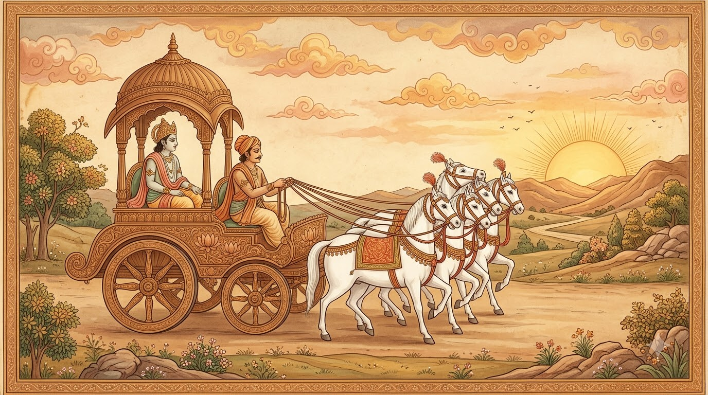

*Fig 1 – The chariot of the self (images/img_chariot.jpg). Generated with Google Flow for this guide.*

Read the mapping carefully, because each part fails in a different way:

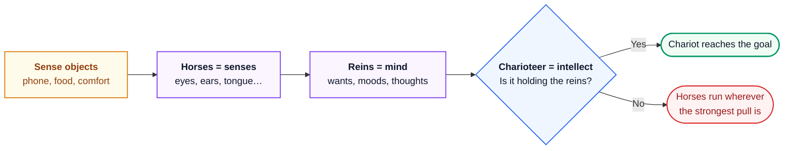

The next verses (1.3.5–6) say it plainly: for the person without understanding, whose mind is never held
firm, the senses are like **wild horses**. For the one with understanding, they are like **good horses**
under a skilled driver.

Here's the key insight, and read it twice: **the horses are not the enemy.** A chariot without horses goes
nowhere. Your desires, energy and senses are the power that moves you. Discipline is not killing the horses.
It is training them and keeping the reins in a steady hand.

**The Gita's version.** The Bhagavad Gita (6.5–6) puts the same idea as a personal duty:

> *uddhared ātmanātmānaṁ nātmānam avasādayet; ātmaiva hy ātmano bandhur ātmaiva ripur ātmanaḥ.*
>
> "Lift yourself up by your own self; do not let yourself sink. You alone are your own friend, and you alone
> are your own enemy."

Verse 6.6 finishes it: the mind is a friend to the person who has mastered it, and an enemy to the one who
has not. Nobody else can do your discipline for you. That is both the burden and the freedom of it.

---

## 2. Why willpower alone fails

**The problem.** The common belief is: "Disciplined people have more willpower, so they resist temptation
harder." If that were true, the fix would be to grit your teeth more. Most people try exactly that, and it
fails.

**What the research says.** For about 15 years psychology taught **ego depletion**: willpower is like a
battery, and each act of self-control drains it. Then, in 2016, 23 labs ran the same experiment together
with 2,141 people under strict, pre-registered rules. The effect was almost zero (d = 0.04, and the 95%
confidence interval included zero). The idea of a simple willpower battery did not hold up.

> In plain English: `d` is the size of a difference measured in standard deviations. A value of 0.04 is far
> too small to matter in daily life.

So if disciplined people are not just "stronger", what are they doing differently? A 2012 study (Hofmann and
colleagues) beeped 205 adults through their day for a week and collected almost 8,000 reports of desires. The
surprise was in the people with **high self-control**. They had as many desires as everyone else, but their
desires were **weaker**, they felt **less inner conflict**, and they **tried to resist less often**. They
weren't winning more fights. The usual reading, which the researchers' own commentary shares, is that they had
**set up their lives so fewer fights happened**.

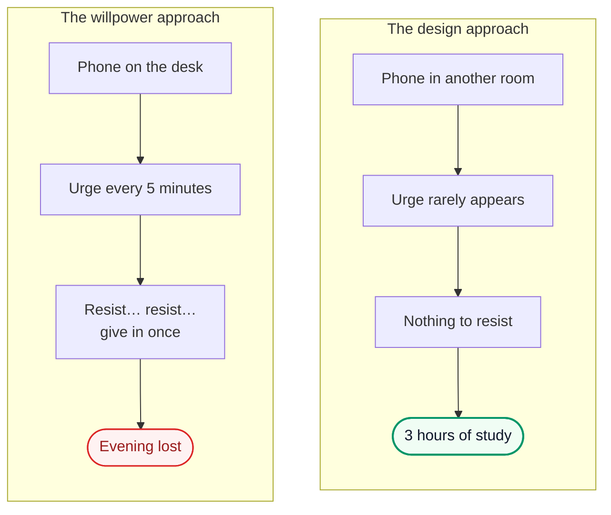

**How to apply it.** Make the right action easy and the wrong action hard:

| Goal | Make the right action easy | Make the wrong action hard |
|---|---|---|
| Study in the morning | Books open on the desk the night before | Phone charging outside the room |
| Exercise | Shoes and clothes laid out | No "I'll decide in the morning" |
| Eat well | Fruit and nuts in sight | No junk food bought, so none at home |
| Sleep on time | Alarm set for bedtime, not just wake time | Laptop and phone out of the bed |

Notice this matches the chariot exactly: you don't fight the horses on a road full of temptations. You
**choose a better road**.

---

## 3. How a habit actually forms

**The problem.** You hear "it takes 21 days to build a habit", try for 21 days, and feel it still isn't
automatic. You think you have failed. You haven't; the number was wrong.

**What a habit is.** A habit is an action your brain links to a **cue** (a time, a place, a previous
action) so firmly that the cue starts the action **without a decision**. That is the whole value of a habit:
it removes the daily debate.

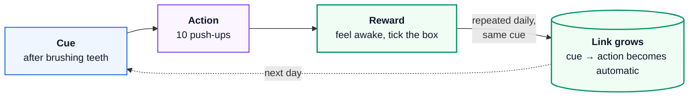

**The real numbers.** In the best-known study (Lally and colleagues, 2010), 96 people each chose one healthy
action (for example "drink water with lunch" or "run before dinner") and did it daily. Every day they rated
how automatic it felt. For the people whose data fitted cleanly, the time to reach 95% of their maximum
automaticity was:

- **median 66 days**,
- **range 18 to 254 days** (the long end is projected from the curve, because the study ran 84 days),
- simple actions (drinking water) became automatic faster than hard ones (exercise),
- and **missing a single day did not materially harm** the habit.

**The maths, worked through.** The study modelled automaticity as a curve that rises fast and then levels
off. A simple version:

$$
A(t) = 1 - e^{-kt}
$$

Read out loud: *"Automaticity after `t` days equals one minus `e` to the power of minus `k` times `t`."* Here
$A(t)$ is how automatic the action feels, as a fraction of its final plateau (0 = not at all, 1 = fully
automatic), and $k$ is how quickly this particular habit grows.

For the median person, $A$ reaches 0.95 at day 66. So:

$$
0.95 = 1 - e^{-66k} \quad\Rightarrow\quad e^{-66k} = 0.05 \quad\Rightarrow\quad k = \frac{\ln 20}{66} \approx 0.0454
$$

Read out loud: *"`k` is the natural log of 20 divided by 66, about 0.045 per day."* Now plug in some days:

| Day | $A(t) = 1 - e^{-0.0454 t}$ | What it feels like |
|---|---|---|
| 7 | 0.27 | Still needs a push every time |
| 21 | 0.61 | Easier, but not yet automatic |
| 30 | 0.74 | Mostly automatic on good days |
| 66 | 0.95 | Automatic; skipping feels strange |
| 90 | 0.98 | Part of who you are |

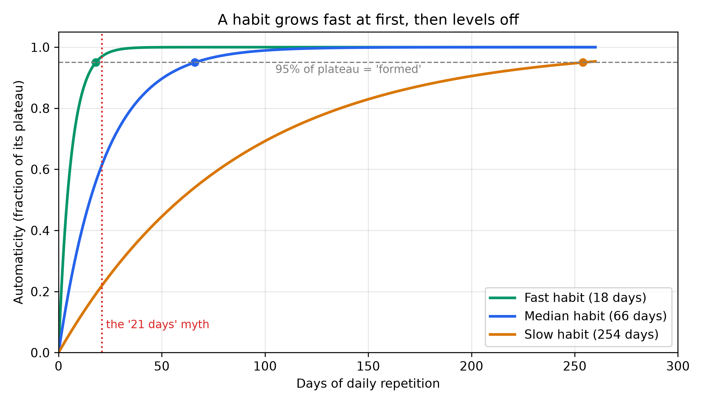

*Fig 2 – Habit growth curve (images/fig_habit_curve.png). Three habits of different difficulty. At day 21 the
median habit is only about 61% of the way there. Drawn from the model above, not from the study's raw data.*

Two lessons sit inside that curve:

1. **The early days give the biggest gains.** The curve is steepest at the start, so the first weeks are
   where your repetitions buy the most automaticity.
2. **The middle is where people quit.** Around weeks 3–6 the habit is half-automatic: no longer exciting, not
   yet easy. Expect this dip, and keep going.

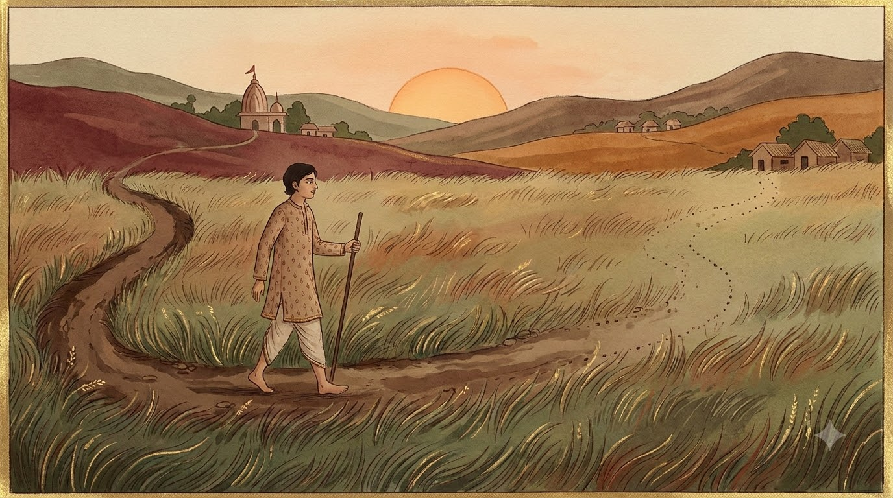

*Fig 3 – A path made by walking (images/img_footpath.jpg). Generated with Google Flow for this guide. Behind
you the path is deep; ahead it is faint. Each walk makes the next one easier.*

---

## 4. If–then plans: deciding in advance

**The problem.** A goal like "I will study more" never tells you **when** or **where**. So each day you have
to decide again, and each decision is a chance to say "later".

**How it works.** An **implementation intention** (Peter Gollwitzer's term) is a plan written as:

> **If** [situation X happens], **then** I will [do action Y].

Examples:

- *If* I finish lunch, *then* I open my DSA notes for 25 minutes.
- *If* I pick up my phone after 10 pm, *then* I put it on the charger outside my room.
- *If* I feel angry in an argument, *then* I take three slow breaths before I speak.

Why it works: the "if" part ties the action to a **cue**, which is exactly what a habit needs (section 3).
The decision is made once, calmly, in advance, instead of in the weak moment.

**How strong is the effect?** A 2006 review of 94 studies (Gollwitzer and Sheeran) found that adding if–then
plans to a goal improved success by d = 0.65, a medium-to-large effect. A larger 2024 review (642 tests)
found positive effects from about d = 0.27 to d = 0.66 depending on the outcome, and **smaller** effects
once publication bias was corrected for. Be honest with yourself
about the size: if–then plans are a strong tool, not magic.

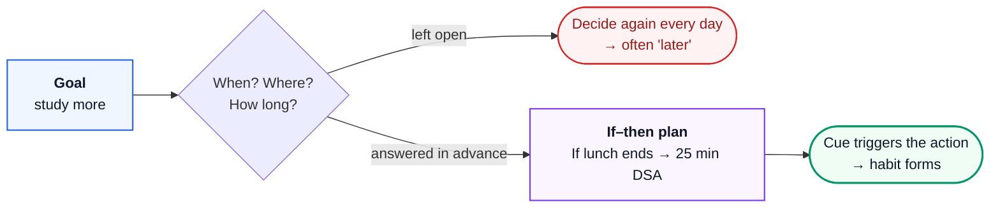

---

## 5. Abhyasa and vairagya: the Gita's two tools

**The problem.** In the Gita, Arjuna, a great warrior, admits what everyone feels (6.34): the mind is
restless, turbulent, strong and stubborn, and controlling it seems as hard as controlling the wind.

**Krishna's answer (6.35)** doesn't deny this. It gives a method:

> *asaṁśayaṁ mahā-bāho mano durnigrahaṁ calam; abhyāsena tu kaunteya vairāgyeṇa ca gṛhyate.*
>
> "No doubt, mighty-armed one, the mind is restless and hard to control. But by **practice** and by
> **detachment** it can be held."

Two tools, and they work as a pair:

| Tool | Sanskrit meaning | What it does | Modern match |
|---|---|---|---|
| **Abhyasa** | repeated, steady practice | Builds the good pattern | Habit formation (section 3) |
| **Vairagya** | non-attachment, cooling of craving | Weakens the pull of the bad pattern | Removing cues and temptations (section 2) |

Practice without detachment is like filling a bucket with a hole in it. Detachment without practice leaves
an empty space that old habits refill. You need both.

**How long is "practice"? Patanjali answered 2,000 years ago.** The Yoga Sutras, which pair the same two
words (1.12), define when practice becomes firm (1.14):

> *sa tu dīrgha-kāla-nairantarya-satkāra-āsevito dṛḍha-bhūmiḥ.*
>
> "Practice becomes firmly grounded when it is done **for a long time**, **without breaks**, and **with
> care and respect**."

Compare it with the habit research:

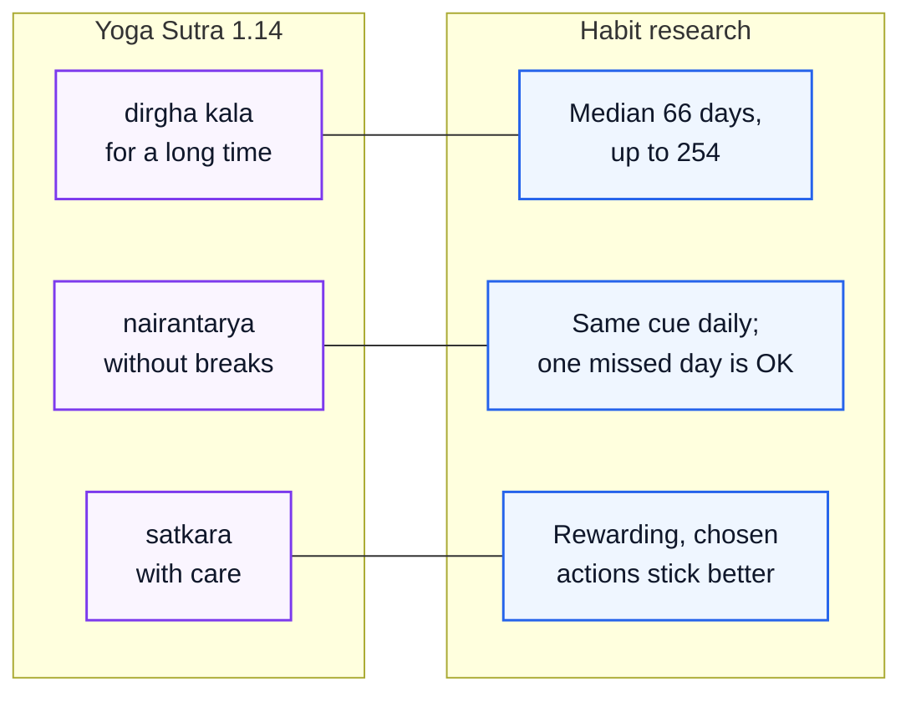

One nuance: *nairantarya* means "without interruption", and the research found that **one** missed day
does no real harm. Both are true together: aim for no breaks, and if you miss a day, **never miss two in a
row**. A single miss is an accident; two misses start a new habit of skipping.

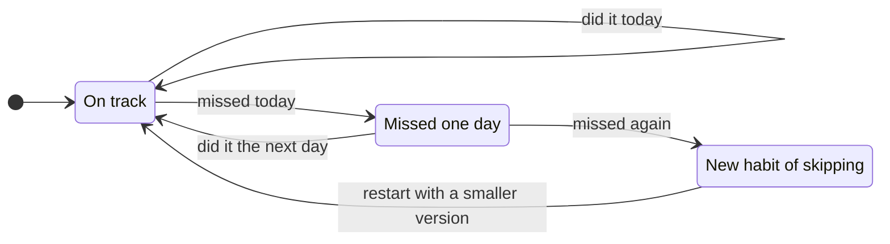

**What vairagya is not.** It isn't hating the world, running away from people, or feeling nothing. It means
**not being owned** by a craving. You can enjoy good food and still be the one who decides when to stop.

**What the practice produces.** The Gita (6.19) describes the result with one image:

> *yathā dīpo nivāta-stho neṅgate sopamā smṛtā.*
>
> "As a lamp in a windless place does not flicker": that is the image used for the disciplined mind.

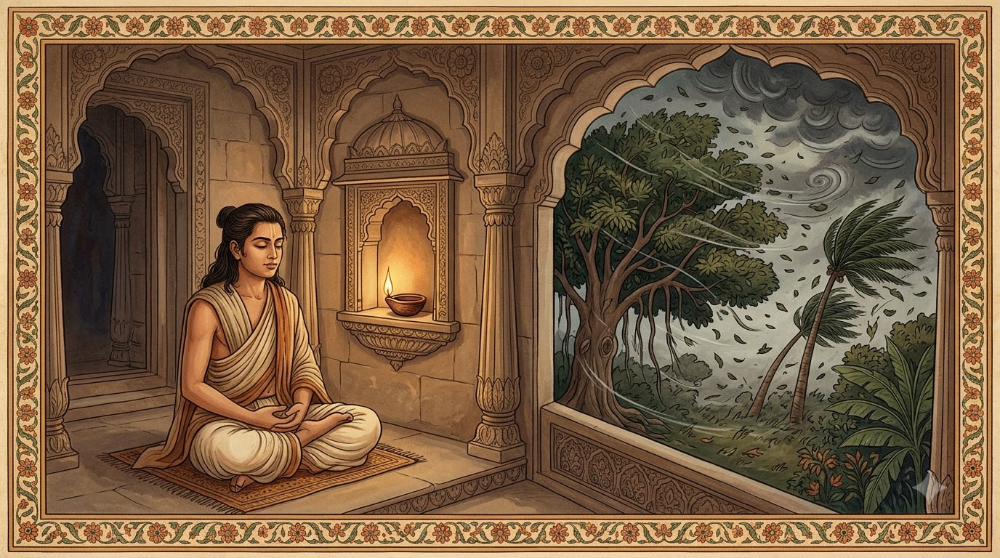

*Fig 4 – A lamp in a windless place (images/img_lamp.jpg). Generated with Google Flow for this guide. Outside,
the storm still blows; inside, the flame stands straight. Abhyasa builds the shelter, vairagya keeps the
window shut.*

---

## 6. The body is the base

**The problem.** Many young men try to fix their discipline with motivation videos while sleeping 5 hours,
never exercising and living on junk food. A tired, under-slept brain has weaker focus and worse emotional
control, so every good intention gets harder.

**The Gita on moderation (6.16–17):**

> "Yoga is not for one who eats too much or too little, sleeps too much or too little. For one who is
> moderate in eating and recreation, balanced in work, and regulated in sleep and waking, yoga destroys
> sorrow."

Notice the word is **moderate**, not extreme. The Gita warns against both too much and too little. Here is
what modern health guidance says those words mean in numbers:

| Area | Guidance | Source |
|---|---|---|
| Sleep | **7 or more hours** a night, regularly, for adults | AASM and Sleep Research Society consensus (2015) |
| Movement | **150–300 min** a week of moderate activity (brisk walking) **or 75–150 min** vigorous (running), plus **muscle-strengthening on 2 or more days** | WHO guidelines (2020) |
| Sitting | Break up long sitting; any activity is better than none | WHO guidelines (2020) |
| Mood | Walking or jogging, yoga and strength training all reduced depression in trials | Noetel et al., BMJ (2024) |

**Worked example: does it fit a student's week?** 150 minutes ÷ 5 days = **30 minutes a day, 5 days a
week**. Two of those sessions can be strength work (push-ups, squats, pull-ups) to cover the
muscle-strengthening part. That is less time than most people spend on short videos in a day.

**Sleep is the one people cut first and should cut last.** Simple rules that work:

1. Same wake-up time every day, including weekends. This anchors your body clock.
2. Phone charges **outside** the bed area. This one rule removes most late-night scrolling.
3. Morning light: get outside within an hour of waking.
4. Caffeine before early afternoon only.

*Fig 5 – A morning that builds the base (images/img_morning.jpg). Generated with Google Flow for this guide.
Movement in the morning light, simple food and water, and the phone left charging in another room.*

**Brahma muhurta.** Hindu tradition prizes the early-morning period before sunrise for study and
meditation. You can use it well, but only if you **sleep early enough** to still get 7+ hours. Waking at 4:30
after sleeping at 1:00 is not discipline; it is sleep loss with a nice name.

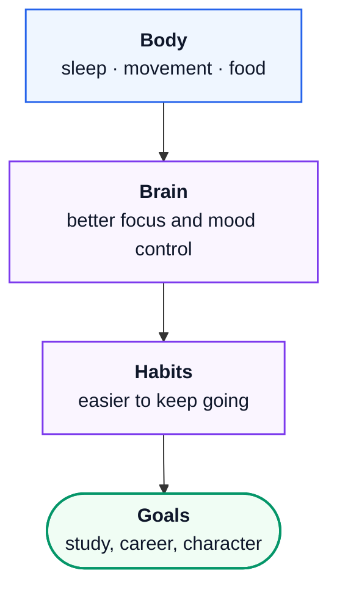

---

## 7. Small gains, long time

**The problem.** People want big changes fast, so they start with a huge plan (5 am, gym 2 hours, study 8
hours, no sugar) and collapse by day 4. A small plan kept beats a big plan dropped.

**The maths, as an illustration.** Suppose you get just 1% better each day, and compare it with getting 1%
worse:

$$
1.01^{365} \approx 37.8 \qquad\qquad 0.99^{365} \approx 0.026
$$

Read out loud: *"1.01 multiplied by itself 365 times is about 38; 0.99 multiplied by itself 365 times is
about 0.03."* Tiny daily differences, repeated, end a year apart by a factor of more than a thousand.

> Honest caveat: real life doesn't compound this neatly; skills plateau and you can't measure "1% better".
> Take it as a picture of direction, not a prediction. The real lesson is **direction plus repetition**.

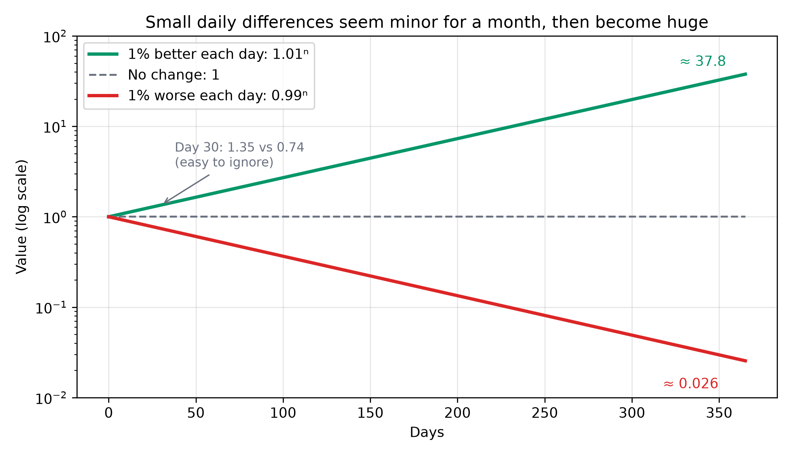

*Fig 6 – 1% better vs 1% worse (images/fig_one_percent.png). On a log scale both lines are straight. At day 30
the gap (1.35 vs 0.74) is easy to ignore; by day 365 it is 37.8 vs 0.026. This is why the first month feels
like nothing is happening.*

The Gita says the same thing about effort (2.40): on this path **no effort is wasted** and there is no
loss; even a little of it protects you from great fear. Start small enough that you can't fail, then grow.

---

## 8. Your 30-day plan

Pick **one keystone habit** in each row. Don't start all of them on day 1; add one per week.

| Week | Add this | If–then plan to write down |
|---|---|---|
| 1 | Fixed wake-up time + phone outside the bed area | If it is 10:30 pm, then the phone goes on the charger outside my room |
| 2 | 30 min movement, 5 days (2 of them strength) | If I get back from class, then I change and walk or train before anything else |
| 3 | One 50-minute deep-work block a day, phone in another room | If I finish lunch, then I start my study block |
| 4 | 10 minutes of quiet sitting or pranayama in the morning | If I finish brushing my teeth, then I sit for 10 minutes |

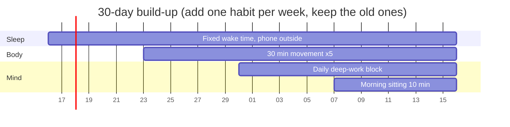

**Daily scorecard (60 seconds each night).** Tick each habit you did. If you missed one, write **one line**
on why, then fix the cue, not your self-respect. Remember the rule: **never miss twice**.

**After day 30.** You are at roughly $A(30) \approx 0.74$ on the median curve: most of the way, not finished.
Keep going to day 66 before you judge whether a habit "worked".

---

## References

- Katha Upanishad 1.3.3–6 (the chariot). Bhagavad Gita 2.40, 6.5–6, 6.16–17, 6.34–35. Patanjali, Yoga Sutras
  1.12–14. Translations compared at [holy-bhagavad-gita.org](https://www.holy-bhagavad-gita.org/chapter/6/verse/35/)
  and [vedabase.io](https://vedabase.io/en/library/bg/6/5).
- Hagger, M. S., et al. (2016). A multilab preregistered replication of the ego-depletion effect.
  *Perspectives on Psychological Science*, 11(4), 546–573.
- Hofmann, W., Baumeister, R. F., Förster, G., & Vohs, K. D. (2012). Everyday temptations: An experience
  sampling study of desire, conflict, and self-control. *Journal of Personality and Social Psychology*,
  102(6), 1318–1335.
- Lally, P., van Jaarsveld, C. H. M., Potts, H. W. W., & Wardle, J. (2010). How are habits formed: Modelling
  habit formation in the real world. *European Journal of Social Psychology*, 40(6), 998–1009.
- Gollwitzer, P. M., & Sheeran, P. (2006). Implementation intentions and goal achievement: A meta-analysis
  of effects and processes. *Advances in Experimental Social Psychology*, 38, 69–119.
- Sheeran, P., Listrom, O., & Gollwitzer, P. M. (2024). Meta-analysis of implementation intentions across 642
  tests. *European Review of Social Psychology*. doi:10.1080/10463283.2024.2334563
- Watson, N. F., et al. (2015). Recommended amount of sleep for a healthy adult: A joint consensus statement
  of the AASM and Sleep Research Society. *Sleep*, 38(6), 843–844.
- Bull, F. C., et al. (2020). World Health Organization 2020 guidelines on physical activity and sedentary
  behaviour. *British Journal of Sports Medicine*, 54(24), 1451–1462.
- Noetel, M., et al. (2024). Effect of exercise for depression: systematic review and network meta-analysis
  of randomised controlled trials. *BMJ*, 384, e075847.
