# Life 2 – Emotional Steadiness: Learn Guide

> **Source:** Built from research: the Bhagavad Gita and modern emotion science (psychology and
> neuroscience). References are at the end. Every number was recomputed. Sanskrit is given in simple
> transliteration with a plain-English meaning; translations differ a little between teachers.

**The big picture:** Strong men are not men who feel nothing. They are men who **feel fully but are not
driven by what they feel**. The Gita describes this person as *sthitaprajna*, "one of steady wisdom", and
maps exactly how an emotion grows from a passing thought into a disaster. Modern research gives you tools to
break that chain early: **name the feeling, slow the body, change the story, and act on your values**, not on
the surge.

## Contents

1. [Feeling is not the problem](#1-feeling-is-not-the-problem)
2. [The chain: how a thought becomes a disaster](#2-the-chain-how-a-thought-becomes-a-disaster)
3. [The three gates: desire, anger and greed](#3-the-three-gates-desire-anger-and-greed)
4. [The steady man: sthitaprajna](#4-the-steady-man-sthitaprajna)
5. [Where you can step in: the emotion timeline](#5-where-you-can-step-in-the-emotion-timeline)
6. [Four tools that work](#6-four-tools-that-work)
7. [Anger: a protocol for the hot moment](#7-anger-a-protocol-for-the-hot-moment)
8. [Real strength includes asking for help](#8-real-strength-includes-asking-for-help)
9. [Your 30-day practice](#9-your-30-day-practice)

---

## 1. Feeling is not the problem

**The problem.** Many young men are taught two bad options: **explode** ("I'm just being honest") or
**bottle it up** ("men don't cry"). Both hurt. The first damages relationships and decisions. The second
doesn't remove the emotion; it only hides it, and it leaks out later as irritation, numbness or illness.

**The Gita's starting point (2.14).** Krishna doesn't tell Arjuna to stop feeling. He explains what feelings
are:

> *mātrā-sparśās tu kaunteya śītoṣṇa-sukha-duḥkha-dāḥ; āgamāpāyino 'nityās tāṁs titikṣasva bhārata.*
>
> "Contacts of the senses with their objects bring cold and heat, pleasure and pain. They **come and go**;
> they are **not permanent**. Bear them patiently."

Three ideas live in that verse:

1. **Emotions are caused by contact.** Something happens and your system reacts. That is normal biology.
2. **Every emotion is temporary.** The wave rises and falls. You have survived every bad feeling you have
   ever had.
3. **Titiksha: you can endure it without obeying it.** Feel the heat; don't let it decide your actions.

So the goal isn't "no emotion". It is **space between the feeling and the action**. In that space, you
choose.

---

## 2. The chain: how a thought becomes a disaster

**The problem.** People think anger "just happens" in one jump. In reality it grows through steps, and each
step is a chance to stop it.

**The Gita's chain (2.62–63)** is one of the most precise descriptions of emotional escalation ever written:

> *dhyāyato viṣayān puṁsaḥ saṅgas teṣūpajāyate; saṅgāt sañjāyate kāmaḥ kāmāt krodho 'bhijāyate.
> krodhād bhavati sammohaḥ sammohāt smṛti-vibhramaḥ; smṛti-bhraṁśād buddhi-nāśo buddhi-nāśāt praṇaśyati.*
>
> "When a man **dwells** on objects, **attachment** to them arises. From attachment comes **desire**; from
> desire, when blocked, comes **anger**. From anger comes **delusion**; from delusion, **loss of memory**
> (forgetting what you know is right). From that, **judgement is destroyed**, and when judgement is
> destroyed, the man is **ruined**."

```mermaid
flowchart LR
    accTitle: The chain of downfall from Gita 2.62 to 2.63
    accDescr: Eight steps from dwelling on an object to ruin, with the best point to break the chain marked at the start.
    a["<b>1 · Dwelling</b><br/>replaying it in the mind"] --> b["<b>2 · Attachment</b><br/>'I must have this'"]
    b --> c["<b>3 · Desire</b><br/>craving grows"]
    c --> d["<b>4 · Anger</b><br/>when blocked"]
    d --> e["<b>5 · Delusion</b><br/>can't see clearly"]
    e --> f["<b>6 · Memory lost</b><br/>forget your values"]
    f --> g["<b>7 · Judgement gone</b><br/>bad decision"]
    g --> h(["<b>8 · Ruin</b><br/>damage done"])
    class a target;
    class b,c intermediate;
    class d,e,f warning;
    class g,h error;
    classDef intermediate fill:#FAF5FF,stroke:#7C3AED,stroke-width:1.5px,color:#0F172A;
    classDef target fill:#F0FDF4,stroke:#059669,stroke-width:2px,color:#0F172A;
    classDef warning fill:#FFFBEB,stroke:#D97706,stroke-width:1.5px,color:#92400E;
    classDef error fill:#FEF2F2,stroke:#DC2626,stroke-width:1.5px,color:#991B1B;
```

**A real example.** You see that a friend got the internship you applied for.

1. **Dwelling:** you keep replaying it at night.
2. **Attachment:** "That was *my* spot."
3. **Desire:** you want it back, want him to fail.
4. **Anger:** you feel rage when he posts about it.
5. **Delusion:** "He must have cheated. Everyone is against me."
6. **Memory lost:** you forget that he is your friend and that he helped you last semester.
7. **Judgement gone:** you send a nasty message.
8. **Ruin:** a friendship is lost, and you look small to everyone who sees it.

**Where to break the chain.** Notice the first step is **dwelling** (*dhyāyataḥ*, literally "meditating on").
The earliest link is the weakest, so it is the easiest to cut. Modern psychology has a name for this step:
**rumination**, repeatedly circling a painful thought. Research consistently links rumination to worse
depression and anger. By step 4 your body is flooded and every step is harder to stop. So the skill is
**catching yourself at step 1 or 2**: "I'm replaying this again. Stop. Do something else."

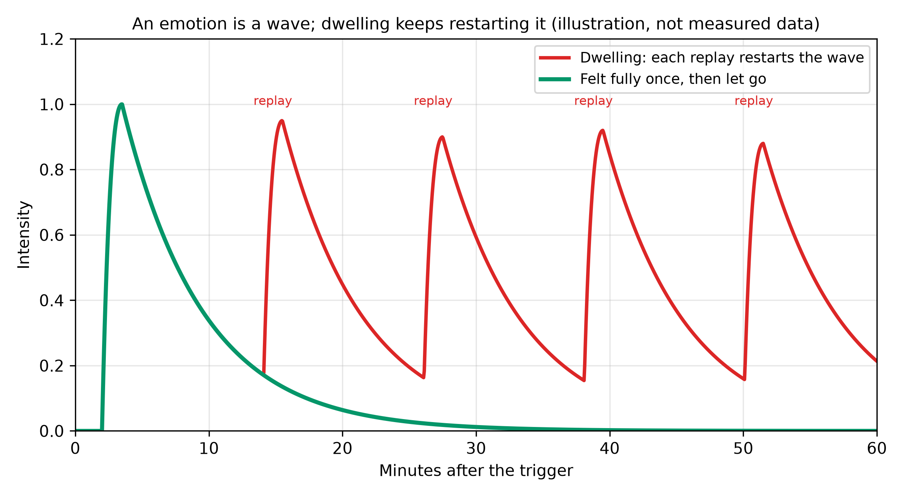

*Fig 1 – One wave vs a restarted wave (images/fig_emotion_wave.png). An illustration, not measured data. A
feeling that is felt and then let go fades on its own (green). Each time you replay the event, you restart
the wave (red), so an hour later you are still near the top.*

---

## 3. The three gates: desire, anger and greed

The Gita (16.21) names three forces that wreck a man:

> *tri-vidhaṁ narakasyedaṁ dvāraṁ nāśanam ātmanaḥ; kāmaḥ krodhas tathā lobhas tasmād etat trayaṁ tyajet.*
>
> "There are three gates to hell that destroy the self: **lust** (*kāma*), **anger** (*krodha*) and
> **greed** (*lobha*). Therefore give up these three."

| Gate | What it looks like today | First sign to watch for |
|---|---|---|
| **Kama** (uncontrolled desire) | Endless scrolling, porn, junk food, chasing pleasure | "Just one more" |
| **Krodha** (anger) | Fights, road rage, insulting people online | Heat in the face, jaw tight |
| **Lobha** (greed) | Cheating, never enough money, envy of others | Comparing, "I deserve more than him" |

Notice how they connect: in the chain in section 2, blocked **desire** becomes **anger**. Greed is desire
for more that never ends. They feed each other, which is why the Gita treats them as a set.

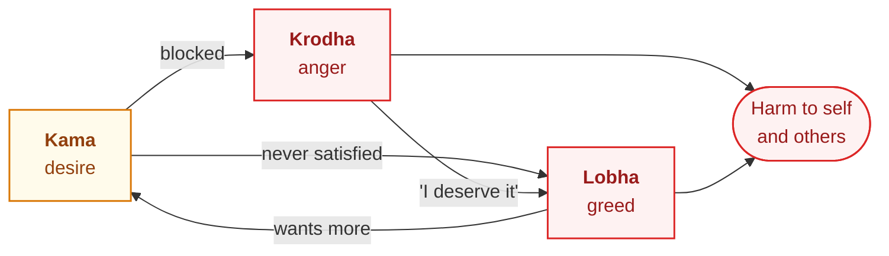

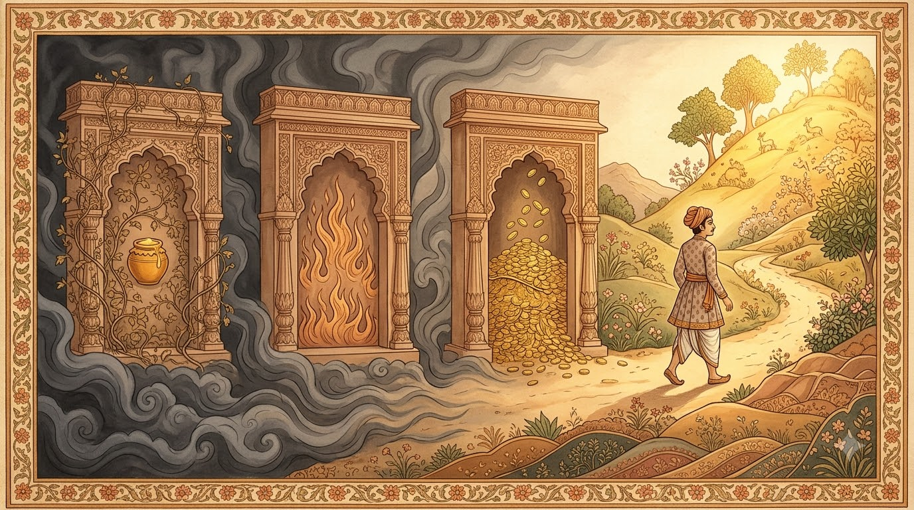

*Fig 2 – Three gates, one way out (images/img_gates.jpg). Generated with Google Flow for this guide. The vines
and honey stand for desire, the flames for anger, the heap of gold for greed. The way out is to turn and walk
the other way, early.*

---

## 4. The steady man: sthitaprajna

**The question.** Arjuna asks (2.54): how does a person of steady wisdom speak, sit and walk? What does he
look like in real life?

**Krishna's answer (2.56):**

> "One whose mind is **not shaken by sorrow**, who **does not crave** pleasures, who is **free from
> attachment, fear and anger**: he is called a sage of steady mind."

Then the Gita gives two images worth remembering.

**The tortoise (2.58).** As a tortoise draws its limbs into its shell, the steady man **withdraws his senses**
from their objects when he needs to. The tortoise still has legs and uses them; it simply pulls them in when
there is danger. That is the skill: not losing your senses, but **choosing when to engage them**.

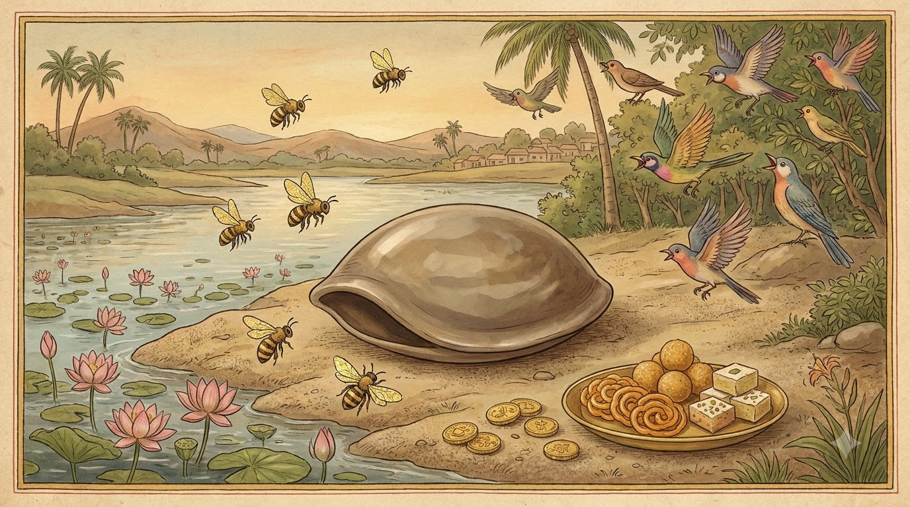

*Fig 3 – The tortoise withdraws its limbs (images/img_tortoise.jpg). Generated with Google Flow for this guide.
Bees, birds, sweets and coins all around; the tortoise stays closed and safe.*

**The ocean (2.70).** Rivers pour into the ocean all the time, yet it stays full and **does not overflow**.
In the same way, desires keep flowing into the steady man, but he stays at peace; the one who chases every
desire does not.

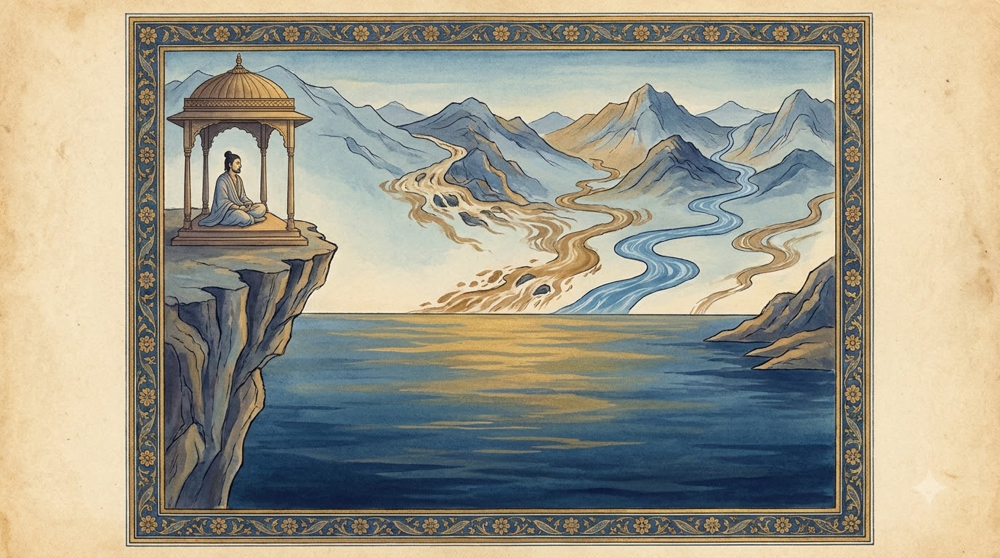

*Fig 4 – The ocean that rivers cannot disturb (images/img_ocean.jpg). Generated with Google Flow for this
guide. Many rivers, some muddy and some stormy, enter; the ocean's level stays the same.*

Read the ocean image carefully, because it fixes a common mistake. The ocean doesn't **block** the rivers.
It **receives** them and stays steady because it is **deep**. Steadiness doesn't come from building walls
against every feeling; it comes from becoming deep enough that no single feeling can move you much.

---

## 5. Where you can step in: the emotion timeline

**The modern model.** The psychologist James Gross describes an emotion as a process that unfolds over time.
At each stage you can act on it, and this is called **emotion regulation**:

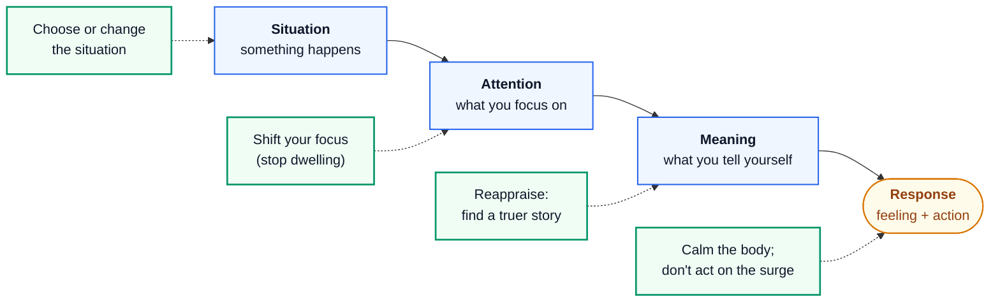

The general rule: **the earlier you step in, the less effort it costs.** That is the same lesson as the
Gita's chain: cut it at "dwelling", not at "ruin".

**Reappraisal vs suppression.** Two common strategies give very different results:

| Strategy | What it is | What research finds |
|---|---|---|
| **Reappraisal** | Changing the *meaning*: "He's late; maybe he's stuck in traffic", "This exam is practice for the real one" | Linked to more positive emotion, better relationships and wellbeing (Gross & John, 2003) |
| **Suppression** | Hiding the feeling on your face while it still burns inside | Linked to less positive emotion, worse memory of the event and weaker relationships (Gross & John, 2003) |

This is why "man up and hide it" fails. Hiding the expression doesn't reduce the feeling inside; changing the
**story** does.

---

## 6. Four tools that work

### Tool 1: Name it

**Why it works.** In a brain-imaging study (Lieberman and colleagues, 2007), people looked at angry or
frightened faces. When they **picked a word for the emotion** ("angry", "scared"), activity in the
**amygdala**, the brain's alarm centre, went down, and a region of the prefrontal cortex that helps control
it became more active. Picking a *name* for the person in the picture didn't have this effect. Putting the
feeling into words acted like a brake.

**How to do it.** Silently say: *"This is anger."* Be precise if you can: *"I feel humiliated"* is more
useful than *"I feel bad"*. Naming it also moves you from **being** the emotion to **watching** it, which is
exactly the witness position the Gita teaches.

> One honest caveat: this was a single imaging study of 30 people, not a clinical trial. The wider
> research on labelling emotions points the same way, but treat it as a helpful tool, not a cure.

### Tool 2: Breathe with a long exhale

**Why it works.** Slow breathing with a longer out-breath activates the calming branch of your nervous
system. In a 2023 randomised study from Stanford (Balban and colleagues), people did 5 minutes of breathing
a day for a month. **Cyclic sighing**, which focuses on long exhales, improved mood and lowered breathing
rate **more than mindfulness meditation** did over the same time.

**How to do it (cyclic sighing):**

1. Inhale through the nose.
2. Take a second, short inhale on top to fill the lungs fully.
3. Exhale **slowly and completely** through the mouth, longer than the inhale.
4. Repeat for 5 minutes.

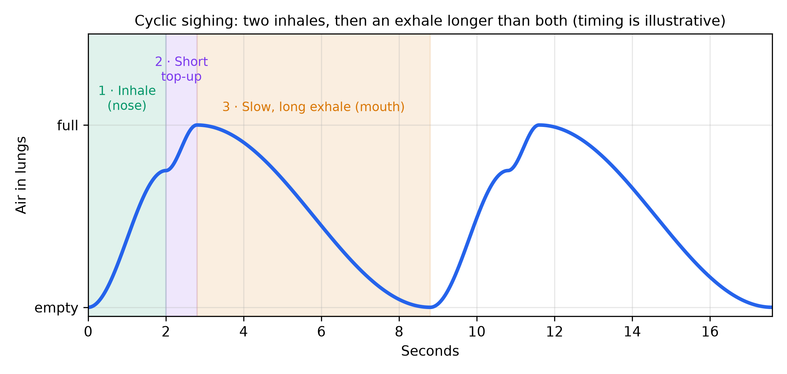

*Fig 5 – The shape of one cyclic sigh (images/fig_cyclic_sigh.png). The exact seconds are illustrative; go
at a pace that is comfortable. What matters is the shape: a full inhale, a small top-up, then an exhale that
is clearly the longest part.*

Your tradition already has this: **pranayama**. Slow breathing practices with long exhales are its modern,
measured cousins.

### Tool 3: Calm down, don't vent

**The myth.** "Let it out: hit a pillow, scream, go for a hard run, and you'll feel better." This is the
**catharsis** idea, and it is wrong.

**The evidence.** A 2024 review (Kjærvik and Bushman) combined **154 studies with over 10,000 people**.
Activities that **lower** arousal (slow breathing, meditation, slow yoga, progressive muscle relaxation,
taking a time-out) **reduced** anger and aggression, with an effect of about **g = −0.63**, a medium-sized
reduction. Activities that **raise** arousal had **no reliable effect** overall (g ≈ −0.02), and venting was
not supported.

> In plain English: `g` is a standardised effect size like `d`. Minus 0.63 means anger dropped by about
> two-thirds of a standard deviation, which is a meaningful change. Minus 0.02 means essentially nothing.

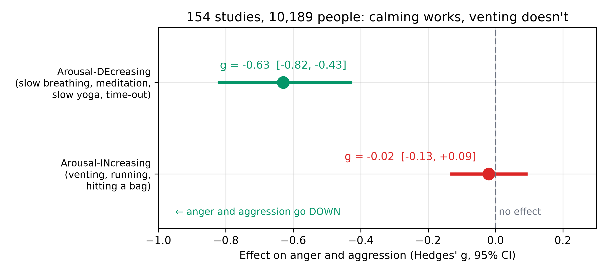

*Fig 6 – What the 154 studies found (images/fig_anger_meta.png). Dots are the pooled effects; bars are 95%
confidence intervals, from Kjærvik and Bushman (2024). The calming interval sits wholly left of zero; the
arousing interval straddles zero, meaning "no reliable effect".*

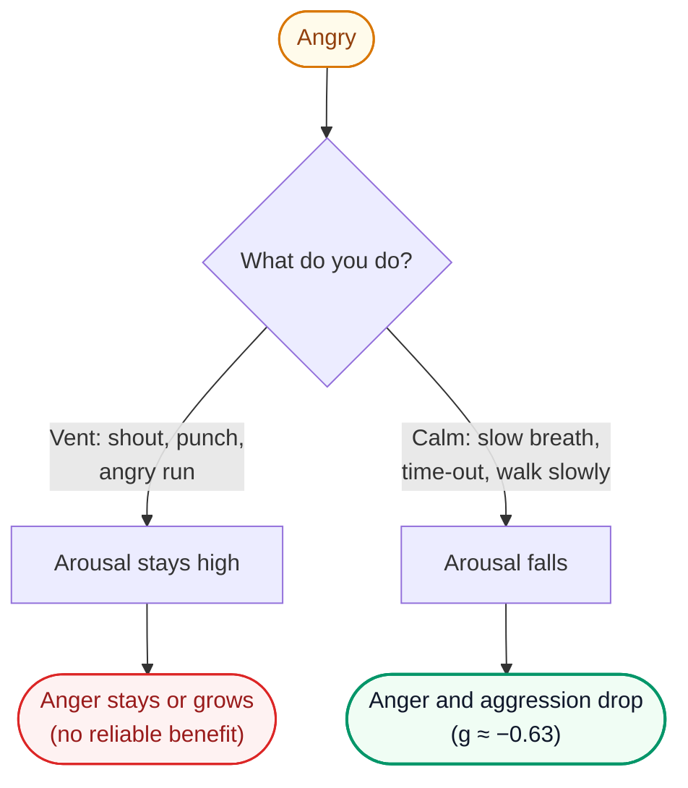

Exercise still matters a lot for your **overall** mood (see Tool 4). The point is that in the **hot
moment**, you need to cool the body, not fire it up further.

### Tool 4: Move every day (for mood over weeks)

A 2024 review in the *BMJ* (Noetel and colleagues: 218 trials, over 14,000 people with depression) found
that **walking or jogging, yoga and strength training** all reduced depressive symptoms, more so at higher
intensity. The certainty of the evidence was rated low, mostly because of the quality of the trials, but
the direction was consistent. Regular movement is one of the cheapest mood medicines there is. Guide 1 gives
the weekly numbers.

---

## 7. Anger: a protocol for the hot moment

Anger deserves its own plan, because it does the most damage in the shortest time. Write this on a card:

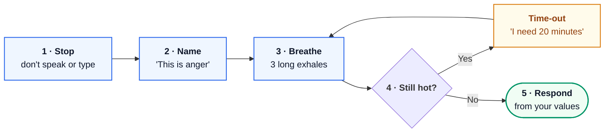

Three rules that prevent most regrets:

1. **Never send a message while angry.** Write it if you must, then wait until tomorrow. You will delete
   most of them.
2. **A time-out is not running away.** Say clearly, "I'm too angry to talk well. Let's continue in 20
   minutes," and then come back. Coming back is what makes it respectful.
3. **Attack the problem, not the person.** "When you are late, I feel disrespected" works. "You are
   useless" ends the conversation.

---

## 8. Real strength includes asking for help

**The problem.** Men are less likely than women to seek help for emotional problems, often because they see
it as weakness. But using every tool available, including other people, is what a capable man does. A
cricketer with a coach isn't weak; he's serious.

**Signs it is more than a bad week** (and time to talk to a doctor or counsellor):

- Low mood, emptiness or loss of interest most days for **two weeks or more**.
- Sleep or appetite badly changed; you can't function in classes or work.
- Anger you can't control, or that frightens people around you.
- Using alcohol, drugs or porn to escape most days.
- **Any** thought of harming yourself.

**Where to go (India):**

- **Tele-MANAS**, the national tele-mental-health helpline: call **14416** or **1-800-891-4416**. Free,
  24×7, many languages.
- Your college counselling cell.
- In an emergency, call **112** or go to the nearest hospital.

Talking to someone is not the opposite of the Gita's steadiness. Arjuna himself collapsed in grief on the
battlefield and **asked for guidance** (2.7). The whole Gita is the answer to that one honest request for
help.

---

## 9. Your 30-day practice

| When | Practice | Time |
|---|---|---|
| Every morning | Cyclic sighing or pranayama | 5 min |
| Every evening | Write 3 lines: what I felt today, what triggered it, what I did | 3 min |
| Whenever you notice dwelling | "I'm replaying it again." Then switch to an action: walk, call someone, study | 1 min |
| In any hot moment | Stop → Name → Breathe → (Time-out) → Respond | 1–20 min |
| 4 days a week | Walk, run, yoga or strength work | 30 min |

**Weekly review (Sunday, 10 minutes).** Look at your evening notes. Which gate (kama, krodha or lobha)
showed up most? At which step of the chain did you catch it? Your aim over the month is to catch it **one
step earlier** each week.

---

## References

- Bhagavad Gita 2.7, 2.14, 2.54–58, 2.62–63, 2.70, 16.21. Translations compared at
  [holy-bhagavad-gita.org](https://www.holy-bhagavad-gita.org/) and [vedabase.io](https://vedabase.io/en/library/bg/).
- Gross, J. J. (1998). The emerging field of emotion regulation: An integrative review. *Review of General
  Psychology*, 2(3), 271–299.
- Gross, J. J., & John, O. P. (2003). Individual differences in two emotion regulation processes:
  Implications for affect, relationships, and well-being. *Journal of Personality and Social Psychology*,
  85(2), 348–362.
- Lieberman, M. D., et al. (2007). Putting feelings into words: Affect labeling disrupts amygdala activity in
  response to affective stimuli. *Psychological Science*, 18(5), 421–428.
- Balban, M. Y., et al. (2023). Brief structured respiration practices enhance mood and reduce physiological
  arousal. *Cell Reports Medicine*, 4(1), 100895.
- Kjærvik, S. L., & Bushman, B. J. (2024). A meta-analytic review of anger management activities that
  increase or decrease arousal: What fuels or douses rage? *Clinical Psychology Review*, 109, 102414.
- Noetel, M., et al. (2024). Effect of exercise for depression: systematic review and network meta-analysis
  of randomised controlled trials. *BMJ*, 384, e075847.
- Tele-MANAS, National Tele Mental Health Programme, Ministry of Health and Family Welfare, Government of India.
