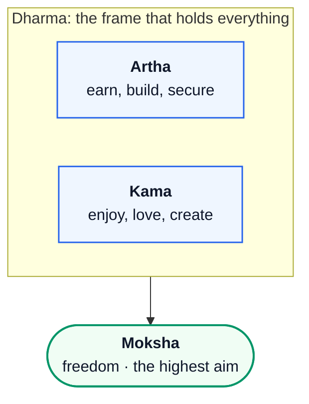
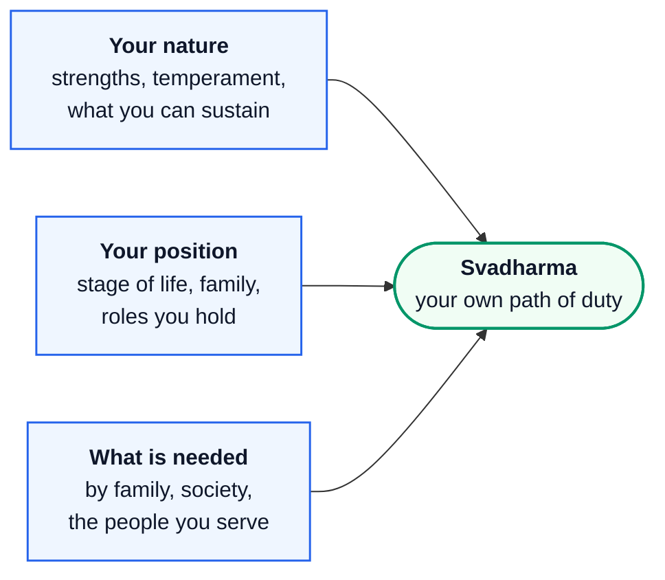
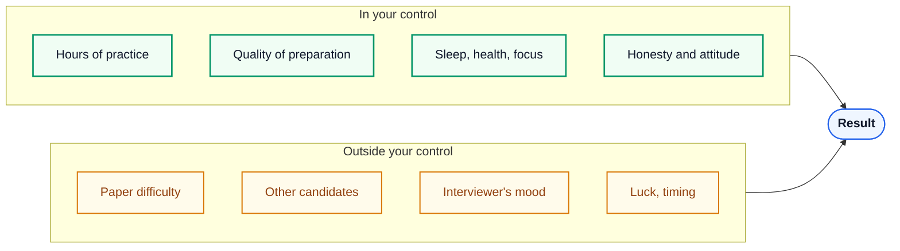
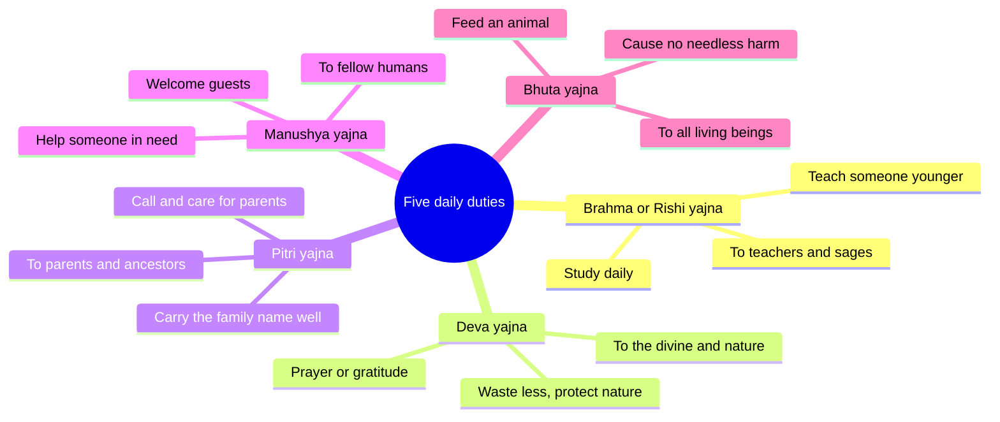

# Life 3 – Purpose and Duty: Learn Guide

> **Source:** Built from research: the Bhagavad Gita, the Vedic idea of the purusharthas and the three
> debts, and modern research on purpose and goals. References are at the end. Sanskrit is given in simple
> transliteration with a plain-English meaning; translations differ a little between teachers.

**The big picture:** A man without a purpose drifts: he works for whatever pays, chases whatever pleases, and
copies whoever looks successful. Hindu thought gives you a complete map instead: **four aims of life**
(dharma, artha, kama, moksha) held in balance, **your own duty** (svadharma) rather than someone else's, and
**karma yoga**, a way of working with full effort without being crushed by results. Modern research agrees:
people with a clear purpose live longer and cope better.

## Contents

1. [Why purpose matters](#1-why-purpose-matters)
2. [The four aims of life: purusharthas](#2-the-four-aims-of-life-purusharthas)
3. [Your stage of life: the student's dharma](#3-your-stage-of-life-the-students-dharma)
4. [Svadharma: your duty, not someone else's](#4-svadharma-your-duty-not-someone-elses)
5. [Karma yoga: full effort, free from results](#5-karma-yoga-full-effort-free-from-results)
6. [What you owe: the debts and daily duties](#6-what-you-owe-the-debts-and-daily-duties)
7. [A warning about "ikigai" diagrams](#7-a-warning-about-ikigai-diagrams)
8. [Worksheet: write your own dharma](#8-worksheet-write-your-own-dharma)

---

## 1. Why purpose matters

**The problem.** Without a purpose, every day is decided by the loudest pull: a notification, a friend's
plan, a mood. You can be busy all year and still feel empty, because nothing was connected to anything.

**What the research says.** A US study (Hill and Turiano, 2014) followed over 6,000 adults for **14 years**.
People who reported a stronger sense of purpose at the start were **less likely to die** during the
follow-up, even after accounting for other measures of wellbeing. The benefit was similar for young,
middle-aged and older adults.

> Read it carefully: this is an **observational** study. It shows that purpose and longer life go together;
> it can't fully prove that purpose *causes* the longer life. But the link held up after many other factors
> were accounted for, and it agrees with a wider body of research.

The psychiatrist Viktor Frankl, who survived the Nazi concentration camps, saw the same thing in the worst
conditions imaginable. In *Man's Search for Meaning* (1946) he observed that prisoners who still had a reason
to live (a person waiting for them, a work to finish) were more likely to endure. He often quoted Nietzsche:
a person with a *why* can bear almost any *how*.

---

## 2. The four aims of life: purusharthas

**The idea.** Hindu thought names four legitimate aims of human life, the **purusharthas** ("aims of a
person"):

| Aim | Meaning | In your life |
|---|---|---|
| **Dharma** | Right conduct, duty, what holds things together | Honesty, keeping your word, doing your role well |
| **Artha** | Wealth, security, worldly success | Skills, career, savings, the means to support a family |
| **Kama** | Pleasure, love, beauty, enjoyment | Friendship, love, music, food, fun |
| **Moksha** | Freedom, liberation, the highest goal | Growing beyond the ego; inner peace that doesn't depend on circumstances |

Notice what is **not** in this list: a demand to give up money or pleasure. Artha and kama are **valid aims**.
The tradition simply insists that they be pursued **within dharma**. Money earned by cheating, or pleasure
that betrays someone, breaks the structure.

**Think of them as four pillars of a house.** If one pillar is missing or much shorter, the roof tilts:

- **All artha, no kama:** rich but joyless, burned out at 35.
- **All kama, no artha:** fun at 20, broke and dependent at 30.
- **Artha and kama without dharma:** success built on lies, which collapses and takes others with it.
- **No thought of moksha:** everything depends on outside events, so every loss feels like the end of the
  world.

*Fig 1 – Four pillars, one roof (images/img_pillars.jpg). Generated with Google Flow for this guide. The
pillars carry motifs for balance, wealth, enjoyment and freedom; the family lives safely because all four
stand at the same height.*

---

## 3. Your stage of life: the student's dharma

The tradition also divides life into four stages, the **ashramas**: student (*brahmacharya*), householder
(*grihastha*), retiring elder (*vanaprastha*) and renunciant (*sannyasa*). Each stage has its own main duty.

You are in the **student stage**. Its dharma is clear: **learn deeply, build your body and character, respect
your teachers, and prepare to carry responsibility**. Everything in Guides 1 and 2 (discipline, sleep,
steadiness) is part of this stage's dharma. When you study well today, you are not "waiting for life to
start". You are doing your duty for this stage of it.

The Taittiriya Upanishad (1.11) records a teacher's parting words to students finishing their study:
*satyaṁ vada, dharmaṁ cara*: **"Speak the truth. Practise dharma."** It adds, *svādhyāyān mā pramadaḥ*:
**"Do not neglect your own study."** Learning doesn't end when college does.

---

## 4. Svadharma: your duty, not someone else's

**The problem.** Today you can see thousands of lives through your phone: the founder, the fitness model, the
cricketer, the guy from your batch at a big company. It's easy to feel your own path is wrong and switch
every six months to copy whoever looks most successful.

**The Gita's rule (3.35):**

> *śreyān sva-dharmo viguṇaḥ para-dharmāt sv-anuṣṭhitāt; sva-dharme nidhanaṁ śreyaḥ para-dharmo bhayāvahaḥ.*
>
> "Better is **one's own duty**, even done imperfectly, than **another's duty** done well. Better to die in
> one's own dharma; another's dharma is full of fear."

The Gita repeats the same line almost word for word in 18.47, near its end. A teaching said twice is one the
text wants you to remember.

**What svadharma means in practice.** Your svadharma is where **your nature**, **your position** and **what
is needed** meet:

Why "another's dharma is full of fear": when you live someone else's path, you are always anxious, because it
doesn't fit your nature and you are always measuring yourself against people built for it. On your own path
you can be imperfect and still at peace.

*Fig 2 – The crowded road and your own path (images/img_ownpath.jpg). Generated with Google Flow for this
guide. The crowd copies each other down one road. One man walks the narrower path that fits him, toward the
people who need what he carries.*

**Action beats inaction (3.8).** None of this is an excuse to wait until you "find your passion":

> *niyataṁ kuru karma tvaṁ karma jyāyo hy akarmaṇaḥ.*
>
> "Do your **prescribed duty**; action is better than inaction."

Purpose is usually found **by doing**, not by thinking. Do the duty in front of you well, and your path becomes
clearer as you go.

**Lead by example (3.21).** "Whatever a great person does, others follow; whatever standard he sets, the world
follows." Younger siblings, cousins and juniors are watching how you live. That is part of your duty too.

---

## 5. Karma yoga: full effort, free from results

**The problem.** You prepare hard for an exam or an interview. Before it, anxiety: "What if I fail?" After it,
if the result is bad, collapse: "All that effort was wasted." Your peace is chained to an outcome that is
partly outside your control.

**The most famous verse of the Gita (2.47):**

> *karmaṇy evādhikāras te mā phaleṣu kadācana; mā karma-phala-hetur bhūr mā te saṅgo 'stv akarmaṇi.*
>
> "Your right is to **action** alone, never to its **fruits**. Don't let the fruits be your motive, and don't
> be attached to **not acting** either."

It has four parts, and people usually remember only the first. Read all four:

| Part | Says | Common misreading |
|---|---|---|
| 1 | Your control is over your action | — |
| 2 | Not over the results | "So results don't matter" (wrong: you still aim at a goal) |
| 3 | Don't make the result your **motive** | "So don't have goals" (wrong: have them, but don't let your worth depend on them) |
| 4 | Don't fall into **inaction** either | Often forgotten. Detachment is never an excuse to stop working |

The next verse (2.48) gives the attitude: *samatvaṁ yoga ucyate*, **"Evenness of mind is called yoga."**
Work fully; meet success and failure with the same steadiness.

*Fig 3 – The archer controls the shot, not the wind (images/img_archer.jpg). Generated with Google Flow for
this guide. Stance, aim and release are his; the wind and the distance are not.*

**Why it works (the logic).** Every result depends on two kinds of factors:

If your peace depends on the result, it depends partly on things you can't touch, so you will always be
anxious. If your peace depends on **giving your full effort**, it depends only on you. And here is the
practical bonus: worry about results uses attention that should go into the work. Sports psychology finds the
same thing: athletes who focus on **process goals** ("keep my head still, follow through") rather than only on
**outcome goals** ("win the match") can control anxiety better and feel more confident. In one
goal-setting study (Kingston and Hardy, 1997), athletes trained to set process goals improved more in anxiety
control and self-efficacy than athletes trained to set only performance goals.

**How to practise it.**

1. Before a task: set the goal, then write **the process**: what you will do, today, that is fully yours.
2. During the task: when your mind jumps to "What if I fail?", return to the next action.
3. After the result: ask only, "Did I give my full effort? What will I improve?" Then let the result go,
   whether it was good or bad.

---

## 6. What you owe: the debts and daily duties

**The idea.** Vedic texts say a person is born carrying **debts** (*ṛṇa*). The Taittiriya Samhita (6.3.10.5)
names three:

| Debt | Owed to | How it is repaid |
|---|---|---|
| **Rishi rina** | the sages and teachers | By learning, and by passing knowledge on |
| **Deva rina** | the gods and the forces of nature | By worship, gratitude, and care for nature |
| **Pitri rina** | your ancestors and parents | By raising a family and honouring your parents |

Later texts expand this into the **five daily duties** (*pañca mahā-yajña*), which add duties to **fellow
humans** (hospitality, service) and to **all living beings** (feeding animals, not harming).

**Why this matters for a modern man.** The debt idea flips a common attitude. Instead of "What does the world
owe me?", it starts with "**I have already received a great deal**: life, language, knowledge, care. What do
I give back?" That one shift turns duty from a burden into gratitude in action.

---

## 7. A warning about "ikigai" diagrams

You will see a popular four-circle diagram online: *what you love*, *what you are good at*, *what the world
needs*, *what you can be paid for*, with **"ikigai"** in the centre, labelled as ancient Japanese wisdom.

It isn't. The four-circle "purpose" diagram was made by a Spanish author, Andrés Zuzunaga, around 2011. In
2014 a British blogger, Marc Winn, **replaced the centre word with "ikigai"** and posted it; he later said
himself that he had changed one word. In Japanese, *ikigai* simply means "something that makes life worth
living", and it is often small: a morning walk, grandchildren, a garden. It doesn't have to be your career.

The diagram can still be a useful thinking tool. Just know where it comes from, and notice that your own
tradition's idea of **svadharma** (section 4) covers the same ground and adds what the diagram leaves out:
**duty and conduct**.

---

## 8. Worksheet: write your own dharma

Take 30 minutes this week and fill in this table, on paper. Keep it where you will see it.

| Level | My duties right now (be specific) | One action this week |
|---|---|---|
| **Self** (body, mind, character) | e.g. sleep 7+ hours, train 4×/week, no lying | |
| **Family** (parents, siblings) | e.g. call home twice a week, help a sibling with studies | |
| **Craft** (study, skills, future work) | e.g. master DSA and system design, finish the ML course | |
| **Society** (friends, community, nature) | e.g. teach a junior, give a little to someone in need | |

Then write **one sentence** of purpose in this form:

> *"In this stage of my life, my duty is to become ______ so that I can ______ for ______."*

For example: *"In this stage of my life, my duty is to become a skilled and steady engineer so that I can
support my family and build things that help people."*

**Every Sunday (5 minutes):** read the table. For each row, ask: *"Did I act on this, with full effort, and
let go of the result?"* That question is karma yoga, practised weekly.

---

## References

- Bhagavad Gita 2.47–48, 3.8, 3.21, 3.35, 18.47. Translations compared at
  [holy-bhagavad-gita.org](https://www.holy-bhagavad-gita.org/) and [vedabase.io](https://vedabase.io/en/library/bg/).
- Taittiriya Upanishad 1.11 (the convocation address); Taittiriya Samhita 6.3.10.5 (the three debts).
- Hill, P. L., & Turiano, N. A. (2014). Purpose in life as a predictor of mortality across adulthood.
  *Psychological Science*, 25(7), 1482–1486.
- Frankl, V. E. (1946/2006). *Man's Search for Meaning*. Beacon Press.
- Kingston, K. M., & Hardy, L. (1997). Effects of different types of goals on processes that support
  performance. *The Sport Psychologist*, 11(3), 277–293.
- On the origin of the ikigai Venn diagram: Marc Winn's own account, discussed at
  [ikigaitribe.com](https://ikigaitribe.com/ikigai/ikigai-misunderstood/).
