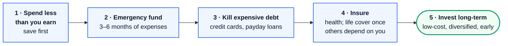
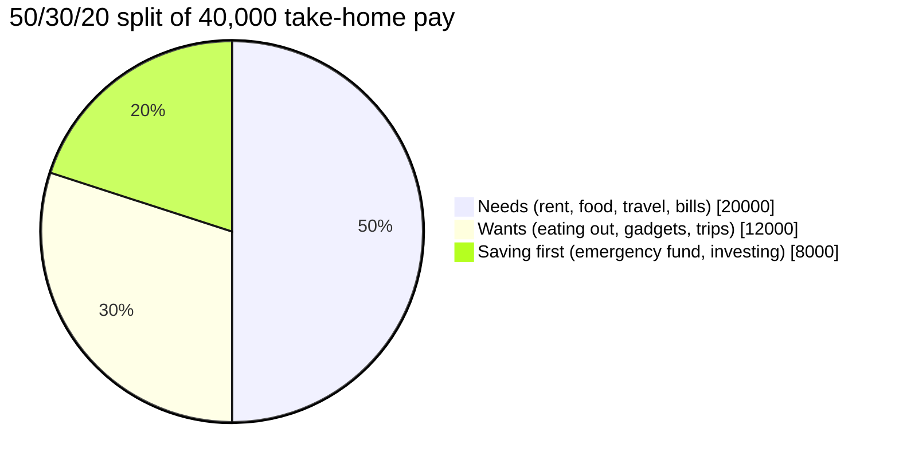
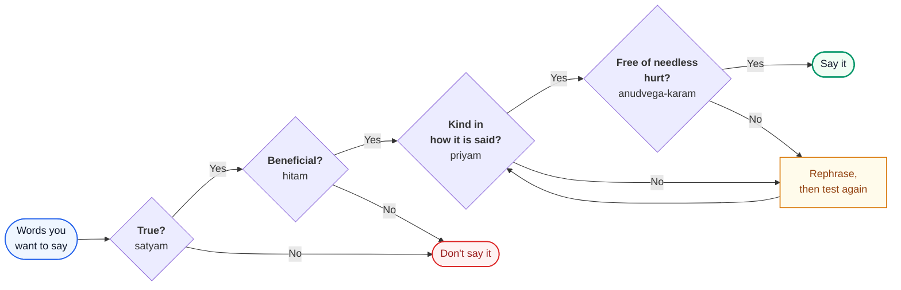
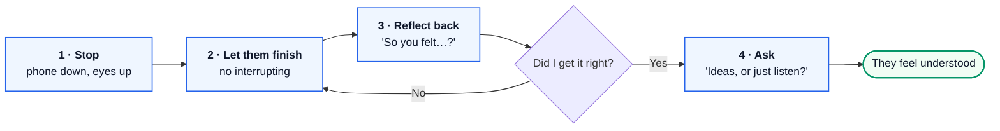

# Life 4 – Money and People: Learn Guide

> **Source:** Built from research: Hindu texts (the Bhagavad Gita, the Taittiriya Upanishad), economics and
> personal-finance basics, and research on relationships. References are at the end. Every number was
> recomputed. The money part is **country-neutral general education, not personal financial advice**:
> products, taxes and rules differ by country, so check your own before acting.

**The big picture:** Two practical skills decide much of a man's life, and schools rarely teach either.
**Money:** spend less than you earn, protect yourself from emergencies and expensive debt, and let
compounding work for decades. **People:** speak truthfully and kindly, listen properly, keep your word, and
choose and honour the people around you. Both follow the same law: **small, consistent actions compound**.

## Contents

**Part A: Money (artha done right)**

1. [Money is part of dharma](#1-money-is-part-of-dharma)
2. [Does money buy happiness?](#2-does-money-buy-happiness)
3. [The five money rules](#3-the-five-money-rules)
4. [Compounding: the maths that rewards starting early](#4-compounding-the-maths-that-rewards-starting-early)
5. [Debt: compounding working against you](#5-debt-compounding-working-against-you)

**Part B: People**

6. [Relationships are the strongest predictor of a good life](#6-relationships-are-the-strongest-predictor-of-a-good-life)
7. [Speech: the Gita's four tests](#7-speech-the-gitas-four-tests)
8. [Listening and conflict](#8-listening-and-conflict)
9. [Whom you honour, whom you choose](#9-whom-you-honour-whom-you-choose)
10. [Your 30-day plan](#10-your-30-day-plan)

---

# Part A: Money

## 1. Money is part of dharma

**The problem.** Some people think a "spiritual" person shouldn't care about money. Others think money is the
only thing that matters. Both views lead to trouble: the first to dependence and stress, the second to an
empty or dishonest life.

**The Hindu view.** **Artha** (wealth and security) is one of the four legitimate aims of life (see Guide 3).
A householder is **expected** to earn, save and support his family, his parents in old age, guests and those
in need. What the tradition demands is that artha be earned and used **within dharma**: honestly, without
harming others, and with a share given back.

So caring about money is not greed. Greed (*lobha*, one of the three gates in Guide 2) is the **endless**
wanting of more, never satisfied, willing to cheat. Managing money well is the opposite: it is
**discipline applied to wealth**.

---

## 2. Does money buy happiness?

**The famous debate.** In 2010, Daniel Kahneman and Angus Deaton reported that emotional wellbeing rose with
income up to about **$75,000 a year** (in the US) and then **flattened**. In 2021, Matthew Killingsworth,
using a different method, found that happiness **kept rising** with income, with no plateau.

**The resolution (2023).** Killingsworth and Kahneman did something rare: they worked **together** with a
neutral arbiter (Barbara Mellers) to settle it, an "adversarial collaboration". Their finding:

- For **most** people, happiness keeps rising as income rises.
- For the **least happy** group, happiness rises with income only up to around **$100,000**, and then
  stops. Their unhappiness has causes money can't fix (grief, depression, broken relationships).
- For the **happiest** people, the rise actually **speeds up** at higher incomes.

**The maths: why "log" matters.** In these studies happiness rises with the **logarithm** of income, not with
income itself. That means each **doubling** of income adds about the same amount of happiness:

$$
\Delta H \propto \log_2\left(\frac{\text{new income}}{\text{old income}}\right)
$$

Read out loud: *"The change in happiness is proportional to the base-2 logarithm of new income divided by
old income."* In other words, it counts **how many doublings** you made.

| Change in income | Doublings: $\log_2(\text{new}/\text{old})$ | Happiness gain (same units) |
|---|---|---|
| 20,000 → 40,000 | 1 | 1 |
| 50,000 → 100,000 | 1 | 1 |
| 100,000 → 110,000 | 0.14 | 0.14 |

*Fig 1 – Equal steps for each doubling (images/fig_log_income.png). An illustration of the log model, not the
study's data. Going from 20k to 40k and from 50k to 100k climbs the same height; 100k to 110k barely moves.*

So an extra 20,000 means a lot when you have little and very little when you have a lot. **Lessons:**

1. Getting out of financial stress (the first doublings) improves life a lot. Take money seriously, early.
2. After that, each extra unit of money buys less. Don't trade your health, family or integrity for the last 10%.
3. Money can't fix unhappiness that comes from elsewhere. That needs Guides 1–3.

---

## 3. The five money rules

These are the principles almost every personal-finance educator agrees on, whatever the country.

**Rule 1: Spend less than you earn, and save first.** Most people save "whatever is left" at the end of the
month, which is usually nothing. Reverse it: the day money arrives, move your savings out **first**, then
live on the rest. A simple starting split is **50/30/20**: 50% needs, 30% wants, 20% saving (from Elizabeth
Warren and Amelia Tyagi's *All Your Worth*, 2005). As a student on a small allowance, even 10% builds the
habit, and the habit matters more than the amount.

**Rule 2: Emergency fund.** Keep **3–6 months of essential expenses** somewhere safe and easy to reach (a
savings account, not shares). Without it, one emergency (a job loss, an illness, a repair) forces you into
expensive debt or into selling investments at a bad time.

> Worked example: if your essential costs are 20,000 a month, a 3–6 month fund is 60,000 to 120,000.

**Rule 3: Kill expensive debt.** Credit-card and short-term loan interest often runs at 30–40% a year. No
investment reliably earns that, so paying it off is the best "return" available. Section 5 shows why.

**Rule 4: Insure against ruin.** Health insurance first. Once anyone depends on your income, add pure life
cover (often called term insurance). The rule: insure against what would **ruin** you, not against small
losses you can absorb.

**Rule 5: Invest long-term, low-cost and diversified.** For most people the evidence favours broad,
low-cost **index funds** (funds that simply hold a whole market index) over picking stocks or funds that
try to beat the market. S&P's long-running SPIVA reports, published for many countries, repeatedly find that
**most actively managed funds trail their benchmark index over long periods**, partly because their higher
fees eat the returns.

**Watch for lifestyle creep.** When your income rises, your spending tends to rise just as fast (better
phone, better bike, more eating out), so you never get ahead. A good rule: when your income goes up, **save at
least half of every raise**.

---

## 4. Compounding: the maths that rewards starting early

**The problem.** "I'll start investing when I earn more." It feels sensible, but it costs far more than
people realise, because **time** is the most powerful input, not the amount.

**How it works.** Compounding means your returns earn returns. Year 1 grows your money; year 2 grows the
money **plus** year 1's growth; and so on. The value of a fixed monthly investment after $n$ months is:

$$
FV = P \times \frac{(1+r)^{n} - 1}{r}
$$

Read out loud: *"Future value equals the monthly payment `P` times one plus `r` to the power `n`, minus one,
all divided by `r`."* Here $P$ is the amount invested each month, $r$ is the **monthly** return (annual
return ÷ 12) and $n$ is the number of months.

**Worked example: Asha and Ravi.** Both invest **100 a month** (in any currency) and earn **7% a year**,
so $r = 0.07 / 12 \approx 0.00583$.

- **Asha** starts at 22 and invests until 52: $n = 30 \times 12 = 360$ months.
- **Ravi** starts at 32 and invests until 52: $n = 20 \times 12 = 240$ months.

| | Asha (starts at 22) | Ravi (starts at 32) |
|---|---|---|
| Months invested | 360 | 240 |
| Money put in | 36,000 | 24,000 |
| Value at 52 | **≈ 122,000** | **≈ 52,100** |
| Growth earned | ≈ 86,000 | ≈ 28,100 |

Ravi put in two-thirds as much money as Asha but ends with **less than half** her result. Even if Ravi
invests **double** (200 a month) for his 20 years, he reaches only about **104,200**, still behind Asha.
Those 10 early years are worth more than doubling his effort later.

*Fig 2 – Asha vs Ravi (images/fig_compounding.png). Same habit, same return; the only difference is a 10-year
head start. Asha's curve pulls away from the grey "money put in" line because growth earns growth.*

> 7% a year is an illustration, not a promise. Real returns vary year to year, and can be negative for a
> while. The shape of the curve, slow at first and then steep, is the lesson.

**The Rule of 72: a mental shortcut.** To estimate how many years money takes to **double**, divide 72 by the
yearly return in percent:

| Yearly return | Rule of 72 estimate | Exact doubling time |
|---|---|---|
| 4% | 72 ÷ 4 = 18 years | 17.7 years |
| 7% | 72 ÷ 7 ≈ 10.3 years | 10.2 years |
| 10% | 72 ÷ 10 = 7.2 years | 7.3 years |

The exact time is $\ln 2 / \ln(1 + \text{rate})$; the shortcut is within a few months for normal rates.

*Fig 3 – From seed to banyan (images/img_banyan.jpg). Generated with Google Flow for this guide. A seed you
can hold in your palm becomes a tree that shelters a village, but only with decades. Compounding is a banyan,
not a firework.*

---

## 5. Debt: compounding working against you

**The problem.** Compounding works in reverse on debt. Credit cards make it easy: pay the "minimum due" and
the problem seems handled. It isn't.

**Worked example.** You owe **1,000** on a card charging **36% a year**, which is **3% a month**. Each month,
interest is added, then your payment is subtracted:

$$
B_{\text{next}} = B \times 1.03 - \text{payment}
$$

Read out loud: *"Next month's balance equals this month's balance times 1.03, minus what you pay."*

| Monthly payment | Months to clear 1,000 | Total interest paid |
|---|---|---|
| 30 | **never**: interest is 1,000 × 0.03 = 30, so the payment only covers interest | grows forever |
| 40 | 47 months (almost 4 years) | ≈ 876 |
| 100 | 13 months | ≈ 207 |

Read the first row again: paying 30 a month on this debt **pays exactly the interest**, so the balance never
falls. You could pay forever. Paying a little more than the minimum turns a lifelong trap into a 13-month
problem.

*Fig 4 – The minimum-payment trap (images/fig_debt.png). The red line never moves: 30 a month only covers the
interest. Ten more a month (orange) ends it in about 4 years; 100 a month (green) in 13 months.*

**Rules for debt:**

1. Never borrow for things that lose value and that you can't afford in cash (phones, gadgets, holidays).
2. If you use a credit card, **pay the full balance every month**, no exceptions.
3. If you have several debts, pay minimums on all, then put every spare amount on the **highest interest
   rate first** (the "avalanche" method).
4. Treat "buy now, pay later" and instant-loan apps as debt, because they are.

---

# Part B: People

## 6. Relationships are the strongest predictor of a good life

**The research.** The **Harvard Study of Adult Development** began in 1938 and has followed two groups of men
(Harvard students and young men from poor Boston neighbourhoods) for over 85 years, and later their families.
Its current director, Robert Waldinger, sums up the main finding simply: **good relationships keep us
happier and healthier**.

- What mattered was the **quality** of close relationships, not the number of friends or contacts.
- The men who were **most satisfied in their relationships at 50 were the healthiest at 80**, a better
  predictor than their cholesterol levels at 50.
- Loneliness and high-conflict relationships went with worse health.

> Caveat: this is an observational study, and the original groups were all men from one country. It shows
> strong associations, not proven causes. But it matches a large body of research on social connection and
> health.

**What it means for you.** Your career will matter. But the people you build your life with, and how you
treat them, will matter more to how your life actually feels at 50 and 80. Relationships are an
**investment that compounds**, exactly like money: small deposits of attention, honesty and help, made
consistently over decades.

*Fig 5 – Friends at eighty (images/img_oldfriends.jpg). Generated with Google Flow for this guide. The
Harvard study's picture of a good old age: not the richest men, but the most connected ones.*

---

## 7. Speech: the Gita's four tests

**The problem.** Most damage between people is done with words: a harsh joke, a lie to avoid trouble, gossip,
a cruel truth thrown in anger.

**The Gita's standard (17.15)** defines the "austerity of speech":

> *anudvega-karaṁ vākyaṁ satyaṁ priya-hitaṁ ca yat; svādhyāyābhyasanaṁ caiva vāṅ-mayaṁ tapa ucyate.*
>
> "Speech that **causes no distress**, that is **true**, **pleasant** and **beneficial**, together with
> regular study of the scriptures, is called the discipline of speech."

So before you speak, especially in a hard moment, run four tests:

Commentators such as Shankara point out that speech must pass **all** the tests **together**. A pleasant
lie fails. A true statement thrown to wound fails too. The skill isn't choosing between honesty and kindness;
it is **finding the true words that can be said kindly**.

**Example.** A friend asks what you think of his startup idea, and you see a serious flaw.

- ❌ Pleasant but false: "It's brilliant, go for it."
- ❌ True but hurtful: "That's a stupid idea, it'll never work."
- ✅ True, kind and useful: "I like the problem you're solving. My worry is how you'll get the first
  customers. Can we think that part through?"

---

## 8. Listening and conflict

**Listening is the half of communication people skip.** Most of us listen only to reply. Try this instead,
especially when someone is upset:

1. **Stop doing other things.** Phone face down, eyes up.
2. **Let them finish.** Don't interrupt, don't fix yet.
3. **Reflect it back:** "So you felt ignored when I cancelled at the last minute. Is that right?"
4. **Ask before advising:** "Do you want ideas, or do you mainly want me to listen?"

Step 3 is the one that changes everything. People calm down when they feel **understood**, often before
anything is solved.

**The 5-to-1 idea.** The psychologist John Gottman studied couples talking through conflicts and coded every
positive and negative moment. Stable, happy couples had **about five positive interactions for every negative
one during conflict**; couples heading for divorce were closer to **one to one**. Negative moments still
happened in good relationships; they were simply outweighed and repaired.

> Caveat: this ratio comes mostly from Gottman's own lab and is better treated as a strong rule of thumb than
> a precise law. The idea behind it is well supported: **warmth must clearly outweigh criticism**.

It applies beyond romance: to parents, friends, teammates and juniors. If most of what someone hears from you
is correction, they stop hearing it.

---

## 9. Whom you honour, whom you choose

**Whom you honour.** The Taittiriya Upanishad (1.11) gives students a short code for life that Indian homes
still repeat:

> *mātṛ-devo bhava, pitṛ-devo bhava, ācārya-devo bhava, atithi-devo bhava.*
>
> "Treat your **mother** as divine. Treat your **father** as divine. Treat your **teacher** as divine. Treat
> your **guest** as divine."

*Fig 6 – Passing the flame (images/img_diyas.jpg). Generated with Google Flow for this guide. Lighting
another lamp from yours costs your flame nothing, and the whole room grows brighter. Respect and care work
the same way.*

In practice, "treat as divine" means **respect, gratitude and care**: calling your parents, thanking your
teachers, and making any guest (or new person in your group) feel welcome.

**Respect for women.** A widely quoted verse of the Manusmriti (3.56) says: *yatra nāryas tu pūjyante ramante
tatra devatāḥ*, "where women are honoured, there the gods rejoice." In modern terms: treat every woman with
the same dignity you'd want for your mother and sister, in person and online; take "no" as a full sentence;
and never laugh along when other men demean women. Character shows most in how a man treats people who have
less power than him.

**Whom you choose.** You slowly become like the people you spend the most time with: their habits, their
standards, their language. Research on social networks (Christakis and Fowler, 2007–2008) found that health
behaviours and even happiness cluster among friends. Researchers still debate how much of that is
**influence** and how much is similar people **choosing** each other, but either way the practical rule
holds: **choose friends who make you better**.

| Friend who pulls you down | Friend who builds you up |
|---|---|
| Mocks your goals | Asks how your goals are going |
| Only calls when he needs something | Shows up when you need something |
| Gossips about everyone, including you | Defends you when you're not there |
| Pushes you toward the three gates (Guide 2) | Joins you at the gym or library |

**Keep your word: trust compounds too.** Every promise kept is a small deposit; every promise broken is a big
withdrawal. Be careful about **what** you promise, and then do it, even small things like "I'll call you
back tonight". Over years, people learn they can rely on you completely. That reputation is worth more than
any salary, and like the banyan, it can't be grown quickly.

---

## 10. Your 30-day plan

| Week | Money | People |
|---|---|---|
| 1 | Track every expense for 7 days; no judgement, just see | Call your parents twice; ask about their day, not just "all fine?" |
| 2 | Set up "save first": move a fixed % out on the day money arrives | Practise the 4-step listening in one real conversation a day |
| 3 | Start or grow an emergency fund; list any debts with their interest rates | Before any hard message, run the four speech tests |
| 4 | Read about low-cost index funds available in your country; no rush to act | Thank one teacher or mentor properly; keep every small promise this week |

**The one-line summary of this guide:** *Earn honestly, spend less than you earn, let time grow it, and
invest the same patience in people.*

---

## References

- Bhagavad Gita 17.15. Taittiriya Upanishad 1.11. Manusmriti 3.56. Translations compared at
  [holy-bhagavad-gita.org](https://www.holy-bhagavad-gita.org/chapter/17/verse/15/) and
  [shlokam.org](https://shlokam.org/texts/taittiriya-1-11-1/).
- Kahneman, D., & Deaton, A. (2010). High income improves evaluation of life but not emotional well-being.
  *PNAS*, 107(38), 16489–16493.
- Killingsworth, M. A. (2021). Experienced well-being rises with income, even above $75,000 per year.
  *PNAS*, 118(4), e2016976118.
- Killingsworth, M. A., Kahneman, D., & Mellers, B. (2023). Income and emotional well-being: A conflict
  resolved. *PNAS*, 120(10), e2208661120.
- Warren, E., & Tyagi, A. W. (2005). *All Your Worth: The Ultimate Lifetime Money Plan*. Free Press.
- S&P Dow Jones Indices. SPIVA scorecards (U.S., India and other markets), published twice a year.
- Waldinger, R., & Schulz, M. (2023). *The Good Life: Lessons from the World's Longest Scientific Study of
  Happiness*. Simon & Schuster.
- Gottman, J. M. (1994). *What Predicts Divorce? The Relationship Between Marital Processes and Marital
  Outcomes*. Lawrence Erlbaum.
- Christakis, N. A., & Fowler, J. H. (2007). The spread of obesity in a large social network over 32 years.
  *NEJM*, 357, 370–379. Fowler, J. H., & Christakis, N. A. (2008). Dynamic spread of happiness in a large
  social network. *BMJ*, 337, a2338.
