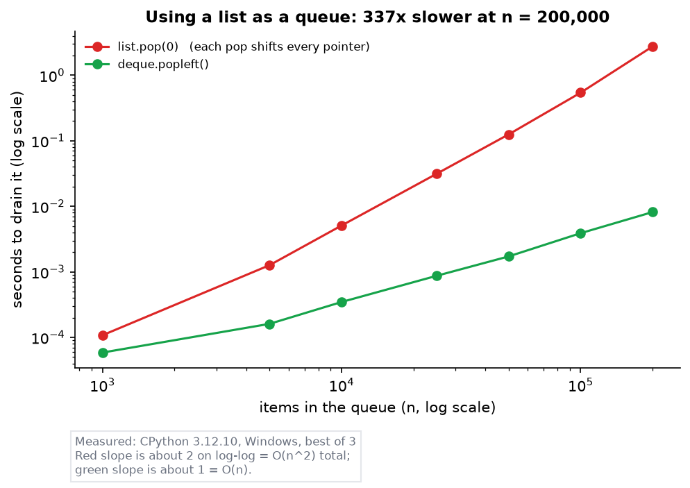
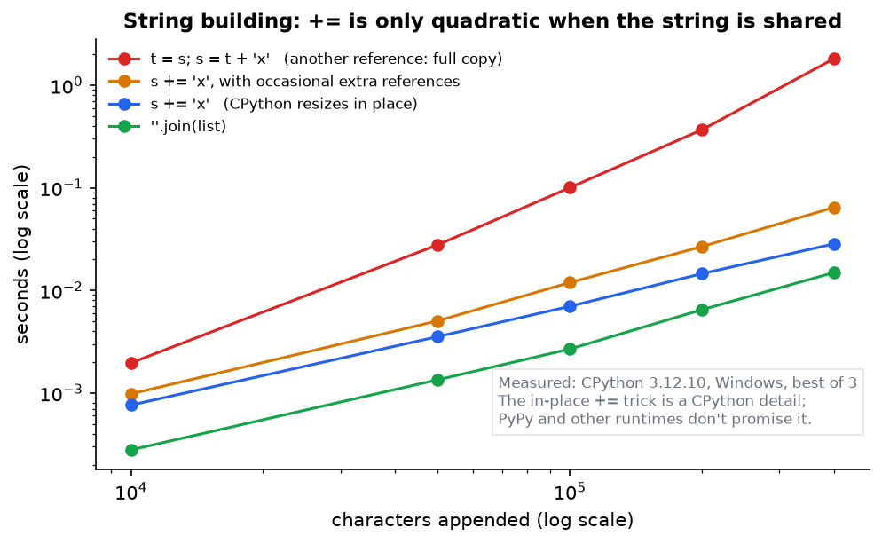
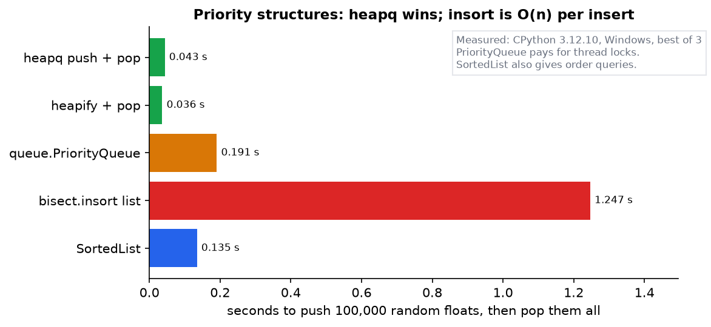
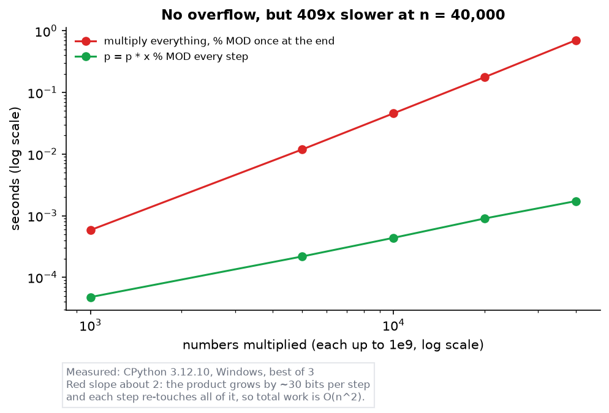
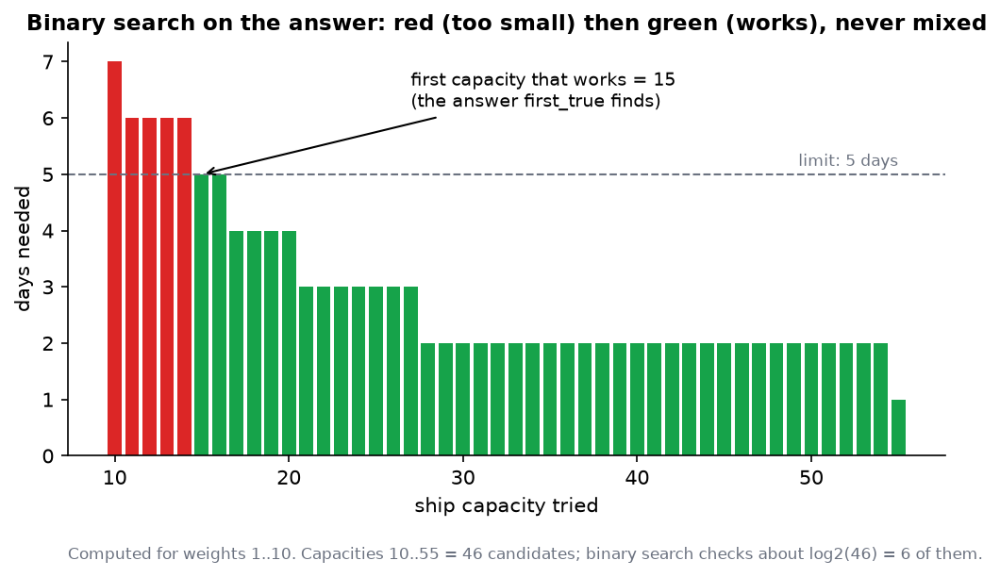
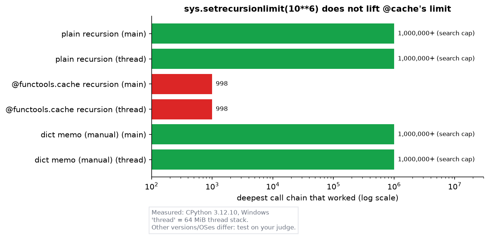
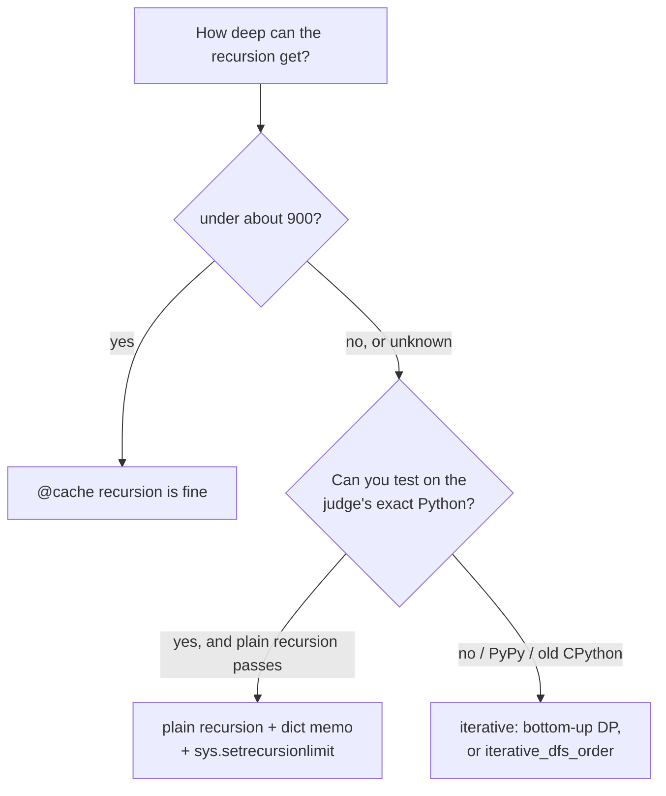
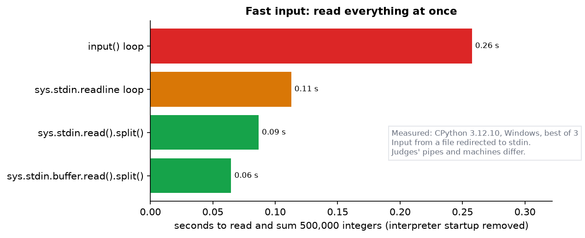
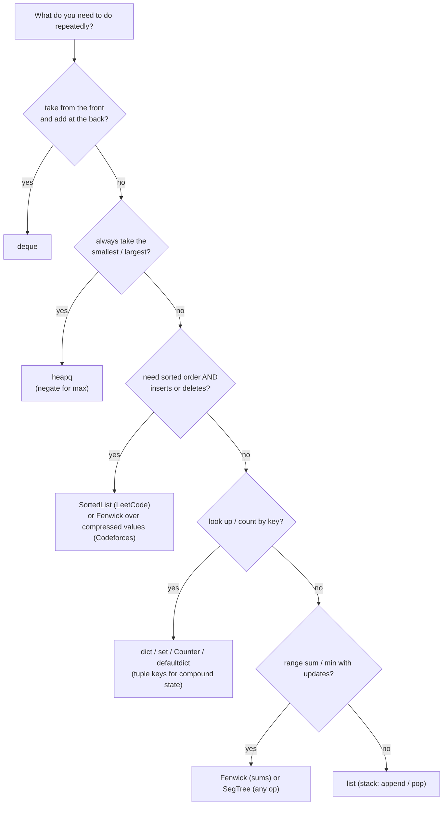

# Python DSA: Templates, Patterns and Performance

> **Series:** companion to `notes/py-dsa.md` · backend series: [Part 1](Reading%20a%20Python%20Backend%201%20-%20The%20Python%20You%20Need.md) · [Part 2](Reading%20a%20Python%20Backend%202%20-%20A%20Codebase%20Tour%20and%20One%20Request%20Traced.md) · [Part 3](Reading%20a%20Python%20Backend%203%20-%20Backend%20Concepts%20Decisions%20and%20Unfamiliar%20Code.md) · [Folder index](README.md)
> **Source:** Python documentation, CPython's own library source, and measurements. Every template is in [dsa_templates.py](code/dsa/dsa_templates.py), **checked against brute force on random inputs** by [test_dsa_templates.py](code/dsa/test_dsa_templates.py) (15 tests pass). Every output block is pasted from [dsa_gotchas.py](code/dsa/dsa_gotchas.py), [dsa_patterns.py](code/dsa/dsa_patterns.py) or [dsa_benchmarks.py](code/dsa/dsa_benchmarks.py). Figures come from [make_dsa_figs.py](images/make_dsa_figs.py). All measurements: CPython 3.12.10 on Windows. The current release is **Python 3.15** (9 October 2026); where 3.13–3.15 behave differently, the text says so (§4.1, §7). **PyPy wasn't available, so PyPy claims are marked "as reported".**
> **Facts re-checked:** 24 October 2026.

**The big picture:** `py-dsa.md` taught you how Python's containers map to the C++ STL. This guide is what you need to actually **solve problems** in Python: a measured cost model (what's fast and what isn't), the C++ habits that silently give wrong answers, tested templates for the standard algorithms, the patterns that recognise each problem type, and the recursion limits that measurement shows are different from what most advice says.

---

## Contents

0. [How to use this guide](#0-how-to-use-this-guide)
1. [TL;DR](#1-tldr)
2. [The cost model, measured](#2-the-cost-model-measured)
3. [C++ habits that give wrong answers in Python](#3-c-habits-that-give-wrong-answers-in-python)
4. [The standard-library toolkit](#4-the-standard-library-toolkit)
5. [Tested templates](#5-tested-templates)
6. [Patterns: recognise the problem, pick the tool](#6-patterns-recognise-the-problem-pick-the-tool)
7. [Recursion and DP in Python, measured](#7-recursion-and-dp-in-python-measured)
8. [LeetCode vs Codeforces setup](#8-leetcode-vs-codeforces-setup)
9. [Choosing a data structure](#9-choosing-a-data-structure)
10. [Corrections to py-dsa.md](#10-corrections-to-py-dsamd)
11. [Common misconceptions](#11-common-misconceptions)
12. [Self-check and decision drills](#12-self-check-and-decision-drills)
13. [Glossary](#13-glossary)
14. [References](#14-references)

---

## 0. How to use this guide

| If you have… | Read |
|---|---|
| 10 minutes | §0.1, §1, and Figure 7 in §7 (the `@cache` depth limit, which surprises nearly everyone) |
| 1 hour | §2 (cost model), §3 (wrong-answer habits), §5 (templates), §7 (recursion) |
| A weekend | Everything, then solve 10 problems using only the templates and the §6 recognition table, then do the drills in §12 |

**Run everything** from the repository root:

```bash
py -3.12 -m pytest -q target/py/code/dsa
py -3.12 target/py/code/dsa/dsa_gotchas.py
py -3.12 target/py/code/dsa/dsa_patterns.py
py -3.12 target/py/code/dsa/dsa_benchmarks.py
```

The test suite needs `pytest`; the patterns script optionally uses `sortedcontainers`. Everything else is standard library.

### 0.1 First, in completely plain words

You already know how to cook. C++ was a kitchen with very sharp knives and no safety guards. Python is a different kitchen. The knives are blunter (each step is slower), but there are many ready-made tools on the shelf (sorting, heaps, counters, caches), and some things that would cut you in C++ can't happen here (an integer can't overflow).

To cook well in the new kitchen you need four things:

1. **Know how slow each tool really is**, so you know whether an idea will finish in time. Not from rumour, from measurement (§2).
2. **Know which old habits now give the wrong dish.** `-7 / 2` rounds differently, and copying a grid doesn't copy the rows (§3).
3. **Have tested recipes ready:** union-find, Dijkstra, segment tree and so on, written once, checked, and reused (§5).
4. **Recognise what a problem is asking for** from its wording: "the k-th smallest" means a heap; "minimum capacity so that…" means binary search on the answer (§6).

That's what this guide gives you.

---

## 1. TL;DR

1. **Budget:** plain CPython runs about **4 × 10⁷ trivial loop steps per second** (measured) and realistically 10⁶–10⁷ steps of typical DSA work. At n = 2 × 10⁵, O(n log n) is fine and O(n²) is not.
2. **Built-ins run at C speed:** `sum(data)` was **4× faster** than a hand-written loop; `sorted`, `heapq`, `bisect`, `Counter` and `str.join` all run in C. Push work into them.
3. **`list.pop(0)` is O(n):** 329× slower than `deque.popleft()` at n = 200,000 (Figure 1).
4. **`s += ch` is usually linear in CPython**, but quadratic once anything else references the string (Figure 2). `"".join` is always safe.
5. **Read input in one go:** `sys.stdin.buffer.read().split()` read 500k ints about 4× faster than an `input()` loop (Figure 8).
6. **Take `% MOD` every step:** about 400× faster at n = 40,000 (Figure 4).
7. **Wrong-answer traps from C++:** `//` and `%` round toward −∞; ints don't wrap at 2⁶⁴; `round(2.5) == 2`; `math.sqrt` is inexact for big ints (use `math.isqrt`); `str()` refuses ints over 4,300 digits unless you call `sys.set_int_max_str_digits(0)`.
8. **Biggest surprise:** on CPython 3.12, **`@cache` recursion failed at 998 calls deep** even with `sys.setrecursionlimit(10**6)` and a big thread stack. Plain recursion and a hand-written dict memo both reached 1,000,000 (Figure 7). For deep top-down DP, use a dict memo or go bottom-up.

---

## 2. The cost model, measured

### 2.1 How many operations fit in a time limit?

The tightest possible Python loop, `for x in data: s += x` over a million items, took **0.024 s** in [dsa_benchmarks.py](code/dsa/dsa_benchmarks.py):

$$\text{steps per second} \approx \frac{10^6}{0.024\ \text{s}} \approx 4 \times 10^7$$

*Read it out loud: "a million loop steps in about 24 milliseconds is about forty million steps per second". That's the ceiling for the simplest possible body; a real loop body with indexing, comparisons and appends runs several times slower.*

**Worked example: will it pass in 1 second?**

| n | Algorithm | Steps | Estimate at 10⁷ steps/s | Verdict |
|---|---|---|---|---|
| 10⁵ | O(n log n): sort plus one pass | 10⁵ × 17 ≈ 1.7 × 10⁶ | ≈ 0.2 s | Fine |
| 2 × 10⁵ | O(n √n) | 2 × 10⁵ × 447 ≈ 9 × 10⁷ | ≈ 9 s | Too slow in CPython; maybe with PyPy (as reported) or vectorised |
| 10⁵ | O(n²): all pairs | 10¹⁰ | ≈ 1,000 s | Impossible: find the O(n log n) idea |
| 20 | O(2ⁿ · n²): bitmask TSP | 10⁶ × 400 = 4 × 10⁸ | ≈ 40 s | Too slow; n ≤ 16 is the Python comfort zone |

*How to read "steps": count how many times the innermost line runs. log₂(10⁵) ≈ 17.*

### 2.2 Let C do the loop

```text
7. Loop styles over 1,000,000 items (seconds)
   append_loop        0.0540
   append_loop_local  0.0579
   comprehension      0.0480
   map_lambda         0.0684
   manual_sum         0.0240
   builtin_sum        0.0059
```

- `sum(data)` (C) is about **4× faster** than the same loop in Python.
- A comprehension beats `append` in a loop slightly.
- **The old micro-trick `app = r.append` no longer helps** on 3.12 (0.058 s vs 0.054 s). Python 3.11+ speeds up these lookups internally. Don't clutter code with it.
- `map(lambda ...)` is *slower* than a comprehension, because every item still calls a Python function.

The general rule: **one C-level call over the whole data beats a Python loop.** That means `sum`, `max`, `min`, `sorted`, `"".join`, `Counter(iterable)`, `set(a) & set(b)`, `str.count`, `bisect`, `heapq.heapify`, `itertools.accumulate`.

### 2.3 Queues: `list.pop(0)` vs `deque`



*Figure 1 (measured). Each `pop(0)` shifts every remaining pointer one slot left, so draining n items costs about n²/2 shifts in total. That's slope 2 on a log-log plot. `deque.popleft` is O(1), slope 1. At 200,000 items: 2.85 s vs 0.009 s.*

### 2.4 Strings: when `+=` is fine and when it isn't



*Figure 2 (measured). CPython has a special trick: if the string on the left of `+=` has **no other references**, it's resized in place, so the blue line is linear. The moment another name points at it (red: `t = s; s = t + 'x'`), every step copies the whole string, which is quadratic. Keeping occasional extra references (amber) costs in between. `"".join` (green) is linear by design.*

So `py-dsa.md`'s rule "always use `join`" is the safe habit, but **`s += ch` isn't automatically a bug in CPython**. It becomes one when the string is shared, and on runtimes without the in-place trick (such as PyPy, as reported).

### 2.5 Priority structures



*Figure 3 (measured). `queue.PriorityQueue` is about 4× slower than `heapq` because it takes a thread lock on every operation; it's for threads, not algorithms. `bisect.insort` is O(n) per insert (it shifts the list), so 100,000 inserts take 25× longer than heapq. `SortedList` costs about 3× a heap but also answers "k-th smallest" and "predecessor" queries.*

### 2.6 Big integers: no overflow, but not free



*Figure 4 (measured). Without `% MOD`, the product grows by about 30 bits per step, and each multiplication re-touches all of it. That's n steps of growing linear work, O(n²) in total. With `% MOD` every step, the number stays one machine-sized "digit". About 400× apart at n = 40,000.*

> **Correction to `py-dsa.md` Node 8:** it blames Karatsuba's O(D^1.58) multiplication. Karatsuba only applies when **both** numbers are large. Here, each step multiplies a big number by a small one (≤ 10⁹), which is linear in the big number's size. The conclusion ("mod every step") is right; the mechanism is "linear work on a growing number, n times".

---

## 3. C++ habits that give wrong answers in Python

These don't crash. They silently change your answer. All output is from [dsa_gotchas.py](code/dsa/dsa_gotchas.py).

**3.1 Integer division and modulo round toward −∞.**

```text
-7 // 2 = -4    (C++: -3)
-7 % 2  = 1    (C++: -1)
int(-7 / 2) = -3   <- truncates like C++, but goes through a float
math.fmod(-7, 2) = -1.0  <- C-style remainder
(-1) % (10**9 + 7) = 1000000006  <- always non-negative: no '+ MOD' fix-up needed
```

The upside: `(a - b) % MOD` is always in `[0, MOD)`, so you can drop the C++ `((x % M) + M) % M` dance. The downside: porting C++ code that uses `/` on negatives, such as midpoints in signed binary search or floor/ceil helpers, changes behaviour. For ceiling division use `-(-a // b)`.

**3.2 Big integers don't overflow, but printing huge ones is limited.**

```text
7**10000 has 8451 decimal digits; arithmetic on it is fine: 1
str(7**10000) -> ValueError: Exceeds the limit (4300 digits) for integer string conversion; use sys.set_...
after sys.set_int_max_str_digits(0): printed 8451 digits fine
```

Since Python 3.11, converting an int with more than 4,300 digits to a string raises an error. It was added to stop denial-of-service attacks on web servers. In contest code that prints huge numbers, put `sys.set_int_max_str_digits(0)` at the top. And if C++ code relied on unsigned wrap-around (hashing, for example), you must mask explicitly:

```text
~5 = -6   -5 >> 1 = -3   -1 & 0xFF = 255
(1 << 64) = 18446744073709551616   <- no wrap-around; mask with & ((1 << 64) - 1) to emulate uint64
(13).bit_count() = 3   (13).bit_length() = 4   lowbit 12 & -12 = 4
```

Python ints behave like **infinitely wide two's complement**. `x & -x` (the lowest set bit, which Fenwick trees use) works exactly as in C++. `bit_count()` (3.10+) is `__builtin_popcount`; `bit_length()` is "index of the highest set bit + 1".

**3.3 Rounding and floats.**

```text
round(0.5), round(1.5), round(2.5) = 0 2 2
0.1 + 0.2 == 0.3 -> False   math.isclose -> True
int(math.sqrt(10**18 - 1)) = 1000000000  math.isqrt = 999999999 <- the float is wrong, isqrt is exact
float(2**53 + 1) == 2**53 -> True
```

`round` uses banker's rounding (ties go to the even number). For "round half up" on non-negative numbers, use `int(x + 0.5)`, or `Decimal` when it matters. **Never use `int(math.sqrt(n))` for big n**; `math.isqrt` is exact for any size.

**3.4 Heap ties compare the payload.**

```text
push (1, dict) twice -> TypeError: '<' not supported between instances of 'dict' and 'dict'
with (priority, counter, payload): ['a', 'b']
```

Push `(priority, counter, payload)` with a running counter (`itertools.count()`); this is `py-dsa.md` Node 3's rule, demonstrated.

**3.5 Sorting is stable, and mixed types fail.**

```text
sorted by number only (stable keeps letter order): [('a', 1), ('d', 1), ('b', 2), ('c', 2)]
sorted([3, 'a', 1]) -> TypeError: '<' not supported between instances of 'str' and 'int'
max with key + default: None ccc
```

Stability lets you sort by several keys in **multiple passes**: sort by the secondary key first, then by the primary. That's useful when one key must be descending and can't be negated, such as strings.

**3.6 `is` vs `==`, strings, and copies.**

```text
256 is 256 -> True  | int('257') is int('257') -> False  | == -> True
'Z' < 'a' -> True   ord('a') = 97   chr(98) = b
'abc'[::-1] = cba   'a,b,,c'.split(',') = ['a', 'b', '', 'c']   ' x '.split() = ['x']
[[0]*3]*2 after grid[0][0]=1: [[1, 0, 0], [1, 0, 0]]  <- one row, two references
grid[:] is shallow, so grid changed too: [[1, 0, 0], [0, 9, 0]]  -> use [row[:] for row in grid]
```

Use `is` only for `None`. Small ints happen to be cached (−5 to 256), so `is` "works" in tests and fails in production. `split()` with no argument splits on any whitespace and drops empty strings; `split(',')` keeps them.

---

## 4. The standard-library toolkit

The tools `py-dsa.md` didn't cover, with real output from [dsa_patterns.py](code/dsa/dsa_patterns.py):

```text
prefix sums  accumulate(a, initial=0)                [0, 3, 4, 8, 9, 14, 23, 25, 31]
running max  accumulate(a, max)                      [3, 3, 4, 4, 5, 9, 9, 9]
adjacent pairs  pairwise(a) -> diffs                 [-2, 3, -3, 4, 4, -7, 4]
combinations('abc', 2)                               ['ab', 'ac', 'bc']
product([0,1], repeat=3)  (all bitstrings)           ['000', '001', '010', '011', '100', '101', '110', '111']
groupby on SORTED data: run lengths of 'aaabccdd'    [('a', 3), ('b', 1), ('c', 2), ('d', 2)]
chain.from_iterable([[1,2],[3],[4,5]])               [1, 2, 3, 4, 5]
reduce(operator.xor, [4,1,2,1,2])  (single number)   4
Counter('banana').most_common(2)                     [('a', 3), ('n', 2)]
zip(*matrix)  (transpose)                            [(1, 4), (2, 5), (3, 6)]
divmod(17, 5)                                        (3, 2)
sorted by length then alphabet                       ['a', 'ab', 'bb', 'ccc']
```

| Need | Tool | C++ equivalent |
|---|---|---|
| Prefix sums | `accumulate(a, initial=0)`; then `pre[r] - pre[l]` is the sum of `a[l:r]` | `partial_sum` |
| Running max/min | `accumulate(a, max)` | Manual loop |
| Neighbouring pairs | `pairwise(a)` (3.10+) | `adjacent_difference` |
| Subsets / permutations | `combinations`, `permutations`, `product(..., repeat=k)` | `next_permutation`, bitmask loops |
| Run-length grouping | `groupby` (only groups **consecutive** equal items, so sort first if needed) | Manual loop |
| Flatten | `chain.from_iterable` | Nested loop |
| Fold | `functools.reduce`, or `math.prod`, `math.lcm`, `math.gcd(*xs)` (3.9+) | `accumulate` with an operator |
| Infinite counter for tie-breaks | `itertools.count()` | Manual |
| Memo | `functools.cache` (careful: §7) | Manual table |
| Exact integer maths | `math.isqrt`, `math.comb`, `math.perm`, `pow(a, -1, m)` (modular inverse) | Hand-written |

`Counter.most_common(k)` uses `heapq.nlargest` internally (confirmed in the CPython 3.12 library source), so it's O(U log k), as `py-dsa.md` says.

### 4.1 Newer Pythons add a few DSA-relevant tools

Not available on every judge yet, so check the version first (from the official "What's New" pages, checked 24 Oct 2026):

| Feature | Version | Why it matters for DSA |
|---|---|---|
| `itertools.batched(it, n)` | 3.12 | Split into chunks of n without index arithmetic |
| `frozendict({...})` | 3.15 (PEP 814) | A **hashable** dict, so a small mapping can be a `set` member, a dict key or a `@cache` argument without converting it to a sorted tuple |
| `[*row for row in grid]` | 3.15 (PEP 798) | Unpacking inside a comprehension flattens a list of lists without `itertools.chain` |
| `math.integer` module | 3.15 (PEP 791) | A new home for integer maths functions (`gcd`, `isqrt`, `comb` and friends) |
| Faster interpreter, experimental JIT | 3.11+ / 3.13+ | 3.11 was a big step up in plain loop speed, which is why the §2.2 micro-tricks stopped mattering. The JIT is still experimental, so don't count on it in contests |

---

## 5. Tested templates

All of these are in [dsa_templates.py](code/dsa/dsa_templates.py), using only the standard library, so they're safe on Codeforces. Each is checked against a slow, obviously correct version on random inputs:

```text
...............                                                          [100%]
15 passed in 13.40s
```

| Template | Operations and cost | Use when | Python-specific note |
|---|---|---|---|
| `DSU` (union-find) | `find`/`union` ≈ O(1) amortised | Connectivity, cycle detection, Kruskal | Path *halving* in a `while` loop: no recursion, no `RecursionError` |
| `Fenwick` | `add`, `prefix`, `range_sum`: O(log n); `from_list`: O(n) | Prefix sums with updates, counting inversions | `i & -i` works exactly as in C++ |
| `SegTree(values, op, identity)` | `set`, `query(lo, hi)`: O(log n) | Range min/max/gcd/sum with point updates | Iterative bottom-up: no recursion, and about 2n memory instead of 4n |
| `dijkstra` | O((V+E) log E) | Non-negative weighted shortest paths | Lazy deletion: push duplicates, skip stale pops (`heapq` has no decrease-key) |
| `bfs_01` | O(V+E) | Weights are only 0 or 1 | `deque.appendleft` for weight 0 |
| `topo_sort` | O(V+E) | Ordering with prerequisites, cycle check | Returns `None` on a cycle |
| `iterative_dfs_order` | O(V+E) | Pre-/post-order on deep trees (tree DP) | The `(node, child_index)` stack gives correct post-order; tested on a path 200,000 deep |
| `Trie` | O(word length) | Prefix counting, autocomplete, word search | Dict-of-dicts: simplest and fast enough |
| `next_greater`, `sliding_window_max` | O(n) | "Next bigger", "max in every window" | Monotonic stack / deque of **indices** |
| `first_true(lo, hi, pred)` | O(log range) | Every binary search, including on the answer | `(lo + hi) // 2` can't overflow in Python |
| `lis_length` | O(n log n) | Longest increasing subsequence | `bisect_left` = strictly increasing; `bisect_right` = non-decreasing |
| `prefix_function`, `find_all` | O(n + m) | Pattern search, borders, periods | For simple substring search, `str.find` (C) is usually faster |
| `build_factorials`, `ncr` | O(n) setup, O(1) per query | nCr mod p | `pow(x, -1, p)` is the modular inverse (3.8+) |
| `tsp_min_cost` | O(2ⁿ · n²) | Bitmask DP over subsets | In Python, practical for n ≤ about 16 |

Two templates in full, to show the style:

```python
class DSU:
    def __init__(self, n):
        self.parent = list(range(n)); self.size = [1] * n; self.components = n

    def find(self, x):
        parent = self.parent              # local alias: attribute lookups are slow in loops
        while parent[x] != x:
            parent[x] = parent[parent[x]]  # path halving: no recursion
            x = parent[x]
        return x
```

```python
def first_true(lo, hi, pred):
    """Smallest x in [lo, hi) with pred(x) True; pred must be False...False True...True."""
    while lo < hi:
        mid = (lo + hi) // 2
        if pred(mid):
            hi = mid
        else:
            lo = mid + 1
    return lo
```

`first_true` is the only binary search you need to memorise. `bisect_left(a, x)` is `first_true(0, len(a), lambda i: a[i] >= x)`, and "binary search on the answer" is `first_true(lowest, highest + 1, feasible)`.

It works whenever the yes/no question flips **once**, from all "no" to all "yes". Here's that shape for a real problem ("smallest ship capacity that delivers packages 1..10 within 5 days", solved in §6.2):



*Figure 5 (computed). Each bar is one call to `feasible(capacity)`. Bigger capacities never need more days, so the bars go red, red, …, green, green and never mix. That one-way flip is the only condition binary search needs. Of the 46 candidates it checks about 6.*

### 5.1 How a Fenwick tree works, in one picture

The Fenwick code is short but opaque until you see what each slot holds. Slot `i` stores the sum of the last `lowbit(i)` array positions ending at `i`, where `lowbit(i) = i & -i` is the value of i's lowest set bit:


*Figure 6 (computed). To get the sum of a[1..13], start at 13 and repeatedly strip the lowest set bit: 13 → 12 → 8 → 0. The three slots on that path (stars) cover 13, 9–12 and 1–8: exactly a[1..13], with no overlap. Any prefix needs at most about log₂ n slots. An update to position i walks the other way (`i += i & -i`), touching every slot whose range contains i.*

---

## 6. Patterns: recognise the problem, pick the tool

### 6.1 The recognition table

| The problem says… | Think | Template / tool |
|---|---|---|
| "longest/shortest **subarray/substring** such that…" | Sliding window | Two indices plus a dict/Counter of the window |
| "pair/triple in a **sorted** array summing to…" | Two pointers | `i, j` moving inward |
| "**minimum** X such that it's possible…", "maximum X that still works" | Binary search on the answer | `first_true` plus a greedy `feasible(x)` |
| "k-th largest/smallest", "top k", "merge k sorted" | Heap | `heapq` (`nlargest`, `merge`) |
| "next greater/smaller", "span", "histogram" | Monotonic stack | `next_greater` |
| "max/min in every window of size k" | Monotonic deque | `sliding_window_max` |
| "shortest path, unweighted / grid" | BFS | `deque` |
| "shortest path, weights 0/1" | 0-1 BFS | `bfs_01` |
| "shortest path, non-negative weights" | Dijkstra | `dijkstra` |
| "order with prerequisites", "is there a cycle (directed)" | Topological sort | `topo_sort` |
| "connected? merge groups? redundant edge?" | Union-find | `DSU` |
| "range sum/min with updates" | Fenwick / segment tree | `Fenwick`, `SegTree` |
| "count pairs i < j with a[i] > a[j]" | Fenwick plus coordinate compression | `inversions` example |
| "prefix / dictionary of words" | Trie | `Trie` |
| "number of ways", "min cost", choices that overlap | DP | Bottom-up lists; dict memo if deep (§7) |
| "n ≤ 16–20, visit all / choose subsets" | Bitmask DP | `tsp_min_cost` |
| "intervals / meetings / overlaps" | Sort by start, sweep | `merge` example |
| "group things that are 'equivalent'" | Canonical key | `defaultdict(list)` keyed by a tuple |

### 6.2 Worked examples (real output)

```text
=== Sliding window: longest substring without repeats ===
longest_unique('abcabcbb')                           3
longest_unique('bbbbb')                              1
longest_unique('pwwkew')                             3

=== Two pointers on a sorted array: pair with target sum ===
pair_sum([1,2,4,7,11,15], 15)                        (2, 4)

=== Binary search on the answer: minimum ship capacity in D days ===
ship_within_days([1..10], 5)                         15
count of 2 in sorted arr: bisect_right - bisect_left 3

=== Intervals: merge overlapping ===
merge([[1,3],[8,10],[2,6],[15,18]])                  [[1, 6], [8, 10], [15, 18]]

=== Monotonic stack: days until a warmer temperature ===
daily_temperatures([73,74,75,71,69,72,76,73])        [1, 1, 4, 2, 1, 1, 0, 0]
  step-by-step:
   i t[i]  popped (answer found)          stack after push
   0   73  -                              ['0:73']
   1   74  0:73 waits 1                   ['1:74']
   2   75  1:74 waits 1                   ['2:75']
   3   71  -                              ['2:75', '3:71']
   4   69  -                              ['2:75', '3:71', '4:69']
   5   72  4:69 waits 1, 3:71 waits 2     ['2:75', '5:72']
   6   76  5:72 waits 1, 2:75 waits 4     ['6:76']
   7   73  -                              ['6:76', '7:73']

=== Grid BFS: shortest path, 4 directions ===
grid_shortest(4x4 maze)                              6

=== Graphs with the templates ===
topo_sort: 4 courses, prereqs 0->1, 0->2, 1->3, 2->3 [0, 1, 2, 3]
topo_sort with a cycle 0->1->0                       None
dijkstra from 0                                      [0, 3, 1, 4]
union-find: first edge closing a cycle               (2, 0)

=== DP, written the Python way ===
edit_distance('horse', 'ros')                        3
knapsack(w=[1,3,4,5], v=[1,4,5,7], cap=7)            9
coin_ways([1,2,5], 5)                                4

=== Counting with a Fenwick tree: inversions ===
inversions([8, 4, 2, 1])                             6
inversions([3, 1, 2])                                2

=== Custom comparison when a key won't do ===
largest number from [3,30,34,5,9]                    9534330

=== Grouping: anagrams with a tuple key ===
group anagrams                                       [['eat', 'tea', 'ate'], ['tan', 'nat'], ['bat']]

=== Ordered set (LeetCode has sortedcontainers; Codeforces does not) ===
SortedList after add(4)                              [1, 3, 4, 5, 9]
first >= 4 (lower_bound)                             4
largest < 4 (predecessor)                            3
after remove(9); k-th smallest sl[2]                 4
```

**How to read the monotonic-stack trace above.** The stack holds days that are *still waiting* for a warmer day, and their temperatures always decrease from bottom to top. When a warmer day arrives (day 5, 72°), it "answers" every waiting day that is colder (69° and 71°), pops them, and records how long each waited. Day 2 (75°) stays until day 6 (76°). Each index is pushed once and popped at most once, so the whole thing is O(n), even though there's a `while` inside the `for`.

Three DP details that are easy to get wrong, all visible in [dsa_patterns.py](code/dsa/dsa_patterns.py):

1. **0/1 knapsack loops capacity backwards** (`range(cap, w - 1, -1)`), so each item is used at most once. Looping forwards gives the *unbounded* knapsack.
2. **Coin change: coins in the outer loop** counts *combinations* (1+2 is the same as 2+1). Amounts in the outer loop counts *permutations*.
3. **Rolling rows:** edit distance keeps only `prev` and `cur`, so memory is O(len(b)) instead of O(len(a) · len(b)). In Python that also saves the time of allocating a big 2D list.

---

## 7. Recursion and DP in Python, measured

The standard advice (`py-dsa.md` Nodes 6–7) is: write recursive DFS/DP with `@cache`, and raise `sys.setrecursionlimit`. On CPython 3.12 that advice is **half wrong**:



*Figure 7 (measured, CPython 3.12.10, Windows). For each style, the deepest chain f(n) → f(n−1) → … that ran without `RecursionError`, binary-searched up to 1,000,000, with the recursion limit set to 10⁶. Plain recursion and a manual memo dict reach the cap. `@functools.cache` stops at **998**, on the main thread and inside a 64 MiB thread alike.*

```text
6. Deepest recursion that works (searched up to 1,000,000; recursion limit set to 10**6)
   plain recursive function     main   1,000,000  (= search cap)
   plain recursive function     thread 1,000,000  (= search cap)
   @functools.cache recursion   main         998
   @functools.cache recursion   thread       998
   hand-written dict memo       main   1,000,000  (= search cap)
   hand-written dict memo       thread 1,000,000  (= search cap)
```

**Why.** Since Python 3.11, a Python function calling a Python function doesn't use the C stack, so `sys.setrecursionlimit` is the only limit and it can go very high. But `@cache` wraps your function in **C code**, so every level of recursion passes through C, and CPython 3.12 limits C-level recursion separately, ignoring your `setrecursionlimit`. On 3.12 the thread-stack trick doesn't help either: that limit is a **counter**, not stack space.

> **Changed in 3.14 (not measured here):** CPython's internal documentation says the C-recursion protection "was initially implemented using a counter" in 3.12 and was "improved in 3.14 to use the actual stack depth". So on 3.14 and 3.15, how deep `@cache` recursion can go depends on the **real stack size**: likely deeper than 998 on the main thread, and a bigger `threading.stack_size` should help again. Only 3.12 was available to measure here, so test this on your own judge's version before relying on it.

**Also measured:** `threading.stack_size(256 MiB)` and `(512 MiB)` were **rejected on Windows** (`ValueError: size not valid`); 64 MiB worked.

> **This is version- and platform-dependent.** Other CPython versions and other operating systems have different C-recursion limits, and PyPy behaves differently again (as reported, PyPy still benefits from the thread-stack trick). Before relying on deep `@cache` recursion on a judge, test it there with a quick depth probe like the one in [dsa_benchmarks.py](code/dsa/dsa_benchmarks.py).

**Decision guide for recursive problems:**



| Depth can reach… | Do this |
|---|---|
| < about 900 (small n, balanced trees, log-depth divide and conquer) | Anything: `@cache` is fine and short |
| Thousands to 10⁶ (DP over i up to 10⁵, path-like trees) | Plain recursion with a **dict memo** plus `setrecursionlimit`, or better… |
| Any depth, or a judge you can't test | **Iterative**: bottom-up DP loops, or `iterative_dfs_order` for trees |

The manual memo is three extra lines:

```python
memo = {}
def f(i):
    if i in memo:
        return memo[i]
    memo[i] = r = ...          # the recurrence, calling f(i - 1) etc.
    return r
```

---

## 8. LeetCode vs Codeforces setup

### 8.1 Fast input, measured



*Figure 8 (measured). Interpreter startup (about 0.1 s) subtracted; input redirected from a file. Bulk reading of bytes is about 4× faster than an `input()` loop. That's a real saving, but much smaller than the 10–15× gap `py-dsa.md` reports, which may reflect older Pythons or slower judge pipes.*

`int()` accepts bytes directly (`int(b"42")`), so `sys.stdin.buffer.read().split()` works without decoding. For string tokens, call `.decode()`.

### 8.2 The two templates

**Codeforces / AtCoder** (no third-party packages; often PyPy is available):

```python
import sys
from collections import deque, defaultdict, Counter
import heapq, bisect, math

def main():
    data = sys.stdin.buffer.read().split()
    it = iter(data)
    t = int(next(it))
    out = []
    for _ in range(t):
        n = int(next(it))
        a = [int(next(it)) for _ in range(n)]
        out.append(str(sum(a)))          # replace with the real answer
    sys.stdout.write("\n".join(out) + "\n")

sys.set_int_max_str_digits(0)            # only matters if you print huge integers
main()
```

**LeetCode:** the class/method form. `sortedcontainers` is available there, as are `functools.cache` and `heapq`. Input parsing isn't your problem, so the risks are complexity and recursion depth (§7).

### 8.3 PyPy (as reported, not measured here)

PyPy uses a JIT compiler, and it's commonly reported as **several times faster than CPython on loop-heavy code**. That's why Codeforces Python solvers usually submit with PyPy 3. It uses more memory, some CPython-specific tricks (like the in-place `s +=` of §2.4) don't apply, and deep recursion still benefits from the thread-stack trick. Measure on the judge's "custom invocation" before you rely on any of this.

---

## 9. Choosing a data structure



| You need… | Use | Avoid |
|---|---|---|
| Stack | `list` with `append` / `pop()` | `deque` (fine, but no benefit) |
| Queue / BFS | `deque` | `list.pop(0)` (Figure 1) |
| Min/max repeatedly, with inserts | `heapq` (negate for max) | `queue.PriorityQueue` (locks), `insort` (O(n)) |
| Sorted order with inserts/deletes and rank queries | `SortedList` (LeetCode), or Fenwick over compressed values (Codeforces) | `bisect.insort` beyond about 10⁴ items |
| Membership / dedup | `set` / `frozenset` | Lists (`in` is O(n)) |
| Counting | `Counter` / `defaultdict(int)` | `dict.get` boilerplate (fine, just longer) |
| Graph adjacency | `[[] for _ in range(n)]` (dense ids) or `defaultdict(list)` | `[[]] * n` (one shared list) |
| Compound keys | `tuple` | `list` (unhashable) |
| 2D grid | List of lists, or a flat list with `r * C + c` for speed | `[[0] * C] * R` |
| Fixed-size numeric arrays, heavy maths | `array('i')` or NumPy (when allowed) | Lists of Python ints for 10⁷ items (each int is about 28 bytes) |

---

## 10. Corrections to py-dsa.md

All are marked inline in `notes/py-dsa.md` as "Correction (… 23 Oct 2026)" boxes.

| Where | It said | Measured / checked |
|---|---|---|
| Node 2 §4 | `s += ch` in a loop can be O(N²) | Usually linear in CPython; quadratic when the string is shared (Figure 2) |
| Node 4 §3 | Quadratic-style probing | CPython uses perturbation probing; the hack risk itself is "as reported" |
| Node 6 §2 | Needs the thread-stack trick for deep recursion | Plain recursion to 10⁶ works on 3.12 main thread; 256/512 MiB stacks rejected on Windows |
| Node 7 | Use `@cache` + raise the limit | `@cache` recursion stops at 998 on 3.12 regardless (Figure 7) |
| Node 8 | `input()` loop: 1.5–2.5 s | 0.27 s for 500k ints (bulk read about 4× faster, still recommended) |
| Node 8 | Karatsuba O(D^1.58) | Big × small is linear; the total is O(n²) (Figure 4) |
| Node 8 | Ints never overflow, so print freely | `str()` limited to 4,300 digits since 3.11: `sys.set_int_max_str_digits(0)` |

Everything else checked out, including `Counter.most_common` using `heapq.nlargest`, `deque`'s 64-item blocks, and `heapify` being O(n).

---

## 11. Common misconceptions

| Belief | Reality |
|---|---|
| "Python is 100× slower, so it can't do CP." | Built-ins run at C speed. Most O(n log n) solutions at n = 2 × 10⁵ pass if you let C do the inner loops. |
| "`sys.setrecursionlimit` fixes all deep recursion." | Not through `@cache`/`lru_cache` on 3.12 (stops at 998). |
| "Strings make `+=` always quadratic." | Only when shared, or on runtimes without CPython's in-place trick. |
| "`queue.PriorityQueue` is the Python heap." | It's a thread-safe wrapper, about 4× slower. Use `heapq`. |
| "Python ints can't misbehave." | `//` and `%` round toward −∞, there's no wrap-around, `str()` has a 4,300-digit limit, and `round` is banker's. |
| "`int(math.sqrt(n))` is the integer square root." | Wrong for large n; use `math.isqrt`. |
| "Micro-tricks like `app = lst.append` matter." | Not on 3.11+ (measured). Choose better algorithms and use built-ins instead. |

---

## 12. Self-check and decision drills

<details>
<summary><b>Q1.</b> What do <code>-7 // 2</code> and <code>-7 % 2</code> give, and why is that convenient for modular arithmetic?</summary>

−4 and 1. Python rounds toward −∞, so `x % m` is always in `[0, m)` for positive `m`. `(a - b) % MOD` is never negative, with no fix-up needed.
</details>

<details>
<summary><b>Q2.</b> Your top-down DP is <code>@cache def f(i)</code> with i up to 10⁵, and you added <code>sys.setrecursionlimit(10**6)</code>. It throws <code>RecursionError</code> at depth about 1,000. Why, and what are two fixes?</summary>

`@cache` is C code, and CPython 3.12 limits C-level recursion separately from `setrecursionlimit` (Figure 7). Fix 1: replace `@cache` with a manual `memo = {}` dict (plain Python recursion reached 10⁶). Fix 2: rewrite bottom-up as a loop over `i`.
</details>

<details>
<summary><b>Q3.</b> Why does <code>heappush(h, (dist, node_obj))</code> sometimes crash, and what's the fix?</summary>

When two distances tie, Python compares the second elements. If those don't support `<` (dicts, custom objects), it raises `TypeError`. Push `(dist, counter, node)` with a unique counter, or push node ids, which are ints.
</details>

<details>
<summary><b>Q4.</b> Rewrite "count elements equal to x in a sorted list" in O(log n).</summary>

`bisect_right(a, x) - bisect_left(a, x)`.
</details>

<details>
<summary><b>Q5.</b> 0/1 knapsack with a 1D <code>dp</code>: why does the capacity loop go backwards?</summary>

Going backwards, `dp[c - w]` still holds the value *without* the current item, so each item is used at most once. Going forwards, `dp[c - w]` may already include the item, which turns it into the unbounded knapsack.
</details>

**Decision drills.** Commit to an answer before opening each one.

<details>
<summary><b>D1.</b> n = 2 × 10⁵ queries: "insert x", "delete x", "how many elements ≤ y?". You're on Codeforces (no sortedcontainers). Which structure?</summary>

Read all queries first (offline), coordinate-compress every x and y, and use a **Fenwick tree** of counts: insert is `add(r, 1)`, delete is `add(r, -1)`, the query is `prefix(rank(y) + 1)`. O(log n) each, standard library only.

On LeetCode, `SortedList` with `bisect_right` is simpler. `bisect.insort` on a plain list is O(n) per insert, so O(n²) in total: Figure 3 measured 1.24 s for only 10⁵ random inserts, and doubling n roughly quadruples that, before any queries are counted.
</details>

<details>
<summary><b>D2.</b> A tree with n = 10⁵ nodes that may be a single long path. You need subtree sizes. Recursive DFS or iterative?</summary>

The depth can reach 10⁵. On CPython 3.11+, plain recursion with a raised limit worked to 10⁶ here, so recursive DFS (without `@cache`) is likely fine. But judges may run PyPy or older versions, where it can crash. The safe answer is `iterative_dfs_order` and then accumulating sizes in post-order. It's correct at any depth, and it was tested on a 200,000-deep path.
</details>

<details>
<summary><b>D3.</b> A DP has state (i, mask) with i < 10⁴ and mask < 2¹⁰. Bottom-up 2D list, <code>@cache</code>, or dict memo?</summary>

That's 10⁴ × 1,024 ≈ 10⁷ states. In CPython that's around a second or more just to visit each state once (§2.1), and too much memory as a dict of tuples. Bottom-up is the right default: iterate `i` and keep only the previous layer (a rolling list of 1,024 entries). That needs no recursion (and `@cache` would also hit the depth limit, since i reaches 10⁴) and no tuple keys. If it's still too slow, look for a smaller state or use PyPy.
</details>

---

## 13. Glossary

| Term | Meaning |
|---|---|
| **Amortised O(1)** | Occasional slow steps averaged over many fast ones (e.g. list append resizing) |
| **Binary search on the answer** | Searching the range of possible answers with a yes/no feasibility check |
| **Coordinate compression** | Replacing values by their rank in sorted order, so they fit array indices |
| **Lazy deletion** | Leaving outdated heap entries in place and skipping them when popped |
| **Monotonic stack/deque** | A stack/deque kept sorted by discarding elements that can never be the answer again |
| **Rolling array** | Keeping only the last row(s) of a DP table |
| **Stable sort** | Equal keys keep their original order |
| **C-level recursion** | Recursion that passes through C code (such as the `@cache` wrapper), limited separately from Python recursion |

## 14. References

- Python docs: [`itertools`](https://docs.python.org/3/library/itertools.html), [`functools`](https://docs.python.org/3/library/functools.html), [`heapq`](https://docs.python.org/3/library/heapq.html), [`bisect`](https://docs.python.org/3/library/bisect.html), [`collections`](https://docs.python.org/3/library/collections.html), [`math`](https://docs.python.org/3/library/math.html), [`sys.setrecursionlimit`](https://docs.python.org/3/library/sys.html#sys.setrecursionlimit), [integer string conversion length limit](https://docs.python.org/3/library/stdtypes.html#int-max-str-digits). Checked 23 Oct 2026.
- [What's New in Python 3.11](https://docs.python.org/3/whatsnew/3.11.html): Python-to-Python calls no longer consume the C stack; the faster, specialising interpreter.
- CPython 3.12 library source: `collections/__init__.py` (`Counter.most_common` uses `heapq.nlargest`).
- [sortedcontainers documentation](https://grantjenks.com/docs/sortedcontainers/) (SortedList complexity).
- [cp-algorithms.com](https://cp-algorithms.com/): reference explanations for Fenwick trees, segment trees, the prefix function and DSU.
