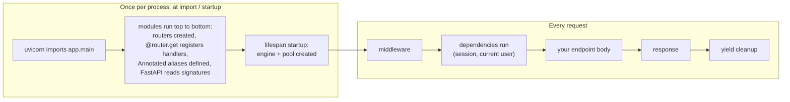
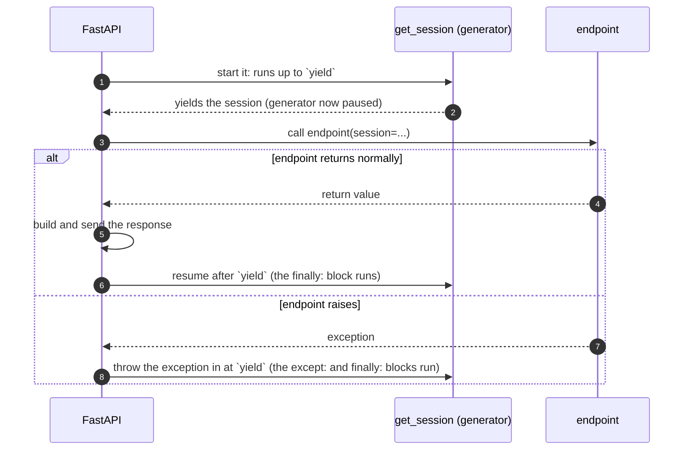
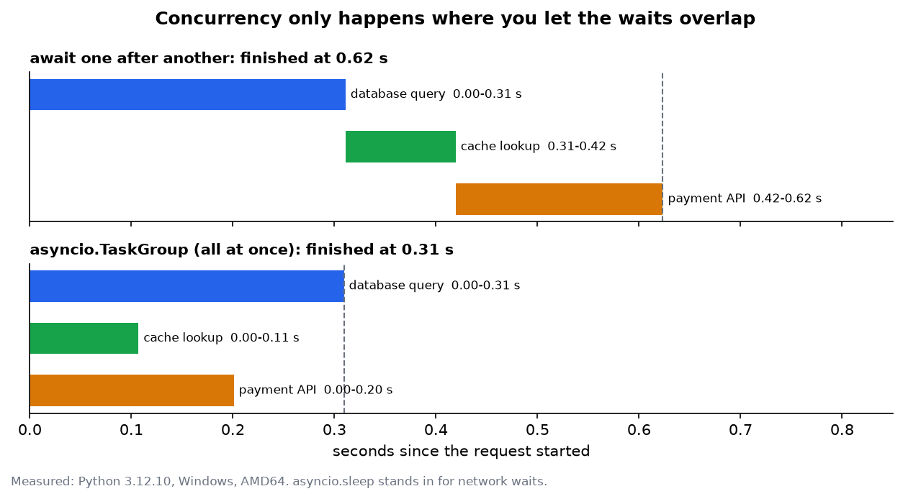
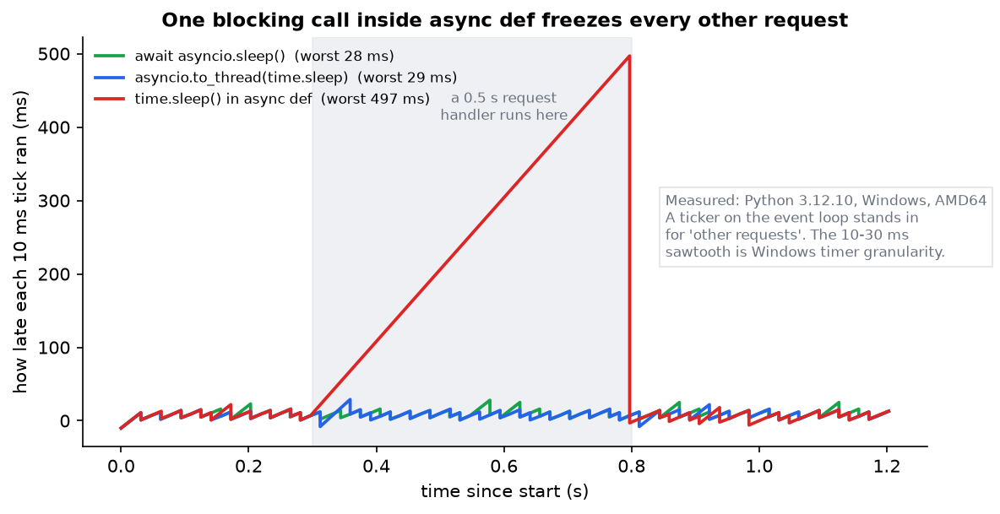

# Reading a Python Backend 1: The Python You Need

> **Series:** **Part 1 (this file)** · [Part 2: A Codebase Tour and One Request Traced](Reading%20a%20Python%20Backend%202%20-%20A%20Codebase%20Tour%20and%20One%20Request%20Traced.md) · [Part 3: Backend Concepts, Decisions and Unfamiliar Code](Reading%20a%20Python%20Backend%203%20-%20Backend%20Concepts%20Decisions%20and%20Unfamiliar%20Code.md) · [Folder index](README.md)
> **Source:** built from the official Python, FastAPI, Pydantic and SQLAlchemy documentation and from the installed library source code. Written against FastAPI 0.143 / Starlette 1.7 and **re-verified on the latest releases (FastAPI 0.162, Starlette 1.9, Pydantic 2.14, SQLAlchemy 2.1) on 24 October 2026**: every behaviour shown here was re-run and is unchanged. Every output block in this part is pasted from [python_for_backend.py](code/python_for_backend.py), run on Python 3.12. The current Python release is **3.15** (9 October 2026); §2.5 lists what 3.14 and 3.15 change for code readers. Figures come from [make_figs.py](images/make_figs.py) and are measured, not drawn.
> **Facts re-checked:** 24 October 2026.

**The big picture:** a Python backend is mostly ordinary Python. What makes it hard to read is a handful of language features: decorators, type hints that libraries *act on*, `yield`, `with`, `async`/`await`. Frameworks lean on these heavily, so a short file can do a lot without saying so. This part teaches exactly those features, each shown in the backend code where you will actually meet it.

---

## Contents

0. [How to use this guide](#0-how-to-use-this-guide)
1. [TL;DR](#1-tldr)
2. [How Python runs a project: modules, imports, packages](#2-how-python-runs-a-project-modules-imports-packages)
3. [Functions are objects: arguments, closures, decorators](#3-functions-are-objects-arguments-closures-decorators)
4. [Type hints that libraries act on](#4-type-hints-that-libraries-act-on)
5. [Classes as you meet them in backends](#5-classes-as-you-meet-them-in-backends)
6. [`with`, `yield` and the cleanup guarantee](#6-with-yield-and-the-cleanup-guarantee)
7. [async and await, properly](#7-async-and-await-properly)
8. [Exceptions as control flow](#8-exceptions-as-control-flow)
9. [Pydantic: parse, don't check](#9-pydantic-parse-dont-check)
10. [Small idioms that confuse new readers](#10-small-idioms-that-confuse-new-readers)
11. [Common misconceptions](#11-common-misconceptions)
12. [Self-check and decision drills](#12-self-check-and-decision-drills)
13. [Glossary](#13-glossary)
14. [References](#14-references)

---

## 0. How to use this guide

| If you have… | Read |
|---|---|
| 10 minutes | §0.1, §1 (TL;DR), the diagram in §2.2, and Figures 1 and 2 in §7 |
| 1 hour | §3 (decorators), §4 (type hints), §6 (`yield`) and §7 (async). These four explain 80% of "how does this framework code even work?" |
| A weekend | All of Part 1 with the demo script open beside you, then [Part 2](Reading%20a%20Python%20Backend%202%20-%20A%20Codebase%20Tour%20and%20One%20Request%20Traced.md), which tours a real codebase line by line |

**How this series fits with your other Python notes:**

| File | Role | When |
|---|---|---|
| `notes/py-dsa.md` | The Python object model (names are tags, mutability, hashability) and the STL ↔ stdlib mapping | Already done. §2.4 here builds on it |
| **This series (`target/py/`)** | **How to read and judge a whole backend.** The language features, a real runnable codebase, and the concepts that connect them | **Now** |
| `notes/py-backend.md` | Deeper notes on each backend concept (GIL, ASGI, Pydantic, DI, SQLAlchemy, JWT, Celery, Docker) | Alongside Part 2/3, as the "go deeper" reference |
| [Python Mastery for C++ Engineers](../Python%20Mastery%20for%20C%2B%2B%20Engineers%20-%20DSA%20and%20Backend%20Systems.md) | A practice gym: 26 two-minute drills, one mechanic each | After each section here, do the matching drill (each section names it) |

**Run the code as you read.** From the repository root:

```bash
py -3.12 target/py/code/python_for_backend.py
```

It needs FastAPI, Pydantic, SQLAlchemy, aiosqlite and greenlet. It runs offline with no keys. Your timings will differ a little; the shapes will not.

### 0.1 First, in completely plain words

Imagine walking into a busy restaurant kitchen for the first time. You can cook, but you don't know this kitchen. Things happen that you can't see the cause of. A ticket appears and three people move at once. A pan gets washed without anyone being told. Plates leave the pass already checked.

A Python backend feels the same. You read a ten-line function and it somehow gets the logged-in user, a database connection, and validated input. Nobody seems to call it, and nobody seems to close the connection afterwards. That's because the **framework** (FastAPI, Django, Flask) is the kitchen's system. It reads small signs you leave in the code and does the work for you:

- A line starting with `@` above a function (a **decorator**) is a sign saying "register this function, or wrap it with extra behaviour".
- A **type hint** like `user: CurrentUser` is not just documentation. FastAPI reads it and says "before calling this, find the current user and pass it in".
- A function that uses **`yield`** is a sign saying "set something up, pause while the real work happens, then clean up, no matter what".
- **`async def`** and **`await`** are signs saying "this work spends most of its time waiting, so let other requests run while it waits".

Once you can read these signs, framework code stops being magic. You can follow exactly what happens, in what order, and spot when something is wrong. That is what this part teaches. Part 2 then walks you through a whole real kitchen.

---

## 1. TL;DR

1. **Importing a module runs it.** Module-level code runs once per process, top to bottom. That is where apps, routers, engines and settings get created.
2. **A decorator is just `f = decorator(f)`.** `@app.get("/x")` is a function call that *registers* your function in a table. `@functools.wraps` keeps the wrapped function's name and signature, which frameworks rely on.
3. **Type hints do nothing in plain Python, but FastAPI, Pydantic and SQLAlchemy read them at runtime** and act on them. `Annotated[T, Depends(f)]` means "this is a T, and here's how to get one".
4. **`yield` inside a function makes a pause point.** A `yield` dependency or `@contextmanager` runs setup, pauses while your code runs, then runs cleanup in `finally:` even if your code raised.
5. **`async def` only helps if everything slow inside it is `await`ed.** One blocking call (`time.sleep`, `requests.get`, a sync DB driver) freezes *every* request on that worker. Measured in Figure 2: about 500 ms of freeze from one 0.5 s `time.sleep`.
6. **`def` endpoints run in a thread pool; `async def` endpoints run on the event loop.** Use `def` when you must call blocking code.
7. **Exceptions are how backends say "stop"**: a service raises `NotFound`, and one handler somewhere turns it into a 404.
8. **Pydantic parses input into typed objects** (and rejects junk with a 422) before your code runs. Response models filter output so secrets don't leak.

---

## 2. How Python runs a project: modules, imports, packages

### 2.1 The problem

In C++ there is a clear moment when code starts: `main()`. Global objects get built before it, in an order you mostly avoid relying on. In a Python backend you often can't find any `main()` at all. You run `uvicorn app.main:app` and things just exist. Where did the app come from?

### 2.2 Importing runs the file

When Python imports a module the first time, it **executes the file from top to bottom** and keeps the result in `sys.modules`. Later imports of the same module just return that stored module. They don't run it again.

So this line at the bottom of [main.py](code/shop_api/app/main.py):

```python
app = create_app()
```

runs exactly once per process, when Uvicorn does the equivalent of `from app.main import app`. `uvicorn app.main:app` reads as "import the module `app.main`, then take the attribute named `app` from it".

Things you'll see created at module level in real projects, and why:

| Module-level line | Why it's there |
|---|---|
| `app = FastAPI(...)` or `app = create_app()` | The server needs one object to send requests to |
| `router = APIRouter(prefix="/orders")` | Routes get attached to it as the file is imported |
| `log = logging.getLogger(__name__)` | One named logger per module (`__name__` is e.g. `"app.services"`) |
| `engine = create_async_engine(URL)` | One connection pool per process. (Our app creates it in `lifespan` instead, so the URL comes from the settings the app was *built* with. Tests can then pass a different database, and the pool is closed cleanly on shutdown. See Part 2 §5.1.) |
| `settings = Settings()` / `@lru_cache def get_settings()` | Read environment variables once |

> **Reading tip:** when a value "just exists", search for where it's assigned at module level. It was built during import.

Most of the confusion goes away once you separate the code that runs **once, at import** from the code that runs **on every request**:



*Left: things that happen once and are then shared by every request in that process. Right: things that happen again for every request. A bug that "only happens after a restart" usually lives on the left; a bug that "only happens under load" usually lives on the right.*

`if __name__ == "__main__":` guards code that should run only when the file is executed directly (`python file.py`), not when it's imported. Scripts like [trace_request.py](code/shop_api/trace_request.py) use it.

### 2.3 Packages and imports

A **package** is a folder of modules. The `__init__.py` file marks it as a package and runs when the package is imported. It's often empty.

```text
shop_api/
  app/
    __init__.py        # makes "app" a package
    main.py            # import as app.main
    routers/
      __init__.py
      orders.py        # import as app.routers.orders
```

Inside `app/routers/orders.py` you'll see **relative imports**:

```python
from ..deps import CurrentUser      # ".." = the parent package (app), then module deps
from ..schemas import OrderCreate
```

One dot is "this package", two dots is "the parent package". They only work inside a package, which is why you run `uvicorn app.main:app` from the `shop_api/` folder rather than running `python app/main.py`.

**Circular imports** are the classic Python backend error: `ImportError: cannot import name 'X' from partially initialized module`. It happens when `a.py` imports `b.py` and `b.py` imports `a.py`. Python is halfway through running `a.py` when `b.py` asks for something `a.py` hasn't defined yet. Typical fixes:

1. Move the shared thing to a third module both can import. Layered projects (Part 2) avoid most cycles because imports only point "down" the layers.
2. Import inside the function that needs it, so the import happens at call time.
3. For type hints only, use `from typing import TYPE_CHECKING` with `if TYPE_CHECKING: from .models import User`, plus quoted hints like `"User"`. (On Python 3.14+ the quotes are optional, see §2.5.)

### 2.4 Names are tags (a recap from py-dsa)

Everything from `notes/py-dsa.md` Node 1 applies in backends too:

- Assignment never copies.
- Lists and dicts are shared between every name that points to them.
- A module-level dict is shared by every request in that process.

That last point is the backend version of the backtracking bug. A module-level `cache = {}` is shared by **all concurrent requests in one worker**, but **not** between workers (each worker process has its own copy). Part 3 §5 comes back to this.

> **Practice:** Mastery guide, Mechanic 2 (in-place slice mutation) and Capstone 8.1 (RequestCache and pointer isolation).

### 2.5 What Python 3.14 and 3.15 change for a code reader

Most codebases you read today target Python 3.10–3.13, but new code is starting to use these features (checked against the official "What's New" pages, 24 Oct 2026):

| You may see | Version | What it means |
|---|---|---|
| Hints like `def f(u: User)` where `User` is defined *later* in the file, without quotes | 3.14 (PEP 649/749) | Annotations are now evaluated lazily, only when something asks for them, so forward references no longer need quotes. `from __future__ import annotations` opts back into the old "store everything as strings" behaviour, and you'll still see it everywhere in pre-3.14 code |
| `lazy import json` / `lazy from x import y` at the top of a module | 3.15 (PEP 810) | The module is loaded on first *use*, not at import. It's used to cut startup time. Only allowed at module level. Note that it changes §2.2's "importing runs the file" timing for that module |
| `t"SELECT * FROM t WHERE id = {uid}"` | 3.14 (PEP 750) | A *template string*: like an f-string, but it returns a `Template` object instead of a `str`, so a library can escape the interpolated parts safely (SQL, HTML, shell) |
| `except ValueError, TypeError:` without brackets | 3.14 (PEP 758) | Same as `except (ValueError, TypeError):` |
| `frozendict({...})` | 3.15 (PEP 814) | A built-in immutable, hashable dict. Usable as a dict key or set member |
| `open(path)` with no `encoding=` | 3.15 (PEP 686) | Now defaults to UTF-8 everywhere, including Windows. Older code that relied on the locale encoding can read files differently |

---

## 3. Functions are objects: arguments, closures, decorators

### 3.1 Arguments you'll see

```python
def create_engine(url, /, *, echo=False, **kwargs): ...
```

| Syntax | Meaning | Why backends use it |
|---|---|---|
| `x=5` | Default value | Optional query parameters: `limit: int = 20` |
| `*args` | Extra positional arguments, packed into a tuple | Wrappers that pass everything through |
| `**kwargs` | Extra keyword arguments, packed into a dict | Same, and config passthrough: `create_async_engine(url, **pool_options)` |
| `*` alone | Everything after it must be passed by name | Forces readable calls: `send(email, *, retry=True)` |
| `/` | Everything before it must be passed by position | Rare in app code; common in library signatures |
| `f(**d)` | Unpack a dict into keyword arguments | `User(**data.model_dump())` builds an ORM object from a schema |

**The mutable default trap.** A default value is created **once**, when the `def` line runs, not on each call:

```text
======== 8. The mutable-default-argument bug =========================
  add_tag('a') -> ['a']
  add_tag('b') -> ['a', 'b']  <- 'a' leaked from the previous call
  fixed: ['a'] ['b']
```

In a backend, that leak crosses between *requests*. The fix is `tags=None`, then `tags = [] if tags is None else tags`. Pydantic and dataclass fields (`Field(default_factory=list)`) handle this correctly for you.

> **Practice:** Mastery Paradigm 6 (signature boundaries `/`, `*`).

### 3.2 Closures

A function defined inside another function can use the outer function's variables, even after the outer function has returned. The inner function "closes over" them. Decorators and dependency factories are built from this.

```python
def require_role(role: str):
    def checker(user: CurrentUser):          # 'role' is captured from the outer call
        if user.role != role:
            raise Forbidden(f"{role} only")
        return user
    return checker

@router.delete("/x", dependencies=[Depends(require_role("admin"))])
```

> **Practice:** Mastery Paradigm 7 (closures and `nonlocal`).

### 3.3 Decorators: `@thing` is `f = thing(f)`

This is the feature that makes framework code look magic. It's just a function call.

```python
@app.get("/ping")
def ping(): ...
```

is *exactly* the same as:

```python
def ping(): ...
ping = app.get("/ping")(ping)
```

Read it in two steps. `app.get("/ping")` is called first and **returns a decorator**. That decorator is then called with `ping`. FastAPI's decorator stores `ping` in its route table and hands the same function back. The demo builds a tiny router to prove there's nothing else going on:

```text
======== 1. Decorators: how @app.get('/x') works =====================
registered routes: {('GET', '/ping'): 'ping'}
calling the handler the router found: {'pong': True}
  slow_add took 10.43 ms
slow_add(2, 3) = 5
name kept by functools.wraps: slow_add | signature: (a: int, b: int) -> int
```

There are two kinds of decorator. Learn to tell them apart, because they behave differently:

| Kind | What it returns | Examples |
|---|---|---|
| **Registering** | The original function, unchanged; it records it somewhere | `@app.get`, `@router.post`, `@celery_app.task`, `@pytest.fixture`, `@app.exception_handler` |
| **Wrapping** | A new function that calls the original with extra behaviour around it | `@lru_cache`, `@timed`, `@retry`, `@login_required` (Flask/Django), `@field_validator` |

**Why `@functools.wraps` matters in backends.** FastAPI builds the request handling from the endpoint's **signature**. A wrapper written as `def wrapper(*args, **kwargs)` without `@wraps` hides that signature. FastAPI then sees the wrapper's own parameters instead, and reads `args` and `kwargs` as **two required query parameters**. Measured on FastAPI 0.162, an endpoint `limit: int = 5` wrapped this way answered `GET /a?limit=7` with:

```text
422 {"detail":[{"type":"missing","loc":["query","args"],"msg":"Field required",...},{"type":"missing","loc":["query","kwargs"],...}]}
```

With `@functools.wraps(func)` on the wrapper, the same request returns `200 {"limit":7}`. `wraps` copies the name and docstring, and sets `__wrapped__`, which `inspect.signature` follows back to the original. If a decorated endpoint suddenly demands `args` and `kwargs`, check for a missing `@wraps`. (The wrapper must also be `async def` if the endpoint is, so it can `await` it.)

**Stacked decorators apply bottom-up:**

```python
@router.get("/report")   # 2. registers the cached version
@lru_cache               # 1. wraps report first
def report(): ...
```

> **Practice:** Mastery Paradigm 1 (async route guard with `functools.wraps`) and Paradigm 10 (`lru_cache`).

---

## 4. Type hints that libraries act on

### 4.1 The problem

In C++ a type is enforced by the compiler. In Python, `def f(x: int)` does **not** stop you passing a string. Plain Python ignores hints at runtime. So why does FastAPI return a 422 error when a client sends `"abc"` for an `int` parameter?

### 4.2 Hints are data that libraries read

Python stores the hints on the function. Any library can read them at runtime with `inspect.signature()` and `typing.get_type_hints()`. FastAPI does this **once per route at startup** and builds a plan from what it finds. The demo does the same reading for a sample endpoint:

```text
======== 2. How FastAPI reads your function signature ================
  order_id  int                                path parameter (its name appears in the URL '/orders/{order_id}')
  data      Body                               request body (a model class)
  db        Annotated[str, Depends(get_db)]    dependency -> run Depends(get_db) first
  limit     int                                query parameter, default=20
FastAPI does this once at startup, not on every request.
```

FastAPI's rules for "where does this parameter come from?":

| Parameter looks like… | FastAPI gets it from… |
|---|---|
| Its name appears in the path, like `{order_id}` | The URL path, converted to the hinted type |
| Hint is a Pydantic model | The JSON body |
| Hint is a simple type (`int`, `str`, `bool`, `float`) and not in the path | The query string `?limit=5` |
| `Annotated[list[str], Query()]` | Repeated query keys `?tags=a&tags=b`. **Without `Query()`, a `list[str]` parameter is read from the JSON body**; measured: `GET /c?tags=x&tags=y` returned `422 ... "loc":["body"]` |
| `Annotated[T, Depends(f)]` | Calls `f` (and *its* dependencies) and passes the result |
| `Annotated[int, Query(ge=1, le=100)]` | The query string, with extra validation |
| `Annotated[str, Header()]`, `Cookie()`, `Form()`, `File()` | That part of the request |
| `Request`, `Response`, `BackgroundTasks` | FastAPI passes the object itself |

### 4.3 The hint syntax you'll see

| Hint | Read it as |
|---|---|
| `int \| None` (old style: `Optional[int]`) | "an int, or None". `None` is Python's null |
| `list[str]`, `dict[str, int]`, `tuple[int, str]` | Containers of those types |
| `Annotated[T, extra]` | "a T, plus extra information for whoever is reading". Python ignores `extra`; FastAPI and Pydantic use it |
| `T = TypeVar("T")`, `class Page(BaseModel, Generic[T])` | A generic, like a C++ template. `Page[OrderOut]` is a page of orders |
| `Mapped[int]` (SQLAlchemy) | "a column holding an int". SQLAlchemy reads it to build the table |
| `Callable[[int], str]` | A function taking an int and returning a str |
| `Literal["asc", "desc"]` | Only these exact values are allowed; FastAPI validates them |
| `"User"` in quotes | A forward reference, for a class defined later or imported only for type checking (quotes optional from 3.14, §2.5) |

**Type aliases are how modern FastAPI code stays short.** In [deps.py](code/shop_api/app/deps.py):

```python
SessionDep  = Annotated[AsyncSession, Depends(get_session)]
CurrentUser = Annotated[User, Depends(get_current_user)]
```

So an endpoint that says `user: CurrentUser` *means* "run `get_current_user`, which itself needs a session, and give me the `User` it returns". When you see an unfamiliar type name in a signature, jump to its definition. It's often one of these aliases.

### 4.4 Protocol: duck typing with a contract

A `Protocol` describes the methods something must have, without requiring inheritance. It's like a C++20 concept. A type checker such as mypy checks it; at runtime nothing is enforced. Backends use it to describe "anything that can store users", so tests can pass a fake:

```text
======== 9. Protocol: duck typing you can type-check =================
  with a fake store: hello ada@example.com | who are you?
```

`FakeStore` never inherits from `UserStore`. It just has the right method.

> **Practice:** Mastery Paradigm 9 (`singledispatch`) shows a related idea: picking behaviour by type.

---

## 5. Classes as you meet them in backends

You know classes from C++. The surprises:

| Python | C++ equivalent | Backend use |
|---|---|---|
| `self` is explicit; every method lists it first | `this` | Everywhere |
| `__init__(self, session)` | Constructor | Services and repositories store their session |
| Class attributes: `status_code = 404` written in the class body | `static` members | Error classes, `__tablename__` |
| `@classmethod def f(cls, ...)` | Static factory that knows its class | Pydantic validators, `Model.from_row(...)` |
| `@staticmethod` | Static function | Rare; often a plain function would do |
| `@property def total(self)` | Getter called like a field | Derived values: `order.total` |
| `__call__(self, ...)` | `operator()` | **Class-based dependencies**: `Depends(RequireRole(["admin"]))` (see `py-backend.md` Node 6) |
| `class NotFound(DomainError)` | Inheritance | Error hierarchies, and `Base` for ORM models |
| No `private`; `_name` is "internal by convention" | `private` | `_hasher` in [security.py](code/shop_api/app/security.py) |

**Three kinds of "data class" look alike but do very different jobs.** Mixing them up is a common source of confusion:

| | `@dataclass` | Pydantic `BaseModel` | SQLAlchemy model (`Base`) |
|---|---|---|---|
| Purpose | Plain data container | **Validate and convert** untrusted input; serialise output | **Map a table**: each instance is a row |
| Checks types at runtime? | No | Yes, and converts `"3"` → `3` | No (the database enforces constraints) |
| Lives in | `domain/`, internal code | `schemas.py` | `models.py` |
| Example | `Money(amount, currency)` | `OrderCreate`, `UserOut` | `User`, `Order` |

A real codebase usually has **both** a `User` model and a `UserOut` schema. That's not duplication. One describes the database, the other describes the API, and the gap between them (for example `password_hash`) is deliberate.

> **Practice:** Mastery Mechanic 9 (reflection with `getattr`/`setattr`). That's how ORMs and Pydantic's `from_attributes` read fields.

---

## 6. `with`, `yield` and the cleanup guarantee

### 6.1 The problem

A request opens a database session and then the code raises an exception halfway through. In C++, a destructor runs during stack unwinding and releases the resource (RAII). Python has no deterministic destructors you can rely on. If cleanup isn't guaranteed, connections leak until the pool runs out and the whole service hangs.

### 6.2 `with` is Python's RAII

```python
with open("f.txt") as f:      # f.__enter__() runs here
    data = f.read()
# f.__exit__() runs here, ALWAYS, even if read() raised
```

The easiest way to write your own context manager is a generator with one `yield`:

```python
@contextmanager
def transaction(name):
    print(f"BEGIN {name}")
    try:
        yield                     # the body of the `with` block runs here
    except Exception as e:
        print(f"ROLLBACK {name} because: {e}")
        raise                     # re-raise: don't swallow the caller's error
    else:
        print(f"COMMIT {name}")
```

```text
======== 4. Context managers: Python's RAII ==========================
  BEGIN t1
  ...work in t1
  COMMIT t1
  BEGIN t2
  ROLLBACK t2 because: stock went negative
  caller still sees the ValueError
```

`async with` is the same idea for async resources (`__aenter__`/`__aexit__`, or `@asynccontextmanager`). You'll see `async with sessionmaker() as session:`, `async with httpx.AsyncClient() as client:` and `async with engine.begin() as conn:`.

### 6.3 A `yield` dependency *is* a context manager

FastAPI turns every dependency that uses `yield` into a context manager and enters it in a per-request **exit stack**. To make that concrete, the demo builds a 40-line `Depends()` resolver. It handles `yield`, caches each dependency once per request, and cleans up in reverse order:

```text
======== 3. A 40-line Depends(): yield, caching, cleanup order =======
  request 1 (succeeds):
    open session
    load user using SESSION
    build service using SESSION
    endpoint runs with user=ada, svc=OrderService
    close session
    response: {'ok': True}
  request 2 (endpoint raises):
    open session
    load user using SESSION
    build service using SESSION
    endpoint runs with user=ada, svc=OrderService
    close session
    exception reached the caller: boom
```

The life of one request through a `yield` dependency, step by step:



*A paused generator is what makes "setup, then your code, then cleanup" possible in one function. FastAPI keeps it paused for the whole request and resumes it at the end. With the default `scope="request"`, that resumption happens after the response is sent (Part 2 §4.3).*

Three things to notice. Each holds in real FastAPI too; Part 2 §4 shows the same thing in the real app.

1. **Caching.** `get_user` and `get_service` both need the session, but it's opened **once**. Within one request, a dependency runs once and its result is shared (FastAPI: `use_cache=True` by default).
2. **Order.** Dependencies are solved recursively: a dependency's own dependencies run first. Cleanup runs in **reverse** order after the endpoint.
3. **Exceptions don't skip cleanup.** In request 2 the endpoint raised, yet "close session" still ran.

> **Correction to `py-backend.md` Node 5:** `await AsyncSessionLocal()` is not valid. A sessionmaker returns a session object, not something you await. The correct form is `async with AsyncSessionLocal() as session:`, as in [db.py](code/shop_api/app/db.py).

> **Practice:** Mastery Paradigms 2, 4, 5 and 11. Paradigm 11 (`gen.throw`) shows how an exception is pushed *into* a paused generator, which is how the `except` in a `yield` dependency sees the endpoint's error.

---

## 7. async and await, properly

### 7.1 The problem

A web request spends almost all its time **waiting**: for the database, a cache, another API. One OS thread per request wastes memory and switching time when you have thousands of connections. Python's answer is **one thread running many requests**, switching between them whenever one is waiting.

### 7.2 The pieces

| Term | Plain meaning |
|---|---|
| `async def f()` | Defines a **coroutine function**. Calling `f()` returns a coroutine object; **the body does not run yet** |
| `await x` | "Run `x`; if it has to wait, pause me and let the event loop run something else" |
| **Event loop** | The scheduler: one loop per thread, deciding which paused coroutine to resume next |
| **Task** | A coroutine the loop is running in the background (`asyncio.create_task`) |
| `asyncio.gather(a, b, c)` | Run several awaitables concurrently and wait for all of them |
| `asyncio.TaskGroup` (3.11+) | Same, but if one fails the others are cancelled. The modern, safer form |
| `asyncio.to_thread(f, ...)` | Run a **blocking** function in a thread, and await its result |

**Concurrency only happens at `await`.** Three 0.2 s waits, done two ways:

```text
======== 5. async/await: sequential vs concurrent, and blocking the loop 
  sequential      ['db', 'cache', 'api']  0.64 s
  concurrent      ['db', 'cache', 'api']  0.21 s
  with_taskgroup  ['db', 'cache', 'api']  0.21 s
  without await you get: coroutine - the function body never ran
```



*Figure 1 (measured). The same three waits, two ways. With `await` one after another, each starts only when the previous one ends, so the total is the **sum** (0.62 s). In a `TaskGroup` they all start at once, and the event loop switches between them while each waits, so the total is the **longest one** (0.31 s). There's still only one thread: the overlap comes purely from waiting at the same time.*

Reading tip: in code review, `x = await a(); y = await b()` means *one after another*. If `a` and `b` don't depend on each other, `gather` or a `TaskGroup` would make them concurrent. And a call to an `async def` function **without** `await` does nothing at all. Python warns "coroutine was never awaited", which is easy to miss in logs.

### 7.3 Where async does *not* help

`async` is not "faster". It only helps when the work is **waiting on I/O**. CPU-heavy work (resizing images, hashing passwords, big JSON) still occupies the single thread. With the standard GIL build, threads don't help CPU work either:

```text
======== 11. Threads: fine for waiting, useless for CPU (with the GIL) 
  CPU work: 4 in a row 0.51 s | 4 threads 0.50 s
  I/O wait: 4 in a row 0.80 s | 4 threads 0.20 s
  (Python 3.12.10, GIL enabled: True)
```

Four threads of CPU work took the same time as running them one after another. Four threads of waiting finished 4× faster.

> **Update (verified 24 Oct 2026):** Python 3.13 added an optional *free-threaded* build without the GIL (PEP 703). Python 3.14 made it officially supported (PEP 779), with single-threaded code running about 5–10% slower in that build. Python 3.15 added a stable ABI for free-threaded extensions (PEP 803), and its official macOS installer includes the free-threaded build by default. It's still a **separate build** (`python3.14t`, `python3.15t`), and many C extensions are still catching up. Every standard deployment you'll read today assumes the GIL. CPU parallelism in backends still comes from **multiple processes** (workers, Celery) or native code that releases the GIL.

### 7.4 The cardinal sin, measured

One blocking call inside `async def` stops the event loop, so **every** request on that worker waits:



*Figure 2 (measured). A ticker that should run every 10 ms stands in for "all the other requests". At 0.3 s a handler starts that waits 0.5 s. Written with `await asyncio.sleep` (green) or `asyncio.to_thread(time.sleep)` (blue), the ticker carries on. Written with `time.sleep` inside `async def` (red), the ticker is frozen for the whole 0.5 s. The small 10–30 ms sawtooth on every line is the Windows timer, not blocking.*

The demo prints the same thing as numbers:

```text
  ping answered    0.0 ms late while a 'good' handler ran
  ping answered  491.2 ms late while a 'bad' handler ran
  ping answered    0.0 ms late while a 'offloaded' handler ran
```

**FastAPI's rule** (`py-backend.md` Node 1, confirmed in the FastAPI docs):

| You write | FastAPI runs it | So inside it you may… |
|---|---|---|
| `async def endpoint()` | Directly on the event loop | Only `await` non-blocking libraries (`httpx.AsyncClient`, `asyncpg`, `redis.asyncio`, `aiosqlite`) |
| `def endpoint()` | In a worker thread pool | Call blocking libraries (`requests`, `psycopg2`, `open().read()`, `time.sleep`) |

The same rule applies to **dependencies**: a plain `def` dependency also runs in the thread pool.

### 7.5 ContextVar: per-request "globals"

Logging needs the current request's id everywhere, but passing it through every function is noise. A plain global would be overwritten by whichever request ran last. A `ContextVar` gives each asyncio task its own value:

```text
======== 6. ContextVar: per-request 'globals' ========================
  [req-A] start
  [req-B] start
  [req-B] end (still my own id after other requests ran)
  [req-A] end (still my own id after other requests ran)
```

[middleware.py](code/shop_api/app/middleware.py) uses exactly this, so every log line in Part 2's trace carries its request id.

> **Practice:** Mastery Paradigm 3 (async generators for streaming) and Paradigm 12 (`TaskGroup` and `to_thread`).

---

## 8. Exceptions as control flow

C++ codebases often avoid exceptions. Python backends use them constantly, on purpose. The pattern in [errors.py](code/shop_api/app/errors.py) and [services.py](code/shop_api/app/services.py):

1. **Services raise domain exceptions** that know nothing about HTTP: `raise NotFound("order 7 not found")`.
2. **One registered handler** turns every `DomainError` into a status code and a single JSON error shape.
3. **Routes stay clean**: no `if result is None: return 404` everywhere.

Syntax worth recognising:

```python
try:
    await session.commit()
except IntegrityError:                     # catch a specific type, never a bare `except:`
    await session.rollback()
    raise Conflict("email already registered") from None   # hide the low-level cause
else:
    ...                                    # runs only if no exception happened
finally:
    ...                                    # runs no matter what
```

- `raise X from e` keeps the original error attached as the cause (shown in tracebacks as "The above exception was the direct cause…").
- `from None` deliberately hides it.
- `HTTPException(status_code=404, detail=...)` is FastAPI's built-in "stop and return this status". You'll see it in many codebases instead of custom domain errors. It's fine for small apps, but it couples your business logic to HTTP.

> **Practice:** Mastery Mechanic 14 (exception chaining and domain error hierarchies).

---

## 9. Pydantic: parse, don't check

**The idea:** convert untrusted input into a typed object **once**, at the edge. After that, all code can trust it. Compare this with scattering `if "email" not in data` checks everywhere, which is the "before" picture in `py-backend.md` Node 3.

```text
======== 7. Pydantic: parse, validate, coerce, dump ==================
  '3' coerced to int: item='pen' quantity=3
  rejected ('item',): String should have at least 1 character
  rejected ('quantity',): Input should be a valid integer, unable to parse string as an integer
  strict mode refuses '3': Input should be a valid integer
  UserOut from an object: {'id': 1, 'email': 'ada@example.com'} <- no password_hash
```

The Pydantic v2 vocabulary you'll read:

| You see | It means |
|---|---|
| `class X(BaseModel): a: int = Field(gt=0)` | A schema with constraints. In FastAPI, failures become HTTP **422** automatically |
| `@field_validator("email")` + `@classmethod` | Custom check or cleanup for one field; return the cleaned value |
| `@model_validator(mode="after")` | A check across several fields (e.g. `end > start`) |
| `X.model_validate(obj)` | Parse a dict or object into `X` (v1 name: `parse_obj`) |
| `x.model_dump()` / `x.model_dump_json()` | To dict / JSON (v1 names: `.dict()` / `.json()`) |
| `model_config = ConfigDict(from_attributes=True)` | Allow reading attributes off any object, e.g. an ORM row (v1: `orm_mode = True`) |
| `ConfigDict(strict=True)` | Turn off coercion: `"3"` is rejected for an `int` |
| `BaseSettings` (from `pydantic-settings`) | A schema filled from environment variables. See [config.py](code/shop_api/app/config.py) |

> **Correction to `py-backend.md` Node 7:** `product.dict()` is the Pydantic **v1** method. In v2 it's `product.model_dump()`; `.dict()` still works but is deprecated. Also, an ORM object has no `.dict()` at all. Convert it through a schema: `ProductOut.model_validate(product).model_dump()`.

**Version tell:** if you see `class Config:` inside a model, `orm_mode`, `@validator` or `.dict()`, the code was written for Pydantic v1. You'll still meet it in older codebases.

---

## 10. Small idioms that confuse new readers

| Code | What it does |
|---|---|
| `[o.id for o in orders if o.paid]` | List comprehension: build a list in one expression |
| `(x for x in rows)` | Generator expression: lazy, items computed on demand |
| `{**defaults, **overrides}` | Merge dicts; the right side wins (Mastery Mechanic 1) |
| `first, *rest = items` | Unpack: `rest` gets everything after the first |
| `if (user := await repo.get(id)) is None:` | Walrus: assign and test in one line (Mastery Mechanic 4) |
| `match event: case {"type": "paid", "id": i}: ...` | Structural pattern matching on shapes (Mastery Mechanic 13) |
| `x or default` | `x` if it's truthy, else `default`. Careful: `0`, `""` and `[]` are falsy too |
| `getattr(obj, "name", None)` | Read an attribute by string name, with a fallback |
| `_unused`, `_admin: AdminUser` | Leading underscore: "I need this for its side effect, not its value". In our app, `_admin` exists only to force the admin check |
| `__all__ = [...]` | What `from module import *` exports; also a hint about the public API |
| `# noqa: F401`, `# type: ignore` | Silence a linter or type checker on this line, usually for a deliberate reason |
| `@lru_cache` / `@cache` on a function with no args | A lazy singleton: compute once, reuse forever (`get_settings`) |

---

## 11. Common misconceptions

| Belief | Reality |
|---|---|
| "Type hints are just comments." | Python ignores them, but FastAPI, Pydantic and SQLAlchemy read them at runtime and change behaviour. Removing a hint can break an endpoint. |
| "`async def` makes code faster." | It makes *waiting* overlap. CPU work and blocking calls inside it make things worse (Figure 2). |
| "A decorator changes the function's code." | It replaces the *name* with whatever the decorator returns. Registering decorators return the original function untouched. |
| "If an exception is raised, cleanup is skipped." | `finally:`, `with` and `yield` dependencies run cleanup on the way out. |
| "Module-level variables are per request." | They're per **process**: shared by every request in that worker, and *not* shared across workers. |
| "Pydantic models and ORM models are the same thing." | One validates API data, the other maps table rows. Keeping them separate is a security feature. |
| "Threads give Python parallelism." | Only for waiting (I/O). For CPU work, use processes, while the standard build has a GIL. |

---

## 12. Self-check and decision drills

<details>
<summary><b>Q1.</b> What does <code>@router.get("/orders")</code> literally evaluate to, step by step?</summary>

`router.get("/orders")` is called first and returns a decorator function. That decorator is called with your endpoint function. It records `(GET, /orders) → endpoint` in the router's route list and returns the endpoint unchanged. So `endpoint = router.get("/orders")(endpoint)`.
</details>

<details>
<summary><b>Q2.</b> An endpoint is <code>async def</code> and calls <code>requests.get(url, timeout=3)</code>. Production p99 latency for <em>every</em> endpoint jumps whenever that URL is slow. Why, and what are the two fixes?</summary>

`requests` is blocking, so the event loop thread is stuck for up to 3 s and every other request on that worker waits (Figure 2). Fix A: use `httpx.AsyncClient` and `await` it. Fix B: make the endpoint a plain `def`, so FastAPI runs it in the thread pool. A third option is `await asyncio.to_thread(requests.get, url, timeout=3)`.
</details>

<details>
<summary><b>Q3.</b> Two dependencies of the same endpoint both declare <code>session: SessionDep</code>. How many sessions are opened?</summary>

One. Within a single request FastAPI caches each dependency's result (`use_cache=True` by default), so both get the same session. The demo in §6.3 and the trace in Part 2 both show "opened a session" exactly once.
</details>

<details>
<summary><b>Q4.</b> You add a timing decorator to an endpoint, and suddenly every call returns 422 complaining that query parameters <code>args</code> and <code>kwargs</code> are missing. What did you forget?</summary>

`@functools.wraps(func)` on the wrapper. Without it, FastAPI inspects `wrapper(*args, **kwargs)` instead of the real signature, and treats `args` and `kwargs` as required query parameters (§3.3 shows the measured response).
</details>

<details>
<summary><b>Q5.</b> Why does <code>x = fetch_user(1)</code> (with <code>fetch_user</code> being <code>async def</code>) not hit the database?</summary>

Calling a coroutine function only creates a coroutine object. Nothing runs until it's awaited (or scheduled as a task). You need `x = await fetch_user(1)`.
</details>

**Decision drills.** Commit to an answer before opening each one.

<details>
<summary><b>D1.</b> You must call a vendor SDK that only has a synchronous client, from a FastAPI service that is otherwise fully async. Options: (a) make that endpoint <code>def</code>; (b) keep <code>async def</code> and wrap the call in <code>asyncio.to_thread</code>; (c) write your own async HTTP client for the vendor API.</summary>

The questions that decide it: does the endpoint also `await` other async things? How many concurrent calls do you expect? And is maintaining your own client worth it?

- If the endpoint only calls the SDK, **(a)** is simplest and correct.
- If it mixes async DB calls with the SDK call, **(b)** keeps the async parts on the loop and offloads only the blocking part.
- **(c)** is worth it only if this call is very hot and the thread pool (40 threads by default in AnyIO) becomes the bottleneck.
</details>

<details>
<summary><b>D2.</b> A teammate puts <code>_cache: dict = {}</code> at module level to cache user profiles. What two questions do you ask in review?</summary>

1. **"Is it bounded?"** An unbounded dict is a memory leak with a slow fuse. Use `lru_cache(maxsize=...)`, `cachetools.TTLCache`, or Redis.
2. **"What happens with several workers and several pods?"** Each process has its own copy, so invalidating it in one worker leaves stale data in the others. If staleness matters, the cache belongs in Redis.
</details>

---

## 13. Glossary

| Term | Meaning |
|---|---|
| **ASGI** | The async interface between a Python web server (Uvicorn) and an app (FastAPI): `async def app(scope, receive, send)` |
| **Context manager** | An object usable with `with`; guarantees setup and cleanup |
| **Coroutine** | The object an `async def` call returns; runs when awaited |
| **Decorator** | A callable applied with `@` that receives a function and returns a replacement (or the same function) |
| **Dependency (FastAPI)** | A function FastAPI calls to produce a parameter value for an endpoint |
| **Event loop** | The single-threaded scheduler that runs coroutines and switches between them at `await` |
| **GIL** | Global Interpreter Lock: in standard CPython, only one thread runs Python bytecode at a time |
| **Module-level** | Code at the top level of a file; runs once, when the module is first imported |
| **Protocol** | A structural interface: anything with the right methods matches, no inheritance needed |
| **Schema** | A Pydantic model describing API data |
| **Type hint** | An annotation like `x: int`; ignored by Python itself, read by libraries |

## 14. References

- Python docs: [Data model](https://docs.python.org/3/reference/datamodel.html), [`contextlib`](https://docs.python.org/3/library/contextlib.html), [`asyncio` tasks and TaskGroup](https://docs.python.org/3/library/asyncio-task.html), [`contextvars`](https://docs.python.org/3/library/contextvars.html), [`typing`](https://docs.python.org/3/library/typing.html). Checked 24 Oct 2026.
- [What's New in Python 3.14](https://docs.python.org/3/whatsnew/3.14.html) (deferred annotations, template strings, free-threading supported) and [What's New in Python 3.15](https://docs.python.org/3.15/whatsnew/3.15.html) (lazy imports, `frozendict`, UTF-8 default; released 9 Oct 2026).
- FastAPI docs: [Query parameters and string validations](https://fastapi.tiangolo.com/tutorial/query-params-str-validations/) (lists need `Query()`).
- [PEP 703](https://peps.python.org/pep-0703/) (making the GIL optional) and [PEP 779](https://peps.python.org/pep-0779/) (free-threaded Python officially supported in 3.14).
- FastAPI docs: [Dependencies with yield](https://fastapi.tiangolo.com/tutorial/dependencies/dependencies-with-yield/) (including the `scope` parameter) and [Concurrency and async/await](https://fastapi.tiangolo.com/async/). Checked 23 Oct 2026.
- Pydantic v2 docs: [Models](https://docs.pydantic.dev/latest/concepts/models/), [Validators](https://docs.pydantic.dev/latest/concepts/validators/), [Migration guide v1 → v2](https://docs.pydantic.dev/latest/migration/).
- Library source read directly: `fastapi/dependencies/utils.py` (`solve_dependencies`: recursive, with a per-request `dependency_cache`) and `starlette/routing.py` (`Router.app`: first full match wins), FastAPI 0.143 / Starlette 1.7, re-checked unchanged in FastAPI 0.162 / Starlette 1.9.
