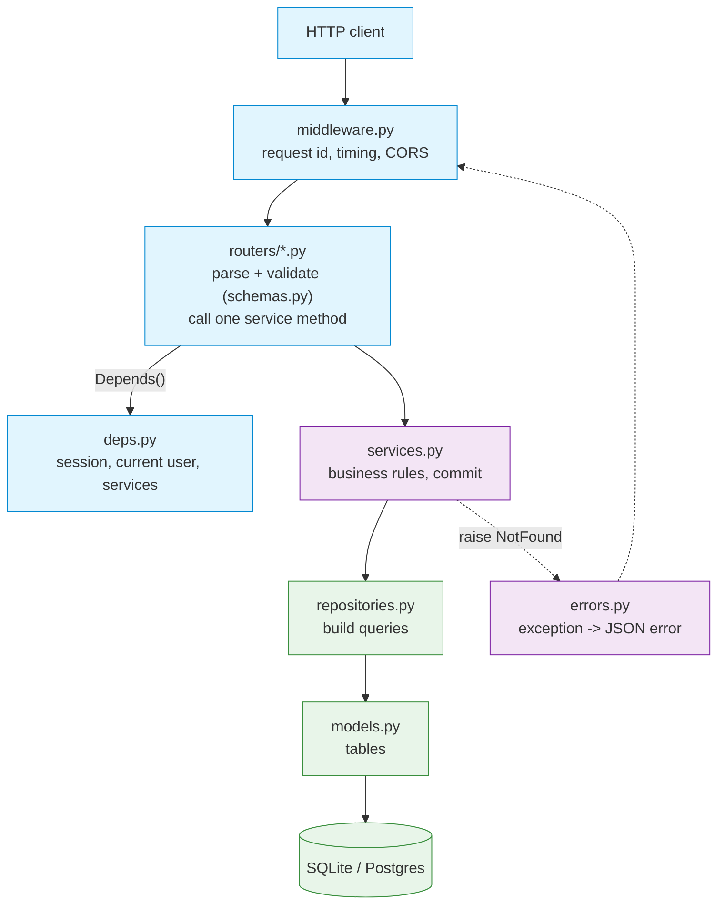
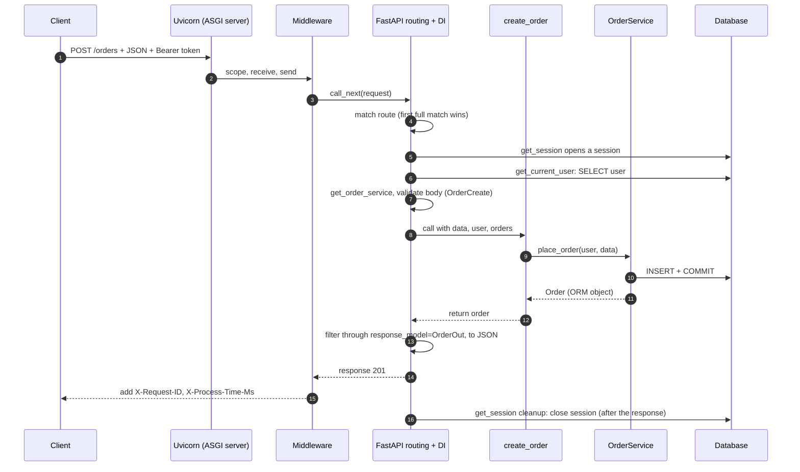
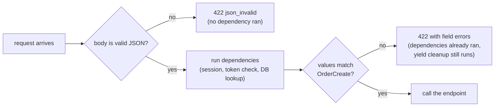
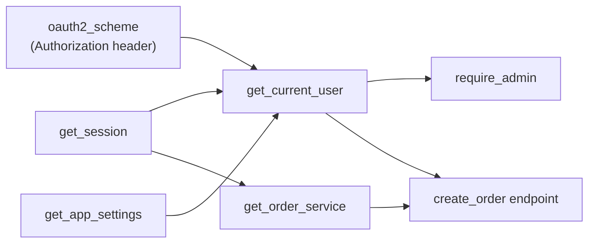

# Reading a Python Backend 2: A Codebase Tour and One Request Traced

> **Series:** [Part 1: The Python You Need](Reading%20a%20Python%20Backend%201%20-%20The%20Python%20You%20Need.md) · **Part 2 (this file)** · [Part 3: Backend Concepts, Decisions and Unfamiliar Code](Reading%20a%20Python%20Backend%203%20-%20Backend%20Concepts%20Decisions%20and%20Unfamiliar%20Code.md) · [Folder index](README.md)
> **Source:** the runnable app in [code/shop_api/](code/shop_api/README.md). It has 11 passing tests and was written for this guide in the layout real FastAPI projects use. Every output block is pasted from a real run (Python 3.12, FastAPI 0.143, Starlette 1.7, SQLAlchemy 2.1, Pydantic 2.14). **Re-run on the latest releases (FastAPI 0.162, Starlette 1.9, SQLAlchemy 2.1.6) on 24 October 2026:** the tests pass, and the trace, the route-order trap and the missing-`response_model` leak all behave exactly as shown. Only the timings differ.
> **Facts re-checked:** 24 October 2026.

**The big picture:** reading a backend isn't reading files in alphabetical order. You find the entry point, draw the layer map, then **follow one request** from the socket to the database and back. Once you've traced one request, every other endpoint is a variation on it. This part does exactly that, on a small app you can run and break.

---

## Contents

0. [How to use this part](#0-how-to-use-this-part)
1. [TL;DR](#1-tldr)
2. [Run it first](#2-run-it-first)
3. [The map: folders, layers and the import rule](#3-the-map-folders-layers-and-the-import-rule)
4. [One request, traced end to end](#4-one-request-traced-end-to-end)
5. [File by file: what each piece does and what to look for](#5-file-by-file-what-each-piece-does-and-what-to-look-for)
6. [Tests are the best documentation](#6-tests-are-the-best-documentation)
7. [Exercises: change it, break it, predict it](#7-exercises-change-it-break-it-predict-it)
8. [Common misconceptions](#8-common-misconceptions)
9. [Self-check and decision drills](#9-self-check-and-decision-drills)
10. [Glossary](#10-glossary)
11. [References](#11-references)

---

## 0. How to use this part

| If you have… | Read |
|---|---|
| 10 minutes | §0.1, §3.2 (the layer diagram) and §4.1 (the trace output) |
| 1 hour | §2 to §4: run the app, learn the map, follow the trace line by line |
| A weekend | Everything, with the code open, then do the exercises in §7 before moving to Part 3 |

### 0.1 First, in completely plain words

Think of a well-run restaurant again, but now you're the new manager reading how it works.

- **The front door** (`main.py`) is where every customer enters. It tells you which sections of the restaurant exist (the *routers*), who greets everyone at the door (the *middleware*), and what gets set up before opening and packed away after closing (the *lifespan*).
- **The waiters** (`routers/`) take an order, check it's a real order, and pass it to the kitchen. They don't cook.
- **The chefs** (`services.py`) know the recipes: the business rules. They don't run to the storeroom themselves.
- **The storekeeper** (`repositories.py`) is the only person who goes into the storeroom (the *database*).
- **The rules on the wall** (`schemas.py`) say what a valid order looks like, and what a plate going out may contain.
- **The cloakroom attendant** (`deps.py`) hands each waiter exactly what they need for this customer (the customer's identity, a storeroom key) and takes it back afterwards.

If you can say who does what, you can read any backend, because almost all of them are some version of this restaurant. Some merge the waiter and the chef; some skip the storekeeper. Part 3 shows those variations.

---

## 1. TL;DR

1. **Open `main.py` first** (or wherever the `FastAPI()` / `Flask()` / Django `settings` object is). It lists routers, middleware, startup work and error handlers.
2. **Layers point one way:** routers → services → repositories → models. Schemas sit at the HTTP edge. If a router builds SQL, or a repository raises `HTTPException`, the layering is leaking.
3. **Trace one request.** The real order, measured in §4: middleware → dependencies (session, auth, service) → body validation → endpoint → service → repository → SQL → commit → response serialisation → middleware → **cleanup after the response is sent**.
4. **Each dependency runs once per request** and is shared, so the session is opened once even though two other dependencies need it.
5. **Dependencies run before the body's *values* are checked.** A body with invalid values still costs you a token check and a database query, then returns 422. (Malformed JSON is rejected earlier, before any dependency runs.)
6. **Route order matters.** Starlette tries routes in the order they were added; `/users/{user_id}` registered before `/users/me` turns "me" into a 422.
7. **The tests show how the app is meant to be used.** Read them early.

---

## 2. Run it first

From `target/py/code/shop_api`:

```bash
py -3.12 -m pytest -q
```

```text
...........                                                              [100%]
11 passed in 2.31s
```

```bash
py -3.12 -m uvicorn app.main:app --reload
```

Then open `http://127.0.0.1:8000/docs`. FastAPI generated that page from your type hints and Pydantic schemas (OpenAPI). Try it:

1. `POST /auth/register` with `{"email": "ada@example.com", "password": "correct-horse"}`.
2. Click **Authorize** (top right), type the email into *username* and the password into *password*, and log in. Swagger calls `POST /auth/token` with a **form** and stores the token it gets back.
3. Call `POST /orders`. Swagger now adds `Authorization: Bearer <token>` for you.

> **Why the login takes a form, not JSON:** the OAuth2 "password flow" standard sends `username=...&password=...` as a form, and Swagger's Authorize button speaks that standard. [routers/auth.py](code/shop_api/app/routers/auth.py) uses FastAPI's `OAuth2PasswordRequestForm` for this, exactly as FastAPI's own security tutorial does (with PyJWT and pwdlib/Argon2, checked 24 Oct 2026). Reading forms needs the `python-multipart` package. The field is called `username` by the standard; this app puts the email in it.

---

## 3. The map: folders, layers and the import rule

### 3.1 The folder tree

```text
shop_api/
├── pyproject.toml        what it depends on, plus pytest settings      ← read 2nd
├── app/
│   ├── main.py           app factory, lifespan, middleware, routers    ← read 1st
│   ├── config.py         Settings from env vars (SHOP_*)
│   ├── db.py             Base + get_session (the yield dependency)
│   ├── models.py         SQLAlchemy tables: User, Order
│   ├── schemas.py        Pydantic: UserCreate, UserOut, OrderCreate, OrderOut, Page[T]
│   ├── security.py       Argon2 hashing, JWT encode/decode
│   ├── repositories.py   queries only (no rules, no commit)
│   ├── services.py       rules + commit (no HTTP, no SQL strings)
│   ├── deps.py           get_current_user, services, Annotated aliases  ← read 3rd
│   ├── errors.py         DomainError family + one handler
│   ├── middleware.py     request id + timing, around every request
│   └── routers/          auth, users, orders, health: thin HTTP layer
├── tests/                conftest.py fixtures + test_api.py             ← read 4th
└── trace_request.py      prints the life of one request
```

In bigger projects each of these files becomes a folder: `repositories/orders.py`, `services/orders.py`, `schemas/orders.py`. Some projects group by *feature* instead (`orders/router.py`, `orders/service.py`, `orders/models.py`). The roles stay the same; only where they live changes.

### 3.2 The layers



*Blue is the HTTP edge, purple the business core, green the data. Solid arrows are calls; dotted arrows are how errors travel back.*

### 3.3 The import rule

**Imports point down the diagram, never up.** `services.py` imports `repositories` and `models`; it never imports `fastapi` or `routers`. You can check this from the import lines at the top of each file. It's the quickest health check for any codebase:

| If you see… | It means |
|---|---|
| `from fastapi import HTTPException` in a service | Business logic now depends on HTTP, so you can't reuse it from a CLI or worker without faking HTTP |
| `select(...)` or `session.execute` in a router | No repository layer. Fine for tiny apps; in big ones the same query gets copied around |
| `from app.routers...` anywhere except `main.py` | Something is upside down; circular imports are likely |

---

## 4. One request, traced end to end

### 4.1 The real order

[trace_request.py](code/shop_api/trace_request.py) registers a user, logs in, and then sends one `POST /orders`. Every layer logs a line, and a SQLAlchemy event listener prints each SQL statement as it is sent. This is the real output:

```text
=== POST /orders  (X-Request-ID: demo-001) ===
[req demo-001] shop.middleware middleware: start POST /orders
[req demo-001] shop.db         get_session: opened a session
[req demo-001] shop.deps       get_current_user: checking bearer token
[req demo-001] shop.repo       UserRepository.get(1)
[req demo-001] shop.sql        SQL  SELECT users.id, users.email, users.password_hash, users.is_admin, users.created_at FROM u  (1,)
[req demo-001] shop.deps       get_current_user: token ok, user id=1
[req demo-001] shop.deps       get_order_service: building OrderService
[req demo-001] shop.route      route create_order: body valid, user=1, calling service
[req demo-001] shop.service    OrderService.place_order: computing total
[req demo-001] shop.repo       OrderRepository.add(item='pen')
[req demo-001] shop.sql        SQL  INSERT INTO orders (user_id, item, quantity, total_cents, status) VALUES (?, ?, ?, ?, ?)  (1, 'pen', 3, 450, 'pending')
[req demo-001] shop.service    OrderService.place_order: committed order id=1
[req demo-001] shop.route      route create_order: returning ORM object; FastAPI will serialise it
[req demo-001] shop.middleware middleware: done 201 in 60.1 ms
[req demo-001] shop.db         get_session: closing session
=== client received ===
status : 201
headers: {'x-request-id': 'demo-001', 'x-process-time-ms': '60.1'}
body   : {'id': 1, 'item': 'pen', 'quantity': 3, 'total_cents': 450, 'status': 'pending'}
```

The same flow as a diagram:



### 4.2 Line by line

| # | Log line | What's happening | Where in the code |
|---|---|---|---|
| 1 | `middleware: start` | Uvicorn parsed the HTTP bytes into an ASGI `scope` and called the app. The outermost user middleware runs first. It reads or makes a request id and stores it in a ContextVar (Part 1 §7.5) | [middleware.py](code/shop_api/app/middleware.py) |
| 2 | `get_session: opened` | Routing matched `POST /orders`. FastAPI started solving the endpoint's dependencies. The session comes first, because `get_current_user` needs it | [db.py](code/shop_api/app/db.py) |
| 3–6 | `get_current_user…`, `SELECT users…` | `OAuth2PasswordBearer` pulled the token from the `Authorization` header. PyJWT checked the signature and the expiry. The repository loaded the user | [deps.py](code/shop_api/app/deps.py), [security.py](code/shop_api/app/security.py) |
| 7 | `building OrderService` | The second dependency that needs a session gets **the same one**, from the per-request cache. There is no second "opened a session" line | [deps.py](code/shop_api/app/deps.py) |
| 8 | `route create_order: body valid` | All inputs are ready: the JSON body has been parsed into `OrderCreate`, `user` is a `User`, and `orders` is an `OrderService` | [routers/orders.py](code/shop_api/app/routers/orders.py) |
| 9–12 | `computing total`, `INSERT`, `committed` | Business rule (total = quantity × price, in integer cents). The repository adds the row; the service decides the unit of work is complete and commits | [services.py](code/shop_api/app/services.py), [repositories.py](code/shop_api/app/repositories.py) |
| 13 | `returning ORM object` | The endpoint returns the `Order` row itself. FastAPI validates it through `response_model=OrderOut`, which reads attributes thanks to `from_attributes=True` and drops anything not declared | [schemas.py](code/shop_api/app/schemas.py) |
| 14 | `middleware: done 201` | Back out through the middleware, which adds timing headers | [middleware.py](code/shop_api/app/middleware.py) |
| 15 | `get_session: closing` | **After** the response. That's the default `scope="request"` for `yield` dependencies: their exit code runs after the response is sent | [db.py](code/shop_api/app/db.py) |

> **Why `expire_on_commit=False`?** In [main.py](code/shop_api/app/main.py) the sessionmaker is built with it. By default SQLAlchemy *expires* every object after a commit, so the next attribute read reloads it from the database. In async code that hidden reload is exactly the lazy load that crashes with `MissingGreenlet` (Part 1 demo 10, `py-backend.md` Node 5). With `expire_on_commit=False`, reading `order.id` and the other fields after the commit is safe.

### 4.3 Three surprises worth remembering

**Surprise 1: cleanup runs after the client already has the response.** Line 15 comes after line 14. FastAPI's docs state it directly: the exit code of a `yield` dependency runs *after the response* by default (`scope="request"`). FastAPI also lets you write `Depends(get_session, scope="function")` to run cleanup *before* the response is sent.

This matters if you **commit in the cleanup code**. If that late commit fails, the client has already been told "201 Created". That's why this app commits **inside the service** (line 12). Never rely on a commit that happens after the response. (Checked against the FastAPI docs, 23 Oct 2026.)

> **Correction to `py-backend.md` Node 4:** its description ("exit code runs after the response is sent") matches today's default, but the default has changed across FastAPI versions, and newer versions have the `scope` option. When you read an older codebase, check its FastAPI version before assuming either behaviour.

**Surprise 2: an invalid body still runs your dependencies first.** The second request in the trace sends `quantity: 0`:

```text
=== POST /orders with quantity=0 (X-Request-ID: demo-002) ===
[req demo-002] shop.middleware middleware: start POST /orders
[req demo-002] shop.db         get_session: opened a session
[req demo-002] shop.deps       get_current_user: checking bearer token
[req demo-002] shop.repo       UserRepository.get(1)
[req demo-002] shop.sql        SQL  SELECT users.id, users.email, users.password_hash, users.is_admin, users.created_at FROM u  (1,)
[req demo-002] shop.deps       get_current_user: token ok, user id=1
[req demo-002] shop.deps       get_order_service: building OrderService
[req demo-002] shop.db         get_session: rolled back after an error
[req demo-002] shop.db         get_session: closing session
[req demo-002] shop.middleware middleware: done 422 in 5.7 ms
status : 422
body   : {'detail': [{'type': 'greater_than', 'loc': ['body', 'quantity'], 'msg': 'Input should be greater than 0', 'input': 0, 'ctx': {'gt': 0}}]}
```

FastAPI solves the dependencies, validates the body, and only then reports all the errors together as a 422. So the endpoint never ran, but the token check and the user `SELECT` did.

There's one exception. **Malformed** JSON (for example `{not json`) is rejected while the body is being read, *before* any dependency runs. Measured on FastAPI 0.162: the only log lines were `middleware: start` and `middleware: done 422`, with error type `json_invalid`. So the order is: read and parse the JSON → run the dependencies → check the body's values against the schema → call the endpoint.



Two practical consequences:

- Expensive dependencies (calling an auth server, loading big objects) are paid even for junk requests.
- The `RequestValidationError` passed **through** `get_session`, which is why you see "rolled back after an error". Your `except` in a yield dependency sees validation failures too.

**Surprise 3: route order is a real bug source.** Starlette's router loops over the routes in the order they were added and takes the **first full match** (`for route in self.routes: ... if match == Match.FULL`, from `starlette/routing.py`). That's why [routers/users.py](code/shop_api/app/routers/users.py) declares `/users/me` before `/users/{user_id}`. Reversing them:

```text
GET /users/me with /users/{user_id} registered first:
422 Input should be a valid integer, unable to parse string as an integer
```

> **Correction to the Mastery guide §4.1:** it says modern routers match URLs "using a Trie rather than evaluating hundreds of sequential regular expressions". That's true of some routers (Go's `httprouter`, for example), but **not of FastAPI/Starlette**. Starlette compiles each route to a regex and tries them in order (checked in Starlette 1.7 source). The trie code there is still a good DSA exercise; it just isn't how FastAPI works.

### 4.4 Where each input came from

| Endpoint parameter | Source in the HTTP request | Who produced it |
|---|---|---|
| `data: OrderCreate` | JSON body | Pydantic, from the type hint |
| `user: CurrentUser` | `Authorization` header → JWT → database row | `oauth2_scheme` → `get_current_user` (→ `get_session`) |
| `orders: OrderServiceDep` | Nothing in the request | `get_order_service` (→ `get_session`, the cached one) |
| `cursor`, `limit` (in `list_orders`) | Query string `?cursor=12&limit=5` | FastAPI, validated by `Query(ge=1, le=100)` |
| `order_id` (in `read_order`) | Path `/orders/7` | FastAPI, converted to `int` |

---

## 5. File by file: what each piece does and what to look for

For each file: what it does here, then **what to check when you meet its equivalent in someone else's codebase**.

### 5.1 `main.py`: the front door

```python
@asynccontextmanager
async def lifespan(app: FastAPI):
    settings: Settings = app.state.settings
    engine = create_async_engine(settings.database_url)  # owns the connection pool
    async with engine.begin() as conn:
        await conn.run_sync(Base.metadata.create_all)    # demo only; real projects: Alembic
    app.state.sessionmaker = async_sessionmaker(engine, expire_on_commit=False)
    yield
    await engine.dispose()

def create_app(settings: Settings | None = None) -> FastAPI:
    app = FastAPI(title="Shop API", version="1.0", lifespan=lifespan)
    ...
    app.add_middleware(CORSMiddleware, ...)
    app.middleware("http")(request_context_middleware)
    register_error_handlers(app)
    app.include_router(orders.router)
    ...
app = create_app()
```

- **`lifespan`** is a context manager: code before `yield` runs once at startup, code after it once at shutdown. It's the modern replacement for `@app.on_event("startup")`, which is deprecated. If you see `on_event`, the codebase is older.
- **The app factory `create_app(settings)`** lets tests build a fresh app with a test database (§6). If a codebase only has a module-level `app = FastAPI()`, tests usually patch globals instead, which is harder to follow.
- **Middleware order:** each `add_middleware` wraps the app built so far, so **the last one added is the outermost** and runs first on the way in. Here `request_context_middleware` (added last) wraps CORS. Checked: `app.user_middleware` lists `BaseHTTPMiddleware` before `CORSMiddleware`.
- **Look for:** which routers are included and with which `prefix`; any `dependencies=[...]` applied to a whole router (global auth); exception handlers; anything heavy done at import time.

### 5.2 `config.py`: settings

`Settings(BaseSettings)` reads `SHOP_DATABASE_URL`, `SHOP_JWT_SECRET` and so on from the environment or a `.env` file, validates their types, and fails **at startup** if one is wrong. `@lru_cache` on `get_settings()` makes it a lazy singleton.

**Look for:** secrets with defaults that would be dangerous in production (our `jwt_secret` default is clearly marked "dev-only"); settings read with `os.environ[...]` scattered around the code instead of in one place.

### 5.3 `db.py` + `models.py`: the data layer

`Mapped[int]` / `mapped_column(...)` is SQLAlchemy 2.x style. If you see `Column(Integer, ...)` without `Mapped`, the code was written for 1.x and still works. `relationship(back_populates=...)` links `User.orders` ↔ `Order.user`. `CheckConstraint("quantity > 0")` makes the **database** enforce a rule as well as Pydantic. That's defence in depth, because not every write comes through the API.

**Look for:** money stored as `Float` (a bug: use integer cents or `Numeric`); missing `index=True` on columns used in `WHERE`; a `relationship` you later loop over (the N+1 risk: see Part 3 §3.3).

### 5.4 `schemas.py`: the API contract

Separate **input** schemas (`UserCreate`, `OrderCreate`) and **output** schemas (`UserOut`, `OrderOut`). `UserOut` has no `password_hash` field, so it can't leak. `test_register_never_returns_password_hash` proves it. `Page[OrderOut]` is a generic response shape.

**What happens without the filter, measured.** The same `register` service, called from an endpoint with no `response_model` and no return annotation:

```text
200 {"email":"a@b.co","password_hash":"$argon2id$v=19$m=65536,t=3,p=4$XfMyhelJeaCZzyn+D40vYA$invFd7HnPIcrmdCoHY0O9I8Cmr9FIiLvwUbm8VNV6v0","id":1,"created_at":"2026-10-23T05:48:19","is_admin":false}
```

No error and no warning: FastAPI's fallback encoder turned the ORM object's columns into JSON, **password hash included**. The only thing standing between the database row and the client is the output schema.

**Look for:** one schema used for both input and output (a client could then set fields like `is_admin`); and **any endpoint with neither `response_model` nor a return type annotation that returns an ORM object**. That's the leak above.

A return annotation works as a response model too. Measured on FastAPI 0.162, the same leaky endpoint written as `async def annot(...) -> UserOut:` returned `{"id":1,"email":"a@b.co","is_admin":false}`, with the hash filtered out. The status code still comes from the decorator (`status_code=201`).

### 5.5 `repositories.py`: queries only

Each method answers one question: `get_by_email`, `list_for_user(user_id, after_id, limit)`. **No commits and no permission decisions.** `list_for_user` implements **keyset pagination**: `WHERE id > :cursor ORDER BY id LIMIT n`.

Why keyset instead of the more familiar `LIMIT 20 OFFSET 40`? `OFFSET n` makes the database walk past n rows and throw them away, so every page is slower than the one before it. `WHERE id > cursor` uses the primary-key index to jump straight to the right row:


*Figure 1 (measured, SQLite in memory, 1,000,000 rows). Each point fetches one 20-row page that many rows deep. OFFSET (red) grows in a straight line, because the skipped rows are read and discarded. Keyset (green) is flat, because it's an index lookup. On a disk-backed database with wider rows the red line is much steeper. Keyset also keeps pages stable: a new row inserted while you page can't shift items into or out of the next page.*

Keyset's trade-off: you can only go "next" (or "previous") from a cursor, not "jump to page 37". Most feeds and APIs don't need page numbers.

**Look for:** queries in loops (N+1); `OFFSET` pagination on big tables (it gets slower page by page); repositories that commit (two repository calls can then no longer form one transaction).

### 5.6 `services.py`: the rules

`register` checks for a duplicate email, **and** catches `IntegrityError` from the UNIQUE index. Two simultaneous registrations can both pass the check, and only the database can settle the race. `login` gives the same error for "no such user" and "wrong password". `get_order` returns 404, not 403, for someone else's order, so it doesn't confirm that the id exists.

**Look for:** where `commit()` is called. The service is the right owner, because it knows when the whole unit of work is done. Also look for business rules hiding in routers.

### 5.7 `deps.py`: the wiring

The `Annotated` aliases (`SessionDep`, `CurrentUser`, `AdminUser`, `OrderServiceDep`) form a small graph:



*FastAPI solves this recursively for each request, caching each node's result, so `get_session` runs once even though two arrows leave it.*

> **Correction to the Mastery guide §4.3:** it says FastAPI's `Depends()` resolver "computes the topological execution order" with Kahn's algorithm. FastAPI's `solve_dependencies` (in `fastapi/dependencies/utils.py`) actually **recurses** into each sub-dependency, depth-first, and stores results in a per-request `dependency_cache`. A depth-first recursion visits dependencies in a valid topological order too, so the *outcome* is the same. The Kahn's sort code there is a good exercise, but it isn't FastAPI's implementation.

### 5.8 `errors.py` + `middleware.py`: cross-cutting concerns

One `@app.exception_handler(DomainError)` gives every error the same JSON shape, `{"error": {"code", "message"}}`, and adds `WWW-Authenticate: Bearer` on 401s. The middleware adds `X-Request-ID` and `X-Process-Time-Ms` to every response.

**Look for:** whether unexpected exceptions (bugs) are logged with the request id before turning into a 500; and whether the error shape is consistent. FastAPI's own validation errors use `{"detail": [...]}`, which is a different shape from ours. Many teams also register a handler for `RequestValidationError` to unify them.

---

## 6. Tests are the best documentation

[tests/conftest.py](code/shop_api/tests/conftest.py):

```python
@pytest.fixture
def client(tmp_path):
    settings = Settings(database_url=f"sqlite+aiosqlite:///{tmp_path / 'test.db'}", jwt_secret="test-secret-at-least-32-bytes-long-xyz")
    app = create_app(settings)
    with TestClient(app) as c:   # `with` runs the lifespan (startup/shutdown)
        yield c
```

- A **fixture** is pytest's version of `Depends`: name it as a test parameter and pytest builds it, including `yield`-style cleanup.
- `TestClient` calls the ASGI app **in-process**: no server, no network. It must be used as `with TestClient(app)`, otherwise the lifespan doesn't run and `app.state.sessionmaker` won't exist.
- **`app.dependency_overrides[get_current_user] = lambda: fake_user`** swaps a dependency for one test. It's the cleanest way to test endpoints without real tokens, and you'll see it in most FastAPI test suites (`test_dependency_override_skips_auth`).

Read a codebase's test names as a list of requirements:

```text
test_register_never_returns_password_hash
test_duplicate_email_is_409_with_error_shape
test_wrong_password_is_401
test_orders_need_a_token
test_validation_error_is_422
test_create_and_read_order
test_cursor_pagination
test_users_me_is_not_swallowed_by_user_id_route
test_non_admin_cannot_read_other_users
test_dependency_override_skips_auth
test_health
```

> **Observed while building this (Starlette 1.7.0):** running the tests prints `StarletteDeprecationWarning: Using httpx with starlette.testclient is deprecated; install httpx2 instead`. The tests still pass. If you see that warning in a codebase, it's this upgrade path, not a bug in your code.

---

## 7. Exercises: change it, break it, predict it

For each one: **write down your prediction first**, then run `py -3.12 -m pytest -q` or `trace_request.py`.

1. **Add `POST /orders/{order_id}/cancel`.** It may only cancel `pending` orders, and must 404 for other users' orders and 409 if the order is already cancelled. Decide which layer each rule goes in, then add a test.
2. **Make `get_session` commit after `yield`** and remove the commits from the services. Run the trace: when does `COMMIT` happen relative to "middleware: done"? What does that mean if the commit fails? (§4.3)
3. **Swap the two routes** in `routers/users.py`. Which test fails, and with what status code?
4. **Remove `response_model=UserOut`** from `register`. What does the response contain now? (Answer in §5.4. Predict first. Most people guess "an error"; it isn't.)
5. **Add `time.sleep(0.5)`** inside `create_order`. Run two requests at once with `uvicorn` and a tool like `hey` or two terminals. Then change the endpoint to `def`. Explain the difference using Part 1 Figure 1.
6. **Loop over `user.orders`** in a new endpoint without `selectinload`. What error do you get in this async app, and why does a sync app give you N+1 queries instead?

---

## 8. Common misconceptions

| Belief | Reality |
|---|---|
| "Read files top to bottom, alphabetically." | Start at the entry point, then the dependency wiring, then trace one request. |
| "The session is closed when the endpoint returns." | By default it's closed **after the response is sent** (line 15 of the trace). |
| "Validation happens before anything else." | Dependencies run first; body errors are reported afterwards, together (§4.3). |
| "Routes are matched by best fit." | First full match in registration order wins. |
| "FastAPI topologically sorts dependencies with Kahn's algorithm." | It recurses depth-first and caches per request. Same order, different mechanism. |
| "Returning an ORM object without a schema will just error." | It serialises every column, **including `password_hash`** (measured in §5.4). |
| "`create_all` is how tables get made." | Only in demos and tests. Production schemas change through migrations (Alembic, Part 3 §3.4). |

---

## 9. Self-check and decision drills

<details>
<summary><b>Q1.</b> In the trace, why is there exactly one "opened a session" line even though three things use the session?</summary>

FastAPI caches each dependency's result for the length of one request. `get_current_user`, `get_order_service` and anything else declaring `SessionDep` all receive the same `AsyncSession` object.
</details>

<details>
<summary><b>Q2.</b> A client gets <code>201 Created</code>, but the row is missing from the database. The codebase commits inside the <code>finally:</code> of its session dependency. What happened?</summary>

The commit ran **after** the response was sent (default `scope="request"`) and then failed: a constraint, a deadlock, or a dropped connection. The client had already been told it worked. Fix it by committing in the service before returning, or by using `Depends(..., scope="function")` so cleanup runs before the response.
</details>

<details>
<summary><b>Q3.</b> Name three things you'd check in a new codebase's <code>main.py</code> in your first five minutes.</summary>

Any three of: which routers are included and their prefixes; middleware and its order; the lifespan (what connects at startup, such as the DB, Redis or HTTP clients); exception handlers; router-wide `dependencies=[...]` (global auth); anything heavy at import time; docs settings (`docs_url=None` in production?).
</details>

**Decision drills.**

<details>
<summary><b>D1.</b> A small internal tool has three endpoints. A teammate proposes routers + services + repositories + schemas + models. Another says "just put the queries in the routes". Who's right?</summary>

The questions that decide it: will the logic be reused (CLI, workers, other endpoints)? Will it grow? How many people will work on it?

For three endpoints with no reuse, queries in routes plus Pydantic schemas is fine and easier to read. Add a service layer when the same rule is needed in two places, or when tests start needing HTTP just to test a rule. Layers are a tool for change; they cost reading time, so add them when change arrives.
</details>

<details>
<summary><b>D2.</b> <code>get_current_user</code> calls an external auth server (50 ms). Bad requests with invalid bodies are 30% of traffic. What do you change?</summary>

Surprise 2 says invalid bodies still pay the 50 ms. Options:

- Verify JWTs **locally** (signature + expiry, no network): this is the whole point of JWTs, see `py-backend.md` Node 6.
- Cache auth-server results for a short TTL.
- Reject obviously malformed requests earlier (size limits at the proxy, or a cheap middleware check).

Local verification is usually the right first move.
</details>

---

## 10. Glossary

| Term | Meaning |
|---|---|
| **App factory** | A function (`create_app`) that builds and returns the app, so tests can build one with different settings |
| **Dependency override** | `app.dependency_overrides[f] = g`: use `g` instead of `f`, typically in tests |
| **Entry point** | The `module:attribute` the server imports, e.g. `app.main:app` |
| **Keyset pagination** | "Give me rows after id X", as opposed to "skip N rows" (OFFSET) |
| **Lifespan** | Startup/shutdown code for the whole app, written as an async context manager |
| **Repository** | A class whose only job is running queries for one kind of entity |
| **`response_model`** | The schema FastAPI validates and filters a return value through |
| **Service** | A class holding business rules for one area; owns the commit |
| **Unit of work** | A set of changes that must succeed or fail together: one transaction |

## 11. References

- FastAPI docs: [Bigger applications](https://fastapi.tiangolo.com/tutorial/bigger-applications/), [Dependencies with yield](https://fastapi.tiangolo.com/tutorial/dependencies/dependencies-with-yield/), [Lifespan events](https://fastapi.tiangolo.com/advanced/events/), [Testing](https://fastapi.tiangolo.com/tutorial/testing/), [Testing dependencies with overrides](https://fastapi.tiangolo.com/advanced/testing-dependencies/), [OAuth2 with JWT](https://fastapi.tiangolo.com/tutorial/security/oauth2-jwt/). Checked 23 Oct 2026.
- SQLAlchemy 2.x docs: [Asyncio extension](https://docs.sqlalchemy.org/en/20/orm/extensions/asyncio.html) (`expire_on_commit`, avoiding implicit IO), [ORM declarative mapping](https://docs.sqlalchemy.org/en/20/orm/declarative_tables.html).
- Starlette docs: [Middleware](https://www.starlette.io/middleware/), and the source of `starlette/routing.py` (Starlette 1.7).
- pytest docs: [Fixtures](https://docs.pytest.org/en/stable/explanation/fixtures.html).
