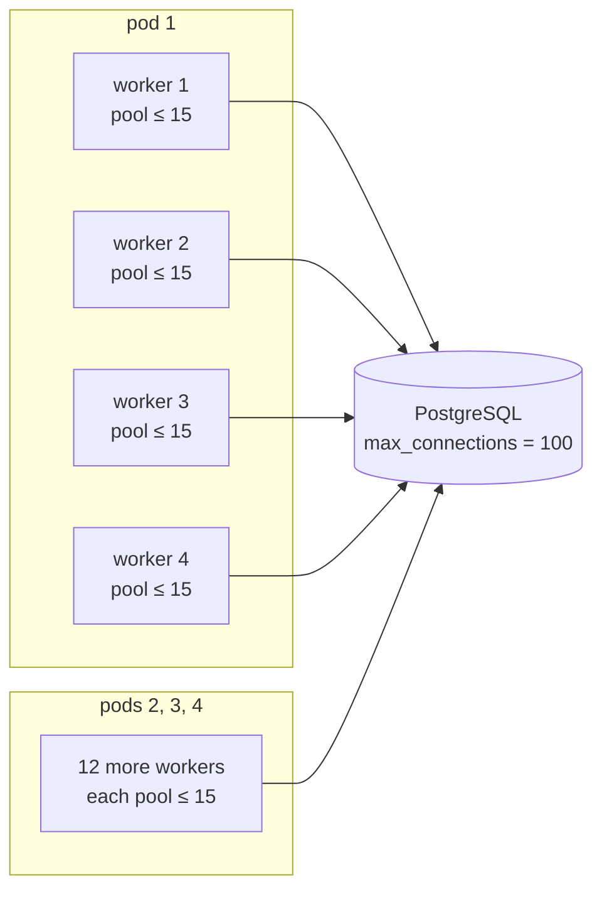
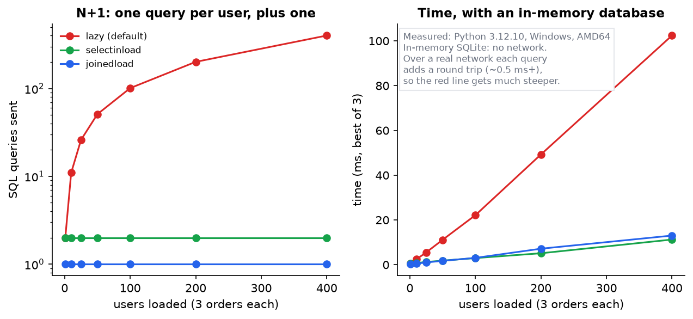
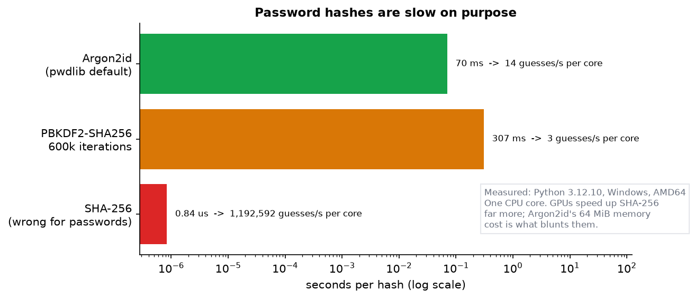
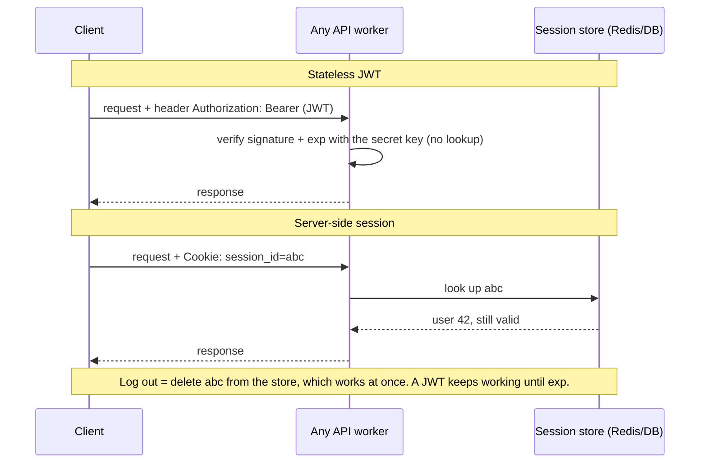
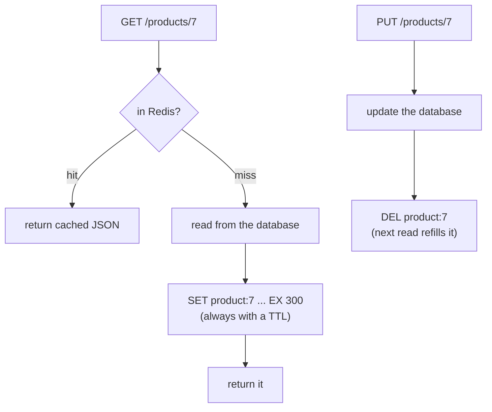
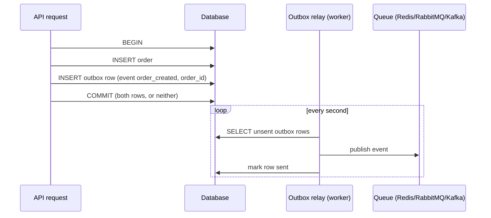
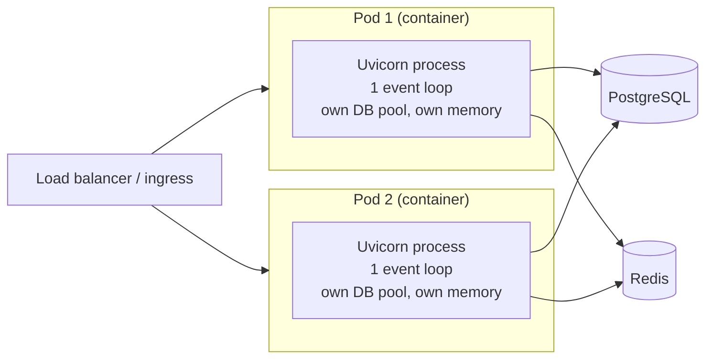

# Reading a Python Backend 3: Backend Concepts, Decisions and Unfamiliar Code

> **Series:** [Part 1: The Python You Need](Reading%20a%20Python%20Backend%201%20-%20The%20Python%20You%20Need.md) · [Part 2: A Codebase Tour and One Request Traced](Reading%20a%20Python%20Backend%202%20-%20A%20Codebase%20Tour%20and%20One%20Request%20Traced.md) · **Part 3 (this file)** · [Folder index](README.md)
> **Source:** official docs for FastAPI, SQLAlchemy, Uvicorn, PostgreSQL, Flask and Django, plus measurements from [make_figs.py](images/make_figs.py). Numbers in worked examples are computed in the text. The Flask and Django snippets in §10 are **illustrative and were not run** (those frameworks aren't installed here); everything else was. Library versions re-checked against PyPI on 24 October 2026: FastAPI 0.162, Starlette 1.9, SQLAlchemy 2.1.6, Uvicorn 0.54, pwdlib 0.3.1, PyJWT 2.15, Django 6.1, Flask 3.1.
> **Facts re-checked:** 24 October 2026.

**The big picture:** Part 2 showed *how* one request moves through a codebase. This part covers the **decisions** behind that code: where state lives, how the database is used safely, what happens with many workers, what to do about slow calls and slow jobs. It ends with a method for reading **any** Python backend (FastAPI, Flask or Django) and a checklist for reviewing backend code an LLM wrote for you.

---

## Contents

0. [How to use this part](#0-how-to-use-this-part)
1. [TL;DR](#1-tldr)
2. [The questions every backend must answer](#2-the-questions-every-backend-must-answer)
3. [The database: transactions, pools, N+1, migrations](#3-the-database-transactions-pools-n1-migrations)
4. [Security: passwords, tokens, CORS, secrets](#4-security-passwords-tokens-cors-secrets)
5. [Where state lives: memory, Redis, database](#5-where-state-lives-memory-redis-database)
6. [Calling other services: timeouts, retries, idempotency](#6-calling-other-services-timeouts-retries-idempotency)
7. [Slow work: background tasks and queues](#7-slow-work-background-tasks-and-queues)
8. [Running it: processes, workers, containers](#8-running-it-processes-workers-containers)
9. [Errors, logs and health checks](#9-errors-logs-and-health-checks)
10. [Reading an unfamiliar backend: a method](#10-reading-an-unfamiliar-backend-a-method)
11. [Reviewing backend code an LLM wrote](#11-reviewing-backend-code-an-llm-wrote)
12. [Where your DSA shows up in backends](#12-where-your-dsa-shows-up-in-backends)
13. [Corrections to the earlier notes](#13-corrections-to-the-earlier-notes)
14. [Common misconceptions](#14-common-misconceptions)
15. [Decision drills](#15-decision-drills)
16. [Glossary](#16-glossary)
17. [References](#17-references)

---

## 0. How to use this part

| If you have… | Read |
|---|---|
| 10 minutes | §0.1, §1, and the checklists in §10.1 and §11 |
| 1 hour | §3 (database), §5 (state), §8 (workers) and §10 (reading method) |
| A weekend | Everything, then the drills in §15, then open a real open-source FastAPI project and apply §10 to it |

### 0.1 First, in completely plain words

Back to the restaurant. Part 2 followed one order from the door to the kitchen and back. Running a restaurant well means answering harder questions:

- **What if two waiters sell the last cake at the same moment?** That's transactions and constraints (§3).
- **What if we open four identical kitchens?** Notes stuck on one kitchen's fridge aren't visible in the others. That's state with several workers (§5, §8).
- **What if the supplier never picks up the phone?** You can't wait forever. That's timeouts and retries (§6).
- **What if an order takes an hour, like a wedding cake?** You don't keep the customer standing at the counter. You give them a ticket and call them later. That's background jobs (§7).
- **How do you know a kitchen is on fire before customers do?** That's logs and health checks (§9).

Every backend, in any framework, answers these same questions somewhere in its code. Knowing the questions tells you where to look and what to judge.

---

## 1. TL;DR

1. **One transaction per unit of work**, committed by the code that knows the work is complete (the service). Let the database enforce invariants (UNIQUE, CHECK, foreign keys), because application checks can race.
2. **Connection math:** pods × workers × (pool_size + max_overflow) must stay under the database's `max_connections`. With SQLAlchemy defaults, 4 pods × 4 workers × 15 = 240, more than PostgreSQL's default of 100.
3. **N+1 grows linearly with rows** (Figure 1: 401 queries for 400 users versus 2 with `selectinload`). In async SQLAlchemy, lazy loading crashes instead (`MissingGreenlet`).
4. **Password hashes must be slow:** Argon2id measured at about 70 ms per hash versus about 0.8 µs for SHA-256 (Figure 2). FastAPI's docs now use `pwdlib` + `PyJWT`, not `passlib` + `python-jose`.
5. **Process memory is per worker.** Anything that must be shared or survive restarts goes in Redis or the database.
6. **Every outgoing call needs a timeout.** Retry only idempotent operations, with backoff and jitter.
7. **Slow work leaves the request:** `BackgroundTasks` for small, losable work; a real queue (Celery, arq, Dramatiq, RQ) for anything that must survive a crash.
8. **Workers:** for async workers, roughly one per CPU core. On Kubernetes, usually **one process per container**, scaled with replicas. `uvicorn.workers` is deprecated; use `fastapi run --workers N`, `uvicorn --workers N`, or the separate `uvicorn-worker` package with Gunicorn.
9. **To read any backend:** find the entry point → list the routes → find the wiring (DI or globals) → trace one write request → read the models → read the tests.

---

## 2. The questions every backend must answer

Use this table as a map when you open any codebase. Each row is a question, followed by where the answer usually lives.

| Concern | The question | Where to look | FastAPI tools | Flask / Django equivalent |
|---|---|---|---|---|
| Routing | Which URL runs which code? | `routers/`, `urls.py`, `@app.route` | `APIRouter`, `@router.get` | `@bp.route` / `urls.py` + views |
| Input | What's a valid request? | `schemas/`, `serializers.py`, `forms.py` | Pydantic models | marshmallow, WTForms / DRF serializers, Django forms |
| Identity | Who is calling? | `auth/`, `deps.py`, middleware | `OAuth2PasswordBearer`, `Depends` | Flask-Login / `request.user` |
| Permission | Are they allowed? | Dependencies, decorators, policies | `Depends(require_admin)` | `@login_required` / DRF `permission_classes` |
| Data | How is it stored, and what must be atomic? | `models.py`, `repositories/`, migrations | SQLAlchemy, Alembic | Flask-SQLAlchemy / Django ORM + migrations |
| Business rules | What does the app *do*? | `services/`, `domain/`, sometimes models | Plain Python | Same, or "fat models" in Django |
| Output | What may leave the server? | Response schemas | `response_model` | Serializers / `JsonResponse` |
| Errors | How do failures look to clients? | `errors.py`, exception handlers | `@app.exception_handler` | `@app.errorhandler` / DRF exception handler |
| Slow work | What happens outside the request? | `tasks.py`, `workers/` | `BackgroundTasks`, Celery | Celery, RQ |
| Config | What changes between environments? | `config.py`, `settings.py`, `.env` | `pydantic-settings` | `app.config` / `settings.py` |
| Operations | How is it run, observed and checked? | `Dockerfile`, `compose.yaml`, `/healthz`, logging setup | lifespan, middleware | Gunicorn config, middleware |

---

## 3. The database: transactions, pools, N+1, migrations

### 3.1 Transactions: the unit of work

**The problem.** Placing an order might insert an order, decrement stock and write an audit row. If the process dies between the second and third step, the data is inconsistent. A **transaction** makes the steps all-or-nothing.

In SQLAlchemy, a `Session` starts a transaction automatically on first use. `commit()` makes the changes permanent; `rollback()` (or closing without committing) throws them away. The rules this codebase follows:

1. **One transaction per request, at most.** The session comes from one dependency, and every repository shares it (Part 2 §4).
2. **The service commits**, because only it knows when the unit of work is complete. Repositories never commit; otherwise two repository calls can no longer be atomic together.
3. **On error, roll back** (the `except` in [db.py](code/shop_api/app/db.py)).
4. **Let the database settle races.** `UserService.register` checks "email exists?" *and* catches `IntegrityError` from the UNIQUE index. Two requests at the same instant can both pass the check; only one can pass the index.

**Read-modify-write races.** `stock = row.stock; row.stock = stock - 1` loses updates when two requests run it at once. You'll see one of these three fixes in real code:

| Fix | Code shape | When |
|---|---|---|
| Atomic update | `UPDATE items SET stock = stock - 1 WHERE id = :id AND stock > 0` | Simple counters; check the rowcount |
| Row lock | `select(Item).where(...).with_for_update()` | You need to read, decide, then write |
| Optimistic version | `version_id_col` in SQLAlchemy, or `WHERE version = :v` | Low contention; retry on conflict |

Isolation levels and the anomalies they prevent are covered in depth in the System Design guide, Part 1 §8 ([link](../system-design/System%20Design%201%20-%20Foundations%20Building%20Blocks%20and%20Storage.md#8-transactions-and-isolation)).

### 3.2 Connection pools: a worked example

**The problem.** Opening a PostgreSQL connection costs a TCP + TLS handshake plus authentication, often several milliseconds. So each process keeps a **pool** of open connections and lends one to each request.

SQLAlchemy's defaults are `pool_size=5` (connections kept open) and `max_overflow=10` (extra connections allowed under load), so up to 15 connections per engine. Each worker **process** has its own engine. PostgreSQL's default `max_connections` is 100.

**Worked example.** 4 Kubernetes pods, each running 4 Uvicorn workers, each with the default pool:

$$\text{peak connections} = \text{pods} \times \text{workers} \times (\text{pool\_size} + \text{max\_overflow}) = 4 \times 4 \times (5 + 10) = 240$$

*Read it out loud: "peak connections equals the number of pods, times the workers in each pod, times the most connections each worker's pool can open". Here that's 240, against a database that accepts 100 by default.*



*Each worker process owns its own pool; nothing is shared between processes. The database sees the sum of every pool: 16 × 15 = 240 possible connections against a limit of 100.*

Under load, new connections fail with `FATAL: sorry, too many clients already` or the pool raises `TimeoutError`. Typical fixes:

- Shrink the per-process pool so the sum fits with headroom. Reserve, say, 20 connections for migrations, admin tools and monitoring: (100 − 20) ÷ 16 processes = 5 each, so `pool_size=3, max_overflow=2`. That's 16 × 5 = 80 at peak.
- Put **PgBouncer** in front of PostgreSQL. Note that PgBouncer in *transaction* mode has caveats with asyncpg prepared statements, so check the asyncpg and SQLAlchemy docs for the settings.
- Use fewer, larger processes.

**Reading tip:** whenever you see `create_async_engine(...)` / `create_engine(...)`, check `pool_size` and `max_overflow` and multiply by the deployment's process count.

### 3.3 N+1 queries, measured



*Figure 1 (measured). Loading N users and reading each user's orders. Lazy loading (red) sends 1 query for the users plus 1 per user. `selectinload` (green) always sends 2 (`... WHERE user_id IN (...)`), and `joinedload` (blue) sends 1 JOIN. Timings are on in-memory SQLite, with no network. Against a real database server each query also pays a network round trip, so the red line gets far steeper.*

Part 1's demo 10 shows both faces of the same mistake:

```text
  lazy (default)  50 users, 100 orders -> 51 SQL queries
  selectinload    50 users, 100 orders -> 2 SQL queries
  async lazy load -> StatementError: (sqlalchemy.exc.MissingGreenlet) greenlet_spawn has not been called; c...
  async + selectinload -> 1 order(s), no error
```

The same mistake gives **N+1 queries in sync code** and a **crash in async code**. The async crash is actually kinder: it fails loudly in development instead of slowly in production.

**Which loader?** Use `selectinload` for one-to-many collections (no row duplication), and `joinedload` for many-to-one or one-to-one (one JOIN, no extra query). In Django the equivalents are `prefetch_related` and `select_related`.

### 3.4 Migrations: how the schema changes

Real projects never call `create_all` in production. Schema changes are versioned scripts, so every environment can be moved to the same version in order.

```bash
alembic revision --autogenerate -m "add orders.status"
alembic upgrade head
alembic downgrade -1
```

1. `alembic revision --autogenerate` compares your models with the database and **writes a migration script**. Always read it, because autogenerate misses things like renames, which it sees as a drop plus an add.
2. `alembic upgrade head` applies all pending migrations, usually in CI/CD or a startup job.
3. `alembic downgrade -1` steps back one revision.

**Reading tip:** the `migrations/versions/` (or `alembic/versions/`) folder is the **history of the data model**. Reading the last few files tells you what changed recently and why. Django keeps the same history in `app/migrations/`.

**Zero-downtime rule:** old and new code run side by side during a deploy, so a schema change must work with both. For example, add a nullable column, deploy, backfill, then make it required in a later migration. Never rename a column in one step.

### 3.5 Sync or async database access?

| | Sync (`psycopg`, `create_engine`, `def` endpoints) | Async (`asyncpg`/`psycopg` async, `create_async_engine`, `async def`) |
|---|---|---|
| Concurrency model | Thread pool (AnyIO's default limit is 40 threads) | Event loop; thousands of waiting requests |
| Lazy loading | Works (and causes N+1 silently) | Raises `MissingGreenlet`; you must eager-load |
| Ecosystem | Everything works | Every library on the request path must be async |
| Good default when… | Moderate traffic, a team new to async, lots of sync libraries | High concurrency, lots of waiting on I/O, a fully async stack |

Both are legitimate. Many production FastAPI apps use **sync SQLAlchemy with `def` endpoints**, and that's not a mistake. Mixing them carelessly (a sync driver inside `async def`) *is* the mistake (Part 1 Figure 2).

---

## 4. Security: passwords, tokens, CORS, secrets

### 4.1 Passwords: slow on purpose



*Figure 2 (measured on one core). A fast hash lets an attacker who stole your database try about a million passwords per second per core, and far more on GPUs. Argon2id (pwdlib's default: 64 MiB memory, 3 passes) allows about 14. Its memory cost is what makes GPU cracking expensive.*

> **Update (verified 24 Oct 2026):** FastAPI's security tutorial uses **`pwdlib` (Argon2)** for password hashing and **`PyJWT`** for tokens. Older tutorials, many existing codebases and `notes/py-backend.md` Node 6 use `passlib` and `python-jose`.
> - `passlib`'s last release is **1.7.4, from 2020** (checked on PyPI), and it has known compatibility warnings with newer `bcrypt` releases.
> - `python-jose` did get new releases in 2025 (3.5.0 is current), but FastAPI's docs moved to PyJWT.
>
> When you read `from passlib.context import CryptContext` or `from jose import jwt`, read it as "older code": it isn't wrong, but it's due for an upgrade. [security.py](code/shop_api/app/security.py) shows the current form.
>
> **How slow is slow enough?** OWASP's Password Storage Cheat Sheet sets a *minimum* for Argon2id of 19 MiB of memory, 2 iterations and parallelism 1, and recommends 600,000 iterations if you must use PBKDF2-HMAC-SHA256. pwdlib's default (64 MiB, 3 iterations, parallelism 4) is above that minimum.

### 4.2 Tokens: JWT versus server sessions

| | Stateless JWT | Server-side session (cookie with an id; data in Redis/DB) |
|---|---|---|
| Verify a request | Check the signature and expiry locally: no lookup | Look up the session id |
| Log out / revoke now | **Hard**: the token stays valid until `exp`. You need a denylist (a lookup again) or short expiry plus refresh tokens | Delete the session row: instant |
| Many workers / services | Any process with the key can verify | Every process needs the shared store |
| Typical use | APIs called by other services, mobile apps | Browser apps, especially with cookie-based login |

The two flows side by side:



`py-backend.md` Node 6 explains why JWTs suit multi-worker systems. The trade-off it doesn't mention is **revocation**, which is why real systems use short-lived access tokens (5–30 minutes; ours is 30) plus a refresh token that *is* checked against a store.

**PyJWT checks `exp` for you**, but only if the claim is present: always include it. Always pass `algorithms=[...]` to `decode` so an attacker can't choose the algorithm.

### 4.3 Authorization patterns

Authentication answers "who is this?"; authorization answers "may they do this?". In our app:

- **Role check as a dependency:** `AdminUser = Annotated[User, Depends(require_admin)]`.
- **Ownership check in the query:** `WHERE id = :order_id AND user_id = :me`, returning 404 when there's no match. Filtering by owner *in the query* makes it impossible to forget. The classic bug, called IDOR (insecure direct object reference), is `GET /orders/7` returning someone else's order because the code only filtered by `id`.

### 4.4 CORS is a browser rule, not a firewall

CORS headers tell a **browser** whether JavaScript from another site may read your responses. They don't stop `curl`, scripts or other servers. So `allow_origins=["*"]` doesn't "open your API". But `allow_origins=["*"]` together with cookies is refused by browsers, and a too-broad list can let a malicious site read responses with the user's cookies. Keep the list to your real front-end origins (our `cors_origins` setting).

### 4.5 Secrets and injection

- Secrets come from the environment or a secret manager, never from the repository. Look for `.env` in `.gitignore`.
- **SQL injection:** any SQL built with f-strings (`f"SELECT ... WHERE email = '{email}'"`) is a bug. ORM queries and `text("... :email")` with bound parameters are safe.
- The broader checklist is the OWASP Top 10 (2025 edition), covered in the System Design guide.

---

## 5. Where state lives: memory, Redis, database

**The problem.** A module-level dict looks like a cache. With 4 workers on 3 pods, there are **12 separate copies** of it. Each fills up independently, gets invalidated independently, and disappears on every restart or deploy.

| Kind of state | Example | Where it belongs |
|---|---|---|
| Read-only config | Settings, feature flags loaded at start | Process memory (`lru_cache`, `app.state`) |
| Per-request | Current user, request id, DB session | Dependencies, ContextVars: never globals |
| Shared, can be lost | Cached product page, rate-limit counters | Redis, with a TTL |
| Shared, must not be lost | Orders, balances, users | The database |
| Expensive per-process resources | DB engine, `httpx.AsyncClient`, Redis client | Created once in `lifespan`, stored on `app.state` |

**Cache-aside**, the pattern in `py-backend.md` Node 7, works like this. Read the cache; on a miss, read the database and write the cache with a TTL; on a write, **delete** the key rather than updating it.



*Reads fill the cache lazily; writes only delete. Deleting rather than writing the new value avoids a race where two concurrent writers leave the older value in the cache.*

The two traps:

1. **Invalidation.** Forgetting to delete on some write path serves stale data until the TTL runs out.
2. **Stampede.** A hot key expires and 1,000 requests miss at once and all hit the database. Fixes: a lock so only one request refills the key, early refresh, or random jitter on TTLs.

---

## 6. Calling other services: timeouts, retries, idempotency

**The problem.** With no timeout, a slow dependency makes your requests wait, your pool or threads fill up, and soon your service is down too. That's a cascading failure.

```python
# in lifespan: one shared client = connection reuse (keep-alive), not a new TCP+TLS per call
app.state.http = httpx.AsyncClient(timeout=httpx.Timeout(5.0, connect=2.0))
...
resp = await request.app.state.http.post(url, json=payload, headers={"Idempotency-Key": key})
resp.raise_for_status()
```

Rules you should be able to spot, or spot missing:

| Rule | Why | Red flag |
|---|---|---|
| Every outgoing call has a timeout | A missing timeout means an unbounded wait | `requests.get(url)` with no `timeout=` (requests has **no default timeout**) |
| Reuse one client | Avoids a new TCP + TLS handshake per call | `async with httpx.AsyncClient()` inside every request on a hot path |
| Retry only idempotent operations | Retrying a payment can charge twice | Retrying `POST /charge` with no idempotency key |
| Back off exponentially, with jitter | Prevents synchronised retry storms | `for i in range(5): try ... except: continue` |
| Cap total time | Retries must fit inside the caller's own timeout | 3 retries × 5 s timeout inside an endpoint with a 10 s proxy timeout |

Libraries you'll see: `tenacity` (`@retry(stop=stop_after_attempt(3), wait=wait_exponential_jitter())`), `stamina`, and httpx transports with `retries=`. Retry maths, jitter and circuit breakers are worked through in the System Design guide, Part 3.

---

## 7. Slow work: background tasks and queues

| Option | Runs where | Survives a crash? | Retries | Use for |
|---|---|---|---|---|
| `BackgroundTasks` (FastAPI) | Same process, after the response | **No** | No | Small, losable work: a welcome email, a metrics ping |
| `asyncio.create_task` | Same process, on the event loop | No, and the task can be garbage-collected if you don't keep a reference | No | Rarely right in request handlers |
| Celery / Dramatiq / RQ (+ Redis or RabbitMQ) | Separate worker processes | Yes, if acknowledged after completion | Yes | Emails that must send, PDFs, video, imports |
| arq / taskiq | Separate async workers | Yes | Yes | The same, for async-native stacks |
| Cron / scheduler (Celery beat, APScheduler, Kubernetes CronJob) | On a schedule | Depends | Depends | Nightly reports, cleanups |

**The dual-write trap.** You commit an order, then call `send_email.delay(order.id)`. If the process dies between the two lines, the order exists but no email is ever sent. If you send the message *before* committing, a rollback leaves an email about an order that doesn't exist. The robust pattern is the **transactional outbox**: write an `outbox` row in the **same transaction** as the order, and have a separate worker publish outbox rows. When you see an `outbox` table in a codebase, this is why it's there.



*The order and the "send an email" intent are committed atomically, so neither can exist without the other. If the relay crashes after publishing but before marking the row sent, the event is published twice. That's why consumers must be idempotent (§6).*

> **Django 6.0 (December 2025) added a built-in `django.tasks` framework** (`@task`, then `.enqueue(...)`). Its built-in backends are mainly for development and testing, and Django doesn't ship a worker, so production use still needs a backend from a third-party package. If you see `from django.tasks import task` in a codebase, it's this.

---

## 8. Running it: processes, workers, containers



*On Kubernetes the usual shape is one process per container, scaled by adding replicas. On a single VM, one Uvicorn command with several worker processes plays the same role.*

What to know when you read a `Dockerfile`, `compose.yaml` or deployment config:

- **Commands you'll see:** `fastapi run --workers 4 app/main.py`, `uvicorn app.main:app --host 0.0.0.0 --port 8000 --workers 4`, or Gunicorn managing Uvicorn workers.
- **`uvicorn.workers` is deprecated** (verified in the Uvicorn 0.54 source: "The `uvicorn.workers` module is deprecated. Please use `uvicorn-worker` package instead"). So `gunicorn -k uvicorn.workers.UvicornWorker` is older code; the current form is `-k uvicorn_worker.UvicornWorker` from the `uvicorn-worker` package.
- **How many workers?** Gunicorn's well-known `2 × cores + 1` formula was written for **synchronous** workers, which sit idle while they wait on I/O. An async worker already overlaps its waiting, so a common starting point is **about one worker per core**, and then you measure.
- **Kubernetes:** FastAPI's deployment docs recommend a **single Uvicorn process per container** there and scaling with replicas, because the cluster already does process management, restarts and load balancing.
- **Every worker is a separate process:** separate memory, separate DB pool (§3.2), separate in-memory cache (§5). That's why a reading checklist always asks "what's shared, and how?".

---

## 9. Errors, logs and health checks

- **One error shape.** Clients should be able to parse every error the same way. Our app uses `{"error": {...}}`; FastAPI's validation errors use `{"detail": [...]}`. A production codebase usually unifies them with a handler for `RequestValidationError`.
- **Unexpected exceptions** become 500s. Check that they're **logged with the request id and a traceback** before the generic response goes out, and that the response body doesn't leak the traceback to clients.
- **Structured logs.** JSON lines with `request_id`, `user_id`, `path`, `status` and `latency_ms` can be searched; `print()` can't. Libraries you'll see: the standard `logging` module with a JSON formatter, `structlog`, `loguru`.
- **Tracing.** OpenTelemetry instrumentation (`opentelemetry-instrumentation-fastapi`, `-sqlalchemy`, `-httpx`) produces the same picture as Part 2's trace, but across services and in production.
- **Liveness vs readiness.** Our `/healthz` says "the process is alive". `/readyz` says "it can reach the database". A failing readiness check takes the pod out of the load balancer without restarting it (`py-backend.md` Node 8).

---

## 10. Reading an unfamiliar backend: a method

### 10.1 The ten-step checklist

1. **Find the dependencies:** `pyproject.toml` / `requirements.txt` / `uv.lock`. The framework, ORM, driver (sync or async?), task queue and auth library tell you most of the architecture before you read a single line.
2. **Find the entry point.** Search for `FastAPI(`, `Flask(`, `manage.py` / `wsgi.py` / `asgi.py`, or the `CMD` line in the `Dockerfile`.
3. **List every route.** FastAPI: open `/docs`, or print `app.routes`. Flask: `flask routes`. Django: `urls.py`, or `python manage.py show_urls` with django-extensions.
4. **Find the wiring.** How does a handler get a DB session and the current user? `Depends` (FastAPI), `g` / `current_app` / extensions (Flask), or `request.user` plus the ORM's global connection (Django).
5. **Trace one write request end to end,** as in Part 2. Writes show validation, auth, transactions and side effects; reads show less.
6. **Read the models and the latest migrations.** They show the data and its history.
7. **Find every place that commits,** and every place that calls another service or enqueues a job.
8. **Find the config:** what comes from the environment, and what the defaults are.
9. **Read the tests:** their names are the requirements, and their fixtures show how to build the app.
10. **Run it,** with a debugger breakpoint in one handler or with `logging` at DEBUG. Watching it run beats reading it.

Searches that find the important places quickly (run from the project root):

```bash
grep -rn "FastAPI(\|Flask(\|APIRouter(\|include_router" --include=*.py .
```

```bash
grep -rn "Depends(" --include=*.py . | head -50
```

```bash
grep -rn "commit()\|\.delay(\|apply_async\|add_task(" --include=*.py .
```

```bash
grep -rn "requests\.\|httpx\.\|time\.sleep" --include=*.py .
```

### 10.2 Recognising Flask and Django

The same endpoint ("create an order for the logged-in user") in three frameworks. *Illustrative; the Flask and Django versions were not run.*

**FastAPI** (Part 2):

```python
@router.post("", response_model=OrderOut, status_code=201)
async def create_order(data: OrderCreate, user: CurrentUser, orders: OrderServiceDep):
    return await orders.place_order(user, data)
```

**Flask** (sync, WSGI; input is read from `request`, and helpers are global-looking proxies):

```python
@bp.post("/orders")
@login_required                                  # Flask-Login: redirects or 401s if anonymous
def create_order():
    data = OrderCreate.model_validate(request.get_json())   # validation is up to you
    order = Order(user_id=current_user.id, item=data.item, quantity=data.quantity,
                  total_cents=data.quantity * data.unit_price_cents)
    db.session.add(order)                        # Flask-SQLAlchemy: one scoped session per request
    db.session.commit()
    return OrderOut.model_validate(order).model_dump(), 201
```

**Django REST Framework** (the ORM, auth and admin are built in; serializers do validation *and* output):

```python
class OrderViewSet(viewsets.ModelViewSet):
    serializer_class = OrderSerializer
    permission_classes = [IsAuthenticated]

    def get_queryset(self):
        return Order.objects.filter(user=self.request.user)   # ownership in the query

    def perform_create(self, serializer):
        serializer.save(user=self.request.user)
```

| Idea | FastAPI | Flask | Django (+ DRF) |
|---|---|---|---|
| Server interface | ASGI | WSGI (async views possible, but sync at heart) | WSGI or ASGI |
| Current request | Passed in as parameters | `request`, a context-local proxy | `request` argument |
| Current user | `Depends(get_current_user)` | `current_user` (Flask-Login) | `request.user`, set by middleware |
| DB session | A dependency | `db.session` (scoped to the request) | Implicit; `transaction.atomic()` for transactions |
| Validation | Pydantic from type hints | Manual, marshmallow or Pydantic | Forms / serializers |
| Eager loading | `selectinload` / `joinedload` | Same (SQLAlchemy) | `prefetch_related` / `select_related` |
| Background jobs | `BackgroundTasks`, Celery | Celery, RQ | Celery |
| Where logic tends to live | Services | Views or services | Models ("fat models") and managers |

**Flask's "magic globals"** (`request`, `g`, `current_app`, `current_user`) are context-local proxies. Each request sees its own value, much like Part 1's ContextVar. **Django's magic** is mostly settings-driven: `INSTALLED_APPS` and `MIDDLEWARE` in `settings.py` decide what runs. Read that file the way you read `main.py` in FastAPI.

---

## 11. Reviewing backend code an LLM wrote

LLMs learned from years of older tutorials, so their mistakes are predictable. Check every generated backend change against this list:

| Check | What an LLM often produces | What you want |
|---|---|---|
| Blocking calls inside `async def` | `requests.get`, `time.sleep`, sync DB drivers, `open().read()` | An async library, a `def` endpoint, or `asyncio.to_thread` |
| Output filtering | Returns ORM objects with no `response_model` or return type | An output schema on every endpoint (Part 2 §5.4 shows the leak) |
| Library era | Pydantic v1 (`class Config`, `.dict()`, `orm_mode`), `@app.on_event`, `passlib` / `python-jose`, `uvicorn.workers` | v2 APIs, `lifespan`, `pwdlib` / `PyJWT`, `uvicorn-worker` / `--workers` |
| Session handling | `await AsyncSessionLocal()`, sessions never closed, a global session | `async with sessionmaker() as session` inside a yield dependency |
| Commit placement | Commit in every repository method, or in cleanup after `yield` | One commit per unit of work, in the service, before responding |
| Relationships | Loops over `user.orders` without eager loading | `selectinload` / `joinedload` |
| Authorization | Filters by `id` only | Filters by `id` **and** owner, returning 404 |
| Outgoing calls | No timeout, retries on non-idempotent `POST` | Timeouts, idempotency keys, backoff |
| Secrets and config | Hard-coded keys, `allow_origins=["*"]` with credentials | Settings from the environment; an explicit origin list |
| SQL | f-string SQL | ORM or bound parameters |
| Decorated endpoints | A wrapper without `@functools.wraps` (every call then 422s on `args`/`kwargs`) | `@wraps(func)` on every wrapper |
| List query parameters | `tags: list[str]` (read from the **body**) | `tags: Annotated[list[str], Query()]` |
| Tests | Tests that only check status 200 | Tests on body shape, error cases, permission failures |

**A method that works:** ask the LLM to produce the change **and** the tests. Run the tests. Then trace one request through the new code yourself (Part 2 §4) before accepting it. You don't need to be able to write every line from memory; you do need to be able to say what each line does and in what order it runs.

---

## 12. Where your DSA shows up in backends

| Data structure / algorithm | Backend appearance | Where to read more |
|---|---|---|
| Hash map (`dict`) | Dependency cache per request, identity map in the ORM session, in-process caches, routing tables keyed by name | `py-dsa.md` Node 4 |
| B-tree | Every database index; keyset pagination (`WHERE id > :cursor ORDER BY id LIMIT n`) is a range scan on a B-tree | System Design Part 1 §6 |
| Sorted array + binary search (`bisect`) | Consistent hashing rings for cache sharding | Mastery §4.4 |
| Heap (`heapq`) | Job schedulers, "next retry time" queues, top-K endpoints | `py-dsa.md` Node 3 |
| Deque | Sliding-window rate limiters, bounded recent-events buffers (`deque(maxlen=N)`) | Mastery Mechanic 11 |
| Token bucket | Rate limiting per client | Mastery §4.2 |
| Graph traversal / topological order | Dependency resolution (FastAPI solves it by recursion, §5.7 of Part 2), migration ordering, task DAGs | Mastery §4.3 |
| Set | Permission and scope checks (`required <= granted`), dedup of idempotency keys | `py-dsa.md` Node 4 |
| LRU cache | `functools.lru_cache` for settings and pure lookups | Mastery Paradigm 10 |

For the contest side of the same structures (tested templates, measured costs, recursion limits), see [Python DSA: Templates, Patterns and Performance](Python%20DSA%20-%20Templates%20Patterns%20and%20Performance.md).

The difference from contest code: in a backend, the data structure usually lives **outside your process** (a database index, a Redis sorted set). The algorithmic thinking is the same; the cost model adds network round trips.

---

## 13. Corrections to the earlier notes

All checked on 23 October 2026 against the docs and library source named. Each correction is also flagged inline in the original file.

| Where | What it says | What's accurate now |
|---|---|---|
| `py-backend.md` Node 2 | Production = `gunicorn -k uvicorn.workers.UvicornWorker`, workers = `2 × cores + 1` | `uvicorn.workers` is deprecated (use the `uvicorn-worker` package, or `fastapi run` / `uvicorn --workers`). `2 × cores + 1` is a sync-worker rule; for async, start near one per core. On Kubernetes, one process per container |
| `py-backend.md` Node 4 | `yield` dependency cleanup runs after the response is sent | True for the current default (`scope="request"`), but `Depends(..., scope="function")` now runs it before the response, and the default has changed across FastAPI versions |
| `py-backend.md` Nodes 4, 5 | `db = await AsyncSessionLocal()` | `async with AsyncSessionLocal() as db:` |
| `py-backend.md` Node 6 | `passlib` + `python-jose` | FastAPI's tutorial now uses `pwdlib` (Argon2) + `PyJWT` |
| `py-backend.md` Node 7 | `product.dict()` | Pydantic v2: `model_dump()`; for ORM rows, go through a schema |
| Mastery §4.1 | Modern routers use a trie | Starlette/FastAPI tries regex routes in registration order, first match wins |
| Mastery §4.3 | FastAPI resolves `Depends()` with Kahn's topological sort | `solve_dependencies` recurses depth-first with a per-request cache |

---

## 14. Common misconceptions

| Belief | Reality |
|---|---|
| "Checking for a duplicate before inserting prevents duplicates." | Two requests can both pass the check. Only a UNIQUE constraint settles it. |
| "A module-level cache is shared by the whole service." | It's per process; with 12 processes there are 12 caches. |
| "CORS protects my API." | It controls what browsers let JavaScript read. Servers and scripts ignore it. |
| "JWTs are strictly better than sessions." | They trade instant revocation for no-lookup verification. |
| "More workers = more throughput." | Past the core count, async workers mostly add memory use and DB connections. |
| "`BackgroundTasks` is a job queue." | It's in-process and lost on a crash or deploy. |
| "Async apps are faster." | They handle more *waiting* requests at once. Per-request speed is about the same, and blocking calls make them worse. |

---

## 15. Decision drills

Commit to an answer before opening each one.

<details>
<summary><b>D1.</b> Your API runs 3 pods × 4 workers. PostgreSQL allows 100 connections and the DBA wants 20 kept free for admin work. What pool settings do you choose?</summary>

The budget is 100 − 20 = 80 connections across 3 × 4 = 12 processes, so about 6.6 each. Choose `pool_size=4, max_overflow=2`, giving at most 6 per process and 72 in total, which leaves headroom.

If that starves throughput, the answer is usually PgBouncer or fewer processes, not a bigger pool.
</details>

<details>
<summary><b>D2.</b> "Users who change their password must be logged out everywhere, immediately." You use 30-minute JWTs. What do you change?</summary>

Pure stateless JWTs can't do "immediately". Options:

- Store a `token_version` (or `password_changed_at`) on the user, put it in the token, and compare it on each request. That's one cheap lookup, and `get_current_user` already loads the user, so it's nearly free here.
- Keep a Redis denylist of token ids until they expire.
- Shorten access tokens to a few minutes and revoke refresh tokens in the database.

The first option fits this codebase best.
</details>

<details>
<summary><b>D3.</b> An endpoint generates a 40-page PDF (about 8 s of CPU) and emails it. Product wants "click and get it in your inbox". Design the request path.</summary>

Not inline: 8 s of CPU blocks a worker (and the event loop, if it's async). Not `BackgroundTasks`: CPU-heavy work in the web process, lost on deploy.

Instead, the endpoint validates the request, writes a `report_jobs` row (plus an outbox row) in one transaction, and returns `202 Accepted` with a job id. A Celery or arq worker builds the PDF and emails it, with retries. The client can poll `GET /report-jobs/{id}` or just wait for the email.
</details>

<details>
<summary><b>D4.</b> You inherit a Flask app with 80 routes, no tests and frequent 500s. Where do you start?</summary>

Don't rewrite it. Follow §10.1:

1. List the routes and the dependencies.
2. Add request-id logging with tracebacks, so the 500s become readable.
3. Add tests around the routes behind the most frequent errors.
4. Look for the usual suspects: missing timeouts, N+1, sessions not closed, read-modify-write races.

Fix the worst problems with tests around them. Only then consider structural changes like a service layer or a move to FastAPI.
</details>

<details>
<summary><b>D5.</b> An LLM gives you an <code>async def</code> endpoint that calls <code>boto3</code> (sync) to upload a file to S3, then commits a row. What do you ask it to change?</summary>

`boto3` is blocking, so inside `async def` it freezes the loop (Part 1 Figure 2). Options:

- Make the endpoint `def`.
- Wrap the upload in `asyncio.to_thread`.
- Use an async client (for example `aioboto3`).

Also think about ordering. If the upload succeeds and the commit fails, you have an orphan file; if you commit first and the upload fails, you have a row pointing at nothing. Usually you upload first, then commit, and run a cleanup job for orphans.
</details>

---

## 16. Glossary

| Term | Meaning |
|---|---|
| **Cascading failure** | A slow or failing dependency making its callers slow or failing, and so on outward |
| **Connection pool** | A set of open DB connections a process reuses across requests |
| **Eager loading** | Fetching related rows up front (`selectinload`, `joinedload`) instead of on first access |
| **IDOR** | Insecure direct object reference: accessing someone else's object by guessing its id |
| **Idempotent** | Doing it twice has the same effect as doing it once |
| **Migration** | A versioned script that changes the database schema |
| **Outbox pattern** | Writing "messages to publish" in the same transaction as the data, and publishing them separately |
| **Readiness probe** | A check that says whether a process should receive traffic now |
| **Stampede** | Many requests recomputing the same expired cache entry at once |
| **Worker (process)** | One OS process running the app, with its own memory, pool and event loop |

## 17. References

- FastAPI docs: [Server workers](https://fastapi.tiangolo.com/deployment/server-workers/), [FastAPI in containers](https://fastapi.tiangolo.com/deployment/docker/), [OAuth2 with JWT](https://fastapi.tiangolo.com/tutorial/security/oauth2-jwt/), [Background tasks](https://fastapi.tiangolo.com/tutorial/background-tasks/), [Handling errors](https://fastapi.tiangolo.com/tutorial/handling-errors/). Checked 23 Oct 2026.
- Uvicorn: [Deployment](https://www.uvicorn.org/deployment/); the `uvicorn/workers.py` deprecation notice in Uvicorn 0.54; the [`uvicorn-worker`](https://github.com/Kludex/uvicorn-worker) package.
- Gunicorn: [Design: how many workers](https://docs.gunicorn.org/en/stable/design.html#how-many-workers).
- SQLAlchemy: [Connection pooling](https://docs.sqlalchemy.org/en/20/core/pooling.html) (`pool_size=5`, `max_overflow=10` defaults), [Relationship loading techniques](https://docs.sqlalchemy.org/en/20/orm/queryguide/relationships.html), [Asyncio](https://docs.sqlalchemy.org/en/20/orm/extensions/asyncio.html).
- PostgreSQL: [`max_connections`](https://www.postgresql.org/docs/current/runtime-config-connection.html) (default 100).
- Alembic: [Auto-generating migrations](https://alembic.sqlalchemy.org/en/latest/autogenerate.html) (what autogenerate can and can't detect).
- pwdlib: [docs](https://frankie567.github.io/pwdlib/); PyJWT: [usage](https://pyjwt.readthedocs.io/en/stable/usage.html); [OWASP Password Storage Cheat Sheet](https://cheatsheetseries.owasp.org/cheatsheets/Password_Storage_Cheat_Sheet.html).
- Flask: [Application and request contexts](https://flask.palletsprojects.com/en/stable/appcontext/); Django: [Database transactions](https://docs.djangoproject.com/en/stable/topics/db/transactions/), [`select_related` / `prefetch_related`](https://docs.djangoproject.com/en/stable/ref/models/querysets/).
- Transactional outbox: [microservices.io pattern description](https://microservices.io/patterns/data/transactional-outbox.html).
