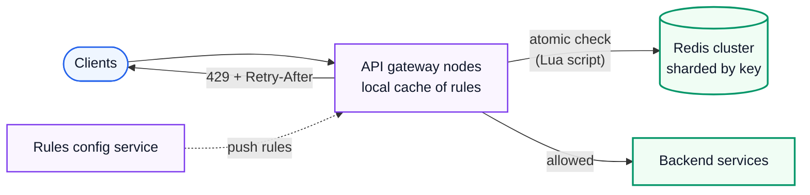
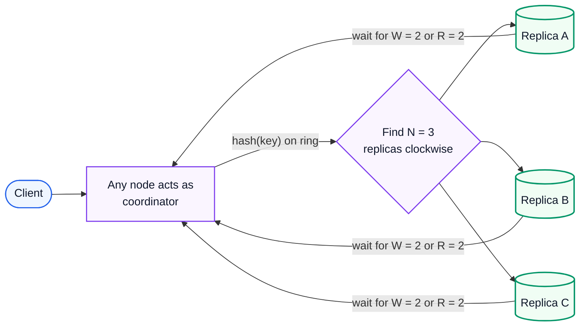
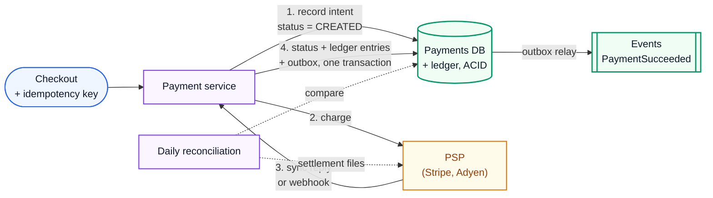
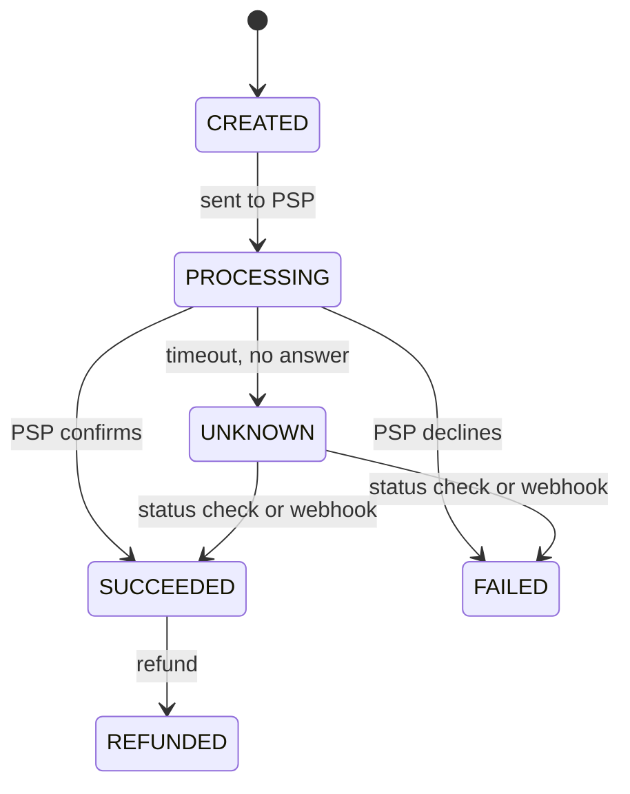
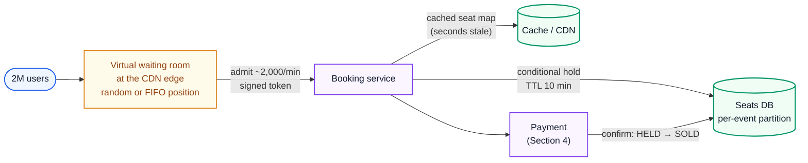
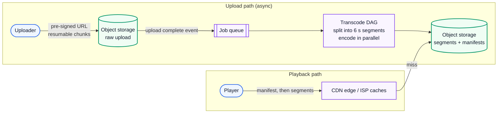
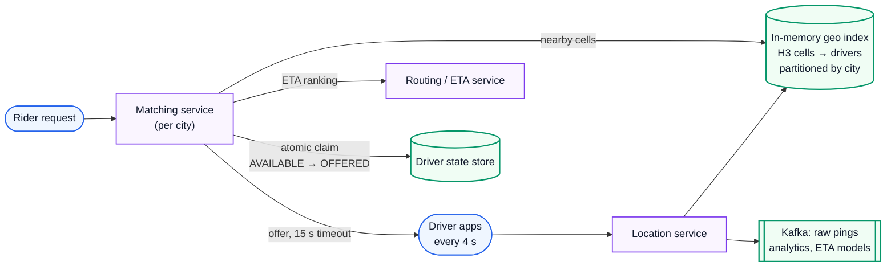
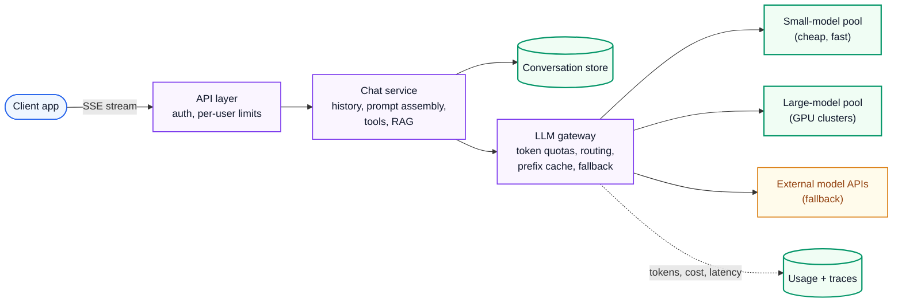

```mermaid
flowchart LR
    accTitle: Notification system
    accDescr: Services call the notification API, which validates, checks preferences, renders templates and places messages on priority and channel queues; channel workers call external providers, retry, and route failures to a dead-letter queue.
    SV(["Calling services"]) --> API["Notification API<br/>validate + idempotency key"]
    API --> PREF["Preferences + rate limits<br/>opt-outs, quiet hours"]
    PREF --> TPL["Template rendering"]
    TPL --> QH[["High-priority queue<br/>2FA, security"]]
    TPL --> QL[["Bulk queue<br/>campaigns, throttled"]]
    QH --> WK["Channel workers<br/>push / email / SMS"]
    QL --> WK
    WK --> PROV["Providers<br/>APNs, FCM, email, SMS"]
    WK -->|"after N retries"| DLQ[["Dead-letter queue"]]
    PROV -.->|"delivery callbacks"| TRK[("Delivery log")]
    class SV primary;
    class API,PREF,TPL,WK intermediate;
    class QH,QL,TRK target;
    class DLQ,PROV warning;
    classDef primary fill:#EFF6FF,stroke:#2563EB,stroke-width:1.5px,color:#0F172A;
    classDef intermediate fill:#FAF5FF,stroke:#7C3AED,stroke-width:1.5px,color:#0F172A;
    classDef target fill:#F0FDF4,stroke:#059669,stroke-width:2px,color:#0F172A;
    classDef warning fill:#FFFBEB,stroke:#D97706,stroke-width:1.5px,color:#92400E;
```

# System Design 4: Worked Case Studies

> **Series:** [Part 1: Foundations, Building Blocks and Storage](System%20Design%201%20-%20Foundations%20Building%20Blocks%20and%20Storage.md) · [Part 2: Distributed Systems Theory](System%20Design%202%20-%20Distributed%20Systems%20Theory.md) · [Part 3: Building Real Systems in 2026](System%20Design%203%20-%20Building%20Real%20Systems%20in%202026.md) · **Part 4 (this file)**
> **Source:** built from research (references at the end) and from the theory in Parts 1–3, which every design links back to. Every estimate was recomputed with Python. Figures from [make_figs.py](images/make_figs.py); code from [system_design_theory.py](code/system_design_theory.py).
> **Self-contained:** the four parts in this folder need nothing else. Part 1 §2.5 explains the decision method used throughout.
> **Facts re-checked:** 24 October 2026 (full audit; new token-bucket figure and contention/payment-timeout diagrams).

**The big picture:** theory only counts when you can use it on a blank page. This part works through eight more systems with the same 8-step method from [Part 3 §11](System%20Design%203%20-%20Building%20Real%20Systems%20in%202026.md). Part 3 already did the URL shortener, news feed and chat. Each design here is chosen because it tests a *different* hard idea.

Diagram colours: 🔵 input / primary · 🟣 processing · 🟢 result · 🟠 trade-off · 🔴 failure

---

## Contents

0. [How to use this guide](#0-how-to-use-this-guide)
1. [The method, as a checklist](#1-the-method-as-a-checklist)
2. [Distributed rate limiter](#2-distributed-rate-limiter)
3. [Distributed key-value store](#3-distributed-key-value-store)
4. [Payment system with a ledger](#4-payment-system-with-a-ledger)
5. [Ticket booking under extreme contention](#5-ticket-booking-under-extreme-contention)
6. [Video upload and streaming](#6-video-upload-and-streaming)
7. [Notification system](#7-notification-system)
8. [Ride matching (proximity in real time)](#8-ride-matching-proximity-in-real-time)
9. [ChatGPT-style chat service and LLM gateway](#9-chatgpt-style-chat-service-and-llm-gateway)
10. [The patterns that keep coming back](#10-the-patterns-that-keep-coming-back)
11. [Decision drills: change the requirements](#11-decision-drills-change-the-requirements)
12. [References](#12-references)

---

## 0. How to use this guide

| If you have… | Read |
|---|---|
| 10 minutes | §1 and the table in §10 |
| 1 hour | Pick two designs. Cover everything below the **Requirements** line, try it yourself for 20 minutes, then compare. |
| A weekend | All eight, each one attempted on paper first |

**The key habit: attempt before you read.** Reading a finished design feels like understanding, but in an interview you must produce one. For each system, write your own requirements, estimates and box diagram first.

### 0.1 First, in completely plain words

Every design here is the same story told about a different business. You ask what it must do and how big it is. You draw the simplest thing that works. Then you find the one or two places where it would break: too many people wanting the same seat, money that must never be counted twice, a video file far too big to send in one go. You spend most of your effort there.

Each system has one main lesson:

| Design | The main idea it teaches |
|---|---|
| Rate limiter | Shared counters at high speed; atomic updates; fail-open vs fail-closed |
| Key-value store | Putting Part 2 together: hashing, replication, quorums, repair |
| Payments | Correctness above everything: idempotency, double-entry ledgers, reconciliation |
| Ticket booking | Many users fighting over a few items: holds, conditional writes, waiting rooms |
| Video streaming | Huge files: async pipelines, object storage, CDNs, adaptive bitrate |
| Notifications | Fan-out to unreliable third parties: queues, retries, dead-letter queues, user preferences |
| Ride matching | Fast-moving location data: in-memory geo indexes, partitioning by city, exactly one assignment |
| LLM chat | GPU-bound serving: streaming tokens, token-based capacity, gateways and cost |

---

## 1. The method, as a checklist

Use this for every design (explained in [Part 3 §11.1](System%20Design%203%20-%20Building%20Real%20Systems%20in%202026.md)):

1. **Requirements.** Functional (3–5 core features) and non-functional (scale, latency, availability, consistency, durability). Say what's *out of scope*.
2. **Estimates.** QPS (average and peak), storage, bandwidth. Only enough to see what needs scaling.
3. **API.** The key operations.
4. **Data model.** Entities and access patterns, which then pick the database.
5. **High-level design.** The simplest boxes and arrows that meet the requirements.
6. **Deep dives.** The 2–3 hardest problems. This is where the score is.
7. **Failure modes.** For each component: dies, slows down, or gets partitioned. What happens?
8. **Evolution.** What breaks at 10×, and which trade-offs you chose on purpose.

**Time budget for a 45-minute interview:** about 5 min requirements, 5 estimates and API, 10 high-level design, 20 deep dives, 5 failures and wrap-up.

---

## 2. Distributed rate limiter

### Requirements

- **Functional:** limit each client (API key, user or IP) to a configured rate, for example 100 requests per minute per key, with different limits per endpoint and plan. Rejected requests get `429 Too Many Requests` with a `Retry-After` header.
- **Non-functional:** adds under 1–2 ms to each request; handles 1M checks/s; works across hundreds of API gateway nodes (so the counts must be **shared**); stays up when parts of it fail.
- **Out of scope:** billing quotas measured over months (a different, slower system).

### Estimates

| Quantity | Calculation | Result |
|---|---|---|
| Active keys | given | 10 million |
| State per key | counter + timestamp + key overhead | ~100 bytes |
| Total state | 10M × 100 B | **≈ 1 GB**, fits in memory |
| Throughput | 1M checks/s ÷ ~100k ops/s per Redis node | **≈ 10 shards** (plus replicas) |

### The algorithm choice

Five algorithms are in common use:

| Algorithm | State per key | Behaviour | Weakness |
|---|---|---|---|
| Fixed window counter | 1 counter | Count per calendar minute | Allows **2× bursts** at window edges (100 at 12:00:59, 100 more at 12:01:00) |
| Sliding window log | Every timestamp | Exact | Memory grows with the limit |
| **Sliding window counter** | 2 counters | Weighted blend of the previous and current window | Approximate, but very close |
| **Token bucket** | Tokens + last time | Allows bursts up to the capacity, then a steady rate | Two parameters to tune |
| Leaky bucket | Queue | Smooths output to a constant rate | Adds queueing delay |

**Token bucket**, the usual default:

$$
\text{tokens} \leftarrow \min\left(C, \ \text{tokens} + r \cdot \Delta t\right)
$$

*Before each request, refill the bucket by the rate r times the seconds since the last update, capped at the capacity C. If at least one token remains, take it and allow the request.*

The refill is computed **lazily**, at check time. There's no background timer per key, which is what makes 10M keys cheap. Running the demo from [system_design_theory.py](code/system_design_theory.py) with $C = 10$ and $r = 5$/s:

```python
class TokenBucket:
    """In production this state lives in Redis and the update runs atomically (a Lua script)."""
    def __init__(self, capacity, refill_per_s):
        self.capacity, self.rate = capacity, refill_per_s
        self.tokens, self.last = capacity, 0.0

    def allow(self, now):
        self.tokens = min(self.capacity, self.tokens + (now - self.last) * self.rate)  # lazy refill
        self.last = now
        if self.tokens >= 1:
            self.tokens -= 1
            return True
        return False
```

```text
burst of 12 at t=0.0s: allowed 10 rejected 2
4 more at t=0.6s:      allowed 3 rejected 1
```

A full bucket absorbs a burst of 10. After 0.6 s it has refilled $5 \times 0.6 = 3$ tokens.

**Sliding window counter** estimate:

$$
\text{count} \approx \text{prev} \times \left(1 - \frac{t}{W}\right) + \text{curr}
$$

*Assume the previous window's requests were spread evenly, and count only the part of it still inside the sliding window.* Here $t$ is the time elapsed in the current window and $W$ is the window length. **Example:** previous minute 80, current minute 30, 15 s (25%) into the current minute: $80 \times 0.75 + 30 = 90$. That's under a limit of 100, so allow.


*Fig 16 (fig16_token_bucket.png). Computed with the same `TokenBucket` logic as the code above. **Left:** the burst of 12 empties the full bucket (2 rejected). During the steady 8 requests/s, the bucket drains at 8 − 5 = 3 tokens per second from its 4.5 tokens, so it runs dry after about 1.2 s, and from then on roughly 3 of every 8 requests are rejected: the client is held to the 5/s refill rate. After a rest, the bucket is full again and absorbs a whole burst. **Right:** the fixed-window flaw in numbers. 10 requests at 0.95 s and 10 at 1.00 s all pass a fixed "10 per second" window, because the counter resets at 1.00 s. That's 20 requests in 50 ms. The sliding window counter and the token bucket both hold it to 10.*

### High-level design



### Deep dives

1. **Atomicity.** "Read tokens, compute, write back" from many gateways at once is the **lost update** problem (Part 1 §8.2): two gateways both see 1 token and both allow. The fix is to run the whole check *inside* Redis as one atomic **Lua script**, or to use atomic `INCR` with an expiry for window counters.
2. **Latency.** A Redis round trip inside the datacenter costs about 0.5 ms (Part 1 Fig 1), which is within budget. For very hot keys, or to cut cost, use a **two-tier** limiter: each gateway keeps a small *local* allowance (it takes, say, 10 tokens at a time from Redis and spends them locally). That's far fewer round trips, at the cost of slight over-admission.
3. **Fail-open vs fail-closed.** If Redis is unreachable, do you allow every request (**fail open**: users unaffected, but the backend is unprotected) or reject them (**fail closed**: safe, but you caused an outage)? Most public APIs **fail open, with a local in-memory limiter as a fallback**. Security-critical limits, such as login attempts, fail closed.
4. **Multi-region.** Global exact limits would need cross-region coordination (80–200 ms). Usually each region enforces its own share of the limit, and you accept a little inaccuracy.
5. **Where to limit.** At the edge (CDN/WAF) for crude IP floods, at the gateway for per-key limits, and inside services for protecting specific resources (bulkheads, Part 3 §5.2).

### Failure modes and evolution

- **A Redis shard dies** → its replica is promoted. A few counters reset, so some keys briefly get extra allowance, which is acceptable.
- **A hot key** (one huge customer) → local allowances, or split the key across shards (salting, Part 2 §4.4).
- **At 10×** → more shards. The state is tiny, so the limit is operations per second, not memory.

---

## 3. Distributed key-value store

This is Part 2 assembled into one system. It's essentially Dynamo/Cassandra.

### Requirements

- **Functional:** `put(key, value)`, `get(key)`, `delete(key)`. Values up to 1 MB.
- **Non-functional:** 10 TB of data, 1M operations/s, p99 under 10 ms, **always writable** (availability over consistency, PACELC: PA/EL), tunable consistency, no single point of failure, scales by adding nodes.

### Estimates

| Quantity | Calculation | Result |
|---|---|---|
| Raw data with 3 replicas | 10 TB × 3 | 30 TB |
| Nodes for storage | 30 TB ÷ 2 TB SSD per node | 15 |
| …at 70% disk fill (room for compaction) | 30 ÷ (2 × 0.7) | **≈ 22** |
| Nodes for throughput | 1M ops/s ÷ ~50k ops/s per node | **≈ 20** |

Both constraints land around 20–22 nodes. Plan for about 25 to allow for failures and growth.

### High-level design



### Deep dives: each decision and the Part 2 idea behind it

| Problem | Decision | Theory |
|---|---|---|
| Spread data, add nodes cheaply | Consistent hashing with ~100–256 virtual nodes per server | Part 2 §4.2, Figs 5–6 |
| Survive node loss | Replicate to the next $N = 3$ distinct servers clockwise, in different racks or AZs | Part 2 §3.4 |
| Consistency vs latency | Per request: $W = 2, R = 2$ for read-your-latest; $W = 1, R = 1$ for speed | $R + W > N$ |
| Concurrent writes | Version vectors detect conflicts; resolve with LWW (simple, can lose data) or return siblings | Part 2 §6.4 |
| Write fast on disk | LSM-tree engine: WAL + memtable + SSTables + Bloom filters | Part 1 §6.2, §9.1 |
| A replica is temporarily down | Sloppy quorum + hinted handoff | Part 2 §3.4 |
| Replicas drift apart | Read repair on reads; Merkle-tree anti-entropy in the background | Part 2 §10.4 |
| Who's alive, who owns which range | Gossip membership + phi-accrual failure detection | Part 2 §10 |
| Deletes | Tombstones, kept long enough for every replica to see them, then compacted | Part 1 §6.1 |

**The tombstone subtlety.** If a tombstone is purged before a replica that missed the delete gets repaired, that replica's old value spreads back ("**zombie data**"). Cassandra's `gc_grace_seconds` (10 days by default) exists for this reason. Repairs must run more often than the grace period.

### The cache variant

A **distributed cache** (Memcached-style) is the same ring *without* replication, durability or quorums. A lost node just means misses. 10 TB of cache at about 50 GB of usable RAM per node means **≈ 200 nodes**. That's why caches hold only the hot fraction. Add consistent hashing so losing a node invalidates only about 1/N of the cache, and stampede protection (Part 1 §5.3) for when it does.

### Failure modes and evolution

- **A node dies** → reads and writes continue at quorum; hints accumulate; replace the node, then stream its data from the replicas.
- **A whole AZ goes down** → with replicas placed per AZ, two of three replicas remain, so quorum holds.
- **Need transactions or strict consistency** → that's a different system: consensus per range (Spanner/CockroachDB style, Part 2 §7).

---

## 4. Payment system with a ledger

The one design where **correctness beats everything**: latency, cost, even availability.

### Requirements

- **Functional:** a merchant charges a customer's card; the merchant later gets paid out; refunds; a balance history for every party.
- **Non-functional:** **never** charge twice, **never** lose money, a full audit trail, strong consistency for balances, about 10M payments per day. Card details are handled by a payment service provider (PSP) such as Stripe or Adyen, which keeps us out of most PCI-DSS scope.

### Estimates

| Quantity | Calculation | Result |
|---|---|---|
| Payments | 10M / 86,400 | **≈ 116/s**; peak ×10 (sales) ≈ 1,160/s |
| Ledger rows | 3 entries × 200 B × 10M | 6 GB/day ≈ **2.2 TB/year** |

Notice the scale is **small**. One well-run relational database handles it. The difficulty is correctness, not throughput.

### The data model: double-entry bookkeeping

**The idea (500 years old and still the right one):** money is never created or destroyed, only moved. Every transaction records **at least two entries** that **sum to zero**: a debit on one account and a matching credit on another.

$$
\sum_{\text{entries in a transaction}} \text{amount} = 0
$$

*In every transaction, the signed amounts of all its entries add up to exactly zero.* Then the sum over the *whole ledger* is also zero. That one invariant catches whole classes of bugs.

**Worked example.** A customer pays USD 100.00; the fee is 2.9% + USD 0.30 = **USD 3.20**:

| Account | Debit | Credit |
|---|---|---|
| Customer card receivable (money the PSP will settle to us) | 100.00 | |
| Merchant payable (we owe the merchant) | | 96.80 |
| Fee revenue | | 3.20 |
| **Total** | **100.00** | **100.00** ✓ |

Rules for the ledger:

1. **Append-only.** Never update or delete an entry. Corrections are *new* reversing entries, which keeps the audit trail complete.
2. **Integers in minor units** (cents), never floating point: `0.1 + 0.2 ≠ 0.3` in binary floats.
3. **Balances are derived** by summing entries (cached as running balances, updated in the *same transaction* as the entries).
4. **Serializable transactions** (or explicit row locks) around balance checks, to avoid write skew (Part 1 §8.2).

### High-level design and the payment state machine





### Deep dives

1. **Never charge twice.** The client sends an **idempotency key** per checkout attempt (Part 2 §8.5), stored with a unique constraint. Our call to the PSP passes *our* payment ID as the PSP's idempotency key too, so even our own retries are safe end to end.
2. **The UNKNOWN state is the important one.** A timeout to the PSP doesn't mean failure (Part 2 §2.1: no reply ≠ not done). **Never** mark it failed and retry blindly. Hold it as UNKNOWN, query the PSP's status API with backoff, and accept the webhook. Webhooks arrive at-least-once and out of order, so handle them idempotently and only allow valid state transitions.

   ```mermaid
   sequenceDiagram
       participant PS as Payment service
       participant DB as Payments DB
       participant PSP as PSP
       PS->>DB: payment 77: PROCESSING
       PS->>PSP: charge USD 100 (idempotency key = payment 77)
       Note over PSP: the PSP charges the card, but the reply is lost
       PSP--xPS: reply lost: timeout after 10 s
       PS->>DB: payment 77: UNKNOWN (not FAILED!)
       PS->>PSP: GET status of payment 77 (with backoff)
       PSP->>PS: succeeded
       PS->>DB: SUCCEEDED + ledger entries + outbox, one transaction
       PSP-->>PS: webhook "succeeded" arrives later
       Note over PS: already SUCCEEDED: ignore the duplicate, reply 200
   ```

   If the service had marked payment 77 FAILED and let the customer try again, the card would have been charged twice. Retrying with the **same** idempotency key is also safe here, because the PSP returns the original result instead of charging again.
3. **Events without dual writes.** The status change, the ledger entries and the outbox event are written in **one local transaction** (Part 2 §8.4). Downstream (emails, fulfilment) consumes `PaymentSucceeded` events idempotently.
4. **Reconciliation** is the safety net that catches everything else. Every day, compare our ledger with the PSP's and bank's settlement reports, line by line. Mismatches go to an investigation queue. Real payment systems *expect* some mismatches (delayed settlements, chargebacks), so reconciliation is a core feature, not an afterthought.
5. **Multi-step flows** (charge → reserve inventory → ship) are a **saga** (Part 2 §8.3): a failed step triggers compensations such as a refund.

### Failure modes and evolution

- **The database primary fails** → synchronous replication to a standby (RPO = 0 for money) and automatic failover. Prefer a few seconds of unavailability over any data loss.
- **The PSP is down** → circuit breaker (Part 3 §5.2), with fallback to a second PSP if available. Payments in UNKNOWN are resolved later.
- **At 10×** → still one database, scaled vertically plus read replicas. Then partition by merchant, because each merchant's ledger is independent.

---

## 5. Ticket booking under extreme contention

### Requirements

- **Functional:** browse events, see seat availability, hold seats while paying, buy. **No seat is ever sold twice.**
- **Non-functional:** a popular on-sale has **2 million users** arriving at once for a **50,000-seat** stadium; fairness (roughly first come, first served); the system must not fall over.

### Estimates

| Quantity | Calculation | Result |
|---|---|---|
| Orders possible | 50,000 seats ÷ ~4 seats per order | **12,500** orders |
| Users who will be disappointed | 2M − 12.5k | > 99% |
| Seat-map load if everyone polls every 5 s | 2M ÷ 5 | **400,000 req/s** |
| Time to sell out at 2,000 admitted users/min | 12,500 ÷ 2,000 | ≈ **6.25 min** |

The key insight from the numbers: **almost everyone will lose**. The design's job is to make them lose *quickly, fairly and cheaply*, without taking the system down for the winners.

### High-level design



### Deep dives

1. **No double-selling: holds with a conditional write.** Each seat row has `status` (AVAILABLE / HELD / SOLD), `hold_owner` and `hold_expires_at`. To hold a seat:

   ```sql
   UPDATE seats
   SET status = 'HELD', hold_owner = :order_id, hold_expires_at = now() + interval '10 minutes'
   WHERE seat_id = :seat AND event_id = :event
     AND (status = 'AVAILABLE' OR (status = 'HELD' AND hold_expires_at < now()));
   ```

   ```mermaid
   sequenceDiagram
       participant A as Alice
       participant DB as seats row 14C<br/>status = AVAILABLE
       participant B as Bob
       A->>DB: UPDATE … SET HELD, owner = A WHERE status = 'AVAILABLE'
       B->>DB: UPDATE … SET HELD, owner = B WHERE status = 'AVAILABLE'
       Note over DB: The row lock queues Bob's update behind Alice's
       DB->>A: 1 row updated: seat is yours
       Note over DB: Bob's update re-checks the WHERE: status is now HELD
       DB->>B: 0 rows updated: pick another seat
   ```

   If 1 row changed, you got the seat. If 0, someone else did. This is **compare-and-set** (Part 1 §8.5): the database row is the single point of truth, and the condition makes the check-and-claim atomic. Holding several seats happens in one transaction, all or nothing. Confirming after payment is another conditional update: `HELD → SOLD` only if `hold_owner` still matches.
2. **Expired holds** don't need a background job to be correct: the `WHERE` clause treats expired holds as available. A sweeper only tidies up the display.
3. **The waiting room** is the most important part. It protects everything else. Users get a queue position at the edge (static pages and CDN workers scale almost without limit), and are **admitted at a rate the booking service can handle**, with a signed, expiring token. It turns an unbounded spike into a controlled flow, which is load shedding done fairly (Part 3 §5.3).
4. **The seat map** is read 400k times a second. Serve it from the cache or CDN, a few seconds stale. The *hold* is what's strongly consistent, not the picture. A user may click a seat that has just gone; tell them instantly and let them pick another.
5. **Hot partition.** All writes for one event hit the same rows. Partition by `event_id` so the hot event doesn't slow the others, and split the stadium into sections if needed. Bots and scalpers → CAPTCHA at the waiting room, per-account limits, and verified-fan pre-registration.

### Failure modes and evolution

- **Payment is slow** → holds expire and seats return to the pool. Show the user a countdown.
- **The booking DB is overloaded** → slow the admission rate. The waiting room is your throttle.
- **General admission (no seat numbers)** → replace per-seat rows with an inventory counter decremented conditionally (`UPDATE … SET remaining = remaining - 4 WHERE remaining >= 4`). For extreme rates, split the counter into shards with a share of the inventory each.

---

## 6. Video upload and streaming

### Requirements

- **Functional:** upload videos; watch them on any device and network, with quick start and few stalls; view counts.
- **Non-functional:** assume 1M uploads/day (average 10 minutes each) and 100M views/day; playback start under 2 s; uploads can take minutes to become watchable; global users.

### Estimates

| Quantity | Calculation | Result |
|---|---|---|
| Bitrate ladder | 1080p 5 + 720p 3 + 480p 1.5 + 360p 0.8 + 240p 0.4 Mbit/s | 10.7 Mbit/s for all renditions |
| Stored per 10-min video | 10.7 Mbit/s × 600 s ÷ 8 | **≈ 802 MB** |
| New storage per day | 802.5 MB × 1M | **≈ 802 TB/day** (≈ 2.4 PB/day with 3× replication) |
| Data per view (avg 3 Mbit/s, 10 min) | 3 × 600 ÷ 8 | 225 MB |
| Egress per day | 225 MB × 100M | **22.5 PB/day** ≈ 2.1 Tbit/s on average |

**What the numbers say:** egress (22.5 PB/day) dwarfs everything else. Delivery cost and speed *are* the problem, so a **CDN is mandatory**, and big platforms place caches inside ISPs' own networks. Storage grows by petabytes a week, so it needs tiering (popular videos on hot storage, the long tail on cheap cold storage).

### High-level design



### Deep dives

1. **Uploads bypass your servers.** The API returns a **pre-signed URL** and the client uploads *directly* to object storage, in resumable chunks (multipart upload), so a dropped mobile connection resumes instead of restarting. Your app servers never touch the bytes.
2. **Transcoding is a parallel DAG.** Split the video into segments (a 10-minute video in 6 s segments = 100 segments), encode every segment × every rendition in parallel on a worker fleet, then stitch the manifests together. A 10-minute video can be ready in about the time it takes to encode one segment. Workers pull from a queue, retry failed segments, and send poison inputs (corrupt files) to a **dead-letter queue** (Part 3 §3.8). Spot instances fit well, because the work is retryable.
3. **Adaptive bitrate streaming (HLS / MPEG-DASH).** Each rendition is cut into small segments, and a **manifest** lists them. The player measures its download speed and buffer level, and picks the rendition for the *next* segment. That's how playback adapts to a train going through a tunnel. It's plain HTTP GETs of static files, so the CDN does almost all the work.
4. **Fast start.** Start at a low rendition and step up; put the first segments of popular videos on the edge in advance; keep the manifest small.
5. **View counts** are high-volume and can be approximate: events → Kafka → stream aggregation (Part 3 §3.6), with batched counter updates. Never a database write per view.

### Failure modes and evolution

- **A transcode worker crashes** → the segment job times out and is retried (idempotent: same input, same output path).
- **A CDN PoP fails** → anycast/DNS routes users to the next nearest PoP; the origin shield absorbs the extra misses.
- **Cost at 10×** → better codecs (AV1 cuts bitrate a lot at the same quality, at higher encode cost), encode *popular* videos with expensive settings and the long tail cheaply, and push more caches into ISPs.

---

## 7. Notification system

### Requirements

- **Functional:** other services ask to notify a user ("your order shipped") via **push** (iOS/Android), **email** and **SMS**; users set preferences (opt-outs, quiet hours); templates; delivery tracking.
- **Non-functional:** about 1 billion notifications/day; time-sensitive ones (2FA codes) delivered in seconds; marketing campaigns can be slower; **never** send a duplicate 2FA SMS storm or ignore an opt-out.

### Estimates

| Quantity | Calculation | Result |
|---|---|---|
| Average rate | 1B / 86,400 | **≈ 11,600/s** |
| A campaign: 50M users in 10 minutes | 50M / 600 | **≈ 83,000/s** on top |

Campaigns create the peaks, so they must be **throttled and kept separate** from urgent traffic.

### High-level design



### Deep dives

1. **Separate queues by priority and by channel.** A 50M-user campaign must never delay a 2FA code. Use separate queues and worker pools (bulkheads, Part 3 §5.2). Throttle bulk queues to each provider's rate limits.
2. **Providers are unreliable third parties.** APNs, FCM, email and SMS gateways time out, rate-limit you (429), and go down. Use timeouts, retries with backoff and jitter (Part 3 §5.1), circuit breakers per provider, and failover to a secondary SMS provider. Messages that fail after N attempts go to a **dead-letter queue** for inspection and re-drive, instead of blocking the queue forever.
3. **Deduplication.** Calling services retry, and queues deliver at least once, so every notification carries an **idempotency key** (`order-42-shipped`). Workers record sent keys (a key-value store with a TTL) and skip repeats.
4. **Preferences are checked at send time**, not just at enqueue time: a user who opted out a minute ago must not get the campaign. Store per-user, per-channel, per-category settings. Cache them, but invalidate on change.
5. **Per-user rate limits** ("at most 3 marketing pushes a day") use the limiter from §2. Quiet hours need the user's time zone, and delayed jobs are scheduled for later (Part 3 §3.9).
6. **Device tokens go stale** (app uninstalled). Providers report invalid tokens; delete them, or you'll pay to send into the void.

### Failure modes and evolution

- **The SMS provider is down** → the breaker opens; fail over; if there's no secondary, queue with expiry (a 2FA code older than 5 minutes is useless, so drop it).
- **A bad template** → every message fails and fills the DLQ. Alert on DLQ growth, fix, then re-drive.
- **At 10×** → partition queues and workers by channel and region. The design scales horizontally; the providers' limits become the real ceiling.

---

## 8. Ride matching (proximity in real time)

### Requirements

- **Functional:** drivers send their location continuously; a rider requests a ride; match a nearby available driver within seconds; track the trip live.
- **Non-functional:** 1M active drivers sending updates every 4 s; matching in under a few seconds; **a driver is never assigned to two riders at once**.

### Estimates

| Quantity | Calculation | Result |
|---|---|---|
| Location writes | 1M drivers ÷ 4 s | **250,000 writes/s** |
| Location state | 1M × ~100 bytes | **≈ 100 MB**, fits in RAM easily |
| Ride requests | 20M rides/day ÷ 86,400 | ≈ 230/s (peaks much higher) |

**What the numbers say:** the location stream is huge but the *state* is tiny, and only the latest position matters. **Don't write every ping to a database.** Keep current positions in memory in a geospatial index. Send the raw stream to Kafka for analytics.

### High-level design



### Deep dives

1. **The geo index.** Map each position to a cell: **H3** hexagons or geohash (Part 1 §9.4). Keep `cell → set of available drivers` in memory. Each update moves a driver between cells only if their cell changed. To search, start with the rider's cell plus its neighbouring ring, and widen the ring until there are enough candidates. Hexagons are convenient because all neighbours are the same distance away.
2. **Partition by geography.** Rides are local: a driver in Paris is irrelevant to a rider in Tokyo. Partition the index and the matching service **by city or region**. That's a natural shard key with almost no cross-shard queries (κ ≈ 0 in the USL, Part 3 §4.4). Cities near shard borders need cells replicated to both sides.
3. **Rank by ETA, not straight-line distance.** A driver 300 m away across a river can be 10 minutes off. Take the top candidates by distance, then ask a routing service for ETAs.
4. **Exactly one assignment.** Many matchers might pick the same nearby driver. Claim the driver atomically in a state store: `AVAILABLE → OFFERED(trip 9)` only if currently AVAILABLE (compare-and-set again, as in §5). The offer has a timeout. If the driver declines or the offer expires, the driver goes back to AVAILABLE and matching tries the next candidate. That's a lease, essentially (Part 2 §7.6).
5. **Live trip tracking.** The rider subscribes (WebSocket) to their driver's location updates. Fan-out is just 1:1, which is cheap.
6. **Surge pricing** = supply and demand per cell, aggregated over short windows by a stream processor (Part 3 §3.6).

### Failure modes and evolution

- **A geo-index node dies** → its city is unavailable until a replica takes over. Rebuilding is quick: the state is only seconds old, and drivers re-send positions every 4 s anyway. **The data rebuilds itself**, so asynchronous replication is fine.
- **Phone GPS jitter** → smooth positions on the driver side, and snap to roads (map-matching).
- **At 10×** → split big cities into sub-regions. Each partition stays small.

---

## 9. ChatGPT-style chat service and LLM gateway

### Requirements

- **Functional:** users chat with an AI assistant; answers **stream** token by token; conversation history; several models (fast/cheap and large/smart); file and tool use.
- **Non-functional:** 10M daily active users at 20 messages a day; time to first token under 1 s; streaming at reading speed or faster; cost per message under control; graceful behaviour when GPUs are saturated.

### Estimates

Assume each message sends about 1,000 input tokens (including history) and gets 500 output tokens.

| Quantity | Calculation | Result |
|---|---|---|
| Messages | 10M × 20 / 86,400 | **≈ 2,300/s**; peak ×3 ≈ 6,900/s |
| Output tokens | 2,315 × 500 | **≈ 1.16M tokens/s** average; ≈ 3.5M at peak |
| Input tokens (prefill) | 2,315 × 1,000 | ≈ 2.3M tokens/s |
| GPU nodes, if one node produces ~2,500 output tokens/s (assumed) | 1.16M / 2,500 | **≈ 460 nodes** average; ≈ 1,400 at peak |
| Conversation storage | 200M messages × ~2 KB | ≈ 400 GB/day |

**What the numbers say:** storage and request routing are ordinary web scale. **GPU capacity is the whole problem**: it sets cost, latency and how you behave under load. Capacity is measured in **tokens per second**, not requests per second, because one request can be 10 tokens or 10,000. (The 2,500 tokens/s per node is an assumption; it varies a lot with model, hardware, batch size and context length. Part 3 §9.2–9.3 explains why.)

### High-level design



### Deep dives

1. **Streaming.** Use **Server-Sent Events** (or WebSockets) so tokens appear as they're generated. Perceived latency becomes *time to first token*, not total time. Connections are long-lived (tens of seconds), so by Little's Law ($L = \lambda W$, Part 3 §4.1) the API layer holds roughly 2,300/s × ~20 s ≈ 46,000 open streams on average. Use event-loop servers (Part 1 §3.4). If a stream drops, the client should be able to reconnect and fetch the finished message, rather than regenerating it.
2. **Capacity is tokens, and the gateway enforces it.** Per-user and per-tier limits are on **tokens per minute** as well as requests (a token bucket, §2, whose cost per request is the token count). When GPUs are saturated, **degrade, don't collapse**: queue briefly with a visible "busy" state, route free-tier traffic to a smaller model, shorten maximum output, and shed load by priority (Part 3 §5.3).
3. **Model routing.** Send simple requests (short questions, classification, titles) to a small model and hard ones to a large one. Even a basic router cuts cost a lot, because most traffic is simple.
4. **Prefix (prompt) caching.** The system prompt and the conversation history are re-sent on every turn. Keep a conversation on the **same inference replica** where possible (affinity routing, for example consistent hashing on `conversation_id`), so its KV cache for the shared prefix is reused (Part 3 §9.3). That cuts prefill cost and time to first token.
5. **Context management.** Long conversations exceed the context window and get expensive. Summarise or trim older turns, and retrieve relevant past turns or documents (RAG, Part 3 §9.4) instead of sending everything.
6. **Tools and agents.** Tool calls (search, code execution) run in **sandboxes** with timeouts and least privilege. Tool output is untrusted data (prompt injection, Part 3 §9.5). Long agent tasks run as durable workflows (Part 3 §3.7).
7. **Safety and quality.** Input and output moderation, evals run in CI on every model or prompt change, and tracing of every request (tokens, latency, model, cost) for debugging and billing (Part 3 §9.6).

### Failure modes and evolution

- **A GPU node fails mid-stream** → the gateway retries on another replica. The user sees a short pause, or a "regenerate" prompt. Idempotency matters for tool calls with side effects: don't re-run "send email".
- **A model provider outage** → gateway fallback to another model or provider, with quality differences accepted and recorded.
- **At 10×** → GPU supply and cost dominate. Quantisation, speculative decoding, disaggregated prefill/decode and better batching (Part 3 §9.3) raise tokens/s per GPU; routing more traffic to small models cuts the demand.

---

## 10. The patterns that keep coming back

Across all eleven designs (eight here, three in Part 3), the same few ideas solve most of the hard problems:

| Pattern | Where it appeared | Theory |
|---|---|---|
| **Compare-and-set / conditional write** | Seat holds, driver claims, payment state transitions, rate-limit counters | Part 1 §8.5 |
| **Idempotency keys + dedup** | Payments, notifications, chat messages, transcode jobs | Part 2 §8.5 |
| **Outbox / CDC instead of dual writes** | Payments, news feed fan-out | Part 2 §8.4, Part 3 §3.5 |
| **Queue + workers + DLQ** | Transcoding, notifications, fan-out | Part 3 §3.2, §3.8 |
| **Partition by the natural unit** | Event (tickets), city (rides), conversation (chat), merchant (payments), key (KV) | Part 2 §4 |
| **Cache the read path, keep the write path strict** | Seat map vs seat hold, feed vs post, redirect vs link creation | Part 1 §5.3 |
| **Admission control and load shedding** | Waiting room, LLM busy states, campaign throttling | Part 3 §5.3 |
| **In-memory state that rebuilds itself** | Driver locations, presence, rate-limit counters | Part 1 §3.3 (durability as a spectrum) |
| **Bytes in object storage + CDN, metadata in a DB** | Video, images, uploads | Part 1 §7.9 |
| **Leases with timeouts** | Seat holds, driver offers, job visibility timeouts | Part 2 §7.6 |
| **Approximate is fine** | View counts, rate limits across regions, seat-map freshness | Part 1 §9 |

**The meta-lesson:** strong consistency is needed in very few places: the seat, the payment, the driver assignment. Find those few points, make them strictly correct with a database transaction or a conditional write, and make everything else fast, cached and eventually consistent. That split is most of good system design.

---

## 11. Decision drills: change the requirements

Real projects rarely keep their first requirements. The skill that separates senior designers is **re-deciding well when a requirement changes**: seeing which parts of the design survive, which break, and what the new trade-off is. Each drill changes one requirement of a design above. Decide before opening each one (method: Part 1 §2.5).

<details>
<summary><b>Drill 1 (rate limiter).</b> The limit is now a paid quota: "exactly 1,000,000 API calls per month per customer, across all three regions". Approximate is no longer acceptable.</summary>

What breaks: per-region allowances (§2) are approximate by design. Options:

1. **One global counter** in a single region. Exact, but every check from far regions pays 80–200 ms. Unacceptable on the request path.
2. **Leased allocations**: a central quota service hands each region a block of the quota (say 10,000 calls) and gives more as blocks are used. Checks stay local and fast. The total can never exceed the quota. The only cost is up to one unused block per region near the limit. **This is the usual answer.**
3. Accept a small overshoot and **reconcile in billing** afterwards.

The reframe that helps: "exact" in billing usually means *never charge for more than the quota*. That's satisfied by option 2, or by option 3 plus a billing cap.
</details>

<details>
<summary><b>Drill 2 (key-value store).</b> A new client needs compare-and-set ("write only if the current version is 7") on some keys, with no lost updates.</summary>

The leaderless, last-writer-wins design can't provide this (Part 2 §3.4: quorums aren't linearizable). Add a **linearizable path for those operations only**: per-key Paxos, as Cassandra's lightweight transactions do, or route those keys to consensus-replicated ranges (Raft per range). Ordinary reads and writes keep the fast path. Then *document* the cost: CAS operations take several round trips and are slower under contention. That's the per-operation consistency choice (Part 2 §5.5).
</details>

<details>
<summary><b>Drill 3 (payments).</b> The company expands to the EU and US. Payment data must stay in its jurisdiction, and a whole-region outage must not lose any acknowledged payment.</summary>

1. **Partition by merchant home region** (Part 3 §5.7): EU merchants' ledgers live only in EU regions. That satisfies residency and keeps ledgers independent.
2. **"No acknowledged payment lost if a region fails"** means RPO = 0 across regions. Within a jurisdiction, use **synchronous replication or consensus across two or three EU regions** (distributed SQL, or a database with synchronous cross-region replicas). Accept the extra write latency: payments are about 116/s, so latency matters far less than correctness.
3. Keep **reconciliation** (§4) as the final safety net; it also catches any cross-region failover edge cases.
</details>

<details>
<summary><b>Drill 4 (ticket booking).</b> Users no longer pick seats. The system must assign "the best available adjacent seats" automatically.</summary>

Contention moves from many users fighting over seat rows to **one allocator per section** choosing for many users. A good shape: admitted requests go into a **queue per section**, and a **single-writer allocator** (one owner per section, Part 2 §7) assigns blocks of adjacent seats in batches. That removes conflicting conditional writes entirely, because one writer can't conflict with itself. Holds and payment stay as before. The new trade-off: a little queueing latency in exchange for good adjacency and no wasted retries.
</details>

<details>
<summary><b>Drill 5 (video).</b> Add live streaming with under 5 seconds of delay from camera to viewer.</summary>

The upload design (§6) relied on time: transcode after upload, using minute-long parallel batch work. Live has no "after". Changes:

1. **Ingest** over a streaming protocol (RTMP, SRT or WebRTC) to the nearest ingest point.
2. **Real-time transcoding**: each stream gets a dedicated encoder producing the bitrate ladder as it arrives. Capacity is now sized by *concurrent streams*, not by uploads per day.
3. **Low-latency segments**: low-latency HLS/DASH with 1–2 s parts (or WebRTC for sub-second, interactive use). Shorter segments mean more requests per viewer, so CDN request costs rise.
4. Failure handling changes too: a dead encoder must be replaced within seconds, so run hot standbys for big streams.

The trade-off line: lower latency ⇒ smaller buffers ⇒ more stalls on bad networks. Choose the latency target per product (a sports broadcast vs a video call).
</details>

<details>
<summary><b>Drill 6 (notifications).</b> Product wants each user's notifications delivered strictly in order, and each 2FA code delivered "exactly once".</summary>

**Order:** partition queues by `user_id`, so one consumer handles each user's messages in sequence (as Kafka keys do). Cost: a slow provider call for one message delays that user's later ones, and the DLQ needs per-key parking (Part 3 §3.8).

**Exactly once:** you can't guarantee exactly-once *delivery to a phone* through third-party providers (Part 2 §8.5). What you can do is **dedupe on send** with idempotency keys, and make the *effect* idempotent: the same 2FA code shown twice is harmless; two *different* codes are confusing. So the real requirement becomes "never generate a second code while one is still valid". Say that reframing out loud.
</details>

<details>
<summary><b>Drill 7 (ride matching).</b> Add shared rides: two or three riders going the same way share one car.</summary>

Matching changes from "nearest available driver, now" to an **optimisation over many requests**. Collect requests over a short **batching window** (a few seconds), then solve an assignment problem: which riders fit together, and which driver serves each group, minimising detours. The trade-off is explicit: a slightly longer wait before matching in exchange for much better efficiency. The window length becomes a tunable product parameter. Exactly-once driver assignment (§8) still applies, now per group.
</details>

<details>
<summary><b>Drill 8 (LLM chat).</b> Enterprise customers require that their data never leaves their region and is never used for training, and they want a 99.9% SLO. Today you depend on one external model provider with about 99.5% availability.</summary>

1. **The availability maths first:** a hard dependency on a 99.5% provider caps you at 99.5% (Part 3 §5.4). To reach 99.9%, add **fallback** to a second provider or a self-hosted model. If the two fail independently, the pair is up $1 - 0.005 \times 0.005 = 0.999975$ of the time, i.e. 99.9975%.
2. **Residency:** deploy per region (EU and US cells), using providers' regional endpoints or self-hosted models in-region. The LLM gateway (§9) enforces "this tenant's requests only go to these endpoints". Fallback choices must respect residency too, which may limit options.
3. **No training on customer data:** contractual zero-retention terms with providers, gateway-level PII redaction where possible, and per-tenant logging policies (Part 3 §7.7).

The tension to name: the strictest residency rules shrink the pool of fallback options, which makes the availability goal harder. Decide with the customer which requirement wins.
</details>

---

## 12. References

- Alex Xu, *System Design Interview: An Insider's Guide*, volumes 1 (2020) and 2 (2022, with Sahn Lam): rate limiter, key-value store, notification system, YouTube, payment system, proximity service.
- Giuseppe DeCandia et al., "Dynamo: Amazon's Highly Available Key-value Store", SOSP 2007 (§3).
- Martin Kleppmann and Chris Riccomini, *Designing Data-Intensive Applications*, 2nd ed., O'Reilly, 2026 (transactions and the ledger reasoning in §4–§5).
- Stripe, "Designing robust and predictable APIs with idempotency" (engineering blog, 2017) (§4).
- Apple HTTP Live Streaming (RFC 8216) and MPEG-DASH (ISO/IEC 23009-1) (§6).
- Uber Engineering, "H3: Uber's Hexagonal Hierarchical Spatial Index", 2018 (§8).
- Woosuk Kwon et al., "Efficient Memory Management for Large Language Model Serving with PagedAttention", SOSP 2023 (§9).
- Marc Brooker, "Exponential Backoff and Jitter", AWS Architecture Blog, 2015 (§7).

**Back to:** [Part 1](System%20Design%201%20-%20Foundations%20Building%20Blocks%20and%20Storage.md) · [Part 2](System%20Design%202%20-%20Distributed%20Systems%20Theory.md) · [Part 3](System%20Design%203%20-%20Building%20Real%20Systems%20in%202026.md)
